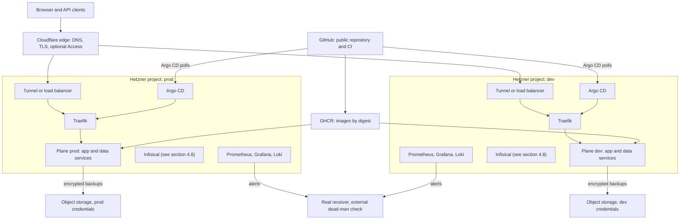

# Pass 2 handoff: moving the platform to Hetzner Cloud and Cloudflare

This document describes what is known to be needed for the Hetzner migration, and what is still open. It is written for an engineer who has never seen this repository. Begin at [Start here](#start-here).

The application is a customized deployment of open-source Plane Community Edition v1.4.3 (AGPL-3.0), under the name Wayline. It is not an original product, and nothing here should present it as one. Pass 1 is local and production-inspired.

Written 2026-11-04 by the AI agents that built Pass 1, and corrected on 2026-11-05 against the code at that date and against the real runs since, up to the cold install and second full restore that ended at about 13:05Z. One destructive run, `make drill-clean-restore CONFIRM=yes LOSE_CLUSTER=yes`, is still going, so check [`docs/validation.md`](docs/validation.md) for what has been recorded since. This page's commits carry the owner's name because the agents commit under that git identity, so nothing here is an owner decision unless it says so. Nothing about Hetzner or Cloudflare in this document has been built or tested.

Names such as `critique`, `plane-branding.md` and `cicd-security.md` are the build's research notes. They are not in this repository, so treat what they are cited for as a reading, not a source you can check here.

**Markers.** A sentence starting "Unverified:" or "Not measured:" is a question Pass 1 cannot answer. Anything about Hetzner or Cloudflare in one is from those agents' memory and was not checked against current documentation, so treat it as a question to answer, not a fact, and check it at the start of Pass 2. `git grep -n -E '(Unverified|Not measured):' -- PASS2_HANDOFF.md` lists them. No `VERIFY` or `MEASURE` marker is left on this page: each became its answer and citation, or a plain sentence saying no run read it.

**Nothing on Hetzner or Cloudflare exists.** No Hetzner or Cloudflare resource, account, token, or Terraform code has been created. `infrastructure/terraform/environments/{dev,prod}` holds only interface documents. Outside the laptop there is only the private GitHub repository, its Actions runs, and four private GHCR packages.

## Start here

Read this section, then [section 1](#1-what-pass-1-hands-over) and [section 11](#11-phased-migration-plan-with-verification-gates).

**What you are taking over.** A customized Plane Community Edition v1.4.3 deployment, branded Wayline, on one kind node on one laptop. Two Plane namespaces, `plane-dev` and `plane-prod-sim`, share Argo CD, Infisical, Traefik, Prometheus, Grafana and Loki. Rendered manifests live in Git, and `make` targets call scripts. Pass 2 moves this to independent dev and prod on Hetzner Cloud behind Cloudflare. None of that exists yet.

**To read and run it.** The repository, `BereketAbera/plane-platform`, is private, so ask the owner, Bereket Abera, for access. [README.md](README.md) and [docs/install.md](docs/install.md) give the local commands: `make setup`, `make up`, `make status`, `make test`, with the two `make promote` steps [a new machine needs](docs/install.md#first-run). `make ci` needs no cluster. The laptop's `.local/` holds secret zero, backups, test accounts and Terraform state. It is not in Git, so a clone does not carry it, and all of it belongs to that local test instance.

**What is proven.** On kind, with test data: one `make up` from a fresh clone that kept the registry and caches, a cold install from a fresh clone with them gone, which reached both environments after a real defect was fixed on the way, a full restore into a new cluster, twice, a full `make test` after the first, a stop and resume, end-to-end tests in both environments, first real secret rotations, one killed and resumed and one killed and undone, a failed deploy and a failing migrator with the old pods still serving, rollback and forward promotion, in-place restores of Plane and Infisical, alerts reaching an in-cluster sink, pod restarts, self-heal, real use in Chromium in both environments, load tests that found Postgres's CPU limit binding first, and the NetworkPolicy matrix. [The table in section 1](#what-is-proven) gives the evidence and what each result does not prove.

**What is not proven.** Anything on Hetzner or Cloudflare. A real CNI, CSI, TLS, load balancer or second node. Independent environments. A cold install with no defect, timed end to end. Off-host backups. An alert reaching a person. Load at a target, because no target is stated. Any legal review. [The full list](#what-is-not-proven) is in section 1.

### Decide first

These shape everything after them. Options and recommendations are in [section 12](#12-open-decisions).

| Order | Decision | Why it comes first |
|---|---|---|
| 1 | D8: target users, availability, RPO and RTO | Sizing and the node count depend on it, and Pass 1 has no target to size against |
| 2 | D1 and D14: topology and location | They set how many Hetzner projects and accounts the owner creates. The recommended topology depends on API tokens being per project, which is unverified |
| 3 | D3 and D13: architecture and Plane version | Needed by phase 1. x86 means multi-arch builds and new digests |
| 4 | D15: how a prod promotion proves itself on dev | Needed by phase 1. Pass 1's check asks one cluster's API, which independent clusters must not allow, and nothing is designed |

### Owner decisions still open

Only the owner can settle these. The first four come before the repository goes public (phase 2). The fifth is why it has to go public, or offer the source another way, before anyone else uses an instance.

1. **D12, the `email.py` header.** Upstream's v1.4.3 tag heads this one file with a commercial licence. AI agents replaced it in the backend image with upstream's own later AGPL-3.0-only version and flattened the image. The agent coordinating the work also removed the requirement that the repository be private. The owner was told and has not reviewed any of this, and no legal review has happened ([details](docs/agpl-compliance.md#the-commercial-header-in-emailpy)).
2. **D16, the licence for platform code.** The root `LICENSE` is upstream's AGPL-3.0 text, unchanged, and new files under `apps/wayline/` carry `AGPL-3.0-only`. Nearly all the scripts and manifests around them carry no header, and `LICENSE` does not say "only". No decision is recorded.
3. **D17, two GitHub Apps that appear to have access to the repository.** `netlify` and `builder-io-integration` left check suites on pushed commits. As GitHub describes those Apps, netlify can have `contents` read, and Builder.io `contents`, `administration` and `workflows` write. What each installation really covers was not read, because the local token gets 403 ([record](docs/evidence/ci/br-3-20261105T060937Z-apps.txt)). So nothing shows that only the owner can read this repository.
4. **D18, whether to rename Wayline.** No trademark search has been done on the name, in any class ([what was checked](docs/agpl-compliance.md#trademark-position-not-legal-advice)), so nothing shows it is free to use. No decision is recorded.
5. **`/source` needs a public repository (D10).** AGPL section 13 applies once anyone else uses an instance over a network. `/source` answers 302 to `84b63d9`, and that target answers 404 to outsiders while the repository is private ([record](docs/evidence/ci/br-3-20261105T054812Z-source-logged-out.txt)). That row reads FAIL until the source is public. See [section 9](#9-agpl-section-13).

### First steps

1. Get repository access, and take the decisions above to the owner.
2. Run `git log origin/main`. When this was written `origin/main` was `0dde813`, 246 commits behind the laptop's `main` at 11:02Z and growing, and those commits hold this page, most of the evidence it cites, and code fixes such as `4664cbd`, `53aab26` and `40a2e3a`. If they are still missing, ask the owner to push first, and read the traps below before that push.
3. Run `make setup` and `make ci`. Then [the sequence in install.md](docs/install.md#first-run) and `make test`, on a machine that meets [the prerequisites](docs/install.md#prerequisites), after reading the first two traps below.
4. Work through `git grep -n -E '(Unverified|Not measured):' -- PASS2_HANDOFF.md docs/future-hetzner.md`, starting with what could change a decision: token scope, arm64 availability, the CSI driver, Object Storage.
5. Start phase 1 of [section 11](#11-phased-migration-plan-with-verification-gates), which stays on kind. The Terraform contracts for later phases are in [docs/future-hetzner.md](docs/future-hetzner.md).

### Traps

- **Another machine cannot get the digests Pass 1 ran.** The images Pass 1 ran were built on the owner's Mac from `84b63d9`, and the laptop's local registry holds the only copy. GHCR holds a different build, from `9c8e098`, with other digests. The cold install showed it: `make up` rebuilt, got other digests, exited non-zero and printed what to do, in 1,008 s ([log](docs/evidence/runs/clean-install-20261105T105546Z/make-up-stops-on-new-digests.txt)). `make promote` for both environments then commits the new digests to `main` of that clone, so a new machine's digests are its own.
- **`make up` does not say why an Application is Degraded.** On the cold install, `umask 077` made every build context file 0600, so web, admin, space and api crashed at start with Permission denied, while worker, beat and live ran. No build step noticed, and `make up` printed `plane-dev=OutOfSync/Degraded` every minute for about 26 minutes ([log](docs/evidence/runs/clean-install-20261105T105546Z/make-up.txt)). `6f5a426` closes that cause, and `make up` still waits with no explanation, so read a pod's log. `apps/wayline/checks/smoke-images.sh` starts each image under the chart's UID, and it is manual, so no build runs it.
- **A local commit holds a session value.** `7d5ff62` holds a plane-dev session cookie, in `k6.log` and `k6-summary.json` under `docs/evidence/runs/load-20261105T073241Z/`. It fits no gitleaks rule, so a clean `gitleaks` over the history does not clear it. A colleague reading the evidence caught it. `18130d4` scrubbed the tree and `ec6aa89` widened the new rule, and nothing after `0dde813` has reached GitHub. Rewrite that history before any push ([the scrub](docs/evidence/README.md#the-scrub)).
- **Do not merge pull request 1 as a routine step.** The merge changes nothing running, because Argo CD reads a local bare repository. `make gitops-publish` afterwards has no registry check, so by reading the code it would point `plane-dev` at four digests the local registry answers 404 for. `scripts/ci/copy-to-local-registry.sh` has never finished a copy ([pull request](docs/evidence/ci/ci-5-20261105T055743Z-pr-1.txt), [copy](docs/evidence/ci/ci-5-20261105T060504Z-copy-rehearsal.txt), [limitation](docs/known-limitations.md#delivery)).
- **A push can rebuild images.** The laptop's `main` holds drill promotions and their reverts. A push touching what `.github/workflows/images.yml` watches, such as `apps/wayline/**`, `LICENSE`, `NOTICE.md` or `scripts/lib/common.sh`, rebuilds the images and force-updates pull request 1. At 11:02Z the laptop's `main` differed from `origin/main` in none of those paths.
- **Some green readings say less than they seem to.** During the failing-migrator drill the Application read OutOfSync and Healthy for the whole failure. `scripts/ci/check-promoted-digests.sh` shows that dev recorded a digest, not that dev ran it. Each result below says what it does not prove.

## Contents

1. [What Pass 1 hands over](#1-what-pass-1-hands-over)
2. [Target topology and how to choose](#2-target-topology-and-how-to-choose)
3. [What carries over unchanged](#3-what-carries-over-unchanged)
4. [What must change, per component](#4-what-must-change-per-component)
5. [Terraform module interfaces](#5-terraform-module-interfaces)
6. [Accounts and credentials the owner must supply](#6-accounts-and-credentials-the-owner-must-supply)
7. [Sizing method](#7-sizing-method)
8. [Security hardening required before real users](#8-security-hardening-required-before-real-users)
9. [AGPL section 13](#9-agpl-section-13)
10. [Cost items to price](#10-cost-items-to-price)
11. [Phased migration plan with verification gates](#11-phased-migration-plan-with-verification-gates)
12. [Open decisions](#12-open-decisions)
13. [Appendix: local values hard-coded in the repository](#13-appendix-local-values-hard-coded-in-the-repository)

Related: [known limitations](docs/known-limitations.md), [Terraform environment contracts](docs/future-hetzner.md), [AGPL compliance](docs/agpl-compliance.md), [platform contract](docs/platform-contract.md).

## 1. What Pass 1 hands over

Pass 1 is one kind node on a laptop, with two Plane namespaces. It is a rehearsal of the delivery and operations model. It is not evidence that the design works on real infrastructure.

| Layer | Pass 1 owner | Created by |
|---|---|---|
| Cluster, node, CNI (kindnet) | kind CLI | `scripts/cluster-up.sh`. Terraform does not create it |
| Registry, pull-through caches, `git://` remote | Docker Compose | `infrastructure/local-services/compose.yaml`. Terraform does not create them |
| Namespaces, ResourceQuota, LimitRange, CoreDNS rewrite, Argo CD release, AppProjects, root Application | Terraform | `infrastructure/terraform/environments/local` |
| Infisical projects, identities, Kubernetes Auth | Terraform, separate root | `infisical/terraform` |
| Everything else in the cluster | Argo CD | `gitops/applications` |
| Secret values | Infisical, with secret zero in `.local/secret-zero/` | Scripts |

### What is proven

Every row is one laptop, one kind node and test data, run on 2026-11-05 on the final images unless it says otherwise. Those images were built from `84b63d9`: web `3d7575a1`, admin `ce7adc37`, space `5f0119ff` and backend `8c04bd18`, flattened, with cache headers on HTML ([digests](docs/evidence/branding/digests.tsv)). `live` stays upstream's image. The platform first came up stage by stage ([record](docs/evidence/runs/bootstrap-1.txt)), then by one `make up` on a fresh clone, then from backup into a new cluster. Files from these runs in `docs/evidence/runs/` mostly start with the row id used in [`docs/validation.md`](docs/validation.md).

| Area | What happened | Evidence | What it does not prove |
|---|---|---|---|
| Platform state | All 14 Argo CD Applications read Synced and Healthy after the full restore, and again after a stop and resume, with both environments on the final images | [drill log](docs/evidence/runs/drill-clean-restore-20261105T074859Z.log), [stop and resume](docs/evidence/runs/PERS-3-20261105T083304Z.txt) | A cold install with no defect, which has not been timed end to end |
| Cold install | At `18af97a`, after `make destroy` with `PURGE=yes` removed the cluster, registry and caches, a fresh clone with no `.local` and no `.build`. `make setup` passed. `make up` built and stopped by design, in 1,008 s. `make promote ENV=dev` and `make promote ENV=prod-sim` with `OVERRIDE_DEV_CHECK` followed, then `make up` pulled everything through empty caches, exit 0, all 14 Synced and Healthy. The first smoke passed in both, 46 and 45 PASS, no SKIP, including `branding-fresh-install`. `make test-infisical` passed, one more `make up` took 16 s with the same pods, Terraform found no differences, and a backup from another install was refused on `SECRET_KEY`. The drill's log reads `RESULT FAIL` for its own `destroy-refused` step alone, fixed in `36d3011` | [summary](docs/evidence/runs/clean-install-20261105T105546Z/summary.txt), [first make up](docs/evidence/runs/clean-install-20261105T105546Z/make-up-stops-on-new-digests.txt), [promotions](docs/evidence/runs/clean-install-20261105T105546Z/clone-evidence/promotion-overrides.log), [make up](docs/evidence/runs/clean-install-20261105T105546Z/make-up.txt), [Applications](docs/evidence/runs/clean-install-20261105T105546Z/apps-after-up.txt), [timeline](docs/evidence/runs/clean-install-20261105T105546Z/app-timeline.txt), [rebuild](docs/evidence/runs/INST-1-cold-rebuild-20261105T122036Z.txt), [dev](docs/evidence/runs/clean-install-20261105T105546Z/clone-evidence/smoke-dev-20261105T124049Z-24505.json), [prod-sim](docs/evidence/runs/clean-install-20261105T105546Z/clone-evidence/smoke-prod-sim-20261105T124237Z-98783.json), [refusal](docs/evidence/runs/clean-install-20261105T105546Z/restore-foreign-key-refused.txt), [drill log](docs/evidence/runs/drill-clean-restore-20261105T105347Z.log) | The time of a good install. That `make up`'s 5,238 s holds a real defect, the umask one under [Traps](#traps), which cost up to about 46 minutes, and the good figure, with caches kept, is 955 s. A full cold install with no defect has not been timed end to end. The fix, `6f5a426` here and `8770097` in that clone, ran through `make images` in 598 s and a promotion into the same cluster, with the stuck operation ended by the runbook's Terminating patch, and not through a whole install. No file holds the pods' crash logs or that patch. The clone, its digests and its promotions were deleted at the end, so this checkout still names the images built from `84b63d9`. A new machine's tool downloads, because `.tools` was copied. Peak memory, which it did not sample |
| Clean install | `make up` on a fresh clone with new secrets, at `7d5ff62`: exit 0 in 955 s, all 14 Applications Synced and Healthy. A second `make up` took 16 s with the same pod uids, and Terraform planned no changes. `make test-e2e` then read 46 PASS in dev and 45 in prod-sim, with no SKIP, and setup created each admin on an image built here | [summary](docs/evidence/runs/clean-install-20261105T075041Z/summary.txt), [Applications](docs/evidence/runs/clean-install-20261105T075041Z/apps-after-up.txt), [plan](docs/evidence/runs/clean-install-20261105T075041Z/terraform-plan-local.txt), [dev](docs/evidence/runs/clean-install-20261105T075041Z/clone-evidence/smoke-dev-20261105T080642Z-65896.json), [prod-sim](docs/evidence/runs/clean-install-20261105T075041Z/clone-evidence/smoke-prod-sim-20261105T080826Z-22080.json) | An empty machine: it kept the local registry, caches and node image, and copied `.tools`. Peak memory during it, which it did not sample |
| End to end | In the final `make test`, after the full restore and a stop and resume: dev 45 PASS, 1 SKIP, and prod-sim 44 PASS, 1 SKIP. The skip needs a clean database, and the clean install's runs passed it | [dev](docs/evidence/runs/smoke-dev-20261105T083455Z-37296.json), [prod-sim](docs/evidence/runs/smoke-prod-sim-20261105T083455Z-37296.json), [whole run](docs/evidence/runs/MAKE-TEST-20261105T083455Z.txt) | A public host, TLS, Cloudflare, or real email |
| Secret rotation | First real runs. `make rotate ENV=dev` passed. A signed-in watcher got 500 on 38 requests, 07:23:51Z to 07:24:29Z, about 38 s. The script's own anonymous probe printed 60 s, which probably reads high, because Plane's anonymous rate limit also counts as a failure ([why](docs/runbooks/secret-rotation.md)). Prod-sim passed. A rotation killed with SIGKILL 4 seconds in, after `ALTER ROLE`, was finished by `RESUME=yes`, and Postgres refused the old passwords. No sync loop in 16 minutes on dev. A second rotation in prod-sim, killed the same way, was undone by `ROLLBACK=yes`: Postgres took the target password and refused the replaced one, the three Deployments rolled out, and the script's probe failed 12 of 61, a 36 s window. `SECRET_KEY` untouched | [dev](docs/evidence/runs/SEC-2-20261105T072331Z.txt), [watcher](docs/evidence/runs/SEC-2-20261105T072331Z-watch.txt), [prod-sim](docs/evidence/runs/SEC-3-BKP-3-20261105T073240Z.txt), [kill and resume](docs/evidence/runs/SEC-4-20261105T073843Z.txt), [sync](docs/evidence/runs/SEC-6-20261105T072331Z-application-watch.txt), [undo](docs/evidence/runs/SEC-4b-20261105T084615Z.txt) | A full e2e after the undo, because none is published. Rotating `SECRET_KEY`, which contract section 8 forbids. Any error window under real traffic. A stop before or during `ALTER ROLE`. That a resume leaves a current Infisical backup: this one took none, so the newest stayed one version behind (SEC-4 in [`docs/validation.md`](docs/validation.md)) |
| Failed deploy | `make drill-failed-deploy` passed on dev. Bad web digest at 06:23:45Z, `ErrImagePull` 25 s later, `ProgressDeadlineExceeded` at 10m24s, revert published at 10m32s, Synced and Healthy at 11m51s. The old web pod kept serving: 61 of 61 drill samples answered 200, and all 458 cycles of `/`, `/sign-in/`, `/god-mode/` and `/spaces/` did too. The API, which this drill did not change, stayed up: 913 signed-in samples, 0 failures. Nothing fired, because the revert came first. `ArgoAppOutOfSync`, `ArgoSyncFailed`, `KubeContainerWaiting`, `KubePodNotReady`, `ArgoAppStuckProgressing`, `KubeDeploymentRolloutStuck` and `ArgoAppDegraded` went pending only | [drill](docs/evidence/runs/drill-failed-deploy-20261105T062343Z.log), [alerts](docs/evidence/runs/drill-failed-deploy-20261105T062343Z-alerts.tsv), [timeline](docs/evidence/runs/DEP-1-20261105T062323Z-timeline.txt) | A crash loop or bad config. "Nothing fired" holds only for a revert within about 10.5 minutes, and no run shows what fires later |
| Rollback and forward promotion | `make rollback ENV=dev`, then `make promote ENV=dev`, each operation 61 s. 239 of 239 signed-in samples and 120 of 120 route cycles were good, and prod-sim did not move | [rollback](docs/evidence/runs/DEP-2-20261105T064032Z-rollback.txt), [forward](docs/evidence/runs/DEP-2-20261105T064032Z-promote-forward.txt), [timeline](docs/evidence/runs/DEP-2-20261105T064032Z-timeline.txt) | Old code on a newer schema, because these image sets differ in no migration |
| Failing migrator | `tests/drills/failed-migrator.sh` on dev: the Job hit `BackoffLimitExceeded` at 58 s and wave 3 did not move. 820 of 820 signed-in samples were good. After the revert the operation closed only 4m08s later, on its retry timer. Nothing fired. The Application read OutOfSync and Healthy for the whole failure | [drill](docs/evidence/runs/drill-failed-migrator-20261105T064940Z.log), [alerts](docs/evidence/runs/drill-failed-migrator-20261105T064940Z-alerts.tsv), [timeline](docs/evidence/runs/DEP-3-20261105T064517Z-timeline.txt) | A migration failing part way, a hanging migrator, or what fires if nobody reverts |
| Backups and in-place restores | First real runs for Plane. `make backup`, then `make restore BACKUP=latest CONFIRM=yes`, read PASS with all proofs in dev and prod-sim, and e2e passed after. Each took about 3 minutes to the start of its verify. A restore with no `CONFIRM` refused and changed nothing, and its record reads FAIL for that reason. Infisical's backup and in-place restore ran earlier | [dev](docs/evidence/runs/BKP-2-20261105T074322Z.txt), [prod-sim](docs/evidence/runs/SEC-3-BKP-3-20261105T073240Z.txt), results [dev](docs/evidence/runs/restore-dev-20261105T074337Z.json), [prod-sim](docs/evidence/runs/restore-prod-sim-20261105T073438Z.json), [refusal](docs/evidence/runs/restore-prod-sim-20261105T073428Z.json), [Infisical](docs/evidence/runs/restore-infisical-20261105T001834Z.json) and [its README](infisical/README.md) | A lost machine, because backups sit on the same laptop. Recovery from data loss or from an old backup: each backup was seconds old and restored onto the same data. Real data sizes |
| Full restore into a new cluster | Twice. The second, `make drill-clean-restore CONFIRM=yes CLEAN_INSTALL_FIRST=yes COLD_INSTALL=yes` at `18af97a`, ran on the code with the recovery fixes merged: every step PASS, every `not_run` empty. The cluster CA was new, the old ids, secret zero and the admin token came back, all 38 rendered Secret keys hold the old values, a second bootstrap changed nothing, and the e2e and Infisical tests passed with the restored accounts. It took about 1,092 s: 7,663 s from the delete, less the clean install's 6,571 s. The first, on the script from before those fixes, read the same in about 1,226 s. Both logs read `RESULT FAIL`, 1 failure, only because the clean install's own `destroy-refused` step failed at stage 4b: `make` passed `CONFIRM=yes` down through `MAKEFLAGS`, past the `unset`, so `make destroy` obeyed. `00126ea` did not reach that path, and `36d3011` does | [result](docs/evidence/runs/restore-clean-20261105T124518Z.json), [Infisical](docs/evidence/runs/restore-infisical-20261105T124950Z.json), [dev](docs/evidence/runs/restore-dev-20261105T125720Z.json), [prod-sim](docs/evidence/runs/restore-prod-sim-20261105T130009Z.json), [log](docs/evidence/runs/drill-clean-restore-20261105T105347Z.log), [smoke dev](docs/evidence/runs/smoke-dev-20261105T130318Z-97151.json), [smoke prod-sim](docs/evidence/runs/smoke-prod-sim-20261105T130503Z-95847.json), [refusal step](docs/evidence/runs/clean-install-20261105T105546Z/destroy-refused.txt). First run: [result](docs/evidence/runs/restore-clean-20261105T081017Z.json), [log](docs/evidence/runs/drill-clean-restore-20261105T074859Z.log) | A lost machine, because `.local/` stayed on the laptop. Real data sizes: the dumps were 4.40, 1.33 and 0.86 MB. A restore that stops and resumes for real, or any refusal of a resume. `36d3011` itself, because no drill has run that step since |
| Alert path | `make test-alert`: `PlaneApiDown` fired and resolved at the sink, and none of the three alert names the script reads appeared in the other environment. Dev fired at 68 s and reached the sink at 78 s. Prod-sim did both at 83 s | [dev](docs/evidence/runs/alert-test-dev-20261105T055044Z.json), [prod-sim](docs/evidence/runs/MON-2-20261105T072541Z-run.txt) | That anyone is told, because the in-cluster sink is the end of the path. Any other alert. A hung or slow API, since only a clean stop was tested. That the other environment was silent, which [section 4.11](#411-alert-routing-to-real-receivers) sets out |
| Data service alerts | A real defect, found and fixed. `PlaneRabbitmqDown` and `PlaneMinioDown` did not fire for 270 s each with the pod gone, because `up` has no series once the endpoint leaves the Service. With `kube_statefulset_status_replicas_ready` added, they reached the sink at 157 s and 148 s, and resolved there 40 s and 26 s after the pod came back | [before](docs/evidence/runs/alert-rules-dev-20261105T100605Z.txt), [after](docs/evidence/runs/alert-rules-dev-20261105T101707Z.txt), `tests/drills/alert-rules.sh`, `tests/rules/data-services-down.test.yaml` | Crashes and hung processes, which were not tested. Prod-sim, beyond the unit test. Any other rule |
| Pod restarts | `make drill-pod-restart` in each environment: all four StatefulSet pods replaced, the same claims reattached, the sentinel row and attachment intact, background jobs ran. In dev, 7 of 180 signed-in samples answered 500 during the Postgres restart | [dev](docs/evidence/runs/drill-pod-restart-dev-20261105T070414Z.log), [timeline](docs/evidence/runs/PERS-1-20261105T070358Z-timeline.txt), [prod-sim](docs/evidence/runs/drill-pod-restart-prod-sim-20261105T072331Z.log) | A crash or forced kill, a node restart, writes in flight, or a restart on the rotated passwords, which came later |
| Stop, resume and refusal | `make down` took 15 s and `make up` 82 s, and the sentinel row and attachment read back in both environments. `make destroy` with no `CONFIRM` refused, with the node unchanged | [stop and resume](docs/evidence/runs/PERS-3-20261105T083304Z.txt), [refusal](docs/evidence/runs/TEAR-1-20261105T083304Z.txt) | A node or host failure, because this is a clean stop |
| Self-heal | A replica change on `plane-admin-wl` in dev, reverted by Argo CD in 3 s | [run](docs/evidence/runs/GITOPS-4-20261105T073240Z.txt) | Any other kind of drift |
| Real browser | Sign-in, onboarding, board, page editor, admin and public page, in Chromium on dev, on the earlier images from `1563cbf`. On the final images: two tabs of one page synced and held about 5 minutes, and text typed during a live pod restart reached the other tab after reconnect and survived a reload. After a promotion and after a rollback, new HTML arrived with no hard reload. A dev session did not carry to the prod-sim host. After the full restore, on the final images: a work item typed before the delete was still on the board, a published board rendered, prod-sim had its first browser sign-in, and both hosts held a session at once | [walk-through](docs/evidence/branding/live-dev/README.md), [tabs and restart](docs/evidence/runs/RT-2b-RT-3-20261105T073208Z.txt), [promotion](docs/evidence/runs/auth-6-browser-promotion-dev-1.txt), [rollback](docs/evidence/runs/AUTH-6-rollback-20261105T064032Z.txt), [sessions](docs/evidence/runs/AUTH-4-20261105T062750Z.txt), [after the restore](docs/evidence/branding/live-final/README.md) | Safari and Firefox, which were not run. The UI's publish button, or an anonymous view of the board in a browser. An admin sign-in on prod-sim. Any of this through Cloudflare. For new HTML: any route but `/sign-in/`, which was read by etag, the page's scripts at the rollback reading, which were not checked, and a browser left open across a rollback |
| Load | On a quiet cluster, on dev. `make test-load` passed its thresholds: k6 at 5, 10 and 20 VUs with think time, 2,800 requests, 0 failed, p95 268, 647 and 1,005 ms. `THINK=0` found a ceiling: requests flatten by 5 VUs at about 8.9 a second, then fall to 7.82, with p95 4,935 ms at 20 VUs, 1 failed of 4,512, and `make` exit 2 on k6's read threshold. Postgres's 500 m CPU limit binds first, as [section 7](#what-the-load-tests-say-about-sizing) sets out. An earlier run on a busy machine is kept on the resource page | [run](docs/evidence/runs/LOAD-1b-20261105T090247Z-run.txt), [with think time](docs/evidence/runs/load-20261105T090247Z/results.json), [with none](docs/evidence/runs/load-20261105T091213Z/results.json), [resources](docs/resource-utilization.md#load-results-dev) | Any target load, since none is stated (D8). The API worker's own ceiling, or what a higher Postgres limit gives. The web, space and `live` paths, since k6 calls only the API. A steady table, since its writes grew it. Another host |
| Network and separation | In the final `make test`, on the final images, after the restore: `make test-netpol` read 418 of 418, the routes test passed, and the separation test read 384 network checks and 97 on state, 0 failed. Of the 384: 240 dials from real pods across the environments, all timing out, 20 rows of each source pod's own DNS over TCP, 96 references inside an environment, 24 real-client rows, half of them at home, and 4 rows with the data pods' own `pg_isready` and `valkey-cli`. No pod reached the other environment's data ports. One environment's api can reach the other's public HTTP surface through Traefik, as any browser can, and that known gap stays open | [whole run](docs/evidence/runs/MAKE-TEST-20261105T083455Z.txt), [matrix](docs/evidence/runs/netpol-20261105T083542Z.tsv), [routes](docs/evidence/runs/routes-20261105T083455Z-37296.txt), [network](docs/evidence/runs/separation-network-20261105T083455Z-37296.txt), [state](docs/evidence/runs/separation-state-20261105T083455Z-37296.txt) | Anything about another CNI, or isolation between clusters. A deny PASS is a timeout. That ports 15672 and 9090 were up: they time out from inside the environment too, so 40 of the 120 rows each way do not show the target was up |
| GitHub | `ci.yml` passed on push at `9c8e098` and `0dde813`, and `make ci` exited 0 in clean clones of those two commits. `images.yml` published four private GHCR packages from an arm runner, with clean layer walks. Pull request 1, the digest bump, stays open and unmerged. Promotion pull request 2 was opened and closed as a test | [CI records](docs/evidence/ci/README.md), [what was published](docs/evidence/ci/ci-4-20261105T060219Z-published-compare.txt), [visibility](docs/evidence/ci/ci-4-20261105T055033Z-ghcr-visibility.txt) | That the GHCR images run, because they were never deployed and their digests differ from what the cluster ran. Any job on `on: pull_request`, which GitHub holds at `action_required`. A review, merge and publish of a promotion. A prune that deletes. Any commit after `0dde813`, which no CI run covers |
| Source offer | **FAIL.** `/source` answers 302 to `84b63d9`, and that target answers 404 to outsiders while the repository is private | [record](docs/evidence/ci/br-3-20261105T054812Z-source-logged-out.txt) | Read with `curl`, not a logged-out browser |

Left on GitHub for the owner: branch `promote/prod-sim`, and run 41976206674, held for pull request 1. Approving that run would be the first `on: pull_request` job.

### What is not proven

- Anything on Hetzner or Cloudflare, and anything on a real CNI, CSI driver, load balancer, TLS or second node. [Known limitations](docs/known-limitations.md#what-pass-1-does-not-prove) says why a kind result does not transfer.
- That dev and prod are independent. Pass 1's two namespaces share one API server, etcd, kernel, ingress, Argo CD and Infisical.
- A cold install with no defect, timed end to end. The one cold install lost up to about 46 minutes to a defect, and the fix ran through a rebuild and a promotion, not a whole install. A new machine's tool downloads, which that drill copies instead.
- Off-host backups, encrypted backups and a backup schedule. Backups are manual and on the laptop.
- A clean restore that stops and resumes for real. Four off-path ways to lose data were fixed and merged at `18af97a`: the exit trap with dead output, `make destroy`'s backup under a kept marker, `ALLOW_RESUME_OVERWRITE` naming environments, and the `data-back` marker. The second real restore ran on that code and did not stop, so those paths themselves have run only on stubs. [infisical/README.md](infisical/README.md#not-yet-proven) lists what has run only on stubs.
- An alert reaching a person, or any receiver but the in-cluster sink.
- Growth over time and retention. Pass 1 has run for under two days on test data.
- Legal questions. No legal review has happened.
- Not tested in Pass 1: Safari and Firefox, a chart or Plane upgrade, and stopping kindnet.

Read [`docs/validation.md`](docs/validation.md) before relying on any row of section 3. Runs also found defects that were fixed, and limits that stay: see [what real runs found](docs/known-limitations.md#what-real-runs-found). The working backlog, `.local/hardening-backlog.md`, is on the owner's laptop and not in Git. It still lists some fixed items as open, so check each item against the code.

### Still in progress

`make drill-clean-restore CONFIRM=yes LOSE_CLUSTER=yes` is running, started at 13:06:33Z at `f9abc2a`. It deletes the cluster with kind alone, as a disaster would, leaving the local Terraform state behind, then restores from backup. There is no cluster to read until it ends. Its result is in progress, and none is recorded here. It runs no clean install, so its result should carry no test bug.

[Its output](docs/evidence/runs/BKP-6-20261105T130633Z-lose-cluster-make.txt), published when it ends, also answers the last open reading: `Docker.raw` before and after a delete, at its top and bottom, so the numbers are in that file. Earlier drills read host free only: 31.7 GiB free right after a delete with `PURGE=yes`, 15.6 GiB back, where the check counted on about 27.0 GiB ([log](docs/evidence/runs/drill-clean-restore-20261105T105347Z.log)).

The run before it, the cold drill, answered the rest:

- **Disk growth of a first install.** Host free went from 31 to 13 GiB by `df`, 18 GiB, and `Docker.raw` then read 40,060,992 KiB ([summary](docs/evidence/runs/clean-install-20261105T105546Z/summary.txt), [disk](docs/evidence/runs/clean-install-20261105T105546Z/disk-after-install.txt)). The defect made it build twice, so both builds' images and the second build's files are in that, and the same with no defect: Not measured in Pass 1 ([what it holds](docs/resource-utilization.md#host-and-docker-storage)).
- **Time of a `make up` from nothing.** 955 s with the registry and caches kept ([summary](docs/evidence/runs/clean-install-20261105T075041Z/summary.txt)). With them gone, 1,008 s to build and stop, then 5,238 s, which holds the defect, so a full cold install with no defect has not been timed end to end ([what is timed](docs/resource-utilization.md#boot-and-start-times)).
- **Data across the rebuild.** The full restore passed on the merged recovery code, in about 1,092 s on test data ([result](docs/evidence/runs/restore-clean-20261105T124518Z.json), [log](docs/evidence/runs/drill-clean-restore-20261105T105347Z.log)).

## 2. Target topology and how to choose

The requirement is independent dev and prod. Pass 1's two namespaces do not meet it, because namespace separation is not equivalent to independent production clusters. Both namespaces share one API server, etcd, kernel, CoreDNS, Traefik, Argo CD, Infisical, and disk.

### Options

| Option | Blast radius between dev and prod | Operating cost | Verdict |
|---|---|---|---|
| A. One cluster, two namespaces | Shared control plane, nodes, ingress, Argo CD | Lowest | Rejected. It is Pass 1 with public IPs and does not meet the requirement |
| B. Two clusters in one Hetzner project | Separate control planes and nodes. One API token and one firewall scope can reach both | Medium | Acceptable only if tokens cannot be separated, which should be checked first |
| C. Two clusters in two Hetzner projects, one Cloudflare zone | Separate clusters and tokens. The zone and the Git repository are the shared points | Medium | **Recommended starting point** |
| D. C plus a third small operations cluster or host for Infisical and monitoring | As C, plus shared services sit outside both | Highest | Choose only if the Infisical decision (section 4.8) needs it |

Option C depends on Hetzner API tokens being scoped per project. Unverified: whether Hetzner Cloud API tokens are scoped to a single project. Check it at the start of Pass 2.

### Inside each cluster

| Question | Choose more nodes when | Choose fewer when |
|---|---|---|
| Control plane: 1 or 3 | The environment must survive losing a node without an operator, and you will run etcd properly | The target is an RTO you can meet by restoring from backup. Dev should stay at 1 |
| Workers separate from control plane | Measured load justifies it, or data volumes need isolation from control plane I/O | Measured use fits one server with headroom (section 7) |
| Data services stateful in cluster or managed elsewhere | You accept running HA Postgres (CloudNativePG is the path noted in research, untested here) | A single instance plus tested off-host backups meets the stated RPO and RTO |

Adding nodes does not make Plane highly available. All four data services are single-replica in chart 1.8.6's local setup, and a single-replica Postgres on a block volume is still a single point of failure. State an RPO and RTO first, then pick the node count.

**Recommendation.** Start with one server per environment if the measured sizing fits, and say plainly in the docs that this is not HA. Move prod to three nodes only with a stated availability target. This is a recommendation, not a result. The owner decides (section 12).



### Independence test

Treat dev and prod as independent only when all of these hold. Each is a gate in section 11.

- Destroying the dev cluster, its state, and its credentials leaves prod serving. Unverified: prod stays healthy while dev is destroyed. Pass 1 has nothing to test this on, so set up the check at the start of Pass 2.
- No credential that dev holds can read or change anything in prod. Unverified: dev Hetzner, Infisical, S3, and Argo credentials are refused against prod. Pass 1 has nothing to test this on, so set up the check at the start of Pass 2.
- No pod in dev has a route to a pod or data service in prod. Unverified: a connection from dev to prod node and service addresses fails. Pass 1 has nothing to test this on, so set up the check at the start of Pass 2.

The Git repository, GHCR, and the Cloudflare account remain shared in the recommended design, and D1 is open. A Cloudflare token scoped to one zone cannot separate dev from prod records in that zone.

## 3. What carries over unchanged

"Unchanged" means the design and files move as they are. It does not mean they are proven. Runtime behaviour needs the same evidence again on real nodes.

| Item | Files | Why it carries |
|---|---|---|
| Plane release and chart | Contract section 1, `helm/plane/vendor/plane-ce-1.8.6` (byte-identical) | Independent of infrastructure |
| Render and commit | `scripts/render.sh`, `gitops/environments/`, CI render diff | Argo CD syncs plain manifests. No Helm or Kustomize at sync time |
| Sync waves | Contract section 6 | Ordering is a property of the workloads, including the migrator as a `Sync` hook, never `PreSync` |
| Secret contract | Contract section 8 | The six Secrets, hex passwords, `FILE_SIZE_LIMIT` in bytes, bucket `uploads`, never rotating `SECRET_KEY` |
| Workload hardening | `helm/plane/components/hardening` | UIDs, probes, limits, no service account tokens, a 5-second `preStop` and a 600-second rollout deadline. The `preStop` took failed requests in a rollout from 10 to 0 on kind ([before](docs/evidence/runs/plane-dev-rollout-availability-1.txt), [after](docs/evidence/runs/plane-dev-rollout-availability-2.txt)). The deadline was set by cold image pulls. Adjust limits only from measurement |
| Application health checks | `helm/values/argocd.yaml` | The Lua that makes sync waves gate, proven on Argo CD v3.5.7 ([waves](docs/evidence/runs/argocd-wave-gating-1.txt)). Run the checks again if Argo CD's version changes |
| AppProject model | `gitops/bootstrap/chart/templates/appprojects.yaml` | `platform` holds cluster scope, Plane projects hold namespaced workloads. Namespace lists change (section 4.13) |
| Conftest policy | `policy/` | Still applies to rendered manifests. Host and environment rules need updating |
| CI scripts | `scripts/ci/*`, `.github/workflows/ci.yml` | No cluster access. Runs the same scripts as `make ci` |
| Dashboards and alert rules | `monitoring/manifests/shared` | `NodeFilesystem*` alerts should become meaningful, unlike on kind |
| Backup and restore logic | `scripts/backup.sh`, `scripts/restore.sh`, `infisical/lib/recovery.sh` | Dump format, checks, recovery sets and proofs carry. The destination and how the scripts reach the cluster change (section 4.7) |
| Pinned versions | `tools.lock`, Terraform lock files, image digests | Lock files gain a platform if CI or nodes need one |

## 4. What must change, per component

Appendix 13 names the main places each value lives, and its `git grep` gives the full list. Other work is still landing, so line numbers move. Search for the value rather than trusting a line.

### 4.1 kind to real nodes

| | Pass 1 | Pass 2 |
|---|---|---|
| Cluster creation | `scripts/cluster-up.sh`, `infrastructure/kind/cluster.yaml.tmpl` | Terraform creates servers, and a chosen distribution creates Kubernetes (open decision D2) |
| Kubernetes | v1.36.4 | Exact version pinned. Check support for the Argo CD line in use before changing it |
| Lifecycle | `make down`, `make up`, `make destroy` | Rewrite. `scripts/down.sh` and `scripts/destroy.sh` assume kind and local state |
| Architecture | arm64 only | Decide (D3). `scripts/ci/build-images.sh` passes `--platform linux/arm64`, and `.github/workflows/images.yml` runs on `ubuntu-24.04-arm` |
| Disk protection | kind disables image GC and eviction, as the running kubelet reports ([config](docs/evidence/runs/node-kubelet-config-1.txt)) | Kubelet defaults return. Size disks so garbage collection and eviction do not fire in normal use |
| `guard_disk` | Guards the Mac's disk, because the VM cannot see it | Replace with node-level alerts. Keep it for scripts that write to the operator's machine |

Hetzner has no managed Kubernetes offering as far as those agents know. Unverified: whether Hetzner offers managed Kubernetes at migration time. Check it at the start of Pass 2.

`externalTrafficPolicy: Local` in `helm/values/traefik.yaml` is safe today only because there is one node, as its comment says. On more than one node it blackholes traffic to nodes without a Traefik pod unless a load balancer health-checks that node. Change it deliberately.

### 4.2 Storage class and CSI

| Item | Pass 1 | Pass 2 action |
|---|---|---|
| Plane data | `storageClass: standard` in both overlays' `values.yaml`, four lines each | Set the real class before first sync. `volumeClaimTemplates` are immutable |
| Infisical data | `storageClassName: standard` in `infisical/manifests/postgres.yaml` and `redis.yaml` | Same |
| Prometheus, Alertmanager, Loki | Default class | Name the class explicitly, as the Plane overlays do |
| PVC sizes | `local-path` ignores them. Comments call Loki's `2Gi` "a label" | **Now enforced.** Set real sizes and alert on them. `retentionSize` must stay below volume size |
| Volume permissions | Non-root writes work here, and local-path uses mode 0777 | Block volumes will not have 0777 directories. `infisical/manifests/{postgres,redis}.yaml` set `fsGroup`, but `helm/plane/components/hardening` does not, so Plane's non-root Postgres, Valkey, RabbitMQ, and Silo need it added. Unverified: whether each Plane data service writes to its volume on the chosen CSI. Pass 1 has nothing to test this on, so set up the check at the start of Pass 2 |
| Scheduling | One node | Block volumes attach to one node in one location. Keep pods and volumes co-located |

The expected driver is the Hetzner Cloud CSI driver, with block volumes as ReadWriteOnce. Unverified: the current driver's name, version, minimum volume size, and arm64 support. Check it at the start of Pass 2.

Compare Postgres on a network block volume with the server's local disk before choosing. Not measured: Postgres write latency on a Hetzner volume against local disk. Measure it at the start of Pass 2.

### 4.3 Local registry to a real registry

| Item | Pass 1 | Pass 2 |
|---|---|---|
| Branded images | `localhost:5001/wayline/*` by digest | GHCR by digest. `images.yml` pushes there: run 41975430939 at `9c8e098` built, walked, scanned and published all four and opened a digest bump ([evidence](docs/evidence/ci/README.md)). Its prune has deleted nothing, so a delete is untested. `apps/wayline/scripts/publish-gate.sh` limits it to the owner's GHCR namespace, and the job fails for anywhere else. The gate does not read visibility. The packages read as private, because an anonymous read gets 401 ([record](docs/evidence/ci/ci-4-20261105T055033Z-ghcr-visibility.txt)) |
| Local copy step | `scripts/ci/copy-to-local-registry.sh`, which has never finished a copy, because its `docker login ghcr.io` needs a `read:packages` token this host lacks ([workflows README](.github/workflows/README.md)) | Remove. Digests in Git point straight at GHCR |
| Pull-through caches | `infrastructure/local-services`, `infrastructure/kind/containerd-certs.d` | Remove. Node pulls use real registries |
| Docker Hub limits | Mitigated through `mirror.gcr.io` | Nodes share a public IP, and anonymous limits apply. Decide: authenticated pulls through kubelet config, a mirror in GHCR, or retain `mirror.gcr.io` as a containerd mirror |
| Pull auth | None | Private packages need `imagePullSecrets` on the `plane` ServiceAccount, sourced from Infisical, and public packages need none. The packages are private today. Read each package's visibility again if that changes, because making the repository public no longer stops publishing (D12) |
| Digest kind | Index digests for upstream, one plain manifest for branded (`--provenance=false --sbom=false`) | Keep. On x86, branded builds must become multi-arch and digests change |

On 2026-11-05 both `helm/plane/overlays/*/kustomization.yaml` name the four branded images built from `84b63d9`, in `localhost:5001/wayline`, and both environments ran them ([digests](docs/evidence/branding/digests.tsv)). `live` stays upstream's image in both. The digests on GHCR come from the build at `9c8e098`, and all four differ, because copying keeps a digest and rebuilding does not.

`.github/workflows/README.md` records what is known about GHCR limits: GitHub's Packages billing page gives Free 500 MB of storage and 1 GB of transfer a month, and says Container registry storage and bandwidth are free for now, with a month's notice before that changes. The four images take 401.8 MiB compressed, as read from GHCR. Unverified: the limits for public and private packages at migration time. Check it at the start of Pass 2.

### 4.4 Git daemon to GitHub as Argo's source

**This is not a one-value change, despite what `infrastructure/terraform/modules/argocd/variables.tf` says.** The value `git_repo_url` reaches the root Application and AppProject `sourceRepos`, but 13 child Application files hard-code `git://plane-git/plane-platform.git` (14 lines). If you change only the variable, the projects refuse those children.

| Task | Detail |
|---|---|
| Parameterise children | Render `gitops/applications` from a value, or generate per-cluster files (section 4.13). Pick one and make CI check it |
| Transport | Use HTTPS. The repo-server NetworkPolicy allows 443 to public addresses, not SSH |
| Credentials | None for a public repository. For a private one, a read-only deploy key or GitHub App held outside Git |
| Remove the old path | `plane-git` Compose service, `gitops-publish.sh`, and the `9418` egress rule in `gitops/platform/network-policies/argocd.yaml` |
| Pre-promotion backup | **Moves.** Today `scripts/gitops-publish.sh` takes the prod-sim dump before publishing, and that is the only place a promotion merged on GitHub takes one. With GitHub as source, merging deploys directly and the dump does not happen. Contract section 5 requires it. See below |
| Proof on dev before prod | **Moves too, and has no answer yet.** The same publish step refuses a prod-sim digest unless `plane-dev` is Synced and Healthy with it in a ready container (`scripts/lib/dev-check.sh`). That reads one cluster's API. On independent clusters, prod's path has no such credential and must not get one (section 2). See D15 |
| Detection delay | Argo CD polls. Decide whether a webhook is worth exposing an endpoint. Not measured: time from merge to sync with polling, because Pass 1's Argo CD reads a local remote. Measure it at the start of Pass 2 |
| Enforced approval | A public repository on GitHub Free gets protected branches and required reviewers per `cicd-security.md`. Unverified: GitHub's plan features for public repositories at migration time. Check them at the start of Pass 2 |

Options for the pre-promotion dump:

| Option | Tradeoff |
|---|---|
| Scheduled backups plus a freshness check in the promotion PR | Simple. The dump is not immediately before the change, so state the gap |
| Argo `PreSync` hook running a backup Job | Immediate, but `PreSync` runs on a fresh install too, when Postgres does not exist. The Job must tolerate that |
| A CI job with cluster credentials | Gives GitHub write access to prod, which Pass 1 avoids on purpose. Not recommended |

### 4.5 NodePort to a load balancer or Cloudflare Tunnel

| | Hetzner load balancer | Cloudflare Tunnel |
|---|---|---|
| Inbound ports on nodes | 80 and 443 from the load balancer | None. `cloudflared` dials out |
| Bypassing Cloudflare | Possible unless the firewall allows only Cloudflare ranges or origin pulls are authenticated | Not possible through a public address, since none is open |
| New in-cluster owner | Cloud controller manager for the Service | `cloudflared` Deployment, its namespace, and its token in Infisical |
| Client IP | Needs PROXY protocol or trusted headers | `CF-Connecting-IP` and trusted forwarded headers from `cloudflared` |
| Failure mode | Depends on Hetzner LB and Cloudflare | Depends on `cloudflared` and Cloudflare |
| Cost | Monthly per load balancer | Check plan terms |

**Recommended starting point: Cloudflare Tunnel**, because it leaves no inbound application port and takes one piece of cloud controller work out of the first iteration. This is those agents' judgement, not a test. Whichever is chosen, the same work is required:

- Trust forwarded headers, or uploads get `http://` URLs and Plane's throttle shares one bucket. `SECURE_PROXY_SSL_HEADER` is set in Plane's `settings/production.py`, and presigned URLs use `request.scheme`. Set `ports.web.forwardedHeaders.trustedIPs` in `helm/values/traefik.yaml` to the real proxy source only.
- Rewrite `traefik-ingress` in `gitops/platform/network-policies/traefik.yaml`. It allows `172.16.0.0/12`, which is specific to Docker. On kind the NodePort source is the kind gateway, measured with conntrack ([source](docs/evidence/runs/traefik-nodeport-source-1.txt)). The policy once also allowed Docker Desktop's `192.168.65.0/24`, and no traffic used it. Expect a different source on real nodes.
- Change the `node-network-only` Middleware in `gitops/bootstrap/argocd-route/ingressroute.yaml`, `infisical/manifests/ingressroute.yaml` and `monitoring/manifests/shared/ingress-routes.yaml`. It admits `172.16.0.0/12`. On another network each internal UI answers 403, and behind a proxy or Tunnel it means nothing, because every request arrives from the proxy. `policy/plane.rego` holds that range too.
- Decide what happens to the websocket path through `/live`. It held through Traefik and the buffering middleware for a 330-second idle soak on kind ([soak](docs/evidence/runs/plane-dev-smoke-soak-1.txt)), and two real browser tabs carried edits about 5 minutes after opening ([tabs](docs/evidence/runs/RT-2b-RT-3-20261105T073208Z.txt)). Cloudflare's WebSocket support was read in its docs, and the behaviour through that edge is unproven. Unverified: whether `/live` collaboration holds a WebSocket through Cloudflare, Traefik, and the buffering middleware for a 5 minute soak. Pass 1 has nothing to test this on, so set up the check at the start of Pass 2.
- Check proxied request size limits against `FILE_SIZE_LIMIT=5242880`. Unverified: Cloudflare's request body limit on the chosen plan. Check it at the start of Pass 2.

Tunnel behaviour, client IP header, and pricing are from memory. Unverified: Cloudflare Tunnel's current terms, headers, and origin settings. Check them at the start of Pass 2.

### 4.6 Hostnames and TLS

Contract section 3 says Pass 2 terminates at Cloudflare and the origin, so there are two legs:

| Leg | Approach | To verify |
|---|---|---|
| Browser to Cloudflare | Cloudflare certificate | Unverified: certificate coverage for the chosen hostname depth on the plan. Check it at the start of Pass 2 |
| Cloudflare to origin | Tunnel, or origin certificate with strict mode. Never flexible mode | Unverified: whether the origin mode rejects an invalid origin certificate. Pass 1 has nothing to test this on, so set up the check at the start of Pass 2 |

A two-level name such as `plane.dev.example.com` may fall outside a free universal certificate, which usually covers one wildcard level. Unverified: whether a universal certificate covers two subdomain levels. Check it at the start of Pass 2.

Plane-specific changes:

| Item | Detail |
|---|---|
| Chart TLS | Set `ssl.externalTermination: true` when TLS ends before Traefik, and `WEB_URL` then renders as `https://`. Keep `entryPoints: [web]` when Cloudflare or a Tunnel forwards cleartext to Traefik. The chart comment says `websecure` is needed only if Traefik itself terminates TLS, because a route on `web` never matches that traffic. An origin certificate on Traefik, the other option in the table above, is that case |
| Cookies | The chart renders `CORS_ALLOWED_ORIGINS` as both `http://` and `https://`, and any `http:` origin drops `Secure` from session and CSRF cookies (`settings/common.py:187`). Override with an exact `https://<host>` through `plane-app-env`, which needs a contract section 8 change. Never use `*` |
| Override order | `envFrom` in `gitops/environments/dev/manifests.yaml` lists the ConfigMap `plane-app-vars` first and the Secrets after it, the same for api, worker, beat-worker and the migrator, and Kubernetes gives the last source the key on a conflict. So a value in `plane-app-env` should override `CORS_ALLOWED_ORIGINS`. That is a reading of the manifests, and no run has overridden it |
| Cookie proof | Unverified: whether `session-id` and `csrftoken` cookies carry `Secure` on the public host. Pass 1 has nothing to test this on, so set up the check at the start of Pass 2 |
| Self-dial | See below |
| Public hostname | A public `plane.` hostname uses the upstream name. Decide (D9) with [the trademark position](docs/agpl-compliance.md#trademark-position-not-legal-advice) |

**Self-dial problem.** The API calls `copy_object` and fetches OAuth avatars against its own public host. `settings/storage.py` builds the endpoint from `request.scheme` and `request.get_host()` when `USE_MINIO=1`. In Pass 1, CoreDNS rewrites the host to Traefik and everything is plain HTTP, and that path is measured ([path](docs/evidence/runs/plane-dev-copy-object-path-1.txt)). On HTTPS the same code dials `https://<host>`:

| Option | Effect |
|---|---|
| Allow the API egress to the public host through Cloudflare | Simple, no rewrite. Adds an internet path and hairpin latency. The NetworkPolicy needs an egress rule, which is what Pass 1 denied |
| Keep a CoreDNS rewrite to a Traefik TLS entrypoint | Needs a certificate the pod trusts for the public name. `modules/foundation` writes a kubeadm Corefile, so distribution matters |
| Keep Silo private and use a real object store with `USE_MINIO` unset | The client then uses `AWS_S3_ENDPOINT_URL`. It changes presigned URL behaviour and the `uploads` route. Needs a new read of `settings/storage.py` |

Unverified: whether asset duplication returns 200 on the public host with the chosen option. Pass 1 has nothing to test this on, so set up the check at the start of Pass 2.

**Bucket name.** The bucket must stay `uploads` (`bgtasks/export_task.py:68` strips `/uploads` from the domain). If bucket names are global at a hosted store, that name will be taken, which rules out a direct move to one without a Plane patch. Unverified: the bucket name uniqueness rules at Hetzner Object Storage and R2. Check them at the start of Pass 2.

Other hosts:

| Host today | Pass 2 |
|---|---|
| `plane.dev.localhost`, `plane.prod-sim.localhost` | Public, each on its own cluster |
| `argocd.localhost`, `grafana.localhost`, `infisical.localhost` | Not anonymous. Behind Cloudflare Access or a VPN. Each has its own login, which is not a reason to expose it |
| `prometheus.localhost`, `alertmanager.localhost` | **No login of their own.** Pass 1 has only a source-address allow list, `node-network-only`, which section 4.5 says must change. Never public without an auth layer |

Cloudflare Access availability and limits are from memory. Unverified: Cloudflare Access plan terms for the number of operators. Check them at the start of Pass 2.

### 4.7 Backups to off-host object storage

Pass 1 writes to `.local/backups` on the laptop through `/backups`, a static hostPath PV per environment (`gitops/platform/backup-storage`). That is the same disk as the cluster. It protects against a deleted cluster, not a lost machine.

| Task | Detail |
|---|---|
| Destination | S3-compatible object storage in a different failure domain from the servers. Per-environment bucket and credentials |
| Mechanism | Replace the hostPath PV and PVC. The Job keeps `pg_dump -Fc`, the scratch-database restore check, and the rclone check, then uploads |
| Encryption | Client-side, before upload. `scripts/backup.sh` notes that dumps hold password hashes and plaintext API tokens. Keep the key out of the same bucket |
| Schedule | **Pass 1 has no CronJob.** `make backup` is manual. Add a schedule and an alert on backup age |
| Retention | `KEEP` defaults to 3 for dev and 5 otherwise, local only. Use lifecycle rules as well, and decide on object lock |
| Key escrow | `ENCRYPTION_KEY` and `SECRET_KEY` must be recoverable without the cluster. The manifest stores only truncated hashes on purpose |
| Quota | `persistentvolumeclaims` in `modules/foundation/main.tf` counts the backup PVC. Adjust if it goes |
| Volume snapshots | Useful as a second layer, not a substitute. They share the provider and are crash-consistent only |
| Recovery set | `infisical/lib/recovery.sh`. Each Infisical backup holds its Terraform state and hashes of secret zero, and each Plane backup holds its test accounts and sentinel. Secret zero is never copied into a backup. Decide what of this belongs off-host, and keep test accounts out of real backups |
| Restore | `scripts/restore.sh` uses local paths, and `infisical/lib/api.sh` defaults to `http://infisical.localhost`. Rewrite both. `make restore-clean` is the order to keep: Infisical first, then Plane. On kind, in-place restores have run for real: Infisical ([JSON](docs/evidence/runs/restore-infisical-20261105T001834Z.json)), dev ([JSON](docs/evidence/runs/restore-dev-20261105T074337Z.json)) and prod-sim ([JSON](docs/evidence/runs/restore-prod-sim-20261105T073438Z.json)). A clean restore into a new cluster passed every restore step ([JSON](docs/evidence/runs/restore-clean-20261105T081017Z.json)) |

On kind, with test data, a backup took 11 to 31 seconds per environment, and `make backup ENV=all` took 42 seconds. A Postgres dump was 0.7 to 4.4 MB ([run](docs/evidence/runs/dr-backup-retention-1.txt), [resource-utilization.md](docs/resource-utilization.md#persistent-storage)). An in-place restore took about 3 minutes to the start of its verify (section 1). Real data will not look like this, so measure again. The restore into a new cluster took about 1,226 s with dumps of 4.4, 1.07 and 0.83 MB ([log](docs/evidence/runs/drill-clean-restore-20261105T074859Z.log)), which is the only RTO input Pass 1 has.

### 4.8 Infisical hosting and secret zero

Each environment has its own Infisical project in Pass 1, on one shared instance. Independent environments force a choice:

| Option | Independence | Cost | Note |
|---|---|---|---|
| One instance per cluster | Strongest. Each cluster's secrets die with it, so backups matter | Memory on each: 770 MiB quiet for the server, its Postgres and Redis on kind, with the server peaking at 822 MiB on a later boot ([snapshot](docs/evidence/runs/plane-prod-sim-snapshot-final-1.txt), [later boot](docs/evidence/runs/infisical-second-boot-1.txt), [memory](docs/evidence/runs/infisical-memory-1.txt)), plus an operator at about 25 MiB | **Recommended default.** Same chart path as Pass 1 |
| One instance on a separate operations host | Environments share a secret store, which is a shared failure and shared compromise | A third server | Requires Kubernetes Auth to reach each API server across networks, which widens API exposure |
| Hosted Infisical | Hands custody to a vendor | Plan pricing | The free tier's limits on hosted differ from the self-hosted limits. Unverified: hosted Infisical's limits and plan cost. Check them at the start of Pass 2 |

Limits to keep in mind for self-hosted, read in source at v0.167.6: no custom roles or RBAC, no native rotation, zero audit log retention. Per-project isolation with built-in `viewer` is the free-tier boundary. A cross-project read gets a real 403 in both directions on kind ([run](docs/evidence/runs/infisical-isolation-3.txt)). `scripts/rotate.sh` is a script with an error window, not a rotation system. Its first real runs are in section 1, and its undo has not run.

Required changes:

| Item | Detail |
|---|---|
| Secret zero custody | `.local/secret-zero/` on a laptop does not work for two independent environments. Store `ENCRYPTION_KEY`, `AUTH_SECRET`, and DB passwords in a password manager or offline escrow, per environment. **Losing `ENCRYPTION_KEY` with the cluster makes every secret unrecoverable** |
| Bootstrap path | `scripts/infisical-bootstrap.sh` needs `http://infisical.localhost` from the operator's machine, and it keeps the admin token off the cluster. Keep that property, using a tunnel or port-forward |
| `ALLOW_INTERNAL_IP_CONNECTIONS=true` | Set at `helm/values/infisical.yaml:44` because, as its comment says, Kubernetes Auth fails without it on kind. It relaxes SSRF protection globally, and it is left on because the instance is single-user, with no owner decision recorded. Re-decide. With a private API server address the flag may still be needed |
| `SITE_URL` | `http://infisical.localhost` at `helm/values/infisical.yaml:47` |
| Kubernetes Auth | `kubernetes_host` and CA in `infisical/terraform/variables.tf`. A new cluster has a new CA, so rerun |
| Terraform state | `.local/terraform/infisical`. Holds IDs. Move to remote state with the rest. Scripts keep values out, which should stay true, and no `*_wo` attribute is used today |
| etcd at rest | `kind` etcd is unencrypted. Enable encryption at rest for Kubernetes Secrets. Unverified: that etcd encryption is on, by reading a Secret directly from etcd. Pass 1 has nothing to test this on, so set up the check at the start of Pass 2 |
| Backups | `scripts/backup.sh infisical` exists, and its destination moves with section 4.7 |

### 4.9 NetworkPolicy under a real CNI

Kindnet enforces policy after DNAT and before SNAT, fails open on setup errors, and exempts root sockets in the node's namespace (critique section 1.6). None of those details transfer. The policies were written against them, so expect failures rather than assume compatibility.

| Assumption in `gitops/platform/network-policies` | Under a real CNI |
|---|---|
| `172.16.0.0/12` is the node network (`traefik.yaml:3-10`, 15 `ipBlock` rules across files) | Replace with the node or private network CIDR. On Hetzner that range may overlap nothing, or everything, depending on the network you create |
| API server is reached as node IP on 6443 by `ipBlock`. Measured on kindnet: evaluated after DNAT ([probes](docs/evidence/runs/netpol-real-pods-1.txt)) | Cilium does not apply CIDR rules to cluster nodes by default, and uses entities such as `kube-apiserver`. Standard `NetworkPolicy` may not express this. Unverified: how Cilium treats `ipBlock` for the API server and node IPs in the chosen mode. Check it at the start of Pass 2 |
| NodePort source reaches Traefik as the kind gateway, measured | Differs with kube-proxy replacement and tunnel. Retest |
| `except: [10.0.0.0/8, 172.16.0.0/12, 192.168.0.0/16]` on repo-server egress | Still sound if Hetzner private networks use those ranges. Confirm hosts resolve outside them |
| Kubelet probes bypass policy | CNI-specific. Probes may need host or `remote-node` rules. Unverified: whether probes pass under default-deny on the chosen CNI. Pass 1 has nothing to test this on, so set up the check at the start of Pass 2 |

Test tooling is kindnet-specific too. `scripts/test-netpol.sh` checks `ds/kindnet`, its log line, and nftables tables through `docker exec`, and `tests/gates/day1.sh` uses the node as a witness on each deny. Rewrite those checks. The matrix in `tests/network-policy-matrix.yaml` should run again unchanged except for hosts. `KindnetSkippedNetworkPolicies` and `KindnetLogsNotRead` in `monitoring/manifests/shared/rules-platform.yaml`, and the Alloy pipeline that feeds them, apply only to kindnet.

| CNI question | Note |
|---|---|
| Cilium vs. Calico | Research sized Cilium's agent at 300 to 500 MiB as a planning estimate, from a third-party 150 to 250 MB figure and reports at other scales. Calico was not assessed further |
| Fail-closed behaviour | Confirm what happens when the agent is down. Unverified: how existing pods and new connections behave when the CNI agent is stopped. Pass 1 has nothing to test this on, so set up the check at the start of Pass 2 |
| Kernel | Unverified: whether the chosen OS image and kernel meet the CNI's requirements. Check it at the start of Pass 2 |

Two known gaps in Pass 1 go away with separate clusters: an API asking Traefik for the other environment's hostname, and a pod with free egress reaching the internal UIs through `host.docker.internal`, which is specific to Docker Desktop.

### 4.10 Monitoring retention

| Setting | Pass 1 | Pass 2 |
|---|---|---|
| Prometheus | `retention: 3d`, `retentionSize: 1GiB`, 2Gi PVC (`helm/values/kube-prometheus-stack.yaml`) | Pick from need, for example weeks in prod. Volume size is now enforced. Not measured: Prometheus bytes per day per cluster. On kind it read 66 MiB of WAL with no block compacted ([storage](docs/resource-utilization.md#persistent-storage)), and later, at 07:45Z with 86,558 head series, 231 MiB of blocks and 367 MiB of WAL ([windows](docs/evidence/runs/LOAD-3-20261105T074543Z-prometheus-windows.json)). Measure it at the start of Pass 2 |
| Loki | `retention_period: 72h`, filesystem, 2Gi, 640Mi limit (`helm/values/loki.yaml`) | Object storage backend if retained longer. Not measured: Loki bytes per day per cluster. The 882 MiB read on kind is mostly chunks from stress tests ([storage](docs/resource-utilization.md#persistent-storage)). Measure it at the start of Pass 2 |
| Alertmanager | 24h | Longer, on a real volume, to keep silences |
| Grafana | No persistence, state from Git | Keep. The password regenerates on each render, per `monitoring/README.md`, so manage it from Infisical or SSO |
| Log collection | Alloy as a Deployment through the API (`loki.source.kubernetes`). A second copy on 53 streams added 6 to 40 MiB of apiserver RSS on kind ([cost](docs/evidence/runs/monitoring-alloy-apiserver-cost-1.txt)) | Re-evaluate on many nodes. Clustering or a DaemonSet may be needed |
| Host metrics | node-exporter in `monitoring-agents` | Now reports real disks. Add alerts on volume fill |

Monitoring in each cluster fails with that cluster. An outside check is required (section 4.11).

### 4.11 Alert routing to real receivers

Pass 1 routes every alert to an in-cluster webhook, `alert-sink`, which prints lines. Nobody is paged. `make test-alert` read PASS in both environments on 2026-11-05. In dev `PlaneApiDown` fired at 68 s and reached the sink at 78 s ([dev](docs/evidence/runs/alert-test-dev-20261105T055044Z.json)). In prod-sim it did both at 83 s ([prod-sim](docs/evidence/runs/MON-2-20261105T072541Z-run.txt)). Each time none of the three alert names the script reads appeared in the other environment, and that is all its isolation result says. During dev's run a range read also found no alert series for prod-sim ([read](docs/evidence/runs/MON-1-20261105T055029Z-prom-final.txt)). During prod-sim's run `InfoInhibitor` fired in dev and `CPUThrottlingHigh` went pending there ([watch](docs/evidence/runs/SEC-2-20261105T072331Z-watch.txt)). Only a clean stop of the API was tested, not a hung or slow one. A temporary rule took 70 seconds from pending to the sink ([path](docs/evidence/runs/monitoring-alert-path-1.txt)), and `PlaneWorkerNoConsumer` fired on a real fault ([record](docs/evidence/runs/plane-prod-sim-worker-no-consumer-alert-1.txt)). A failed deploy fired nothing, because the revert ended it with `ArgoSyncFailed` still pending ([drill](docs/evidence/runs/drill-failed-deploy-20261105T062343Z.log)).

| Task | Detail |
|---|---|
| Receivers | Replace `receivers` in `helm/values/kube-prometheus-stack.yaml`. Choose one per severity (D7). Remove `alert-sink` from prod |
| Credentials | Webhook URLs and keys are secrets. They must not be in values in a public repository. Use an Infisical-managed Secret referenced by Alertmanager |
| Watchdog | Route it to an external dead-man service, so a dead cluster raises an alert from outside. Pass 1 only logs it |
| Egress | The `alertmanager` policy in `gitops/platform/network-policies/monitoring.yaml` allows egress only to `alert-sink` on 8080, and has no DNS rule of its own in that block. Add a specific rule for the real receiver |
| Proof | `scripts/test-alert.sh` asserts on the sink. Rewrite to assert delivery. Unverified: whether an injected failure reaches a person within the stated time. Pass 1 has nothing to test this on, so set up the check at the start of Pass 2 |
| Rule conditions | `tests/drills/alert-rules.sh` found `PlaneRabbitmqDown` and `PlaneMinioDown` silent with the pod gone, and adding `kube_statefulset_status_replicas_ready` fixed them ([before](docs/evidence/runs/alert-rules-dev-20261105T100605Z.txt), [after](docs/evidence/runs/alert-rules-dev-20261105T101707Z.txt)). It defines only those two rows. Drive the other rules the same way on real nodes, and add crashes and hung processes, which Pass 1 did not test |
| Noise | Unverified: whether alert rules stay quiet on a healthy cluster for 24 hours. Set up the check at the start of Pass 2 |

### 4.12 Plane application settings for real use

| Item | Pass 1 | Pass 2 |
|---|---|---|
| Email | No SMTP config and no egress rule. Password reset and invitations cannot send | Provide SMTP in Infisical and an egress rule, and set a sender. On a started instance the image's entrypoint stores `EMAIL_FROM` once, empty if unset, and the stored value wins, so mail goes from Django's `webmaster@localhost` until someone sets a sender in god-mode, and setting the variable later changes nothing ([sender](docs/evidence/branding/default-sender.txt)). The fallback `noreply@wayline.invalid` applies only while no sender is stored. It is a reserved domain that real mail servers should not be expected to accept, which is not tested, and only a scratch server has taken it ([mail](docs/evidence/branding/backend-db.txt)) |
| Signup | Default | Set `ENABLE_SIGNUP` to match the audience |
| Telemetry | Off through `tests/e2e/smoke.py`, and denied by NetworkPolicy, both measured on upstream images ([smoke](docs/evidence/runs/smoke-dev-20261104T221730Z.json), [matrix](docs/evidence/runs/netpol-20261104T232752Z.tsv)). The branded images default it off in the setup form and at registration | Check it for an admin made through the UI, which has not been done. Upstream's images turn it on for a hand-made admin, so egress denial is the backstop. Also keep it denied after adding SMTP egress |
| HTML caching | The final images send `Cache-Control: no-cache` on HTML, on every error and on anything without a content hash in its name, keyed on status, with byte ranges off, as `smoke-images.sh` read them by digest on a local port with no ingress ([smoke](docs/evidence/branding/smoke.txt)). Through Traefik on those images, the records read it on `/sign-in/` and `/source` ([source](docs/evidence/runs/BR-3-20261105T054812Z.txt)). What a real browser does with those errors was measured on the build from `b2ba587`, whose nginx source `84b63d9` did not change ([errors](docs/evidence/branding/cache-errors.txt)). On dev, in Chromium with no hard reload, the new file arrived after a rollback and after a promotion ([record](docs/evidence/runs/AUTH-6-rollback-20261105T064032Z.txt)). A browser still holding HTML from an image without the header reuses it unasked until its own time runs out, and nobody timed that | Confirm the header on the images you deploy, and set Cloudflare's cache rules to match, or a promotion may not reach returning users |
| `/api/instances/` | Upstream caches this response for 2 hours in Valkey, so a value that comes from the image can read stale after a promotion. The first smoke after prod-sim's promotion failed on it, and a re-run passed ([failed](docs/evidence/runs/final-prod-sim-smoke-1.txt), [passed](docs/evidence/runs/final-prod-sim-smoke-2.txt)) | Clear the key on a promotion, or accept up to 2 hours |
| `enable_drf_spectacular` | On in dev, off in prod-sim | Off wherever public |
| Terms, privacy | None | The owner must supply them if others use it |

### 4.13 Environments: `prod-sim` to `prod`, and split by cluster

Pass 1 assumes both environments in one cluster. At `15d24fd`, on 2026-11-05, `git grep -l prod-sim` finds 85 tracked files outside docs, rendered manifests, the vendored chart and this page.

| Item | Change |
|---|---|
| `modules/foundation/main.tf` | Hard-codes both Plane namespaces, and `coredns_rewrites` is its only variable. Add a variable selecting the environment |
| `gitops/applications/` | Holds both environments' Applications, and the root Application syncs that path (`root-application.yaml:13`). Each cluster needs its own set. A per-cluster directory, such as `gitops/clusters/{dev,prod}/`, is a proposal |
| `gitops/bootstrap/chart/templates/appprojects.yaml` | Declares both projects. Render one per cluster |
| `gitops/platform/network-policies/` | Includes both Plane namespaces and `plane-dev-loadtest.yaml` |
| `gitops/platform/backup-storage/`, `infisical-operator-*` | Same |
| `infisical/terraform/main.tf` | Local map has both environments, and slug `prod` is inside each project already. Run one root per instance |
| Naming | Rename `prod-sim` to `prod` as one reviewed change. Namespace rename means new PVCs, so do it before any data exists |
| Promotion | `scripts/promote.sh` compares overlays in one repository, which does not depend on the cluster, since Git is the source. The dev digest record is still the rule |
| Scripts and tests | `monitoring/ops/lib.sh`, `tests/e2e/smoke.py`, `tests/separation/`, `tests/routes/internal-routes.sh`, `scripts/status.sh` and `scripts/rotate.sh` hard-code hosts and context |

## 5. Terraform module interfaces

These are expected interfaces, not code. Root-level contracts, state, and acceptance tests are in [docs/future-hetzner.md](docs/future-hetzner.md). Provider versions seen in `infra-versions.md` were `hetznercloud/hcloud` 1.70.2 and `cloudflare/cloudflare` 5.28.1 in October 2026. Pin exact versions at the time of work. Unverified: the latest stable provider versions, and that the resources below exist. Check them at the start of Pass 2.

### `modules/hetzner-network`

| Direction | Name | Type | Notes |
|---|---|---|---|
| Input | `name_prefix` | string | Includes the environment |
| Input | `location` | string | |
| Input | `network_cidr`, `subnet_cidr` | string | Must not overlap the pod or Service CIDR |
| Input | `admin_cidrs` | list(string) | No default, so it cannot silently be open |
| Input | `allow_inbound_http` | bool | False with Tunnel |
| Output | `network_id`, `firewall_id` | string | |
| Output | `node_cidr` | string | Replaces `172.16.0.0/12` in NetworkPolicies |

### `modules/hetzner-cluster`

| Direction | Name | Type | Notes |
|---|---|---|---|
| Input | `name_prefix`, `location`, `network_id`, `firewall_id` | string | |
| Input | `control_plane_count`, `worker_count` | number | No default. Set from the sizing method and the availability target, not memory |
| Input | `control_plane_server_type`, `worker_server_type` | string | Validated against measured need. The root's one `server_type` sets both ([mapping](docs/future-hetzner.md#inputs)) |
| Input | `image` | string | Pinned OS image |
| Input | `kubernetes_version` | string | Exact |
| Input | `ssh_public_keys` | list(string) | Public keys only. The root's one `ssh_public_key` is its entry |
| Output | `kubeconfig` | string, sensitive | See the state warning in `docs/future-hetzner.md` |
| Output | `kube_context` | string | Same name `environments/local` takes |
| Output | `node_ipv4`, `node_private_ipv4` | list(string) | |
| Output | `api_server_endpoint`, `cluster_ca_certificate` | string | The CA feeds `infisical/terraform` |
| Output | `storage_class_name` | string | Feeds overlay values |

The module may install the CCM, CSI, and CNI, or leave them to Argo CD. Contract section 4 allows only one owner. Anything needed before Argo CD can run (CNI) belongs here. CSI and CCM can go either way, and the choice must be recorded. Unverified: the Hetzner CCM and CSI install method and required token scopes. Check them at the start of Pass 2.

### `modules/hetzner-object-storage`

The Hetzner provider may not manage S3 buckets, in which case this module uses an S3-compatible provider with separate S3 credentials. Unverified: how Hetzner Object Storage buckets and scoped keys are created through Terraform. Check it at the start of Pass 2.

| Direction | Name | Type | Notes |
|---|---|---|---|
| Input | `bucket_name`, `location` | string | |
| Input | `retention_days` | number | Lifecycle rule. Object lock is a decision |
| Output | `s3_endpoint`, `bucket` | string | Credentials go to Infisical by script, never to state or outputs |

### `modules/cloudflare-edge`

| Direction | Name | Type | Notes |
|---|---|---|---|
| Input | `zone_id` | string | |
| Input | `public_hostnames` | map(string) | Host to origin service |
| Input | `origin_mode` | string | `tunnel` or `load_balancer`. No flexible TLS |
| Input | `origin_ipv4` | list(string) | `load_balancer` only |
| Input | `access_protected_hostnames` | list(string) | Argo CD, Grafana, Prometheus, Alertmanager, Infisical |
| Input | `access_allowed_emails` | list(string) | |
| Output | `tunnel_id` | string | `tunnel` only |

The tunnel token must not be stored as an output or in state if avoidable. Generate it out of band and write it to Infisical by script. Unverified: whether the Cloudflare provider can create a tunnel without keeping its secret in state. Check it at the start of Pass 2.

### Existing modules

| Module | Needed change |
|---|---|
| `modules/foundation` | Add an input selecting environments. Keep `coredns_rewrites` empty unless section 4.6's rewrite option is chosen. Its template is the kubeadm Corefile, and it overwrites a different distribution's config |
| `modules/argocd` | Input `values_file` already exists, so give each cluster its own values file. Add an input for the root path. Fix the variable description that claims one value is enough |

## 6. Accounts and credentials the owner must supply

No values belong in Git or chat. Every token below should be created with the narrowest scope available.

| Item | Purpose | Scope | Where it lives |
|---|---|---|---|
| Hetzner Cloud account, billing | Owner only | | |
| Hetzner project per environment | Blast radius | | |
| Hetzner API token per project | Terraform, CCM, CSI. Ideally separate tokens for Terraform and in-cluster use | Read and write, one project | `TF_VAR_hcloud_token` at runtime, password manager, Infisical for the in-cluster one |
| Hetzner Object Storage keys per environment | Terraform state, backups | One bucket each if scoping allows | Environment at runtime, Infisical |
| SSH key pair(s) | Node admin | Public key in Terraform | Private key on the operator's machine |
| `admin_cidrs` values | Firewall | | Variable, not secret, may be sensitive to publish |
| Domain, and Cloudflare account with the zone | DNS, TLS, Tunnel, Access | | |
| Cloudflare API token | Terraform | DNS and Tunnel for one zone and account | `TF_VAR_cloudflare_api_token` at runtime |
| GitHub repository settings | Public visibility, branch protection. The setting that lets Actions open pull requests is on already, since pull requests 1 and 2 opened | Owner | GitHub |
| GitHub App installations | Read what `netlify` and `builder-io-integration` hold on this repository, and remove what is not needed (D17) | Owner | GitHub |
| GitHub token with `read:packages` | Read the private GHCR packages from an operator's machine. The local token lacks it, so the GHCR digests could not be confirmed from the Mac ([record](docs/evidence/ci/ci-4-20261105T055130Z-ghcr-local-token.txt)) | Read packages only | Operator's machine |
| Docker Hub account and token, if authenticated pulls are chosen | Pull quota | Read-only | Infisical, kubelet config |
| Alert receiver accounts | Alerts, dead-man check | One integration each | Infisical |
| SMTP provider | Plane email | Send only | Infisical |
| Off-machine escrow for `ENCRYPTION_KEY`, `SECRET_KEY`, backup encryption key | Disaster recovery | One per environment | Password manager or offline |
| Legal review | AGPL, trademark, with a search on Wayline (D18), terms, privacy | | Owner's counsel |

## 7. Sizing method

Do not pick a server type from this document or from memory. Derive it from measurements on Pass 1, then re-measure on the target. Measurements on an arm64 Docker Desktop VM do not transfer exactly, particularly to x86, so the first Pass 2 cluster should be easy to resize.

### Inputs

Collect from [docs/resource-utilization.md](docs/resource-utilization.md). Its main numbers are three windows on the final images, on a quiet restored cluster: idle, load with think time, and load with none ([windows](docs/evidence/runs/LOAD-3-20261105T092547Z-prometheus-windows.json)). The rows below give what they add:

| Input | Source | Marker |
|---|---|---|
| Idle working set per workload | `kubectl top`, Prometheus `container_memory_working_set_bytes` | Per workload, 2026-11-05T08:47:35Z to 08:56:59Z, in [resource-utilization.md](docs/resource-utilization.md#plane-per-environment): dev 1,109 MiB and 64 m, prod-sim 1,039 MiB and 63 m, all pods 5,703 MiB and 458 m. The cluster was young, so this is not a steady state: `monitoring` read 1,018 MiB here, against 1,568 MiB on the earlier cluster after about 9 hours |
| Peak working set per workload during first boot and load | Prometheus `max_over_time` over the run. Cgroup peaks under smoke tests and drills are in the same page | Top under `THINK=0` on dev, MiB: worker 287, api 207, live 155, beat 148, rabbitmq 138, postgres 122, space 92, silo 82, valkey 10, admin 3, web 3 ([windows](docs/evidence/runs/LOAD-3-20261105T092547Z-prometheus-windows.json), [page](docs/resource-utilization.md#plane-per-environment)). The `plane-dev` namespace reached 1,312 MiB in all, and the VM 9.05 GiB with prod-sim running, with no OOM event. This is one run. First boot on a clean install: Not tested in Pass 1, because the install does not sample memory |
| CPU p95 per workload under load | `tests/load/run.sh` samples, and Prometheus series | The load test records average and peak, not a p95. Average and top of a 1-minute rate, in m, with think time and then with none: api 194 / 356 and 381 / 460, postgres 210 / 398 and 478 / 500, worker 62 / 108 and 85 / 131, rabbitmq 21 / 31 and 24 / 44, the rest under 10 at their top ([series](docs/evidence/runs/LOAD-3-20261105T092547Z-prometheus-series.json)). A 1-minute rate smooths bursts. Not measured: CPU p95 at the target load, because no target is set (D8). Measure it on the target at the start of Pass 2 |
| Image store size on the node | Node disk, per architecture | arm64: 10.51 GiB in `/var/lib/containerd` by `du`, on the running platform at 2026-11-05T02:01Z ([reading](docs/evidence/runs/dr-disk-1.txt)). It moves by a few hundred MB while builds run, and it holds older image versions too, since kind disables image garbage collection. Not measured: x86. Measure it on the target at the start of Pass 2 |
| Disk growth of a first install | Docker's disk file, before and after | Host free went from 31 to 13 GiB on the cold install, 18 GiB by `df` in whole GiB, with both builds' images and one build's files in it ([summary](docs/evidence/runs/clean-install-20261105T105546Z/summary.txt), [disk](docs/evidence/runs/clean-install-20261105T105546Z/disk-after-install.txt), [what it holds](docs/resource-utilization.md#host-and-docker-storage)). `Docker.raw` read 40,060,992 KiB after it, and before it: Not measured in Pass 1. The clean install took host free from 31 to 19 GiB, the clone included, with the registry and caches on disk, so that is not this figure ([summary](docs/evidence/runs/clean-install-20261105T075041Z/summary.txt)). Measure it on the target at the start of Pass 2 |
| Data growth per day | PV usage over time | Not measured: PV growth per day per service. Pass 1 holds test data and has run for under two days, so measure it on the target at the start of Pass 2 |
| Load the target must carry | Owner's expectation of users | Open decision D8 |

### What the load tests say about sizing

**Postgres's CPU limit binds first.** On a quiet restored cluster with no think time, requests stopped rising by 5 virtual users, at 8.86 a second, then fell to 8.37 and 7.82 at 10 and 20. Postgres ran at 497, 493 and 500 m against its 500 m limit (`helm/plane/components/hardening/patches/postgres.yaml`), throttled in 98% to 100% of CFS periods. The single API worker's one-minute rate topped out at 460 m of its 750 m limit, though it was throttled in 10% to 17% of periods, so its bursts reached that limit and its average did not. The Celery queue went from 0 to 172 to 747 ready while the worker's CPU fell from 118 to 88 to 45 m, so background work fell behind first, short of Postgres and not of CPU. The VM had at most 2.49 of its 12 CPUs busy, and memory stayed well under every limit, so this ceiling comes from a setting in this repository, not from the laptop ([with none](docs/evidence/runs/load-20261105T091213Z/results.json), [details](docs/resource-utilization.md#load-results-dev)).

**Do not size from about 8.9 requests a second.** That figure belongs to this limit, this data and this laptop. It is one run, calling only `/api/users/me/`, the project list, the work item list and work item creation, on a project its own writes grew from 293 to 1,067 work items, so a larger project may have a lower ceiling. Contract section 10 budgets memory only, and no run has tried a higher Postgres limit, so the API worker's own ceiling is unmeasured.

**What Pass 2 should measure again,** on the target and at the load D8 states:

1. `THINK=0` with Postgres's CPU limit raised in steps, to find what binds next, and whether one API worker is enough.
2. The same on a fixed dataset of the size the owner expects, so table growth and load can be told apart.
3. CPU p95 per workload at the target load, with throttled periods beside it, because a 1-minute rate hid the API's bursts here.
4. What k6 does not call: the web, space and `live` paths, real-time and uploads.
5. Memory on a first boot, which Pass 1 did not sample, and after days of running, because the idle window comes from a cluster about an hour old.
6. What one cluster uses alone, since Pass 1's two environments share a node, a control plane and monitoring.
7. Disk on the target's architecture: the image store, volume growth per day, and retention.
8. Recovery with real data: the restore's 1,226 s rests on dumps of about 1 MB, and the rotation's error window on no real traffic.

### Method

For each cluster, using only what that cluster runs:

```text
memory_needed = sum(peak working set of workloads, not limits)
              + node_overhead (kubelet, containerd, CNI, CSI, CCM, OS)
              + largest concurrent burst (migrator, backup Job, repo-server render)

memory_required = memory_needed / target_utilization

cpu_required    = sum(p95 CPU at target load) / target_utilization

disk_required   = images + PV totals at chosen retention + container logs + free space
                  needed to keep kubelet GC and eviction thresholds from firing
```

- `target_utilization` is the owner's judgement. 0.7 is a reasonable starting value because it leaves room for a rollout surge, and it has no measurement behind it.
- Then check limits against the node. Pass 1's limits are deliberately overcommitted: at 2026-11-05T02:08Z they summed to 15,812 MiB across the cluster against 13,959 MiB in the VM, about 113% ([reading](docs/evidence/runs/cluster-readings-1.txt)). That sum leaves out 7 containers with no limit, the API server among them, which read 1,168 MiB in the snapshot below. Decide whether that remains acceptable when a real user is affected by an OOM kill.
- `ResourceQuota` in `modules/foundation/main.tf` computes one surge pod per Deployment. With all seven Plane Deployments rolling at once, the most seen was 21 of 24 pods, with no `FailedCreate` ([rollout](docs/evidence/runs/plane-dev-rollout-quota-1.txt)). Keep that margin when adjusting limits.
- With more than one node, add the failure case: the remaining nodes must hold the workloads, or state that they will not.
- Pick the smallest server type that meets all three, and record prices and specs from the current Hetzner page on the same day.

### Starting estimate

This is an estimate for sanity checking, not a result. The measured column is one quiet reading from a kind node on upstream images ([snapshot](docs/evidence/runs/plane-prod-sim-snapshot-final-1.txt)), and that node runs two Plane environments.

| Group, one cluster with one Plane environment and its own Infisical | Idle MiB, estimate | Measured on kind, 2026-11-05, MiB |
|---|---:|---|
| Plane, one environment | 1,240 to 2,080 | 1,108 and 1,187 |
| Control plane and node agents | 750 to 1,300 | 1,543 for the pods alone, 1,168 of it the API server |
| Container shims and pause, about 42 pods at 5 to 10 MiB | 210 to 420 | 1,525 for kubelet, containerd, shims and pause together, with 56 pods |
| Traefik, metrics-server | 80 to 150 | 95 |
| Argo CD | 450 to 700 | 404 |
| Prometheus, Alertmanager, Grafana, operators | 620 to 1,040 | 1,182, with two environments to scrape |
| Loki, Alloy | 250 to 500 | 392 |
| Exporters, half of the two-environment figure | 25 | 39 |
| Infisical with its Postgres and Redis, one operator | 610 to 990 | 795 |
| CNI agent (Cilium planning guess from `cicd-security.md`) | 300 to 500 | Not comparable. kindnet read 31, in the control plane row |
| **Total** | **4,535 to 7,705, about 4.4 to 7.5 GiB** | Not comparable: 8,331 for the whole two-environment node |

Derived by taking one environment's rows from critique section 4, scaling per-pod overhead to one cluster, and adding the CNI guess. The critique's rows were written before any Plane container ran, so they are estimates anchored on a few measurements of related software on this host and one third-party figure for Plane v1.4.2. The measured control plane is above its estimate, and it comes from a kind node, so it will differ by distribution. Replace all of this with measurement on the target.

## 8. Security hardening required before real users

Pass 1 makes no claim of production readiness, and neither does this document. All of these are required, not suggested, before anyone other than the owner uses an instance.

| Area | Requirement | Pass 1 state |
|---|---|---|
| Source offer | Section 9 complete | `/source` answers on the final images with a 302 to `84b63d9` on a private repository, so it ends in a 404 |
| Exposure | No anonymous admin UI. Prometheus and Alertmanager behind auth | Loopback only. A source-address allow list on the 5 internal UIs, which is not a login |
| TLS | HTTPS only, `Secure` cookies, HSTS at the edge | None |
| Origin | No direct origin path, or firewall limited to the edge | Not applicable |
| Node access | SSH key only, `admin_cidrs` set, API server not public | Not applicable |
| OS | Unattended security updates, a reboot plan | Docker Desktop VM |
| Kubernetes | etcd encryption at rest, audit logging on, supported version with a patch cadence | Neither |
| Pod Security | Move `enforce` from `baseline` to `restricted` per namespace after a per-workload test, except node-exporter | `baseline`, `restricted` as warn and audit. A server dry run of `restricted` gives no warnings in either Plane namespace, on upstream images ([dev](docs/evidence/runs/plane-dev-psa-1.txt), [prod-sim](docs/evidence/runs/plane-prod-sim-host-and-identity-1.txt)) |
| Workloads | Read-only root where possible. `KSV-0014` in `.trivyignore` expires 2027-02-01 | Not read-only |
| Secrets | Secret zero in escrow, Argo CD initial admin removed, Grafana password managed | Local files, generated passwords |
| Database | A non-superuser Plane role. `scripts/rotate.sh` notes the role is a shared superuser | Superuser |
| Argo CD | SSO or named accounts, RBAC, `server.insecure` reviewed | Admin only |
| Infisical | Re-decide `ALLOW_INTERNAL_IP_CONNECTIONS`, confirm cross-project denial | Cross-project reads get 403 both ways on kind ([run](docs/evidence/runs/infisical-isolation-3.txt)) |
| Network | Default-deny re-proven on the real CNI, fail-closed behaviour known, egress minimal | Matrix passes on kindnet, and that does not transfer. Unverified: the result of `tests/network-policy-matrix.yaml` on the real CNI. Pass 1 has nothing to test this on, so set up the check at the start of Pass 2 |
| Images | Scan gate that blocks. Sign images if the repository is public, since attestations become available | `make scan-images` fails on a fixable CRITICAL in an image built here, and as a complete scan it reads FAIL (CI-7). Its only complete run, on 2026-11-04T21:54Z, failed on 5 such findings, and reported CRITICAL findings in upstream images without failing on them ([run](docs/evidence/security/scan-images-20261104T215437Z/run.log)). None has run since. `SCAN_ONLY=built`, which covers the 4 images built here and the source lockfiles, passed on the final images at 2026-11-05T05:20Z (CI-7b), so those 5 are fixed. HIGH findings are left, backend 4 and space 30, each with a fix not taken ([scan](docs/evidence/security/scan-images-20261105T052024Z/README.md)). That scan's zeros for web and admin cover OS packages only. The lockfile row, the only view of their bundles, reads 1 CRITICAL, proxy-addr, which is in no bundle ([check](docs/evidence/branding/lockfile-critical.txt)), and 31 HIGH. `images.yml` has the same `SCAN_ONLY=built` step, and it passed on the GHCR digests in run 41975430939 ([log](docs/evidence/ci/ci-4-20261105T053955Z-run-41975430939.log)) |
| Known risks | RabbitMQ 3.13 is out of community support. Re-decide. 4.2.9 is the candidate, 4.3 breaks Celery per upstream | In force for Pass 1 ([ADR 0016](docs/adr/0016-datastore-versions.md)), with no owner decision recorded |
| Git | Clean `gitleaks` history before going public, branch protection with required review | Advisory only on GitHub Free private. `7d5ff62` holds a session value gitleaks cannot see, so a clean run does not clear it |
| Terraform | Remote encrypted state with separate keys per environment, lock tested | Local state |
| Backups | Encrypted, off-host, restore proven, alert on age | Manual, local, unencrypted. In-place restores ran on kind, each from a backup seconds old, and one full restore into a new cluster (section 1) |
| Abuse and privacy | Rate limits work with true client IP, an operator contact, terms, privacy, retention, and data location reviewed | None |
| Upstream finding | Read the invitation-flow finding and decide what to do. It is item H51 in `.local/hardening-backlog.md`, left out of this repository's docs because it may need reporting to Plane privately first. Ask the owner | Not patched and not reported |
| Rollback | Rollback and restore drills repeated on real infrastructure | On kind, dev's failed-deploy, rollback and failing-migrator drills read PASS (section 1), and a clean restore into a new cluster passed every restore step, twice, the second after a cold install. Unverified: `tests/drills` results on Hetzner dev. Pass 1 has nothing to test this on, so set up the check at the start of Pass 2 |

## 9. AGPL section 13

Read [docs/agpl-compliance.md](docs/agpl-compliance.md). This summary is engineering guidance, not legal advice.

- A modified version must offer its Corresponding Source to all users who interact with it over a network, at no charge. Patched branded images are modified versions.
- **The repository must be public, or source otherwise offered, before anyone other than the owner uses the instance.** `origin` is private today. A `/source` link to a private repository offers nothing to someone without access. Two third-party GitHub Apps, `netlify` and `builder-io-integration`, left check suites on pushed commits, and this token cannot list what they hold ([record](docs/evidence/ci/br-3-20261105T060937Z-apps.txt)). The owner should check that before relying on "private" (D17).
- Corresponding Source includes the pinned upstream ref, patches, overlay, codemod, build scripts, and Dockerfiles, not only application code.
- `/source` must lead to the exact commit of the running build. The web image stamps that commit at build time, and through Traefik in both environments it answers 302 to `84b63d9`. That commit is on GitHub, and with no credentials its page answers 404, because the repository is private, so this reads FAIL until the source is public ([record](docs/evidence/ci/br-3-20261105T054812Z-source-logged-out.txt)). That reading used `curl`, not a logged-out browser.
- Before the first outside user: pass the checklist in [docs/agpl-compliance.md](docs/agpl-compliance.md#checklist-before-the-first-other-user). The repository's `LICENSE`, `COPYRIGHT.txt` and `NOTICE.md` are in place. AI agents applied the `email.py` replacement and the flattening. The owner, Bereket Abera, was told and has not reviewed them (D12), no legal review has happened, and going public is still open. The licence for the platform code around `apps/wayline/` is not decided either (D16).

## 10. Cost items to price

No prices appear here on purpose. Check them on the provider's current pricing page on the day of the decision, and record date and region.

| Provider | Item | Unit to check |
|---|---|---|
| Hetzner | Servers, per type and architecture, per environment | Hourly and monthly cap |
| Hetzner | Block volumes | Per GiB per month |
| Hetzner | Primary IPv4 addresses | Per IP |
| Hetzner | Load balancers, if chosen | Per load balancer |
| Hetzner | Traffic allowance and overage | Per server, per TB |
| Hetzner | Object Storage | Base fee, storage, egress |
| Hetzner | Snapshots and backups, if enabled | Per GiB or percentage |
| Cloudflare | Domain registration or transfer | Per year |
| Cloudflare | Plan for the zone | Monthly |
| Cloudflare | Access seats, if beyond the free allowance | Per user |
| Cloudflare | R2, if used | Storage and operations |
| GitHub | Actions minutes on arm64 runners, Packages | Public versus private |
| Other | Docker Hub plan if authenticated pulls are needed | Monthly |
| Other | SMTP provider, alert receiver, dead-man service | Monthly |
| Other | Legal review | One-off |

Run dev and prod sizes through the sizing method first, so the price is for a measured need.

## 11. Phased migration plan with verification gates

Each phase has one exit gate. Do not start the next phase until evidence for the gate is in `docs/evidence/`, labelled PASS, FAIL, BLOCKED, or NOT RUN, per contract section 12. kind keeps working throughout, which makes it the rollback for every phase up to 3.

| Phase | Work | Exit gate |
|---|---|---|
| 0. Close Pass 1 | Record the run under [Still in progress](#still-in-progress), and run `make test` on what it leaves, because the full pass ending 08:45Z came before it. Time a cold install at `36d3011` or later, with `make drill-clean-restore CONFIRM=yes CLEAN_INSTALL_FIRST=yes COLD_INSTALL=yes`, because that gives the one figure the defect took away and runs the fixed refusal step | `docs/validation.md` complete, with that run's result. `docs/resource-utilization.md` has measured values. Every BLOCKED item has a Pass 2 decision |
| 1. Remove hard-coding, on kind | Parameterise repo URL, hostnames, storage class, per-cluster Applications, foundation environments, CNI-specific tests. Everything stays on kind | `make up` then `make test` on kind give the same results as Phase 0. `make render` diff contains only intended lines |
| 2. Public source | The owner settles D10, D12, D16, D17 and D18 first. Clean history, working `/source`, go public, GHCR packages as D12 allows, protect `main`. Point kind's Argo CD at GitHub | `gitleaks` clean over full history, and `7d5ff62` rewritten, because its session value fits no gitleaks rule. Kind syncs from GitHub. A logged-out browser reaches the exact commit's source |
| 3. Accounts and state | Owner supplies section 6 items. State buckets created | `terraform init` on each root, against real state. Two concurrent plans prove locking |
| 4. Dev infrastructure | Network, firewall, servers, Kubernetes, CNI, CSI | Nodes Ready. Policy sentinel: default-deny blocks and allow admits on a new connection. PVC survives pod move and node reboot. Digest pull from each registry path. External port scan shows only intended ports |
| 5. Dev platform | `modules/foundation`, `modules/argocd`, root Application, Infisical, secrets | All Applications Synced and Healthy. `tests/network-policy-matrix.yaml` executed with zero unexpected results. Cross-project 403 proven |
| 6. Dev edge | Cloudflare, TLS, forwarded headers, cookies, self-dial decision | `tests/e2e/smoke.py` on the public host, including upload, export, asset duplicate, and WebSocket soak. Cookies carry `Secure`. Origin refuses direct access. Client IP in logs is the real one |
| 7. Dev operations | Off-host backups, schedule, real receivers, dead-man | Backup restored into a **new** cluster and smoke tested. Injected failure reaches a person. Stopping the cluster triggers the dead-man. Rollback and failed-deploy drills executed |
| 8. Prod cluster | Repeat 4 to 7 with prod inputs, from a promotion PR with required review | Same gates, plus the independence test in section 2 |
| 9. Before first user | Load test at target, section 8 list, AGPL checklist, legal review | Every section 8 row resolved or accepted in writing by the owner. Measured numbers in the docs. No statement of production readiness without evidence for it |

Local data is test data, so the default is to start both clouds empty rather than migrate. If data must move, use `scripts/backup.sh` and `scripts/restore.sh`, and keep `SECRET_KEY` the same. By reading the code, `restore.sh` refuses a different `SECRET_KEY`, and encrypted config rows decrypt silently to empty only if someone passes `ALLOW_SECRET_KEY_MISMATCH=yes`.

Reversal: phases 4 to 8 are `terraform destroy` plus restoring from off-host backups. Add `prevent_destroy` or a similar guard to prod volumes once data exists, and never point a dev credential at prod state.

## 12. Open decisions

Each needs an owner decision before the phase shown. Recommendations are the judgement of the agents that wrote this page, with no test behind them.

| # | Decision | Options | Recommendation | Needed by phase |
|---|---|---|---|---|
| D1 | Topology | Section 2, options B to D | C: two clusters, two projects | 3 |
| D2 | Kubernetes distribution | kubeadm, k3s, Talos, a community Terraform module | Choose after checking the CCM, CSI, and Cilium fit. kubeadm is closest to what `modules/foundation` assumes. No preference is proven | 4 |
| D3 | Architecture | arm64 (matches Pass 1 measurements and build), x86 (needs multi-arch builds) | arm64 if available in the chosen location. Unverified: arm64 server availability by Hetzner location. Check it at the start of Pass 2 | 1 |
| D4 | Ingress | Tunnel or load balancer | Tunnel | 4 |
| D5 | Infisical | Per cluster, separate host, hosted | Per cluster | 5 |
| D6 | Data services | In-cluster single instance, CloudNativePG, external store | Single instance with tested off-host backups, plus a stated RPO and RTO | 5 |
| D7 | Alert receivers | Owner's choice of email, chat, or pager | One real channel plus an external dead-man | 7 |
| D8 | Target load and availability | Users, RPO, RTO | Owner must state these. The sizing method and D1 depend on them | 3 |
| D9 | Public hostname and name | `plane.` vs. a Wayline-named host | Wayline-named host, since the upstream name is not licensed for branding | 2 |
| D10 | Repository visibility | Public, or a separate source offer | Public. `/source` ends in a 404 while the repository is private, so this comes before anyone but the owner uses an instance | 2 |
| D11 | Object storage for uploads | Silo in cluster, external S3 | Silo first, since `uploads` is constrained by Plane code | 6 |
| D12 | `email.py` header | Applied by AI agents, and the owner's decision is still open: the owner, Bereket Abera, was told and has not reviewed it, and no legal review has happened. The image replaces the file with upstream's own AGPL-3.0-only version, pinned by commit, and the image is flattened, so both environments run a backend where a walk of every layer reads 0 hits ([walk](docs/evidence/branding/layer-check.txt)). It publishes only to the local registry or the owner's GHCR namespace, with a job failure otherwise and no check on visibility (`apps/wayline/backend/email-py-decision.txt`, `apps/wayline/scripts/publish-gate.sh`). The agent coordinating the work also removed the requirement that the repository be private, because no layer holds the original, and the owner has not reviewed that either. The push has happened, and four private packages built from `9c8e098` are on GHCR | Review what the agents did before the packages or the repository become public. Take advice before any public distribution of the backend image, or move to an upstream release that carries the fix. See [docs/agpl-compliance.md](docs/agpl-compliance.md#the-commercial-header-in-emailpy) | 2 |
| D13 | Plane version at migration | Stay on v1.4.3 or upgrade first | Stay. Change one thing at a time. Security fixes may override this | 1 |
| D14 | Hosted location and privacy | Hetzner location, data residency | Owner's decision, with legal input if real user data is held | 3 |
| D15 | How a prod promotion proves itself on dev, with independent clusters | A record dev writes to Git after its checks, a CI status, or a person's review. Pass 1's `scripts/lib/dev-check.sh` asks the one cluster directly, which independent clusters must not allow | A record in Git that dev writes and prod's promotion check reads. Nothing is designed yet | 1 |
| D16 | Licence for platform code | AGPL-3.0-only for the whole repository, or another licence for what is not derived from Plane. `LICENSE` is upstream's AGPL-3.0 text and does not say "only", and nearly all scripts and manifests carry no header. Build scripts count as Corresponding Source | AGPL-3.0-only for the whole repository as the cautious default. This is not legal advice, so take advice before choosing otherwise | 2 |
| D17 | The two GitHub Apps, `netlify` and `builder-io-integration` | Keep or remove each. Their check suites suggest they are installed. What each covers was not read ([record](docs/evidence/ci/br-3-20261105T060937Z-apps.txt)) | The owner reads both in GitHub's settings and removes what is not needed. Do this before relying on "private", and before giving the repository any secret | 2 |
| D18 | Whether to rename Wayline | Keep the name after a search, or rename. No trademark search has been done on it, in any class ([what was checked](docs/agpl-compliance.md#trademark-position-not-legal-advice)) | Run a search before the repository goes public, because a rename means rebuilding the branded images and new digests. This is not legal advice | 2 |

## 13. Appendix: local values hard-coded in the repository

Read on 2026-11-05. These are the main places, with files only because line numbers move, and they are not a complete list. The `git grep` below is the full list, so run it before Phase 1:

```bash
git grep -n -E 'localhost|plane-git|prod-sim|172\.16\.0\.0|192\.168\.65|storageClass|kind-plane-platform|node-network-only' \
  -- ':!docs' ':!gitops/environments' ':!helm/plane/vendor' ':!PASS2_HANDOFF.md'
```

| Value | Where |
|---|---|
| `git://plane-git/plane-platform.git` | 13 files in `gitops/applications/`, 14 lines. Default in `environments/local/variables.tf`, `gitops/bootstrap/chart/values.yaml` |
| Hostnames | `helm/plane/overlays/{dev,prod-sim}/values.yaml`, `helm/values/argocd.yaml`, `helm/values/infisical.yaml`, `helm/values/kube-prometheus-stack.yaml`, `gitops/bootstrap/argocd-route/ingressroute.yaml`, `gitops/platform/network-policies/infisical.yaml`, `infisical/manifests/ingressroute.yaml`, `monitoring/manifests/shared/ingress-routes.yaml`, `monitoring/manifests/environments/{dev,prod-sim}/kustomization.yaml`, `infisical/terraform/variables.tf`, `infrastructure/terraform/environments/local/main.tf`, `policy/plane.rego` |
| Hostnames in tooling | `monitoring/ops/lib.sh`, `infisical/lib/api.sh`, `tests/e2e/smoke.py`, `tests/separation/`, `tests/routes/internal-routes.sh`, `tests/drills/*.sh`, `tests/network-policy-matrix.yaml`, `scripts/prereqs.sh`, `scripts/status.sh`, `scripts/rotate.sh`, `scripts/up.sh`, `scripts/logs.sh`, `scripts/ci/negative-controls.sh` |
| Entry point `web`, plain HTTP | `helm/plane/overlays/*/values.yaml`, all IngressRoutes above, `helm/values/argocd.yaml` (`server.insecure`) |
| `standard` storage class | `helm/plane/overlays/*/values.yaml`, `infisical/manifests/postgres.yaml`, `infisical/manifests/redis.yaml` |
| Docker network CIDRs | `gitops/platform/network-policies/*.yaml`, 15 `ipBlock` rules, `scripts/cluster-up.sh` |
| `node-network-only` allow list on `172.16.0.0/12` | `gitops/bootstrap/argocd-route/ingressroute.yaml`, `infisical/manifests/ingressroute.yaml`, `monitoring/manifests/shared/ingress-routes.yaml`, `policy/plane.rego` |
| `/backups` hostPath | `gitops/platform/backup-storage/*.yaml`, `infrastructure/kind/cluster.yaml.tmpl` |
| `localhost:5001` | `scripts/promote.sh`, `scripts/up.sh`, `scripts/restore.sh`, `scripts/destroy.sh`, `scripts/ci/build-images.sh`, `scripts/ci/copy-to-local-registry.sh`, `scripts/ci/scan-images.sh`, `scripts/ci/scan-images-report.py`, `tests/e2e/smoke.py`, `tests/gates/day1.sh`, `policy/tests/environments_test.rego`, `.github/workflows/images.yml`, `Makefile` (`images` target), `helm/plane/overlays/{dev,prod-sim}/kustomization.yaml` |
| arm64 only | `scripts/ci/build-images.sh`, `.github/workflows/images.yml` |
| Kindnet checks | `scripts/test-netpol.sh`, `tests/gates/day1.sh`, `monitoring/manifests/shared/rules-platform.yaml`, `helm/values/alloy.yaml` |
| Alert sink | `helm/values/kube-prometheus-stack.yaml`, `monitoring/manifests/shared/alert-sink.yaml`, `scripts/test-alert.sh` |
| Local Terraform state | `infrastructure/terraform/environments/local/versions.tf`, `infisical/terraform/versions.tf` |
