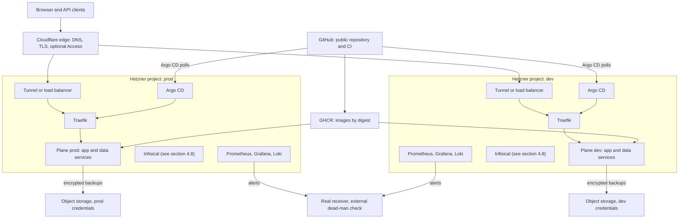

# Pass 2 handoff: moving the platform to Hetzner Cloud and Cloudflare

This document describes everything needed for the Hetzner migration. It is written for an engineer who did not build Pass 1.

The application is a customized deployment of open-source Plane Community Edition v1.4.3 (AGPL-3.0), under the name Wayline. It is not an original product, and nothing here should present it as one.

Written 2026-11-04, and corrected on 2026-11-05 against the code at that date and against what real runs showed. Pass 1's validation is not finished, so check [`docs/validation.md`](docs/validation.md) for what has run since. Nothing about Hetzner or Cloudflare in this document has been built or tested.

Names such as `critique`, `plane-branding.md` and `cicd-security.md` are the build's research notes. They are not in this repository, so treat what they are cited for as a reading, not a source you can check here.

**Markers.** `VERIFY` is a claim that needs a runtime result or a check against a current primary source. `MEASURE` is a number that must come from a measurement. Anything about Hetzner or Cloudflare that carries `VERIFY` is from the author's memory and was not checked against current documentation. Treat it as a question to answer, not a fact. Results from Pass 1 cite their evidence, and they come from a kind node on a laptop.

**Nothing cloud exists.** No Hetzner or Cloudflare resource, account, token, or Terraform code has been created. `infrastructure/terraform/environments/{dev,prod}` holds only interface documents.

## Contents

1. [What Pass 1 hands over](#1-what-pass-1-hands-over)
2. [Target topology and how to choose](#2-target-topology-and-how-to-choose)
3. [What carries over unchanged](#3-what-carries-over-unchanged)
4. [What must change, per component](#4-what-must-change-per-component)
5. [Terraform module interfaces](#5-terraform-module-interfaces)
6. [Accounts and credentials the owner must supply](#6-accounts-and-credentials-the-owner-must-supply)
7. [Sizing method](#7-sizing-method)
8. [Security hardening required before real users](#8-security-hardening-required-before-real-users)
9. [AGPL section 13](#9-agpl-section-13)
10. [Cost items to price](#10-cost-items-to-price)
11. [Phased migration plan with verification gates](#11-phased-migration-plan-with-verification-gates)
12. [Open decisions](#12-open-decisions)
13. [Appendix: local values hard-coded in the repository](#13-appendix-local-values-hard-coded-in-the-repository)

Related: [known limitations](docs/known-limitations.md), [Terraform environment contracts](docs/future-hetzner.md), [AGPL compliance](docs/agpl-compliance.md), [platform contract](docs/platform-contract.md).

## 1. What Pass 1 hands over

Pass 1 is one kind node on a laptop, with two Plane namespaces. It is a rehearsal of the delivery and operations model. It is not evidence that the design works on real infrastructure.

| Layer | Pass 1 owner | Created by |
|---|---|---|
| Cluster, node, CNI (kindnet) | kind CLI | `scripts/cluster-up.sh`. Terraform does not create it |
| Registry, pull-through caches, `git://` remote | Docker Compose | `infrastructure/local-services/compose.yaml`. Terraform does not create them |
| Namespaces, ResourceQuota, LimitRange, CoreDNS rewrite, Argo CD release, AppProjects, root Application | Terraform | `infrastructure/terraform/environments/local` |
| Infisical projects, identities, Kubernetes Auth | Terraform, separate root | `infisical/terraform` |
| Everything else in the cluster | Argo CD | `gitops/applications` |
| Secret values | Infisical, with secret zero in `.local/secret-zero/` | Scripts |

Runtime status on 2026-11-05, on one laptop, brought up stage by stage rather than by one `make up`:

- All 14 Argo CD Applications read Synced and Healthy ([`make status`](docs/evidence/runs/plane-prod-sim-status-1.txt)).
- `make test-e2e` passes in `plane-dev` on the branded images, 38 steps ([output](docs/evidence/runs/branded-dev-smoke-1.txt)), and in `plane-prod-sim` on upstream images, 37 steps ([JSON](docs/evidence/runs/smoke-prod-sim-20261104T235926Z.json)). The branded images have not reached prod-sim.
- The NetworkPolicy matrix passes from both Plane namespaces, and real attempts to cross between the environments all failed as they should ([network](docs/evidence/runs/harness-separation-network-1.txt), [state](docs/evidence/runs/harness-separation-state-1.txt)).
- **NOT RUN:** a clean install, teardown and recreation, a full restore, secret rotation, the failed-deploy drill, a load test, `make test-alert`, and any publish from `images.yml`. [[VERIFY: docs/validation.md records the final Pass 1 result of make up and make test]]
- **Not pushed:** `origin/main` is at `da7a4c9`, and the branding and everything since are local. The first push that carries `apps/wayline/**` runs a real GHCR publish through `images.yml`, so plan that push.
- Read [`docs/validation.md`](docs/validation.md) for what actually ran before relying on any "carries over" row below.

The reasons a kind result does not transfer are listed in [known limitations](docs/known-limitations.md#what-pass-1-does-not-prove).

## 2. Target topology and how to choose

The requirement is independent dev and prod. Pass 1's two namespaces do not meet it, because namespace separation is not equivalent to independent production clusters. Both namespaces share one API server, etcd, kernel, CoreDNS, Traefik, Argo CD, Infisical, and disk.

### Options

| Option | Blast radius between dev and prod | Operating cost | Verdict |
|---|---|---|---|
| A. One cluster, two namespaces | Shared control plane, nodes, ingress, Argo CD | Lowest | Rejected. It is Pass 1 with public IPs and does not meet the requirement |
| B. Two clusters in one Hetzner project | Separate control planes and nodes. One API token and one firewall scope can reach both | Medium | Acceptable only if tokens cannot be separated, which should be checked first |
| C. Two clusters in two Hetzner projects, one Cloudflare zone | Separate clusters and tokens. The zone and the Git repository are the shared points | Medium | **Recommended starting point** |
| D. C plus a third small operations cluster or host for Infisical and monitoring | As C, plus shared services sit outside both | Highest | Choose only if the Infisical decision (section 4.8) needs it |

Option C depends on Hetzner API tokens being scoped per project. [[VERIFY: Hetzner Cloud API tokens are scoped to a single project]]

### Inside each cluster

| Question | Choose more nodes when | Choose fewer when |
|---|---|---|
| Control plane: 1 or 3 | The environment must survive losing a node without an operator, and you will run etcd properly | The target is an RTO you can meet by restoring from backup. Dev should stay at 1 |
| Workers separate from control plane | Measured load justifies it, or data volumes need isolation from control plane I/O | Measured use fits one server with headroom (section 7) |
| Data services stateful in cluster or managed elsewhere | You accept running HA Postgres (CloudNativePG is the path noted in research, untested here) | A single instance plus tested off-host backups meets the stated RPO and RTO |

Adding nodes does not make Plane highly available. All four data services are single-replica in chart 1.8.6's local setup, and a single-replica Postgres on a block volume is still a single point of failure. State an RPO and RTO first, then pick the node count.

**Recommendation.** Start with one server per environment if the measured sizing fits, and say plainly in the docs that this is not HA. Move prod to three nodes only with a stated availability target. This is a recommendation, not a result. The owner decides (section 12).



### Independence test

Treat dev and prod as independent only when all of these hold. Each is a gate in section 11.

- Destroying the dev cluster, its state, and its credentials leaves prod serving. [[VERIFY: prod stays healthy while dev is destroyed]]
- No credential that dev holds can read or change anything in prod. [[VERIFY: dev Hetzner, Infisical, S3, and Argo credentials are refused against prod]]
- No pod in dev has a route to a pod or data service in prod. [[VERIFY: connection from dev to prod node and service addresses fails]]

The Git repository, GHCR, and the Cloudflare account remain shared. That is a deliberate residual dependency, and a Cloudflare token scoped to one zone cannot separate dev from prod records in that zone.

## 3. What carries over unchanged

"Unchanged" means the design and files move as they are. It does not mean they are proven. Runtime behaviour needs the same evidence again on real nodes.

| Item | Files | Why it carries |
|---|---|---|
| Plane release and chart | Contract section 1, `helm/plane/vendor/plane-ce-1.8.6` (byte-identical) | Independent of infrastructure |
| Render and commit | `scripts/render.sh`, `gitops/environments/`, CI render diff | Argo CD syncs plain manifests. No Helm or Kustomize at sync time |
| Sync waves | Contract section 6 | Ordering is a property of the workloads, including the migrator as a `Sync` hook, never `PreSync` |
| Secret contract | Contract section 8 | The six Secrets, hex passwords, `FILE_SIZE_LIMIT` in bytes, bucket `uploads`, never rotating `SECRET_KEY` |
| Workload hardening | `helm/plane/components/hardening` | UIDs, probes, limits, no service account tokens, a 5-second `preStop` and a 600-second rollout deadline. The `preStop` took failed requests in a rollout from 10 to 0 on kind ([before](docs/evidence/runs/plane-dev-rollout-availability-1.txt), [after](docs/evidence/runs/plane-dev-rollout-availability-2.txt)). The deadline was set by cold image pulls. Adjust limits only from measurement |
| Application health checks | `helm/values/argocd.yaml` | The Lua that makes sync waves gate, proven on Argo CD v3.5.7 ([waves](docs/evidence/runs/argocd-wave-gating-1.txt)). Run the checks again if Argo CD's version changes |
| AppProject model | `gitops/bootstrap/chart/templates/appprojects.yaml` | `platform` holds cluster scope, Plane projects hold namespaced workloads. Namespace lists change (section 4.13) |
| Conftest policy | `policy/` | Still applies to rendered manifests. Host and environment rules need updating |
| CI scripts | `scripts/ci/*`, `.github/workflows/ci.yml` | No cluster access. Runs the same scripts as `make ci` |
| Dashboards and alert rules | `monitoring/manifests/shared` | `NodeFilesystem*` alerts should become meaningful, unlike on kind |
| Backup and restore logic | `scripts/backup.sh`, `scripts/restore.sh`, `infisical/lib/recovery.sh` | Dump format, checks, recovery sets and proofs carry. The destination and how the scripts reach the cluster change (section 4.7) |
| Pinned versions | `tools.lock`, Terraform lock files, image digests | Lock files gain a platform if CI or nodes need one |

## 4. What must change, per component

Appendix 13 lists where each value lives. Other work is still landing, so line numbers move. Search for the value rather than trusting a line.

### 4.1 kind to real nodes

| | Pass 1 | Pass 2 |
|---|---|---|
| Cluster creation | `scripts/cluster-up.sh`, `infrastructure/kind/cluster.yaml.tmpl` | Terraform creates servers, and a chosen distribution creates Kubernetes (open decision D2) |
| Kubernetes | v1.36.4 | Exact version pinned. Check support for the Argo CD line in use before changing it |
| Lifecycle | `make down`, `make up`, `make destroy` | Rewrite. `scripts/down.sh` and `scripts/destroy.sh` assume kind and local state |
| Architecture | arm64 only | Decide (D3). `scripts/ci/build-images.sh` passes `--platform linux/arm64`, and `.github/workflows/images.yml` runs on `ubuntu-24.04-arm` |
| Disk protection | kind disables image GC and eviction (critique section 5) | Kubelet defaults return. Size disks so garbage collection and eviction do not fire in normal use |
| `guard_disk` | Guards the Mac's disk, because the VM cannot see it | Replace with node-level alerts. Keep it for scripts that write to the operator's machine |

Hetzner has no managed Kubernetes offering as far as the author knows. [[VERIFY: whether Hetzner offers managed Kubernetes at migration time]]

`externalTrafficPolicy: Local` in `helm/values/traefik.yaml` is safe today only because there is one node, as its comment says. On more than one node it blackholes traffic to nodes without a Traefik pod unless a load balancer health-checks that node. Change it deliberately.

### 4.2 Storage class and CSI

| Item | Pass 1 | Pass 2 action |
|---|---|---|
| Plane data | `storageClass: standard` in both overlays' `values.yaml`, four lines each | Set the real class before first sync. `volumeClaimTemplates` are immutable |
| Infisical data | `storageClassName: standard` in `infisical/manifests/postgres.yaml` and `redis.yaml` | Same |
| Prometheus, Alertmanager, Loki | Default class | Name the class explicitly, as the Plane overlays do |
| PVC sizes | `local-path` ignores them. Comments call Loki's `2Gi` "a label" | **Now enforced.** Set real sizes and alert on them. `retentionSize` must stay below volume size |
| Volume permissions | Non-root writes work here, and local-path uses mode 0777 | Block volumes will not have 0777 directories. `infisical/manifests/{postgres,redis}.yaml` set `fsGroup`, but `helm/plane/components/hardening` does not, so Plane's non-root Postgres, Valkey, RabbitMQ, and Silo need it added. [[VERIFY: each Plane data service writes to its volume on the chosen CSI]] |
| Scheduling | One node | Block volumes attach to one node in one location. Keep pods and volumes co-located |

The expected driver is the Hetzner Cloud CSI driver, with block volumes as ReadWriteOnce. [[VERIFY: current Hetzner CSI driver name, version, minimum volume size, and arm64 support]]

Compare Postgres on a network block volume with the server's local disk before choosing. [[MEASURE: Postgres write latency on Hetzner volume versus local disk]]

### 4.3 Local registry to a real registry

| Item | Pass 1 | Pass 2 |
|---|---|---|
| Branded images | `localhost:5001/wayline/*` by digest | GHCR by digest. `images.yml` is written to push there and has never run with `apps/wayline`, so that push, its scan, its prune and its digest bump are all untested. D12 limits it to private packages under the owner's account |
| Local copy step | `scripts/ci/copy-to-local-registry.sh` | Remove. Digests in Git point straight at GHCR |
| Pull-through caches | `infrastructure/local-services`, `infrastructure/kind/containerd-certs.d` | Remove. Node pulls use real registries |
| Docker Hub limits | Mitigated through `mirror.gcr.io` | Nodes share a public IP, and anonymous limits apply. Decide: authenticated pulls through kubelet config, a mirror in GHCR, or retain `mirror.gcr.io` as a containerd mirror |
| Pull auth | None | Private packages, which D12 requires today, need `imagePullSecrets` on the `plane` ServiceAccount, sourced from Infisical. Public packages need none, once D12 allows them |
| Digest kind | Index digests for upstream, one plain manifest for branded (`--provenance=false --sbom=false`) | Keep. On x86, branded builds must become multi-arch and digests change |

On 2026-11-05 the four branded images are built from `1563cbf` and pushed to the local registry. `helm/plane/overlays/dev/kustomization.yaml` names them, and the prod-sim overlay still names `docker.io/makeplane/*`. `live` stays upstream's image in both. [[VERIFY: branded images are built, pushed, and referenced in helm/plane/overlays/*/kustomization.yaml]]

`.github/workflows/README.md` records what is known about GHCR limits: GitHub's billing page lists a small quota for Packages and says Container registry storage is free for now, and no image has been stored there to test that. [[VERIFY: current GHCR limits for public and private packages]]

### 4.4 Git daemon to GitHub as Argo's source

**This is not a one-value change, despite what `infrastructure/terraform/modules/argocd/variables.tf` says.** The value `git_repo_url` reaches the root Application and AppProject `sourceRepos`, but 13 child Application files hard-code `git://plane-git/plane-platform.git` (14 lines). If you change only the variable, the projects refuse those children.

| Task | Detail |
|---|---|
| Parameterise children | Render `gitops/applications` from a value, or generate per-cluster files (section 4.13). Pick one and make CI check it |
| Transport | Use HTTPS. The repo-server NetworkPolicy allows 443 to public addresses, not SSH |
| Credentials | None for a public repository. For a private one, a read-only deploy key or GitHub App held outside Git |
| Remove the old path | `plane-git` Compose service, `gitops-publish.sh`, and the `9418` egress rule in `gitops/platform/network-policies/argocd.yaml` |
| Pre-promotion backup | **Moves.** Today `scripts/gitops-publish.sh` takes the prod-sim dump before publishing, and that is the only place a promotion merged on GitHub takes one. With GitHub as source, merging deploys directly and the dump does not happen. Contract section 5 requires it. See below |
| Proof on dev before prod | **Moves too, and has no answer yet.** The same publish step refuses a prod-sim digest unless `plane-dev` is Synced and Healthy with it in a ready container (`scripts/lib/dev-check.sh`). That reads one cluster's API. On independent clusters, prod's path has no such credential and must not get one (section 2). See D15 |
| Detection delay | Argo CD polls. Decide whether a webhook is worth exposing an endpoint. [[MEASURE: time from merge to sync with polling]] |
| Enforced approval | A public repository on GitHub Free gets protected branches and required reviewers per `cicd-security.md`. [[VERIFY: GitHub plan features for public repositories at migration time]] |

Options for the pre-promotion dump:

| Option | Tradeoff |
|---|---|
| Scheduled backups plus a freshness check in the promotion PR | Simple. The dump is not immediately before the change, so state the gap |
| Argo `PreSync` hook running a backup Job | Immediate, but `PreSync` runs on a fresh install too, when Postgres does not exist. The Job must tolerate that |
| A CI job with cluster credentials | Gives GitHub write access to prod, which Pass 1 avoids on purpose. Not recommended |

### 4.5 NodePort to a load balancer or Cloudflare Tunnel

| | Hetzner load balancer | Cloudflare Tunnel |
|---|---|---|
| Inbound ports on nodes | 80 and 443 from the load balancer | None. `cloudflared` dials out |
| Bypassing Cloudflare | Possible unless the firewall allows only Cloudflare ranges or origin pulls are authenticated | Not possible through a public address, since none is open |
| New in-cluster owner | Cloud controller manager for the Service | `cloudflared` Deployment, its namespace, and its token in Infisical |
| Client IP | Needs PROXY protocol or trusted headers | `CF-Connecting-IP` and trusted forwarded headers from `cloudflared` |
| Failure mode | Depends on Hetzner LB and Cloudflare | Depends on `cloudflared` and Cloudflare |
| Cost | Monthly per load balancer | Check plan terms |

**Recommended starting point: Cloudflare Tunnel**, because it leaves no inbound application port and takes one piece of cloud controller work out of the first iteration. This is the author's judgement, not a test. Whichever is chosen, the same work is required:

- Trust forwarded headers, or uploads get `http://` URLs and Plane's throttle shares one bucket. `SECURE_PROXY_SSL_HEADER` is set in Plane's `settings/production.py`, and presigned URLs use `request.scheme`. Set `ports.web.forwardedHeaders.trustedIPs` in `helm/values/traefik.yaml` to the real proxy source only.
- Rewrite `traefik-ingress` in `gitops/platform/network-policies/traefik.yaml`. It allows `172.16.0.0/12`, which is specific to Docker. On kind the NodePort source is the kind gateway, measured with conntrack ([source](docs/evidence/runs/traefik-nodeport-source-1.txt)). The policy once also allowed Docker Desktop's `192.168.65.0/24`, and no traffic used it. Expect a different source on real nodes.
- Change the `node-network-only` Middleware in `gitops/bootstrap/argocd-route/ingressroute.yaml`, `infisical/manifests/ingressroute.yaml` and `monitoring/manifests/shared/ingress-routes.yaml`. It admits `172.16.0.0/12`. On another network each internal UI answers 403, and behind a proxy or Tunnel it means nothing, because every request arrives from the proxy. `policy/plane.rego` holds that range too.
- Decide what happens to the websocket path through `/live`. It held through Traefik and the buffering middleware for a 330-second idle soak on kind ([soak](docs/evidence/runs/plane-dev-smoke-soak-1.txt)). Cloudflare's WebSocket support was read in its docs, and the behaviour through that edge is unproven. [[VERIFY: /live collaboration holds a WebSocket through Cloudflare, Traefik, and the buffering middleware for a 5 minute soak]]
- Check proxied request size limits against `FILE_SIZE_LIMIT=5242880`. [[VERIFY: Cloudflare request body limit on the chosen plan]]

Tunnel behaviour, client IP header, and pricing are from memory. [[VERIFY: Cloudflare Tunnel current terms, headers, and origin settings]]

### 4.6 Hostnames and TLS

Contract section 3 says Pass 2 terminates at Cloudflare and the origin, so there are two legs:

| Leg | Approach | To verify |
|---|---|---|
| Browser to Cloudflare | Cloudflare certificate | [[VERIFY: certificate coverage for the chosen hostname depth on the plan]] |
| Cloudflare to origin | Tunnel, or origin certificate with strict mode. Never flexible mode | [[VERIFY: origin mode rejects an invalid origin certificate]] |

A two-level name such as `plane.dev.example.com` may fall outside a free universal certificate, which usually covers one wildcard level. [[VERIFY: whether a universal certificate covers two subdomain levels]]

Plane-specific changes:

| Item | Detail |
|---|---|
| Chart TLS | Set `ssl.externalTermination: true` when TLS ends before Traefik. Keep `entryPoints: [web]`. The chart comment warns that the route otherwise never matches. `WEB_URL` then renders as `https://` |
| Cookies | The chart renders `CORS_ALLOWED_ORIGINS` as both `http://` and `https://`, and any `http:` origin drops `Secure` from session and CSRF cookies (`settings/common.py:187`). Override with an exact `https://<host>` through `plane-app-env`, which needs a contract section 8 change. Never use `*` |
| Override order | Research confirmed Secret after ConfigMap for the migrator. [[VERIFY: api and worker envFrom order lets the Secret override CORS_ALLOWED_ORIGINS]] |
| Cookie proof | [[VERIFY: session-id and csrftoken cookies carry Secure on the public host]] |
| Self-dial | See below |
| Public hostname | A public `plane.` hostname uses the upstream name. Decide (D9) with [the trademark position](docs/agpl-compliance.md#trademark-position-not-legal-advice) |

**Self-dial problem.** The API calls `copy_object` and fetches OAuth avatars against its own public host. `settings/storage.py` builds the endpoint from `request.scheme` and `request.get_host()` when `USE_MINIO=1`. In Pass 1, CoreDNS rewrites the host to Traefik and everything is plain HTTP, and that path is measured ([path](docs/evidence/runs/plane-dev-copy-object-path-1.txt)). On HTTPS the same code dials `https://<host>`:

| Option | Effect |
|---|---|
| Allow the API egress to the public host through Cloudflare | Simple, no rewrite. Adds an internet path and hairpin latency. The NetworkPolicy needs an egress rule, which is what Pass 1 denied |
| Keep a CoreDNS rewrite to a Traefik TLS entrypoint | Needs a certificate the pod trusts for the public name. `modules/foundation` writes a kubeadm Corefile, so distribution matters |
| Keep Silo private and use a real object store with `USE_MINIO` unset | The client then uses `AWS_S3_ENDPOINT_URL`. It changes presigned URL behaviour and the `uploads` route. Needs a new read of `settings/storage.py` |

[[VERIFY: asset duplication returns 200 on the public host with the chosen option]]

**Bucket name.** The bucket must stay `uploads` (`bgtasks/export_task.py:68` strips `/uploads` from the domain). If bucket names are global at a hosted store, that name will be taken, which rules out a direct move to one without a Plane patch. [[VERIFY: bucket name uniqueness rules at Hetzner Object Storage and R2]]

Other hosts:

| Host today | Pass 2 |
|---|---|
| `plane.dev.localhost`, `plane.prod-sim.localhost` | Public, each on its own cluster |
| `argocd.localhost`, `grafana.localhost`, `infisical.localhost` | Not anonymous. Behind Cloudflare Access or a VPN. Each has its own login, which is not a reason to expose it |
| `prometheus.localhost`, `alertmanager.localhost` | **No login of their own.** Pass 1 has only a source-address allow list, `node-network-only`, which section 4.5 says must change. Never public without an auth layer |

Cloudflare Access availability and limits are from memory. [[VERIFY: Cloudflare Access plan terms for the number of operators]]

### 4.7 Backups to off-host object storage

Pass 1 writes to `.local/backups` on the laptop through `/backups`, a static hostPath PV per environment (`gitops/platform/backup-storage`). That is the same disk as the cluster. It protects against a deleted cluster, not a lost machine.

| Task | Detail |
|---|---|
| Destination | S3-compatible object storage in a different failure domain from the servers. Per-environment bucket and credentials |
| Mechanism | Replace the hostPath PV and PVC. The Job keeps `pg_dump -Fc`, the scratch-database restore check, and the rclone check, then uploads |
| Encryption | Client-side, before upload. `scripts/backup.sh` notes that dumps hold password hashes and plaintext API tokens. Keep the key out of the same bucket |
| Schedule | **Pass 1 has no CronJob.** `make backup` is manual. Add a schedule and an alert on backup age |
| Retention | `KEEP` defaults to 3 for dev and 5 otherwise, local only. Use lifecycle rules as well, and decide on object lock |
| Key escrow | `ENCRYPTION_KEY` and `SECRET_KEY` must be recoverable without the cluster. The manifest stores only truncated hashes on purpose |
| Quota | `persistentvolumeclaims` in `modules/foundation/main.tf` counts the backup PVC. Adjust if it goes |
| Volume snapshots | Useful as a second layer, not a substitute. They share the provider and are crash-consistent only |
| Recovery set | `infisical/lib/recovery.sh`. Each Infisical backup holds its Terraform state and hashes of secret zero, and each Plane backup holds its test accounts and sentinel. Secret zero is never copied into a backup. Decide what of this belongs off-host, and keep test accounts out of real backups |
| Restore | `scripts/restore.sh` uses local paths and `http://infisical.localhost`. Rewrite both. `make restore-clean` is the order to keep: Infisical first, then Plane. On kind, only an in-place Infisical restore has run for real ([JSON](docs/evidence/runs/restore-infisical-20261105T001834Z.json)), plus rehearsals in throwaway places |

On kind, with test data, a backup took 11 to 31 seconds per environment, and `make backup ENV=all` took 42 seconds. A Postgres dump was 0.7 to 4.4 MB ([run](docs/evidence/runs/dr-backup-retention-1.txt), [resource-utilization.md](docs/resource-utilization.md#persistent-storage)). Real data will not look like this, so measure again.

[[MEASURE: restore duration to a fresh cluster, as the RTO input]]

[[VERIFY: a backup restored into a newly created cluster passes tests/e2e/smoke.py]]

### 4.8 Infisical hosting and secret zero

Each environment has its own Infisical project in Pass 1, on one shared instance. Independent environments force a choice:

| Option | Independence | Cost | Note |
|---|---|---|---|
| One instance per cluster | Strongest. Each cluster's secrets die with it, so backups matter | Memory on each: 770 MiB quiet for the server, its Postgres and Redis on kind, with the server peaking at 822 MiB ([snapshot](docs/evidence/runs/plane-prod-sim-snapshot-final-1.txt), [memory](docs/evidence/runs/infisical-memory-1.txt)), plus an operator at about 25 MiB | **Recommended default.** Same chart path as Pass 1 |
| One instance on a separate operations host | Environments share a secret store, which is a shared failure and shared compromise | A third server | Requires Kubernetes Auth to reach each API server across networks, which widens API exposure |
| Hosted Infisical | Hands custody to a vendor | Plan pricing | The free tier's limits on hosted differ from the self-hosted limits. [[VERIFY: hosted Infisical limits and plan cost]] |

Limits to keep in mind for self-hosted, read in source at v0.167.6: no custom roles or RBAC, no native rotation, zero audit log retention. Per-project isolation with built-in `viewer` is the free-tier boundary. A cross-project read gets a real 403 in both directions on kind ([run](docs/evidence/runs/infisical-isolation-3.txt)). `scripts/rotate.sh` is a demonstration script, not a rotation system, and it has not run yet.

Required changes:

| Item | Detail |
|---|---|
| Secret zero custody | `.local/secret-zero/` on a laptop does not work for two independent environments. Store `ENCRYPTION_KEY`, `AUTH_SECRET`, and DB passwords in a password manager or offline escrow, per environment. **Losing `ENCRYPTION_KEY` with the cluster makes every secret unrecoverable** |
| Bootstrap path | `scripts/infisical-bootstrap.sh` needs `http://infisical.localhost` from the operator's machine, and it keeps the admin token off the cluster. Keep that property, using a tunnel or port-forward |
| `ALLOW_INTERNAL_IP_CONNECTIONS=true` | `helm/values/infisical.yaml:44` relaxes SSRF protection globally, accepted only because the instance is single-user. Re-decide. With a private API server address the flag may still be needed |
| `SITE_URL` | `http://infisical.localhost` at `helm/values/infisical.yaml:47` |
| Kubernetes Auth | `kubernetes_host` and CA in `infisical/terraform/variables.tf`. A new cluster has a new CA, so rerun |
| Terraform state | `.local/terraform/infisical`. Holds IDs. Move to remote state with the rest. `*_wo` attributes and scripts keep values out, which should stay true |
| etcd at rest | `kind` etcd is unencrypted. Enable encryption at rest for Kubernetes Secrets. [[VERIFY: etcd encryption is on, using a read of a Secret directly from etcd]] |
| Backups | `scripts/backup.sh infisical` exists, and its destination moves with section 4.7 |

### 4.9 NetworkPolicy under a real CNI

Kindnet enforces policy after DNAT and before SNAT, fails open on setup errors, and exempts root sockets in the node's namespace (critique section 1.6). None of those details transfer. The policies were written against them, so expect failures rather than assume compatibility.

| Assumption in `gitops/platform/network-policies` | Under a real CNI |
|---|---|
| `172.16.0.0/12` is the node network (`traefik.yaml:3-10`, 15 `ipBlock` rules across files) | Replace with the node or private network CIDR. On Hetzner that range may overlap nothing, or everything, depending on the network you create |
| API server is reached as node IP on 6443 by `ipBlock`. Measured on kindnet: evaluated after DNAT ([probes](docs/evidence/runs/netpol-real-pods-1.txt)) | Cilium does not apply CIDR rules to cluster nodes by default, and uses entities such as `kube-apiserver`. Standard `NetworkPolicy` may not express this. [[VERIFY: how Cilium treats ipBlock for the API server and node IPs in the chosen mode]] |
| NodePort source reaches Traefik as the kind gateway, measured | Differs with kube-proxy replacement and tunnel. Retest |
| `except: [10.0.0.0/8, 172.16.0.0/12, 192.168.0.0/16]` on repo-server egress | Still sound if Hetzner private networks use those ranges. Confirm hosts resolve outside them |
| Kubelet probes bypass policy | CNI-specific. Probes may need host or `remote-node` rules. [[VERIFY: probes pass under default-deny on the chosen CNI]] |

Test tooling is kindnet-specific too. `scripts/test-netpol.sh` checks `ds/kindnet`, its log line, and nftables tables through `docker exec`, and `tests/gates/day1.sh` uses the node as a witness on each deny. Rewrite those checks. The matrix in `tests/network-policy-matrix.yaml` should run again unchanged except for hosts. `KindnetSkippedNetworkPolicies` and `KindnetLogsNotRead` in `monitoring/manifests/shared/rules-platform.yaml`, and the Alloy pipeline that feeds them, apply only to kindnet.

| CNI question | Note |
|---|---|
| Cilium vs. Calico | Research sized Cilium's agent at 300 to 500 MiB as a planning estimate, from a third-party 150 to 250 MB figure and reports at other scales. Calico was not assessed further |
| Fail-closed behaviour | Confirm what happens when the agent is down. [[VERIFY: behaviour of existing pods and new connections when the CNI agent is stopped]] |
| Kernel | [[VERIFY: chosen OS image and kernel meet the CNI's requirements]] |

Two known gaps in Pass 1 go away with separate clusters: an API asking Traefik for the other environment's hostname, and a pod with free egress reaching the internal UIs through `host.docker.internal`, which is specific to Docker Desktop.

### 4.10 Monitoring retention

| Setting | Pass 1 | Pass 2 |
|---|---|---|
| Prometheus | `retention: 3d`, `retentionSize: 1GiB`, 2Gi PVC (`helm/values/kube-prometheus-stack.yaml`) | Pick from need, for example weeks in prod. Volume size is now enforced. [[MEASURE: Prometheus bytes per day per cluster]] |
| Loki | `retention_period: 72h`, filesystem, 2Gi, 640Mi limit (`helm/values/loki.yaml`) | Object storage backend if retained longer. [[MEASURE: Loki bytes per day per cluster]] |
| Alertmanager | 24h | Longer, on a real volume, to keep silences |
| Grafana | No persistence, state from Git | Keep. The password regenerates on each render, per `monitoring/README.md`, so manage it from Infisical or SSO |
| Log collection | Alloy as a Deployment through the API (`loki.source.kubernetes`). A second copy on 53 streams added 6 to 40 MiB of apiserver RSS on kind ([cost](docs/evidence/runs/monitoring-alloy-apiserver-cost-1.txt)) | Re-evaluate on many nodes. Clustering or a DaemonSet may be needed |
| Host metrics | node-exporter in `monitoring-agents` | Now reports real disks. Add alerts on volume fill |

Monitoring in each cluster fails with that cluster. An outside check is required (section 4.11).

### 4.11 Alert routing to real receivers

Pass 1 routes every alert to an in-cluster webhook, `alert-sink`, which prints lines. Nobody is paged. `make test-alert` has not run there. A temporary rule took 70 seconds from pending to the sink ([path](docs/evidence/runs/monitoring-alert-path-1.txt)), and `PlaneWorkerNoConsumer` fired on a real fault ([record](docs/evidence/runs/plane-prod-sim-worker-no-consumer-alert-1.txt)).

| Task | Detail |
|---|---|
| Receivers | Replace `receivers` in `helm/values/kube-prometheus-stack.yaml`. Choose one per severity (D7). Remove `alert-sink` from prod |
| Credentials | Webhook URLs and keys are secrets. They must not be in values in a public repository. Use an Infisical-managed Secret referenced by Alertmanager |
| Watchdog | Route it to an external dead-man service, so a dead cluster raises an alert from outside. Pass 1 only logs it |
| Egress | The `alertmanager` policy in `gitops/platform/network-policies/monitoring.yaml` allows egress only to `alert-sink` on 8080, and has no DNS rule of its own in that block. Add a specific rule for the real receiver |
| Proof | `scripts/test-alert.sh` asserts on the sink. Rewrite to assert delivery. [[VERIFY: an injected failure reaches a person within the stated time]] |
| Noise | [[VERIFY: alert rules are quiet on a healthy cluster for 24 hours]] |

### 4.12 Plane application settings for real use

| Item | Pass 1 | Pass 2 |
|---|---|---|
| Email | No SMTP config and no egress rule. Password reset and invitations cannot send | Provide SMTP in Infisical and an egress rule. In the branded backend image `EMAIL_FROM` defaults to `noreply@wayline.invalid`, which no mail server will accept, so set it |
| Signup | Default | Set `ENABLE_SIGNUP` to match the audience |
| Telemetry | Off through `tests/e2e/smoke.py`, and denied by NetworkPolicy, both measured on upstream images ([smoke](docs/evidence/runs/smoke-dev-20261104T221730Z.json), [matrix](docs/evidence/runs/netpol-20261104T232752Z.tsv)). The branded images default it off in the setup form and at registration | Check it for an admin made through the UI, which has not been done. Upstream's images turn it on for a hand-made admin, so egress denial is the backstop. Also keep it denied after adding SMTP egress |
| HTML caching | The web and admin images sent no `Cache-Control`, so a browser kept showing the old app after a promotion ([record](docs/evidence/branding/live-dev/README.md)). A fix was being built on 2026-11-05 | Confirm the header on the images you deploy, and set Cloudflare's cache rules to match, or a promotion may not reach returning users |
| `enable_drf_spectacular` | On in dev, off in prod-sim | Off wherever public |
| Terms, privacy | None | The owner must supply them if others use it |

### 4.13 Environments: `prod-sim` to `prod`, and split by cluster

Pass 1 assumes both environments in one cluster. On 2026-11-05 `git grep` finds `prod-sim` in 77 tracked files outside docs and rendered manifests.

| Item | Change |
|---|---|
| `modules/foundation/main.tf` | Hard-codes both Plane namespaces, and `coredns_rewrites` is its only variable. Add a variable selecting the environment |
| `gitops/applications/` | Holds both environments' Applications, and the root Application syncs that path (`root-application.yaml:13`). Each cluster needs its own set. A per-cluster directory, such as `gitops/clusters/{dev,prod}/`, is a proposal |
| `gitops/bootstrap/chart/templates/appprojects.yaml` | Declares both projects. Render one per cluster |
| `gitops/platform/network-policies/` | Includes both Plane namespaces and `plane-dev-loadtest.yaml` |
| `gitops/platform/backup-storage/`, `infisical-operator-*` | Same |
| `infisical/terraform/main.tf` | Local map has both environments, and slug `prod` is inside each project already. Run one root per instance |
| Naming | Rename `prod-sim` to `prod` as one reviewed change. Namespace rename means new PVCs, so do it before any data exists |
| Promotion | `scripts/promote.sh` compares overlays in one repository, which does not depend on the cluster, since Git is the source. The dev digest record is still the rule |
| Scripts and tests | `monitoring/ops/lib.sh`, `tests/e2e/smoke.py`, `tests/separation/`, `tests/routes/internal-routes.sh`, `scripts/status.sh` and `scripts/rotate.sh` hard-code hosts and context |

## 5. Terraform module interfaces

These are expected interfaces, not code. Root-level contracts, state, and acceptance tests are in [docs/future-hetzner.md](docs/future-hetzner.md). Provider versions seen in `infra-versions.md` were `hetznercloud/hcloud` 1.70.2 and `cloudflare/cloudflare` 5.28.1 in October 2026. Pin exact versions at the time of work. [[VERIFY: latest stable provider versions and that the resources below exist]]

### `modules/hetzner-network`

| Direction | Name | Type | Notes |
|---|---|---|---|
| Input | `name_prefix` | string | Includes the environment |
| Input | `location` | string | |
| Input | `network_cidr`, `subnet_cidr` | string | Must not overlap the pod or Service CIDR |
| Input | `admin_cidrs` | list(string) | No default, so it cannot silently be open |
| Input | `allow_inbound_http` | bool | False with Tunnel |
| Output | `network_id`, `firewall_id` | string | |
| Output | `node_cidr` | string | Replaces `172.16.0.0/12` in NetworkPolicies |

### `modules/hetzner-cluster`

| Direction | Name | Type | Notes |
|---|---|---|---|
| Input | `name_prefix`, `location`, `network_id`, `firewall_id` | string | |
| Input | `control_plane_count`, `worker_count` | number | Default from the sizing method, not memory |
| Input | `control_plane_server_type`, `worker_server_type` | string | Validated against measured need |
| Input | `image` | string | Pinned OS image |
| Input | `kubernetes_version` | string | Exact |
| Input | `ssh_public_keys` | list(string) | Public keys only |
| Output | `kubeconfig` | string, sensitive | See the state warning in `docs/future-hetzner.md` |
| Output | `kube_context` | string | Same name `environments/local` takes |
| Output | `node_ipv4`, `node_private_ipv4` | list(string) | |
| Output | `api_server_endpoint`, `cluster_ca_certificate` | string | The CA feeds `infisical/terraform` |
| Output | `storage_class_name` | string | Feeds overlay values |

The module may install the CCM, CSI, and CNI, or leave them to Argo CD. Contract section 4 allows only one owner. Anything needed before Argo CD can run (CNI) belongs here. CSI and CCM can go either way, and the choice must be recorded. [[VERIFY: Hetzner CCM and CSI install method and required token scopes]]

### `modules/hetzner-object-storage`

The Hetzner provider may not manage S3 buckets, in which case this module uses an S3-compatible provider with separate S3 credentials. [[VERIFY: how Hetzner Object Storage buckets and scoped keys are created through Terraform]]

| Direction | Name | Type | Notes |
|---|---|---|---|
| Input | `bucket_name`, `location` | string | |
| Input | `retention_days` | number | Lifecycle rule. Object lock is a decision |
| Output | `s3_endpoint`, `bucket` | string | Credentials go to Infisical by script, never to state or outputs |

### `modules/cloudflare-edge`

| Direction | Name | Type | Notes |
|---|---|---|---|
| Input | `zone_id` | string | |
| Input | `public_hostnames` | map(string) | Host to origin service |
| Input | `origin_mode` | string | `tunnel` or `load_balancer`. No flexible TLS |
| Input | `origin_ipv4` | list(string) | `load_balancer` only |
| Input | `access_protected_hostnames` | list(string) | Argo CD, Grafana, Prometheus, Alertmanager, Infisical |
| Input | `access_allowed_emails` | list(string) | |
| Output | `tunnel_id` | string | `tunnel` only |

The tunnel token must not be stored as an output or in state if avoidable. Generate it out of band and write it to Infisical by script. [[VERIFY: whether the Cloudflare provider can create a tunnel without keeping its secret in state]]

### Existing modules

| Module | Needed change |
|---|---|
| `modules/foundation` | Add an input selecting environments. Keep `coredns_rewrites` empty unless section 4.6's rewrite option is chosen. Its template is the kubeadm Corefile, and it overwrites a different distribution's config |
| `modules/argocd` | Input `values_file` already exists, so give each cluster its own values file. Add an input for the root path. Fix the variable description that claims one value is enough |

## 6. Accounts and credentials the owner must supply

No values belong in Git or chat. Every token below should be created with the narrowest scope available.

| Item | Purpose | Scope | Where it lives |
|---|---|---|---|
| Hetzner Cloud account, billing | Owner only | | |
| Hetzner project per environment | Blast radius | | |
| Hetzner API token per project | Terraform, CCM, CSI. Ideally separate tokens for Terraform and in-cluster use | Read and write, one project | `TF_VAR_hcloud_token` at runtime, password manager, Infisical for the in-cluster one |
| Hetzner Object Storage keys per environment | Terraform state, backups | One bucket each if scoping allows | Environment at runtime, Infisical |
| SSH key pair(s) | Node admin | Public key in Terraform | Private key on the operator's machine |
| `admin_cidrs` values | Firewall | | Variable, not secret, may be sensitive to publish |
| Domain, and Cloudflare account with the zone | DNS, TLS, Tunnel, Access | | |
| Cloudflare API token | Terraform | DNS and Tunnel for one zone and account | `TF_VAR_cloudflare_api_token` at runtime |
| GitHub repository settings | Public visibility, branch protection, Actions PR permission | Owner | GitHub |
| Docker Hub account and token, if authenticated pulls are chosen | Pull quota | Read-only | Infisical, kubelet config |
| Alert receiver accounts | Alerts, dead-man check | One integration each | Infisical |
| SMTP provider | Plane email | Send only | Infisical |
| Off-machine escrow for `ENCRYPTION_KEY`, `SECRET_KEY`, backup encryption key | Disaster recovery | One per environment | Password manager or offline |
| Legal review | AGPL, trademark, terms, privacy | | Owner's counsel |

## 7. Sizing method

Do not pick a server type from this document or from memory. Derive it from measurements on Pass 1, then re-measure on the target. Measurements on an arm64 Docker Desktop VM do not transfer exactly, particularly to x86, so the first Pass 2 cluster should be easy to resize.

### Inputs

Collect from [docs/resource-utilization.md](docs/resource-utilization.md). It holds quiet readings and peaks under smoke tests and drills, on upstream images. `make test-load` has not run, so nothing there is under load:

| Input | Source | Marker |
|---|---|---|
| Idle working set per workload | `kubectl top`, Prometheus `container_memory_working_set_bytes` | Quiet readings per workload, 2026-11-05T00:03:44Z, in [resource-utilization.md](docs/resource-utilization.md#plane-per-environment). A strict idle capture has not run |
| Peak working set per workload during first boot and load | Prometheus `max_over_time` over the run. Cgroup peaks under smoke tests and drills are in the same page | [[MEASURE: peak working set per pod]] |
| CPU p95 per workload under load | `tests/load/run.sh` samples | [[MEASURE: CPU p95 per pod under load]] |
| Image store size on the node | Node disk, per architecture | [[MEASURE: image filesystem usage on the node]] |
| Data growth per day | PV usage over time | [[MEASURE: PV growth per day per service]] |
| Load the target must carry | Owner's expectation of users | Open decision D8 |

### Method

For each cluster, using only what that cluster runs:

```text
memory_needed = sum(peak working set of workloads, not limits)
              + node_overhead (kubelet, containerd, CNI, CSI, CCM, OS)
              + largest concurrent burst (migrator, backup Job, repo-server render)

memory_required = memory_needed / target_utilization

cpu_required    = sum(p95 CPU at target load) / target_utilization

disk_required   = images + PV totals at chosen retention + container logs + free space
                  needed to keep kubelet GC and eviction thresholds from firing
```

- `target_utilization` is the owner's judgement. 0.7 is a reasonable starting value because it leaves room for a rollout surge, and it has no measurement behind it.
- Then check limits against the node. Pass 1's limits are deliberately overcommitted: 15,812 MiB across the cluster against 13,959 MiB in the VM, about 113%. Decide whether that remains acceptable when a real user is affected by an OOM kill.
- `ResourceQuota` in `modules/foundation/main.tf` computes one surge pod per Deployment. With all seven Plane Deployments rolling at once, the most seen was 21 of 24 pods, with no `FailedCreate` ([rollout](docs/evidence/runs/plane-dev-rollout-quota-1.txt)). Keep that margin when adjusting limits.
- With more than one node, add the failure case: the remaining nodes must hold the workloads, or state that they will not.
- Pick the smallest server type that meets all three, and record prices and specs from the current Hetzner page on the same day.

### Starting estimate

This is an estimate for sanity checking, not a result. The measured column is one quiet reading from a kind node on upstream images ([snapshot](docs/evidence/runs/plane-prod-sim-snapshot-final-1.txt)), and that node runs two Plane environments.

| Group, one cluster with one Plane environment and its own Infisical | Idle MiB, estimate | Measured on kind, 2026-11-05, MiB |
|---|---:|---|
| Plane, one environment | 1,240 to 2,080 | 1,108 and 1,187 |
| Control plane and node agents | 750 to 1,300 | 1,543 for the pods alone, 1,168 of it the API server |
| Container shims and pause, about 42 pods at 5 to 10 MiB | 210 to 420 | 1,525 for kubelet, containerd, shims and pause together, with 56 pods |
| Traefik, metrics-server | 80 to 150 | 95 |
| Argo CD | 450 to 700 | 404 |
| Prometheus, Alertmanager, Grafana, operators | 620 to 1,040 | 1,182, with two environments to scrape |
| Loki, Alloy | 250 to 500 | 392 |
| Exporters, half of the two-environment figure | 25 | 39 |
| Infisical with its Postgres and Redis, one operator | 610 to 990 | 795 |
| CNI agent (Cilium planning guess from `cicd-security.md`) | 300 to 500 | Not comparable. kindnet read 31, in the control plane row |
| **Total** | **4,535 to 7,705, about 4.4 to 7.5 GiB** | Not comparable: 8,331 for the whole two-environment node |

Derived by taking one environment's rows from critique section 4, scaling per-pod overhead to one cluster, and adding the CNI guess. The critique's rows were written before any Plane container ran, so they are estimates anchored on a few measurements of related software on this host and one third-party figure for Plane v1.4.2. The measured control plane is above its estimate, and it comes from a kind node, so it will differ by distribution. Replace all of this with measurement on the target.

## 8. Security hardening required before real users

Pass 1 makes no claim of production readiness, and neither does this document. All of these are required, not suggested, before anyone other than the owner uses an instance.

| Area | Requirement | Pass 1 state |
|---|---|---|
| Source offer | Section 9 complete | `/source` answers on the branded images, with a 302 to a private repository, so it ends in a 404 |
| Exposure | No anonymous admin UI. Prometheus and Alertmanager behind auth | Loopback only. A source-address allow list on the 5 internal UIs, which is not a login |
| TLS | HTTPS only, `Secure` cookies, HSTS at the edge | None |
| Origin | No direct origin path, or firewall limited to the edge | Not applicable |
| Node access | SSH key only, `admin_cidrs` set, API server not public | Not applicable |
| OS | Unattended security updates, a reboot plan | Docker Desktop VM |
| Kubernetes | etcd encryption at rest, audit logging on, supported version with a patch cadence | Neither |
| Pod Security | Move `enforce` from `baseline` to `restricted` per namespace after a per-workload test, except node-exporter | `baseline`, `restricted` as warn and audit. A server dry run of `restricted` gives no warnings in either Plane namespace, on upstream images ([dev](docs/evidence/runs/plane-dev-psa-1.txt), [prod-sim](docs/evidence/runs/plane-prod-sim-host-and-identity-1.txt)) |
| Workloads | Read-only root where possible. `KSV-0014` in `.trivyignore` expires 2027-02-01 | Not read-only |
| Secrets | Secret zero in escrow, Argo CD initial admin removed, Grafana password managed | Local files, generated passwords |
| Database | A non-superuser Plane role. `scripts/rotate.sh` notes the role is a shared superuser | Superuser |
| Argo CD | SSO or named accounts, RBAC, `server.insecure` reviewed | Admin only |
| Infisical | Re-decide `ALLOW_INTERNAL_IP_CONNECTIONS`, confirm cross-project denial | Cross-project reads get 403 both ways on kind ([run](docs/evidence/runs/infisical-isolation-3.txt)) |
| Network | Default-deny re-proven on the real CNI, fail-closed behaviour known, egress minimal | Matrix passes from both Plane namespaces on kindnet, and that does not transfer. [[VERIFY: tests/network-policy-matrix.yaml result on the real CNI]] |
| Images | Scan gate that blocks. Sign images if the repository is public, since attestations become available | `make scan-images` fails on a fixable CRITICAL in an image built here, and those pass today ([scans](docs/evidence/security/README.md)). Upstream images still report CRITICAL findings, reported only. `images.yml` has the same step, never yet run |
| Accepted risks | RabbitMQ 3.13 is out of community support. Re-decide. 4.2.9 is the candidate, 4.3 breaks Celery per upstream | Accepted for Pass 1 |
| Git | Clean `gitleaks` history before going public, branch protection with required review | Advisory only on GitHub Free private |
| Terraform | Remote encrypted state with separate keys per environment, lock tested | Local state |
| Backups | Encrypted, off-host, restore proven, alert on age | Manual, local |
| Abuse and privacy | Rate limits work with true client IP, an operator contact, terms, privacy, retention, and data location reviewed | None |
| Rollback | Rollback and restore drills repeated on real infrastructure | [[VERIFY: tests/drills results on Hetzner dev]] |

## 9. AGPL section 13

Read [docs/agpl-compliance.md](docs/agpl-compliance.md). This summary is engineering guidance, not legal advice.

- A modified version must offer its Corresponding Source to all users who interact with it over a network, at no charge. Patched branded images are modified versions.
- **The repository must be public, or source otherwise offered, before anyone other than the owner uses the instance.** `origin` is private today. A `/source` link to a private repository offers nothing to someone without access.
- Corresponding Source includes the pinned upstream ref, patches, overlay, codemod, build scripts, and Dockerfiles, not only application code.
- `/source` must lead to the exact commit of the running build. The web image stamps that commit at build time, and on `plane-dev` it answers 302 to the commit that built it, `1563cbf`, which is not pushed. [[VERIFY: /source resolves to the commit of the deployed digest, from a logged-out browser, on each surface]]
- Before the first outside user: pass the checklist in [docs/agpl-compliance.md](docs/agpl-compliance.md#checklist-before-the-first-other-user). The repository's `LICENSE`, `COPYRIGHT.txt` and `NOTICE.md` are in place, and the `email.py` decision (D12) is made for private images. Going public is what remains open.

## 10. Cost items to price

No prices appear here on purpose. Check them on the provider's current pricing page on the day of the decision, and record date and region.

| Provider | Item | Unit to check |
|---|---|---|
| Hetzner | Servers, per type and architecture, per environment | Hourly and monthly cap |
| Hetzner | Block volumes | Per GiB per month |
| Hetzner | Primary IPv4 addresses | Per IP |
| Hetzner | Load balancers, if chosen | Per load balancer |
| Hetzner | Traffic allowance and overage | Per server, per TB |
| Hetzner | Object Storage | Base fee, storage, egress |
| Hetzner | Snapshots and backups, if enabled | Per GiB or percentage |
| Cloudflare | Domain registration or transfer | Per year |
| Cloudflare | Plan for the zone | Monthly |
| Cloudflare | Access seats, if beyond the free allowance | Per user |
| Cloudflare | R2, if used | Storage and operations |
| GitHub | Actions minutes on arm64 runners, Packages | Public versus private |
| Other | Docker Hub plan if authenticated pulls are needed | Monthly |
| Other | SMTP provider, alert receiver, dead-man service | Monthly |
| Other | Legal review | One-off |

Run dev and prod sizes through the sizing method first, so the price is for a measured need.

## 11. Phased migration plan with verification gates

Each phase has one exit gate. Do not start the next phase until evidence for the gate is in `docs/evidence/`, labelled PASS, FAIL, BLOCKED, or NOT RUN, per contract section 12. kind keeps working throughout, which makes it the rollback for every phase up to 3.

| Phase | Work | Exit gate |
|---|---|---|
| 0. Close Pass 1 | Finish validation, resolve markers, measure resources | `docs/validation.md` complete. `docs/resource-utilization.md` has measured values. Every BLOCKED item has a Pass 2 decision |
| 1. Remove hard-coding, on kind | Parameterise repo URL, hostnames, storage class, per-cluster Applications, foundation environments, CNI-specific tests. Everything stays on kind | `make up` then `make test` on kind give the same results as Phase 0. `make render` diff contains only intended lines |
| 2. Public source | Clean history, working `/source`, go public, GHCR packages as D12 allows, protect `main`. Point kind's Argo CD at GitHub | `gitleaks` clean over full history. Kind syncs from GitHub. A logged-out browser reaches the exact commit's source |
| 3. Accounts and state | Owner supplies section 6 items. State buckets created | `terraform init` on each root, against real state. Two concurrent plans prove locking |
| 4. Dev infrastructure | Network, firewall, servers, Kubernetes, CNI, CSI | Nodes Ready. Policy sentinel: default-deny blocks and allow admits on a new connection. PVC survives pod move and node reboot. Digest pull from each registry path. External port scan shows only intended ports |
| 5. Dev platform | `modules/foundation`, `modules/argocd`, root Application, Infisical, secrets | All Applications Synced and Healthy. `tests/network-policy-matrix.yaml` executed with zero unexpected results. Cross-project 403 proven |
| 6. Dev edge | Cloudflare, TLS, forwarded headers, cookies, self-dial decision | `tests/e2e/smoke.py` on the public host, including upload, export, asset duplicate, and WebSocket soak. Cookies carry `Secure`. Origin refuses direct access. Client IP in logs is the real one |
| 7. Dev operations | Off-host backups, schedule, real receivers, dead-man | Backup restored into a **new** cluster and smoke tested. Injected failure reaches a person. Stopping the cluster triggers the dead-man. Rollback and failed-deploy drills executed |
| 8. Prod cluster | Repeat 4 to 7 with prod inputs, from a promotion PR with required review | Same gates, plus the independence test in section 2 |
| 9. Before first user | Load test at target, section 8 list, AGPL checklist, legal review | Every section 8 row resolved or accepted in writing by the owner. Measured numbers in the docs. No statement of production readiness without evidence for it |

Local data is test data, so the default is to start both clouds empty rather than migrate. If data must move, use `scripts/backup.sh` and `scripts/restore.sh`, keep `SECRET_KEY` the same, and expect encrypted config rows to decrypt silently to empty if it differs.

Reversal: phases 4 to 8 are `terraform destroy` plus restoring from off-host backups. Add `prevent_destroy` or a similar guard to prod volumes once data exists, and never point a dev credential at prod state.

## 12. Open decisions

Each needs an owner decision before the phase shown. Recommendations are the author's judgement, with no test behind them.

| # | Decision | Options | Recommendation | Needed by phase |
|---|---|---|---|---|
| D1 | Topology | Section 2, options B to D | C: two clusters, two projects | 3 |
| D2 | Kubernetes distribution | kubeadm, k3s, Talos, a community Terraform module | Choose after checking the CCM, CSI, and Cilium fit. kubeadm is closest to what `modules/foundation` assumes. No preference is proven | 4 |
| D3 | Architecture | arm64 (matches Pass 1 measurements and build), x86 (needs multi-arch builds) | arm64 if available in the chosen location. [[VERIFY: arm64 server availability by Hetzner location]] | 1 |
| D4 | Ingress | Tunnel or load balancer | Tunnel | 4 |
| D5 | Infisical | Per cluster, separate host, hosted | Per cluster | 5 |
| D6 | Data services | In-cluster single instance, CloudNativePG, external store | Single instance with tested off-host backups, plus a stated RPO and RTO | 5 |
| D7 | Alert receivers | Owner's choice of email, chat, or pager | One real channel plus an external dead-man | 7 |
| D8 | Target load and availability | Users, RPO, RTO | Owner must state these. The sizing method and D1 depend on them | 3 |
| D9 | Public hostname and name | `plane.` vs. a Wayline-named host | Wayline-named host, since the upstream name is not licensed for branding | 2 |
| D10 | Repository visibility | Public, or a separate source offer | Public | 2 |
| D11 | Object storage for uploads | Silo in cluster, external S3 | Silo first, since `uploads` is constrained by Plane code | 6 |
| D12 | `email.py` header | Decided for the image on 2026-11-05: it replaces the file with upstream's own AGPL-3.0-only version, pinned by commit, and publishes only to private GHCR packages under the owner's account (`apps/wayline/backend/email-py-decision.txt`). Still open: a public image, because the original stays in its `FROM` layer | Take advice before any public distribution of the backend image, or move to an upstream release that carries the fix. See [docs/agpl-compliance.md](docs/agpl-compliance.md#the-commercial-header-in-emailpy) | 2 |
| D13 | Plane version at migration | Stay on v1.4.3 or upgrade first | Stay. Change one thing at a time. Security fixes may override this | 1 |
| D14 | Hosted location and privacy | Hetzner location, data residency | Owner's decision, with legal input if real user data is held | 3 |
| D15 | How a prod promotion proves itself on dev, with independent clusters | A record dev writes to Git after its checks, a CI status, or a person's review. Pass 1's `scripts/lib/dev-check.sh` asks the one cluster directly, which independent clusters must not allow | A record in Git that dev writes and prod's promotion check reads. Nothing is designed yet | 1 |

## 13. Appendix: local values hard-coded in the repository

Read on 2026-11-05. Files only, because line numbers move. Regenerate before Phase 1:

```bash
git grep -n -E 'localhost|plane-git|prod-sim|172\.16\.0\.0|192\.168\.65|storageClass|kind-plane-platform|node-network-only' \
  -- ':!docs' ':!gitops/environments' ':!helm/plane/vendor' ':!PASS2_HANDOFF.md'
```

| Value | Where |
|---|---|
| `git://plane-git/plane-platform.git` | 13 files in `gitops/applications/`, 14 lines. Default in `environments/local/variables.tf`, `gitops/bootstrap/chart/values.yaml` |
| Hostnames | `helm/plane/overlays/{dev,prod-sim}/values.yaml`, `helm/values/argocd.yaml`, `helm/values/infisical.yaml`, `helm/values/kube-prometheus-stack.yaml`, `gitops/bootstrap/argocd-route/ingressroute.yaml`, `infisical/manifests/ingressroute.yaml`, `monitoring/manifests/shared/ingress-routes.yaml`, `monitoring/manifests/environments/{dev,prod-sim}/kustomization.yaml`, `infisical/terraform/variables.tf`, `infrastructure/terraform/environments/local/main.tf` |
| Hostnames in tooling | `monitoring/ops/lib.sh`, `tests/e2e/smoke.py`, `tests/separation/`, `tests/routes/internal-routes.sh`, `scripts/status.sh`, `scripts/rotate.sh`, `scripts/restore.sh`, `scripts/logs.sh`, `tests/network-policy-matrix.yaml` |
| Entry point `web`, plain HTTP | `helm/plane/overlays/*/values.yaml`, all IngressRoutes above, `helm/values/argocd.yaml` (`server.insecure`) |
| `standard` storage class | `helm/plane/overlays/*/values.yaml`, `infisical/manifests/postgres.yaml`, `infisical/manifests/redis.yaml` |
| Docker network CIDRs | `gitops/platform/network-policies/*.yaml`, 15 `ipBlock` rules, `scripts/cluster-up.sh` |
| `node-network-only` allow list on `172.16.0.0/12` | `gitops/bootstrap/argocd-route/ingressroute.yaml`, `infisical/manifests/ingressroute.yaml`, `monitoring/manifests/shared/ingress-routes.yaml`, `policy/plane.rego` |
| `/backups` hostPath | `gitops/platform/backup-storage/*.yaml`, `infrastructure/kind/cluster.yaml.tmpl` |
| `localhost:5001` | `scripts/promote.sh`, `scripts/up.sh`, `scripts/ci/copy-to-local-registry.sh`, `Makefile` (`images` target), `helm/plane/overlays/dev/kustomization.yaml` |
| arm64 only | `scripts/ci/build-images.sh`, `.github/workflows/images.yml` |
| Kindnet checks | `scripts/test-netpol.sh`, `tests/gates/day1.sh`, `monitoring/manifests/shared/rules-platform.yaml`, `helm/values/alloy.yaml` |
| Alert sink | `helm/values/kube-prometheus-stack.yaml`, `monitoring/manifests/shared/alert-sink.yaml`, `scripts/test-alert.sh` |
| Local Terraform state | `infrastructure/terraform/environments/local/versions.tf`, `infisical/terraform/versions.tf` |
