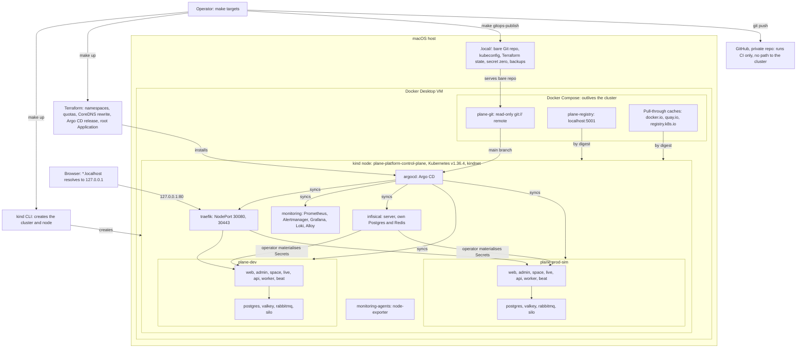

# plane-platform

This is a local deployment platform for a **customized Plane Community Edition v1.4.3 deployment**. It is not an original product.

The project management application is [Plane Community Edition](https://github.com/makeplane/plane), built by the Plane team and licensed AGPL-3.0. This repository adds what surrounds it: a kind cluster, Terraform, Argo CD, Infisical, a hardened overlay of the upstream Helm chart, monitoring, backups, and tests. "Wayline" is the name of this customized deployment, and it stays credited to Plane CE wherever it appears.

This is Pass 1 of 2. It runs on one laptop. Nothing cloud is provisioned or configured. Pass 2 moves to Hetzner Cloud with independent dev and prod environments and Cloudflare, as described in [PASS2_HANDOFF.md](PASS2_HANDOFF.md) and [docs/future-hetzner.md](docs/future-hetzner.md).

**This platform is production-inspired. It is not production-ready, and it makes no such claim.**

## Status

[docs/validation.md](docs/validation.md) is the authoritative record, and this table only summarizes it. Results use the labels in [contract section 12](docs/platform-contract.md#12-evidence-rule): PASS, FAIL, BLOCKED, NOT RUN. A result counts only with evidence in [docs/evidence/](docs/evidence/README.md).

| Area | State when written | Marker |
|---|---|---|
| kind cluster and local services (`scripts/cluster-up.sh`) | Ran. Raw log only, not yet in `docs/evidence/` | [[VERIFY: cluster-up log is copied to docs/evidence with date and command]] |
| Day-1 gates: digest pulls, kindnet enforcement, `git://` from a pod | Ran. Raw capture records 9 checks PASS, 0 FAIL, not yet in `docs/evidence/` | [[VERIFY: day1-gates-2.txt is copied to docs/evidence with date and command, and shows 9 PASS, 0 FAIL]] |
| Static checks (`make ci`) | No recorded result | [[VERIFY: make ci output is captured in docs/evidence and its result is stated]] |
| `make up`, full platform | BLOCKED: `scripts/up.sh` did not exist | [[VERIFY: scripts/up.sh exists and make up reaches all Applications Synced and Healthy]] |
| Plane deployed in `plane-dev` | NOT RUN | [[VERIFY: Plane is deployed and healthy in plane-dev]] |
| Plane deployed in `plane-prod-sim` | NOT RUN | [[VERIFY: Plane is deployed and healthy in plane-prod-sim]] |
| End-to-end smoke test (`make test-e2e`) | BLOCKED: `scripts/test.sh` did not exist | [[VERIFY: make test-e2e result for dev and prod-sim, with evidence]] |
| NetworkPolicy matrix, 383 rows (`make test-netpol`) | NOT RUN | [[VERIFY: make test-netpol result, with sentinel output in evidence]] |
| Infisical secret sync, cross-project isolation | NOT RUN | [[VERIFY: operator sync works and the cross-project read returns 403]] |
| Credential rotation (`make rotate`) | NOT RUN | [[VERIFY: make rotate result, with Plane healthy afterwards]] |
| Backup and restore (`make backup`, `make restore`) | NOT RUN | [[VERIFY: restore into an empty environment returns the sentinel data]] |
| Alert delivery (`make test-alert`) | NOT RUN | [[VERIFY: make test-alert shows an alert firing and reaching the sink]] |
| Failure drills (`tests/drills/`) | NOT RUN | [[VERIFY: results of failed-deploy-rollback and pod-restart-persistence drills]] |
| Load test (`make test-load`) | NOT RUN | [[VERIFY: make test-load result, with resource capture]] |
| Wayline branded images | NOT RUN. `apps/wayline/` is not in the repository, and the rendered manifests still use upstream Plane images | [[VERIFY: apps/wayline exists and rendered manifests reference localhost:5001/wayline images by digest]] |
| GitHub Actions workflows on GitHub | No recorded run | [[VERIFY: ci.yml run result on GitHub, with link or capture]] |
| Hetzner, Cloudflare | Out of scope for Pass 1. Nothing provisioned | |

## What this platform does not claim

- **Namespace separation is not equivalent to independent production clusters.** `plane-dev` and `plane-prod-sim` share one node, one kernel, one API server, one etcd, one CNI, one Traefik, one Argo CD, one monitoring stack, and one Docker VM. A node failure or a bad cluster-wide change takes out both. "Prod-sim" is a simulation of a promotion path, not a production environment.
- **Terraform does not create the cluster.** The kind CLI creates the cluster and node, through `scripts/cluster-up.sh`. Docker Compose creates the registry, pull-through caches, and Git remote. Terraform manages only the objects listed under [Who creates what](#who-creates-what).
- **GitHub does not enforce approval.** On GitHub Free with a private repository there are no required reviewers, protected branches, or environment gates. A pull request merge is a process, not a control. See [.github/workflows/README.md](.github/workflows/README.md).
- **There is no TLS locally, and no high availability.** Everything is plain HTTP on loopback, with one replica of each stateful service.

The full list is in [docs/known-limitations.md](docs/known-limitations.md).

## Architecture



The diagram shows intent. The design and its reasons are in [docs/architecture.md](docs/architecture.md).

### Who creates what

Each resource has one owner, and [contract section 4](docs/platform-contract.md#4-ownership-exactly-one-owner-per-resource) is binding. `scripts/ci/ownership.sh` checks for overlaps.

| Owner | Owns |
|---|---|
| kind CLI, via `scripts/cluster-up.sh` | Cluster, node, CNI, port and volume mounts |
| Docker Compose, in `infrastructure/local-services/` | Registry, pull-through caches, `git://` remote |
| Terraform, in `infrastructure/terraform/environments/local` | Namespaces and labels, ResourceQuota, LimitRange, CoreDNS rewrite, Argo CD Helm release, AppProjects, root Application |
| Terraform, in `infisical/terraform` (separate root and state) | Infisical projects, environments, machine identities, Kubernetes Auth config. Not secret values |
| Argo CD | Everything else in the cluster, including both Plane environments |
| Infisical | Secret values and their history |
| Scripts, via `.local/secret-zero/` | The few secrets that must exist before Infisical does |

## Quick start

Prerequisites, which `make setup` checks through `scripts/prereqs.sh`:

- Docker, git, make, curl, jq, python3.
- Docker with 14 GiB of memory (the script accepts 13 GiB or more visible, since the VM reports slightly less than the setting) and 4 or more CPUs.
- 25 GiB of free host disk, 35 GiB recommended.
- Host ports 80, 443, and 5001 free.

```bash
make setup    # install pinned CLIs into .tools/bin, check prerequisites
make up       # create or resume the whole platform
make status   # cluster, GitOps, workloads, URLs, resource use
make test     # gates, NetworkPolicy matrix, end-to-end smoke tests
```

[[VERIFY: this quick start runs from a clean clone on a machine meeting the prerequisites]]

[[MEASURE: wall-clock time of the first make up, with an empty image cache]]

Stopping and removing:

```bash
make down                 # stop the cluster, keep all data; make up resumes it
make destroy CONFIRM=yes  # delete the cluster; takes a backup first unless SKIP_BACKUP=yes
```

`make help` lists every target. The common ones:

| Target | What it does |
|---|---|
| `make logs ENV=dev SVC=api` | Tail logs for one service |
| `make backup ENV=dev` | Back up an environment, or `ENV=all` |
| `make restore ENV=dev BACKUP=<dir>` | Restore. Refuses a non-empty environment without `CONFIRM=yes` |
| `make rotate ENV=dev` | Rotate a database credential through Infisical. It never rotates `SECRET_KEY` |
| `make render` | Re-render Plane manifests from `helm/plane` into `gitops/environments` |
| `make gitops-publish` | Push committed `main` to the local Git remote that Argo CD reads. Argo CD sees nothing else |
| `make promote ENV=prod-sim` | Promote digests. Prod-sim accepts only a digest already recorded for dev, and takes a dump first |
| `make rollback ENV=dev` | Revert the last promotion for an environment |
| `make ci` | Run the CI checks locally, using the same scripts as GitHub Actions |

Full steps and troubleshooting are in [docs/install.md](docs/install.md) and [docs/runbooks/](docs/runbooks/).

Do not run `docker system prune -a` to free disk if other projects on the machine rely on cached images. Official MinIO images, for example, can no longer be pulled anonymously, so a pruned copy may not come back.

## Environment URLs

All hosts resolve to loopback without editing `/etc/hosts`. Traefik is reached through kind's port mapping, bound to `127.0.0.1` only, so these are not exposed to the LAN. Sign-in details are in [docs/install.md](docs/install.md). None are in this file.

| URL | Backend |
|---|---|
| <http://plane.dev.localhost> | Plane, dev |
| <http://plane.prod-sim.localhost> | Plane, production simulation |
| <http://argocd.localhost> | Argo CD |
| <http://grafana.localhost> | Grafana |
| <http://prometheus.localhost> | Prometheus |
| <http://alertmanager.localhost> | Alertmanager |
| <http://infisical.localhost> | Infisical |

[[VERIFY: all seven URLs answer through Traefik with NetworkPolicies applied]]

[[VERIFY: *.localhost resolution and cookie separation between the two Plane hosts in Chrome, Firefox and Safari]]

## Resource expectations

**Everything in the estimate tables is an estimate until measured.** No Plane container had run on this platform when they were written. [docs/resource-utilization.md](docs/resource-utilization.md) will hold the measured values.

Requests and limits are configuration, set in [contract section 10](docs/platform-contract.md#10-memory-budget-per-workload):

| Configured memory | Requests | Limits |
|---|---:|---:|
| One Plane environment, 11 workloads | 1,424 MiB | 4,192 MiB |
| Two Plane environments | 2,848 MiB | 8,384 MiB |

Estimates from research:

| Item | Estimate | How it was derived |
|---|---:|---|
| Workload memory at idle, both environments and platform | 5.5 to 9.3 GiB | Estimate: per-workload planning figures, anchored on `docker stats` of similar containers on this host and one third-party figure for Plane v1.4.2 |
| Peak on the Docker VM, including 2 GiB of unrelated containers | 9.9 to 13.7 GiB | Estimate: idle figure plus VM overhead, unrelated containers, and 2 GiB for first-boot bursts |
| Images on the node, unpacked | 8.56 GiB | Estimate: sum of gzip ISIZE trailers across deduplicated registry layers, 33 images, without filesystem overhead |
| Total host disk growth | 16.7 to 22 GiB | Estimate: image sizes above plus planning figures for volumes, logs, builds, and tools |

Limits add up to more than the VM's memory on purpose, so the two environments are brought up one after the other. Simultaneous first boots are the worst case.

[[MEASURE: idle RSS of all workloads, both environments up, from kubectl top]]

[[MEASURE: peak memory on the Docker VM during first boot]]

[[MEASURE: host disk growth and Docker.raw size after a full install]]

## Repository map

```text
apps/wayline/                  branding: patches, overlay, Dockerfiles (not in the repository yet)
infrastructure/kind/           cluster template, containerd mirror config
infrastructure/local-services/ registry, pull-through caches, git daemon (Compose)
infrastructure/terraform/      modules/{foundation,argocd}, environments/local
                               environments/{dev,prod} are untested Pass 2 interface notes, no Terraform
helm/plane/                    vendor/ (byte-identical upstream chart), components/hardening, overlays/{dev,prod-sim}
helm/values/                   values for each platform chart
gitops/bootstrap/              AppProjects and root Application (applied by Terraform), Argo CD route
gitops/applications/           Application manifests; the root app syncs this directory
gitops/platform/               network policies, backup storage
gitops/environments/           rendered Plane manifests. Generated by make render, never hand-edited
infisical/                     Terraform root for Infisical config, manifests, docs
monitoring/                    dashboards, rules, blackbox config, alert sink, ops helpers
policy/                        conftest rules and their tests
tests/                         day-1 gates, NetworkPolicy matrix, e2e smoke, drills, load test
scripts/                       entry points behind make targets; scripts/ci/ is shared with GitHub Actions
docs/                          documentation index, contract, ADRs, runbooks, evidence
.github/workflows/             thin workflows that call the same scripts as make targets
tools.lock                     pinned CLI versions and checksums
```

Start with the [documentation index](docs/README.md). The [platform contract](docs/platform-contract.md) is binding for names, ownership, and ordering. For the story of how this was built, including what went wrong and what remains unproven, read the [case study](docs/case-study.md).

## License and credit

Plane Community Edition is developed by the Plane team and licensed under AGPL-3.0. Source for the pinned release is at [makeplane/plane](https://github.com/makeplane/plane), commit `37a15d99231042b3ff5a4401fed479fdbec9effe` (v1.4.3).

| Component | License note |
|---|---|
| Plane CE application | AGPL-3.0 |
| `plane-ce` Helm chart 1.8.6, vendored unmodified in `helm/plane/vendor/` | AGPL-3.0 by the chart's `artifacthub.io/license` annotation only. The upstream chart repository has no LICENSE file. See `helm/plane/vendor/plane-ce-1.8.6/VENDOR.md` |
| Silo (`pgsty/silo`), the MinIO-compatible object store | AGPL-3.0 |
| Wayline branding patches | Modifications of AGPL-3.0 source, so AGPL-3.0 applies when delivered |

AGPL section 13 applies to a modified version that users interact with over a network. The repository is private today and Pass 1 serves only loopback. The source must be made available before anyone else uses a deployed instance. Details and obligations are in [docs/agpl-compliance.md](docs/agpl-compliance.md).

This repository has no root LICENSE file yet, so the license for the platform code has not been stated.

[[VERIFY: a root LICENSE decision has been made and this section reflects it]]
