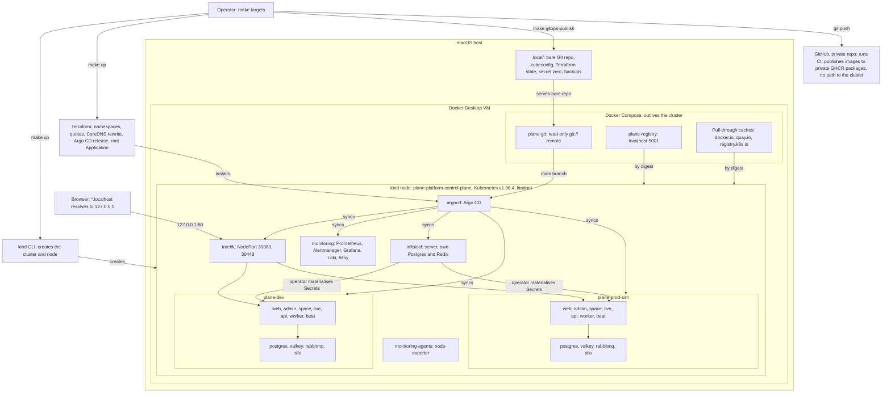

# plane-platform

This is a local deployment platform for a **customized Plane Community Edition v1.4.3 deployment**. It is not an original product.

The project management application is [Plane Community Edition](https://github.com/makeplane/plane), built by the Plane team and licensed AGPL-3.0. This repository adds what surrounds it: a kind cluster, Terraform, Argo CD, Infisical, a hardened overlay of the upstream Helm chart, monitoring, backups, and tests. "Wayline" is the name of this customized deployment, and it stays credited to Plane CE wherever it appears.

This is Pass 1 of 2. It runs on one laptop. No Hetzner or Cloudflare resource exists, and nothing about them has been built or tested. Outside the laptop there is only the private GitHub repository, its Actions runs, and four private GHCR packages. Pass 2 would move to Hetzner Cloud with independent dev and prod environments and Cloudflare, as described in [PASS2_HANDOFF.md](PASS2_HANDOFF.md) and [docs/future-hetzner.md](docs/future-hetzner.md).

**This platform is local and production-inspired, and it makes no claim of being ready for production.**

## Status

[docs/validation.md](docs/validation.md) is the authoritative record, and this table only summarizes it. Results use the labels in [contract section 12](docs/platform-contract.md#12-evidence-rule): PASS, FAIL, BLOCKED, NOT RUN. A result counts only with evidence in [docs/evidence/](docs/evidence/README.md). A row that reads NOT RUN and names the drill has no evidence published yet, however that run went.

**On 2026-11-05 the platform came back from nothing and from backup, on this one laptop, and Plane worked in both environments.** Both ran the final images, built from `84b63d9`: web `3d7575a1`, admin `ce7adc37`, space `5f0119ff` and backend `8c04bd18`, with a flattened backend and cache headers on HTML. One `make up` on a fresh clone exited 0 in 955 s, keeping the local registry and pull-through caches ([summary](docs/evidence/runs/clean-install-20261105T075041Z/summary.txt)). A full restore from backup into a new cluster passed every restore step ([result](docs/evidence/runs/restore-clean-20261105T081017Z.json)). Then `make down` and `make up` kept the data ([PERS-3](docs/evidence/runs/PERS-3-20261105T083304Z.txt)), and `make test` passed in full, ending at 08:45Z ([output](docs/evidence/runs/MAKE-TEST-20261105T083455Z.txt)). Most of these ran once, and the rows below say what each does not prove.

**Later that day a cold install reached both environments, and found a real defect.** At `e602dad`, `make destroy` with `PURGE=yes` removed the cluster, registry and caches, and a fresh clone ran a new machine's sequence, with `.tools` copied. The first `make up` built the images and stopped by design, in 1,008 s. After `make promote` for both environments, the next `make up` pulled everything through empty caches ([summary](docs/evidence/runs/clean-install-20261105T105546Z/summary.txt)). The drill's `umask 077` had made every build context file 0600, so web, admin, space and api crashed at start, and `make up` waited with no explanation. `b4f6cc9` fixes that, and a rebuild brought both environments up healthy ([rebuild](docs/evidence/runs/INST-1-cold-rebuild-20261105T122036Z.txt), [install](docs/install.md#first-run)). So that run's 5,238 s for `make up` is not the time of a good install. It holds up to about 46 minutes of the defect, and a full cold install with no defect has not been timed end to end. The same drill then restored everything from backup on the merged recovery code, and every restore step read PASS ([result](docs/evidence/runs/restore-clean-20261105T124518Z.json)).

**The last drill passed.** `make drill-clean-restore CONFIRM=yes LOSE_CLUSTER=yes`, from 13:06Z to 13:35Z at `06b8be7`, deleted the cluster with kind alone, as a disaster would, and restored from backup into a new one. Its last line reads `RESULT PASS`, `make` exit 0, in about 28 minutes, with every restore step PASS ([output](docs/evidence/runs/BKP-6-20261105T130633Z-lose-cluster-make.txt), [log](docs/evidence/runs/drill-clean-restore-20261105T130633Z.log)).

**Then the checks ran together at the final commit, `f30a7f5`, on the cluster that drill left, so not on a quiet machine.** `make test` passed whole, exit 0, from 14:00Z to 14:11Z ([output](docs/evidence/runs/MAKE-TEST-20261105T140019Z.txt), [summary](docs/evidence/runs/test-20261105T140019Z-56547.txt)). `make ci` passed in a clean clone ([output](docs/evidence/runs/ci-2-20261105T140005Z-clean-clone-f30a7f5.txt)). The stubbed restore suite read 1340 passed and 0 failed ([total](docs/evidence/runs/final-harness-f30a7f5/total.txt)), which shows the logic and not the platform. Of its 126 planted defects, 125 were caught and 1 survived ([record](docs/evidence/runs/final-harness-f30a7f5/mutants.txt)), a gap in one scenario that `f05930d` closes ([that defect, caught](docs/evidence/runs/final-harness-f05930d/mutant-survivor-rerun.txt)), with the whole set not run again. A complete image scan passed its policy, with upstream's findings reported and still there ([scan](docs/evidence/security/scan-images-20261105T140048Z/README.md)). The first push since `0dde813` then reached GitHub, and the GitHub Actions row of the table says what it ran. Commits after `f30a7f5` change how CI fetches its tools, one test scenario and these docs, and nothing Argo CD reads. A state below holds as of its date.

Runs up to the planted defects at the final commit, which ended at 14:54Z, are published under [docs/evidence/runs/](docs/evidence/runs/MANIFEST.tsv), with GitHub's runs in [docs/evidence/ci/](docs/evidence/ci/README.md). By the [evidence rules](docs/evidence/README.md#rules), anything newer has no result here until it is published.

| Area | State on 2026-11-05 | Marker |
|---|---|---|
| kind cluster and local services (`scripts/cluster-up.sh`) | The last drill deleted the cluster with kind alone, and its restore created a new one ([output](docs/evidence/runs/BKP-6-20261105T130633Z-lose-cluster-make.txt)). The cold install removed the local services with their volumes and brought them back ([summary](docs/evidence/runs/clean-install-20261105T105546Z/summary.txt)). [Creation log](docs/evidence/cluster-up-20261104T184521Z.log), which shows cluster creation only | None |
| Day-1 gates: digest pulls, kindnet enforcement, `git://` from a pod | PASS: 17 passed, 0 failed, in the final `make test` at `f30a7f5` ([run](docs/evidence/runs/gates-20261105T140019Z-56547.txt)), and at `fbfd7c5`, with a same-moment reference and the node as witness on each deny ([run](docs/evidence/day1-gates-20261104T231136Z.txt)). These checks do not cover Plane | None |
| Static checks (`make ci`) | PASS: exit 0 in a clean clone of `f30a7f5`, the final commit, from 2026-11-05T14:00Z to 14:14Z, with 149 of 149 stubbed scenarios ([output](docs/evidence/runs/ci-2-20261105T140005Z-clean-clone-f30a7f5.txt)). That clone came from this checkout, because the commit was not yet pushed, and `.tools` was copied. Before it, exit 0 in clean clones from GitHub, of `9c8e098` and of `0dde813`, the newer at 06:16Z, with 132 ([log](docs/evidence/ci/ci-2-20261105T061644Z-make-ci.log)). Planted defects caught: 33 of 33 at `283b51a` ([log](docs/evidence/ci/ci-3-20261104T223937Z-negative-controls-local.log)), and 45 of 45 at `cc88450`, 04:32Z, on this Mac only ([log](docs/evidence/runs/negative-controls-alerts-track-3.txt)). At `2f7a476`, the four scripts `make ci` runs passed as the baseline of two later control runs, and 3 more planted defects were caught ([routes](docs/evidence/runs/negative-controls-routes-1.txt), [Thanos](docs/evidence/runs/negative-controls-thanos-1.txt)) | None |
| `make up`, full platform | One `make up` from nothing: exit 0 in 955 s on 2026-11-05 at `94a54e2`, on a fresh clone with new secrets, keeping the local registry and pull-through caches and copying `.tools` ([summary](docs/evidence/runs/clean-install-20261105T075041Z/summary.txt), [Applications](docs/evidence/runs/clean-install-20261105T075041Z/apps-after-up.txt)). A second `make up` took 16 s and left the same pod uids, and Terraform planned no changes ([second](docs/evidence/runs/clean-install-20261105T075041Z/make-up-again.txt), [plan](docs/evidence/runs/clean-install-20261105T075041Z/terraform-plan-local.txt)). With them gone: the cold install at `e602dad` built and stopped in 1,008 s, then its next `make up` exited 0 with all 14 Synced and Healthy, one more `make up` took 16 s with the same pods, and Terraform found no differences ([summary](docs/evidence/runs/clean-install-20261105T105546Z/summary.txt), [Applications](docs/evidence/runs/clean-install-20261105T105546Z/apps-after-up.txt), [plan](docs/evidence/runs/clean-install-20261105T105546Z/terraform-plan-local.txt)). Its 5,238 s holds a defect, so it is not a good figure, and no cold install with no defect has been timed. Before this it ran in stages with `UP_STOP_AFTER` ([record](docs/evidence/runs/bootstrap-1.txt)), with some steps by hand ([prod-sim's CRs](docs/evidence/runs/infisical-prod-sim-crs-1.txt)) | None |
| Plane deployed in `plane-dev` | On the final images, by digest, restored into a new cluster. Synced and Healthy, with 11 workloads ready and 0 pods restarted, in the smoke test's `workloads-ready` step of the final `make test` at about 14:07Z ([JSON](docs/evidence/runs/smoke-dev-20261105T140019Z-56547.json)). In the `make test` of 08:41Z, on the first restored cluster, that step counted 14 pods that had restarted, read after a stop and resume, and 0 at 08:30Z, before it ([JSON](docs/evidence/runs/smoke-dev-20261105T083455Z-37296.json), [JSON](docs/evidence/runs/smoke-dev-20261105T083032Z-33341.json)). `live` stays upstream's image. Each pod's image read at 09:25Z ([capture](docs/evidence/runs/LOAD-3-20261105T092547Z-host.txt)) | None |
| Plane deployed in `plane-prod-sim` | On the same images, by digest, restored into the same new cluster. Synced and Healthy, with 11 workloads ready and 0 pods restarted, at about 14:09Z ([JSON](docs/evidence/runs/smoke-prod-sim-20261105T140019Z-56547.json)). At 08:43Z, on the first restored cluster, 14 pods restarted after a stop and resume, and 0 at 08:32Z ([JSON](docs/evidence/runs/smoke-prod-sim-20261105T083455Z-37296.json), [JSON](docs/evidence/runs/smoke-prod-sim-20261105T083217Z-34573.json)). `make promote ENV=prod-sim` first brought it these images at 05:34Z, reading `plane-dev` Synced and Healthy on every digest and taking a dump first ([record](docs/evidence/runs/promote-prod-sim-final-2.txt)). `live` stays upstream's image here too | None |
| End-to-end smoke test (`make test-e2e`) | PASS on the final images, in the final `make test` and on a clean install. Final `make test`, at `f30a7f5`, from 14:07Z to 14:09Z, on the cluster the last drill left: dev 45 PASS, 1 SKIP, and prod-sim 44 PASS, 1 SKIP ([dev](docs/evidence/runs/smoke-dev-20261105T140019Z-56547.json), [prod-sim](docs/evidence/runs/smoke-prod-sim-20261105T140019Z-56547.json)). Clean install, 08:06Z and 08:08Z: dev 46 PASS and prod-sim 45 PASS, no SKIP, with setup creating the admin on an image built here and `branding-fresh-install` passing ([dev](docs/evidence/runs/clean-install-20261105T075041Z/clone-evidence/smoke-dev-20261105T080642Z-65896.json), [prod-sim](docs/evidence/runs/clean-install-20261105T075041Z/clone-evidence/smoke-prod-sim-20261105T080826Z-22080.json)). Cold install, 12:42Z: the same counts, on images built in that clone ([dev](docs/evidence/runs/clean-install-20261105T105546Z/clone-evidence/smoke-dev-20261105T124049Z-24505.json), [prod-sim](docs/evidence/runs/clean-install-20261105T105546Z/clone-evidence/smoke-prod-sim-20261105T124237Z-98783.json)). After the second restore, 13:03Z and 13:05Z: dev 45 PASS, 1 SKIP, and prod-sim 44 PASS, 1 SKIP ([dev](docs/evidence/runs/smoke-dev-20261105T130318Z-97151.json), [prod-sim](docs/evidence/runs/smoke-prod-sim-20261105T130503Z-95847.json)). After the third restore, 13:32Z and 13:34Z: the same counts ([dev](docs/evidence/runs/smoke-dev-20261105T133252Z-52957.json), [prod-sim](docs/evidence/runs/smoke-prod-sim-20261105T133441Z-44438.json)). The `make test` of 08:41Z to 08:43Z, on the first restored cluster: the same counts ([dev](docs/evidence/runs/smoke-dev-20261105T083455Z-37296.json), [prod-sim](docs/evidence/runs/smoke-prod-sim-20261105T083455Z-37296.json)). Dev has one more step, the worker's negative control. The skip is `branding-fresh-install`, which can only run on a clean database, and which passed on the clean installs. It drives the API and WebSocket, not a browser. An earlier FAIL is kept ([37 of 38](docs/evidence/runs/smoke-dev-20261104T225624Z.json)) | None |
| Real browser, branded images | PASS by hand, in Chromium only: no script, with an AI agent driving a real browser pane. On dev, on the images from `1563cbf` (AUTH-5): sign-in, onboarding, a board, a page edited in two tabs, god-mode and the `/spaces/` public page ([record](docs/evidence/branding/live-dev/README.md)). On dev, on the final images (RT-2b, RT-3): two tabs of one session stayed in sync, held about 5 minutes, and text typed during a live restart reached the other tab after reconnect and survived reload ([record](docs/evidence/runs/RT-2b-RT-3-20261105T073208Z.txt)). A returning browser after a promotion first read FAIL (AUTH-6), because it kept showing the old page ([record](docs/evidence/branding/live-dev/README.md#the-stale-page)). With the final images, a plain navigation brought new HTML with no hard reload after a [promotion](docs/evidence/runs/auth-6-browser-promotion-dev-1.txt) and a [rollback](docs/evidence/runs/AUTH-6-rollback-20261105T064032Z.txt). That covers one route, and not a tab left open across the change. Sessions do not cross hosts: one profile signed in on dev got 401 on prod-sim ([record](docs/evidence/runs/AUTH-4-20261105T062750Z.txt)). After the restore, on the final images, 08:36Z to 08:39Z, in both environments ([record](docs/evidence/branding/live-final/README.md)): a work item typed by hand before the delete was still on the board, a published board rendered, prod-sim had its first browser sign-in, and both sessions held at once, each tab's `GET /api/users/me/` answering 200 at 08:38:18Z. The board was published by API from the signed-in page, because the UI's menu did not open from a scripted click, and that tab carried a session, so no browser saw it anonymously. An admin sign-in on prod-sim did not run. Safari and Firefox: Not tested in Pass 1 | None |
| Separation of dev and prod-sim | PASS on the restored platform, in the final `make test`, at `f30a7f5`, ending 14:11Z: 384 network checks and 97 on state, credentials and data, 0 failed ([network](docs/evidence/runs/separation-network-20261105T140019Z-56547.txt), [state](docs/evidence/runs/separation-state-20261105T140019Z-56547.txt)). The same at 08:45Z, on the first restored cluster ([network](docs/evidence/runs/separation-network-20261105T083455Z-37296.txt), [state](docs/evidence/runs/separation-state-20261105T083455Z-37296.txt)). All 240 dials between the environments from real pods timed out. References inside each environment time out too on the RabbitMQ and Silo console ports, so the 80 dials across on those two ports do not show the target was up. Each `api` can still reach the other host as any browser could. This is one cluster, not two | None |
| NetworkPolicy matrix (`make test-netpol`) | PASS on every row (NET-2), on the final images, in the final `make test`, at `f30a7f5`: 418 PASS, 0 FAIL, 0 INCONCLUSIVE from 56 source identities, sentinel first ([rows](docs/evidence/runs/netpol-20261105T140145Z.tsv), [output](docs/evidence/runs/MAKE-TEST-20261105T140019Z.txt)). It read the same at 08:35Z, on the first restored cluster ([rows](docs/evidence/runs/netpol-20261105T083542Z.tsv), [output](docs/evidence/runs/MAKE-TEST-20261105T083455Z.txt)), and at 02:38Z and 04:19Z, before the final images ([first](docs/evidence/runs/harness-make-test-netpol-3.txt), [second](docs/evidence/runs/harness-make-test-netpol-4.txt)). A deny PASS is a timeout while both references answered, which cannot rule out loss only on that pod's path to that target. Earlier runs by source namespace on upstream images are kept, among them BLOCKED runs from [argocd](docs/evidence/runs/netpol-foundation-argocd-1.txt) and [traefik](docs/evidence/runs/netpol-foundation-traefik-2.txt), made before their targets existed | None |
| Internal UIs admit only the node network | PASS on the final images, in the final `make test`, at `f30a7f5` ([run](docs/evidence/runs/routes-20261105T140019Z-56547.txt)), and at 08:40Z ([run](docs/evidence/runs/routes-20261105T083455Z-37296.txt)): from a Plane `api` pod, each of the 5 UIs answers 403, while the host gets through. First at 2026-11-05T00:38Z ([before, 30 FAIL](docs/evidence/runs/routes-before-1.txt), [after](docs/evidence/runs/routes-after-3.txt)). A source-address check, not a login | None |
| Infisical secret sync, cross-project isolation | PASS on the final images, after a full restore, in the final `make test`, at `f30a7f5` ([rendered](docs/evidence/runs/infisical-rendered-secrets-20261105T140019Z-56547.txt), [isolation](docs/evidence/runs/infisical-isolation-20261105T140019Z-56547.txt)), and at 08:40Z ([rendered](docs/evidence/runs/infisical-rendered-secrets-20261105T083455Z-37296.txt), [isolation](docs/evidence/runs/infisical-isolation-20261105T083455Z-37296.txt)): every rendered-Secret row, and a real 403 in both directions on each cross-project read. First at 2026-11-04T22:11Z on upstream images ([rendered](docs/evidence/runs/infisical-rendered-secrets-2.txt), [isolation](docs/evidence/runs/infisical-isolation-3.txt)) | None |
| Credential rotation (`make rotate`) | PASS, first real runs, on the final images. Dev, 07:23Z ([run](docs/evidence/runs/SEC-2-20261105T072331Z.txt)): of 1,002 signed-in samples, one a second, 38 answered 500, from 07:23:51Z to 07:24:29Z, about 38 s of errors ([watch](docs/evidence/runs/SEC-2-20261105T072331Z-watch.txt)). The script's own line says 60 s, which likely reads high, because Plane throttles its anonymous probe ([throttle](docs/evidence/runs/SEC-2-throttle-precheck-20261105T061924Z.txt)). No sync loop in about 16 minutes ([watch](docs/evidence/runs/SEC-6-20261105T072331Z-application-watch.txt)). Prod-sim passed at 07:32Z ([run](docs/evidence/runs/SEC-3-BKP-3-20261105T073240Z.txt)), and a rotation killed with SIGKILL 4 seconds in was finished by `RESUME=yes`, with the old passwords refused by Postgres ([run](docs/evidence/runs/SEC-4-20261105T073843Z.txt)). That kill landed at one point, after `ALTER ROLE`. The resume took no Infisical backup, so older dumps hold the previous value. Undo (SEC-4b), prod-sim, 08:46Z: a rotation killed with SIGKILL 4 seconds in, after `ALTER ROLE`, was undone by `ROLLBACK=yes`. Postgres took the target password and refused the replaced one, the three Deployments rolled out, Plane answered a database-backed request, and the script's probe failed 12 of 61, a 36 s window ([run](docs/evidence/runs/SEC-4b-20261105T084615Z.txt)). The full e2e in prod-sim has passed since that undo, 44 PASS and 1 SKIP, on restores from backups taken after it ([13:05Z](docs/evidence/runs/smoke-prod-sim-20261105T130503Z-95847.json), [13:34Z](docs/evidence/runs/smoke-prod-sim-20261105T133441Z-44438.json)). `SECRET_KEY` was untouched, as designed | None |
| Backup and restore (`make backup`, `make restore`) | `make backup` PASS for all three, on the final images, before the delete ([log](docs/evidence/runs/drill-clean-restore-20261105T074859Z.log)). **Full restore into a new cluster, three times on 2026-11-05.** The third, at `06b8be7`, on a cluster deleted with kind alone and with no install in the gap, read `RESULT PASS`, `make` exit 0: every restore step PASS, 1,474 s from the delete, and the local Terraform state moved aside, not applied over ([output](docs/evidence/runs/BKP-6-20261105T130633Z-lose-cluster-make.txt), [log](docs/evidence/runs/drill-clean-restore-20261105T130633Z.log), [result](docs/evidence/runs/restore-clean-20261105T130828Z.json)). It has no stage 4b, so it does not exercise `1374c1e`, and the last small restore fixes, on a branch merged afterward at `90ef495`, ran on stubs only, in the whole suite at `f30a7f5` ([total](docs/evidence/runs/final-harness-f30a7f5/total.txt)). The second, at `e602dad`, ran on the code with the recovery fixes merged: every step PASS, with every `not_run` empty ([result](docs/evidence/runs/restore-clean-20261105T124518Z.json), [Infisical](docs/evidence/runs/restore-infisical-20261105T124950Z.json), [dev](docs/evidence/runs/restore-dev-20261105T125720Z.json), [prod-sim](docs/evidence/runs/restore-prod-sim-20261105T130009Z.json)). The cluster CA was new, the old ids and secret zero came back, all 38 rendered Secret keys hold the old values, a second bootstrap changed nothing, and the e2e and Infisical tests passed ([log](docs/evidence/runs/drill-clean-restore-20261105T105347Z.log)). It took about 1,092 s: 7,663 s from the delete, less the clean install's 6,571 s. The first, on the script from before those fixes, read the same in about 1,226 s ([result](docs/evidence/runs/restore-clean-20261105T081017Z.json), [log](docs/evidence/runs/drill-clean-restore-20261105T074859Z.log)). The first two drill logs read `RESULT FAIL`, 1 failure, only because the clean install's own `destroy-refused` step failed at stage 4b: `make` passed `CONFIRM=yes` down through `MAKEFLAGS`, so `make destroy` obeyed ([step](docs/evidence/runs/clean-install-20261105T105546Z/destroy-refused.txt)). `af8b26e` did not reach that path, `1374c1e` does, and TEAR-1 has its own clean run, which refused ([run](docs/evidence/runs/TEAR-1-20261105T083304Z.txt)). `1374c1e` has not run in a drill, and its line was checked under an outer `make` with `CONFIRM=yes`, against a stub target, where it refused ([check](docs/evidence/runs/destroy-refused-line-check.txt)). The dumps are test data on one laptop, and the host's `.local/` stayed, so this is a lost cluster, not a lost machine. A restore with another `SECRET_KEY` was refused ([run](docs/evidence/runs/clean-install-20261105T075041Z/restore-foreign-key-refused.txt)). `make restore` in place read PASS at 07:43Z in dev ([JSON](docs/evidence/runs/restore-dev-20261105T074337Z.json)) and 07:34Z in prod-sim ([JSON](docs/evidence/runs/restore-prod-sim-20261105T073438Z.json)), from backups seconds old, and with no `CONFIRM` it refused ([JSON](docs/evidence/runs/restore-prod-sim-20261105T073428Z.json)). The fixes merged at `e602dad` are for a clean restore that stops. Neither later restore stopped, so those paths have run only on stubs, see [install](docs/install.md#after-a-destroy) | None |
| Alert delivery (`make test-alert`) | PASS in both, on an injected `PlaneApiDown`. Dev, 05:50Z: fired at 68 s, reached the sink at 78 s, resolved at the sink 91 s after recovery, and prod-sim stayed quiet ([JSON](docs/evidence/runs/alert-test-dev-20261105T055044Z.json)). Prod-sim, 07:25Z: reached the sink at 83 s, resolved there 61 s after recovery, and dev stayed quiet ([run](docs/evidence/runs/MON-2-20261105T072541Z-run.txt), [JSON](docs/evidence/runs/alert-test-prod-sim-20261105T072541Z.json)). Other alerts have reached the sink: a temporary rule ([path](docs/evidence/runs/monitoring-alert-path-1.txt)), `ArgoSyncFailed` on a throwaway Application ([run](docs/evidence/runs/h16-fire-1.txt)), and `KindnetSkippedNetworkPolicies` on a synthetic pod ([run](docs/evidence/runs/h18-synthetic-2.txt)). `PlaneWorkerNoConsumer` fired on a real fault, and its record stops at active in Alertmanager ([record](docs/evidence/runs/plane-prod-sim-worker-no-consumer-alert-1.txt)). A real defect, found and fixed on 2026-11-05: `PlaneRabbitmqDown` and `PlaneMinioDown` did not fire for 270 s each with the pod gone, because `up` has no series once the endpoint leaves the Service ([before](docs/evidence/runs/alert-rules-dev-20261105T100605Z.txt)). With `kube_statefulset_status_replicas_ready` added, they reached the sink at 157 s and 148 s, and resolved there 40 s and 26 s after the pod came back ([after](docs/evidence/runs/alert-rules-dev-20261105T101707Z.txt)). Dev only, by scaling to zero, so crashes and hung processes were not tested. The sink is a webhook that prints lines, and nothing pages a person | None |
| Failure drills (`tests/drills/`) | PASS on the final images. Pod restart: dev 07:04Z ([log](docs/evidence/runs/drill-pod-restart-dev-20261105T070414Z.log)) and prod-sim 07:23Z ([log](docs/evidence/runs/drill-pod-restart-prod-sim-20261105T072331Z.log)), with the sentinel row and attachment intact and new jobs running after each StatefulSet pod was replaced (PERS-1, PERS-2, JOB-2). During dev's Postgres round, 7 of 180 signed-in samples answered 500, from 07:04:26Z to 07:04:32Z ([timeline](docs/evidence/runs/PERS-1-20261105T070358Z-timeline.txt)). Failed deploy, dev, 06:23Z (DEP-1, [log](docs/evidence/runs/drill-failed-deploy-20261105T062343Z.log)): the old pod kept serving, with 200 on all 61 samples, and a revert restored it. Nothing fired, because the revert came first, at 10m32s: `ArgoSyncFailed` and others stayed pending, and that one had reached 13m45s of its 15m when the revert ended it ([alerts](docs/evidence/runs/drill-failed-deploy-20261105T062343Z-alerts.tsv)). Rollback and forward promotion, dev, 06:40Z (DEP-2, [rollback](docs/evidence/runs/DEP-2-20261105T064032Z-rollback.txt), [forward](docs/evidence/runs/DEP-2-20261105T064032Z-promote-forward.txt)): 239 of 239 signed-in samples answered 200, and prod-sim did not move ([timeline](docs/evidence/runs/DEP-2-20261105T064032Z-timeline.txt)). Failing migrator, dev, 06:49Z (DEP-3, [log](docs/evidence/runs/drill-failed-migrator-20261105T064940Z.log)): the sync stopped before wave 3, and a revert restored it. Self-heal: a replica change on `plane-admin-wl` was reverted in 3 s (GITOPS-4, [run](docs/evidence/runs/GITOPS-4-20261105T073240Z.txt)). Each ran once, with one replica of each workload. A pull failure on web and one migrator exit are the only bad releases tried, and a pod delete is not a crash or a node restart. A first prod-sim pod restart on upstream images is a kept FAIL, caused by a test ([log](docs/evidence/runs/drill-pod-restart-prod-sim-20261104T233500Z.log), see the [case study](docs/case-study.md)) | None |
| Load test (`make test-load`) | On a quiet cluster, dev, final images. `THINK=1`, 09:03Z to 09:12Z: PASS on its thresholds, 2.39, 4.52 and 8.63 requests a second at 5, 10 and 20 virtual users, p95 268, 647 and 1,005 ms, 0 failed of 2,800 ([results](docs/evidence/runs/load-20261105T090247Z/results.json)). `THINK=0`, 09:12Z to 09:21Z: requests flatten by 5 virtual users, at 8.86, 8.37 and 7.82 a second, p95 1,093, 2,095 and 4,935 ms, 1 failed of 4,512. k6 crossed its read latency threshold, so `make` exited 2 and the numbers stand ([results](docs/evidence/runs/load-20261105T091213Z/results.json), [run](docs/evidence/runs/LOAD-1b-20261105T090247Z-run.txt)). **Postgres's 500 m CPU limit is what binds:** it ran at 493 to 500 m, throttled in 98% to 100% of CFS periods. The API worker's one-minute rate topped out at 460 m of its 750 m limit, though it was throttled in 10% to 17% of periods, so its bursts did reach that limit. The VM had at most 2.49 of 12 CPUs busy, so this ceiling is a setting here, not the laptop. One run, calling only the API, on a table its own writes grow. Details, and the earlier run on a busy machine, are in [docs/resource-utilization.md](docs/resource-utilization.md) | None |
| Teardown and recreation | TEAR-1 PASS: `make destroy` with no `CONFIRM` refused, with the node unchanged ([run](docs/evidence/runs/TEAR-1-20261105T083304Z.txt)). Stop and resume (PERS-3) PASS: `make down` in 15 s, `make up` in 82 s, and the sentinel row and attachment read back in both environments ([run](docs/evidence/runs/PERS-3-20261105T083304Z.txt)). Recreation after removing the local services (TEAR-4): the cold install above ([summary](docs/evidence/runs/clean-install-20261105T105546Z/summary.txt)). Disk after a delete: 31.7 GiB free, 15.6 GiB back ([log](docs/evidence/runs/drill-clean-restore-20261105T105347Z.log)). `Docker.raw`: 38,276,744 KiB before the last drill's delete and 38,301,404 KiB after its restore, with a cluster back on the disk, so a delete alone was not read (TEAR-5b, [output](docs/evidence/runs/BKP-6-20261105T130633Z-lose-cluster-make.txt)) | None |
| Wayline branded images | Both environments run the images built from `84b63d9`, by digest from `localhost:5001/wayline` (BR-2), and every gate exited 0 on that build ([evidence](docs/evidence/branding/README.md), [digests](docs/evidence/branding/digests.tsv)). `/source`: FAIL (BR-3), because it answers 302 to `84b63d9` on GitHub, which answers 404 with no credentials while the repository is private ([record](docs/evidence/ci/br-3-20261105T054812Z-source-logged-out.txt)) | None |
| Image scan (`make scan-images`) | PASS (CI-7): the complete scan at `f30a7f5`, 2026-11-05T14:00Z, scanned all 31 targets, exit 0, so no image built here has a CRITICAL finding with a fix, and nothing was missed ([scan](docs/evidence/security/scan-images-20261105T140048Z/README.md)). The findings did not go away: 15 CRITICAL, 515 HIGH, 768 MEDIUM, 378 LOW, 120 UNKNOWN. Five upstream images have a CRITICAL finding with a fix, which the policy reports and does not fail: postgres 15 and 16 in `gosu`, rabbitmq in `libcrypto3` and `libssl3`, `plane-live`, and argocd in `git-lfs` and `kustomize`. Infisical has 5 CRITICAL with no fix. HIGH findings remain in images built here, backend 4 and space 30, each with a fix not taken. The zeros for web and admin cover OS packages only, so their bundled libraries show only in the lockfile row, and this run has none, because `.build/plane-src` was not on disk. That row last read 1 CRITICAL and 31 HIGH, on this Mac at 05:20Z ([run](docs/evidence/security/scan-images-20261105T052024Z/README.md)) and on a runner at 14:28Z ([log](docs/evidence/ci/ci-4-20261105T142148Z-run-42044273310.log)). The CRITICAL is proxy-addr 2.0.7 in upstream's `pnpm-lock.yaml`, which no bundle ships ([check](docs/evidence/branding/lockfile-critical.txt)), and upstream's `plane-live`, which runs here, still has it. Every scan on this Mac used the database updated 2026-11-04T19:02Z, so none knows a newer advisory. The first complete scan, 2026-11-04T21:54Z, read FAIL, on 5 fixable CRITICAL findings in images built here, and CI-7b shows those fixed ([summary](docs/evidence/security/README.md)) | None |
| GitHub Actions workflows on GitHub | `76e98ee` reached GitHub at 14:21Z, the first push since `0dde813`, with 347 commits. `images.yml`: PASS, run 42044273310 at `76e98ee` built and published four new digests from an arm runner, with every layer walk clean, its prune deleted nothing, and it force-updated pull request 1, which stays open and unmerged ([log](docs/evidence/ci/ci-4-20261105T142148Z-run-42044273310.log), [pull request](docs/evidence/ci/ci-5-20261105T150014Z-pr-1.txt)). Run 41975430939 at `9c8e098` did the same first ([walk](docs/evidence/ci/ci-4-20261105T060219Z-published-compare.txt)), and anonymous reads get 401 ([record](docs/evidence/ci/ci-4-20261105T055033Z-ghcr-visibility.txt)). None of those digests is running, because the Mac built those from `84b63d9`. `ci.yml`: PASS on 6 runs on `push` up to `0dde813`. At `76e98ee`, run 42044273346: Lint and Security passed, and Manifests failed on three attempts before any check ran, on a 504 from GitHub when it fetched a pinned tool. At `7cde05a`, run 42046683167: Manifests and Security passed, with 149 of 149 stubbed scenarios, and Lint failed the same way, on shellcheck, before any check ran. At `6edde64`, run 42048656380: all three passed ([what happened](docs/evidence/ci/README.md#the-504-on-a-pinned-tool)). `promote-prod-sim.yml` opened promotion pull request 2, closed unmerged as a test. GitHub held the `pull_request` checks with no jobs, run 42045522553 the newest, so no check has run on a pull request | None |
| Hetzner, Cloudflare | Out of scope for Pass 1. Nothing provisioned | |

## What this platform does not claim

- **Namespace separation is not equivalent to independent production clusters.** `plane-dev` and `plane-prod-sim` share one node, one kernel, one API server, one etcd, one CNI, one Traefik, one Argo CD, one monitoring stack, and one Docker VM. A node failure or a bad cluster-wide change takes out both. "Prod-sim" is a simulation of a promotion path, not a production environment.
- **Terraform does not create the cluster.** The kind CLI creates the cluster and node, through `scripts/cluster-up.sh`. Docker Compose creates the registry, pull-through caches, and Git remote. Terraform manages only the objects listed under [Who creates what](#who-creates-what).
- **GitHub does not enforce approval.** On GitHub Free with a private repository there are no required reviewers, protected branches, or environment gates. A pull request merge is a process, not a control. See [.github/workflows/README.md](.github/workflows/README.md).
- **There is no TLS locally, and no high availability.** Everything is plain HTTP on loopback, with one replica of each stateful service.

The full list is in [docs/known-limitations.md](docs/known-limitations.md).

## Owner decisions still open

Only the owner, Bereket Abera, can settle these, and none is settled as of 2026-11-05. [PASS2_HANDOFF.md](PASS2_HANDOFF.md#owner-decisions-still-open) has the detail.

1. **D12, the `email.py` header.** AI agents replaced the one commercially headed upstream file in the backend image and flattened it. The owner was told and has not reviewed this, and no legal review has happened.
2. **D16, the licence for platform code.** `LICENSE` is upstream's AGPL-3.0 text and does not say "only", and nearly all the scripts and manifests carry no header.
3. **D17, two GitHub Apps with access to the repository.** `netlify` and `builder-io-integration`, inferred from the check suites they left. What each covers was not read.
4. **D18, whether to rename Wayline.** No trademark search has been done on the name.
5. **D10, a public repository for `/source`.** `/source` needs one, or another source offer, before anyone else uses an instance. It answers 302 to a commit that gives outsiders 404.

## Architecture



The diagram shows what runs today. The design and its reasons are in [docs/architecture.md](docs/architecture.md).

### Who creates what

Each resource has one owner, and [contract section 4](docs/platform-contract.md#4-ownership-exactly-one-owner-per-resource) is binding. `scripts/ci/ownership.sh` checks for overlaps.

| Owner | Owns |
|---|---|
| kind CLI, via `scripts/cluster-up.sh` | Cluster, node, CNI, port and volume mounts |
| Docker Compose, in `infrastructure/local-services/` | Registry, pull-through caches, `git://` remote |
| Terraform, in `infrastructure/terraform/environments/local` | Namespaces and labels, ResourceQuota, LimitRange, CoreDNS rewrite, Argo CD Helm release, AppProjects, root Application |
| Terraform, in `infisical/terraform` (separate root and state) | Infisical projects, environments, machine identities, Kubernetes Auth config. Not secret values |
| Argo CD | Everything else in the cluster, including both Plane environments |
| Infisical | Secret values and their history |
| Scripts, via `.local/secret-zero/` | The few secrets that must exist before Infisical does |

## Quick start

Prerequisites, which `make setup` checks through `scripts/prereqs.sh`:

- Docker with the Compose and Buildx plugins, git, make, curl, jq, python3, openssl, lsof, tar, unzip, shasum.
- Docker with 14 GiB of memory (the script accepts 13 GiB or more visible, since the VM reports slightly less than the setting) and 4 or more CPUs.
- 25 GiB of free host disk, 35 GiB recommended.
- Host ports 80, 443, and 5001 free.
- Node 22 with corepack, rsync and perl, which only the image build needs. `scripts/prereqs.sh` only warns without them, but a new machine's first `make up` builds the images, so the quick start below needs them.

```bash
make setup    # install pinned CLIs into .tools/bin, check prerequisites
make up       # create or resume the whole platform. On a new machine it builds the images, then stops with an error, on purpose
make promote ENV=dev                 # only after that stop
make promote ENV=prod-sim CONFIRM=yes SKIP_BACKUP=yes OVERRIDE_DEV_CHECK="first install on a new machine: nothing is running yet"
make up       # pulls everything through empty caches
make status   # cluster, GitOps, workloads, URLs, resource use
make test     # gates, NetworkPolicy matrix, Infisical, routes, smoke tests, separation
```

A new machine needs the two `make promote` lines because the digests in Git do not exist there, and a rebuild gives new ones. The cold install ran that sequence, then the smoke test in both environments and the Infisical tests, with `.tools` copied ([summary](docs/evidence/runs/clean-install-20261105T105546Z/summary.txt), [steps](docs/install.md#first-run)). A new machine also downloads the tools, which the drill does not: Not tested in Pass 1. An earlier clean install kept the local registry and pull-through caches, so one `make up` was enough ([summary](docs/evidence/runs/clean-install-20261105T075041Z/summary.txt)). `make test` ran in full on the first restored platform ([output](docs/evidence/runs/MAKE-TEST-20261105T083455Z.txt)).

One `make up` from nothing took 955 s on this laptop, with the registry and caches on disk ([summary](docs/evidence/runs/clean-install-20261105T075041Z/summary.txt)). With them gone, a full cold install with no defect has not been timed end to end, and the [install page](docs/install.md#first-run) says what the one run did time.

Stopping and removing:

```bash
make down                 # stop the cluster, keep all data; make up resumes it
make destroy CONFIRM=yes  # delete the cluster; takes a backup first unless SKIP_BACKUP=yes
```

`make help` lists every target. The common ones:

| Target | What it does |
|---|---|
| `make logs ENV=dev SVC=api` | Tail logs for one workload. With no `SVC`, list what can be tailed |
| `make backup ENV=dev` | Back up an environment, or `ENV=all` |
| `make restore ENV=dev BACKUP=<id or latest>` | Restore. Refuses a non-empty environment without `CONFIRM=yes` |
| `make restore-clean BACKUP=<id or latest>` | Bring the whole platform back into a clean environment, Infisical first. Its first real run read PASS on every step on 2026-11-05 ([result](docs/evidence/runs/restore-clean-20261105T081017Z.json)) |
| `make rotate ENV=dev` | Rotate a database credential through Infisical. It never rotates `SECRET_KEY` |
| `make render` | Re-render Plane manifests from `helm/plane` into `gitops/environments` |
| `make gitops-publish` | Push committed `main` to the local Git remote that Argo CD reads. Argo CD sees nothing else |
| `make promote ENV=prod-sim` | Promote digests. Prod-sim accepts only a digest recorded for dev under that image, needs `plane-dev` Synced and Healthy with it in a ready container, and takes a dump first |
| `make rollback ENV=dev` | Revert the last promotion for an environment |
| `make ci` | Run the CI checks locally, using the same scripts as GitHub Actions |
| `make test-routes`, `make test-separation`, `make test-infisical` | Each part of `make test` alone |
| `make scan-images` | Scan every image the platform runs |
| `make drill-pod-restart ENV=dev` | Restart each StatefulSet pod and prove the data survives. Also `drill-failed-deploy` and `drill-clean-restore`, and `tests/drills/failed-migrator.sh` and `tests/drills/alert-rules.sh`, which have no make target |

Full steps and troubleshooting are in [docs/install.md](docs/install.md) and [docs/runbooks/](docs/runbooks/).

Do not run `docker system prune -a` to free disk if other projects on the machine rely on cached images. Official MinIO images, for example, can no longer be pulled anonymously, so a pruned copy may not come back.

## Environment URLs

All hosts resolve to loopback without editing `/etc/hosts`. Traefik is reached through kind's port mapping, bound to `127.0.0.1` only, so these are not exposed to the LAN. Sign-in details are in [docs/install.md](docs/install.md). None are in this file.

| URL | Backend |
|---|---|
| <http://plane.dev.localhost> | Plane, dev |
| <http://plane.prod-sim.localhost> | Plane, production simulation |
| <http://argocd.localhost> | Argo CD |
| <http://grafana.localhost> | Grafana |
| <http://prometheus.localhost> | Prometheus |
| <http://alertmanager.localhost> | Alertmanager |
| <http://infisical.localhost> | Infisical |

All seven answered through Traefik, with the NetworkPolicies applied, in [`make status`](docs/evidence/runs/plane-prod-sim-status-1.txt) on 2026-11-04, and again after the stop and resume on 2026-11-05 ([PERS-3](docs/evidence/runs/PERS-3-20261105T083304Z.txt)): 200, or a 302 from Grafana and Prometheus. `/source` on the web host answers 302 to `84b63d9` on GitHub, which is pushed, and it ends in a 404 for anyone without access, because the repository is private ([record](docs/evidence/ci/br-3-20261105T054812Z-source-logged-out.txt)).

A real browser session used `http://plane.dev.localhost` in Chromium ([record](docs/evidence/branding/live-dev/README.md)), and session cookies are host-only, so a dev session gets 401 on the prod-sim host ([check](docs/evidence/runs/plane-dev-cookies-1.txt)). The same held in one Chromium profile on 2026-11-05 ([record](docs/evidence/runs/AUTH-4-20261105T062750Z.txt)), and that browser then held a session on both hosts at once ([record](docs/evidence/branding/live-final/README.md)).

`*.localhost` resolution and cookie separation in Firefox and Safari: Not tested in Pass 1.

## Resource use

[docs/resource-utilization.md](docs/resource-utilization.md) holds the measured values, with their conditions. The main readings here are three windows on 2026-11-05, on the final images, restored into a new cluster, on this laptop. Each is one run, so they predict no other host. The cluster was young, so they are not a steady state.

| Measured | Value | Conditions |
|---|---:|---|
| Plane, dev and prod-sim, 11 workloads each, idle | 1,109 and 1,039 MiB, 64 and 63 m of CPU | Averages, 08:47:35Z to 08:56:59Z ([derived](docs/evidence/runs/LOAD-3-20261105T092547Z-derived.txt)) |
| All pods, idle | 5,703 MiB, 458 m of CPU | The same window |
| Docker VM used, idle | 8.65 GiB average, 8.79 top, of 13.63 | The same window. It includes the owner's other containers |
| Docker VM used, load with think time | 8.80 GiB average, 8.90 top | 09:03Z to 09:12Z ([results](docs/evidence/runs/load-20261105T090247Z/results.json)) |
| Docker VM used, load with no think time | 8.93 GiB average, 9.05 top, with at most 2.49 of 12 CPUs busy | 09:12Z to 09:21Z ([results](docs/evidence/runs/load-20261105T091213Z/results.json)). No memory limit came close. Postgres's 500 m CPU limit is what bound |
| The kind node, after the clean install | 8.27 GiB of 13.63, one reading | `make status` at 08:06Z ([status](docs/evidence/runs/clean-install-20261105T075041Z/make-status.txt)) |
| Earlier cluster, quiet, upstream images | All pods 6,806 MiB, the node 8,331 MiB, VM 9.44 GiB median | 2026-11-05T00:03:44Z ([snapshot](docs/evidence/runs/plane-prod-sim-snapshot-final-1.txt), [samples](docs/evidence/runs/plane-prod-sim-memory-1.txt)). The API server alone read 1,168 MiB |
| Docker VM used, highest sampled | 10.93 GiB of 13.63 | Earlier cluster, 2026-11-05T01:50:00Z, in 60-second readings from 00:35Z ([timeline](docs/evidence/runs/LOAD-3-20261105T074543Z-timeline.json)), with its cause not read. The estimate was 9.9 to 13.7 GiB |

Requests and limits are configuration, set in [contract section 10](docs/platform-contract.md#10-memory-budget-per-workload) for Plane:

| Configured memory | Requests | Limits |
|---|---:|---:|
| One Plane environment, 11 workloads | 1,424 MiB | 4,192 MiB |
| Two Plane environments | 2,848 MiB | 8,384 MiB |
| The whole cluster | 5,766 MiB | 15,812 MiB |

Still estimates:

| Item | Estimate | How it was derived |
|---|---:|---|
| Images on the node, unpacked | 8.56 GiB | Estimate: sum of gzip ISIZE trailers across deduplicated registry layers, 33 images, without filesystem overhead |
| Total host disk growth | 19.5 to 24.8 GiB | Estimate: image sizes above plus planning figures for volumes, logs, builds, tools, and the three pull-through caches |

Limits add up to more than the VM's memory on purpose, so the two environments are brought up one after the other. Simultaneous first boots are the worst case.

Measured on the staged first boots: VM used reached 8.62 GiB during `plane-dev`'s and 9.23 GiB during `plane-prod-sim`'s ([history](docs/evidence/runs/plane-prod-sim-memory-history-1.txt)). The drill's clean install does not sample VM memory, so peak memory on a clean first boot: Not tested in Pass 1.

Sizes on the running platform added up to 17.75 GiB at 2026-11-05T02:01Z, with 10.51 GiB of that in the node's image store ([reading](docs/evidence/runs/dr-disk-1.txt)). That is a sum read while other work was building, not a before and after of a clean install. At 07:46Z the node's volume read 13.76 GB, the local registry 1.16 GB and the three caches 3.0 GB ([capture](docs/evidence/runs/LOAD-3-20261105T074543Z-docker-project.txt)).

On the clean install, host free disk went from 31 GiB to 19 GiB by `df`, in whole GiB, the clone included, with the registry, caches and node image already on disk ([summary](docs/evidence/runs/clean-install-20261105T075041Z/summary.txt), [status](docs/evidence/runs/clean-install-20261105T075041Z/make-status.txt)). So that is not a first install's growth.

On the cold install, host free disk went from 31 GiB to 13 GiB by `df`, 18 GiB, and `Docker.raw` then held 40,060,992 KiB, 38.21 GiB ([summary](docs/evidence/runs/clean-install-20261105T105546Z/summary.txt), [disk](docs/evidence/runs/clean-install-20261105T105546Z/disk-after-install.txt)). That is one run and not a clean figure, because the defect made it build twice, so both builds' images and the second build's files are in it ([what it holds](docs/resource-utilization.md#host-and-docker-storage)). A cold install with no defect: Not measured in Pass 1.

The deletes before those installs brought host free from 17.5 to 31.6 GiB, 14.1 GiB back ([log](docs/evidence/runs/drill-clean-restore-20261105T074859Z.log)), and to 31.7 GiB with the local services removed too, 15.6 GiB back, where the check counted on about 27.0 GiB ([log](docs/evidence/runs/drill-clean-restore-20261105T105347Z.log)). The last drill's delete, with kind alone, left 28.3 GiB free, 11.2 GiB back ([log](docs/evidence/runs/drill-clean-restore-20261105T130633Z.log)). `Docker.raw` read 38,276,744 KiB at the top of [its output](docs/evidence/runs/BKP-6-20261105T130633Z-lose-cluster-make.txt), before that delete, and 38,301,404 KiB at the bottom, after the restore, with a cluster back on the disk, so what a delete alone does to that file was not read.

## Repository map

```text
apps/wayline/                  branding: pinned upstream ref, patches, overlay, codemod, checks, Dockerfiles
infrastructure/kind/           cluster template, containerd mirror config
infrastructure/local-services/ registry, pull-through caches, git daemon (Compose)
infrastructure/terraform/      modules/{foundation,argocd}, environments/local
                               environments/{dev,prod} are untested Pass 2 interface notes, no Terraform
helm/plane/                    vendor/ (byte-identical upstream chart), components/hardening, overlays/{dev,prod-sim}
helm/values/                   values for each platform chart
gitops/bootstrap/              AppProjects and root Application (applied by Terraform), Argo CD route
gitops/applications/           Application manifests; the root app syncs this directory
gitops/platform/               network policies, backup storage
gitops/environments/           rendered Plane manifests. Generated by make render, never hand-edited
infisical/                     Terraform root for Infisical config, manifests, docs
monitoring/                    dashboards, rules, blackbox config, alert sink, ops helpers
policy/                        conftest rules and their tests
tests/                         day-1 gates, NetworkPolicy matrix, e2e smoke, routes, separation, alert rules, drills, load test
scripts/                       entry points behind make targets; scripts/ci/ is shared with GitHub Actions
docs/                          documentation index, contract, ADRs, runbooks, evidence
.github/workflows/             thin workflows that call the same scripts as make targets
tools.lock                     pinned CLI versions and checksums
```

Start with the [documentation index](docs/README.md). The [platform contract](docs/platform-contract.md) is binding for names, ownership, and ordering. For the story of how this was built, including what went wrong and what remains unproven, read the [case study](docs/case-study.md).

## License and credit

Plane Community Edition is developed by the Plane team and licensed under AGPL-3.0. Source for the pinned release is at [makeplane/plane](https://github.com/makeplane/plane), commit `37a15d99231042b3ff5a4401fed479fdbec9effe` (v1.4.3).

| Component | License note |
|---|---|
| Plane CE application | AGPL-3.0 |
| `plane-ce` Helm chart 1.8.6, vendored unmodified in `helm/plane/vendor/` | AGPL-3.0 by the chart's `artifacthub.io/license` annotation only. The upstream chart repository has no LICENSE file. See `helm/plane/vendor/plane-ce-1.8.6/VENDOR.md` |
| Silo (`pgsty/silo`), the MinIO-compatible object store | AGPL-3.0 |
| Wayline branding patches | Modifications of AGPL-3.0 source, so AGPL-3.0 applies when delivered |

AGPL section 13 applies to a modified version that users interact with over a network. The repository is private today, and Pass 1 serves only loopback. So the `/source` link in the running web image answers 302 to `84b63d9` on GitHub, which returns 404 to anyone without access. That has no practical effect while the owner is the only user, and it must be fixed before anyone else uses a deployed instance. The four GHCR packages read as private too, because an anonymous read gets 401 ([record](docs/evidence/ci/ci-4-20261105T055033Z-ghcr-visibility.txt)). Two third-party GitHub Apps, `netlify` and `builder-io-integration`, left check suites on pushed commits, so they may hold access to the repository, which this token cannot list ([record](docs/evidence/ci/br-3-20261105T060937Z-apps.txt)). Details and obligations are in [docs/agpl-compliance.md](docs/agpl-compliance.md).

One upstream file, `apps/api/plane/utils/email.py`, carries a commercial header at `v1.4.3`. AI agents replaced it in the backend image with upstream's own later AGPL-3.0-only version and flattened the image, and a [walk of every layer](docs/evidence/branding/layer-check.txt) reads 0 hits. The owner, Bereket Abera, was told and has not reviewed this, and no legal review has happened. This is engineering, not legal advice ([details](docs/agpl-compliance.md#the-commercial-header-in-emailpy)).

The repository's root `LICENSE` is upstream's AGPL-3.0 text, unchanged, with upstream's `COPYRIGHT.txt` beside it and [NOTICE.md](NOTICE.md) recording what was modified. New source files under `apps/wayline/` carry `SPDX-License-Identifier: AGPL-3.0-only`. The owner has not confirmed the licence for the platform code around it: `LICENSE` does not say "only", and nearly all of those scripts and manifests carry no header. No decision on this is recorded as of 2026-11-05, so the question stays with the owner.
