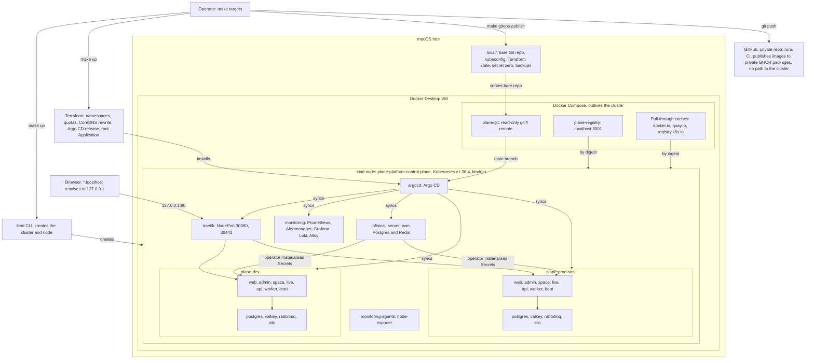

# plane-platform

This is a local deployment platform for a **customized Plane Community Edition v1.4.3 deployment**. It is not an original product.

The project management application is [Plane Community Edition](https://github.com/makeplane/plane), built by the Plane team and licensed AGPL-3.0. This repository adds what surrounds it: a kind cluster, Terraform, Argo CD, Infisical, a hardened overlay of the upstream Helm chart, monitoring, backups, and tests. "Wayline" is the name of this customized deployment, and it stays credited to Plane CE wherever it appears.

This is Pass 1 of 2. It runs on one laptop. No Hetzner or Cloudflare resource exists, and nothing about them has been built or tested. Outside the laptop there is only the private GitHub repository, its Actions runs, and four private GHCR packages. Pass 2 would move to Hetzner Cloud with independent dev and prod environments and Cloudflare, as described in [PASS2_HANDOFF.md](PASS2_HANDOFF.md) and [docs/future-hetzner.md](docs/future-hetzner.md).

**This platform is local and production-inspired, and it makes no claim of being ready for production.**

## Status

[docs/validation.md](docs/validation.md) is the authoritative record, and this table only summarizes it. Results use the labels in [contract section 12](docs/platform-contract.md#12-evidence-rule): PASS, FAIL, BLOCKED, NOT RUN. A result counts only with evidence in [docs/evidence/](docs/evidence/README.md). A row that reads NOT RUN and names the drill has no evidence published yet, however that run went.

**Up to 2026-11-05T07:49Z the platform ran and Plane worked in both environments, on this one laptop.** Both ran the final images, built from `84b63d9`: web `3d7575a1`, admin `ce7adc37`, space `5f0119ff` and backend `8c04bd18`, with a flattened backend and cache headers on HTML. It got there in stages, with fixes and some steps by hand between them. Rotation, in-place restores, the failure drills, the alert path and a load test have now run on those images, most of them once, and the rows below say what each does not prove.

**As this is written,** `make drill-clean-restore CONFIRM=yes CLEAN_INSTALL_FIRST=yes` has deleted the cluster and is rebuilding it. It runs a clean install from a fresh clone with new secrets, keeping the local registry and pull-through caches, with `.tools` copied rather than downloaded. It tests that install and deletes it, then restores dev, prod-sim and Infisical from backup into a new cluster. None of its evidence is published, so one `make up` from nothing, teardown and recreation, and a full restore read NOT RUN here. The final `make test` comes after it. The markers left in this file wait on different runs: the time of one `make up` and data across the rebuild on the drill's evidence, `Docker.raw` after a delete on TEAR-5, and disk growth of a first install on a cold install with the registry and caches gone (TEAR-4), because the drill keeps them. Read a state below as of its date.

Runs up to 2026-11-05T07:48Z are published under [docs/evidence/runs/](docs/evidence/runs/MANIFEST.tsv). Four LOAD-3 files that [docs/resource-utilization.md](docs/resource-utilization.md) links, written by 08:01Z, wait for the next `make publish-evidence`, as that page says. By the [evidence rules](docs/evidence/README.md#rules), anything newer has no result here until it is published.

| Area | State on 2026-11-05 | Marker |
|---|---|---|
| kind cluster and local services (`scripts/cluster-up.sh`) | The drill deleted the cluster and is rebuilding it as this is written. The registry and caches stay. [Creation log](docs/evidence/cluster-up-20261104T184521Z.log), which shows cluster creation only | None |
| Day-1 gates: digest pulls, kindnet enforcement, `git://` from a pod | PASS: 17 passed, 0 failed, at `fbfd7c5`, with a same-moment reference and the node as witness on each deny ([run](docs/evidence/day1-gates-20261104T231136Z.txt)). These checks do not cover Plane | None |
| Static checks (`make ci`) | PASS: exit 0 in clean clones from GitHub, of `9c8e098` and of `0dde813`, the newer at 2026-11-05T06:16Z, with 132 stubbed scenarios ([log](docs/evidence/ci/ci-2-20261105T061644Z-make-ci.log)). Planted defects caught: 33 of 33 at `283b51a` ([log](docs/evidence/ci/ci-3-20261104T223937Z-negative-controls-local.log)), and 45 of 45 at `cc88450`, 04:32Z, on this Mac only ([log](docs/evidence/runs/negative-controls-alerts-track-3.txt)). At `2f7a476`, the four scripts `make ci` runs passed as the baseline of two later control runs, and 3 more planted defects were caught ([routes](docs/evidence/runs/negative-controls-routes-1.txt), [Thanos](docs/evidence/runs/negative-controls-thanos-1.txt)). No full `make ci` is recorded after `0dde813` | None |
| `make up`, full platform | Ran in stages with `UP_STOP_AFTER` ([record](docs/evidence/runs/bootstrap-1.txt)), with some steps by hand ([prod-sim's CRs](docs/evidence/runs/infisical-prod-sim-crs-1.txt)), and all 14 Applications read Synced and Healthy ([`make status`](docs/evidence/runs/plane-prod-sim-status-1.txt)). One `make up` from nothing: NOT RUN, because the drill's clean install has no evidence published | See [Quick start](#quick-start) |
| Plane deployed in `plane-dev` | On the final images, by digest, since `9891630` (06:55:44Z), the revert that ended DEP-3, which put back the digests of `29316f2` (`helm/plane/overlays/dev/kustomization.yaml`). Synced and Healthy, with 11 workloads ready and 0 restarts, in the smoke test's `workloads-ready` step at 07:46Z ([JSON](docs/evidence/runs/smoke-dev-20261105T074635Z-6532.json)). `live` stays upstream's image. Running digests read at 2026-11-05T07:10:13Z ([state](docs/evidence/runs/plane-dev-final-state-20261105T070735Z.txt)) | None |
| Plane deployed in `plane-prod-sim` | On the same images, by digest, since `9c8e098` (05:34:06Z). `make promote ENV=prod-sim` read `plane-dev` Synced and Healthy on every digest and took a dump first ([record](docs/evidence/runs/promote-prod-sim-final-2.txt)). Synced and Healthy, with 11 workloads ready and 0 restarts, in the smoke test's `workloads-ready` step at 07:37Z ([JSON](docs/evidence/runs/smoke-prod-sim-20261105T073741Z-73161.json)). `live` stays upstream's image here too. Each pod's image read at 2026-11-05T07:44:49Z ([capture](docs/evidence/runs/LOAD-3-20261105T074440Z-host.txt)) | None |
| End-to-end smoke test (`make test-e2e`) | PASS on the final images, and again after each in-place restore: dev 45 PASS, 1 SKIP, 2026-11-05T07:46Z ([JSON](docs/evidence/runs/smoke-dev-20261105T074635Z-6532.json)), and prod-sim 44 PASS, 1 SKIP, 07:37Z ([JSON](docs/evidence/runs/smoke-prod-sim-20261105T073741Z-73161.json)). Prod-sim's run came before its second rotation at 07:38Z, and none is published since. Dev has one more step, the worker's negative control. The skip is `branding-fresh-install`, which needs a clean database. It drives the API and WebSocket, not a browser. An earlier FAIL is kept ([37 of 38](docs/evidence/runs/smoke-dev-20261104T225624Z.json)) | None |
| Real browser, branded images | PASS by hand, in Chromium only: no script, with an AI agent driving a real browser pane. On dev, on the images from `1563cbf` (AUTH-5): sign-in, onboarding, a board, a page edited in two tabs, god-mode and the `/spaces/` public page ([record](docs/evidence/branding/live-dev/README.md)). On dev, on the final images (RT-2b, RT-3): two tabs of one session stayed in sync, held about 5 minutes, and text typed during a live restart reached the other tab after reconnect and survived reload ([record](docs/evidence/runs/RT-2b-RT-3-20261105T073208Z.txt)). A returning browser after a promotion first read FAIL (AUTH-6), because it kept showing the old page ([record](docs/evidence/branding/live-dev/README.md#the-stale-page)). With the final images, a plain navigation brought new HTML with no hard reload after a [promotion](docs/evidence/runs/auth-6-browser-promotion-dev-1.txt) and a [rollback](docs/evidence/runs/AUTH-6-rollback-20261105T064032Z.txt). That covers one route, and not a tab left open across the change. Sessions do not cross hosts: one profile signed in on dev got 401 on prod-sim ([record](docs/evidence/runs/AUTH-4-20261105T062750Z.txt)). Safari, Firefox, and any browser check signed in on prod-sim: NOT RUN | None |
| Separation of dev and prod-sim | PASS: 252 real attempts between them all failed as they should ([network](docs/evidence/runs/harness-separation-network-1.txt)). Another 112 checks inside each environment read as wanted, for 364 network checks in all: 80 connected, and 32 timed out, on the RabbitMQ and Silo console ports, so the 80 attempts across on those two ports do not show the target was up. 97 more checks cover state, credentials and data ([state](docs/evidence/runs/harness-separation-state-1.txt)). A later run at 2026-11-05T01:28Z also passed ([output](docs/evidence/runs/harness-make-test-separation-1.txt)). The test has since grown to 384 network checks, and those have run only against stubs ([stubs](docs/evidence/runs/harness-separation-stub-2.txt)). None has run on the final images, and the final `make test` comes after the rebuild. Each `api` can still reach the other host as any browser could. This is one cluster, not two | None |
| NetworkPolicy matrix (`make test-netpol`) | PASS on every row in one run (NET-2): 418 PASS, 0 FAIL, 0 INCONCLUSIVE from all 7 source namespaces, sentinel first, at 2026-11-05T02:38Z and again at 04:19Z ([first](docs/evidence/runs/harness-make-test-netpol-3.txt), [second](docs/evidence/runs/harness-make-test-netpol-4.txt)). Both ran before the final images, and the final `make test` comes after the rebuild. A deny PASS is a timeout while both references answered, which cannot rule out loss only on that pod's path to that target. Earlier runs by source namespace on upstream images are kept, among them BLOCKED runs from [argocd](docs/evidence/runs/netpol-foundation-argocd-1.txt) and [traefik](docs/evidence/runs/netpol-foundation-traefik-2.txt), made before their targets existed | None |
| Internal UIs admit only the node network | PASS, 2026-11-05T00:38Z: from a Plane `api` pod, each of the 5 UIs answers 403, while the host gets 200 ([before, 30 FAIL](docs/evidence/runs/routes-before-1.txt), [after](docs/evidence/runs/routes-after-3.txt)), and `make test-routes` read the same at 02:37Z ([run](docs/evidence/runs/harness-make-test-routes-2.txt)). Not on the final images. A source-address check, not a login | None |
| Infisical secret sync, cross-project isolation | PASS, 2026-11-04T22:11Z, on upstream images: 88 checks on the rendered Secrets ([run](docs/evidence/runs/infisical-rendered-secrets-2.txt)), and a real 403 in both directions on each cross-project read ([run](docs/evidence/runs/infisical-isolation-3.txt)). Every row passed again at 2026-11-05T03:02Z, on the images of `ec45e21` ([rendered](docs/evidence/runs/infisical-rendered-secrets-20261105T030202Z-69103.txt), [isolation](docs/evidence/runs/infisical-isolation-20261105T030202Z-69103.txt)). That is before either rotation, and no run on the final images or after the rotations is published | None |
| Credential rotation (`make rotate`) | PASS, first real runs, on the final images. Dev, 07:23Z ([run](docs/evidence/runs/SEC-2-20261105T072331Z.txt)): of 1,002 signed-in samples, one a second, 38 answered 500, from 07:23:51Z to 07:24:29Z, about 38 s of errors ([watch](docs/evidence/runs/SEC-2-20261105T072331Z-watch.txt)). The script's own line says 60 s, which likely reads high, because Plane throttles its anonymous probe ([throttle](docs/evidence/runs/SEC-2-throttle-precheck-20261105T061924Z.txt)). No sync loop in about 16 minutes ([watch](docs/evidence/runs/SEC-6-20261105T072331Z-application-watch.txt)). Prod-sim passed at 07:32Z ([run](docs/evidence/runs/SEC-3-BKP-3-20261105T073240Z.txt)), and a rotation killed with SIGKILL 4 seconds in was finished by `RESUME=yes`, with the old passwords refused by Postgres ([run](docs/evidence/runs/SEC-4-20261105T073843Z.txt)). That kill landed at one point, after `ALTER ROLE`. The resume took no Infisical backup, so older dumps hold the previous value, and prod-sim's e2e at 07:37Z came before this rotation, with none published since. Undo (`ROLLBACK=yes`): NOT RUN. `SECRET_KEY` was untouched, as designed | None |
| Backup and restore (`make backup`, `make restore`) | `make backup` PASS for all three, on upstream images, 00:05Z ([run](docs/evidence/runs/dr-backup-retention-1.txt)), and on the final images before each restore below. `make restore` in place, first real runs, on the final images: dev 07:43Z ([run](docs/evidence/runs/BKP-2-20261105T074322Z.txt), [JSON](docs/evidence/runs/restore-dev-20261105T074337Z.json)) and prod-sim 07:34Z ([run](docs/evidence/runs/SEC-3-BKP-3-20261105T073240Z.txt), [JSON](docs/evidence/runs/restore-prod-sim-20261105T073438Z.json)), each with result PASS and e2e passing after. With no `CONFIRM`, a restore refused and changed nothing ([JSON](docs/evidence/runs/restore-prod-sim-20261105T073428Z.json)). In-place Infisical restore PASS, 00:18Z ([JSON](docs/evidence/runs/restore-infisical-20261105T001834Z.json), [details](infisical/README.md#measured)). Each Plane restore put back a backup taken 15 to 27 seconds before, into the same volumes with the same `SECRET_KEY`, so it shows the path and not recovery from real loss. A full restore into a new cluster: NOT RUN, because the drill has no evidence published | [[VERIFY: data across the rebuild: sentinel rows and attachments read back after a full restore into a new cluster]] |
| Alert delivery (`make test-alert`) | PASS in both, on an injected `PlaneApiDown`. Dev, 05:50Z: fired at 68 s, reached the sink at 78 s, resolved at the sink 91 s after recovery, and prod-sim stayed quiet ([JSON](docs/evidence/runs/alert-test-dev-20261105T055044Z.json)). Prod-sim, 07:25Z: reached the sink at 83 s, resolved there 61 s after recovery, and dev stayed quiet ([run](docs/evidence/runs/MON-2-20261105T072541Z-run.txt), [JSON](docs/evidence/runs/alert-test-prod-sim-20261105T072541Z.json)). Other alerts have reached the sink: a temporary rule ([path](docs/evidence/runs/monitoring-alert-path-1.txt)), `ArgoSyncFailed` on a throwaway Application ([run](docs/evidence/runs/h16-fire-1.txt)), and `KindnetSkippedNetworkPolicies` on a synthetic pod ([run](docs/evidence/runs/h18-synthetic-2.txt)). `PlaneWorkerNoConsumer` fired on a real fault, and its record stops at active in Alertmanager ([record](docs/evidence/runs/plane-prod-sim-worker-no-consumer-alert-1.txt)). The sink is a webhook that prints lines, and nothing pages a person | None |
| Failure drills (`tests/drills/`) | PASS on the final images. Pod restart: dev 07:04Z ([log](docs/evidence/runs/drill-pod-restart-dev-20261105T070414Z.log)) and prod-sim 07:23Z ([log](docs/evidence/runs/drill-pod-restart-prod-sim-20261105T072331Z.log)), with the sentinel row and attachment intact and new jobs running after each StatefulSet pod was replaced (PERS-1, PERS-2, JOB-2). During dev's Postgres round, 7 of 180 signed-in samples answered 500, from 07:04:26Z to 07:04:32Z ([timeline](docs/evidence/runs/PERS-1-20261105T070358Z-timeline.txt)). Failed deploy, dev, 06:23Z (DEP-1, [log](docs/evidence/runs/drill-failed-deploy-20261105T062343Z.log)): the old pod kept serving, with 200 on all 61 samples, and a revert restored it. Nothing fired, because the revert came first, at 10m32s: `ArgoSyncFailed` and others stayed pending, and that one had reached 13m45s of its 15m when the revert ended it ([alerts](docs/evidence/runs/drill-failed-deploy-20261105T062343Z-alerts.tsv)). Rollback and forward promotion, dev, 06:40Z (DEP-2, [rollback](docs/evidence/runs/DEP-2-20261105T064032Z-rollback.txt), [forward](docs/evidence/runs/DEP-2-20261105T064032Z-promote-forward.txt)): 239 of 239 signed-in samples answered 200, and prod-sim did not move ([timeline](docs/evidence/runs/DEP-2-20261105T064032Z-timeline.txt)). Failing migrator, dev, 06:49Z (DEP-3, [log](docs/evidence/runs/drill-failed-migrator-20261105T064940Z.log)): the sync stopped before wave 3, and a revert restored it. Self-heal: a replica change on `plane-admin-wl` was reverted in 3 s (GITOPS-4, [run](docs/evidence/runs/GITOPS-4-20261105T073240Z.txt)). Each ran once, with one replica of each workload. A pull failure on web and one migrator exit are the only bad releases tried, and a pod delete is not a crash or a node restart. A first prod-sim pod restart on upstream images is a kept FAIL, caused by a test ([log](docs/evidence/runs/drill-pod-restart-prod-sim-20261104T233500Z.log), see the [case study](docs/case-study.md)) | None |
| Load test (`make test-load`) | PASS on its thresholds, on dev, final images, 07:33Z to 07:43Z ([results](docs/evidence/runs/load-20261105T073241Z/results.json), [run](docs/evidence/runs/LOAD-1-20261105T073240Z-run.txt)): p95 147 ms at 5 virtual users, 280 ms at 10 and 1,109 ms at 20, with `THINK=1`, which sleeps 1 to 3 s between requests, and 0 failed of 2,883 requests. The machine was not quiet. Prod-sim was being rotated and restored in the same minutes, and dev itself took a signed-in watcher's request about once a second until 07:40:19Z ([watch](docs/evidence/runs/SEC-2-20261105T072331Z-watch.txt)), two browser tabs typed by hand, and a delete of its `live` pod at 07:38:02Z ([record](docs/evidence/runs/RT-2b-RT-3-20261105T073208Z.txt)). About 5 requests a second finds no ceiling. `THINK=0`: NOT RUN. Details in [docs/resource-utilization.md](docs/resource-utilization.md) | None |
| Teardown and recreation | NOT RUN: the drill has no evidence published, and TEAR-1 to TEAR-5 wait on later runs | See [Resource use](#resource-use) |
| Wayline branded images | Both environments run the images built from `84b63d9`, by digest from `localhost:5001/wayline` (BR-2), and every gate exited 0 on that build ([evidence](docs/evidence/branding/README.md), [digests](docs/evidence/branding/digests.tsv)). `/source`: FAIL (BR-3), because it answers 302 to `84b63d9` on GitHub, which answers 404 with no credentials while the repository is private ([record](docs/evidence/ci/br-3-20261105T054812Z-source-logged-out.txt)) | None |
| Image scan (`make scan-images`) | Only complete scan, 2026-11-04T21:54Z: FAIL, 5 fixable CRITICAL findings in images built here (CI-7) ([summary](docs/evidence/security/README.md)). Upstream images reported CRITICAL findings in that run, which do not fail the policy, and they have not been scanned since. After fixes, the final images pass the policy (CI-7b): PASS, 2026-11-05T05:20Z ([run](docs/evidence/security/scan-images-20261105T052024Z/README.md)). HIGH findings remain, backend 4 and space 30, each with a fix not taken. The zeros for web and admin cover OS packages only, so their bundled libraries show only in the lockfile row, which reads 1 CRITICAL and 31 HIGH. The policy reports that row and does not fail on it. The CRITICAL is proxy-addr 2.0.7 in upstream's `pnpm-lock.yaml`, which no bundle ships ([check](docs/evidence/branding/lockfile-critical.txt)), and upstream's `plane-live`, which runs here, still has it ([summary](docs/evidence/security/README.md)). `images.yml` runs the same scan on the GHCR digests, and it passed ([log](docs/evidence/ci/ci-4-20261105T053955Z-run-41975430939.log)) | None |
| GitHub Actions workflows on GitHub | `ci.yml`: PASS on 6 runs on `push`, the last at `0dde813` ([evidence](docs/evidence/ci/README.md)). `images.yml`: PASS, run 41975430939 at `9c8e098` published four private GHCR packages from an arm runner, with every layer walk clean ([walk](docs/evidence/ci/ci-4-20261105T060219Z-published-compare.txt)), anonymous reads get 401 ([record](docs/evidence/ci/ci-4-20261105T055033Z-ghcr-visibility.txt)), and it opened pull request 1, which stays open and unmerged. Those four digests differ from the ones running, because the Mac built those from `84b63d9`. `promote-prod-sim.yml` opened promotion pull request 2, closed unmerged as a test. GitHub held the `pull_request` checks on both with no jobs, so no check has run on a pull request. Commits after `0dde813` are covered by no run | None |
| Hetzner, Cloudflare | Out of scope for Pass 1. Nothing provisioned | |

## What this platform does not claim

- **Namespace separation is not equivalent to independent production clusters.** `plane-dev` and `plane-prod-sim` share one node, one kernel, one API server, one etcd, one CNI, one Traefik, one Argo CD, one monitoring stack, and one Docker VM. A node failure or a bad cluster-wide change takes out both. "Prod-sim" is a simulation of a promotion path, not a production environment.
- **Terraform does not create the cluster.** The kind CLI creates the cluster and node, through `scripts/cluster-up.sh`. Docker Compose creates the registry, pull-through caches, and Git remote. Terraform manages only the objects listed under [Who creates what](#who-creates-what).
- **GitHub does not enforce approval.** On GitHub Free with a private repository there are no required reviewers, protected branches, or environment gates. A pull request merge is a process, not a control. See [.github/workflows/README.md](.github/workflows/README.md).
- **There is no TLS locally, and no high availability.** Everything is plain HTTP on loopback, with one replica of each stateful service.

The full list is in [docs/known-limitations.md](docs/known-limitations.md).

## Architecture



The diagram shows what runs today. The design and its reasons are in [docs/architecture.md](docs/architecture.md).

### Who creates what

Each resource has one owner, and [contract section 4](docs/platform-contract.md#4-ownership-exactly-one-owner-per-resource) is binding. `scripts/ci/ownership.sh` checks for overlaps.

| Owner | Owns |
|---|---|
| kind CLI, via `scripts/cluster-up.sh` | Cluster, node, CNI, port and volume mounts |
| Docker Compose, in `infrastructure/local-services/` | Registry, pull-through caches, `git://` remote |
| Terraform, in `infrastructure/terraform/environments/local` | Namespaces and labels, ResourceQuota, LimitRange, CoreDNS rewrite, Argo CD Helm release, AppProjects, root Application |
| Terraform, in `infisical/terraform` (separate root and state) | Infisical projects, environments, machine identities, Kubernetes Auth config. Not secret values |
| Argo CD | Everything else in the cluster, including both Plane environments |
| Infisical | Secret values and their history |
| Scripts, via `.local/secret-zero/` | The few secrets that must exist before Infisical does |

## Quick start

Prerequisites, which `make setup` checks through `scripts/prereqs.sh`:

- Docker with the Compose and Buildx plugins, git, make, curl, jq, python3, openssl, lsof, tar, unzip, shasum.
- Docker with 14 GiB of memory (the script accepts 13 GiB or more visible, since the VM reports slightly less than the setting) and 4 or more CPUs.
- 25 GiB of free host disk, 35 GiB recommended.
- Host ports 80, 443, and 5001 free.

```bash
make setup    # install pinned CLIs into .tools/bin, check prerequisites
make up       # create or resume the whole platform
make status   # cluster, GitOps, workloads, URLs, resource use
make test     # gates, NetworkPolicy matrix, Infisical, routes, smoke tests, separation
```

The drill's clean install runs `make setup`, `make up` and `make status` from a fresh clone, then the smoke test in both environments and the Infisical tests, and not `make test`. It keeps the local registry and pull-through caches and copies `.tools`, and it has no recorded result. On a new machine, `make up` creates the registry, builds the images and stops, because the digests in Git do not exist there. `make promote` then commits what was built, and `make up` runs again ([steps](docs/install.md#first-run)). That path: NOT RUN, with no evidence published. A new machine also downloads the tools, which the drill does not: Not tested in Pass 1.

[[MEASURE: wall-clock time of one make up from nothing]]

Stopping and removing:

```bash
make down                 # stop the cluster, keep all data; make up resumes it
make destroy CONFIRM=yes  # delete the cluster; takes a backup first unless SKIP_BACKUP=yes
```

`make help` lists every target. The common ones:

| Target | What it does |
|---|---|
| `make logs ENV=dev SVC=api` | Tail logs for one workload. With no `SVC`, list what can be tailed |
| `make backup ENV=dev` | Back up an environment, or `ENV=all` |
| `make restore ENV=dev BACKUP=<id or latest>` | Restore. Refuses a non-empty environment without `CONFIRM=yes` |
| `make restore-clean BACKUP=<id or latest>` | Bring the whole platform back into a clean environment, Infisical first. Its first real run: NOT RUN, because the drill has no evidence published |
| `make rotate ENV=dev` | Rotate a database credential through Infisical. It never rotates `SECRET_KEY` |
| `make render` | Re-render Plane manifests from `helm/plane` into `gitops/environments` |
| `make gitops-publish` | Push committed `main` to the local Git remote that Argo CD reads. Argo CD sees nothing else |
| `make promote ENV=prod-sim` | Promote digests. Prod-sim accepts only a digest recorded for dev under that image, needs `plane-dev` Synced and Healthy with it in a ready container, and takes a dump first |
| `make rollback ENV=dev` | Revert the last promotion for an environment |
| `make ci` | Run the CI checks locally, using the same scripts as GitHub Actions |
| `make test-routes`, `make test-separation`, `make test-infisical` | Each part of `make test` alone |
| `make scan-images` | Scan every image the platform runs |
| `make drill-pod-restart ENV=dev` | Restart each StatefulSet pod and prove the data survives. Also `drill-failed-deploy` and `drill-clean-restore`, and `tests/drills/failed-migrator.sh`, which has no make target |

Full steps and troubleshooting are in [docs/install.md](docs/install.md) and [docs/runbooks/](docs/runbooks/).

Do not run `docker system prune -a` to free disk if other projects on the machine rely on cached images. Official MinIO images, for example, can no longer be pulled anonymously, so a pruned copy may not come back.

## Environment URLs

All hosts resolve to loopback without editing `/etc/hosts`. Traefik is reached through kind's port mapping, bound to `127.0.0.1` only, so these are not exposed to the LAN. Sign-in details are in [docs/install.md](docs/install.md). None are in this file.

| URL | Backend |
|---|---|
| <http://plane.dev.localhost> | Plane, dev |
| <http://plane.prod-sim.localhost> | Plane, production simulation |
| <http://argocd.localhost> | Argo CD |
| <http://grafana.localhost> | Grafana |
| <http://prometheus.localhost> | Prometheus |
| <http://alertmanager.localhost> | Alertmanager |
| <http://infisical.localhost> | Infisical |

All seven answered through Traefik, with the NetworkPolicies applied, in [`make status`](docs/evidence/runs/plane-prod-sim-status-1.txt) on 2026-11-04: 200, or a 302 from Grafana and Prometheus. `/source` on the web host answers 302 to `84b63d9` on GitHub, which is pushed, and it ends in a 404 for anyone without access, because the repository is private ([record](docs/evidence/ci/br-3-20261105T054812Z-source-logged-out.txt)).

A real browser session used `http://plane.dev.localhost` in Chromium ([record](docs/evidence/branding/live-dev/README.md)), and session cookies are host-only, so a dev session gets 401 on the prod-sim host ([check](docs/evidence/runs/plane-dev-cookies-1.txt)). The same held in one Chromium profile on 2026-11-05 ([record](docs/evidence/runs/AUTH-4-20261105T062750Z.txt)).

`*.localhost` resolution and cookie separation in Firefox and Safari: Not tested in Pass 1.

## Resource use

[docs/resource-utilization.md](docs/resource-utilization.md) holds the measured values, with their conditions. The quiet readings here are from 2026-11-04 and 2026-11-05 on this laptop, with both environments on upstream images. The load rows are on the final images. No clean install has a recorded result, so nothing here is from one.

| Measured | Value | Conditions |
|---|---:|---|
| All pods, `kubectl top` | 6,806 MiB | Quiet, 2026-11-05T00:03:44Z ([snapshot](docs/evidence/runs/plane-prod-sim-snapshot-final-1.txt)). The largest is the API server, 1,168 MiB |
| The kind node, `kubectl top node` | 8,331 MiB | The same reading. Adds kubelet, containerd, shims and pause. The estimate for this layer was 5.5 to 9.3 GiB |
| Plane, dev and prod-sim, 11 workloads each | 1,187 and 1,108 MiB | The same reading |
| Docker VM used, quiet | 9.44 GiB median | 30 samples, including 1.01 GiB of unrelated containers ([samples](docs/evidence/runs/plane-prod-sim-memory-1.txt)) |
| Docker VM used, smoke tests, drills and separation runs | 9.48 to 9.76 GiB median | The same samples, by phase. Tests barely move it |
| Docker VM used, highest sampled | 10.93 GiB of 13.63 | 2026-11-05T01:50:00Z, in 60-second readings from 00:35Z ([timeline](docs/evidence/runs/LOAD-3-20261105T074543Z-timeline.json)), with its cause not read. The 5-second samples, which ended at 00:04Z, topped out at 10.49 at 2026-11-04T23:23:42Z, right after a change replaced the Argo CD pods. Estimate was 9.9 to 13.7 GiB |
| Docker VM used, load test | 10.33 GiB of 13.63 | Highest in the run, on the final images, while prod-sim was being rotated and restored ([results](docs/evidence/runs/load-20261105T073241Z/results.json)) |

Requests and limits are configuration, set in [contract section 10](docs/platform-contract.md#10-memory-budget-per-workload) for Plane:

| Configured memory | Requests | Limits |
|---|---:|---:|
| One Plane environment, 11 workloads | 1,424 MiB | 4,192 MiB |
| Two Plane environments | 2,848 MiB | 8,384 MiB |
| The whole cluster | 5,766 MiB | 15,812 MiB |

Still estimates:

| Item | Estimate | How it was derived |
|---|---:|---|
| Images on the node, unpacked | 8.56 GiB | Estimate: sum of gzip ISIZE trailers across deduplicated registry layers, 33 images, without filesystem overhead |
| Total host disk growth | 19.5 to 24.8 GiB | Estimate: image sizes above plus planning figures for volumes, logs, builds, tools, and the three pull-through caches |

Limits add up to more than the VM's memory on purpose, so the two environments are brought up one after the other. Simultaneous first boots are the worst case.

Measured on the staged first boots: VM used reached 8.62 GiB during `plane-dev`'s and 9.23 GiB during `plane-prod-sim`'s ([history](docs/evidence/runs/plane-prod-sim-memory-history-1.txt)). The drill's clean install does not sample VM memory, so peak memory on a clean first boot: Not tested in Pass 1.

Sizes on the running platform added up to 17.75 GiB at 2026-11-05T02:01Z, with 10.51 GiB of that in the node's image store ([reading](docs/evidence/runs/dr-disk-1.txt)). That is a sum read while other work was building, not a before and after of a clean install. At 07:46Z the node's volume read 13.76 GB, the local registry 1.16 GB and the three caches 3.0 GB ([capture](docs/evidence/runs/LOAD-3-20261105T074543Z-docker-project.txt)).

[[MEASURE: host disk growth of a first install]]

[[MEASURE: Docker.raw size after the cluster is deleted]]

## Repository map

```text
apps/wayline/                  branding: pinned upstream ref, patches, overlay, codemod, checks, Dockerfiles
infrastructure/kind/           cluster template, containerd mirror config
infrastructure/local-services/ registry, pull-through caches, git daemon (Compose)
infrastructure/terraform/      modules/{foundation,argocd}, environments/local
                               environments/{dev,prod} are untested Pass 2 interface notes, no Terraform
helm/plane/                    vendor/ (byte-identical upstream chart), components/hardening, overlays/{dev,prod-sim}
helm/values/                   values for each platform chart
gitops/bootstrap/              AppProjects and root Application (applied by Terraform), Argo CD route
gitops/applications/           Application manifests; the root app syncs this directory
gitops/platform/               network policies, backup storage
gitops/environments/           rendered Plane manifests. Generated by make render, never hand-edited
infisical/                     Terraform root for Infisical config, manifests, docs
monitoring/                    dashboards, rules, blackbox config, alert sink, ops helpers
policy/                        conftest rules and their tests
tests/                         day-1 gates, NetworkPolicy matrix, e2e smoke, routes, separation, alert rules, drills, load test
scripts/                       entry points behind make targets; scripts/ci/ is shared with GitHub Actions
docs/                          documentation index, contract, ADRs, runbooks, evidence
.github/workflows/             thin workflows that call the same scripts as make targets
tools.lock                     pinned CLI versions and checksums
```

Start with the [documentation index](docs/README.md). The [platform contract](docs/platform-contract.md) is binding for names, ownership, and ordering. For the story of how this was built, including what went wrong and what remains unproven, read the [case study](docs/case-study.md).

## License and credit

Plane Community Edition is developed by the Plane team and licensed under AGPL-3.0. Source for the pinned release is at [makeplane/plane](https://github.com/makeplane/plane), commit `37a15d99231042b3ff5a4401fed479fdbec9effe` (v1.4.3).

| Component | License note |
|---|---|
| Plane CE application | AGPL-3.0 |
| `plane-ce` Helm chart 1.8.6, vendored unmodified in `helm/plane/vendor/` | AGPL-3.0 by the chart's `artifacthub.io/license` annotation only. The upstream chart repository has no LICENSE file. See `helm/plane/vendor/plane-ce-1.8.6/VENDOR.md` |
| Silo (`pgsty/silo`), the MinIO-compatible object store | AGPL-3.0 |
| Wayline branding patches | Modifications of AGPL-3.0 source, so AGPL-3.0 applies when delivered |

AGPL section 13 applies to a modified version that users interact with over a network. The repository is private today, and Pass 1 serves only loopback. So the `/source` link in the running web image answers 302 to `84b63d9` on GitHub, which returns 404 to anyone without access. That has no practical effect while the owner is the only user, and it must be fixed before anyone else uses a deployed instance. The four GHCR packages read as private too, because an anonymous read gets 401 ([record](docs/evidence/ci/ci-4-20261105T055033Z-ghcr-visibility.txt)). Two third-party GitHub Apps, `netlify` and `builder-io-integration`, left check suites on pushed commits, so they may hold access to the repository, which this token cannot list ([record](docs/evidence/ci/br-3-20261105T060937Z-apps.txt)). Details and obligations are in [docs/agpl-compliance.md](docs/agpl-compliance.md).

One upstream file, `apps/api/plane/utils/email.py`, carries a commercial header at `v1.4.3`. AI agents replaced it in the backend image with upstream's own later AGPL-3.0-only version and flattened the image, and a [walk of every layer](docs/evidence/branding/layer-check.txt) reads 0 hits. The owner, Bereket Abera, was told and has not reviewed this, and no legal review has happened. This is engineering, not legal advice ([details](docs/agpl-compliance.md#the-commercial-header-in-emailpy)).

The repository's root `LICENSE` is upstream's AGPL-3.0 text, unchanged, with upstream's `COPYRIGHT.txt` beside it and [NOTICE.md](NOTICE.md) recording what was modified. New source files under `apps/wayline/` carry `SPDX-License-Identifier: AGPL-3.0-only`. The owner has not confirmed the licence for the platform code around it: `LICENSE` does not say "only", and nearly all of those scripts and manifests carry no header. No decision on this is recorded as of 2026-11-05, so the question stays with the owner.
