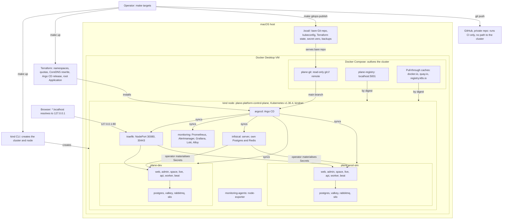

# plane-platform

This is a local deployment platform for a **customized Plane Community Edition v1.4.3 deployment**. It is not an original product.

The project management application is [Plane Community Edition](https://github.com/makeplane/plane), built by the Plane team and licensed AGPL-3.0. This repository adds what surrounds it: a kind cluster, Terraform, Argo CD, Infisical, a hardened overlay of the upstream Helm chart, monitoring, backups, and tests. "Wayline" is the name of this customized deployment, and it stays credited to Plane CE wherever it appears.

This is Pass 1 of 2. It runs on one laptop. Nothing cloud is provisioned or configured. Pass 2 moves to Hetzner Cloud with independent dev and prod environments and Cloudflare, as described in [PASS2_HANDOFF.md](PASS2_HANDOFF.md) and [docs/future-hetzner.md](docs/future-hetzner.md).

**This platform is local and production-inspired, and it makes no claim of being ready for production.**

## Status

[docs/validation.md](docs/validation.md) is the authoritative record, and this table only summarizes it. Results use the labels in [contract section 12](docs/platform-contract.md#12-evidence-rule): PASS, FAIL, BLOCKED, NOT RUN. A result counts only with evidence in [docs/evidence/](docs/evidence/README.md).

**On 2026-11-05 the platform is up and Plane works in both environments, on this one laptop.** It got there in stages, with fixes between them. Nothing has yet shown that it comes up from nothing, survives a full restore, or carries load, and those rows say NOT RUN. Other work is still changing things, so read a state below as of its date.

| Area | State on 2026-11-05 | Marker |
|---|---|---|
| kind cluster and local services (`scripts/cluster-up.sh`) | Running. [Creation log](docs/evidence/cluster-up-20261104T184521Z.log), which shows cluster creation only | None |
| Day-1 gates: digest pulls, kindnet enforcement, `git://` from a pod | PASS: 17 passed, 0 failed, at `fbfd7c5`, with a same-moment reference and the node as witness on each deny ([run](docs/evidence/day1-gates-20261104T231136Z.txt)). These checks do not cover Plane | None |
| Static checks (`make ci`) | PASS: exit 0 in a clean clone of `6fc3708` ([log](docs/evidence/ci/ci-2-20261104T225907Z-make-ci.log)), and 33 of 33 planted defects caught at `283b51a` ([log](docs/evidence/ci/ci-3-20261104T223937Z-negative-controls-local.log)). No run is recorded on a later commit | None |
| `make up`, full platform | Ran in stages with `UP_STOP_AFTER` ([record](docs/evidence/runs/bootstrap-1.txt)), and all 14 Applications read Synced and Healthy ([`make status`](docs/evidence/runs/plane-prod-sim-status-1.txt)). One `make up` from nothing: NOT RUN | [[VERIFY: scripts/up.sh exists and make up reaches all Applications Synced and Healthy]] |
| Plane deployed in `plane-dev` | Synced and Healthy on the branded images, by digest, since `4f622e3`, with 11 workloads ready ([smoke step](docs/evidence/runs/branded-dev-smoke-1.txt)) | None |
| Plane deployed in `plane-prod-sim` | Synced and Healthy on upstream images, by digest, with 11 workloads ready ([smoke step](docs/evidence/runs/plane-prod-sim-smoke-2.txt)). The branded images have not been promoted here yet | None |
| End-to-end smoke test (`make test-e2e`) | PASS: dev 38 of 38 on the branded images, 2026-11-05T00:12Z ([JSON](docs/evidence/runs/smoke-dev-20261105T001213Z.json), [output](docs/evidence/runs/branded-dev-smoke-1.txt)). PASS: prod-sim 37 of 37 on upstream images, 2026-11-04T23:59Z ([JSON](docs/evidence/runs/smoke-prod-sim-20261104T235926Z.json)). It drives the API and WebSocket, not a browser. An earlier FAIL is kept ([37 of 38](docs/evidence/runs/smoke-dev-20261104T225624Z.json)) | None |
| Real browser, branded images, dev | Done by hand on 2026-11-05: sign-in, onboarding, a board, a page edited in two tabs, god-mode. It found one defect, stale HTML after a promotion ([record](docs/evidence/branding/live-dev/README.md)). Safari, and any browser check signed in on prod-sim: NOT RUN | None |
| Separation of dev and prod-sim | PASS: real attempts between them all failed as they should, 364 network checks and 97 on state, credentials and data ([network](docs/evidence/runs/harness-separation-network-1.txt), [state](docs/evidence/runs/harness-separation-state-1.txt)). Each `api` can still reach the other host as any browser could. This is one cluster, not two | None |
| NetworkPolicy matrix (`make test-netpol`) | PASS by source namespace, each with its sentinel first, as the matrix then stood: `plane-dev` 135 rows and `plane-prod-sim` 134 ([output](docs/evidence/runs/plane-prod-sim-netpol-from-dev-1.txt), [output](docs/evidence/runs/plane-prod-sim-netpol-from-prod-sim-1.txt)), `monitoring` 50 ([TSV](docs/evidence/runs/netpol-20261104T221150Z.tsv)), `infisical` 14 ([output](docs/evidence/runs/netpol-infisical-3.txt)). `argocd` and `traefik` last ran before their targets existed, with INCONCLUSIVE rows ([argocd](docs/evidence/runs/netpol-foundation-argocd-1.txt), [traefik](docs/evidence/runs/netpol-foundation-traefik-2.txt)). No published run covers every row yet | None |
| Internal UIs admit only the node network | PASS: from a Plane `api` pod, each of the 5 UIs answers 403, while the host gets 200 ([before, 30 FAIL](docs/evidence/runs/routes-before-1.txt), [after](docs/evidence/runs/routes-after-2.txt)). A source-address check, not a login | None |
| Infisical secret sync, cross-project isolation | PASS: 88 checks on the rendered Secrets ([run](docs/evidence/runs/infisical-rendered-secrets-2.txt)), and a real 403 in both directions on each cross-project read ([run](docs/evidence/runs/infisical-isolation-3.txt)) | None |
| Credential rotation (`make rotate`) | NOT RUN | [[VERIFY: make rotate result, with Plane healthy afterwards]] |
| Backup and restore (`make backup`, `make restore`) | `make backup` PASS for all three ([run](docs/evidence/runs/dr-backup-retention-1.txt)). In-place Infisical restore PASS ([JSON](docs/evidence/runs/restore-infisical-20261105T001834Z.json)). A Plane restore has only been rehearsed in a throwaway place ([run](docs/evidence/runs/dr-plane-restore-rehearsal-1.txt)). `make restore` on a Plane environment, and one full restore into a clean environment: NOT RUN | [[VERIFY: restore into an empty environment returns the sentinel data]] |
| Alert delivery (`make test-alert`) | NOT RUN. Other alerts have reached the sink: a temporary rule ([path](docs/evidence/runs/monitoring-alert-path-1.txt)) and `PlaneWorkerNoConsumer` on a real fault ([record](docs/evidence/runs/plane-prod-sim-worker-no-consumer-alert-1.txt)). Nothing pages a person | [[VERIFY: make test-alert shows an alert firing and reaching the sink]] |
| Failure drills (`tests/drills/`) | Pod restart: PASS in dev ([log](docs/evidence/runs/drill-pod-restart-dev-20261104T224424Z.log)) and in prod-sim on its second run ([log](docs/evidence/runs/drill-pod-restart-prod-sim-20261104T235402Z.log)). The first prod-sim run is a kept FAIL, caused by a test ([log](docs/evidence/runs/drill-pod-restart-prod-sim-20261104T233500Z.log), see the [case study](docs/case-study.md)). Failed deploy: NOT RUN | [[VERIFY: results of failed-deploy-rollback and pod-restart-persistence drills]] |
| Load test (`make test-load`) | NOT RUN | [[VERIFY: make test-load result, with resource capture]] |
| Teardown and recreation | NOT RUN | |
| Wayline branded images | Built from `1563cbf` and pushed to `localhost:5001/wayline` ([evidence](docs/evidence/branding/README.md)). Dev runs them. Prod-sim does not yet. Their `/source` link ends in a 404 today, because the repository is private and that commit is unpushed | None |
| Image scan (`make scan-images`) | First complete scan: FAIL, 5 fixable CRITICAL findings in images built here ([summary](docs/evidence/security/README.md)). After fixes, those images pass the policy ([run](docs/evidence/security/scan-images-20261104T235800Z/summary.tsv)). Upstream images still report CRITICAL findings, which do not fail the policy | None |
| GitHub Actions workflows on GitHub | `ci.yml`: PASS on 4 runs, the last at `5fdf41d` ([evidence](docs/evidence/ci/README.md)). Commits since `da7a4c9` are unpushed, so GitHub has seen none of the later work. `images.yml` has never built an image. A promotion pull request is BLOCKED by a repository setting | None |
| Hetzner, Cloudflare | Out of scope for Pass 1. Nothing provisioned | |

## What this platform does not claim

- **Namespace separation is not equivalent to independent production clusters.** `plane-dev` and `plane-prod-sim` share one node, one kernel, one API server, one etcd, one CNI, one Traefik, one Argo CD, one monitoring stack, and one Docker VM. A node failure or a bad cluster-wide change takes out both. "Prod-sim" is a simulation of a promotion path, not a production environment.
- **Terraform does not create the cluster.** The kind CLI creates the cluster and node, through `scripts/cluster-up.sh`. Docker Compose creates the registry, pull-through caches, and Git remote. Terraform manages only the objects listed under [Who creates what](#who-creates-what).
- **GitHub does not enforce approval.** On GitHub Free with a private repository there are no required reviewers, protected branches, or environment gates. A pull request merge is a process, not a control. See [.github/workflows/README.md](.github/workflows/README.md).
- **There is no TLS locally, and no high availability.** Everything is plain HTTP on loopback, with one replica of each stateful service.

The full list is in [docs/known-limitations.md](docs/known-limitations.md).

## Architecture



The diagram shows what runs today. The design and its reasons are in [docs/architecture.md](docs/architecture.md).

### Who creates what

Each resource has one owner, and [contract section 4](docs/platform-contract.md#4-ownership-exactly-one-owner-per-resource) is binding. `scripts/ci/ownership.sh` checks for overlaps.

| Owner | Owns |
|---|---|
| kind CLI, via `scripts/cluster-up.sh` | Cluster, node, CNI, port and volume mounts |
| Docker Compose, in `infrastructure/local-services/` | Registry, pull-through caches, `git://` remote |
| Terraform, in `infrastructure/terraform/environments/local` | Namespaces and labels, ResourceQuota, LimitRange, CoreDNS rewrite, Argo CD Helm release, AppProjects, root Application |
| Terraform, in `infisical/terraform` (separate root and state) | Infisical projects, environments, machine identities, Kubernetes Auth config. Not secret values |
| Argo CD | Everything else in the cluster, including both Plane environments |
| Infisical | Secret values and their history |
| Scripts, via `.local/secret-zero/` | The few secrets that must exist before Infisical does |

## Quick start

Prerequisites, which `make setup` checks through `scripts/prereqs.sh`:

- Docker with the Compose and Buildx plugins, git, make, curl, jq, python3, openssl, lsof, tar, unzip, shasum.
- Docker with 14 GiB of memory (the script accepts 13 GiB or more visible, since the VM reports slightly less than the setting) and 4 or more CPUs.
- 25 GiB of free host disk, 35 GiB recommended.
- Host ports 80, 443, and 5001 free.

```bash
make setup    # install pinned CLIs into .tools/bin, check prerequisites
make up       # create or resume the whole platform
make status   # cluster, GitOps, workloads, URLs, resource use
make test     # gates, NetworkPolicy matrix, end-to-end smoke tests
```

[[VERIFY: this quick start runs from a clean clone on a machine meeting the prerequisites]]

[[MEASURE: wall-clock time of the first make up, with an empty image cache]]

Stopping and removing:

```bash
make down                 # stop the cluster, keep all data; make up resumes it
make destroy CONFIRM=yes  # delete the cluster; takes a backup first unless SKIP_BACKUP=yes
```

`make help` lists every target. The common ones:

| Target | What it does |
|---|---|
| `make logs ENV=dev SVC=api` | Tail logs for one workload. With no `SVC`, list what can be tailed |
| `make backup ENV=dev` | Back up an environment, or `ENV=all` |
| `make restore ENV=dev BACKUP=<id or latest>` | Restore. Refuses a non-empty environment without `CONFIRM=yes` |
| `make restore-clean BACKUP=<id or latest>` | Bring the whole platform back into a clean environment, Infisical first. NOT RUN end to end |
| `make rotate ENV=dev` | Rotate a database credential through Infisical. It never rotates `SECRET_KEY` |
| `make render` | Re-render Plane manifests from `helm/plane` into `gitops/environments` |
| `make gitops-publish` | Push committed `main` to the local Git remote that Argo CD reads. Argo CD sees nothing else |
| `make promote ENV=prod-sim` | Promote digests. Prod-sim accepts only a digest recorded for dev under that image, needs `plane-dev` Synced and Healthy with it in a ready container, and takes a dump first |
| `make rollback ENV=dev` | Revert the last promotion for an environment |
| `make ci` | Run the CI checks locally, using the same scripts as GitHub Actions |
| `make test-routes`, `make test-separation`, `make test-infisical` | Each part of `make test` alone |
| `make scan-images` | Scan every image the platform runs |
| `make drill-pod-restart ENV=dev` | Restart each StatefulSet pod and prove the data survives. Also `drill-failed-deploy` and `drill-clean-restore` |

Full steps and troubleshooting are in [docs/install.md](docs/install.md) and [docs/runbooks/](docs/runbooks/).

Do not run `docker system prune -a` to free disk if other projects on the machine rely on cached images. Official MinIO images, for example, can no longer be pulled anonymously, so a pruned copy may not come back.

## Environment URLs

All hosts resolve to loopback without editing `/etc/hosts`. Traefik is reached through kind's port mapping, bound to `127.0.0.1` only, so these are not exposed to the LAN. Sign-in details are in [docs/install.md](docs/install.md). None are in this file.

| URL | Backend |
|---|---|
| <http://plane.dev.localhost> | Plane, dev |
| <http://plane.prod-sim.localhost> | Plane, production simulation |
| <http://argocd.localhost> | Argo CD |
| <http://grafana.localhost> | Grafana |
| <http://prometheus.localhost> | Prometheus |
| <http://alertmanager.localhost> | Alertmanager |
| <http://infisical.localhost> | Infisical |

All seven answered through Traefik, with the NetworkPolicies applied, in [`make status`](docs/evidence/runs/plane-prod-sim-status-1.txt) on 2026-11-04: 200, or a 302 from Grafana and Prometheus. `/source` on the web host answers 302 to the commit that built it, which is on a private repository today.

A real browser session used `http://plane.dev.localhost` in Chromium ([record](docs/evidence/branding/live-dev/README.md)), and session cookies are host-only, so a dev session gets 401 on the prod-sim host ([check](docs/evidence/runs/plane-dev-cookies-1.txt)).

[[VERIFY: *.localhost resolution and cookie separation between the two Plane hosts in Chrome, Firefox and Safari]]

## Resource use

[docs/resource-utilization.md](docs/resource-utilization.md) holds the measured values, with their conditions. These readings are from 2026-11-04 and 2026-11-05 on this laptop, with both environments on upstream images. No load test or clean install has run, so nothing here is a peak under load.

| Measured | Value | Conditions |
|---|---:|---|
| All pods, `kubectl top` | 6,806 MiB | Quiet, 2026-11-05T00:03:44Z ([snapshot](docs/evidence/runs/plane-prod-sim-snapshot-final-1.txt)). The largest is the API server, 1,168 MiB |
| The kind node, `kubectl top node` | 8,331 MiB | The same reading. Adds kubelet, containerd, shims and pause. The estimate for this layer was 5.5 to 9.3 GiB |
| Plane, dev and prod-sim, 11 workloads each | 1,187 and 1,108 MiB | The same reading |
| Docker VM used, quiet | 9.44 GiB median | 30 samples, including 1.01 GiB of unrelated containers ([samples](docs/evidence/runs/plane-prod-sim-memory-1.txt)) |
| Docker VM used, smoke tests and drills | 9.48 to 9.76 GiB median | The same samples, by phase. Tests barely move it |
| Docker VM used, highest sampled | 10.49 GiB of 13.63 | 2026-11-04T23:23:42Z, right after a change replaced the Argo CD pods. Estimate was 9.9 to 13.7 GiB |

Requests and limits are configuration, set in [contract section 10](docs/platform-contract.md#10-memory-budget-per-workload) for Plane:

| Configured memory | Requests | Limits |
|---|---:|---:|
| One Plane environment, 11 workloads | 1,424 MiB | 4,192 MiB |
| Two Plane environments | 2,848 MiB | 8,384 MiB |
| The whole cluster | 5,766 MiB | 15,812 MiB |

Still estimates:

| Item | Estimate | How it was derived |
|---|---:|---|
| Images on the node, unpacked | 8.56 GiB | Estimate: sum of gzip ISIZE trailers across deduplicated registry layers, 33 images, without filesystem overhead |
| Total host disk growth | 19.5 to 24.8 GiB | Estimate: image sizes above plus planning figures for volumes, logs, builds, tools, and the three pull-through caches |

Limits add up to more than the VM's memory on purpose, so the two environments are brought up one after the other. Simultaneous first boots are the worst case.

Measured on the staged first boots: VM used reached 8.62 GiB during `plane-dev`'s and 9.23 GiB during `plane-prod-sim`'s ([history](docs/evidence/runs/plane-prod-sim-memory-history-1.txt)). A clean install has not been measured. [[MEASURE: peak memory on the Docker VM during first boot]]

[[MEASURE: host disk growth and Docker.raw size after a full install]]

## Repository map

```text
apps/wayline/                  branding: pinned upstream ref, patches, overlay, codemod, checks, Dockerfiles
infrastructure/kind/           cluster template, containerd mirror config
infrastructure/local-services/ registry, pull-through caches, git daemon (Compose)
infrastructure/terraform/      modules/{foundation,argocd}, environments/local
                               environments/{dev,prod} are untested Pass 2 interface notes, no Terraform
helm/plane/                    vendor/ (byte-identical upstream chart), components/hardening, overlays/{dev,prod-sim}
helm/values/                   values for each platform chart
gitops/bootstrap/              AppProjects and root Application (applied by Terraform), Argo CD route
gitops/applications/           Application manifests; the root app syncs this directory
gitops/platform/               network policies, backup storage
gitops/environments/           rendered Plane manifests. Generated by make render, never hand-edited
infisical/                     Terraform root for Infisical config, manifests, docs
monitoring/                    dashboards, rules, blackbox config, alert sink, ops helpers
policy/                        conftest rules and their tests
tests/                         day-1 gates, NetworkPolicy matrix, e2e smoke, routes, separation, alert rules, drills, load test
scripts/                       entry points behind make targets; scripts/ci/ is shared with GitHub Actions
docs/                          documentation index, contract, ADRs, runbooks, evidence
.github/workflows/             thin workflows that call the same scripts as make targets
tools.lock                     pinned CLI versions and checksums
```

Start with the [documentation index](docs/README.md). The [platform contract](docs/platform-contract.md) is binding for names, ownership, and ordering. For the story of how this was built, including what went wrong and what remains unproven, read the [case study](docs/case-study.md).

## License and credit

Plane Community Edition is developed by the Plane team and licensed under AGPL-3.0. Source for the pinned release is at [makeplane/plane](https://github.com/makeplane/plane), commit `37a15d99231042b3ff5a4401fed479fdbec9effe` (v1.4.3).

| Component | License note |
|---|---|
| Plane CE application | AGPL-3.0 |
| `plane-ce` Helm chart 1.8.6, vendored unmodified in `helm/plane/vendor/` | AGPL-3.0 by the chart's `artifacthub.io/license` annotation only. The upstream chart repository has no LICENSE file. See `helm/plane/vendor/plane-ce-1.8.6/VENDOR.md` |
| Silo (`pgsty/silo`), the MinIO-compatible object store | AGPL-3.0 |
| Wayline branding patches | Modifications of AGPL-3.0 source, so AGPL-3.0 applies when delivered |

AGPL section 13 applies to a modified version that users interact with over a network. The repository is private today, its commits since `da7a4c9` are unpushed, and Pass 1 serves only loopback. So the `/source` link in the running web image answers 302 to a page that returns 404 to anyone without access. That has no practical effect while the owner is the only user, and it must be fixed before anyone else uses a deployed instance. Details and obligations are in [docs/agpl-compliance.md](docs/agpl-compliance.md).

The repository's root `LICENSE` is upstream's AGPL-3.0 text, unchanged, with upstream's `COPYRIGHT.txt` beside it and [NOTICE.md](NOTICE.md) recording what was modified. New source files carry `SPDX-License-Identifier: AGPL-3.0-only`.
