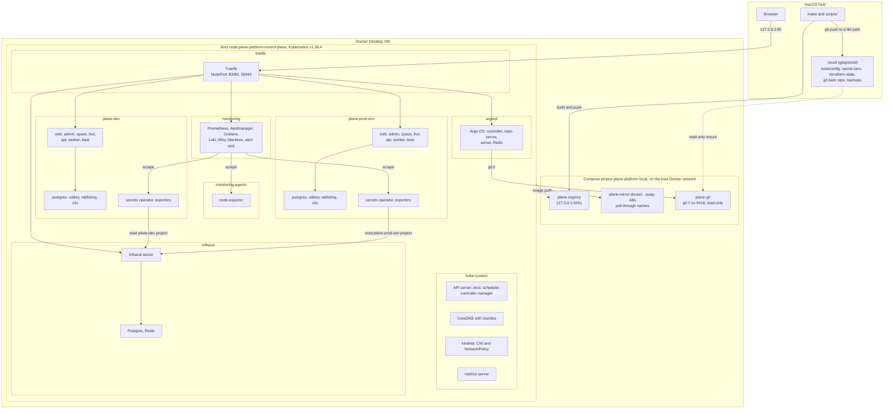
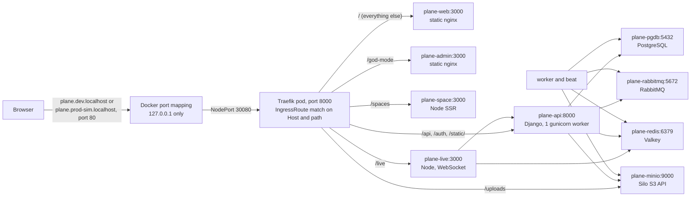
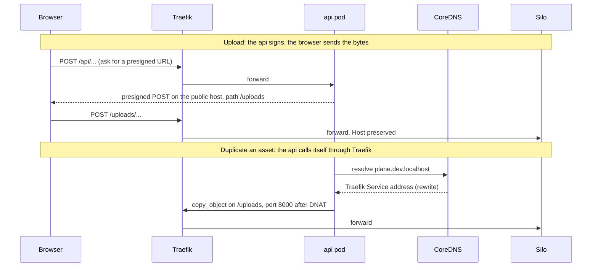
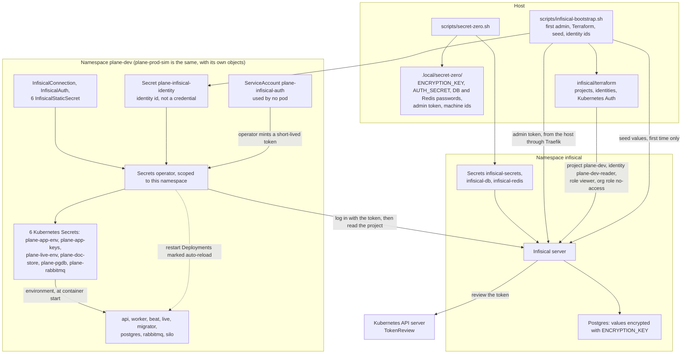
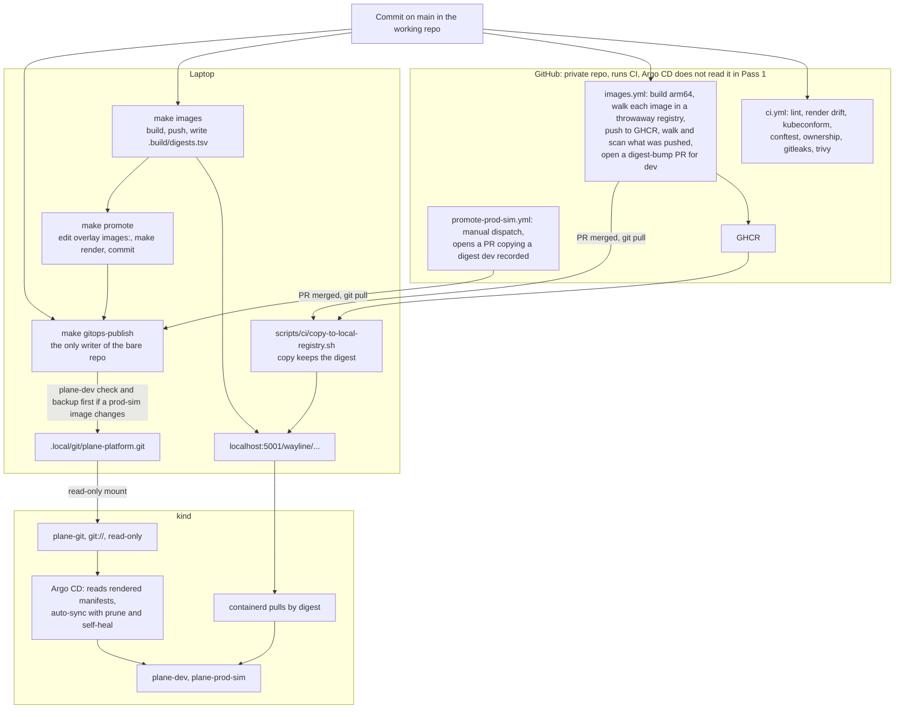

# Architecture

Wayline is a customized deployment of open-source Plane Community Edition v1.4.3 (AGPL-3.0). It is not an original product. This repository adds a local platform around Plane: kind, Terraform, Helm, Argo CD, Infisical, GitHub Actions, Prometheus, Grafana, Loki, and Traefik, with PostgreSQL, Valkey, RabbitMQ, and a MinIO-compatible store (Silo) as data services.

This is Pass 1. The platform runs on one laptop, on one kind node. GitHub runs CI and holds private GHCR packages, as [section 4](#4-delivery-flow) describes, and nothing else in the cloud is provisioned or configured. Pass 2 is described in [future-hetzner.md](future-hetzner.md).

**How to read this page.** It describes configuration: what the code asks the system to do. Results live in [validation.md](validation.md) and [evidence/](evidence/README.md). Where a real run has settled a statement, the text says so and links the file. No marker is left on this page. The platform is local and production-inspired.

**State on 2026-11-05.** Both Plane environments ran the final images built from `84b63d9`: web `3d7575a1`, admin `ce7adc37`, space `5f0119ff` and backend `8c04bd18` ([digests](evidence/branding/digests.tsv)), with the backend flattened and cache headers on the HTML. A first whole `make up` from a fresh clone exited 0 in 955 s, with the registry and caches kept ([summary](evidence/runs/clean-install-20261105T075041Z/summary.txt)). A full restore from backup into a new cluster then read PASS on every restore step ([restore-clean-20261105T081017Z.json](evidence/runs/restore-clean-20261105T081017Z.json)). On that restored platform, after `make down` and `make up`, `make test` exited 0 from 08:34 to 08:45 UTC: gates, NetworkPolicy 418 of 418, Infisical isolation and rendered Secrets, routes, e2e in both environments, and separation at 384 network and 97 state checks ([MAKE-TEST-20261105T083455Z.txt](evidence/runs/MAKE-TEST-20261105T083455Z.txt)). In it `plane-dev` read 45 PASS and 1 SKIP ([smoke-dev-20261105T083455Z-37296.json](evidence/runs/smoke-dev-20261105T083455Z-37296.json)), and `plane-prod-sim` 44 PASS and 1 SKIP ([smoke-prod-sim-20261105T083455Z-37296.json](evidence/runs/smoke-prod-sim-20261105T083455Z-37296.json)). The skipped step, `branding-fresh-install`, needs a clean database, and it passed on the clean install's first smoke in each environment. All 14 Argo CD Applications read Synced and Healthy after that `make up` ([PERS-3-20261105T083304Z.txt](evidence/runs/PERS-3-20261105T083304Z.txt)). The older runs this page links predate that build: `plane-dev` passed 38 steps on the build from `1563cbf` ([smoke](evidence/runs/smoke-dev-20261105T001213Z.json)), and `plane-prod-sim` passed 37 steps on upstream images ([smoke](evidence/runs/smoke-prod-sim-20261104T235926Z.json)). Where this page says "the branded images" for a run, it means the build from `1563cbf`. Most drills below ran on the earlier cluster, which was brought up stage by stage, with fixes along the way, and is gone. Where one ran on the restored cluster, the text says so. `make test-alert`, `make rotate`, the pod restart drill and an in-place restore of Plane have run in both environments, and a rollback, the failed deploy and failed migrator drills and the load test in dev only. A second `make drill-clean-restore`, at `e602dad`, with the registry and caches removed as well, ran a cold install in a clone and then restored again with every restore step PASS, on code with the recovery fixes merged ([summary](evidence/runs/clean-install-20261105T105546Z/summary.txt), [restore](evidence/runs/restore-clean-20261105T124518Z.json)). A third, `LOSE_CLUSTER=yes`, from 13:06Z to 13:35Z at `06b8be7`, deleted with kind alone, restored into a new cluster with every restore step PASS, and read `RESULT PASS`, `make` exit 0 ([output](evidence/runs/BKP-6-20261105T130633Z-lose-cluster-make.txt), [log](evidence/runs/drill-clean-restore-20261105T130633Z.log)). `make test` then passed whole on the cluster it left, from 14:00:19Z to 14:11:52Z at `f30a7f5`, with Argo CD at the same commit and the same counts ([MAKE-TEST-20261105T140019Z.txt](evidence/runs/MAKE-TEST-20261105T140019Z.txt)).

Names, ownership, and ordering are binding in [platform-contract.md](platform-contract.md). Decision records are in [adr/](adr/). Tradeoffs for each tool are in [technology-choices.md](technology-choices.md). What the two environments share is in [environments.md](environments.md).

## 1. The whole system on one kind node

Three groups of things run outside the cluster, for specific reasons.

| Thing | Where | Why it is not in the cluster |
|---|---|---|
| Registry and pull-through caches | Compose | They must outlive `kind delete cluster`, or every rebuild pulls every image again |
| `plane-git` | Compose | A Git server in a pod needs a host path, which PSA `baseline` forbids. Outside the cluster it also survives teardown |
| Secret zero, Terraform state, backups, the bare Git repo | `.local/` on the host | They are what you need to rebuild the cluster, so they cannot depend on it |

All of it is one failure domain. The node, the kernel, the API server, and the Docker VM are single instances. [environments.md](environments.md) spells out what that means for the two environments.

Exposure is loopback only. kind binds host ports 80 and 443 to `127.0.0.1` (`infrastructure/kind/cluster.yaml.tmpl`), and those map to Traefik's NodePorts 30080 and 30443. kind's default of `0.0.0.0` would put unauthenticated UIs on the LAN. On 2026-11-04 Docker reported the mappings on `127.0.0.1`, and port 80 on the Mac's LAN address refused the connection ([traefik-routes-2.txt](evidence/runs/traefik-routes-2.txt)). There is no TLS locally: all routes use Traefik's `web` entry point, and nothing listens with a certificate.

## 2. Request flow

### Browser to Plane

The routes come from the Plane chart's `IngressRoute` template, rendered into `gitops/environments/<env>/manifests.yaml`. Every route carries the chart's `plane-body-limit` Middleware, which buffers up to 20 MiB of request body. `/spaces` and `/god-mode` also carry `plane-trailing-slash`, which the hardening component adds because upstream's Caddy proxy issues that redirect and the chart has no equivalent.

| Host and path | Backend | Why it matters |
|---|---|---|
| `/` | `plane-web:3000` | React Router 7 with `ssr: false`, served by nginx. The pod has no reason to dial anything, and its policy has no egress beyond DNS |
| `/god-mode` | `plane-admin:3000` | Same, for the instance admin UI |
| `/spaces` | `plane-space:3000` | The only server-rendered frontend. Its build has an empty API base URL, so its one server-side fetch fails with `ERR_INVALID_URL` before any connection, and its policy gives it no route to the api anyway. Only the page's metadata is lost |
| `/api`, `/auth`, `/static/` | `plane-api:8000` | Django. One gunicorn worker per pod, by the memory budget in contract section 10 |
| `/live` | `plane-live:3000` | Collaborative editing over WebSocket. The chart routes it through the same buffering Middleware as everything else |
| `/uploads` | `plane-minio:9000` | Presigned S3 requests go straight from the browser to Silo. The path must stay `/uploads`, because `export_task.py` hardcodes it (policy `plane.rego` checks the route) |

The space fetch failure was seen on 2026-11-04, on upstream images. A public board rendered signed out in a real browser, with its work items, because the browser makes those calls, while the space pod logged `ERR_INVALID_URL` for the metadata fetch ([plane-dev-public-board-1.txt](evidence/runs/plane-dev-public-board-1.txt)). On the final images the smoke step `public-board` passes in both environments, in the two runs named at the top of this page. After the restore a real browser opened a published board on dev, with Wayline's chrome, a real row and the source link ([live-final](evidence/branding/live-final/README.md)). It was published by a `POST` from the signed-in page and not the UI's button, and that tab carried the dev session, so it is not an anonymous view. The smoke reads a published board anonymously.

WebSocket upgrades pass the `buffering` Middleware. On 2026-11-05, on the branded images, text typed in one real browser tab showed in a second tab on the same page within 2 seconds, and came back after a reload ([live-dev](evidence/branding/live-dev/README.md)). On the same day, on the final images, in dev, two real tabs of one Chromium session held one page open with no reload while a load test ran. An edit typed 5m54s after the page opened, and 4m41s after the first typed edit, showed in the other tab within 2 seconds. With the `live` pod deleted, text typed in one tab showed only there, reached the other tab after the tabs reconnected, with no action by the person, and came back after a reload ([RT-2b-RT-3](evidence/runs/RT-2b-RT-3-20261105T073208Z.txt)). On 2026-11-04, on upstream images, the smoke's own client held two connections idle for 330s through Traefik, with pings answered on both, and an update then got through ([plane-dev-smoke-soak-1.txt](evidence/runs/plane-dev-smoke-soak-1.txt)). That is one session and one page, in Chromium, in dev. Safari, Firefox and prod-sim were not tested in Pass 1.

Traefik's `traefik-ingress` policy admits NodePort traffic from `172.16.0.0/12`. The source reaching the pod is the kind gateway: `172.24.0.1` on this host on 2026-11-04, read from conntrack on the node. With that block removed, a request from the host timed out ([traefik-nodeport-source-1.txt](evidence/runs/traefik-nodeport-source-1.txt)). So the `192.168.65.0/24` the policy also allowed until then was removed.

`externalTrafficPolicy: Local` removes kube-proxy's SNAT, but that gateway is still the client address, not the browser's. Traefik writes no access log here ([plane-dev-copy-object-path-1.txt](evidence/runs/plane-dev-copy-object-path-1.txt)), so conntrack is the record of it. Plane's anonymous throttle keys on the `X-Forwarded-For` that Traefik builds from that address, so every browser on the host should share one bucket. That has not been measured.

### Other hosts

| Host | Backend | Login |
|---|---|---|
| `argocd.localhost` | `argocd-server:80` | Argo CD admin. Password in `argocd-initial-admin-secret` |
| `grafana.localhost` | `kps-grafana:80` | Grafana admin. Password in Secret `kps-grafana` |
| `infisical.localhost` | `infisical:8080` | Infisical user. Admin credentials in `.local/secret-zero/` |
| `prometheus.localhost` | `kps-prometheus:9090` | **None** |
| `alertmanager.localhost` | `kps-alertmanager:9093` | **None** |

Prometheus and Alertmanager have no login of their own. Loopback binding is what protects them from the LAN. Pods are a different door, because the api may reach Traefik (see below), and until 2026-11-04 a Plane api pod could read metrics and alert silences that way with 200 ([routes-before-1.txt](evidence/runs/routes-before-1.txt)). So all five hosts now carry Middleware `node-network-only`, an `ipAllowList` of `172.16.0.0/12`. From an api pod each answers Traefik's 403, through the Service and the NodePort. A spoofed `X-Forwarded-For`, tried on Prometheus and Alertmanager, gets the same 403. From the host each answers 200 ([routes-after-3.txt](evidence/runs/routes-after-3.txt)). It checks a source address, not a login, and it trusts everything on the node network.

### Requests that start inside the cluster

The Plane api dials its own public hostname in two cases: `copy_object` when duplicating an asset, and OAuth avatars. A `*.localhost` name means loopback to a browser, but inside a pod it must reach Traefik. So Terraform rewrites both Plane hostnames in CoreDNS to `traefik.traefik.svc.cluster.local`, and the api's NetworkPolicy allows egress to Traefik's pod port 8000.

Both paths ran in each environment on earlier images ([dev](evidence/runs/smoke-dev-20261105T001213Z.json), [prod-sim](evidence/runs/smoke-prod-sim-20261104T235926Z.json)), and again in both on the final images, in the two runs named at the top of this page. Step `asset-duplicate` reads the same bytes back from the copy. The api resolves its public host to Traefik's Service, Traefik counted the `copy_object` PUTs, and a worker, with no policy route, times out on the same host ([plane-dev-copy-object-path-1.txt](evidence/runs/plane-dev-copy-object-path-1.txt)).

Presigned upload works with no bucket Job. Steps `attachment-upload` and `object-in-silo` store bytes and read them straight from Silo in bucket `uploads` with a matching sha256, and `uploads-private` gets 403 without a valid signature.

This path has a side effect. The same Traefik serves every host, so the api can ask for any of them by Host header, including the other environment's. That gap is documented in [environments.md](environments.md#the-known-gap-api-to-traefik-to-anywhere).

### Who may talk to whom

Each namespace starts from default-deny for ingress and egress, plus DNS. These are the allow rules for a Plane namespace, from `gitops/platform/network-policies/plane-dev.yaml`. The prod-sim file is the same with the namespace changed.

| From | To | Port |
|---|---|---|
| Traefik | web, admin, space, live | 3000 |
| Traefik, live | api | 8000 |
| Traefik, Prometheus, api, worker, beat, migrator, backup | Silo | 9000 |
| api | Traefik (other namespace) | 8000 |
| api, worker, beat, migrator, backup, postgres-exporter | postgres | 5432 |
| api, worker, beat, migrator, live, redis-exporter | valkey | 6379 |
| api, worker, beat, migrator | rabbitmq | 5672 |
| Prometheus | rabbitmq metrics | 15692 |
| Prometheus | postgres-exporter, redis-exporter | 9187, 9121 |
| Prometheus | secrets operator metrics, allowed and not scraped ([section 5](#5-observability-flow)) | 8443 |
| secrets operator | Infisical server, API server | 8080, 6443 |
| k6, in dev only, from `plane-dev-loadtest.yaml` | Traefik (other namespace) | 8000 |

Nothing in a Plane namespace has a route to the internet, so Plane's telemetry to `telemetry.plane.so` has none. Valkey has no password (chart issue 113), so its policy is its only access control. RabbitMQ's management port and Silo's console stay closed.

These rules only mean something if kindnet enforces them. kindnet evaluates new connections only and fails open with a log line on errors. Default-deny blocks a new connection on this cluster with the platform's 60 policies loaded: the day-1 gate on 2026-11-04 saw a timeout while a reference answered the same client and the node reached the target ([day1-gates-20261104T231136Z.txt](evidence/day1-gates-20261104T231136Z.txt)), and `scripts/test-netpol.sh` repeats a sentinel in a throwaway namespace before each run. Since 2026-11-04 the log line has an alert, `KindnetSkippedNetworkPolicies`, proven with a synthetic line and not a real failure ([h18-synthetic-2.txt](evidence/runs/h18-synthetic-2.txt)).

The matrix in `tests/network-policy-matrix.yaml` has run as one whole. On the final images, `make test` at `f30a7f5` read 418 PASS, 0 FAIL and 0 INCONCLUSIVE, and every deny row ended in a timeout while both of its references answered ([MAKE-TEST-20261105T140019Z.txt](evidence/runs/MAKE-TEST-20261105T140019Z.txt), [netpol-20261105T140145Z.tsv](evidence/runs/netpol-20261105T140145Z.tsv)). It read the same on the first restored cluster ([MAKE-TEST-20261105T083455Z.txt](evidence/runs/MAKE-TEST-20261105T083455Z.txt), [netpol-20261105T083542Z.tsv](evidence/runs/netpol-20261105T083542Z.tsv)). `make test-netpol` read the same at 04:19 UTC on the earlier cluster, before the final images ([harness-make-test-netpol-4.txt](evidence/runs/harness-make-test-netpol-4.txt), [netpol-20261105T041921Z.tsv](evidence/runs/netpol-20261105T041921Z.tsv)). A timeout cannot rule out loss only on that pod's path to that target. [security.md](security.md#networkpolicy-model) has the table.

## 3. Secret flow

**Why this shape.**

- **Git holds no secret values.** The rendered manifests contain zero `kind: Secret`. `scripts/render.sh` and policy `gitops.rego` both fail if one appears. The chart renders none because all six `external_secrets.*_existingSecret` values are set, and `env.requireExplicitSecrets: true` makes the render fail rather than fall back to the chart's public default keys.
- **Secret zero exists because something must start first.** Infisical cannot store its own encryption key. So `ENCRYPTION_KEY`, `AUTH_SECRET`, and the database passwords live in `.local/secret-zero/` at mode 0600. This moves the problem to the laptop. It does not solve it.
- **One project per environment is the isolation boundary.** Custom roles and folder RBAC are paid features of Infisical. Two projects, built-in `viewer`, and org role `no-access` is what the free tier allows.
- **Two namespace-scoped operators, not one cluster-wide.** With `scopedRBAC` unset, an operator could mint a token for any ServiceAccount and read every Secret, and nothing would stop an `InfisicalAuth` in `plane-dev` from naming the prod-sim identity.
- **The admin token never enters the cluster.** Bootstrap runs on the host and reaches Infisical through `infisical.localhost`, which is why it is a script and not an Argo CD step.

**How login works.** The operator mints a short-lived token for `plane-infisical-auth` and presents it to Infisical. Infisical calls TokenReview using that same token as the credential, so no long-lived reviewer JWT exists anywhere. That is why `plane-infisical-auth` holds `system:auth-delegator`, through ClusterRoleBinding `infisical-token-reviewer` in `infisical/manifests/token-reviewer.yaml`. Each identity's Kubernetes Auth config allows one namespace and one ServiceAccount. Access tokens last 3600 seconds, and the dev operator logged in again after 42 minutes with no errors ([infisical-token-renewal-1.txt](evidence/runs/infisical-token-renewal-1.txt)). Operators log in on kind, and on 2026-11-04 each reader got 403 on the other project, on list, single read and slug lookup, in both directions, while the same tokens read their own with 200 ([infisical-isolation-3.txt](evidence/runs/infisical-isolation-3.txt)).

**How values change.** Each `InfisicalStaticSecret` has `refreshInterval: 60s`. Deployments `plane-api-wl`, `plane-worker-wl`, `plane-beat-worker-wl`, `plane-live-wl` and `postgres-exporter` carry `secrets.infisical.com/auto-reload: "true"`, so the operator restarts them when a Secret changes. StatefulSets do not carry it, so a value change does not restart Postgres. `make rotate ENV=dev` ran on 2026-11-05 at 07:23 UTC. The operator synced the Secrets within 4s and rolled `plane-api-wl`, `plane-worker-wl`, `plane-beat-worker-wl` and `postgres-exporter`, whose Secrets changed, and left `plane-live-wl` and the Postgres pod alone. Postgres refused the old password, and `SECRET_KEY` did not move ([SEC-2-20261105T072331Z.txt](evidence/runs/SEC-2-20261105T072331Z.txt), [rotate-dev-20261105T072345Z.log](evidence/runs/rotate-dev-20261105T072345Z.log)). A signed-in request about once a second answered 500 at 38 of 1,002 readings, all from 07:23:51 to 07:24:29 UTC, about 38s, and 200 at the rest ([SEC-2-20261105T072331Z-watch.txt](evidence/runs/SEC-2-20261105T072331Z-watch.txt)). The script's own anonymous probe read 39 of 62 failed over 60s, because it counts anything but 404 as a failure, Plane's anonymous limit included. Auto-reload and self-heal did not fight: to 07:40:51 UTC `plane-dev`'s one new sync operation began at 07:32:41, and that is the self-heal test's ([SEC-6-20261105T072331Z-application-watch.txt](evidence/runs/SEC-6-20261105T072331Z-application-watch.txt), [GITOPS-4-20261105T073240Z.txt](evidence/runs/GITOPS-4-20261105T073240Z.txt)).

`make rotate ENV=prod-sim CONFIRM=yes` also ended PASS, with the same proofs, and no signed-in reading beside it ([SEC-3-BKP-3-20261105T073240Z.txt](evidence/runs/SEC-3-BKP-3-20261105T073240Z.txt)). A second one there, killed with SIGKILL 4 seconds in, was finished by `RESUME=yes`, and Postgres refused the replaced password ([SEC-4-20261105T073843Z.txt](evidence/runs/SEC-4-20261105T073843Z.txt)). `make test-e2e` passed after the first rotation in each environment, with an in-place restore between them ([smoke-dev-20261105T074635Z-6532.json](evidence/runs/smoke-dev-20261105T074635Z-6532.json), [smoke-prod-sim-20261105T073741Z-73161.json](evidence/runs/smoke-prod-sim-20261105T073741Z-73161.json)). The undo path ran once, on the restored cluster: a rotation of prod-sim killed with SIGKILL 4 seconds in, after `ALTER ROLE`, was undone by `ROLLBACK=yes`, and Postgres refused the replaced password ([SEC-4b-20261105T084615Z.txt](evidence/runs/SEC-4b-20261105T084615Z.txt)). These show the Postgres password and nothing else: `SECRET_KEY` was left untouched on purpose.

**How it fails.** Templates use `secretFrom`, not `.KEY.Value`, because the latter renders a literal `<no value>` and reports success, and a database would accept that as a password. Measured on scratch CRs on 2026-11-04: with `secretFrom`, a missing key sets `error: true` and creates no Secret ([infisical-no-value-1.txt](evidence/runs/infisical-no-value-1.txt)), and the Lua check reads that CR as Degraded ([argocd-lua-infisical-live-1.txt](evidence/runs/argocd-lua-infisical-live-1.txt)). No scratch CR was part of a Plane sync, so a sync stopping at wave -1 for this reason has not been seen, though an unready `InfisicalAuth` did fail and retry the sync at wave -2 until its Secret existed ([infisical-unready-sync-1.txt](evidence/runs/infisical-unready-sync-1.txt)). A missing key blocking a real Plane sync at wave -1: not tested in Pass 1. Chart references are `optional: false`, so a pod waits in `CreateContainerConfigError` until its Secret exists.

**Other Secrets exist.** The six in the contract are the application's. These also live in the cluster and do not come from Infisical:

| Secret | Created by | Note |
|---|---|---|
| `infisical-secrets`, `infisical-db`, `infisical-redis` | `scripts/secret-zero.sh` | Argo CD does not manage them |
| `plane-infisical-identity` in each Plane namespace | `scripts/infisical-bootstrap.sh` | An id, not a credential, since login also needs the token. The CRD accepts only a Secret reference |
| `argocd-initial-admin-secret`, `argocd-redis` | Argo CD and its chart hook | Generated at first start |
| `kps-grafana` | kube-prometheus-stack chart | Random password on each render, so the Application ignores that field |

Kubernetes Secrets are base64 in kind's etcd, not encrypted at rest. One etcd holds both environments' Secrets.

Two rules from reading upstream code: passwords are hex because the chart does not URL-encode them into connection strings, and `SECRET_KEY` must never be rotated because it derives the key for encrypted config rows and `decrypt_data` fails silently to an empty string. The rotation demo uses the Postgres password. See [infisical.md](infisical.md).

## 4. Delivery flow

**Three ideas drive this.**

1. **An image is its digest.** Every image in the rendered manifests is `@sha256:`, and `render.sh` and policy `environments.rego` fail on anything else. Digests live only in `helm/plane/overlays/<env>/kustomization.yaml`. Only `make promote` edits those lines, `make rollback` takes an edit back with `git revert`, and nothing else writes them. A digest cannot silently change, and copying between registries preserves it where rebuilding would not.
2. **Argo CD syncs plain manifests.** `make render` runs `kustomize build --enable-helm` over the vendored chart and writes `gitops/environments/<env>/manifests.yaml`. Argo CD runs no Helm or Kustomize for Plane. CI fails if rendering produces a diff. So a reviewer can read exactly what will apply, and Argo CD regression #30215, which appears only at manifest regeneration, cannot affect Plane. Platform charts are different: Traefik, monitoring, and Infisical are Argo CD Helm sources at exact versions, with values from `helm/values/` through a `$values` ref.
3. **The cluster reads Git, and CI never touches the cluster.** No workflow has cluster credentials. A merged pull request changes nothing that runs. It reaches the cluster only when someone pulls `main` and runs `make gitops-publish`, and that script is where a prod-sim change takes its backup.

| Step | Mechanism | Failure mode it guards |
|---|---|---|
| Push to the bare repo | Plain `git push`, no force | Rewritten history is refused, so Argo CD never follows a rewrite with no record of it |
| Serve to Argo CD | `git daemon` over a read-only mount | Nothing in the cluster can write to the source of truth |
| Pull images | `containerd-certs.d` tries the local cache first, then the upstream `server` | Docker Hub's quota, and digests make any mirror safe to trust |
| Refuse unknown digests | `scripts/ci/check-promoted-digests.sh` | Prod-sim receiving a digest dev never recorded under that image |
| Ask `plane-dev` | `scripts/lib/dev-check.sh`, from `scripts/promote.sh` and `scripts/gitops-publish.sh` | Prod-sim receiving a digest `plane-dev` is not running in a ready container, Synced and Healthy. No cluster in reach skips it. `scripts/promote.sh` then says so in the commit, and `scripts/gitops-publish.sh`, which makes no commit, only warns |
| Back up before prod-sim | `scripts/promote.sh` and `scripts/gitops-publish.sh` | Migrations are forward-only, so reverting an image does not revert the schema |

`make promote` ran for real for dev at `4f622e3`, `62699c9` and `1fc9fbe`, and for prod-sim at `0af8956` and `9c8e098`, all on 2026-11-05. The one at `0af8956` took its dump before its commit, and Argo CD started the sync 10s after the commit, on a hard refresh ([cluster-readings-2.txt](evidence/runs/cluster-readings-2.txt)). `make rollback ENV=dev` ran for real at `91ef477`: `plane-dev` read Synced and Healthy 65s after the publish, a verify smoke passed on the images it went back to, and prod-sim's render did not move. `make promote ENV=dev` then put the final images back at `29316f2`. All 239 signed-in requests sampled across the two answered 200 ([DEP-2-20261105T064032Z-rollback.txt](evidence/runs/DEP-2-20261105T064032Z-rollback.txt), [DEP-2-20261105T064032Z-verify-on-rolled-back.txt](evidence/runs/DEP-2-20261105T064032Z-verify-on-rolled-back.txt), [DEP-2-20261105T064032Z-timeline.txt](evidence/runs/DEP-2-20261105T064032Z-timeline.txt)). A rollback of prod-sim, and a prod-sim digest arriving through a merged pull request, ran only against a stubbed `kubectl`, in the 132 scenarios of `make ci` ([make ci](evidence/ci/ci-2-20261105T061644Z-make-ci.log)), which shows the scripts' logic and nothing about a cluster.

`kind load` is forbidden. It is reported to fail on this host's containerd image store (kind #3795), and that was not reproduced here, because nothing calls it. Upstream images come from `docker.io` by index digest, never from `artifacts.plane.so`, which fronts Docker Hub and shares its limit.

Argo CD has no webhook, because nothing could call it, so it notices commits by polling. `helm/values/argocd.yaml` sets no reconciliation override, so the interval is Argo CD's default. On 2026-11-05 the controller's log has root's comparisons 123s to 256s apart ([cluster-readings-2.txt](evidence/runs/cluster-readings-2.txt)). Measured the same day, from a publish to `plane-dev` running a sync at the new revision: within 1s after the promotions in the two drills, which ask for a normal refresh, and 4s and within 1s after `make rollback` at `91ef477` and `make promote` at `29316f2`, whose scripts ask for none ([DEP-1-20261105T062323Z-timeline.txt](evidence/runs/DEP-1-20261105T062323Z-timeline.txt), [DEP-3-20261105T064517Z-drill.txt](evidence/runs/DEP-3-20261105T064517Z-drill.txt), [DEP-2-20261105T064032Z-timeline.txt](evidence/runs/DEP-2-20261105T064032Z-timeline.txt)). The controller's log says why those four are short: each had a refresh asked for by annotation within a second of its sync starting, so none of them measures how long a publish waits with no refresh. For `make rollback` and `make promote` the log does not say who asked ([argocd-refresh-reasons-1.txt](evidence/runs/argocd-refresh-reasons-1.txt)). A throwaway Application with nothing to apply, and no refresh asked for, showed the new revision after 43s. That is one reading, shorter than that interval, and nothing recorded says where in the interval that publish fell, so plan for the interval and not for these. A commit that could not render took longer: the same Application first read `sync=Unknown` 357s after the publish, beyond any of those gaps ([argo-sync-unknown-2.txt](evidence/runs/argo-sync-unknown-2.txt)). That is one reading. `monitoring/manifests/shared/rules-platform.yaml` gives the reason from reading the code, that the controller ignores the failure for 180s after the first look that fails, and estimates up to about 11 minutes.

The repo-server needs port 443 to fetch platform charts. By reading the code, charts come from its cache until it restarts offline, so a full cold start needs internet. A repo-server restart with no internet: not tested in Pass 1.

Argo CD reads `git://plane-git/plane-platform.git` from the repo-server under its NetworkPolicy. On 2026-11-04 `git ls-remote` with Argo CD's own binary answered in the repo-server pod ([netpol-real-pods-1.txt](evidence/runs/netpol-real-pods-1.txt)), a new repo-server with empty caches fetched Git and charts over new connections ([argocd-restart-under-policy-1.txt](evidence/runs/argocd-restart-under-policy-1.txt)), and every Application has synced from it since.

**Current state of branding.** `plane-dev` has run `localhost:5001/wayline/{web,admin,space,backend}` by digest since promotion `4f622e3`, and `plane-prod-sim` since `0af8956`, both on 2026-11-05. Both ran the final build from commit `84b63d9`, which reached dev at `1fc9fbe` and prod-sim at `9c8e098` ([digests](evidence/branding/digests.tsv), [FINAL-state-20261105T062807Z.txt](evidence/runs/FINAL-state-20261105T062807Z.txt)). Dev left it and came back three times during the drills, last at `9891630`. The one full browser session, with sign-in, onboarding, a board, the page editor, admin and `/spaces/`, was on the earlier build, from `1563cbf`, in dev only ([live-dev](evidence/branding/live-dev/README.md)). On the final images after the restore, with `make test` running beside it, a real browser signed in through the form on both hosts. On dev it found a work item typed by hand before the delete and opened a published board. On prod-sim it reached onboarding, the workspace home and the instance admin's sign-in page. Both sessions held at once ([live-final](evidence/branding/live-final/README.md)). That is Chromium, with no admin sign-in on prod-sim. A real browser now gets the new HTML after a promotion with no hard reload: Chromium, on `/sign-in/`, across one promotion in each environment and one rollback in dev ([auth-6-browser-promotion-dev-1.txt](evidence/runs/auth-6-browser-promotion-dev-1.txt), [AUTH-6-rollback-20261105T064032Z.txt](evidence/runs/AUTH-6-rollback-20261105T064032Z.txt)). `live` stays upstream's in both. Those images came through `make images` and `make promote` on the laptop.

The GitHub half of the diagram above ran on 2026-11-05 at `9c8e098`, and again at `76e98ee`, and it has not carried an image to the cluster. `ci.yml` passed, most recently at `6edde64`, after two runs that each lost a job to a 504 fetching a pinned tool, before any check in that job ran. `images.yml` built the four images on `ubuntu-24.04-arm`, its layer walks came back clean, and it published them as four private GHCR packages, under digests that differ from the local build's. It opened pull request 1, and the second build force-updated it, head `de9525e`. It stays open and unmerged. `promote-prod-sim.yml` opened pull request 2, closed unmerged as a test ([ci evidence](evidence/ci/README.md)). So nothing has copied a GHCR image to the local registry, and no merged pull request has reached the cluster. `scripts/ci/copy-to-local-registry.sh` has never finished a copy: at that pull request's head, on this Mac, it stopped at the first image with a 401 on an anonymous token, because docker here has no GHCR login and the packages are private ([rehearsal](evidence/ci/ci-5-20261105T060504Z-copy-rehearsal.txt)). `/source` in both environments points at `84b63d9` on GitHub, which answers 404 to outsiders while the repository is private ([BR-3](evidence/runs/BR-3-20261105T054812Z.txt)). So `/source` needs a public repository before anyone else uses an instance, which is one of the [owner decisions still open](technology-choices.md#owner-decisions-still-open).

GitHub's Free plan on a private repository has no environment reviewers, no protected branches, no code owners, and no artifact attestations. A person merging a pull request is the approval, and GitHub cannot enforce it. See [security.md](security.md) and `.github/workflows/README.md`.

## 5. Observability flow

```mermaid
flowchart LR
  subgraph targets["Scrape targets"]
    kubelet["kubelet and cAdvisor :10250"]
    ne["node-exporter :9100<br/>monitoring-agents"]
    ksm["kube-state-metrics, prometheus-operator :8080"]
    traefik["Traefik metrics :9100"]
    argo["Argo CD application controller :8082"]
    coredns["CoreDNS :9153"]
    exporters["postgres-exporter :9187, redis-exporter :9121<br/>in each Plane namespace"]
    rabbit["RabbitMQ plugin :15692"]
    silo["Silo /minio/v2/metrics :9000"]
    self["Grafana, Loki, Alloy, Alertmanager"]
  end

  subgraph probes["Black-box"]
    blackbox["blackbox-exporter :9115"]
    troute["Traefik :8000 with the public Host"]
  end

  subgraph logs["Logs"]
    pods["Pods in plane-dev, plane-prod-sim,<br/>infisical, argocd, traefik, monitoring,<br/>and kindnet's container"]
    apiserver["API server"]
    alloy["Alloy Deployment<br/>loki.source.kubernetes"]
    loki["Loki monolithic, filesystem<br/>retention 72h"]
  end

  prom["Prometheus<br/>30s scrape, retention 3d or 1GiB"]
  am["Alertmanager"]
  sink["alert-sink<br/>webhook, logs to stdout"]
  grafana["Grafana<br/>4 dashboards from Git"]

  targets --> prom
  prom -->|"/probe"| blackbox
  blackbox --> troute
  pods --> apiserver
  apiserver --> alloy
  alloy --> loki
  prom -->|"rules-plane, rules-platform"| am
  am --> sink
  prom --> grafana
  loki --> grafana
  am --> grafana
```

**Metrics.** One Prometheus scrapes everything. Selector settings make it pick up every ServiceMonitor and Probe in every namespace. The per-environment split comes from the namespace label the operator sets, since each Probe and ServiceMonitor lives in its own Plane namespace. Exporters run in the Plane namespaces, not `monitoring` (contract section 2). On 2026-11-04 all 40 targets were up ([monitoring-targets-1.txt](evidence/runs/monitoring-targets-1.txt)).

**Probes.** Blackbox probes go to Traefik's in-cluster Service with the public host passed as `?hostname=`, so a failed probe means what a failed user request means. Two API probes exist on purpose: `/api/instances/` is cached in Valkey and can answer 200 with Postgres down, while `/api/public/anchor/__probe__/settings/` needs a database connection. In each Postgres round of the pod restart drill on 2026-11-04, one in dev and two in prod-sim, `api-db` read 500 and failed for one sample while `api-instance` stayed 200 ([monitoring-history-reads-1.txt](evidence/runs/monitoring-history-reads-1.txt)). Those outages lasted under a minute, and one that outlasts the cache entry has not been tried. Two API probes every 15 seconds stay under Plane's anonymous limit of 30 a minute: of the 4,740 samples of those probes from 21:04 UTC on 2026-11-04 to 02:01 UTC on 2026-11-05, none read 429 (same file). That window held smoke runs and drills, and no load test.

**Logs.** Alloy runs as a single Deployment and reads logs through the Kubernetes API. It needs no root, no host path, and no privileged namespace. The cost is more load on the API server and kubelet. On 2026-11-04 a second Alloy on the same 53 log streams added 6 to 40 MiB to API server RSS and about 20 MiB to the kubelet's, with CPU inside the noise of other work ([monitoring-alloy-apiserver-cost-1.txt](evidence/runs/monitoring-alloy-apiserver-cost-1.txt)). That is the price of one more Alloy, not of one against none. The same period with no Alloy: not tested in Pass 1. `monitoring-agents` is not collected, and from `kube-system` only kindnet's container, whose lines are counted and dropped rather than stored. Tail positions live in an `emptyDir`. Over a pod replacement no line was lost or duplicated in the containers checked, because a new pod re-reads each log and Loki refuses what it already holds ([monitoring-alloy-restart-1.txt](evidence/runs/monitoring-alloy-restart-1.txt)).

**Alerts.** Rules live in `monitoring/manifests/shared/`. Alertmanager has one real receiver, a small Python webhook sink that writes one JSON line per delivery to stdout, which Alloy ships to Loki. There is no external notification, because Pass 1 configures no cloud or third-party receiver. `Watchdog` always fires and repeats every 5 minutes, so a line in the sink is continuous proof that evaluation, routing, and delivery all work. It reached the sink every 5 to 6 minutes on 2026-11-04 ([monitoring-alertmanager-1.txt](evidence/runs/monitoring-alertmanager-1.txt)), a temporary rule took 70s from pending to the sink ([monitoring-alert-path-1.txt](evidence/runs/monitoring-alert-path-1.txt)), `ArgoSyncFailed` fired on a throwaway Application made to fail ([h16-fire-1.txt](evidence/runs/h16-fire-1.txt)), and `PlaneWorkerNoConsumer` on a real worker in prod-sim ([plane-prod-sim-worker-no-consumer-alert-1.txt](evidence/runs/plane-prod-sim-worker-no-consumer-alert-1.txt)). The scripted test ran in both environments on 2026-11-05. `make test-alert ENV=dev` scaled the api to zero: `PlaneApiDown` read pending after 7s and firing after 68s, its webhook reached the sink after 78s, the resolved webhook arrived 91s after recovery, and `plane-prod-sim` stayed quiet ([MON-1-20261105T055029Z.txt](evidence/runs/MON-1-20261105T055029Z.txt)). `make test-alert ENV=prod-sim` read pending after 24s and firing after 83s, its webhook reached the sink after 83s, the resolved webhook arrived 61s after recovery, and `plane-dev` stayed quiet ([MON-2-20261105T072541Z-run.txt](evidence/runs/MON-2-20261105T072541Z-run.txt)). `Watchdog` lines reached the sink 6 minutes apart around the dev run ([MON-1-20261105T055029Z-sink-final.txt](evidence/runs/MON-1-20261105T055029Z-sink-final.txt)).

**A rule's condition has to hold in the failure it names, and two did not.** `tests/drills/alert-rules.sh` scales a StatefulSet to zero with auto-sync paused, and watches Prometheus and the sink. In dev at 10:06 UTC neither `PlaneRabbitmqDown` nor `PlaneMinioDown` left state `none` in the 270 s it waits, because `up` has no series once the endpoint leaves the Service ([before](evidence/runs/alert-rules-dev-20261105T100605Z.txt)). Each rule now also reads `kube_statefulset_status_replicas_ready` (`63105af`). At 10:17 UTC `PlaneRabbitmqDown` read firing after 147 s, reached the sink after 157 s, and resolved 40 s after the pod came back. `PlaneMinioDown` read firing after 138 s, reached the sink after 148 s, and resolved after 26 s ([after](evidence/runs/alert-rules-dev-20261105T101707Z.txt)). `tests/rules/data-services-down.test.yaml` holds what Prometheus really held. That was a scale to zero in dev. A crash, a hung process and prod-sim were not tested.

**What is deliberately missing.**

| Gap | Why | Compensating check |
|---|---|---|
| API server, etcd, scheduler, controller manager, kube-proxy scrapes | API server off to save series. The others bind to `127.0.0.1` inside a kind node, so they would only show as down | None. `KubeAPIDown` is disabled with it |
| Disk alerts that see the host | The chart's `NodeFilesystem*` rules stay on but watch only the VM, which reports hundreds of free GiB on a sparse disk while the Mac runs out first | `guard_disk` in `scripts/lib/common.sh`, on the host, at script entry only |
| Infisical operator metrics | Scraping needs an extra RBAC binding, and the contract names no operator metrics | None. The NetworkPolicy allows port 8443 anyway, and only `tests/network-policy-matrix.yaml` dials it |
| Argo CD server and repo-server metrics | Their metrics Services exist, and no ServiceMonitor selects them. The alerts read only the controller's `argocd_app_*` series | None. The NetworkPolicy allows ports 8083 and 8084, and only `tests/network-policy-matrix.yaml` dials them |

Monitoring has one Prometheus, one Loki, one Alertmanager, and one Grafana for both environments. Noisy series or logs from dev shorten what prod-sim can retain, because `retentionSize` and Loki's volume are shared.

## 6. Ownership boundaries

Every resource has exactly one owner. If two tools believe they own the same thing, one overwrites the other, and the failure looks like a flapping deployment. Contract section 4 is binding. This is what it means in practice.

| Owner | Owns | Never touches | Why here |
|---|---|---|---|
| **kind CLI** through `scripts/cluster-up.sh` | Cluster and node, CNI (kindnet), port and volume mounts | Anything inside namespaces | Terraform providers read the kubeconfig at plan time, so a cluster and its resources in one root is a known trap |
| **Docker Compose** in `infrastructure/local-services/` | Registry, pull-through caches, `git://` remote | Cluster resources | These must outlive the cluster |
| **Terraform** in `infrastructure/terraform/environments/local` | Namespaces and labels, ResourceQuota, LimitRange, CoreDNS rewrite, the Argo CD Helm release, AppProjects, the root Application | Anything Argo CD deploys | These must exist before Argo CD, or Argo CD could widen its own permissions |
| **Terraform** in `infisical/terraform` (separate root and state) | Infisical projects, environments, machine identities, memberships, Kubernetes Auth config | Secret values | Infisical must be running first, so this cannot share a root with the cluster foundation |
| **Argo CD** | Everything else in the cluster: Traefik, metrics-server, NetworkPolicies, monitoring, Infisical server, operators, both Plane environments | Namespaces, itself | One reconciler means drift gets reverted the same way everywhere |
| **Helm** | Renders charts. A packaging format here, not an owner | Nothing is `helm install`ed by hand | Terraform's `helm_release` and Argo CD's Helm sources are the only callers |
| **Infisical** | Secret values and their rotation history | Kubernetes objects | The operator materialises them |
| **Scripts** through `.local/secret-zero/` | The only secrets that exist before Infisical does | Anything once Infisical is live | Something has to start first |

**Terraform does not create the cluster, the node, the registry, or the Git remote.** kind and Compose do, driven by scripts. In Pass 1, Terraform talks only to an existing Kubernetes API and an existing Infisical API. `infrastructure/terraform/environments/dev` and `prod` are untested interface documents for Pass 2. See [terraform.md](terraform.md).

**Argo CD does not manage itself.** A bad sync cannot take down the controller that would apply the fix, and `terraform apply` does not depend on the Git remote. The cost is that Argo CD upgrades are not GitOps.

**Ownership is per resource, not per namespace.** A Plane namespace holds objects from several owners:

| Object in `plane-dev` | Owner | Argo CD project |
|---|---|---|
| Namespace, ResourceQuota `plane-budget`, LimitRange `plane-defaults` | Terraform | |
| Plane workloads, Services, routes, Infisical CRs | Argo CD, Application `plane-dev` | `plane-dev` |
| NetworkPolicies | Argo CD, Application `network-policies` | `platform` |
| Secrets operator | Argo CD, Application `infisical-operator-dev` | `platform` |
| Exporters, Probes, ServiceMonitors | Argo CD, Application `monitoring-extras` | `platform` |
| Backup PVC | Argo CD, Application `backup-storage` | `platform` |
| The six application Secrets | Infisical operator | |
| `plane-infisical-identity` | `scripts/infisical-bootstrap.sh` | |

**How the boundary is enforced.**

| Mechanism | What it stops | What it does not stop |
|---|---|---|
| `scripts/ci/ownership.sh` | The same kind, namespace, and name claimed by Terraform and Argo CD, or by two Argo CD sources | Names Terraform computes at plan time, except through its per-kind rules |
| AppProject `platform` | Any chart rendering a Namespace, ResourceQuota, or LimitRange | Anything else, in any namespace. It is deliberately broad |
| AppProjects `plane-dev`, `plane-prod-sim` | Cluster-scoped objects, NetworkPolicy, ResourceQuota, LimitRange, and any other namespace | Namespaced workloads and routes inside their own namespace |
| `CreateNamespace=false` on every Application | Argo CD creating a namespace | |
| Policy `environments.rego` | A rendered Plane manifest carrying a platform-only kind | Hand-applied objects |
| Policy `gitops.rego` | A Plane Application under any project but its own, any Application under `default`, and an environment's manifests under another project | A merge on this GitHub plan, where no check can block one |
| Policy `plane.rego` | A route in a Plane namespace off its own host, a route elsewhere naming a Plane host, a TCP or UDP route in a Plane namespace, a route to an internal UI by host, Service or namespace with no `node-network-only`, and a TCP or UDP route to or beside one | Hand-applied objects |

A human with the admin kubeconfig can still change anything. Self-heal reverts tracked fields: a replica change on `plane-admin-wl` in dev was put back in 3s, with nobody running a second command ([GITOPS-4](evidence/runs/GITOPS-4-20261105T073240Z.txt)). It does not see untracked objects.

The CoreDNS ConfigMap is a shared edge. kubeadm created it and Terraform server-side applies the `Corefile` key with `force`. kind never re-runs the kubeadm addon phase, so nothing takes it back. The provider's delete empties the data, so after `terraform destroy` CoreDNS cannot mount its config at the next restart. Delete the cluster afterwards instead of reusing it.

## 7. Sync waves

Waves order resources inside one Argo CD sync. There are two levels: the root app-of-apps orders Applications, and each Plane Application orders its own resources.

### Root Application

| Wave | Applications | Why at this point |
|---|---|---|
| -10 | `network-policies`, `backup-storage` | Every later wave starts under default-deny with its allow rules in place. Backup PVs and PVCs exist before anything can mount them |
| -9 | `traefik` | Ships the IngressRoute CRDs that later routes need |
| -8 | `metrics-server`, and the `argocd-server` IngressRoute with its `node-network-only` Middleware | The route and its Middleware are the root's second source, `gitops/bootstrap/argocd-route`. They need Traefik's CRD, so Terraform cannot create them. `metrics-server` is a child Application like the rest |
| -7 | `kube-prometheus-stack` | Ships the monitoring CRDs. Needs `ServerSideApply` because one CRD exceeds the client-side annotation limit |
| -6 | `loki`, `alloy` | |
| -5 | `monitoring-extras` | Rules, dashboards, Probes, exporters. Needs the CRDs from -7 |
| -4 | `infisical` | Server, Postgres, Redis, route. Has its own waves inside: ServiceAccount -2, data -1, server 0, route 1 |
| -3 | `infisical-operator-dev`, `infisical-operator-prod-sim` | Only the dev release installs the CRDs. The prod-sim manager was expected to crash-loop until they exist, which was not seen on the staged boot. See [ADR 0009](adr/0009-namespace-scoped-operators.md) |
| -1 | `plane-dev` | Needs the operator's CRDs and Infisical answering |
| 0 | `plane-prod-sim` | Serial on purpose: simultaneous first boots are the worst case for memory |

**Waves gate only because of a custom health check.** Argo CD removed the health check for `argoproj.io/Application` in version 1.8, so without one a child reports no health and the root's waves pass straight through. `helm/values/argocd.yaml` adds it back, and it counts a child as Healthy only with no `.operation` open and sync status Synced, because Argo CD's own aggregate skips hooks and resources not created yet. A wave waits while a child is Missing or Progressing. A Degraded child fails the root sync, and the root retries without limit, because a child is often briefly Degraded on first boot and automated sync never reattempts a failed commit by itself.

Measured on scratch Applications on the real controller on 2026-11-04: a child read raw Healthy through its whole 63s hook while the check read Progressing, and the next child appeared in the second the hook finished, on a fresh install and on a resync ([argocd-wave-gating-1.txt](evidence/runs/argocd-wave-gating-1.txt)). On the first real boot `kube-prometheus-stack` read Degraded while its image pulled, which failed the root and sent it into backoff ([bootstrap-timeline-1.txt](evidence/runs/bootstrap-timeline-1.txt)), so a Prometheus with no ready pod now reads Progressing ([h43-repro-after-1.txt](evidence/runs/h43-repro-after-1.txt)). The clean install of 2026-11-05 then went through every wave with one `make up` and no manual step, and all 14 Applications read Synced and Healthy ([make-up.txt](evidence/runs/clean-install-20261105T075041Z/make-up.txt), [apps-after-up.txt](evidence/runs/clean-install-20261105T075041Z/apps-after-up.txt)). That log shows the end and not each wave's order, so the order itself rests on that staged boot and those scratch Applications.

`postgres-exporter` carries `argocd.argoproj.io/ignore-healthcheck`, because `monitoring-extras` syncs at -5 and its Secret `plane-pgdb` does not appear until -1. Without this the root would wait forever on a pod that cannot start yet. On the first boot the exporter sat in `CreateContainerConfigError` from 21:05 to 21:29 UTC while `monitoring-extras` read Healthy ([monitoring-ignore-healthcheck-1.txt](evidence/runs/monitoring-ignore-healthcheck-1.txt)).

**Waves are not a dependency system between environments after first install.** Once `plane-prod-sim` exists, it polls Git and syncs by itself. A wave only orders the root's own operation. So -1 before 0 protects the first boot. It does not make a later change land in dev before prod-sim. [environments.md](environments.md#the-promotion-model) covers what does.

A child stuck in Progressing holds the root in `Running`, and the root does not pick up a new commit until that operation ends. Ending it means patching the phase to `Terminating`, and `infrastructure/terraform/README.md` has what that does ([argocd-root-terminate-1.txt](evidence/runs/argocd-root-terminate-1.txt)). To change a live object behind Git's back, pause automation on both the child and the root, because the root's self-heal reverts a patch to a child's `syncPolicy`. A failure delivered through a commit needs no pause. The children and the root set `retry.refresh: true`, so a retry reads the newest commit. The root does not stay pinned to a bad revision: on the first boot its operation began at `b98fa47` and reached `4a49a9c` on a retry, with no new operation ([bootstrap-up-terraform-1.txt](evidence/runs/bootstrap-up-terraform-1.txt), [argocd-root-terminate-1.txt](evidence/runs/argocd-root-terminate-1.txt), retry 5). That shows the revision moving. Inside `plane-dev` a revert did land during retries, in both drills at the end of this section. A revert of a bad commit under `gitops/applications` landing this way while root retries: not tested in Pass 1.

### Inside each Plane Application

| Wave | Resources | Why |
|---|---|---|
| -3 | ServiceAccounts, `InfisicalConnection` | The operator needs both before it can log in |
| -2 | `InfisicalAuth` | Needs the connection, and `plane-infisical-identity` from bootstrap. Stays unready until bootstrap runs |
| -1 | Six `InfisicalStaticSecret` | Health-gated with Lua. Nothing later can start without these Secrets |
| 0 | ConfigMaps, Services | Headless Services must exist for StatefulSet DNS |
| 1 | StatefulSets: postgres, redis, rabbitmq, silo | The data tier must be up before migrations |
| 2 | Migrator Job, `hook: Sync` | **Never `PreSync`.** Postgres is applied in the Sync phase, so a PreSync hook exhausts its retries against a database that does not exist and deadlocks a fresh install. Policy `environments.rego` rejects it |
| 3 | Deployments: api, worker, beat, web, admin, space, live | Run against a migrated schema. A failed migrator stops the sync here, so no Deployment moves |
| 4 | IngressRoute, Middlewares | Traffic last |

The migrator Job uses `backoffLimit: 3`, `activeDeadlineSeconds: 900`, and `hook-delete-policy: BeforeHookCreation`. The hardening component removes the chart's `timestamp` annotation, because `now` in a pod template changes every render, which would roll every Deployment and hit the Job's immutable template.

Bootstrap is not a wave. `scripts/infisical-bootstrap.sh` runs on the host after Infisical answers, and `plane-dev` waits at wave -2 until it publishes the identity ids. On the first boot the identity was published at 21:25:44 UTC and the next retry landed at 21:28:54 ([infisical-unready-sync-1.txt](evidence/runs/infisical-unready-sync-1.txt)). That boot was not clean. It ran in stages with `UP_STOP_AFTER`, with fixes between them, and prod-sim's Infisical CRs were applied by hand ahead of root's wave 0 ([infisical-prod-sim-crs-1.txt](evidence/runs/infisical-prod-sim-crs-1.txt)). A fresh `make up` with no manual step ran on the clean install of 2026-11-05: Terraform and the seed through `scripts/infisical-bootstrap.sh`, identity ids published, and Plane moving on by itself ([make-up.txt](evidence/runs/clean-install-20261105T075041Z/make-up.txt)). A second `make up` took 16 s and left the same pod uids ([make-up-again.txt](evidence/runs/clean-install-20261105T075041Z/make-up-again.txt)).

`tests/drills/failed-deploy-rollback.sh` uses a web digest that cannot be pulled, so it tests a failed rollout in wave 3. `tests/drills/failed-migrator.sh` promotes a backend whose migrator exits 1, so it tests wave 2. Both ended PASS in dev on 2026-11-05.

- **Wave 3.** `plane-dev` read Degraded 629s after the publish, the host answered 200 on all 61 samples, the old pod stayed Ready and served throughout, and `plane-dev` read Synced and Healthy 82s after the revert was published ([drill-failed-deploy-20261105T062343Z.log](evidence/runs/drill-failed-deploy-20261105T062343Z.log), [DEP-1-20261105T062323Z-timeline.txt](evidence/runs/DEP-1-20261105T062323Z-timeline.txt)).
- **Wave 2.** The Job failed at 58s with `BackoffLimitExceeded`. Deployment generations, images and pods equalled the start on all 67 samples while the sync retried. After the revert the migrator ran again on the old image, and `plane-dev` read Synced and Healthy with no operation open 251s after the revert was published. No Deployment changed and no pod was replaced ([DEP-3-20261105T064517Z-drill.txt](evidence/runs/DEP-3-20261105T064517Z-drill.txt)). During the failure `plane-dev` read Healthy throughout, so only the operation's message said the migrator had failed ([DEP-3-20261105T064517Z-timeline.txt](evidence/runs/DEP-3-20261105T064517Z-timeline.txt)).

These are two failures in dev, not every failure a sync can have: a pull failure on web and a migrator that exits 1, with no crash loop, no hung migrator and no migration failing partway. In both, nothing but `Watchdog` reached the alert sink, because the revert came first and the alerts that went pending ended before their `for`. In the wave 3 drill those were `ArgoAppOutOfSync`, `ArgoSyncFailed`, `KubeContainerWaiting`, `KubePodNotReady`, `ArgoAppStuckProgressing`, `KubeDeploymentRolloutStuck` and `ArgoAppDegraded` ([drill-failed-deploy-20261105T062343Z-alerts.tsv](evidence/runs/drill-failed-deploy-20261105T062343Z-alerts.tsv)). In the wave 2 drill they were `ArgoAppOutOfSync`, `ArgoSyncFailed` and `KubeJobFailed` ([drill-failed-migrator-20261105T064940Z-alerts.tsv](evidence/runs/drill-failed-migrator-20261105T064940Z-alerts.tsv)). `PrometheusMissingRuleEvaluations` was also pending in both, some of it from before the drills. So neither shows what fires if nobody reverts.

One `make up` from a fresh clone, from no cluster to all 14 Applications Synced and Healthy, took 955 s on 2026-11-05 at `94a54e2`: `cluster` 173 s, `publish` 3 s, `terraform` 54 s, `secret-zero` 2 s, `traefik` 151 s, `infisical` 245 s, and the wait for all Applications 324 s ([summary.txt](evidence/runs/clean-install-20261105T075041Z/summary.txt), [make-up.txt](evidence/runs/clean-install-20261105T075041Z/make-up.txt)). It kept the registry, the pull-through caches and the node image, and `.tools` was copied, so it is not a new machine.

The cold install of 2026-11-05 removed the cluster, registry and caches first, from a fresh clone of `e602dad` with no `.local` and no `.build`, and `.tools` copied. The first `make up` created the cluster and local services, built the images from source and stopped by design, because the digests in Git do not exist there, in 1008 s. `make promote` for each environment took 10 s and 3 s, and then `make up` pulled everything through empty caches and exited 0 in 5238 s. That is not the time of a good install, and a full cold install with no defect has not been timed end to end. Its steps before the last wait took 2298 s and reached no image built here: `cluster` 95 s, `publish` 1 s, `terraform` 179 s, `secret-zero` 3 s, `traefik` 46 s and `infisical` 1974 s, inside which `kube-prometheus-stack`'s first sync started 17.5 minutes after `metrics-server`'s ([make-up.txt](evidence/runs/clean-install-20261105T105546Z/make-up.txt), [app-timeline.txt](evidence/runs/clean-install-20261105T105546Z/app-timeline.txt)). The last wait took 2935 s. `plane-dev` held it until 12:32:35Z, about 41 minutes, because the images could not start, and `plane-prod-sim`'s sync started at 12:37:10Z, so at most about 46 minutes went on the defect, less what a healthy `plane-dev` first boot takes.

The drill ran under umask 077, so every file in a build context was 0600, the build kept those modes, and no build step noticed. Web, admin, space and api crashed at start, with Permission denied in the logs of web, admin and api, while worker, beat and live ran, and `make up` waited with no explanation. `b4f6cc9` fixes it in `scripts/ci/build-images.sh`, with `chmod -R a+rX` on each context. `make images` under the same umask took 598 s, and promoted into the same cluster, with the stuck operation ended by [the `Terminating` patch](runbooks/argo-sync-stuck.md#end-an-operation), both environments came up healthy ([rebuild](evidence/runs/INST-1-cold-rebuild-20261105T122036Z.txt)). Then the first smoke passed in both with no SKIP, `make test-infisical` passed, a second `make up` took 16 s with the same pod uids, and Terraform found no differences ([summary](evidence/runs/clean-install-20261105T105546Z/summary.txt)).

## 8. What this architecture does not provide

- **No high availability.** One node, one API server, one etcd, and one replica of each data service. A node restart is an outage for everything.
- **No TLS, and no authentication on Prometheus or Alertmanager.** Loopback binding is the outer boundary, and a source-address list is the only thing between them and a pod that can reach Traefik.
- **No independent environments.** See [environments.md](environments.md).
- **No recovery on a new machine, and none off the host.** The clean install and the first full restore kept the registry, the caches and the node image on this laptop, and `.tools` was copied. The cold install removed the registry and caches, on the same Mac, and the second restore found the caches it had just filled and a registry put back from the drill's snapshot. No restore has run on empty caches. What the first restore brought back matched what its backup held: row counts and content hashes equal in all 110 tables in each environment, every uploaded asset with its object, all 38 rendered Secret keys at their old values under a new cluster CA, and the sentinel work item and attachment read back ([drill log](evidence/runs/drill-clean-restore-20261105T074859Z.log), [dev](evidence/runs/restore-dev-20261105T082337Z.json), [prod-sim](evidence/runs/restore-prod-sim-20261105T082657Z.json)). The second read the same, every step PASS with `not_run` empty ([log](evidence/runs/drill-clean-restore-20261105T105347Z.log), [dev](evidence/runs/restore-dev-20261105T125720Z.json), [prod-sim](evidence/runs/restore-prod-sim-20261105T130009Z.json)). Each drill's last line reads `RESULT FAIL   1 failure(s)`. That one is its clean install's `destroy-refused` step, which inherited `CONFIRM=yes`, a defect in the test, and run clean `make destroy` refused ([TEAR-1-20261105T083304Z.txt](evidence/runs/TEAR-1-20261105T083304Z.txt)). `1374c1e` fixes the test, and that step has not run in a drill since. Its line was [checked against a stub](evidence/runs/destroy-refused-line-check.txt) under an outer `make` with `CONFIRM=yes`, where it refused. With `LOSE_CLUSTER=yes`, which has no such step, the log reads `RESULT PASS`. They are three runs, each from a backup moments old. [disaster-recovery.md](disaster-recovery.md) has the rest.
- **One load result, on one laptop.** On a quiet cluster, `make test-load ENV=dev` passed its thresholds at 5, 10 and 20 virtual users with think time, at 2.39, 4.52 and 8.63 requests a second ([results.json](evidence/runs/load-20261105T090247Z/results.json)). With no think time requests flattened by 5 virtual users at about 8.9 a second, because Postgres reached its 500 m CPU limit, and read latency crossed k6's threshold ([results.json](evidence/runs/load-20261105T091213Z/results.json)). The api's average stayed under its own limit, though its bursts were throttled. It does not predict a server. See [resource-utilization.md](resource-utilization.md#load-results-dev).

See [validation.md](validation.md) for what has run and [known-limitations.md](known-limitations.md) for what is known to be missing.
