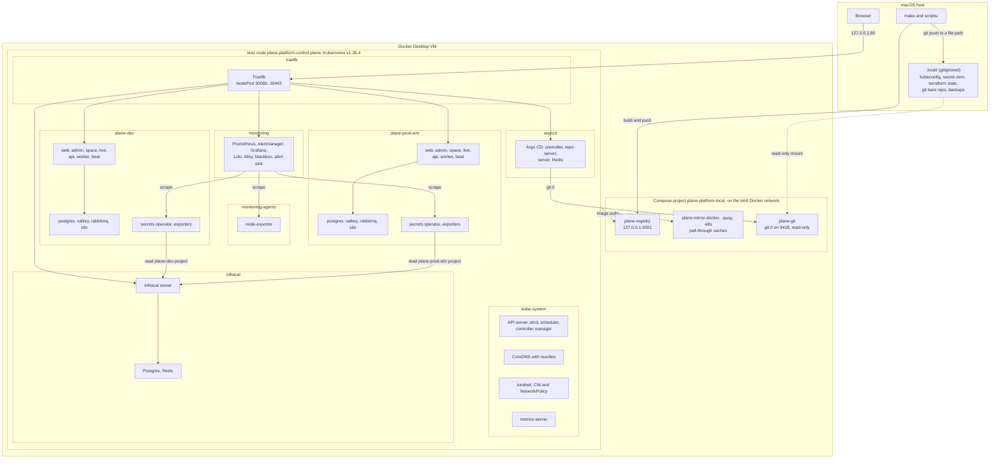
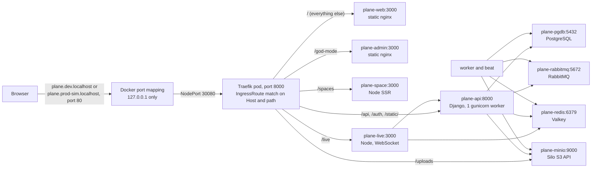
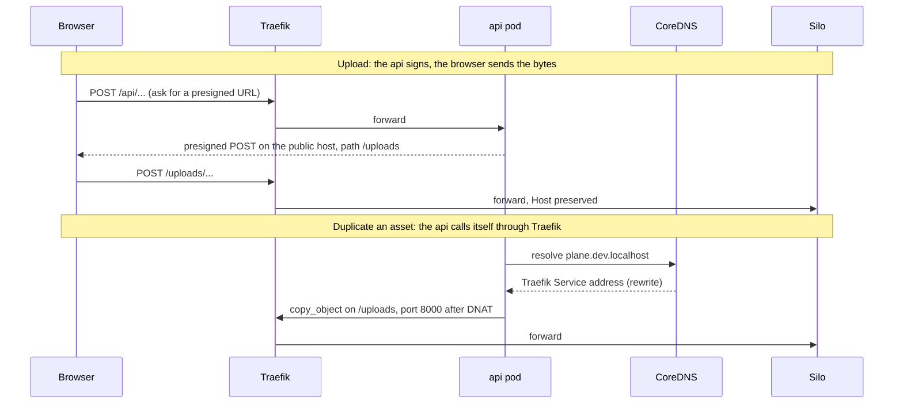
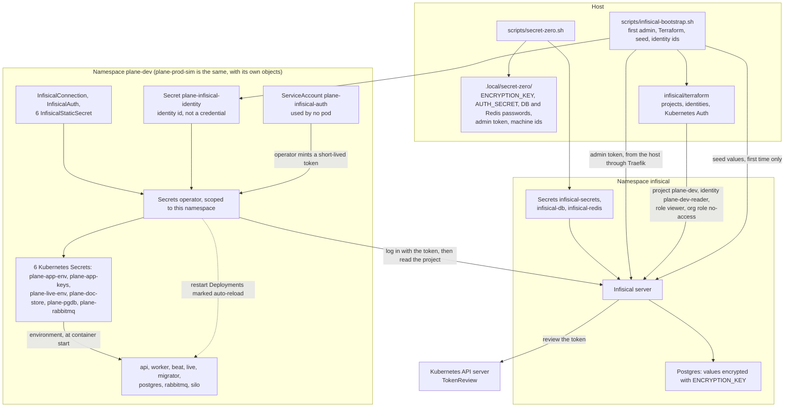
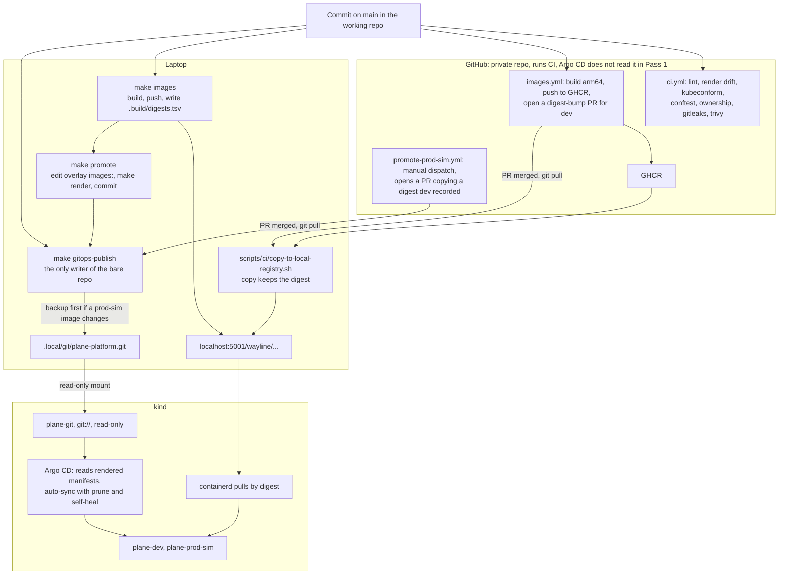

# Architecture

Wayline is a customized deployment of open-source Plane Community Edition v1.4.3 (AGPL-3.0). It is not an original product. This repository adds a local platform around Plane: kind, Terraform, Helm, Argo CD, Infisical, GitHub Actions, Prometheus, Grafana, Loki, and Traefik, with PostgreSQL, Valkey, RabbitMQ, and a MinIO-compatible store (Silo) as data services.

This is Pass 1. Everything runs on one laptop, on one kind node. Nothing in the cloud is provisioned or configured. Pass 2 is described in [future-hetzner.md](future-hetzner.md).

**How to read this page.** It describes configuration: what the code asks the system to do. It does not say the system does it. Results live in [validation.md](validation.md) and [evidence/](evidence/README.md). A statement that depends on a runtime result carries a `[[VERIFY]]` marker until evidence exists. Nothing here is a claim of production readiness.

Names, ownership, and ordering are binding in [platform-contract.md](platform-contract.md). Decision records are in [adr/](adr/). Tradeoffs for each tool are in [technology-choices.md](technology-choices.md). What the two environments share is in [environments.md](environments.md).

## 1. The whole system on one kind node

Three groups of things run outside the cluster, for specific reasons.

| Thing | Where | Why it is not in the cluster |
|---|---|---|
| Registry and pull-through caches | Compose | They must outlive `kind delete cluster`, or every rebuild pulls every image again |
| `plane-git` | Compose | A Git server in a pod needs a host path, which PSA `baseline` forbids. Outside the cluster it also survives teardown |
| Secret zero, Terraform state, backups, the bare Git repo | `.local/` on the host | They are what you need to rebuild the cluster, so they cannot depend on it |

All of it is one failure domain. The node, the kernel, the API server, and the Docker VM are single instances. [environments.md](environments.md) spells out what that means for the two environments.

Exposure is loopback only. kind binds host ports 80 and 443 to `127.0.0.1` (`infrastructure/kind/cluster.yaml.tmpl`), and those map to Traefik's NodePorts 30080 and 30443. kind's default of `0.0.0.0` would put unauthenticated UIs on the LAN. There is no TLS locally: all routes use Traefik's `web` entry point, and nothing listens with a certificate.

## 2. Request flow

### Browser to Plane

The routes come from the Plane chart's `IngressRoute` template, rendered into `gitops/environments/<env>/manifests.yaml`. Every route carries the chart's `plane-body-limit` Middleware, which buffers up to 20 MiB of request body. `/spaces` and `/god-mode` also carry `plane-trailing-slash`, which the hardening component adds because upstream's Caddy proxy issues that redirect and the chart has no equivalent.

| Host and path | Backend | Why it matters |
|---|---|---|
| `/` | `plane-web:3000` | React Router 7 with `ssr: false`, served by nginx. The pod has no reason to dial anything, and its policy has no egress beyond DNS |
| `/god-mode` | `plane-admin:3000` | Same, for the instance admin UI |
| `/spaces` | `plane-space:3000` | The only server-rendered frontend. Its build has an empty API base URL, and its policy gives it no route to the api, so its one server-side fetch should fail with only cosmetic effect |
| `/api`, `/auth`, `/static/` | `plane-api:8000` | Django. One gunicorn worker per pod, by the memory budget in contract section 10 |
| `/live` | `plane-live:3000` | Collaborative editing over WebSocket. The chart routes it through the same buffering Middleware as everything else |
| `/uploads` | `plane-minio:9000` | Presigned S3 requests go straight from the browser to Silo. The path must stay `/uploads`, because `export_task.py` hardcodes it (policy `plane.rego` checks the route) |

The space fetch failure is read from source, not observed. [[VERIFY: public space pages render with the api unreachable from the space pod]]

WebSocket upgrades through the `buffering` Middleware are read from Traefik's source only. [[VERIFY: two browser tabs editing one document through /live, with a soak of at least 5 minutes]]

Traefik's `traefik-ingress` policy admits NodePort traffic from `172.16.0.0/12` and `192.168.65.0/24`. The source address reaching the pod depends on Docker's port publishing, so both ranges are listed. The second range is in the code and not in the contract. [[VERIFY: which source address NodePort traffic presents at the Traefik pod on this host]]

`externalTrafficPolicy: Local` removes kube-proxy's SNAT, but expect Docker's gateway as the client address rather than the browser's. Plane's anonymous throttle keys on the `X-Forwarded-For` that Traefik builds from that address. [[VERIFY: client address seen in Traefik access logs]]

### Other hosts

| Host | Backend | Login |
|---|---|---|
| `argocd.localhost` | `argocd-server:80` | Argo CD admin. Password in `argocd-initial-admin-secret` |
| `grafana.localhost` | `kps-grafana:80` | Grafana admin. Password in Secret `kps-grafana` |
| `infisical.localhost` | `infisical:8080` | Infisical user. Admin credentials in `.local/secret-zero/` |
| `prometheus.localhost` | `kps-prometheus:9090` | **None** |
| `alertmanager.localhost` | `kps-alertmanager:9093` | **None** |

Prometheus and Alertmanager have no login of their own. Loopback binding is what protects them from the LAN. It does not protect them from pods, because the api may reach Traefik (see below).

### Requests that start inside the cluster

The Plane api dials its own public hostname in two cases: `copy_object` when duplicating an asset, and OAuth avatars. A `*.localhost` name means loopback to a browser, but inside a pod it must reach Traefik. So Terraform rewrites both Plane hostnames in CoreDNS to `traefik.traefik.svc.cluster.local`, and the api's NetworkPolicy allows egress to Traefik's pod port 8000.

Both paths are source reading only. [[VERIFY: copy_object from the api pod returns 200 through the CoreDNS rewrite, with the S3 signature valid]]

[[VERIFY: presigned upload through /uploads succeeds with no bucket Job, because the hardening component deletes the chart's bucket Job and relies on the api's create_bucket]]

This path has a side effect. The same Traefik serves every host, so the api can ask for any of them by Host header, including the other environment's. That gap is documented in [environments.md](environments.md#the-known-gap-api-to-traefik-to-anywhere).

### Who may talk to whom

Each namespace starts from default-deny for ingress and egress, plus DNS. These are the allow rules for a Plane namespace, from `gitops/platform/network-policies/plane-dev.yaml`. The prod-sim file is the same with the namespace changed.

| From | To | Port |
|---|---|---|
| Traefik | web, admin, space, live | 3000 |
| Traefik, live | api | 8000 |
| Traefik, Prometheus, api, worker, beat, migrator, backup | Silo | 9000 |
| api | Traefik (other namespace) | 8000 |
| api, worker, beat, migrator, backup, postgres-exporter | postgres | 5432 |
| api, worker, beat, migrator, live, redis-exporter | valkey | 6379 |
| api, worker, beat, migrator | rabbitmq | 5672 |
| Prometheus | rabbitmq metrics | 15692 |
| Prometheus | postgres-exporter, redis-exporter | 9187, 9121 |
| secrets operator | Infisical server, API server | 8080, 6443 |

Nothing in a Plane namespace has a route to the internet, so Plane's telemetry to `telemetry.plane.so` has none. Valkey has no password (chart issue 113), so its policy is its only access control. RabbitMQ's management port and Silo's console stay closed.

These rules only mean something if kindnet enforces them. kindnet evaluates new connections only and fails open with a log line on errors. A day-1 gate run recorded its result in `.local/evidence-raw/day1-gates-2.txt`, which is not yet in `docs/evidence/`. [[VERIFY: copy the day-1 gate 2 result into docs/evidence/ and confirm default-deny blocks a new connection on the final cluster]]

[[VERIFY: full allow and deny matrix in tests/network-policy-matrix.yaml run by make test-netpol]]

## 3. Secret flow

**Why this shape.**

- **Git holds no secret values.** The rendered manifests contain zero `kind: Secret`. `scripts/render.sh` and policy `gitops.rego` both fail if one appears. The chart renders none because all six `external_secrets.*_existingSecret` values are set, and `env.requireExplicitSecrets: true` makes the render fail rather than fall back to the chart's public default keys.
- **Secret zero exists because something must start first.** Infisical cannot store its own encryption key. So `ENCRYPTION_KEY`, `AUTH_SECRET`, and the database passwords live in `.local/secret-zero/` at mode 0600. This moves the problem to the laptop. It does not solve it.
- **One project per environment is the isolation boundary.** Custom roles and folder RBAC are paid features of Infisical. Two projects, built-in `viewer`, and org role `no-access` is what the free tier allows.
- **Two namespace-scoped operators, not one cluster-wide.** With `scopedRBAC` unset, an operator could mint a token for any ServiceAccount and read every Secret, and nothing would stop an `InfisicalAuth` in `plane-dev` from naming the prod-sim identity.
- **The admin token never enters the cluster.** Bootstrap runs on the host and reaches Infisical through `infisical.localhost`, which is why it is a script and not an Argo CD step.

**How login works.** The operator mints a short-lived token for `plane-infisical-auth` and presents it to Infisical. Infisical calls TokenReview using that same token as the credential, so no long-lived reviewer JWT exists anywhere. That is why `plane-infisical-auth` holds `system:auth-delegator`, through ClusterRoleBinding `infisical-token-reviewer` in `infisical/manifests/token-reviewer.yaml`. Each identity's Kubernetes Auth config allows one namespace and one ServiceAccount. Access tokens last 3600 seconds. [[VERIFY: operator login succeeds on kind, and the dev identity gets 403 when reading the plane-prod-sim project]]

**How values change.** Each `InfisicalStaticSecret` has `refreshInterval: 60s`. Deployments `plane-api-wl`, `plane-worker-wl`, `plane-beat-worker-wl`, and `plane-live-wl` carry `secrets.infisical.com/auto-reload: "true"`, so the operator restarts them when a Secret changes. StatefulSets do not carry it, so a value change does not restart Postgres. [[VERIFY: changing a value in Infisical rolls the four Deployments and does not start a fight with Argo CD self-heal]]

**How it fails.** Templates use `secretFrom`, not `.KEY.Value`, because the latter renders a literal `<no value>` and reports success, and a database would accept that as a password. With `secretFrom`, a missing key fails the reconcile and the custom Lua health check in `helm/values/argocd.yaml` reports Degraded. Chart references are `optional: false`, so a pod waits in `CreateContainerConfigError` until its Secret exists. [[VERIFY: a missing key marks the InfisicalStaticSecret Degraded and blocks the Plane sync at wave -1]]

**Other Secrets exist.** The six in the contract are the application's. These also live in the cluster and do not come from Infisical:

| Secret | Created by | Note |
|---|---|---|
| `infisical-secrets`, `infisical-db`, `infisical-redis` | `scripts/secret-zero.sh` | Argo CD does not manage them |
| `plane-infisical-identity` in each Plane namespace | `scripts/infisical-bootstrap.sh` | An id, not a credential, since login also needs the token. The CRD accepts only a Secret reference |
| `argocd-initial-admin-secret`, `argocd-redis` | Argo CD and its chart hook | Generated at first start |
| `kps-grafana` | kube-prometheus-stack chart | Random password on each render, so the Application ignores that field |

Kubernetes Secrets are base64 in kind's etcd, not encrypted at rest. One etcd holds both environments' Secrets.

Two rules from reading upstream code: passwords are hex because the chart does not URL-encode them into connection strings, and `SECRET_KEY` must never be rotated because it derives the key for encrypted config rows and `decrypt_data` fails silently to an empty string. The rotation demo uses the Postgres password. See [infisical.md](infisical.md).

## 4. Delivery flow

**Three ideas drive this.**

1. **An image is its digest.** Every image in the rendered manifests is `@sha256:`, and `render.sh` and policy `environments.rego` fail on anything else. Digests live only in `helm/plane/overlays/<env>/kustomization.yaml`, and only `make promote` writes those lines. A digest cannot silently change, and copying between registries preserves it where rebuilding would not.
2. **Argo CD syncs plain manifests.** `make render` runs `kustomize build --enable-helm` over the vendored chart and writes `gitops/environments/<env>/manifests.yaml`. Argo CD runs no Helm or Kustomize for Plane. CI fails if rendering produces a diff. So a reviewer can read exactly what will apply, and Argo CD regression #30215, which appears only at manifest regeneration, cannot affect Plane. Platform charts are different: Traefik, monitoring, and Infisical are Argo CD Helm sources at exact versions, with values from `helm/values/` through a `$values` ref.
3. **The cluster reads Git, and CI never touches the cluster.** No workflow has cluster credentials. A merged pull request changes nothing that runs. It reaches the cluster only when someone pulls `main` and runs `make gitops-publish`, and that script is where a prod-sim change takes its backup.

| Step | Mechanism | Failure mode it guards |
|---|---|---|
| Push to the bare repo | Plain `git push`, no force | Rewritten history is refused, so Argo CD never follows a rewrite with no record of it |
| Serve to Argo CD | `git daemon` over a read-only mount | Nothing in the cluster can write to the source of truth |
| Pull images | `containerd-certs.d` tries the local cache first, then the upstream `server` | Docker Hub's quota, and digests make any mirror safe to trust |
| Refuse unknown digests | `scripts/ci/check-promoted-digests.sh` | Prod-sim receiving a digest dev never recorded |
| Back up before prod-sim | `scripts/promote.sh` and `scripts/gitops-publish.sh` | Migrations are forward-only, so reverting an image does not revert the schema |

`kind load` is forbidden. It cannot work with this host's containerd image store (kind #3795). Upstream images come from `docker.io` by index digest, never from `artifacts.plane.so`, which fronts Docker Hub and shares its limit.

Argo CD has no webhook, because nothing could call it, so it notices commits by polling. `helm/values/argocd.yaml` sets no reconciliation override, so the interval is Argo CD's default. [[MEASURE: seconds from make gitops-publish to the Application reporting the new revision]]

The repo-server needs port 443 to fetch platform charts. Offline, charts come from its cache until it restarts, so a full cold start needs internet. [[VERIFY: behaviour of a platform Application when the repo-server restarts with no internet]]

[[VERIFY: Argo CD reads git://plane-git/plane-platform.git from the repo-server under its NetworkPolicy; day-1 gate 5 checked git:// from a plain pod only]]

**Current state of branding.** `apps/wayline/` is not in the repository at the time of writing, so both overlays pin upstream `docker.io/makeplane/*` images. `scripts/ci/build-images.sh` exits successfully with nothing to build until `apps/wayline/images.txt` exists. The delivery path above is ready for branded images but carries none yet. [[VERIFY: overlays reference localhost:5001/wayline/{web,admin,space,backend} once the branded images are built; if not, this paragraph stays]]

GitHub's Free plan on a private repository has no environment reviewers, no protected branches, and no artifact attestations. A person merging a pull request is the approval, and GitHub cannot enforce it. See [security.md](security.md) and `.github/workflows/README.md`.

## 5. Observability flow

```mermaid
flowchart LR
  subgraph targets["Scrape targets"]
    kubelet["kubelet and cAdvisor :10250"]
    ne["node-exporter :9100<br/>monitoring-agents"]
    ksm["kube-state-metrics, prometheus-operator :8080"]
    traefik["Traefik metrics :9100"]
    argo["Argo CD :8082, :8083, :8084"]
    coredns["CoreDNS :9153"]
    exporters["postgres-exporter :9187, redis-exporter :9121<br/>in each Plane namespace"]
    rabbit["RabbitMQ plugin :15692"]
    silo["Silo /minio/v2/metrics :9000"]
    self["Grafana, Loki, Alloy, Alertmanager"]
  end

  subgraph probes["Black-box"]
    blackbox["blackbox-exporter :9115"]
    troute["Traefik :8000 with the public Host"]
  end

  subgraph logs["Logs"]
    pods["Pods in plane-dev, plane-prod-sim,<br/>infisical, argocd, traefik, monitoring"]
    apiserver["API server"]
    alloy["Alloy Deployment<br/>loki.source.kubernetes"]
    loki["Loki monolithic, filesystem<br/>retention 72h"]
  end

  prom["Prometheus<br/>30s scrape, retention 3d or 1GiB"]
  am["Alertmanager"]
  sink["alert-sink<br/>webhook, logs to stdout"]
  grafana["Grafana<br/>4 dashboards from Git"]

  targets --> prom
  prom -->|"/probe"| blackbox
  blackbox --> troute
  pods --> apiserver
  apiserver --> alloy
  alloy --> loki
  prom -->|"rules-plane, rules-platform"| am
  am --> sink
  prom --> grafana
  loki --> grafana
  am --> grafana
```

**Metrics.** One Prometheus scrapes everything. Selector settings make it pick up every ServiceMonitor and Probe in every namespace. The per-environment split comes from the namespace label the operator sets, since each Probe and ServiceMonitor lives in its own Plane namespace. Exporters run in the Plane namespaces, not `monitoring`, because each holds that environment's credentials. The contract's namespace table lists exporters under `monitoring`, and this code differs.

**Probes.** Blackbox probes go to Traefik's in-cluster Service with the public host passed as `?hostname=`, so a failed probe means what a failed user request means. Two API probes exist on purpose: `/api/instances/` is cached in Valkey and can answer 200 with Postgres down, while `/api/public/anchor/__probe__/settings/` needs a database connection. Two API probes every 15 seconds stay under Plane's anonymous limit of 30 a minute.

**Logs.** Alloy runs as a single Deployment and reads logs through the Kubernetes API. It needs no root, no host path, and no privileged namespace. The cost is more load on the API server and kubelet. `monitoring-agents` and `kube-system` are not collected. Tail positions live in an `emptyDir`, so lines can be lost across an Alloy restart. [[MEASURE: API server CPU and memory with Alloy tailing all pods, against the same period without it]]

**Alerts.** Rules live in `monitoring/manifests/shared/`. Alertmanager has one real receiver, a small Python webhook sink that writes one JSON line per delivery to stdout, which Alloy ships to Loki. There is no external notification, because nothing cloud or third-party is configured in Pass 1. `Watchdog` always fires and repeats every 5 minutes, so a line in the sink is continuous proof that evaluation, routing, and delivery all work. [[VERIFY: make test-alert shows a real alert reaching the sink, and Watchdog lines appear on schedule]]

**What is deliberately missing.**

| Gap | Why | Compensating check |
|---|---|---|
| API server, etcd, scheduler, controller manager, kube-proxy scrapes | API server off to save series. The others bind to `127.0.0.1` inside a kind node, so they would only show as down | None. `KubeAPIDown` is disabled with it |
| Disk alerts | The VM reports hundreds of free GiB on a sparse disk while the Mac runs out first | `guard_disk` in `scripts/lib/common.sh`, on the host, at script entry only |
| Infisical operator metrics | Scraping needs an extra RBAC binding, and the contract names no operator metrics | None. The NetworkPolicy allows port 8443 anyway, and that rule is unused |

Monitoring has one Prometheus, one Loki, one Alertmanager, and one Grafana for both environments. Noisy series or logs from dev shorten what prod-sim can retain, because `retentionSize` and Loki's volume are shared.

## 6. Ownership boundaries

Every resource has exactly one owner. If two tools believe they own the same thing, one overwrites the other, and the failure looks like a flapping deployment. Contract section 4 is binding. This is what it means in practice.

| Owner | Owns | Never touches | Why here |
|---|---|---|---|
| **kind CLI** through `scripts/cluster-up.sh` | Cluster and node, CNI (kindnet), port and volume mounts | Anything inside namespaces | Terraform providers read the kubeconfig at plan time, so a cluster and its resources in one root is a known trap |
| **Docker Compose** in `infrastructure/local-services/` | Registry, pull-through caches, `git://` remote | Cluster resources | These must outlive the cluster |
| **Terraform** in `infrastructure/terraform/environments/local` | Namespaces and labels, ResourceQuota, LimitRange, CoreDNS rewrite, the Argo CD Helm release, AppProjects, the root Application | Anything Argo CD deploys | These must exist before Argo CD, or Argo CD could widen its own permissions |
| **Terraform** in `infisical/terraform` (separate root and state) | Infisical projects, environments, machine identities, memberships, Kubernetes Auth config | Secret values | Infisical must be running first, so this cannot share a root with the cluster foundation |
| **Argo CD** | Everything else in the cluster: Traefik, metrics-server, NetworkPolicies, monitoring, Infisical server, operators, both Plane environments | Namespaces, itself | One reconciler means drift gets reverted the same way everywhere |
| **Helm** | Renders charts. A packaging format here, not an owner | Nothing is `helm install`ed by hand | Terraform's `helm_release` and Argo CD's Helm sources are the only callers |
| **Infisical** | Secret values and their rotation history | Kubernetes objects | The operator materialises them |
| **Scripts** through `.local/secret-zero/` | The only secrets that exist before Infisical does | Anything once Infisical is live | Something has to start first |

**Terraform does not create the cluster, the node, the registry, or the Git remote.** kind and Compose do, driven by scripts. In Pass 1, Terraform talks only to an existing Kubernetes API and an existing Infisical API. `infrastructure/terraform/environments/dev` and `prod` are untested interface documents for Pass 2. See [terraform.md](terraform.md).

**Argo CD does not manage itself.** A bad sync cannot take down the controller that would apply the fix, and `terraform apply` works while Git is down. The cost is that Argo CD upgrades are not GitOps.

**Ownership is per resource, not per namespace.** A Plane namespace holds objects from several owners:

| Object in `plane-dev` | Owner | Argo CD project |
|---|---|---|
| Namespace, ResourceQuota `plane-budget`, LimitRange `plane-defaults` | Terraform | |
| Plane workloads, Services, routes, Infisical CRs | Argo CD, Application `plane-dev` | `plane-dev` |
| NetworkPolicies | Argo CD, Application `network-policies` | `platform` |
| Secrets operator | Argo CD, Application `infisical-operator-dev` | `platform` |
| Exporters, Probes, ServiceMonitors | Argo CD, Application `monitoring-extras` | `platform` |
| Backup PVC | Argo CD, Application `backup-storage` | `platform` |
| The six application Secrets | Infisical operator | |
| `plane-infisical-identity` | `scripts/infisical-bootstrap.sh` | |

**How the boundary is enforced.**

| Mechanism | What it stops | What it does not stop |
|---|---|---|
| `scripts/ci/ownership.sh` | The same kind, namespace, and name claimed by Terraform and Argo CD, or by two Argo CD sources | Names Terraform computes at plan time, except through its per-kind rules |
| AppProject `platform` | Any chart rendering a Namespace, ResourceQuota, or LimitRange | Anything else, in any namespace. It is deliberately broad |
| AppProjects `plane-dev`, `plane-prod-sim` | Cluster-scoped objects, NetworkPolicy, ResourceQuota, LimitRange, and any other namespace | Namespaced workloads and routes inside their own namespace |
| `CreateNamespace=false` on every Application | Argo CD creating a namespace | |
| Policy `environments.rego` | A rendered Plane manifest carrying a platform-only kind | Hand-applied objects |

A human with the admin kubeconfig can still change anything. Self-heal reverts tracked fields. It does not see untracked objects.

The CoreDNS ConfigMap is a shared edge. kubeadm created it and Terraform server-side applies the `Corefile` key with `force`. kind never re-runs the kubeadm addon phase, so nothing takes it back. The provider's delete empties the data, so after `terraform destroy` CoreDNS cannot mount its config at the next restart. Delete the cluster afterwards instead of reusing it.

## 7. Sync waves

Waves order resources inside one Argo CD sync. There are two levels: the root app-of-apps orders Applications, and each Plane Application orders its own resources.

### Root Application

| Wave | Applications | Why at this point |
|---|---|---|
| -10 | `network-policies`, `backup-storage` | Every later wave starts under default-deny with its allow rules in place. Backup PVs and PVCs exist before anything can mount them |
| -9 | `traefik` | Ships the IngressRoute CRDs that later routes need |
| -8 | `metrics-server`, and the `argocd-server` IngressRoute | The route is the root's second source. It needs Traefik's CRD, so Terraform cannot create it |
| -7 | `kube-prometheus-stack` | Ships the monitoring CRDs. Needs `ServerSideApply` because one CRD exceeds the client-side annotation limit |
| -6 | `loki`, `alloy` | |
| -5 | `monitoring-extras` | Rules, dashboards, Probes, exporters. Needs the CRDs from -7 |
| -4 | `infisical` | Server, Postgres, Redis, route. Has its own waves inside: ServiceAccount -2, data -1, server 0, route 1 |
| -3 | `infisical-operator-dev`, `infisical-operator-prod-sim` | Only the dev release installs the CRDs. The prod-sim manager crash-loops until they exist, then recovers |
| -1 | `plane-dev` | Needs the operator's CRDs and Infisical answering |
| 0 | `plane-prod-sim` | Serial on purpose: simultaneous first boots are the worst case for memory |

The contract's section 6 does not list `backup-storage` (it is in section 13) or the `argocd-server` route. They are in the code.

**Waves gate only because of a custom health check.** Argo CD removed the health check for `argoproj.io/Application` in version 1.8, so without one a child reports no health and the root's waves pass straight through. `helm/values/argocd.yaml` adds it back. A wave waits while a child is Missing or Progressing. A Degraded child fails the root sync, and the root retries without limit, because a child is often briefly Degraded on first boot and automated sync never reattempts a failed commit by itself. [[VERIFY: on a fresh install, each root wave waits for the previous wave's Applications to be Healthy]]

`postgres-exporter` carries `argocd.argoproj.io/ignore-healthcheck`, because `monitoring-extras` syncs at -5 and its Secret `plane-pgdb` does not appear until -1. Without this the root would wait forever on a pod that cannot start yet.

**Waves are not a dependency system between environments after first install.** Once `plane-prod-sim` exists, it polls Git and syncs by itself. A wave only orders the root's own operation. So -1 before 0 protects the first boot. It does not make a later change land in dev before prod-sim. [environments.md](environments.md#the-promotion-model) covers what does.

A child stuck in Progressing holds the root in `Running`, and the root does not pick up a new commit until that operation ends. To inject failure, pause automation on both the child and the root, because the root's self-heal reverts a patch to a child's `syncPolicy`. The children set `retry.refresh: true`, so a retry picks up a newer commit and a revert can land. The root Application at `gitops/bootstrap/chart/templates/root-application.yaml` does not set it. [[VERIFY: whether a bad commit under gitops/applications can be fixed by a revert while the root is retrying, or whether the root stays pinned to the bad revision]]

### Inside each Plane Application

| Wave | Resources | Why |
|---|---|---|
| -3 | ServiceAccounts, `InfisicalConnection` | The operator needs both before it can log in |
| -2 | `InfisicalAuth` | Needs the connection, and `plane-infisical-identity` from bootstrap. Stays unready until bootstrap runs |
| -1 | Six `InfisicalStaticSecret` | Health-gated with Lua. Nothing later can start without these Secrets |
| 0 | ConfigMaps, Services | Headless Services must exist for StatefulSet DNS |
| 1 | StatefulSets: postgres, redis, rabbitmq, silo | The data tier must be up before migrations |
| 2 | Migrator Job, `hook: Sync` | **Never `PreSync`.** Postgres is applied in the Sync phase, so a PreSync hook exhausts its retries against a database that does not exist and deadlocks a fresh install. Policy `environments.rego` rejects it |
| 3 | Deployments: api, worker, beat, web, admin, space, live | Run against a migrated schema. A failed migrator stops the sync here, so no Deployment moves |
| 4 | IngressRoute, Middlewares | Traffic last |

The migrator Job uses `backoffLimit: 3`, `activeDeadlineSeconds: 900`, and `hook-delete-policy: BeforeHookCreation`. The hardening component removes the chart's `timestamp` annotation, because `now` in a pod template changes every render, which would roll every Deployment and hit the Job's immutable template.

Bootstrap is not a wave. `scripts/infisical-bootstrap.sh` runs on the host after Infisical answers, and `plane-dev` waits at wave -2 until it publishes the identity ids. [[VERIFY: a fresh make up reaches both Plane Applications Healthy with this ordering, with no manual step]]

[[VERIFY: a bad backend digest fails at the migrator in wave 2 and leaves running Deployments unchanged, tested by tests/drills/failed-deploy-rollback.sh]]

[[MEASURE: time from make up on an empty machine to both Plane Applications Healthy]]

## 8. What this architecture does not provide

- **No high availability.** One node, one API server, one etcd, and one replica of each data service. A node restart is an outage for everything.
- **No TLS, and no authentication on Prometheus or Alertmanager.** Loopback binding is the only outer boundary.
- **No independent environments.** See [environments.md](environments.md).
- **No proof yet.** Plane has not been deployed at the time of writing. See [validation.md](validation.md) for what has run and [known-limitations.md](known-limitations.md) for what is known to be missing.
