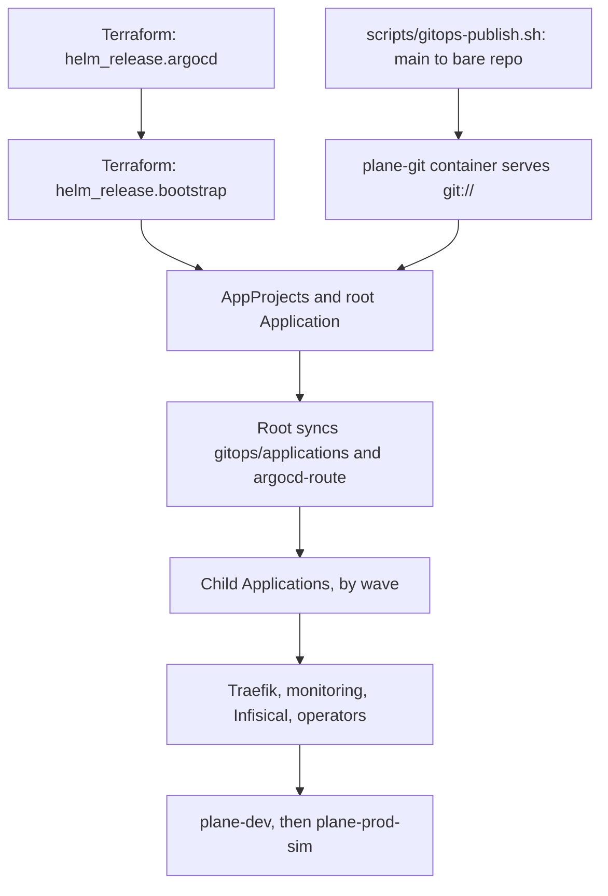

# Argo CD

Argo CD deploys everything in the cluster except namespaces, quotas and itself. Wayline, the application it delivers, is
a customized Plane Community Edition v1.4.3 deployment, not an original product.

**Status of this page.** It describes configuration in the code and Argo CD v3.5.7 behaviour read from source. Nothing
here has run on this platform at the time of writing. Runtime statements carry a `VERIFY` or `MEASURE` marker
until [`docs/evidence/`](evidence/README.md) holds the result.

## Access

| | |
|---|---|
| UI | `http://argocd.localhost`, user `admin`, once Traefik is up. Password: see [install.md](install.md#getting-credentials-without-printing-them) |
| Before Traefik exists | `kubectl -n argocd port-forward svc/argocd-server 8080:80` |
| Server version | v3.5.7, chart `argo-cd` 10.11.7. One replica each of controller, repo server, server and Redis. No Dex, notifications or ApplicationSet |
| Git source | `git://plane-git/plane-platform.git`, branch `main` |
| CLI | **Not in `tools.lock`**, so `make setup` does not install it. If you install it, match the server version v3.5.7, then run `argocd login argocd.localhost --grpc-web --plaintext` |

Commands below use `kubectl` from a shell set up as in [install.md](install.md#shell-setup), and name the CLI form only
where it adds something.

## The bootstrap chain

Nothing in Git can start Argo CD, so the chain has a defined first step.



| Step | Owner | Notes |
|---|---|---|
| Bare repo at `.local/git/plane-platform.git` | `make gitops-publish`, the only writer | Publishes commits on `main`. Uncommitted work never reaches Argo CD |
| `plane-git` | Compose | Read-only `git daemon` on the `kind` network. GitHub runs CI, but Argo CD does not read it in Pass 1 |
| Argo CD release | Terraform | Values in `helm/values/argocd.yaml`. **A change there needs `terraform apply`, not a publish** |
| AppProjects, root Application | Terraform, through local chart `gitops/bootstrap/chart` | Not synced from Git, so a commit cannot edit what a project allows. A commit can still move an Application to project `platform`. See scenario 10 in [environments.md](environments.md#failure-scenarios) |
| Everything else | Argo CD | |

The root Application has two sources, so its status carries `status.sync.revisions` and `status.sync.revision` is empty.

[[VERIFY: repo server fetches git://plane-git under default-deny NetworkPolicy; the day-1 gate used ls-remote from another image with no policy]]

## Projects

Enforced by the AppProjects in `gitops/bootstrap/chart/templates/appprojects.yaml`.

| Project | Destinations | Source repos | Cluster-scoped | Denied in namespaces |
|---|---|---|---|---|
| `platform` | All namespaces | The Git remote and six chart repos | All except `Namespace` | `ResourceQuota`, `LimitRange` |
| `plane-dev` | `plane-dev` only | The Git remote only | None | `ResourceQuota`, `LimitRange`, `NetworkPolicy` |
| `plane-prod-sim` | `plane-prod-sim` only | The Git remote only | None | `ResourceQuota`, `LimitRange`, `NetworkPolicy` |

**Why NetworkPolicies are in `platform`.** A Plane Application cannot change the rules that contain it. The operators
are in `platform` too, because their charts render CRDs and ClusterRoles.

**A project boundary is not a cluster boundary.** Namespace separation is not equivalent to independent production clusters.
Dev and prod-sim share an API server, a controller and a node. See [environments.md](environments.md).

[[VERIFY: an Application in plane-dev is refused when it renders a NetworkPolicy or a cluster-scoped resource]]

## Root Application and waves

`root` syncs `gitops/applications/` and `gitops/bootstrap/argocd-route/`. Each file there is one child.

| Wave | Application | Project | Namespace | Source | Finalizer |
|---:|---|---|---|---|---|
| -10 | `network-policies` | platform | several | `gitops/platform/network-policies` | No |
| -10 | `backup-storage` | platform | several | `gitops/platform/backup-storage` | No |
| -9 | `traefik` | platform | `traefik` | chart 42.3.0 | Yes |
| -8 | `metrics-server` | platform | `kube-system` | chart 3.14.0 | Yes |
| -8 | IngressRoute `argocd-server` (not an Application) | platform | `argocd` | `gitops/bootstrap/argocd-route` | |
| -7 | `kube-prometheus-stack` | platform | `monitoring` | chart 92.18.0 | Yes |
| -6 | `loki` | platform | `monitoring` | chart 20.4.1 | Yes |
| -6 | `alloy` | platform | `monitoring` | chart 1.15.0 | Yes |
| -5 | `monitoring-extras` | platform | `monitoring` | `monitoring/manifests` | Yes |
| -4 | `infisical` | platform | `infisical` | chart `infisical-standalone` 1.12.0, plus `infisical/manifests` | No |
| -3 | `infisical-operator-dev` | platform | `plane-dev` | chart `secrets-operator` 0.11.16 | No |
| -3 | `infisical-operator-prod-sim` | platform | `plane-prod-sim` | chart `secrets-operator` 0.11.16 | No |
| -1 | `plane-dev` | plane-dev | `plane-dev` | `gitops/environments/dev` | No |
| 0 | `plane-prod-sim` | plane-prod-sim | `plane-prod-sim` | `gitops/environments/prod-sim` | No |

**What the finalizer means.** With `resources-finalizer.argocd.argoproj.io`, removing the Application deletes what it deployed.
That is fine for replaceable services. Without it, the objects are orphaned. Plane, Infisical, the operators (deleting
them would delete the CRDs, and so every Infisical CR), NetworkPolicies and backup storage deliberately have none. `root`
has none either, so removing it does not cascade.

**Prune.** Every Application has `prune: true`. Deleting a file under `gitops/applications/` removes that Application.
What happens to its workloads depends on the finalizer above.

### Health gating

Argo CD removed the built-in health check for `Application` in 1.8. Without one, a child reports no health and the root's
waves pass straight through. `helm/values/argocd.yaml` adds these Lua checks through `resource.customizations.health.*`:

| Kind | Healthy when | Degraded when | Otherwise |
|---|---|---|---|
| `argoproj.io/Application` | `status.health.status` is Healthy | That field is Degraded | Copies that field, or Progressing |
| `InfisicalStaticSecret` | `observedGeneration` matches and `status.error` is not true | `observedGeneration` matches and `status.error` is true | Progressing |
| `InfisicalAuth`, `InfisicalConnection` | Condition `IsReady` is True for this generation | Condition `IsReady` is False for this generation | Progressing |

A non-hook task waits on anything except Healthy and Degraded. So Missing and Progressing hold the wave. Degraded fails the
sync, and retry reruns it.

**This gates less than the contract's wording suggests.** The Application check copies the child's aggregate health.
Argo CD's aggregate skips hooks and resources that do not exist yet (`controller/health.go`, read at v3.5.7). So a child
with internal waves can read Healthy between them, including during its migrator. The expected effect on first boot is that
`infisical`, `plane-dev` and `plane-prod-sim` overlap rather than run strictly in series, and that overlap is the
memory worst case in contract section 10.

- [[VERIFY: whether the Application health check holds the root wave until a child's operation ends; the integration review proposed checking operationState.phase]]
- [[VERIFY: all four Lua checks with argocd admin settings resource-overrides health or on a live cluster]]
- [[MEASURE: peak VM memory during a first sync of both environments]]

**Do not wait on `root` alone.** Root's operation can finish right after it applies wave 0, without waiting for
`plane-prod-sim` to become healthy (`sync_context.go`, read at v3.5.7).
[[VERIFY: root's operation ends before plane-prod-sim is healthy]]
Read the child Applications:

```bash
kubectl -n argocd get applications
make status
```

The `REVISION` column in `make status` reads `.status.sync.revision`, which is empty for multi-source Applications.

## Inside a Plane Application

The waves are in the rendered manifests, from `helm/plane/components/hardening`, and are the same in both environments.

| Wave | Resources | Gate before moving on |
|---:|---|---|
| -3 | ServiceAccounts `plane`, `plane-infisical-auth`; `InfisicalConnection` | Lua check |
| -2 | `InfisicalAuth` | Lua check. Needs Secret `plane-infisical-identity` from `scripts/infisical-bootstrap.sh` |
| -1 | Six `InfisicalStaticSecret` | Lua check. The operator has written the Secrets |
| 0 | ConfigMaps, Services | Exists |
| 1 | StatefulSets: postgres, valkey, rabbitmq, silo | Ready |
| 2 | Migrator Job `plane-api-migrate-1`, Sync hook | Job complete |
| 3 | Deployments: api, worker, beat, web, admin, space, live | Rollout complete |
| 4 | `plane-ingress`, Middlewares | Exists |

[[VERIFY: wave order holds on a fresh install in dev]]
[[VERIFY: whether Argo CD waits or fails while InfisicalAuth is unready before bootstrap]]

### Sync hook: the migrator

| Setting | Value | Why |
|---|---|---|
| `argocd.argoproj.io/hook` | `Sync` at wave 2 | **Never `PreSync`.** Postgres is applied in the Sync phase and `wait_for_db` does not wait, so a PreSync migrator exhausts its retries against no database and stops a fresh install |
| `hook-delete-policy` | `BeforeHookCreation` | The Job's name is constant and its template immutable. Each sync deletes and recreates it |
| `ttlSecondsAfterFinished` | Not set | Argo CD can wait forever on a hook Kubernetes already deleted |
| `activeDeadlineSeconds` | 900 | With `restartPolicy: OnFailure`, a bad image gives `ImagePullBackOff` and the Job never fails on its own. The deadline makes it fail |
| `backoffLimit` | 3 | From the chart |

Consequences of this design:

- **The migrator runs on every sync that reaches wave 2,** including one self-heal triggers. [[VERIFY: migrator reruns are harmless when no migration is pending]]
- **A failed migrator stops the sync before wave 3,** so no Deployment is touched and the old version keeps running. [[VERIFY: failing migrator leaves wave 3 Deployments untouched]]
- **App health can stay Healthy while the migrator fails,** because aggregate health skips hooks. Read the operation phase and message, not only health.

### Other sync options

| Option | Where | Why |
|---|---|---|
| `CreateNamespace=false` | All | Terraform creates every namespace |
| `PruneLast=true` | `plane-dev`, `plane-prod-sim` | Removals apply only after the new state is healthy |
| `ServerSideApply=true`, `RespectIgnoreDifferences=true` | `kube-prometheus-stack` | `crd-prometheuses.yaml` is far over client-side apply's annotation limit. Grafana's password is regenerated on each render, so it is ignored |
| `SkipDryRunOnMissingResource=true` | IngressRoute `argocd-server` | The root's dry run happens before Traefik's CRD exists |

## Self-heal

Every Application has `automated: {prune: true, selfHeal: true}`, including prod-sim. **The prod-sim control point is the
Git change, not the sync button.**

A live change that differs from Git is reverted. The contract says this takes seconds.
[[MEASURE: time from a manual kubectl scale to self-heal reverting it]]

Git polling has no webhook in Pass 1. A published commit is seen at the next reconciliation, within about three minutes
by the chart's default (120 seconds plus up to 60 seconds of jitter). To ask immediately:

```bash
kubectl -n argocd annotate application plane-dev argocd.argoproj.io/refresh=normal --overwrite
```

Two things that look like drift and should not fight:

| Writer | What it changes | Expected |
|---|---|---|
| Infisical operator | Pod template annotations, through `auto-reload` | Argo's 3-way diff ignores fields it does not manage. [[VERIFY: no sync loop after an Infisical secret change]] |
| Grafana chart | `checksum/secret` differs per render | `monitoring/README.md` documents an `ignoreDifferences` entry for this. [[VERIFY: gitops-publish does not restart Grafana; the Deployment entry was missing from the Application at commit 2faaed5]] |

## Retry behaviour

**A failing sync shows `Running`, not `Failed`.** This is the one thing to remember on this page.

Every Application has `retry.limit: -1`. Argo CD's controller sets a failed sync back to phase `Running`, with a retry
scheduled, indefinitely (`controller/appcontroller.go`, read at v3.5.7). So you will not see a `Failed` phase. You see
`Running` with a message about the next retry attempt, and `status.operationState.retryCount` rising.

[[VERIFY: exact phase and message shown by a failing sync with retry.limit -1]]

| Setting | Value | Why |
|---|---|---|
| `limit` | -1, no limit | Automated sync never reattempts a failed commit. A child is often briefly Degraded on first boot, so a finite limit would strand it until the next commit |
| `backoff` | 30s, factor 2, cap 5m | The wait goes 30s, 1m, 2m, 4m, 5m, 5m and on |
| `refresh` | `true` on children | A retry picks up the newest commit, so a revert lands while the sync loops. Without it the retry stays pinned to the bad revision |

`root` has `limit: -1` and the same backoff, but **no `refresh: true`** at commit 2faaed5. A fix to an Application manifest may not
land while root's own operation runs or retries. [[VERIFY: whether root picks up a new commit during a retry loop]]

To see the true state:

```bash
kubectl -n argocd get application plane-dev -o json \
  | jq '{sync: .status.sync.status, health: .status.health.status,
         phase: .status.operationState.phase, retries: .status.operationState.retryCount,
         message: .status.operationState.message}'
```

**Stuck child, stuck root.** A child that stays `Progressing` holds the root in `Running`, and the root will not pick up a new
commit until that operation ends. In order, fix the child's cause, or end the operation:

```bash
# With the CLI: argocd app terminate-op <app>
# Without it. The chart's CRD has no status subresource, so this patch reaches status.
kubectl -n argocd patch application root --type merge \
  -p '{"status":{"operationState":{"phase":"Terminating"}}}'
```

[[VERIFY: the Terminating patch ends a running operation without the CLI]]

**Scripts that wait for idle.** `argo_wait_idle` in `monitoring/ops/lib.sh` gives up after 180 seconds while the phase is
`Running`. So `make restore` and `make test-alert` can refuse to start while an Application is in a retry loop, and a
restore after a bad promotion is exactly that case. [[VERIFY: make restore can run while the environment's sync is failing]]

## Rollback

**Rollback is a Git revert.** `argocd app rollback` needs automated sync off, and leaves Git disagreeing with the cluster.

```bash
make rollback ENV=dev
make rollback ENV=prod-sim CONFIRM=yes
```

`scripts/rollback.sh`:

1. Refuses unless you are on `main` with a clean overlay.
2. Finds the newest promotion of that environment not already reverted. It matches the `Promote-Env:` trailer or the `promote(<env>):` subject, since a squash merge may drop the trailer.
3. Runs `git revert`. On a conflict it aborts, changes nothing, and tells you to resolve it by hand.
4. Re-renders, since a later commit may have changed what the overlay renders to.
5. Publishes through `scripts/gitops-publish.sh`.

**Things to know before running it:**

| Point | Detail |
|---|---|
| Images roll back, the schema does not | Migrations are forward only. Old code starts against the newer schema with no warning. The way back for data is the dump taken before a prod-sim promotion, through `make restore` |
| **Do not use `BACKUP=latest` for that** | Publishing a prod-sim image change takes a new dump first, and a rollback is one. So after `make rollback ENV=prod-sim`, `latest` is the dump from after the migration. Pick the pre-promotion backup id under `.local/backups/prod-sim/` |
| A failing backup blocks the publish | `gitops-publish.sh` stops with "nothing was published", and the revert commit is already on local `main`. If the database is the broken part, run `SKIP_BACKUP=yes make gitops-publish` |
| **Do not rerun `make rollback` to retry a failed publish** | It would revert the next promotion back. Rerun `make gitops-publish` |
| A revert during a retry loop | Children have `retry.refresh: true`, so the retry should pick it up. See below |

`tests/drills/failed-deploy-rollback.sh` exercises this path in dev. It promotes an unpullable digest for `web`, checks that the
old pods keep serving, and reverts. It needs no pause, because the bad state is the desired state in Git, so Argo CD has
nothing to undo.

- [[VERIFY: failed-deploy drill passes; old pods keep serving and revert restores Synced and Healthy]]
- [[MEASURE: time from make rollback to the environment reading Synced and Healthy]]

`progressDeadlineSeconds` is 360 on every rendered Deployment, which decides when a bad rollout is declared failed. It stays
above the longest startup budget (api, worker and beat, 300 seconds), because image pull and scheduling count against
the same deadline. Stage 4 of the drill waits that long plus 120 seconds, so up to 8 minutes.

**Rolling back a platform change.** Revert the commit and publish:

```bash
git revert <commit>
make render              # only if the revert touched helm/plane
git status --short       # commit anything render changed
make gitops-publish
```

`gitops-publish` refuses a non-fast-forward push on purpose, because a rewrite would leave Argo CD following history with no
record of it. Reverts are the way back. A change owned by Terraform needs `terraform apply` after the revert. See
[terraform.md](terraform.md#what-reaches-the-cluster-how).

## Pausing automation for drills

Drills that inject failure behind Git's back must pause self-heal first, or Argo CD reverts them in seconds. **Pause both
`root` and the child, root first:** root's self-heal reverts a patch to a child's `syncPolicy`.

`monitoring/ops/lib.sh` does this for `make restore` and `make test-alert`. `argo_pause` saves each Application's
`automated` block, sets `enabled: false`, waits for any running operation to end, then checks that the patch held.
`argo_resume` restores the blocks verbatim in reverse order, from an exit trap, so root sees no drift.

By hand:

```bash
for app in root plane-dev; do
  kubectl -n argocd patch application "$app" --type merge \
    -p '{"spec":{"syncPolicy":{"automated":{"enabled":false}}}}'
done

# ... inject the failure, observe ...

for app in plane-dev root; do
  kubectl -n argocd patch application "$app" --type json \
    -p '[{"op":"replace","path":"/spec/syncPolicy/automated","value":{"prune":true,"selfHeal":true}}]'
done
```

A sync already in flight keeps going after the pause, and retries can keep re-applying. Check the operation phase before
trusting an injection.

| Drill or script | Pauses? | Why |
|---|---|---|
| `make restore` | Yes | It scales apps to zero |
| `make test-alert` | Yes | It injects a failure behind Git's back |
| `tests/drills/failed-deploy-rollback.sh` | No | The change goes through Git |
| `tests/drills/pod-restart-persistence.sh` | No | Deleting a pod changes no spec |

[[VERIFY: automated.enabled false stops self-heal and the saved block restores cleanly]]

## Diffing

Different questions need different diffs.

| Question | Command |
|---|---|
| What will this overlay change produce? | `make render && git diff gitops/environments/` |
| What is committed but not published? | See below |
| What differs between the two environments? | `diff gitops/environments/dev/manifests.yaml gitops/environments/prod-sim/manifests.yaml` |
| What does Argo CD consider out of sync? | The UI's Diff tab, or `argocd app diff plane-dev` with the CLI |
| Which resources are out of sync? | See below |
| How does the live cluster differ from the render? | See below |

```bash
# Committed on main, not yet visible to Argo CD
git diff "$(git --git-dir=.local/git/plane-platform.git rev-parse main)" main -- gitops helm

# Out-of-sync resources in one Application
kubectl -n argocd get application plane-dev -o json \
  | jq -r '.status.resources[] | select(.status != "Synced") | "\(.kind)/\(.name) \(.status)"'

# Live against render, by server-side dry run
kubectl diff -n plane-dev -f gitops/environments/dev/manifests.yaml
```

`kubectl diff` works on what the render sets, so expect noise from the hook Job. Argo's diff is the one that decides sync
status. [[VERIFY: kubectl diff against rendered manifests is readable on a synced environment]]

## Promotion

Image digests for an environment live in `helm/plane/overlays/<env>/kustomization.yaml` under `images:`. Only
`scripts/promote.sh` writes those lines. It edits them with `kustomize edit set image`, re-renders, commits with
`Promote-Env:` and `Promote-Image:` trailers, and publishes.


**Images.** At commit 2faaed5 both overlays name upstream `docker.io/makeplane/*` by digest, so the branded
`localhost:5001/wayline/*` images in contract section 5 are not referenced yet.
[[VERIFY: overlays reference branded localhost:5001/wayline images after the branding layer lands]]

### Dev

```bash
# Every image just built (writes .build/digests.tsv, which promote reads)
make images
make promote ENV=dev

# One image. IMAGE is web, admin, space, live, backend, postgres, valkey, rabbitmq or silo
make promote ENV=dev IMAGE=web DIGEST=sha256:<64-hex>
```

`web` maps to the chart's `plane-frontend`. Add `REPO=` when the digest comes from another repository. A digest under
`localhost:5001/` must already be in the local registry, or the script stops before Argo CD can sit in `ImagePullBackOff`.

**Through GitHub.**

1. `images.yml` builds on `main`, pushes to GHCR, and opens a pull request bumping dev. The workflow rewrites the repository to `localhost:5001/wayline/` first, because that is where Argo CD pulls from in Pass 1.
2. Merge it, and `git pull`.
3. Copy the digests before publishing, or pods fail to pull. Copying keeps the digest. Rebuilding would not.

```bash
scripts/ci/copy-to-local-registry.sh ghcr.io/<owner>/wayline dev
make gitops-publish
```

A merge changes nothing running. GitHub Actions cannot reach the cluster. It reaches the cluster only at `make gitops-publish`.

### Prod-sim

```bash
make test-e2e ENV=dev                                   # earn it first
make promote ENV=prod-sim                               # copies every differing image from dev, asks first
make promote ENV=prod-sim CONFIRM=yes
make promote ENV=prod-sim IMAGE=web DIGEST=sha256:<64-hex>
```

What `scripts/promote.sh` does differently for prod-sim:

| Step | Behaviour |
|---|---|
| Digest check | `scripts/ci/check-promoted-digests.sh` refuses any digest not in the dev overlay's Git history. The failure-drill digest is refused by name |
| Confirmation | Prompts for `yes`, or needs `CONFIRM=yes`. Without a terminal it stops |
| Backup | `scripts/backup.sh prod-sim` before any edit, because rolling back an image does not roll back a migration. `SKIP_BACKUP=yes` overrides, with a warning |
| Failure | Restores the overlay and rendered file, so nothing half-promoted stays behind |

The digest check cannot tell order inside one commit, so a change adding a digest to both environments at once passes. Human
review covers that.

**Through GitHub.** `promote-prod-sim.yml`, run by manual dispatch, opens a pull request. It never builds.

1. Run the workflow, with `image` and `digest` or with neither to copy every image from dev.
2. Review and merge. **Merging is the approval, and GitHub cannot enforce it.** The repository is private on the Free plan, so there are no environment reviewers and no protected branches. See [`.github/workflows/README.md`](../.github/workflows/README.md).
3. Publish. The workflow could not reach the cluster, so the dump happens here.

```bash
git pull
make gitops-publish      # takes the prod-sim dump first if a prod-sim image changed
```

`gitops-publish.sh` detects this by grepping the diff of the prod-sim manifests for `@sha256:`.
[[VERIFY: gitops-publish takes the dump on a large prod-sim diff; grep -q under pipefail can read a match as false, integration review m3]]

### After a promotion

Argo CD picks up the commit at its next reconciliation, or ask with the refresh annotation above. Then:

```bash
kubectl -n argocd get application plane-prod-sim
make test-e2e ENV=prod-sim
```

[[VERIFY: a digest promotion reaches dev and then prod-sim through this path]]
[[VERIFY: prod-sim promotion takes a dump before the image changes]]
[[MEASURE: time from make promote to the environment reading Synced and Healthy]]

If it goes wrong, see [Rollback](#rollback). Failure handling is in [runbooks](runbooks/).
