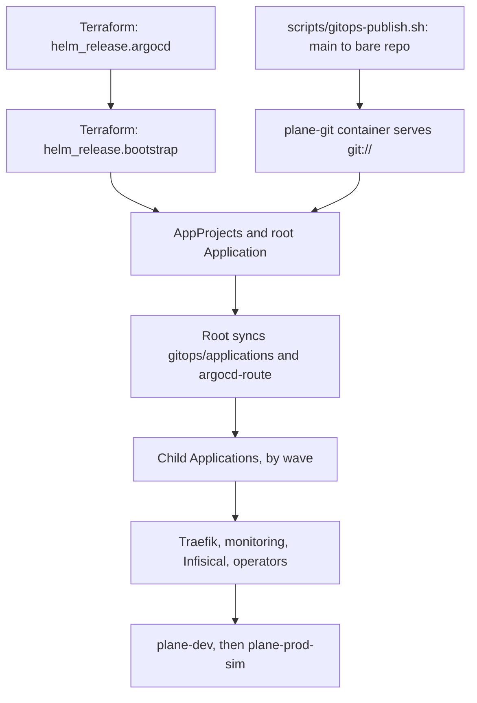

# Argo CD

Argo CD deploys everything in the cluster except namespaces, quotas and itself. Wayline, the application it delivers, is
a customized Plane Community Edition v1.4.3 deployment, not an original product.

**Status of this page.** It describes the configuration in the code, and what ran on the one local kind cluster on
2026-11-04 and 2026-11-05 with Argo CD v3.5.7. A measured statement links its file under
[`docs/evidence/runs/`](evidence/README.md), or names it under `.local/evidence-raw/` for the runs of 2026-11-05 that
`make publish-evidence` has not copied yet. A `VERIFY` or `MEASURE` marker stays on what has not run: a cluster-scoped refusal, a self-heal
timed on a manual scale, a secret rotation and a restore during a failing sync. A clean install has not run either, and neither has a rollback of prod-sim. Several results come from scratch
Applications on the real controller. They show how Argo CD behaves, not how a first boot from nothing would go.

## Access

| | |
|---|---|
| UI | `http://argocd.localhost`, user `admin`, once Traefik is up. Password: see [install.md](install.md#getting-credentials-without-printing-them). The route admits only the node network, so a pod gets 403 from Traefik ([routes-after-2.txt](evidence/runs/routes-after-2.txt)) |
| Before Traefik exists | `kubectl -n argocd port-forward svc/argocd-server 8080:80` |
| Server version | v3.5.7, chart `argo-cd` 10.11.7. One replica each of controller, repo server, server and Redis. No Dex or notifications. The chart has no switch for the ApplicationSet controller, so its Deployment exists at 0 replicas and pulls nothing |
| Git source | `git://plane-git/plane-platform.git`, branch `main` |
| CLI | **Not in `tools.lock`**, so `make setup` does not install it. If you install it, match the server version v3.5.7, then run `argocd login argocd.localhost --grpc-web --plaintext` |

Commands below use `kubectl` from a shell set up as in [install.md](install.md#shell-setup), and name the CLI form only
where it adds something.

## The bootstrap chain

Nothing in Git can start Argo CD, so the chain has a defined first step.



| Step | Owner | Notes |
|---|---|---|
| Bare repo at `.local/git/plane-platform.git` | `make gitops-publish`, the only writer | Publishes commits on `main`. Uncommitted work never reaches Argo CD |
| `plane-git` | Compose | Read-only `git daemon` on the `kind` network. GitHub runs CI, but Argo CD does not read it in Pass 1 |
| Argo CD release | Terraform | Values in `helm/values/argocd.yaml`. **A change there needs `terraform apply`, not a publish** |
| AppProjects, root Application | Terraform, through local chart `gitops/bootstrap/chart` | Not synced from Git, so a commit cannot edit what a project allows. A commit can still set `project: platform` on an Application. `policy/gitops.rego` refuses that for both Plane Applications, for anything that syncs `gitops/environments`, and for project `default`, in `make ci` and in CI. GitHub Free cannot make a failing check block a merge. See [`.github/workflows/README.md`](../.github/workflows/README.md) |
| Everything else | Argo CD | |

The root Application has two sources, so its status carries `status.sync.revisions` and `status.sync.revision` is empty.

The repo server fetches `git://plane-git` under default-deny. On 2026-11-04, from a new pod with empty caches, a hard
refresh ran `git fetch` and `helm pull` over new connections and logged no error
([argocd-restart-under-policy-1.txt](evidence/runs/argocd-restart-under-policy-1.txt)).

## Projects

Enforced by the AppProjects in `gitops/bootstrap/chart/templates/appprojects.yaml`.

| Project | Destinations | Source repos | Cluster-scoped | Denied in namespaces |
|---|---|---|---|---|
| `platform` | All namespaces | The Git remote and six chart repos | All except `Namespace` | `ResourceQuota`, `LimitRange` |
| `plane-dev` | `plane-dev` only | The Git remote only | None | `ResourceQuota`, `LimitRange`, `NetworkPolicy` |
| `plane-prod-sim` | `plane-prod-sim` only | The Git remote only | None | `ResourceQuota`, `LimitRange`, `NetworkPolicy` |

**Why NetworkPolicies are in `platform`.** A Plane Application cannot change the rules that contain it. The operators
are in `platform` too, because their charts render CRDs and ClusterRoles.

**A project boundary is not a cluster boundary.** Namespace separation is not equivalent to independent production clusters.
Dev and prod-sim share an API server, a controller and a node. See [environments.md](environments.md).

The refusal of a NetworkPolicy was measured on 2026-11-04, with a throwaway Application in project `plane-dev`:
`resource networking.k8s.io:NetworkPolicy is not permitted in project plane-dev`
([h16-throwaway-1.txt](evidence/runs/h16-throwaway-1.txt)). No run has tried a cluster-scoped resource.
[[VERIFY: an Application in plane-dev is refused when it renders a cluster-scoped resource]]

## Root Application and waves

`root` syncs `gitops/applications/` and `gitops/bootstrap/argocd-route/`. Each file in the first is one child.

| Wave | Application | Project | Namespace | Source | Finalizer |
|---:|---|---|---|---|---|
| -10 | `network-policies` | platform | several | `gitops/platform/network-policies` | No |
| -10 | `backup-storage` | platform | several | `gitops/platform/backup-storage` | No |
| -9 | `traefik` | platform | `traefik` | chart 42.3.0 | Yes |
| -8 | `metrics-server` | platform | `kube-system` | chart 3.14.0 | Yes |
| -8 | IngressRoute `argocd-server` and Middleware `node-network-only` (not Applications) | platform | `argocd` | `gitops/bootstrap/argocd-route` | |
| -7 | `kube-prometheus-stack` | platform | `monitoring` | chart 92.18.0 | Yes |
| -6 | `loki` | platform | `monitoring` | chart 20.4.1 | Yes |
| -6 | `alloy` | platform | `monitoring` | chart 1.15.0 | Yes |
| -5 | `monitoring-extras` | platform | `monitoring` | `monitoring/manifests` | Yes |
| -4 | `infisical` | platform | `infisical` | chart `infisical-standalone` 1.12.0, plus `infisical/manifests` | No |
| -3 | `infisical-operator-dev` | platform | `plane-dev` | chart `secrets-operator` 0.11.16 | No |
| -3 | `infisical-operator-prod-sim` | platform | `plane-prod-sim` | chart `secrets-operator` 0.11.16 | No |
| -1 | `plane-dev` | plane-dev | `plane-dev` | `gitops/environments/dev` | No |
| 0 | `plane-prod-sim` | plane-prod-sim | `plane-prod-sim` | `gitops/environments/prod-sim` | No |

**What the finalizer means.** With `resources-finalizer.argocd.argoproj.io`, removing the Application deletes what it deployed.
That is fine for replaceable services. Without it, the objects are orphaned. Plane, Infisical, the operators (deleting
them would delete the CRDs, and so every Infisical CR), NetworkPolicies and backup storage deliberately have none. `root`
has none either, so removing it does not cascade.

**Prune.** Every Application has `prune: true`. Deleting a file under `gitops/applications/` removes that Application.
What happens to its workloads depends on the finalizer above.

To start a child before root's waves reach it, see
[Argo sync stuck](runbooks/argo-sync-stuck.md#start-a-child-ahead-of-its-wave).

### Health gating

Argo CD removed the built-in health check for `Application` in 1.8. Without one, a child reports no health and the root's
waves pass straight through. `helm/values/argocd.yaml` adds these Lua checks through `resource.customizations.health.*`:

| Kind | Healthy when | Degraded when | Otherwise |
|---|---|---|---|
| `argoproj.io/Application` | `status.health.status` is Healthy, no `.operation` is open, and `status.sync.status` is Synced | That field is Degraded | Copies that field, or Progressing |
| `monitoring.coreos.com/Prometheus` | Condition `Available` is True, whatever `Reconciled` says | `Available` is not True, and either `Reconciled` is False or its reason is anything but `NoPodReady` and `SomePodsNotReady` | Progressing, which includes no `Available` condition yet |
| `InfisicalStaticSecret` | `observedGeneration` matches and `status.error` is not true | `observedGeneration` matches and `status.error` is true | Progressing |
| `InfisicalAuth`, `InfisicalConnection` | Condition `IsReady` is True for this generation | Condition `IsReady` is False for this generation | Progressing |

A non-hook task waits on anything except Healthy and Degraded. So Missing and Progressing hold the wave. Degraded fails the
sync, and retry reruns it.

**What this gates, measured.** On 2026-11-04, with scratch Applications on the real controller, a child read raw Healthy
for its whole 63s hook while the check read Progressing, and the next child was created in the second the hook finished.
That held on a fresh install and on a resync ([argocd-wave-gating-1.txt](evidence/runs/argocd-wave-gating-1.txt)). The real
first boot agrees: `plane-dev`'s operation closed at 21:46:40Z ([plane-dev-firstboot-1.txt](evidence/runs/plane-dev-firstboot-1.txt))
and `plane-prod-sim`'s first sync began at 21:46:41Z
([plane-prod-sim-memory-history-1.txt](evidence/runs/plane-prod-sim-memory-history-1.txt)).

The checks ran on Argo CD's own Lua inside the real server pod: 36 behaviour cases and two negative controls on the
Application and Infisical checks ([argocd-lua-runtime-1.txt](evidence/runs/argocd-lua-runtime-1.txt)), 13 cases on the Prometheus
check ([h43-lua-runtime-1.txt](evidence/runs/h43-lua-runtime-1.txt)), and the 16 live Infisical CRs plus one failing scratch CR
([argocd-lua-infisical-live-1.txt](evidence/runs/argocd-lua-infisical-live-1.txt)).

What the gate costs and misses:

- **A child that stays OutOfSync holds every later wave.** `make up` needs all 14 Synced anyway, so this changes how a
  failure looks, not what counts as success.
- **The root looks at a child only when its wave comes round.** A crash-looping child that reads Healthy at that moment lets
  the later waves through, and the root does not go back. This happened on the first real run, with Grafana's sidecars being
  killed for memory ([bootstrap-timeline-1.txt](evidence/runs/bootstrap-timeline-1.txt),
  [monitoring-grafana-before-1.txt](evidence/runs/monitoring-grafana-before-1.txt)).
- **A Prometheus with no ready pod reads Progressing, not Degraded.** Before the override, each Prometheus start failed the root
  sync and sent it into backoff. After it, the root waits with no retry
  ([h43-repro-before-1.txt](evidence/runs/h43-repro-before-1.txt), [h43-repro-after-1.txt](evidence/runs/h43-repro-after-1.txt)). So a fix
  to `gitops/applications/kube-prometheus-stack.yaml` needs root's operation ended by hand, as under
  [Retry behaviour](#retry-behaviour).

Peak VM memory on those first syncs, one environment after the other, on 2026-11-04: 8.62 GiB for `plane-dev` and 9.23 GiB
for `plane-prod-sim`, of 13.63 GiB, with the owner's unrelated containers and other agents' work included
([plane-prod-sim-memory-history-1.txt](evidence/runs/plane-prod-sim-memory-history-1.txt)). Prod-sim's images were already on the
node. Neither was a clean `make up`.

**Do not wait on `root` alone.** Root's operation finishes right after it applies wave 0, without waiting for
`plane-prod-sim` to become healthy. Measured on the first boot: Prometheus shows root's operation open until about 21:46, while
`plane-prod-sim`'s opened at 21:47 and its last pod turned Ready at 21:49:24
([h16-op-durations-1.txt](evidence/runs/h16-op-durations-1.txt), [plane-prod-sim-firstboot-1.txt](evidence/runs/plane-prod-sim-firstboot-1.txt)).
Read the child Applications:

```bash
kubectl -n argocd get applications
make status
```

The `REVISION` column in `make status` shows the Git commit, taken from `.status.sync.revisions` for a multi-source Application.

## Inside a Plane Application

The waves are in the rendered manifests, from `helm/plane/components/hardening`, and are the same in both environments.

| Wave | Resources | Gate before moving on |
|---:|---|---|
| -3 | ServiceAccounts `plane`, `plane-infisical-auth`; `InfisicalConnection` | Lua check |
| -2 | `InfisicalAuth` | Lua check. Needs Secret `plane-infisical-identity` from `scripts/infisical-bootstrap.sh` |
| -1 | Six `InfisicalStaticSecret` | Lua check. The operator has written the Secrets |
| 0 | ConfigMaps, Services | Exists |
| 1 | StatefulSets: postgres, valkey, rabbitmq, silo | Ready |
| 2 | Migrator Job `plane-api-migrate-1`, Sync hook | Job complete |
| 3 | Deployments: api, worker, beat, web, admin, space, live | Rollout complete |
| 4 | `plane-ingress`, Middlewares | Exists |

The order held on `plane-dev`'s first boot on 2026-11-04, at commit `e95a6f8`: data pods at 21:29:03Z, 164 migrations from 21:33:49Z
to 21:35:12Z, Deployments at 21:35:15Z, operation closed at 21:46:40Z
([plane-dev-firstboot-1.txt](evidence/runs/plane-dev-firstboot-1.txt)). That was a first boot on a running platform, not `make up`
from nothing, which is row INST-1 and has not run.

While `InfisicalAuth` is unready the sync fails and retries. It does not wait. The identity Secret was published at 21:25:44Z,
and the next attempt, #5 after backoff, moved on at 21:28:54Z
([infisical-unready-sync-1.txt](evidence/runs/infisical-unready-sync-1.txt)).

**A first boot's wave 3 takes minutes.** The kubelet pulls one image at a time, so a Deployment also waits for every pull
queued ahead of it. On `plane-dev`'s first boot, through a cold mirror, four new images took 175s, 216s, 52s and 5s in turn, and
the last pod was Ready 448s in ([plane-dev-firstboot-1.txt](evidence/runs/plane-dev-firstboot-1.txt),
[plane-prod-sim-firstboot-1.txt](evidence/runs/plane-prod-sim-firstboot-1.txt)). The deadline was 360s then, so web, admin and space missed
it and the sync held until a retry. It is 600s now. That value has not been through a cold first boot.

### Sync hook: the migrator

| Setting | Value | Why |
|---|---|---|
| `argocd.argoproj.io/hook` | `Sync` at wave 2 | **Never `PreSync`.** Postgres is applied in the Sync phase and `wait_for_db` does not wait, so a PreSync migrator exhausts its retries against no database and stops a fresh install |
| `hook-delete-policy` | `BeforeHookCreation` | The Job's name is constant and its template immutable. Each sync deletes and recreates it |
| `ttlSecondsAfterFinished` | Not set | Argo CD can wait forever on a hook Kubernetes already deleted |
| `activeDeadlineSeconds` | 900 | With `restartPolicy: OnFailure`, a bad image gives `ImagePullBackOff` and the Job never fails on its own. The deadline makes it fail |
| `backoffLimit` | 3 | From the chart |

Consequences of this design:

- **The migrator runs on every sync that reaches wave 2,** including one self-heal triggers. A re-run with nothing pending is
  harmless: the re-run at 21:46:29Z on `plane-dev` added no row to the 164 of its first run
  ([plane-dev-firstboot-1.txt](evidence/runs/plane-dev-firstboot-1.txt)), and a later one took 9s
  ([plane-prod-sim-firstboot-1.txt](evidence/runs/plane-prod-sim-firstboot-1.txt)).
- **A failed migrator stops the sync before wave 3,** so no Deployment is touched and the old version keeps running. Measured once, on
  2026-11-05 in dev, with a throwaway backend whose migrator exits 1 (`tests/drills/failed-migrator.sh`). The Job failed `BackoffLimitExceeded` 58s after the
  publish, the sync retried, and over 67 samples the Deployments' generations, images and pods equalled the start, and the host answered 200
  (`.local/evidence-raw/drill-failed-migrator-20261105T064940Z.log`). That migrator changed nothing before it failed, so one that fails partway through a schema
  change has not been tried.
- **App health can stay Healthy while the migrator fails,** because aggregate health skips hooks. A failing hook on a scratch
  Application read phase `Running`, health `Healthy` ([argocd-terminate-1.txt](evidence/runs/argocd-terminate-1.txt)), and `plane-dev` read
  `OutOfSync`, `Healthy`, `Running` in that drill. Read the operation phase and message, not only health.

### Other sync options

| Option | Where | Why |
|---|---|---|
| `CreateNamespace=false` | All | Terraform creates every namespace |
| `PruneLast=true` | `plane-dev`, `plane-prod-sim` | Removals apply only after the new state is healthy |
| `ServerSideApply=true`, `RespectIgnoreDifferences=true` | `kube-prometheus-stack` | `crd-prometheuses.yaml` is far over client-side apply's annotation limit. Grafana's password is regenerated on each render, so it is ignored |
| `SkipDryRunOnMissingResource=true` | Middleware `node-network-only` and IngressRoute `argocd-server` | The root's dry run happens before Traefik's CRD exists |

## Self-heal

Every Application has `automated: {prune: true, selfHeal: true}`, including prod-sim. **The prod-sim control point is the
Git change, not the sync button.**

A live change that differs from Git is reverted. The contract says this takes seconds. One edit has been timed: a NetworkPolicy
was back about 6s after its Application's self-heal was switched back on
([traefik-nodeport-source-1.txt](evidence/runs/traefik-nodeport-source-1.txt)).
The test on a Deployment was refused by the session's permission system on 2026-11-05 before it changed anything
(`.local/evidence-raw/GITOPS-4-20261105T062155Z.txt`).
[[MEASURE: time from a manual kubectl scale to self-heal reverting it]]

Git polling has no webhook in Pass 1. A published commit is seen at the controller's next look. The chart's default is 120 seconds plus up to 60
seconds of jitter, and looks were measured 120 to 289s apart, median 193s, because a resync is skipped when the previous look landed later
in its jitter (`.local/evidence-raw/alert-text-figures-1.txt`). To ask immediately:

```bash
kubectl -n argocd annotate application plane-dev argocd.argoproj.io/refresh=normal --overwrite
```

The controller removes the annotation once it has compared, which took 18s after a hard refresh in one test
([argocd-restart-under-policy-1.txt](evidence/runs/argocd-restart-under-policy-1.txt)). In each real promotion, rollback and drill revert of 2026-11-05 a refresh was asked for,
and the sync began within a second of it (`.local/evidence-raw/argocd-refresh-reasons-1.txt`).

Two things that look like drift and should not fight:

| Writer | What it changes | Expected |
|---|---|---|
| Infisical operator | Pod template annotations, through `auto-reload` | Argo's 3-way diff ignores fields it does not manage. Seen so far: the operator patched `postgres-exporter` once, and restarting the operator moved no generation ([infisical-operator-restart-1.txt](evidence/runs/infisical-operator-restart-1.txt)). No rotation has run. [[VERIFY: no sync loop after an Infisical secret change]] |
| Grafana chart | `checksum/secret` and the admin password differ per render, and nothing else ([kps-render-diff-1.txt](evidence/runs/kps-render-diff-1.txt)) | The `kube-prometheus-stack` Application ignores both. With all 8 chart Applications hard-refreshed at once, Grafana's Deployment stayed at generation 1 with one ReplicaSet ([argocd-render-load-1.txt](evidence/runs/argocd-render-load-1.txt)) |

## Retry behaviour

**A failing sync shows `Running`, not `Failed`.** This is the one thing to remember on this page.

Every Application has `retry.limit: -1`. Argo CD's controller sets a failed sync back to phase `Running`, with a retry
scheduled, indefinitely. So you will not see a `Failed` phase. Measured on 2026-11-04 on a throwaway Application refused by its
project: phase `Running`, `retryCount` 7, `finishedAt` set, `status.conditions` empty, and the message
`one or more synchronization tasks are not valid: resource networking.k8s.io:NetworkPolicy is not permitted in project plane-dev. Retrying attempt #7 at 11:22PM.`
([h16-throwaway-1.txt](evidence/runs/h16-throwaway-1.txt)).

| Setting | Value | Why |
|---|---|---|
| `limit` | -1, no limit | Automated sync never reattempts a failed commit. A child is often briefly Degraded on first boot, so a finite limit would strand it until the next commit |
| `backoff` | 30s, factor 2, cap 5m | The waits measured after each failed attempt were 61s or 62s, then 120s, then 242s, so the first wait read about a minute and not the 30s the setting reads as (`.local/evidence-raw/DEP-1-20261105T062323Z-timeline.txt`, `.local/evidence-raw/DEP-3-20261105T064517Z-timeline.txt`). Later waits, up to the cap, have not been read on a real Plane sync |
| `refresh` | `true` on children and on `root` | A retry picks up the newest commit, so a revert lands while the sync loops. Without it the retry stays pinned to the bad revision |

On the first boot, root's operation began at the first published commit (`b98fa47`) and reached `4a49a9c` on a retry, with no new
operation ([bootstrap-up-terraform-1.txt](evidence/runs/bootstrap-up-terraform-1.txt),
[argocd-root-terminate-1.txt](evidence/runs/argocd-root-terminate-1.txt)). That shows the revision moving. A revert landed the same way during `plane-dev`'s retry loop in both
drills of 2026-11-05, with no step by hand (`.local/evidence-raw/DEP-1-20261105T062323Z-timeline.txt`, `.local/evidence-raw/DEP-3-20261105T064517Z-timeline.txt`). Nobody has watched a fix to an
Application manifest land this way.

To see the true state:

```bash
kubectl -n argocd get application plane-dev -o json \
  | jq '{sync: .status.sync.status, health: .status.health.status,
         phase: .status.operationState.phase, retries: .status.operationState.retryCount,
         message: .status.operationState.message}'
```

**Stuck child, stuck root.** A retry happens only after an attempt fails. A root waiting on a child that stays `Progressing` never
fails, so it stays in `Running` with no retry. That hold was seen for the 17 seconds a restarting Prometheus read `Progressing`: root
waited, then succeeded, with `retryCount` empty ([h43-repro-after-1.txt](evidence/runs/h43-repro-after-1.txt)). That such a root does not
pick up a new commit is read from the code, as `gitops/bootstrap/chart/templates/root-application.yaml` and
[`infrastructure/terraform/README.md`](../infrastructure/terraform/README.md) say, and has not been measured. In order, fix the child's
cause, or end the operation:

```bash
# With the CLI: argocd app terminate-op <app>
# Without it. The chart's CRD has no status subresource, so this patch reaches status.
kubectl -n argocd patch application root --type merge \
  -p '{"status":{"operationState":{"phase":"Terminating"}}}'
```

The patch works. Measured on v3.5.7 while a hook ran, during retry backoff, and on the real root: the phase turns `Failed` within
2 seconds and a running hook is deleted ([argocd-terminate-1.txt](evidence/runs/argocd-terminate-1.txt),
[argocd-root-terminate-1.txt](evidence/runs/argocd-root-terminate-1.txt)). A terminated revision does not start again by itself. What it
takes to start again is in [Argo sync stuck](runbooks/argo-sync-stuck.md#end-an-operation).

**Scripts that wait for idle.** `argo_wait_idle` in `monitoring/ops/lib.sh` waits while the phase is `Running`. After 180 seconds it
sends that same patch, repeats it if the controller overwrites it, and gives up at 300 seconds. So `make restore` and
`make test-alert` no longer refuse an Application in a retry loop, and a restore after a bad promotion is exactly that case.
`argo_resume` then warns that Argo CD will not retry that revision. This has run against a stub only
([test_lib-stub-1.txt](evidence/runs/test_lib-stub-1.txt)).
[[VERIFY: make restore can run while the environment's sync is failing]]

## Rollback

**Rollback is a Git revert.** `argocd app rollback` needs automated sync off, and leaves Git disagreeing with the cluster.

```bash
make rollback ENV=dev
make rollback ENV=prod-sim CONFIRM=yes
```

`scripts/rollback.sh`:

1. Refuses unless you are on `main` with a clean overlay and rendered file, and no merge, cherry-pick or revert is under way.
2. For dev, stops if `main` holds a prod-sim image change Argo CD has not read, and names it, because a publish is all of `main`. `OVERRIDE_DEV_CHECK="<reason>"` sends it along, which is logged, and that publish still asks plane-dev and takes the dump.
3. Looks for a revert of this environment's promotion that is on `main` and was never published. If it finds one, it publishes that and reverts nothing else.
4. Otherwise finds the newest promotion of that environment not already reverted. It matches the `Promote-Env:` trailer or the `promote(<env>):` subject, since a squash merge may drop the trailer.
5. For prod-sim, asks unless `CONFIRM=yes`, then takes one best-effort dump, limited to `ROLLBACK_DUMP_TIMEOUT` seconds (300 by default). A failure there does not stop the rollback. `SKIP_BACKUP=yes` leaves the dump out.
6. Runs `git revert`, re-renders, and commits both as one commit, holding the lock in `scripts/lib/commit-lock.sh` from before the revert until the commit. A conflict only in the rendered file is replaced by rendering. A conflict anywhere else stops it with nothing changed, and undoes only the revert it started. If the revert would change nothing, it reports the promotion as already undone and still publishes `main`.
7. Publishes. For prod-sim that is with `SKIP_BACKUP=yes` and `SKIP_DEV_CHECK`, so the publish takes no dump and asks the cluster nothing, because the cluster may be what is broken. For dev, a publish that moves no prod-sim image asks the cluster nothing anyway.

**Things to know before running it:**

| Point | Detail |
|---|---|
| Images roll back, the schema does not | Migrations are forward only. Old code starts against the newer schema with no warning. The way back for data is the dump taken before a prod-sim promotion, through `make restore` |
| **Do not use `BACKUP=latest` for that** | The rollback's own dump holds the newer schema, so `latest` may name it. A prod-sim rollback prints a dump to use, picked by the promotion commit's time. Check it first: [Failed deploy](runbooks/failed-deploy-rollback.md#if-a-migration-ran-and-rolling-back-the-image-is-not-enough) lists when it is the wrong one, such as a promotion whose publish was refused |
| A failed publish is safe to retry | The revert stays on `main`. Run `make rollback` again: it publishes that revert and reverts nothing else |
| A rollback publishes all of `main` | A rollback of prod-sim sends what else waits on `main` under the same skip, an older unpublished prod-sim promotion included, with its digests logged in `.local/evidence-raw/promotion-overrides.log`. That gap is known and open. A rollback of dev stops on one instead |
| A revert during a retry loop | Children have `retry.refresh: true`, and the retry picks it up. Measured in both drills below, and you wait for the backoff |

`make rollback ENV=dev` ran on the real cluster on 2026-11-05: it reverted `1fc9fbe` as `91ef477` and the six Deployments on those images went back to their earlier digests, with prod-sim's render
unmoved and `smoke.py --mode verify --job-probe` passing on the rolled-back images (`.local/evidence-raw/DEP-2-20261105T064032Z-rollback.txt`). A rollback of prod-sim has not run on the real cluster. Its logic has, against a stub `kubectl`: `rollback-rerun-after-failed-publish`,
`rollback-prod-sim-with-broken-backup` and the other scenarios in
[ci-2-20261105T055459Z-make-ci.log](evidence/ci/ci-2-20261105T055459Z-make-ci.log).

`make drill-failed-deploy` runs `tests/drills/failed-deploy-rollback.sh`, which exercises this path in dev. It promotes an
unpullable digest for `web`, checks that the old pods keep serving, and reverts. It needs no pause, because the bad state is the
desired state in Git, so Argo CD has nothing to undo. Preflight stops it before anything moves if a prod-sim change waits on `main`, or if Prometheus does not answer. It keeps every pending and firing alert in
`<evidence>-alerts.tsv`, and stage 6 prints them with what the sink received.

It ran once, on 2026-11-05 in dev, and ended RESULT PASS. The old pod stayed Ready and all 61 samples through Traefik read 200 during the failed rollout. The Application first read Degraded 10m24s in, and the revert was published 8s later.
The next attempt took the newest commit, the old image was back 11m48s in, and `plane-dev` read `Synced` and `Healthy` 82s after the revert. Nothing fired: `ArgoSyncFailed` stayed pending for 13m45s against its 15 minutes
(`.local/evidence-raw/drill-failed-deploy-20261105T062343Z.log`, with `-alerts.tsv` beside it). See
[Argo sync stuck](runbooks/argo-sync-stuck.md#what-fires-for-which-failure). That is one bad image on one Deployment, in dev. An image that pulls and then crashes has not been drilled.

Time from `make rollback` to the environment reading `Synced` and `Healthy`: 67s, for `make rollback ENV=dev` moving four images with no retry open. It published at 06:40:59Z, and the Application read so at 06:42:06Z
(`.local/evidence-raw/DEP-2-20261105T064032Z-timeline.txt`). A refresh was asked for, so this does not include waiting for Argo CD's own look. It is one run, in dev.

`progressDeadlineSeconds` is 600 on every rendered Deployment, which decides when a bad rollout is declared failed. It stays
above the longest startup budget (api, worker and beat, 300 seconds), because image pull and scheduling count against
the same deadline, and first-boot pulls measured 448s. The drill's rollout read `ProgressDeadlineExceeded` about 10 minutes after it started. Stage 4 of the drill can wait the deadline plus 120 seconds, so up to 12 minutes.

web, admin, space, live and api keep serving for a 5-second `preStop` sleep after SIGTERM, so that Traefik stops sending to a pod
before it goes. How long Traefik takes to react has not been measured. The "about 2 seconds" in contract section 6 and in the comment in
`helm/plane/components/hardening/kustomization.yaml` has no run behind it.

What ran, on 2026-11-04 in plane-dev on upstream images: each of the 5 routes sampled at 10 Hz through Traefik while all seven
Deployments rolled, with a failure meaning no answer in 2 seconds or a 5xx. One rollout before the sleep failed 10 of 2,757 samples
([plane-dev-rollout-availability-1.txt](evidence/runs/plane-dev-rollout-availability-1.txt)). Two rollouts after it failed 0 of 5,902
([plane-dev-rollout-availability-2.txt](evidence/runs/plane-dev-rollout-availability-2.txt)). That counts HTTP answers only. On branded images the 10 Hz test has not been repeated. A slower watcher ran across the
rollback and the promotion forward of 2026-11-05 in dev, which rolled six Deployments twice: 239 signed-in requests at about one a second and 120 cycles of four pages, all 200
(`.local/evidence-raw/DEP-2-20261105T064032Z-timeline.txt`). An open WebSocket does not ride through: replacing the `live` pod closed it with code 4205, the
client reconnected 21.2 seconds after the delete, and an edit still inside the debounce was not on the server afterwards
([plane-dev-live-restart-1.txt](evidence/runs/plane-dev-live-restart-1.txt)).

**Rolling back a platform change.** Revert the commit and publish:

```bash
git revert <commit>
make render              # only if the revert touched helm/plane
git status --short       # commit anything render changed
make gitops-publish
```

`gitops-publish` refuses a non-fast-forward push on purpose, because a rewrite would leave Argo CD following history with no
record of it. Reverts are the way back. A change owned by Terraform needs `terraform apply` after the revert. See
[terraform.md](terraform.md#what-reaches-the-cluster-how).

## Pausing automation for drills

Drills that inject failure behind Git's back must pause self-heal first, or Argo CD reverts them in seconds.

**Root does not undo `automated.enabled: false` on a child.** Measured on 2026-11-04 on `metrics-server`: root stayed Synced through a
hard refresh and the child's patch held for a minute, and a server dry run of applying the child's manifest kept the field
([dr-child-pause-1.txt](evidence/runs/dr-child-pause-1.txt)). So a child can be paused alone.

`monitoring/ops/lib.sh` does this for `make restore` and `make test-alert`. `argo_pause` pauses `root` first and resumes it last.
`argo_pause_child` pauses one Application and leaves root alone, for when root itself is waiting on what the restore leads to. Each saves the `automated` block without its `enabled` field, sets `enabled: false`, and waits for any running operation to
end, and `argo_pause_child` then checks that the patch held. `argo_resume` puts the saved blocks back in reverse order, from an exit trap, so root sees
no drift. The two in-place Infisical restores went through this: the server stayed at zero while paused, and auto-sync came back
([dr-inplace-restore-2.txt](evidence/runs/dr-inplace-restore-2.txt),
[restore-infisical-20261105T001834Z.json](evidence/runs/restore-infisical-20261105T001834Z.json)). So did `make test-alert ENV=dev` on 2026-11-05, with `root` and `plane-dev` paused from before the injection until it was over, and both blocks back at the end
(`.local/evidence-raw/MON-1-20261105T055029Z.txt`).

By hand:

```bash
for app in root plane-dev; do
  kubectl -n argocd patch application "$app" --type merge \
    -p '{"spec":{"syncPolicy":{"automated":{"enabled":false}}}}'
done

# ... inject the failure, observe ...

for app in plane-dev root; do
  kubectl -n argocd patch application "$app" --type json \
    -p '[{"op":"replace","path":"/spec/syncPolicy/automated","value":{"prune":true,"selfHeal":true}}]'
done
```

A sync already in flight keeps going after the pause, and retries can keep re-applying. Check the operation phase before
trusting an injection.

| Drill or script | Pauses? | Why |
|---|---|---|
| `make restore ENV=dev` or `ENV=prod-sim` | Root and child | It scales apps to zero |
| `make restore ENV=infisical` | That Application only | It stops the server. Root may be waiting on what the restore leads to |
| `make test-alert` | Root and child | It injects a failure behind Git's back |
| `make drill-failed-deploy` | No | The change goes through Git |
| `tests/drills/failed-migrator.sh` | No | The change goes through Git |
| `make drill-pod-restart` | No | Deleting a pod changes no spec |

## Diffing

Different questions need different diffs.

| Question | Command |
|---|---|
| What will this overlay change produce? | `make render && git diff gitops/environments/` |
| What is committed but not published? | See below |
| What differs between the two environments? | `diff gitops/environments/dev/manifests.yaml gitops/environments/prod-sim/manifests.yaml` |
| What does Argo CD consider out of sync? | The UI's Diff tab, or `argocd app diff plane-dev` with the CLI |
| Which resources are out of sync? | See below |
| How does the live cluster differ from the render? | See below |

```bash
# Committed on main, not yet visible to Argo CD
git diff "$(git --git-dir=.local/git/plane-platform.git rev-parse main)" main -- gitops helm

# Out-of-sync resources in one Application. A hook has no sync status, so without the first test it prints as null
kubectl -n argocd get application plane-dev -o json \
  | jq -r '.status.resources[] | select(.hook != true and .status != "Synced") | "\(.kind)/\(.name) \(.status)"'

# Live against render, by server-side dry run, leaving out what differs even on a synced environment
kubectl diff -n plane-dev -f gitops/environments/dev/manifests.yaml \
  | grep -E '^[-+] ' | grep -v -E 'tracking-id|generation:'
```

Read the filter as well as the result. On 2026-11-05 on a `plane-dev` reading Synced and Healthy, the plain `kubectl diff` exited 1 with
453 lines, and all 37 objects differed. Each differed by Argo CD's `argocd.argoproj.io/tracking-id` annotation, which the render does not
carry, and the seven Deployments also by a `generation` one higher, in the dry run only. Nothing else differed, so the filtered form printed
nothing ([argocd-kubectl-diff-1.txt](evidence/runs/argocd-kubectl-diff-1.txt)). Argo's diff is the one that decides sync status.

## Promotion

Image digests for an environment live in `helm/plane/overlays/<env>/kustomization.yaml` under `images:`. Only
`scripts/promote.sh` writes those lines. It edits them with `kustomize edit set image`, re-renders, commits with
`Promote-Env:` and `Promote-Image:` trailers, and publishes.


**Images.** Both overlays name `localhost:5001/wayline/{web,admin,space,backend}` by digest: dev since `4f622e3` and prod-sim since `0af8956`, both on 2026-11-05.
Their `live` image and the data services stay upstream. Both environments now run the final images built from `84b63d9` (web `3d7575a1`, admin `ce7adc37`, space `5f0119ff`, backend `8c04bd18`), promoted to dev by `1fc9fbe`
and to prod-sim by `9c8e098`. Dev's drills moved it away and back, and `29316f2` is the promotion it stands on.

### Dev

```bash
# Every image just built (writes .build/digests.tsv, which promote reads)
make images
make promote ENV=dev

# One image. IMAGE is web, admin, space, live, backend, postgres, valkey, rabbitmq or silo
make promote ENV=dev IMAGE=web DIGEST=sha256:<64-hex>
```

`web` maps to the chart's `plane-frontend`. Add `REPO=` when the digest comes from another repository. A digest under
`localhost:5001/` must already be in the local registry, or the script stops before Argo CD can sit in `ImagePullBackOff`.

**Through GitHub.** The first step has run, on 2026-11-05 at `9c8e098`. Run 41975430939 built four images, published four private GHCR packages and opened
[pull request 1](https://github.com/BereketAbera/plane-platform/pull/1), which stays open and unmerged (rows CI-4 and CI-5 in [evidence/ci/README.md](evidence/ci/README.md)). Nothing has copied those digests to the local
registry, so steps 2 and 3 have not run, and what runs in the cluster came from `make images`.

1. `images.yml` builds on `main`, pushes to GHCR, and opens a pull request bumping dev. Where publishing is not allowed, the job fails before it builds anything. The workflow rewrites the repository to `localhost:5001/wayline/` first, because that is where Argo CD pulls from in Pass 1. It needs the repository setting that lets workflows open pull requests, on since 2026-11-05 by the owner's decision.
2. Merge it, and `git pull`.
3. Copy the digests before publishing, or pods fail to pull. Copying keeps the digest. Rebuilding would not.

```bash
scripts/ci/copy-to-local-registry.sh ghcr.io/<owner>/wayline dev
make gitops-publish
```

A merge changes nothing running. GitHub Actions cannot reach the cluster. It reaches the cluster only at `make gitops-publish`.

### Prod-sim

```bash
make test-e2e ENV=dev                                   # earn it first
make promote ENV=prod-sim                               # copies every differing image from dev, asks first
make promote ENV=prod-sim CONFIRM=yes
make promote ENV=prod-sim IMAGE=web DIGEST=sha256:<64-hex>
```

What `scripts/promote.sh` does differently for prod-sim:

| Step | Behaviour |
|---|---|
| Digest check | `scripts/ci/check-promoted-digests.sh` refuses any digest the dev overlay's Git history does not record for that same image. The failure-drill digest is refused by name |
| Plane-dev check | `scripts/lib/dev-check.sh` refuses unless `plane-dev` is Synced and Healthy with that digest in a ready container. `OVERRIDE_DEV_CHECK="<reason>"` goes ahead and logs the reason in `.local/evidence-raw/promotion-overrides.log`. With no cluster in reach, as in CI, the check is skipped, and the output and commit say so |
| Confirmation | Prompts for `yes`, or needs `CONFIRM=yes`. Without a terminal it stops |
| Backup | `scripts/backup.sh prod-sim` before any edit, because rolling back an image does not roll back a migration. `SKIP_BACKUP=yes` overrides, with a warning |
| Failure | Before the commit, restores the overlay and rendered file, so nothing half-promoted stays behind. If the publish is refused after the commit, the promotion stays on `main`, and it leaves with the next publish of any kind. Run `make promote` again, which publishes it, or withdraw it with `make rollback ENV=prod-sim` |
| Nothing to promote | With every digest already in the overlay, it publishes `main` if Argo CD has not read it, and a publish that fails exits non-zero |

The digest check cannot tell order inside one commit, so a change adding a digest to both environments at once passes. Human
review covers that.

**Through GitHub.** `promote-prod-sim.yml`, run by manual dispatch, edits the overlay, validates it, pushes branch `promote/prod-sim`, and
asks GitHub for a pull request. It never builds. On a real runner it refused an unrecorded digest on 2026-11-04 (run 41905513020), and on 2026-11-05 an invented digest and another image's digest
(runs 41976950402 and 41977025314). Run 41977114312 at `9c8e098` opened [pull request 2](https://github.com/BereketAbera/plane-platform/pull/2), closed unmerged as a test
(rows CI-6 and CI-6b in [evidence/ci/README.md](evidence/ci/README.md)). The repository setting that lets a workflow open a pull request has been on since 2026-11-05, by the owner's decision. With it off, GitHub refused
the pull request in runs 41905611391 and 41908167069. A pull request opened this way starts no job: GitHub holds its `ci` run for approval. No promotion pull request has been merged, so steps 2 and 3 have not run.

1. Run the workflow, with `image` and `digest` or with neither to copy every image from dev. If that setting is off, the run goes red at the pull request step and links to the page for opening it by hand.
2. Review and merge. **Merging is the approval, and GitHub cannot enforce it.** The repository is private on the Free plan, so there are no environment reviewers and no protected branches. See [`.github/workflows/README.md`](../.github/workflows/README.md).
3. Publish. The workflow could not reach the cluster, so both checks happen here.

```bash
git pull
make gitops-publish      # asks plane-dev first, then takes the prod-sim dump, if a prod-sim image changed
```

`gitops-publish.sh` detects this by reading the diff of the prod-sim manifests for `@sha256:` lines. The plane-dev check comes first,
so a refused publish costs no dump, and `SKIP_BACKUP=yes` is not a way past it. It reads to the end of the diff rather than using
`grep -q`, which under `pipefail` could read a match in a large diff as no match. A stub run reproduces that trap on the old script and
takes the dump on the new one ([test_publish-stub-1.txt](evidence/runs/test_publish-stub-1.txt)). Its plane-dev check ran for real at `9c8e098`, where `make promote ENV=prod-sim` had already taken the dump
(`.local/evidence-raw/promote-prod-sim-final-2.txt`). A promotion merged on GitHub, where this script takes the dump itself, has not run.

Promotion covers image lines only. Any other change to prod-sim's rendered manifests gets a warning and is published, because `helm/plane/components/hardening` and the chart reach both environments in one push.
A digest changed by hand gets a warning if `make promote` would have refused it. A publish also warns about commits on `main` that are not on `origin/main`, which GitHub CI and review have not seen.

### After a promotion

Argo CD picks up the commit at its next reconciliation, or ask with the refresh annotation above. Then:

```bash
kubectl -n argocd get application plane-prod-sim
make test-e2e ENV=prod-sim
```

Both halves have run. On 2026-11-05, `make promote ENV=dev` published `1fc9fbe` and `make promote ENV=prod-sim` published `9c8e098`, carrying the final images from `84b63d9` through the local registry
(`.local/evidence-raw/promote-dev-final-2.txt`, `.local/evidence-raw/promote-prod-sim-final-2.txt`). After them, `make test-e2e` read 45 PASS and 1 SKIP in dev, and 44 PASS and 1 SKIP in prod-sim, with the running digests equal to the overlay's. The skip needs a clean
database, so it waits for the clean install (`.local/evidence-raw/smoke-dev-20261105T053137Z-52811.json`, `.local/evidence-raw/smoke-prod-sim-20261105T053533Z-8468.json`).

**The dump comes first.** Prod-sim's promotion checked each digest against dev's record, asked plane-dev, and took backup `20261105T053351Z` with its row counts and object check before it committed `9c8e098` at 05:34:06Z. The publish then asked plane-dev
again, and took no second dump (`.local/evidence-raw/promote-prod-sim-final-2.txt`). That backup has not been restored, so this shows it exists and came first, not that a restore from it works.

**How long it took,** to the Application's operation closing `Synced` and `Healthy`, each with a refresh asked (`.local/evidence-raw/argocd-refresh-reasons-1.txt`, and `started` and `finished` in `.local/evidence-raw/DEP-1-20261105T062323Z-timeline.txt`):

| Promotion | From | Sync began | Closed | Total |
|---|---|---|---|---:|
| `1fc9fbe`, dev, four images | Commit at 05:29:47Z | 05:29:48Z | 05:30:54Z | 67s |
| `9c8e098`, prod-sim, the same four, already on the node | Dump started at 05:33:51Z | 05:34:07Z | 05:35:07Z | 76s |

One run each, on a small database: the dump is 806,858 bytes. So about 15 of prod-sim's seconds were that dump, and a large database would take longer. Neither run waited for Argo CD's own look, which can add up to the 289s above.

If it goes wrong, see [Rollback](#rollback). Failure handling is in [runbooks](runbooks/).
