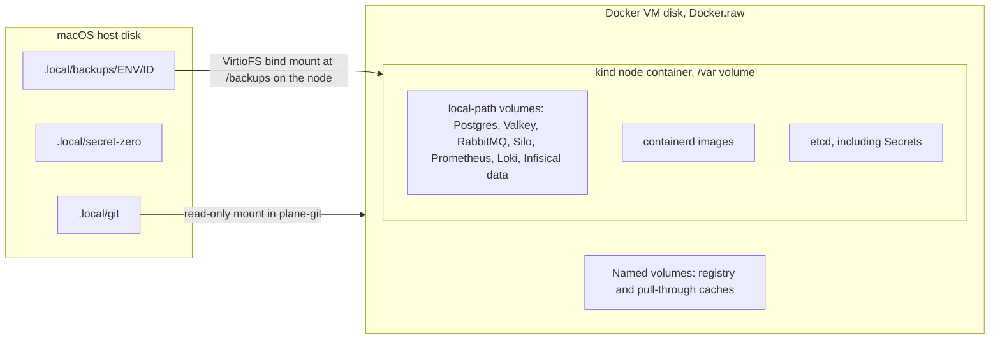

# Data operations

Postgres, Valkey, RabbitMQ and Silo in each Plane environment, where their bytes live, what a backup contains, and how to restore it.

**Status, 2026-11-05.** Backups of dev, prod-sim and Infisical have run. Infisical has been restored in place, and dev and prod-sim have each been restored in place into their real database and bucket, with result PASS and `make test-e2e` passing after. A restore into a clean cluster ran on 2026-11-05 inside `make drill-clean-restore CONFIRM=yes CLEAN_INSTALL_FIRST=yes`, with every restore step PASS, and `make test` then passed on the restored platform ([restore-clean-20261105T081017Z.json](evidence/runs/restore-clean-20261105T081017Z.json), [MAKE-TEST-20261105T083455Z.txt](evidence/runs/MAKE-TEST-20261105T083455Z.txt)). A second drill, with the registry and caches removed as well, was in progress when this was written, and its results are not recorded here. A result links to its file under `docs/evidence/runs/`.

These are single-replica services on a local kind node. There is no replication, no failover and no point-in-time recovery. "prod-sim" is a simulation, and sharing one node with dev is not equivalent to an independent production cluster.

## Services per environment

Each Plane namespace, `plane-dev` and `plane-prod-sim`, runs its own copy from chart `plane-ce` 1.8.6 with digests overridden. Nothing is shared between them except the node.

| Service | Image, by digest | StatefulSet, pod, container | Service, port | Memory req/limit MiB |
|---|---|---|---|---|
| PostgreSQL | `postgres:15.19-alpine` | `plane-pgdb-wl`, `plane-pgdb-wl-0`, `plane-pgdb` | `plane-pgdb`, 5432 | 128 / 512 |
| Valkey | `valkey/valkey:7.2.15-alpine` | `plane-redis-wl`, `plane-redis-wl-0`, `plane-redis` | `plane-redis`, 6379 | 16 / 96 |
| RabbitMQ | `rabbitmq:3.13.7-management-alpine` | `plane-rabbitmq-wl`, `plane-rabbitmq-wl-0`, `plane-rabbitmq` | `plane-rabbitmq`, 5672 | 128 / 512 |
| Silo | `pgsty/silo:RELEASE.2026-10-26T00-00-00Z-distroless` | `plane-minio-wl`, `plane-minio-wl-0`, `plane-minio` | `plane-minio`, 9000 | 256 / 512 |

The Infisical namespace has its own `infisical-postgres` (16.15) and `infisical-redis` (7.2.17). See [infisical.md](infisical.md).

Why Silo: official MinIO images no longer pull anonymously, and the repository is archived. Silo is the MinIO fork that upstream Plane itself pins. It is MinIO-compatible, with the same S3 API and data format. Object names in this repo still say `minio` because the chart does.

Why RabbitMQ 3.13: on 4.3 Celery attaches 0 consumers (upstream chart PR 304). 3.13 is an end-of-life series, in force for Pass 1 with no owner decision recorded ([ADR 0016](adr/0016-datastore-versions.md)). `vm_memory_high_watermark.absolute = 256Mi` is set through `conf.d`, because the default relative watermark cannot be trusted under a cgroup limit.

## Storage layout



| Data | Lives on | Storage class, PVC | Survives `make down` | Survives `make destroy` | Survives Docker VM reset |
|---|---|---|---|---|---|
| Postgres | Node `/var`, VM disk | `standard`, `pvc-plane-pgdb-vol-plane-pgdb-wl-0`, 1Gi label | Yes | No | No |
| Valkey | Same | `standard`, `pvc-plane-redis-vol-plane-redis-wl-0`, 100Mi label | Yes | No | No |
| RabbitMQ | Same | `standard`, `pvc-plane-rabbitmq-vol-plane-rabbitmq-wl-0`, 100Mi label | Yes | No | No |
| Silo | Same | `standard`, `pvc-plane-minio-vol-plane-minio-wl-0`, 1Gi label | Yes | No | No |
| Infisical Postgres | Same | `standard`, `data-infisical-postgres-0`, 1Gi label | Yes | No | No |
| Infisical Redis | Same | `standard`, `data-infisical-redis-0`, 256Mi label | Yes | No | No |
| Backups | Host `.local/backups/`, bind-mounted | Static PV `backups-<env>`, `Retain`, 5Gi label | Yes | **Yes** | **Yes** |
| Secret zero | Host `.local/secret-zero/` | Not in the cluster | Yes | **Yes** | **Yes** |

Why volumes stay on the VM and backups go to the host: PVs on VirtioFS would put Postgres on a filesystem Docker itself advises against, and the `standard` class's `Delete` reclaim makes data-loss drills lose data for real. Backups go to the host so they outlive the cluster and the VM.

**A PVC's size is a label.** kind's `standard` class is `rancher.io/local-path`, which ignores capacity. `hostPath` backup PVs enforce nothing either. Neither stops growth.

**Deleting a PVC destroys its data**, because the class reclaim policy is `Delete`. Argo CD does not track PVCs created from `volumeClaimTemplates`, so it does not prune or recreate them. Deleting a pod does not touch its PVC.

Backup PVs and PVCs come from the `backup-storage` Application at wave -10. Each environment's PVC, named `backups`, binds to a PV with a fixed `claimRef` on `/backups/<env>`. A pod that names a `hostPath` fails PSA `baseline`, while a pod that mounts a PVC does not, so backup Jobs mount only the PVC and see only their own folder.

A Job as UID 70 writes to `/backups/<env>` through the VirtioFS mount. On the host each backup is a folder at 0700 and its files at 0600, belonging to the Docker Desktop user, so the host user reads them, and `shasum -c` passes there ([dr-backup-modes-1.txt](evidence/runs/dr-backup-modes-1.txt), [dr-backup-job-real-1.txt](evidence/runs/dr-backup-job-real-1.txt)).

## Operating each service

All commands below assume `KUBECONFIG=.local/kubeconfig` and `ENV=dev` or `prod-sim`. None prints a credential.

```bash
export PATH="$PWD/.tools/bin:$PATH" KUBECONFIG="$PWD/.local/kubeconfig" NS=plane-dev
```

Prefer the `make` targets for anything they cover. `make status` and `make logs ENV=dev SVC=api` are the starting points.

### PostgreSQL

Stores everything durable: users, workspaces, projects, issues, API tokens, instance configuration, and logs of API activity.

```bash
# Interactive shell over the socket, which the image trusts
kubectl -n "$NS" exec -it plane-pgdb-wl-0 -c plane-pgdb -- sh -c 'psql -U "$POSTGRES_USER" -d "$POSTGRES_DB"'

# Database size, and the biggest tables
kubectl -n "$NS" exec plane-pgdb-wl-0 -c plane-pgdb -- sh -c \
  'psql -U "$POSTGRES_USER" -d "$POSTGRES_DB" -Atc "SELECT pg_size_pretty(pg_database_size(current_database()))"'
kubectl -n "$NS" exec plane-pgdb-wl-0 -c plane-pgdb -- sh -c \
  'psql -U "$POSTGRES_USER" -d "$POSTGRES_DB" -c "SELECT relname, pg_size_pretty(pg_total_relation_size(relid)) FROM pg_catalog.pg_statio_user_tables ORDER BY pg_total_relation_size(relid) DESC LIMIT 10"'
```

| Fact | Consequence |
|---|---|
| `POSTGRES_PASSWORD` acts only on an empty data directory | Changing the Secret alone does not change the role. Use `make rotate`, which runs `ALTER ROLE`. See [infisical.md](infisical.md#rotation) |
| `POSTGRES_USER` is a superuser | One shared credential, used by every component and the exporter |
| `api_activity_logs` stores request and response bodies for API-key traffic, through Celery | It grows fast under load. Backups keep its schema and drop its rows. Default retention is 14 days (`API_ACTIVITY_LOG_RETENTION_DAYS`, read from source) |
| `wait_for_db` does not wait, `wait_for_migrations` blocks forever on an unapplied migration | A migrator must complete before the api, worker and beat can start. A restore runs it explicitly |
| Migrations run forward only | Rolling back an image does not roll back the schema. The dump taken before a prod-sim promotion is the way back |

### Valkey

Holds cache and throttle counters, and it has no password (chart issue 113). The NetworkPolicy is its only access control. It is not backed up, and a restore flushes it.

```bash
kubectl -n "$NS" exec plane-redis-wl-0 -c plane-redis -- valkey-cli info memory | grep -E 'used_memory_human|maxmemory_human'
kubectl -n "$NS" exec plane-redis-wl-0 -c plane-redis -- valkey-cli dbsize
```

`/api/instances/` is cached here for two hours. In the three Postgres rounds of the pod restart drill on upstream images on 2026-11-04, each under a minute, the database probe answered 500 for one 15 s sample while `/api/instances/` stayed 200 ([monitoring-history-reads-1.txt](evidence/runs/monitoring-history-reads-1.txt)). On the final images in dev a signed-in request answered 500 for about 7 s, and no 15 s probe reading caught it ([PERS-1-20261105T070358Z-watch.txt](evidence/runs/PERS-1-20261105T070358Z-watch.txt)). A longer outage has not been tried. A green result from that route says nothing about the database. That is why the probes and `rotate.sh` use a database-backed route.

Deleting the Valkey pod in the drill, on the final images, left a signed-in session answering 200 throughout. The new pod reattached the same volume, so that is not a loss of Valkey's data ([PERS-1-20261105T070358Z-timeline.txt](evidence/runs/PERS-1-20261105T070358Z-timeline.txt)). A real flush ran inside each in-place restore (`valkey` step in [restore-dev-20261105T074337Z.json](evidence/runs/restore-dev-20261105T074337Z.json), [restore-prod-sim-20261105T073438Z.json](evidence/runs/restore-prod-sim-20261105T073438Z.json)), and `make test-e2e` then passed, signing in anew ([BKP-2-20261105T074322Z.txt](evidence/runs/BKP-2-20261105T074322Z.txt), [SEC-3-BKP-3-20261105T073240Z.txt](evidence/runs/SEC-3-BKP-3-20261105T073240Z.txt)). The apps were stopped across that flush. So a session held across a flush, and losing Valkey's volume: Not tested in Pass 1.

### RabbitMQ

Carries Celery tasks: activity logs, notifications, webhooks, exports. The api needs it at boot, since `register_instance.py` calls `.delay()` unconditionally. It is not backed up.

```bash
kubectl -n "$NS" exec plane-rabbitmq-wl-0 -c plane-rabbitmq -- rabbitmqctl -q list_queues name messages consumers
kubectl -n "$NS" exec plane-rabbitmq-wl-0 -c plane-rabbitmq -- rabbitmq-diagnostics -q memory_breakdown --unit mb
kubectl -n "$NS" exec plane-rabbitmq-wl-0 -c plane-rabbitmq -- rabbitmq-diagnostics -q alarms
```

The management port 15672 stays closed by NetworkPolicy. Prometheus scrapes 15692.

Losing the volume loses queued tasks. A restore purges the `celery` queue, because queued tasks describe rows from before the restore. A password change needs `rabbitmqctl change_password` as well as the Secret, since `RABBITMQ_DEFAULT_*` acts only on a new data directory. No script implements that.

`PlaneRabbitmqDown` did not fire with the pod gone until `2f42ddb`. In dev, with the StatefulSet at zero for 270 s, it never left state `none`, because `up` has no series once the endpoint leaves the Service ([before](evidence/runs/alert-rules-dev-20261105T100605Z.txt)). The rule now also reads `kube_statefulset_status_replicas_ready`, and in the same drill it reached the sink after 157 s and resolved 40 s after the pod came back ([after](evidence/runs/alert-rules-dev-20261105T101707Z.txt)). A crash or a hung process, and prod-sim: Not tested in Pass 1.

The watermark applies: `make test-e2e` reads `{absolute,"256Mi"}`, 268435456 bytes, with no alarms, in both environments. The worker attaches 1 consumer on queue `celery`, 0 messages waiting, on `rabbitmq:3.13.7-management-alpine` ([plane-dev-final-e2e-20261105T070735Z.txt](evidence/runs/plane-dev-final-e2e-20261105T070735Z.txt), [final-prod-sim-smoke-3.txt](evidence/runs/final-prod-sim-smoke-3.txt)). The dev run also stops the consumer as a negative control: messages park, and no activity appears until it comes back.

### Silo

Holds attachments and exports in one bucket. **The bucket is `uploads` in both environments.** Any other name breaks export links, because `export_task.py` hardcodes that path. Isolation comes from each environment running its own Silo.

The image is distroless, so there is no shell and no `mc` in the pod. Inspect it through a Job or through metrics. A Job with `rclone` is what the backup uses. The api's `create_bucket` creates the bucket, and the chart's bucket Job is removed on purpose.

```bash
# Bucket usage from Prometheus, through Traefik
curl -fsS -G http://prometheus.localhost/api/v1/query --data-urlencode "query=minio_bucket_usage_total_bytes{namespace=\"$NS\"}" | jq '.data.result'
```

Port 9090, the console, stays closed. Only `/uploads` is routed publicly, and that route serves presigned URLs.

`FILE_SIZE_LIMIT` is bytes, set to 5242880. A value like `5MB` crashes Django at import. Traefik's buffering limit is 20971520 bytes, kept above that to leave room for multipart overhead.

Silo metrics are scraped. `MINIO_PROMETHEUS_AUTH_TYPE=public` is set in `helm/plane/components/hardening/patches/silo.yaml`, and `up` reads 1 on both metrics paths in both namespaces ([monitoring-silo-metrics-1.txt](evidence/runs/monitoring-silo-metrics-1.txt)). `PlaneMinioDown` had the same defect as `PlaneRabbitmqDown`, and the same fix. In the drill it reached the sink after 148 s and resolved 26 s after the pod came back ([before](evidence/runs/alert-rules-dev-20261105T100605Z.txt), [after](evidence/runs/alert-rules-dev-20261105T101707Z.txt)).

Uploads work with no bucket Job. `make test-e2e` uploads through a presigned URL and checks the checksum on download and in the bucket, sends 4718592 bytes through Traefik, has 5 MiB plus 1 byte refused with 400, gets 403 with no signature or a tampered one, and downloads an export through its link ([plane-dev-final-e2e-20261105T070735Z.txt](evidence/runs/plane-dev-final-e2e-20261105T070735Z.txt), [final-prod-sim-smoke-3.txt](evidence/runs/final-prod-sim-smoke-3.txt), and on an earlier image [branded-dev-smoke-1.txt](evidence/runs/branded-dev-smoke-1.txt)).

## Backups

```bash
make backup ENV=dev
make backup ENV=prod-sim
make backup ENV=infisical
make backup ENV=all
```

`make backup` runs `scripts/backup.sh`, which applies a Kubernetes Job in the environment's namespace. A Job rather than `kubectl exec`, because it survives a dropped client stream, has limits and a NetworkPolicy label, and binary data never crosses the API stream.

**Nothing schedules backups.** There is no CronJob. A backup happens only when someone runs it, or as a side effect of:

| Trigger | Environment |
|---|---|
| `make promote ENV=prod-sim`, unless `SKIP_BACKUP=yes` | prod-sim |
| `make gitops-publish` when the diff changes a prod-sim image digest, unless `SKIP_BACKUP=yes` | prod-sim |
| `make rollback ENV=prod-sim`, unless `SKIP_BACKUP=yes` | prod-sim, before the revert. Best effort, limited by `ROLLBACK_DUMP_TIMEOUT`, 300 s by default. A failure does not stop the rollback |
| `make destroy CONFIRM=yes`, unless `SKIP_BACKUP=yes` | All three. A failed backup stops the delete. A clean restore marked as under way does not stop it, because it passes `ALLOW_BACKUP_DURING_RESTORE=yes` by itself, since what it deletes may be all there is (`ed089b4`, on stubs only) |
| `make rotate`, once a rotation finishes, unless `SKIP_BACKUP=yes` | Infisical. Of the three rotations that finished on 2026-11-05, two took it ([SEC-2-20261105T072331Z.txt](evidence/runs/SEC-2-20261105T072331Z.txt), [SEC-3-BKP-3-20261105T073240Z.txt](evidence/runs/SEC-3-BKP-3-20261105T073240Z.txt)), and the resumed one in prod-sim took none, by `SKIP_BACKUP=yes` ([SEC-4-20261105T073843Z.txt](evidence/runs/SEC-4-20261105T073843Z.txt)). The rollback of a killed rotation took none either, by the same switch ([SEC-4b-20261105T084615Z.txt](evidence/runs/SEC-4b-20261105T084615Z.txt)). A failure there exits 3 with the rotation standing |
| `make drill-clean-restore CONFIRM=yes`, unless `SKIP_BACKUP=yes`, and a named `BACKUP=<id>` needs it | All three, before it deletes the cluster |

### Paths and layout

Host path `.local/backups/<env>/<id>/`, with `<id>` a UTC timestamp such as `YYYYMMDDTHHMMSSZ`. Inside the Job the path is `/backups/<id>/`. A folder gets its final name only after everything succeeded, by renaming from `<id>.partial`. A stale `.partial` is removed by a later backup (`find -mtime +1`).

```text
.local/backups/dev/<id>/
  manifest.json          versions, key fingerprint, counts, file hashes, sentinel record
  SHA256SUMS             every file in the folder
  postgres/
    plane.dump           pg_dump -Fc -Z 6
    plane.toc.txt        pg_restore -l
    rowcounts.sql        the query, shipped with the dump
    rowcounts.tsv        row count per table, from a scratch restore of this dump
    content.sql          the query, shipped with the dump
    content.tsv          md5 over issues, projects, file_assets
    server_version.txt
    pg_dump_version.txt
    uploaded-keys.txt    rows the dump marks as uploaded
    uploaded-missing.txt those of them with no object in this backup. A restore refuses a backup with any
  objects/               rclone copy of the uploads bucket
  objects.check          rclone check result, by download
  objects.lsjson         listing with metadata
  recovery/              written from the host after the Job
    test-accounts.env    this environment's lines of .local/test-accounts.env
    test-sentinel.json   .local/test-sentinel-<env>.json
    objects.types.tsv    object key and Content-Type, which the host folder cannot keep

.local/backups/infisical/<id>/
  manifest.json
  SHA256SUMS
  postgres/
    infisical.dump
    infisical.toc.txt
    rowcounts.sql
    rowcounts.tsv
  recovery/              written from the host after the Job
    terraform.tfstate    the state of infisical/terraform that matches this dump
    set.json             sha256 of each secret zero file, who the admin token belongs to and when it ends, project and identity ids, and each Plane secret's truncated hash, version and id. Written last
```

An Infisical backup without a whole `set.json` keeps its dump, and an in-place restore can use it. A clean restore refuses it.

### What is in a backup, and what is not

| In a Plane backup | |
|---|---|
| Postgres schema and rows | Consistent, taken live with `pg_dump` |
| All objects in `uploads` | `rclone copy` runs after the dump, so every asset row has its object. Extra objects are harmless |
| Fingerprint of `SECRET_KEY` | First 16 hex of its sha256, never the key |
| Sentinel record | Ids and a hash, from `tests/e2e/smoke.py`. No secrets |
| Test accounts | Rows in this dump, so a later `make test-e2e` signs in with them. Those lines hold test credentials, and the folder is 0700 |
| Count of rows marked uploaded, and of those with no object | `uploaded_objects` in the manifest. The backups taken for the real restores recorded 62 rows and 0 missing in dev, and 43 and 0 in prod-sim ([BKP-2-20261105T074322Z.txt](evidence/runs/BKP-2-20261105T074322Z.txt), [SEC-3-BKP-3-20261105T073240Z.txt](evidence/runs/SEC-3-BKP-3-20261105T073240Z.txt)) |

| Not in a backup | Why, and what it means |
|---|---|
| Rows of `api_activity_logs`, `webhook_logs`, `email_notification_logs` | Request and response bodies that grow fast. Schema kept, rows lost |
| Valkey | Cache and throttle counters |
| RabbitMQ | Queued tasks are lost and would be stale after a restore |
| Plane secret values | They live in Infisical. Back up `infisical` as well |
| `ENCRYPTION_KEY` and secret zero | A dump without the key is useless, and a dump beside its key gives up everything in it, so no backup holds the key. A backup records only their sha256. **Copy them off the machine by hand**. Apart from the dumps is better, and one encrypted archive of both is the [tradeoff accepted here](disaster-recovery.md#before-anything-fails) |
| Infisical Redis | Queued jobs, schedules and caches. A restore flushes it |
| Prometheus and Loki data | Short retention, not worth restoring |
| Argo CD state, dashboards, manifests | Rebuilt from Git |
| Registry contents | Since promotion the overlays name digests only the local registry holds, and a rebuild does not reproduce a digest. See [registry lost](disaster-recovery.md#scenario-registry-lost) |

**Backups are not encrypted.** Dumps hold password hashes and plaintext API tokens. `.local/backups` is kept at 0700 by `cluster-up.sh` and `backup.sh`, and each environment folder is 0777, because the Job's UID must write there and `hostPath` ignores `fsGroup`. The parent's mode is what keeps other host users out.

**Backups live on the same disk as everything else.** They survive the cluster and the VM. They do not survive the machine. No script copies them elsewhere.

### What a backup checks

| Check | Where |
|---|---|
| The dump restores | A scratch restore into `scratch_<id>`, on the same Postgres server, then dropped. In one transaction for Plane, and object by object for Infisical |
| Row counts and content hashes come from the dump, not a moving live database | `rowcounts.tsv`, `content.tsv` from the scratch database |
| Objects are readable | `rclone check --download` |
| Files are intact | `sha256sum -c` in the Job, then `shasum -a 256 -c` again on the host |
| The API can decrypt | Seeds `WAYLINE_RESTORE_SENTINEL`, an encrypted row. Best effort, so a down API does not stop a backup taken before `make destroy` |

This proves a dump restores on this server, and it does not prove that Plane runs on the result. Only a restore does that. The scratch restore also temporarily doubles the database's disk use on the VM.

The Job uses the same Postgres image as the server, read from the live StatefulSet, because `pg_dump` refuses a server newer than itself. Rclone is pinned in `monitoring/ops/lib.sh`.

Run `make test-e2e ENV=<env>` before the first backup. It writes `.local/test-sentinel-<env>.json`, which `backup.sh` copies into the manifest. Without it, the restore reports its sentinel proof as NOT RUN, not as a pass. `make test-e2e` passes on the final images: dev 45 PASS and 1 SKIP, prod-sim 44 PASS and 1 SKIP, and the same counts after the real restores. The skip needs a clean database ([plane-dev-final-e2e-20261105T070735Z.txt](evidence/runs/plane-dev-final-e2e-20261105T070735Z.txt), [final-prod-sim-smoke-3.txt](evidence/runs/final-prod-sim-smoke-3.txt), [BKP-2-20261105T074322Z.txt](evidence/runs/BKP-2-20261105T074322Z.txt), [SEC-3-BKP-3-20261105T073240Z.txt](evidence/runs/SEC-3-BKP-3-20261105T073240Z.txt)). The clean install of 2026-11-05 had one, and there `branding-fresh-install` ran: dev 46 PASS and prod-sim 45 PASS, no SKIP ([e2e-dev-first.txt](evidence/runs/clean-install-20261105T075041Z/e2e-dev-first.txt), [e2e-prod-sim-first.txt](evidence/runs/clean-install-20261105T075041Z/e2e-prod-sim-first.txt)). `make test` on the restored platform read 45 PASS and 1 SKIP, and 44 PASS and 1 SKIP, again ([dev](evidence/runs/smoke-dev-20261105T083455Z-37296.json), [prod-sim](evidence/runs/smoke-prod-sim-20261105T083455Z-37296.json)).

### Retention

Dev keeps 3, prod-sim and Infisical keep 5, and `KEEP=<n>` overrides. Nothing checks age, and nothing alerts on an old backup.

Plane's retention runs in its backup Job. It keeps the newest `KEEP` finished backups and, past that, the newest one whose `rowcounts.tsv` counts users above 0, so backups of an empty environment cannot push out the last real one. Only folders with a final timestamped name and a manifest are removed. The "kept" branch has run only on BusyBox and stubs ([dr-backup-job-real-1.txt](evidence/runs/dr-backup-job-real-1.txt), [dr-job-lines-busybox-2.txt](evidence/runs/dr-job-lines-busybox-2.txt)).

Infisical's runs from the host, once the backup just taken has a complete recovery set, and only a complete set counts toward `KEEP`. A backup with no complete set stays while it is newer than the oldest set kept. On real folders it removed only what was past `KEEP` ([dr-backup-retention-1.txt](evidence/runs/dr-backup-retention-1.txt), [dr-retention-2.txt](evidence/runs/dr-retention-2.txt), [dr-locks-1.txt](evidence/runs/dr-locks-1.txt), [SEC-2-20261105T072331Z.txt](evidence/runs/SEC-2-20261105T072331Z.txt)).

`PlaneBackupFailed` fires on a failed backup Job, which stays around for 7 days. A later successful backup deletes it.

**What ran.** `make backup ENV=all` exited 0, with `SHA256SUMS` checked again on the host ([dr-backup-4.txt](evidence/runs/dr-backup-4.txt)). The first two attempts failed, and stay as evidence ([dr-backup-1.txt](evidence/runs/dr-backup-1.txt), [dr-backup-2.txt](evidence/runs/dr-backup-2.txt)). `make promote ENV=prod-sim` took a backup at 05:33 UTC on 2026-11-05 with the current lines: 61 objects checked, 40 rows marked uploaded, 0 with no object, every checksum good ([dr-backup-job-real-1.txt](evidence/runs/dr-backup-job-real-1.txt)). On its own this shows backups complete and restore into a scratch database. The [real restores](#plane-restore-step-by-step) are what show Plane running on the result.

| `make backup` | Duration | Size by `du -sh` on the host at 2026-11-05T08:37Z, which no file here records | Evidence |
|---|---|---|---|
| `ENV=dev` | 15 s on 2026-11-05 with 92 objects, 31 s on 2026-11-04 with 17 | `20261105T062141Z`, the one with 92 objects: 78 MiB, and its dump is 951191 bytes. The newest at that reading, `20261105T074932Z`: 87 MiB | [SEC-2-backup-before-20261105T062141Z.txt](evidence/runs/SEC-2-backup-before-20261105T062141Z.txt), [dr-backup-dev-1.txt](evidence/runs/dr-backup-dev-1.txt) |
| `ENV=prod-sim` | 11 s with 0 objects on 2026-11-04. About 17 s with 66 on 2026-11-05, from the backup's stamp to the next command's ([SEC-3-BKP-3-20261105T073240Z.txt](evidence/runs/SEC-3-BKP-3-20261105T073240Z.txt)) | `20261105T053351Z`, with 61 objects, 51935206 bytes of them: 51 MiB. The newest at that reading, `20261105T074950Z`: 60 MiB | [dr-backup-prod-sim-1.txt](evidence/runs/dr-backup-prod-sim-1.txt), [dr-backup-job-real-1.txt](evidence/runs/dr-backup-job-real-1.txt) |
| `ENV=infisical` | 22 s on 2026-11-04, 29 s on 2026-11-05 | Each of the five kept, the newest `20261105T074912Z`: 6.0 MiB. The dump is 4.4 MB | [dr-backup-3.txt](evidence/runs/dr-backup-3.txt), [dr-locks-1.txt](evidence/runs/dr-locks-1.txt) |
| `ENV=all` | 42 s on 2026-11-04T23:13Z, on upstream images, with 22 objects in dev and 0 in prod-sim | Each environment's folder, all kept backups: dev 248 MiB, three backups. Prod-sim 217 MiB, five. Infisical 30 MiB, five | [dr-backup-4.txt](evidence/runs/dr-backup-4.txt), for the 42 s and its object counts |

Smoke runs upload test files, one of them 4718592 bytes, so these sizes describe a test instance and not a real workload.

## Restore

```bash
make restore ENV=dev BACKUP=latest
make restore ENV=dev BACKUP=<backup-id> CONFIRM=yes
make restore ENV=infisical BACKUP=latest CONFIRM=yes
```

| Flag | Effect |
|---|---|
| `BACKUP=latest` | Newest finished backup in that environment's folder |
| `CONFIRM=yes` | Needed to overwrite a target that already holds users or objects |
| `ALLOW_SECRET_KEY_MISMATCH=yes` | Proceed although the live key differs from the backup's. Encrypted rows then decrypt to `""`, the proofs fail, and the script exits non-zero even though the data is back |
| `ALLOW_NO_SENTINEL=yes` | Accept that a sentinel proof could not run, as with a backup taken before a sentinel existed. The step still reads NOT RUN |
| `ALLOW_STALE_PLANE_SECRETS=yes` | Infisical only. Restore a dump older than the last rotation. The operators then render a password Plane's Postgres no longer takes |
| `ALLOW_NEWER_INFISICAL_BACKUP=yes` | Infisical only. Restore a dump from a newer Infisical than the one that will run on it. That server refuses to start until a newer image is deployed |
| `ALLOW_NO_ADMIN_TOKEN=yes` | Infisical only. Restore with nothing here known to log in afterwards, as when its Postgres is lost |
| `ALLOW_RESUME_OVERWRITE="dev prod-sim"` | `make restore-clean` only, on a resume. Overwrite the environments it names, out of `infisical`, `dev` and `prod-sim`, where they hold something other than this backup, or data that came back on an earlier run. `yes` is refused. The step reads FAIL with what was there, and that run exits 4 and reads `OVERWROTE`, which is not a pass. Stubs only |

`scripts/restore.sh` exits 0 when everything is proven, 1 when something failed, and 2 when nothing failed but a proof could not run or a person has to act, which is not a pass. `restore.sh infisical` alone also has 3: Infisical is back, and a person has to sign in. A clean restore that resumes also has 4: everything is proven, and it overwrote what `ALLOW_RESUME_OVERWRITE` named. Through `make`, any of these but 0 is make's own exit 2, and make prints which, so read the evidence: `jq '.result, .not_run' .local/evidence-raw/restore-<env>-*.json`.

A backup restores only into the environment that took it. Each PVC mounts only its own folder, and the script checks the manifest. Moving data between environments is not supported.

**Restore Infisical before Plane.** Plane's `SECRET_KEY` lives in Infisical, and the fingerprint check compares against it. On a clean machine `make restore-clean` does the full order. See [disaster-recovery.md](disaster-recovery.md#full-restoration-into-a-clean-environment).

### Plane restore, step by step

Every refusal comes before anything is touched.

| # | Step | On failure |
|---|---|---|
| 1 | Verify `SHA256SUMS` on the host | Refuse |
| 2 | Manifest `env` equals the target | Refuse |
| 3 | The manifest records no row marked uploaded with no object. Step 11 would refuse it with the data already replaced, and has no override. Backup's Plane version not newer than the running one. Django cannot migrate backwards | Refuse |
| 4 | `SECRET_KEY` fingerprint equals the backup's | Refuse, unless `ALLOW_SECRET_KEY_MISMATCH=yes` |
| 5 | Data services are ready. Guard Jobs count users and objects. It warns if the backup holds 0 users and the target holds some, and names the newest backup that has them | Refuse if the target holds data and `CONFIRM` is not `yes`. A failed count stops the restore |
| 6 | Pause auto-sync: root first, then the environment's Application. Each saved `automated` block is restored verbatim at exit. A sync that has run for 180 s is terminated, and after 300 s the script gives up | Die, and resume what was paused |
| 7 | Scale api, worker, beat and live to zero. Wait for the pods to exit | |
| 8 | `dropdb --force`, `createdb`, `pg_restore --single-transaction --exit-on-error`, `vacuumdb --analyze-only` | All or nothing for this step |
| 9 | Gate 1: row counts and content hashes equal the backup's | Job fails |
| 10 | `rclone sync` objects to the bucket, so objects not in the backup go. `rclone check --download` | Job fails |
| 11 | Gate 2: every asset row marked uploaded has its object | Job fails. Catches a database and a bucket from different backups |
| 12 | Put back this dump's test accounts and sentinel from `recovery/`. `valkey-cli FLUSHALL`. Purge queue `celery` | |
| 13 | Run the migrator as a one-off Job from the rendered manifest, with the image the api runs now | |
| 14 | Scale apps back to the replica count in Git, api first. Wait for readiness | |
| 15 | Proofs below | Non-zero exit if a proof fails |
| 16 | Auto-sync returns, in reverse order, including on failure | Prints the exact command if a patch cannot be put back |

`dropdb` and not `pg_restore --clean`, so tables newer than the dump cannot survive. `--single-transaction` rules out `--jobs`, so restore is serial.

If the client ends while a restore Job runs, by Ctrl-C, SIGTERM, a closed terminal or a kubectl error, it first removes that Job, because the Job would otherwise carry on and drop a database with the apps back up. If it cannot, the apps stay down and auto-sync stays paused, and it prints what to run. Since `699ab8a` that holds with a client that can no longer print too: no error stops it, and what it has to say goes to `restore-<env>-<time>.json.log` beside the evidence. This has run only on stubs, and on a real pty beside them ([dr-stop-sweep-1.txt](evidence/runs/dr-stop-sweep-1.txt), from before that fix).

A clean restore that resumes treats step 5 differently, and that too has run only on stubs. Other users or objects than the backup holds are refused and left as they were. Once the data Job has finished, the marker holds `data-back <env>`, and a resume keeps what is there and goes on from step 13. [Disaster recovery](disaster-recovery.md#off-the-normal-path) has what those closed.

These steps ran against the real database and bucket on 2026-11-05, once in each environment, on the final images: dev from backup `20261105T074322Z`, prod-sim from `20261105T073411Z`. Every step and proof reads PASS, `not_run` is empty, Gate 1 matched all 110 tables, Gate 2 found every uploaded asset, 62 in dev and 43 in prod-sim, and `make test-e2e` passed afterwards ([restore-dev-20261105T074337Z.json](evidence/runs/restore-dev-20261105T074337Z.json), [BKP-2-20261105T074322Z.txt](evidence/runs/BKP-2-20261105T074322Z.txt), [restore-prod-sim-20261105T073438Z.json](evidence/runs/restore-prod-sim-20261105T073438Z.json), [SEC-3-BKP-3-20261105T073240Z.txt](evidence/runs/SEC-3-BKP-3-20261105T073240Z.txt)).

**What this does not prove.** Each restore used the backup taken moments before, over the same rows, so no real loss was repaired. The database really was dropped and recreated from the dump. The bucket already held the objects, and Content-Type went back on 0 of them, so those two did not copy objects back. A rehearsal did. There, into a scratch database and bucket, the exact Job passed its Postgres gates, synced objects and checked them by download through the read-only mount, and put Content-Type back on 14 of 22 objects, because VirtioFS keeps no xattrs ([dr-plane-restore-rehearsal-1.txt](evidence/runs/dr-plane-restore-rehearsal-1.txt)).

**Into a new cluster.** The same steps ran over empty targets on the new cluster of 2026-11-05, on new volumes: dev from `20261105T074932Z`, with 53 users, 571 work items and 102 objects, and prod-sim from `20261105T074950Z`, with 33 users, 173 work items and 71 objects. Every step and proof reads PASS and `not_run` is empty. `overwrite-guard` read `target is empty`, Gate 1 matched all 110 tables, the objects were synced and checked by download, Content-Type went back on 64 and 45 of them, Gate 2 found every uploaded asset, 65 and 46, and a worker ran a new job ([restore-dev-20261105T082337Z.json](evidence/runs/restore-dev-20261105T082337Z.json), [restore-prod-sim-20261105T082657Z.json](evidence/runs/restore-prod-sim-20261105T082657Z.json), [log](evidence/runs/drill-clean-restore-20261105T074859Z.log)). That backup too was taken moments before, so this shows the path and repairs no real loss. A restore after losing one volume on a cluster that stays: Not tested in Pass 1.

The role and its password are not in the dump, so a Plane restore leaves the Postgres role as it is. Restoring an older Plane dump after a rotation should need no password change. Not tested in Pass 1: the real restores used dumps taken after that environment's rotation.

### Proofs

Each writes to `.local/evidence-raw/restore-<env>-<stamp>.json` with status **PASS**, **FAIL** or **NOT RUN**.

| Proof | How | Why it is not vacuous |
|---|---|---|
| `proof-encrypted-sentinel` | `WAYLINE_RESTORE_SENTINEL` decrypts to its seeded value | Encrypted rows are empty on a fresh instance, so a decrypt check with no sentinel proves nothing |
| `proof-no-empty-decrypt` | No encrypted row decrypts to `""` | `decrypt_data` fails silently |
| `proof-sentinel` | `tests/e2e/smoke.py --mode verify --job-probe`: the work item through the API, the attachment's checksum through a presigned URL, a worker finishing a new job | The token comes from the restored database, so this also proves tokens survived |
| `proof-probes` | `probe_success` for the API and database probes reaches 1 in Prometheus within 180 s | Reported NOT RUN rather than FAIL if they do not. The steps above already checked the data, and a broken dashboard path should not fail a restore. It is the one NOT RUN that does not make the script exit 2 |

A Plane restore's evidence file records no durations, so time the run with `time` to get an RTO number. See [disaster-recovery.md](disaster-recovery.md#rpo-and-rto-to-measure-not-promised).

### Infisical restore

Refuses on the same rules, with the `ENCRYPTION_KEY` fingerprint. Infisical cannot run on a wrong key, so unlike Plane this mismatch is fatal to the store. It also refuses a dump newer than the running server, a dump older than the last rotation, and, with no token and no password known to this backup, a restore nothing could log in to afterwards.

Then: pause auto-sync on `infisical` only, scale the server to zero, restore into a second database, compare row counts, swap it in, install the Terraform state and machine file that go with it, flush Redis, start the server, make sure something here can log in, and prove it. The swap is two renames in one transaction and then a drop, so wherever a Job stops, a whole database has that name. No single transaction wraps the restore itself. That ran out of shared memory at the default of 64 locks per transaction, in a backup's scratch restore ([dr-backup-1.txt](evidence/runs/dr-backup-1.txt)), and one transaction has not been tried at 128.

The proofs: `/api/status` answers 200 through Traefik, the server reads the restored admin config, and every Plane secret decrypts to the value, version and id the backup recorded. The next step is `INFISICAL_RESTORED=yes scripts/infisical-bootstrap.sh`, to refresh the cluster CA and the identity Secrets. See [disaster-recovery.md](disaster-recovery.md#scenario-infisical-lost).

`make restore ENV=infisical` has run in place on the live instance seven times, 44 s to 71 s in all. Six read PASS. One read BLOCKED, the 71 s, because that run removed the token and the password on purpose: `admin-token` and `proof-values` read NOT RUN, and make exited 2 ([dr-inplace-no-token-no-password-2.txt](evidence/runs/dr-inplace-no-token-no-password-2.txt)). In the last five the server did not answer for 39 s to 52 s by a probe once a second, and the 52 s is that same run. The script's own `server-downtime` step reads 40 s to 58 s for those five. In the six that compared Plane before and after, every Plane pod uid and restart count, workload generation and Secret resourceVersion stayed the same, apart from probe pods of another test and one worker another test replaced. After all of them, `make test-infisical` exited 0 with 118 PASS lines and all 14 Applications read Synced and Healthy, none paused ([dr-inplace-restore-3.txt](evidence/runs/dr-inplace-restore-3.txt), [dr-inplace-token-lost-1.txt](evidence/runs/dr-inplace-token-lost-1.txt), [dr-inplace-token-back-1.txt](evidence/runs/dr-inplace-token-back-1.txt), [dr-inplace-no-token-no-password-3.txt](evidence/runs/dr-inplace-no-token-no-password-3.txt), [dr-after-restores-1.txt](evidence/runs/dr-after-restores-1.txt), and earlier [dr-inplace-restore-1.txt](evidence/runs/dr-inplace-restore-1.txt), [dr-inplace-restore-2.txt](evidence/runs/dr-inplace-restore-2.txt)). An eighth attempt, with nothing here that could log in afterwards and no override, was refused before it stopped anything, and its evidence reads FAIL ([dr-inplace-no-token-no-password-1.txt](evidence/runs/dr-inplace-no-token-no-password-1.txt), [restore-infisical-20261105T023217Z.json](evidence/runs/restore-infisical-20261105T023217Z.json)). So the operators keep syncing after an in-place restore. Into a brand-new server on the new cluster of 2026-11-05 it read PASS too, in 43 s, with the server not answering for 34 s and Gate 1 matching all 785 tables, and all 38 rendered Secret keys then held the old values ([restore-infisical-20261105T081608Z.json](evidence/runs/restore-infisical-20261105T081608Z.json), [log](evidence/runs/drill-clean-restore-20261105T074859Z.log)).

**Refusals.** With no `CONFIRM`, `make restore ENV=prod-sim` refused on the real environment: 31 users and 66 objects already there, "Nothing was changed", make exit 2 ([restore-prod-sim-20261105T073428Z.json](evidence/runs/restore-prod-sim-20261105T073428Z.json), [SEC-3-BKP-3-20261105T073240Z.txt](evidence/runs/SEC-3-BKP-3-20261105T073240Z.txt)). Dev was not asked that. A real `SECRET_KEY` mismatch was refused at 2026-11-05T08:09:20Z on the clean install, which has new secrets: `make restore ENV=dev BACKUP=20261105T074932Z CONFIRM=yes`, with a backup of the install before it, stopped at the fingerprint and said "Nothing was changed" ([restore-foreign-key-refused.txt](evidence/runs/clean-install-20261105T075041Z/restore-foreign-key-refused.txt)). It and the other refusals have also run on stubs: `make drill-clean-restore-harness` covers them with kubectl and the API stubbed ([dr-harness-stubbed-4.txt](evidence/runs/dr-harness-stubbed-4.txt)), which shows the logic and not the platform.

**During a failing sync.** A restore while the environment's sync is failing: Not tested in Pass 1. Terminating a running sync has run on real Applications ([argocd-terminate-2.txt](evidence/runs/argocd-terminate-2.txt)). The path through `argo_wait_idle`, which terminates at 180 s and gives up at 300 s, has run only on a stub ([test_lib-stub-1.txt](evidence/runs/test_lib-stub-1.txt)).

**Duration.** From the start stamp to the evidence file's last write ([MANIFEST.tsv](evidence/runs/MANIFEST.tsv)): in place, dev 178 s with 51 users and 97 objects, prod-sim 183 s with 31 users and 66 objects. Into the new cluster, dev 200 s with 53 users and 102 objects, prod-sim 199 s with 33 users and 71 objects. That includes the checks and all the proofs. Prod-sim's in-place restore ran while the dev load test was running, so that machine was not quiet ([LOAD-1-20261105T073240Z-run.txt](evidence/runs/LOAD-1-20261105T073240Z-run.txt)). These sizes describe a test instance.

## Capacity limits

Items labelled estimate have no measurement of that thing behind them. Disk figures come from [dr-disk-1.txt](evidence/runs/dr-disk-1.txt), read with both Plane environments up.

| Limit | Value | Enforced by | Note |
|---|---|---|---|
| Host free disk for a new cluster | 25 GiB in `make up`, 15 GiB in `cluster-up.sh` alone | `guard_new_cluster` in `scripts/lib/up-checks.sh`. `ALLOW_LOW_DISK="<reason>"` goes past it, and logs the reason | A first install has not been measured on an empty machine. 17.75 GiB is an estimate from a running cluster's sizes: the node's volume 12.94 by `du`, local services' volumes 3.62, node image 1.19. Re-creating with the rest kept is 12.94 by the same reading, and 25 leaves about 2 over that plus the floor below. The clean install of 2026-11-05 took about 12 GiB by `df`, with the registry, mirrors and node image already on disk ([summary.txt](evidence/runs/clean-install-20261105T075041Z/summary.txt), [make-status.txt](evidence/runs/clean-install-20261105T075041Z/make-status.txt)). A run with those removed was in progress when this was written |
| Host free disk for scripts | 10 GiB default | `guard_disk` in `scripts/lib/common.sh` | `MIN_FREE_DISK_GIB` lowers it, and a value below 10 is logged. `ALLOW_LOW_DISK` does not go past it. The Docker VM reports hundreds of free GiB on a sparse disk, so nothing inside the cluster sees the real limit |
| Postgres disk, Silo disk | 1Gi label, no enforcement | Nothing | Grows until the host runs out. kind sets eviction thresholds to 0% and disables image GC, so a full disk means write errors, not evictions |
| Postgres memory | 512 MiB limit | Kubernetes | Restores and scratch restores run against this server |
| Postgres CPU | 500 m limit, in both environments | Kubernetes | The limit that bound under load. With no think time in dev it ran at 497, 493 and 500 m, throttled in 98% to 100% of CFS periods, and requests flattened by 5 virtual users at about 8.9 a second, on one project of 591 to 1,067 work items. A higher limit has not been tried. See [resource-utilization.md](resource-utilization.md#load-results-dev) |
| Backup Job memory | 256 MiB Postgres, 192 MiB rclone | Kubernetes | |
| Backup and restore Job time | 1800 s | `activeDeadlineSeconds` | A larger dataset fails at this deadline |
| Backup folder, per environment | 5Gi label, no enforcement | Nothing | Bounded only by `KEEP` and host disk. See [the measured sizes](#retention) |
| Attachment size | 5242880 bytes | `FILE_SIZE_LIMIT`, Traefik buffering at 20971520 | |
| ResourceQuota, per Plane namespace | 2732 Mi requests, 7984 Mi limits, 24 pods, 6 PVCs, as [bootstrap-1.txt](evidence/runs/bootstrap-1.txt) and [plane-dev-rollout-quota-1.txt](evidence/runs/plane-dev-rollout-quota-1.txt) read them on 2026-11-04 | Kubernetes | Sized for each Deployment surging once, plus a backup. Terraform computes it in `infrastructure/terraform/modules/foundation/main.tf` |
| Prometheus | 3d, `retentionSize: 1GiB` | Prometheus | The only real cap on that volume |
| Loki | 72h retention, 2Gi label | Loki compactor | Retention is the only cap |

**Volume metrics are unavailable.** `kubelet_volume_stats_*` is empty because local-path creates `hostPath` volumes, so `KubePersistentVolumeFillingUp` never fires. Use `pg_database_size_bytes`, `minio_bucket_usage_total_bytes`, and `du` on the node:

```bash
docker exec plane-platform-control-plane du -sh /var/local-path-provisioner/* | sort -h
du -sh .local/backups/*
df -h .
```

The volumes are there: 1599804 KiB under `/var/local-path-provisioner`, of 13567228 KiB in the node's `/var` ([dr-disk-1.txt](evidence/runs/dr-disk-1.txt)), and each Plane PVC maps to a path there ([harness-separation-state-1.txt](evidence/runs/harness-separation-state-1.txt)).

`make test-load` signs in with a session on purpose, because each `X-Api-Key` request stores its body in `api_activity_logs` through Celery (`tests/load/plane.js`). So on a quiet cluster on 2026-11-05 the load runs on dev grew `pg_database_size_bytes` by about 613 KB in 549 s, about 67 KB a minute, at 5.1 requests a second with think time, and by about 1.08 MB in 548 s, about 119 KB a minute, at 8.2 a second with none ([results.json](evidence/runs/load-20261105T090247Z/results.json), [results.json](evidence/runs/load-20261105T091213Z/results.json)). That says nothing about API-key traffic. The estimate from research, 8 requests per second times 20 KB responses, about 10 MiB per minute uncompressed, has no measurement behind it: API-key traffic under load is Not tested in Pass 1.

Reclaiming disk: removing a 273 MB kind volume gave back 254 MB on the host within 15 s, the first reading (`KIND_RECLAIM_PERCENT` in `scripts/lib/up-checks.sh`, which records it with no evidence file behind it). On 2026-11-05 a delete with a 12.8 GiB kind volume took host free disk from 17.7 GiB to 31.6 GiB, 14.1 GiB back by the first reading, so the 93% held on this volume ([log](evidence/runs/drill-clean-restore-20261105T074859Z.log), lines 7 and 74). That is free disk, not `Docker.raw`, and the first reading is not always the end: after the clean install's delete it read 19 GiB, and a plan moments later 26.8 GiB (lines 98 and 108). [Clean rebuild](runbooks/clean-rebuild.md#destroy) holds the `Docker.raw` reading open. Do not run `docker system prune -a` to free space on this host: unrelated containers run from a cached MinIO image that can no longer be pulled anonymously.

## Related documents

- [disaster-recovery.md](disaster-recovery.md): scenarios and full restoration.
- [infisical.md](infisical.md): secrets, rotation, and Infisical recovery.
- [monitoring.md](monitoring.md): dashboards and the alerts named here.
- [resource-utilization.md](resource-utilization.md): resource use.
- [platform-contract.md](platform-contract.md): names and budgets.
