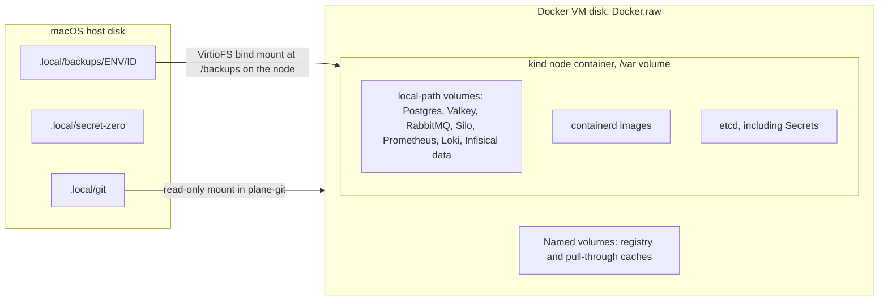

# Data operations

Postgres, Valkey, RabbitMQ and Silo in each Plane environment, where their bytes live, what a backup contains, and how to restore it.

**Status: NOT RUN.** No backup or restore has run yet, and Plane has not been deployed. `docs/evidence/` holds no result. Every statement that depends on a runtime result carries a `VERIFY` marker, and every number to measure carries `MEASURE`.

These are single-replica services on a local kind node. There is no replication, no failover and no point-in-time recovery. "prod-sim" is a simulation, and sharing one node with dev is not equivalent to an independent production cluster.

## Services per environment

Each Plane namespace, `plane-dev` and `plane-prod-sim`, runs its own copy from chart `plane-ce` 1.8.6 with digests overridden. Nothing is shared between them except the node.

| Service | Image, by digest | StatefulSet, pod, container | Service, port | Memory req/limit MiB |
|---|---|---|---|---|
| PostgreSQL | `postgres:15.19-alpine` | `plane-pgdb-wl`, `plane-pgdb-wl-0`, `plane-pgdb` | `plane-pgdb`, 5432 | 128 / 512 |
| Valkey | `valkey/valkey:7.2.15-alpine` | `plane-redis-wl`, `plane-redis-wl-0`, `plane-redis` | `plane-redis`, 6379 | 16 / 96 |
| RabbitMQ | `rabbitmq:3.13.7-management-alpine` | `plane-rabbitmq-wl`, `plane-rabbitmq-wl-0`, `plane-rabbitmq` | `plane-rabbitmq`, 5672 | 128 / 512 |
| Silo | `pgsty/silo:RELEASE.2026-10-26T00-00-00Z-distroless` | `plane-minio-wl`, `plane-minio-wl-0`, `plane-minio` | `plane-minio`, 9000 | 256 / 512 |

The Infisical namespace has its own `infisical-postgres` (16.15) and `infisical-redis` (7.2.17). See [infisical.md](infisical.md).

Why Silo: official MinIO images no longer pull anonymously, and the repository is archived. Silo is the MinIO fork that upstream Plane itself pins. It is MinIO-compatible, with the same S3 API and data format. Object names in this repo still say `minio` because the chart does.

Why RabbitMQ 3.13: on 4.3 Celery attaches 0 consumers (upstream chart PR 304). 3.13 is an end-of-life series, an accepted risk. `vm_memory_high_watermark.absolute = 256Mi` is set through `conf.d`, because the default relative watermark cannot be trusted under a cgroup limit.

## Storage layout



| Data | Lives on | Storage class, PVC | Survives `make down` | Survives `make destroy` | Survives Docker VM reset |
|---|---|---|---|---|---|
| Postgres | Node `/var`, VM disk | `standard`, `pvc-plane-pgdb-vol-plane-pgdb-wl-0`, 1Gi label | Yes | No | No |
| Valkey | Same | `standard`, `pvc-plane-redis-vol-plane-redis-wl-0`, 100Mi label | Yes | No | No |
| RabbitMQ | Same | `standard`, `pvc-plane-rabbitmq-vol-plane-rabbitmq-wl-0`, 100Mi label | Yes | No | No |
| Silo | Same | `standard`, `pvc-plane-minio-vol-plane-minio-wl-0`, 1Gi label | Yes | No | No |
| Infisical Postgres | Same | `standard`, `data-infisical-postgres-0`, 1Gi label | Yes | No | No |
| Infisical Redis | Same | `standard`, `data-infisical-redis-0`, 256Mi label | Yes | No | No |
| Backups | Host `.local/backups/`, bind-mounted | Static PV `backups-<env>`, `Retain`, 5Gi label | Yes | **Yes** | **Yes** |
| Secret zero | Host `.local/secret-zero/` | Not in the cluster | Yes | **Yes** | **Yes** |

Why volumes stay on the VM and backups go to the host: PVs on VirtioFS would put Postgres on a filesystem Docker itself advises against, and the `standard` class's `Delete` reclaim makes data-loss drills lose data for real. Backups go to the host so they outlive the cluster and the VM.

**A PVC's size is a label.** kind's `standard` class is `rancher.io/local-path`, which ignores capacity. `hostPath` backup PVs enforce nothing either. Neither stops growth.

**Deleting a PVC destroys its data**, because the class reclaim policy is `Delete`. Argo CD does not track PVCs created from `volumeClaimTemplates`, so it does not prune or recreate them. Deleting a pod does not touch its PVC.

Backup PVs and PVCs come from the `backup-storage` Application at wave -10. Each environment's PVC, named `backups`, binds to a PV with a fixed `claimRef` on `/backups/<env>`. A pod that names a `hostPath` fails PSA `baseline`, while a pod that mounts a PVC does not, so backup Jobs mount only the PVC and see only their own folder.

[[VERIFY: UID 70 can write /backups/ENV through the VirtioFS mount, and the host user can read what it wrote]]

## Operating each service

All commands below assume `KUBECONFIG=.local/kubeconfig` and `ENV=dev` or `prod-sim`. None prints a credential.

```bash
export PATH="$PWD/.tools/bin:$PATH" KUBECONFIG="$PWD/.local/kubeconfig" NS=plane-dev
```

Prefer the `make` targets for anything they cover. `make status` and `make logs ENV=dev SVC=api` are the starting points.

### PostgreSQL

Stores everything durable: users, workspaces, projects, issues, API tokens, instance configuration, and logs of API activity.

```bash
# Interactive shell over the socket, which the image trusts
kubectl -n "$NS" exec -it plane-pgdb-wl-0 -c plane-pgdb -- sh -c 'psql -U "$POSTGRES_USER" -d "$POSTGRES_DB"'

# Database size, and the biggest tables
kubectl -n "$NS" exec plane-pgdb-wl-0 -c plane-pgdb -- sh -c \
  'psql -U "$POSTGRES_USER" -d "$POSTGRES_DB" -Atc "SELECT pg_size_pretty(pg_database_size(current_database()))"'
kubectl -n "$NS" exec plane-pgdb-wl-0 -c plane-pgdb -- sh -c \
  'psql -U "$POSTGRES_USER" -d "$POSTGRES_DB" -c "SELECT relname, pg_size_pretty(pg_total_relation_size(relid)) FROM pg_catalog.pg_statio_user_tables ORDER BY pg_total_relation_size(relid) DESC LIMIT 10"'
```

| Fact | Consequence |
|---|---|
| `POSTGRES_PASSWORD` acts only on an empty data directory | Changing the Secret alone does not change the role. Use `make rotate`, which runs `ALTER ROLE`. See [infisical.md](infisical.md#rotation) |
| `POSTGRES_USER` is a superuser | One shared credential, used by every component and the exporter |
| `api_activity_logs` stores request and response bodies for API-key traffic, through Celery | It grows fast under load. Backups keep its schema and drop its rows. Default retention is 14 days (`API_ACTIVITY_LOG_RETENTION_DAYS`, read from source) |
| `wait_for_db` does not wait, `wait_for_migrations` blocks forever on an unapplied migration | A migrator must complete before the api, worker and beat can start. A restore runs it explicitly |
| Migrations run forward only | Rolling back an image does not roll back the schema. The dump taken before a prod-sim promotion is the way back |

### Valkey

Holds cache and throttle counters, and it has no password (chart issue 113). The NetworkPolicy is its only access control. It is not backed up, and a restore flushes it.

```bash
kubectl -n "$NS" exec plane-redis-wl-0 -c plane-redis -- valkey-cli info memory | grep -E 'used_memory_human|maxmemory_human'
kubectl -n "$NS" exec plane-redis-wl-0 -c plane-redis -- valkey-cli dbsize
```

`/api/instances/` is cached here for two hours and answers 200 with Postgres down. [[VERIFY: /api/instances/ stays 200 with Postgres stopped]] A green result from that route says nothing about the database. That is why the probes and `rotate.sh` use a database-backed route.

[[VERIFY: flushing or losing Valkey costs only cache and throttle state, and existing sessions keep working]]

### RabbitMQ

Carries Celery tasks: activity logs, notifications, webhooks, exports. The api needs it at boot, since `register_instance.py` calls `.delay()` unconditionally. It is not backed up.

```bash
kubectl -n "$NS" exec plane-rabbitmq-wl-0 -c plane-rabbitmq -- rabbitmqctl -q list_queues name messages consumers
kubectl -n "$NS" exec plane-rabbitmq-wl-0 -c plane-rabbitmq -- rabbitmq-diagnostics -q memory_breakdown --unit mb
kubectl -n "$NS" exec plane-rabbitmq-wl-0 -c plane-rabbitmq -- rabbitmq-diagnostics -q alarms
```

The management port 15672 stays closed by NetworkPolicy. Prometheus scrapes 15692.

Losing the volume loses queued tasks. A restore purges the `celery` queue, because queued tasks describe rows from before the restore. A password change needs `rabbitmqctl change_password` as well as the Secret, since `RABBITMQ_DEFAULT_*` acts only on a new data directory. No script implements that.

[[VERIFY: the absolute watermark applies through conf.d and rabbitmq-diagnostics shows the 256 MiB threshold]]

[[VERIFY: the worker attaches a consumer on queue celery with rabbitmq:3.13.7-management-alpine]]

### Silo

Holds attachments and exports in one bucket. **The bucket is `uploads` in both environments.** Any other name breaks export links, because `export_task.py` hardcodes that path. Isolation comes from each environment running its own Silo.

The image is distroless, so there is no shell and no `mc` in the pod. Inspect it through a Job or through metrics. A Job with `rclone` is what the backup uses. The api's `create_bucket` creates the bucket, and the chart's bucket Job is removed on purpose.

```bash
# Bucket usage from Prometheus, through Traefik
curl -fsS -G http://prometheus.localhost/api/v1/query --data-urlencode "query=minio_bucket_usage_total_bytes{namespace=\"$NS\"}" | jq '.data.result'
```

Port 9090, the console, stays closed. Only `/uploads` is routed publicly, and that route serves presigned URLs.

`FILE_SIZE_LIMIT` is bytes, set to 5242880. A value like `5MB` crashes Django at import. Traefik's buffering limit is 20971520 bytes, kept above that to leave room for multipart overhead.

[[VERIFY: Silo metrics are scraped. No MINIO_PROMETHEUS_AUTH_TYPE is set at commit f733b87, so default auth may answer 403 and PlaneMinioDown would fire on a healthy Silo]]

[[VERIFY: presigned upload through /uploads, download and export links work with no bucket Job]]

## Backups

```bash
make backup ENV=dev
make backup ENV=prod-sim
make backup ENV=infisical
make backup ENV=all
```

`make backup` runs `scripts/backup.sh`, which applies a Kubernetes Job in the environment's namespace. A Job rather than `kubectl exec`, because it survives a dropped client stream, has limits and a NetworkPolicy label, and binary data never crosses the API stream.

**Nothing schedules backups.** There is no CronJob. A backup happens only when someone runs it, or as a side effect of:

| Trigger | Environment |
|---|---|
| `make promote ENV=prod-sim`, unless `SKIP_BACKUP=yes` | prod-sim |
| `make gitops-publish` when the diff changes a prod-sim image digest, unless `SKIP_BACKUP=yes` | prod-sim |
| `make destroy CONFIRM=yes`, unless `SKIP_BACKUP=yes` | All three. A failed backup stops the delete |

### Paths and layout

Host path `.local/backups/<env>/<id>/`, with `<id>` a UTC timestamp such as `YYYYMMDDTHHMMSSZ`. Inside the Job the path is `/backups/<id>/`. A folder gets its final name only after everything succeeded, by renaming from `<id>.partial`. A stale `.partial` is removed by a later backup (`find -mtime +1`).

```text
.local/backups/dev/<id>/
  manifest.json          versions, key fingerprint, counts, file hashes, sentinel record
  SHA256SUMS             every file in the folder
  postgres/
    plane.dump           pg_dump -Fc -Z 6
    plane.toc.txt        pg_restore -l
    rowcounts.sql        the query, shipped with the dump
    rowcounts.tsv        row count per table, from a scratch restore of this dump
    content.sql          the query, shipped with the dump
    content.tsv          md5 over issues, projects, file_assets
    server_version.txt
    pg_dump_version.txt
  objects/               rclone copy of the uploads bucket
  objects.check          rclone check result, by download
  objects.lsjson         listing with metadata

.local/backups/infisical/<id>/
  manifest.json
  SHA256SUMS
  postgres/
    infisical.dump
    infisical.toc.txt
    rowcounts.sql
    rowcounts.tsv
```

### What is in a backup, and what is not

| In a Plane backup | |
|---|---|
| Postgres schema and rows | Consistent, taken live with `pg_dump` |
| All objects in `uploads` | `rclone copy` runs after the dump, so every asset row has its object. Extra objects are harmless |
| Fingerprint of `SECRET_KEY` | First 16 hex of its sha256, never the key |
| Sentinel record | Ids and a hash, from `tests/e2e/smoke.py`. No secrets |

| Not in a backup | Why, and what it means |
|---|---|
| Rows of `api_activity_logs`, `webhook_logs`, `email_notification_logs` | Request and response bodies that grow fast. Schema kept, rows lost |
| Valkey | Cache and throttle counters |
| RabbitMQ | Queued tasks are lost and would be stale after a restore |
| Plane secret values | They live in Infisical. Back up `infisical` as well |
| `ENCRYPTION_KEY` and secret zero | A dump without the key is useless, so they stay apart. **Copy them off the machine by hand** |
| Terraform state in `.local/terraform/infisical/` | Needed to recover Infisical on a new cluster, and not in any backup |
| Infisical Redis | Pending jobs and locks |
| Prometheus and Loki data | Short retention, not worth restoring |
| Argo CD state, dashboards, manifests | Rebuilt from Git |
| Registry contents | Rebuilt or copied. See [disaster-recovery.md](disaster-recovery.md) |

**Backups are not encrypted.** Dumps hold password hashes and plaintext API tokens. `.local/backups` is kept at 0700 by `backup.sh`, and each environment folder is 0777, because the Job's UID must write there and `hostPath` ignores `fsGroup`. The parent's mode is what keeps other host users out.

**Backups live on the same disk as everything else.** They survive the cluster and the VM. They do not survive the machine. No script copies them elsewhere.

### What a backup checks

| Check | Where |
|---|---|
| The dump restores | A scratch restore into `scratch_<id>`, on the same Postgres server, in one transaction, then dropped |
| Row counts and content hashes come from the dump, not a moving live database | `rowcounts.tsv`, `content.tsv` from the scratch database |
| Objects are readable | `rclone check --download` |
| Files are intact | `sha256sum -c` in the Job, then `shasum -a 256 -c` again on the host |
| The API can decrypt | Seeds `WAYLINE_RESTORE_SENTINEL`, an encrypted row. Best effort, so a down API does not stop a backup taken before `make destroy` |

This proves a dump restores on this server, and it does not prove that Plane runs on the result. Only a restore does that. The scratch restore also temporarily doubles the database's disk use on the VM.

The Job uses the same Postgres image as the server, read from the live StatefulSet, because `pg_dump` refuses a server newer than itself. Rclone is pinned in `monitoring/ops/lib.sh`.

Run `make test-e2e ENV=<env>` before the first backup. It writes `.local/test-sentinel-<env>.json`, which `backup.sh` copies into the manifest. Without it, the restore reports its sentinel proof as NOT RUN, not as a pass. [[VERIFY: make test-e2e works, since scripts/test.sh does not exist at commit f733b87]]

### Retention

The Job keeps the newest `KEEP` finished backups. Dev keeps 3, prod-sim and Infisical keep 5, and `KEEP=<n>` overrides. Only folders with a final timestamped name and a manifest are removed. Nothing checks age, and nothing alerts on an old backup.

`PlaneBackupFailed` fires on a failed backup Job, which stays around for 7 days. A later successful backup deletes it.

[[VERIFY: make backup ENV=dev completes against a running environment, and manifest.json and SHA256SUMS check out on the host]]

[[VERIFY: make backup ENV=infisical completes against a running Infisical]]

[[MEASURE: duration of make backup ENV=dev]]

[[MEASURE: duration of make backup ENV=prod-sim]]

[[MEASURE: bytes per backup per environment, from du -sh .local/backups/*]]

## Restore

```bash
make restore ENV=dev BACKUP=latest
make restore ENV=dev BACKUP=<backup-id> CONFIRM=yes
make restore ENV=infisical BACKUP=latest
```

| Flag | Effect |
|---|---|
| `BACKUP=latest` | Newest finished backup in that environment's folder |
| `CONFIRM=yes` | Needed to overwrite a target that already holds users or objects |
| `ALLOW_SECRET_KEY_MISMATCH=yes` | Proceed although the live key differs from the backup's. Encrypted rows then decrypt to `""`, the proofs fail, and the script exits non-zero even though the data is back |

A backup restores only into the environment that took it. Each PVC mounts only its own folder, and the script checks the manifest. Moving data between environments is not supported.

**Restore Infisical before Plane.** Plane's `SECRET_KEY` lives in Infisical, and the fingerprint check compares against it. See [disaster-recovery.md](disaster-recovery.md#full-restoration-into-a-clean-environment) for the full order on a clean machine.

### Plane restore, step by step

Every refusal comes before anything is touched.

| # | Step | On failure |
|---|---|---|
| 1 | Verify `SHA256SUMS` on the host | Refuse |
| 2 | Manifest `env` equals the target | Refuse |
| 3 | Backup's Plane version not newer than the running one. Django cannot migrate backwards | Refuse |
| 4 | `SECRET_KEY` fingerprint equals the backup's | Refuse, unless `ALLOW_SECRET_KEY_MISMATCH=yes` |
| 5 | Data services are ready. Guard Jobs count users and objects | Refuse if the target holds data and `CONFIRM` is not `yes`. A failed count stops the restore |
| 6 | Pause auto-sync: root first, then the environment's Application. Each saved `automated` block is restored verbatim at exit | Die, and resume what was paused |
| 7 | Scale api, worker, beat and live to zero. Wait for the pods to exit | |
| 8 | `dropdb --force`, `createdb`, `pg_restore --single-transaction --exit-on-error`, `vacuumdb --analyze-only` | All or nothing for this step |
| 9 | Gate 1: row counts and content hashes equal the backup's | Job fails |
| 10 | `rclone sync` objects to the bucket, so objects not in the backup go. `rclone check --download` | Job fails |
| 11 | Gate 2: every asset row marked uploaded has its object | Job fails. Catches a database and a bucket from different backups |
| 12 | `valkey-cli FLUSHALL`. Purge queue `celery` | |
| 13 | Run the migrator as a one-off Job from the rendered manifest, with the image the api runs now | |
| 14 | Scale apps back to the replica count in Git, api first. Wait for readiness | |
| 15 | Proofs below | Non-zero exit if a proof fails |
| 16 | Auto-sync returns, in reverse order, including on failure | Prints the exact command if a patch cannot be put back |

`dropdb` and not `pg_restore --clean`, so tables newer than the dump cannot survive. `--single-transaction` rules out `--jobs`, so restore is serial.

The role and its password are not in the dump, so a Plane restore leaves the Postgres role as it is. Restoring an older Plane dump after a rotation should need no password change. [[VERIFY: a Plane dump taken before make rotate restores and Plane connects with the current password]]

### Proofs

Each writes to `.local/evidence-raw/restore-<env>-<stamp>.json` with status **PASS**, **FAIL** or **NOT RUN**.

| Proof | How | Why it is not vacuous |
|---|---|---|
| `proof-encrypted-sentinel` | `WAYLINE_RESTORE_SENTINEL` decrypts to its seeded value | Encrypted rows are empty on a fresh instance, so a decrypt check with no sentinel proves nothing |
| `proof-no-empty-decrypt` | No encrypted row decrypts to `""` | `decrypt_data` fails silently |
| `proof-sentinel` | `tests/e2e/smoke.py --mode verify --job-probe`: the work item through the API, the attachment's checksum through a presigned URL, a worker finishing a new job | The token comes from the restored database, so this also proves tokens survived |
| `proof-probes` | `probe_success` for the API and database probes reaches 1 in Prometheus within 180 s | Reported NOT RUN rather than FAIL if Prometheus cannot be reached. The steps above already checked the data, and a broken dashboard path should not fail a restore |

The evidence file records no durations. Time the run with `time` to get an RTO number. See [disaster-recovery.md](disaster-recovery.md#rpo-and-rto-to-measure-not-promised).

### Infisical restore

Refuses on the same rules, with the `ENCRYPTION_KEY` fingerprint. Infisical cannot run on a wrong key, so unlike Plane this mismatch is fatal to the store. Then: pause auto-sync, scale the server to zero, drop and restore the database, compare row counts, scale up, require `/api/status` to answer 200 through Traefik.

It does not flush Infisical's Redis. It does not reconcile local files or Terraform state, and on a new cluster the stored CA is wrong until Terraform runs again. See [disaster-recovery.md](disaster-recovery.md#scenario-infisical-lost).

[[VERIFY: make restore ENV=dev completes into a populated environment with CONFIRM=yes, and every proof reports PASS]]

[[VERIFY: make restore refuses a non-empty target without CONFIRM=yes, and refuses a SECRET_KEY mismatch]]

[[VERIFY: make restore ENV=infisical completes and operators keep syncing afterwards]]

[[VERIFY: make restore works while the environment's sync is failing. By static reading, argo_wait_idle dies after 180 s in that case, because infinite retries keep the operation phase at Running]]

[[MEASURE: duration of make restore ENV=dev with the sentinel dataset]]

## Capacity limits

Items labelled estimate have no measurement behind them on a running Plane.

| Limit | Value | Enforced by | Note |
|---|---|---|---|
| Host free disk before `make up` | 25 GiB minimum, 35 GiB recommended | `guard_disk` checks 15 GiB in `cluster-up.sh` | Estimate of 16.7 to 22 GiB growth, summed from registry layer sizes (8.56 GiB unpacked on the node) and guessed volumes, logs and builds |
| Host free disk for scripts | 10 GiB default | `guard_disk` in `scripts/lib/common.sh` | Override with `MIN_FREE_DISK_GIB`. The Docker VM reports hundreds of free GiB on a sparse disk, so nothing inside the cluster sees the real limit |
| Postgres disk, Silo disk | 1Gi label, no enforcement | Nothing | Grows until the host runs out. kind sets eviction thresholds to 0% and disables image GC, so a full disk means write errors, not evictions |
| Postgres memory | 512 MiB limit | Kubernetes | Restores and scratch restores run against this server |
| Backup Job memory | 256 MiB Postgres, 192 MiB rclone | Kubernetes | |
| Backup and restore Job time | 1800 s | `activeDeadlineSeconds` | A larger dataset fails at this deadline |
| Backup folder, per environment | 5Gi label, no enforcement | Nothing | Bounded only by `KEEP` and host disk. Backup Job size is an estimate: under 100 MiB compressed for the database with logs excluded, a planning guess with no run behind it |
| Attachment size | 5242880 bytes | `FILE_SIZE_LIMIT`, Traefik buffering at 20971520 | |
| ResourceQuota, per Plane namespace | 2704 Mi requests, 7904 Mi limits, 22 pods, 6 PVCs | Kubernetes | Sized for each Deployment surging once, plus a backup |
| Prometheus | 3d, `retentionSize: 1GiB` | Prometheus | The only real cap on that volume |
| Loki | 72h retention, 2Gi label | Loki compactor | Retention is the only cap |

**Volume metrics are unavailable.** `kubelet_volume_stats_*` is empty because local-path creates `hostPath` volumes, so `KubePersistentVolumeFillingUp` never fires. Use `pg_database_size_bytes`, `minio_bucket_usage_total_bytes`, and `du` on the node:

```bash
docker exec plane-platform-control-plane du -sh /var/local-path-provisioner/* | sort -h
du -sh .local/backups/*
df -h .
```

[[VERIFY: local-path volumes are under /var/local-path-provisioner on the node]]

Load tests grow the database. Each `X-Api-Key` request stores its body in `api_activity_logs` through Celery. Estimate from research: 8 requests per second times 20 KB responses is about 10 MiB per minute uncompressed. [[MEASURE: pg_database_size_bytes growth per minute during make test-load]]

Reclaiming disk: Docker Desktop does not give space back on its own. Do not run `docker system prune -a` to free space on this host: unrelated containers run from a cached MinIO image that can no longer be pulled anonymously.

[[MEASURE: Docker.raw allocated size before and after kind delete cluster, from ls -klsh]]

## Related documents

- [disaster-recovery.md](disaster-recovery.md): scenarios and full restoration.
- [infisical.md](infisical.md): secrets, rotation, and Infisical recovery.
- [monitoring.md](monitoring.md): dashboards and the alerts named here.
- [resource-utilization.md](resource-utilization.md): resource use.
- [platform-contract.md](platform-contract.md): names and budgets.
