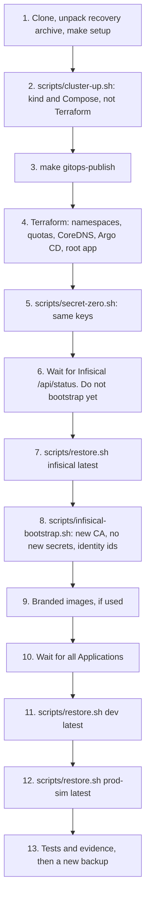

# Disaster recovery

What fails, what survives, how to recover, and how to restore the whole platform into a clean environment.

**Status: NOT RUN.** No failure scenario in this file has been exercised. No restore has run, and Plane has not been deployed. `docs/evidence/` holds no result. Steps are design intent read from the scripts. Every statement that depends on a runtime result carries a `VERIFY` marker. This platform is local and single-node, and nothing here is a claim of production readiness.

## Principles

- **One node, one replica, one Docker VM, one laptop.** There is no failover. Recovery means restarting or restoring.
- **`dev` and `prod-sim` share all of that.** Namespace separation is not equivalent to independent production clusters: a node or VM failure takes both.
- **Git describes what runs, not what is stored.** Argo CD can rebuild workloads from Git. Data comes back only from a backup.
- **Plane data and its `SECRET_KEY` are a matched set.** `SECRET_KEY` lives in Infisical, so Infisical restores first.
- **Three things leave the cluster and no script copies them off the machine:** `.local/backups/`, `.local/secret-zero/`, and `.local/terraform/infisical/`. Until someone copies them, a lost laptop loses everything except Git.

## What survives what

| | Pod deleted | `make down` | Node container lost | `make destroy` | Docker VM disk lost | Machine lost |
|---|---|---|---|---|---|---|
| Plane and Infisical PVs | Yes | Yes | No, node `/var` | No | No | No |
| Etcd, including Secrets | Yes | Yes | No | No | No | No |
| Argo CD state | Yes | Yes | No | No | No | No |
| Registry and caches, named volumes | Yes | Yes | Yes | Yes, unless `PURGE=yes` | No | No |
| `.local/git` bare repo | Yes | Yes | Yes | Yes | Yes | No |
| `.local/backups` | Yes | Yes | Yes | Yes | Yes | **No, unless copied** |
| `.local/secret-zero` | Yes | Yes | Yes | Yes | Yes | **No, unless copied** |
| `.local/terraform/infisical` | Yes | Yes | Yes | **No, deleted by the script** | Yes | **No, unless copied** |
| Working Git repo | Yes | Yes | Yes | Yes | Yes | No |
| GitHub `origin` | Yes | Yes | Yes | Yes | Yes | Yes, as of the last push |

`make destroy` deleting the Infisical Terraform state is a real gap for restoration. See [Known gaps](#known-gaps).

## Before anything fails

Recovery depends on these, and they are manual.

```bash
make backup ENV=all
```

Then copy the recovery set off this machine, encrypted. `gpg` here is an example, not a prerequisite of this repository.

```bash
tar -C .local -cf - secret-zero backups terraform/infisical \
  | gpg --symmetric --cipher-algo AES256 -o "plane-platform-recovery-$(date -u +%Y%m%dT%H%M%SZ).tar.gpg"
```

| Item | Why | If missing |
|---|---|---|
| `secret-zero/ENCRYPTION_KEY` | Decrypts Infisical's database | Path B. All Infisical contents are gone |
| `secret-zero/AUTH_SECRET` | The admin token's signature depends on it | The token dies. Admin password path |
| `secret-zero/infisical-admin.json`, `infisical-admin-password`, `infisical-machine.json` | Access to the restored instance | Recovery by UI, or rerun what can be rerun |
| `terraform/infisical/terraform.tfstate` | Lets Terraform update the restored instance's cluster CA | Bootstrap fails. See [Known gaps](#known-gaps) |
| `backups/infisical`, `backups/dev`, `backups/prod-sim` | The data | Nothing to restore |

Keeping `ENCRYPTION_KEY` in the same archive as a dump is a tradeoff, acceptable for a local platform whose backups are themselves unencrypted, when the archive is encrypted. To separate them, put `ENCRYPTION_KEY` in a password manager.

Push `main` to `origin` as well. [[VERIFY: origin/main contains the commit you intend to recover, with git status and git log origin/main]]

## RPO and RTO: to measure, not promised

No RPO or RTO is promised. No number exists yet, and nothing automates the inputs.

**RPO is the age of the newest copy.** Backups are on demand: no CronJob, and no alert on backup age. With no discipline, RPO is unbounded. Off-machine RPO is the age of the last manual copy.

**RTO is what the timed drills below show.** The restore evidence JSON records steps and a start time, not durations, so use `time`.

| Scenario | RPO by design | RTO | Evidence |
|---|---|---|---|
| Pod lost | Zero, the volume survives | [[MEASURE: seconds to Ready per StatefulSet in tests/drills/pod-restart-persistence.sh]] | NOT RUN |
| `make down` then `make up` | Zero | [[MEASURE: seconds from make up to all Applications Healthy after make down]] | NOT RUN |
| Node container lost | Age of last backup | [[MEASURE: time from cluster-up to verified restore after docker rm of the node]] | NOT RUN |
| Infisical Postgres lost | Age of last Infisical backup | [[MEASURE: time for make restore ENV=infisical, including operators resyncing]] | NOT RUN |
| Plane Postgres lost | Age of last backup | [[MEASURE: time for make restore ENV=dev after deleting the Postgres PVC]] | NOT RUN |
| Docker VM disk lost | Age of last backup | [[MEASURE: time from empty Docker to verified restore with images re-pulled]] | NOT RUN |
| Whole machine lost | Age of last off-machine copy | [[MEASURE: time from a clean clone and recovery archive to verified restore]] | NOT RUN |

Record each result in `docs/evidence/` with date and command, labelled **PASS**, **FAIL**, **BLOCKED** or **NOT RUN**. A first boot on an empty Docker also pulls every image again, which can hit Docker Hub limits. Estimate of the download: 8.56 GiB unpacked on the node, summed from registry layer sizes.

## Failure scenarios

### Scenario: pod lost

**What happens.** Kubernetes reschedules it. StatefulSet pods reattach the same PVC. Deleting a pod changes no spec, so Argo CD sees no drift. There is a brief outage, since every workload has one replica.

**Do.** Nothing. To exercise it:

```bash
tests/drills/pod-restart-persistence.sh dev
```

The drill deletes each StatefulSet's pod in turn, re-reads the sentinel written by `tests/e2e/smoke.py`, and creates a new work item to prove the async path after a broker restart. `make drill-*` targets are named in the contract and absent from the Makefile at commit f733b87, so call the script directly.

[[VERIFY: pod-restart-persistence drill passes in dev and prod-sim]]

### Scenario: node lost

The node is one Docker container, `plane-platform-control-plane`.

| Sub-case | State | Do |
|---|---|---|
| Stopped by `make down`, Docker restart or host reboot | Data intact | `scripts/cluster-up.sh`, which runs `docker start`. `make up` once `scripts/up.sh` exists |
| Container deleted, or `kind delete cluster` by hand | PVs and etcd gone, since they live in the node's `/var` volume. Host state intact | `rm -rf .local/terraform/local`, then [Full restoration](#full-restoration-into-a-clean-environment), Path A, starting from step 2 |

[[VERIFY: a stopped node resumes with its data, kubeconfig valid and API server reachable, including when its Docker IP changes]]

[[VERIFY: compose services restart with Docker, and plane-git answers after a resume]]

### Scenario: Infisical lost

| What is lost | Effect on Plane | Do |
|---|---|---|
| Server pod | None immediately. Kubernetes Secrets stay, so restarts still work. Sync stops | Nothing |
| Redis pod or volume | Pending jobs and locks | Nothing |
| Postgres pod | Server fails until it returns. Volume intact | Nothing |
| Postgres volume, with a dump | Server fails or comes up empty. Plane keeps running on existing Secrets. Operators fail to log in | Procedure below |
| Postgres volume, no dump | Values are gone. Existing Kubernetes Secrets are the last copy | Path B |
| `ENCRYPTION_KEY` lost, cluster alive | None | `scripts/secret-zero.sh` recovers it from Secret `infisical-secrets` |
| `ENCRYPTION_KEY` lost everywhere | Values cannot be decrypted, even with a dump | Path B |

**Volume lost on a live cluster, with a dump and `ENCRYPTION_KEY`:**

```bash
# 1. Do not run scripts/infisical-bootstrap.sh yet. On an empty database it starts a new instance.
# 2. Recreate the volume, if the PVC was deleted, by deleting the pod so the StatefulSet makes a new PVC.
kubectl --context kind-plane-platform -n infisical delete pod infisical-postgres-0

# 3. Wait for the server to finish migrations on the empty database.
until curl -fsS -m 5 http://infisical.localhost/api/status >/dev/null; do sleep 10; done

# 4. Restore.
make restore ENV=infisical BACKUP=latest

# 5. Refresh Terraform, the seed and the identity Secrets. The seed writes nothing, since keys exist.
scripts/infisical-bootstrap.sh
```

Plane's password check matters here. If `PG_PASSWORD` was rotated after this dump was taken, Infisical now holds the old value, the operator writes it to the Secret, and Plane fails on its next restart. `rotate.sh` refuses to run in that state. To fix it, set the role to the restored value, or restore a newer dump. Back up Infisical after each rotation to avoid this.

[[VERIFY: Infisical volume loss recovers with the commands above and the operators resume syncing]]

[[VERIFY: Plane continues serving through an Infisical outage and through a Plane pod restart during it]]

### Scenario: Git repository lost

Three copies exist, and each has a role.

| Copy | Role | If lost |
|---|---|---|
| `.local/git/plane-platform.git`, served by `plane-git` | What Argo CD reads | Rebuilt: `make gitops-publish` recreates it from the working repo. Running workloads are unaffected in the meantime. Argo CD cannot compare or sync, and it reports errors |
| Working repo `/Users/bek/dev/pr/plane-platform` | Source of truth | `git clone` from `origin`. Commits never pushed are gone |
| GitHub `origin` | CI, off-machine copy | `git push` from the working repo |

`gitops-publish` pushes without force. A non-fast-forward means history was rewritten, and it refuses. Reverts are the way back. If `main` was rewritten on purpose, delete the bare repo to republish from scratch.

Repo rights do not imply data. A Git restore brings no secret zero, no backups, and no Terraform state.

[[VERIFY: deleting .local/git and running make gitops-publish restores Argo CD sync without restarting workloads]]

[[VERIFY: plane-git keeps serving after the bare repo is recreated while its container runs]]

### Scenario: registry lost

Registry contents live in Docker named volumes: `registry-data` and three mirror volumes.

| Lost | Effect | Do |
|---|---|---|
| Pull-through caches | Images already on the node keep working. New pulls fetch from upstream through the mirror again | Nothing. `scripts/cluster-up.sh` restarts them. Watch Docker Hub limits |
| `localhost:5001/wayline/*` | Running pods keep running from containerd's store. New pulls of those digests fail | Below |

Contract section 5 specifies branded images in the local registry. At commit f733b87 both overlays reference `docker.io/makeplane/*`, so this registry path is unused so far. Once the branding layer lands:

```bash
# Preferred: copying keeps the digest. Needs images in GHCR from images.yml.
scripts/ci/copy-to-local-registry.sh ghcr.io/<owner>/wayline dev

# Otherwise rebuild. This produces new digests, so promote them.
make images
make promote ENV=dev
```

A rebuild does not reproduce the digest. Prod-sim accepts only a digest recorded for dev, so a rebuild must pass through dev again. GHCR on GitHub Free is limited (estimate of the full image set: about 450 MiB compressed, from `.github/workflows/README.md`, against a 500 MB allowance), so old versions may already be pruned. A digest that exists nowhere means the pinned version is lost.

[[VERIFY: copy-to-local-registry.sh preserves digests and pods pull them through localhost:5001]]

[[VERIFY: a full pull with empty caches completes without exhausting the Docker Hub quota]]

### Scenario: Docker VM disk lost

`Docker.raw` lost or reset. PVs, etcd, images, registry and caches go. Host paths under `.local/` survive, including `.local/git`, because they are bind mounts.

Resetting Docker Desktop also destroys every unrelated container and image on this host, including a cached MinIO image that can no longer be pulled anonymously. Check before doing it by choice.

**Do.** [Full restoration](#full-restoration-into-a-clean-environment), Path A, starting from step 2. First remove state that describes the gone cluster, because `make destroy` never ran:

```bash
rm -rf .local/terraform/local
```

Leave `.local/terraform/infisical` in place. [[VERIFY: terraform apply in environments/local succeeds on a new cluster after removing only .local/terraform/local]]

Disk full is a more likely version of this. kind disables eviction and image GC, so it shows up as write errors, not evictions. `guard_disk` is the check, since the VM reports hundreds of free GiB on a sparse disk.

### Scenario: whole machine lost

Everything local is gone. What exists: GitHub `origin`, as of the last push, and any off-machine archive.

| Have | Result |
|---|---|
| Clone, recovery archive with all items | Path A |
| Clone, backups, `ENCRYPTION_KEY`, no Terraform state | Path A with the [Terraform gap](#known-gaps) |
| Clone, backups, no `ENCRYPTION_KEY` | Path B: Plane's rows come back, encrypted settings do not |
| Clone only | A new, empty platform from Git. All Plane data is gone |

Prerequisites on the new machine: Docker Desktop with the memory and disk below, and `make setup`.

| Requirement | Value | Status |
|---|---|---|
| Docker Desktop memory | 14 GiB minimum with unrelated containers stopped, 16 GiB to keep them running | Estimate, from per-workload idle guesses plus VM overhead and bursts. No Plane container has been sized on this host |
| Free host disk | 25 GiB minimum, 35 GiB recommended | Estimate, from registry layer sizes plus guessed volumes, logs and builds |

## Full restoration into a clean environment

Bring both environments up serially, because simultaneous first boots are the worst case for memory.



### Why this order, and why not `make up`

`scripts/infisical-bootstrap.sh` treats an empty Infisical as a new instance. It moves the admin file and Terraform state aside, then creates new identities and seeds a **new `SECRET_KEY`**. Plane's data tier then initialises with new passwords.

So `make destroy`, `make up`, `make restore` does not bring back a matched set, whatever the message at the end of `scripts/destroy.sh` says. `make restore ENV=dev` refuses on the `SECRET_KEY` fingerprint. Restoring Infisical afterwards leaves the local admin file, machine file, Terraform state and identity Secrets pointing at the new instance, and Plane's volumes initialised with passwords Infisical no longer holds.

The procedure below avoids that by restoring Infisical **before** the first bootstrap. Plane's Secrets do not exist until step 8, so Plane's data tier never initialises with the wrong values. [`scripts/up.sh` does not exist at commit f733b87](#known-gaps), and its planned sequence runs bootstrap unconditionally, so this procedure calls each script directly. [[VERIFY: reconcile this section with scripts/up.sh once it exists, and with any restore mode it adds]]

### Path A: `ENCRYPTION_KEY` and Infisical backup exist

**Step 1. Prepare the host.** Skip for a node or VM loss.

```bash
git clone https://github.com/BereketAbera/plane-platform.git
cd plane-platform
make setup
mkdir -p .local && chmod 700 .local
gpg --decrypt plane-platform-recovery-<stamp>.tar.gpg | tar -C .local -xf -
chmod 700 .local/secret-zero .local/backups
```

Check before continuing:

```bash
ls .local/secret-zero/ENCRYPTION_KEY .local/secret-zero/infisical-admin.json .local/terraform/infisical/terraform.tfstate
ls .local/backups/infisical .local/backups/dev .local/backups/prod-sim
```

If the admin token has passed its 90 day cap, plan to replace it at step 8. See [infisical.md](infisical.md#recovery).

[[VERIFY: backups unpacked from an archive keep modes the Job's UID 70 can read through VirtioFS]]

**Step 2. Cluster and local services.** The kind CLI creates the cluster, and Docker Compose creates the registry, caches and Git remote. Terraform does neither.

```bash
scripts/cluster-up.sh
```

**Step 3. Publish Git for Argo CD.** Needs `main` committed.

```bash
make gitops-publish
```

**Step 4. Terraform, local root.** Creates namespaces, ResourceQuota, LimitRange, the CoreDNS rewrite, the Argo CD release, AppProjects and the root Application.

```bash
export PATH="$PWD/.tools/bin:$PATH"
terraform -chdir=infrastructure/terraform/environments/local init -input=false -lockfile=readonly
terraform -chdir=infrastructure/terraform/environments/local apply -input=false -auto-approve
```

**Step 5. Secret zero.** Reuses the files and applies the three Secrets.

```bash
scripts/secret-zero.sh
```

**Step 6. Wait for Infisical.** Run no bootstrap yet. Plane's Applications stay blocked, because `plane-infisical-identity` does not exist yet.

```bash
until curl -fsS -m 5 http://infisical.localhost/api/status >/dev/null; do sleep 15; done
```

The wait covers first-boot migrations on an empty database and also depends on Traefik and its NetworkPolicy. [[VERIFY: the root Application reaches Infisical at wave -4 and Traefik answers before Plane is unblocked]]

[[VERIFY: Plane data pods wait in CreateContainerConfigError and create no data until step 8]]

**Step 7. Restore Infisical.**

```bash
scripts/restore.sh infisical latest
```

The target is empty, since no bootstrap ran, so `CONFIRM` is not needed. The script compares the `ENCRYPTION_KEY` fingerprint with `secret-zero.sh`'s value and refuses a mismatch.

From reading the code, this step is expected to block today. `argo_pause` waits for the root Application to be idle, and root's sync is waiting on `plane-dev`, which is blocked until step 8. `argo_wait_idle` in `monitoring/ops/lib.sh` then dies after 180 s. Until that is fixed, terminate root's running operation first. This patch comes from static reading of the Argo CD controller, and it has never been applied:

```bash
kubectl --context kind-plane-platform -n argocd patch application root --type merge \
  -p '{"status":{"operationState":{"phase":"Terminating"}}}'
```

[[VERIFY: scripts/restore.sh infisical latest succeeds in this state, with or without the Terminating patch]]

**Step 8. Bootstrap against the restored instance.**

```bash
scripts/infisical-bootstrap.sh
```

Here it finds `initialized: true` and `infisical-admin.json`, reuses the token, runs Terraform to store the new cluster CA, writes nothing in the seed because all keys exist, and publishes the restored identity ids. Operators then log in, and the six Secrets appear with the original values.

[[VERIFY: the pre-restore admin token authenticates against the restored database]]

[[VERIFY: terraform apply against the restored instance changes only the Kubernetes Auth CA, using the preserved state]]

[[VERIFY: operators log in with the new CA and materialise all six Secrets with their original values]]

**Step 9. Branded images.** Only if overlays reference `localhost:5001/wayline`. See [registry lost](#scenario-registry-lost). The digests in Git must exist in the registry, or pods stay in `ImagePullBackOff`.

**Step 10. Wait for the Applications.** Plane comes up empty, using the original passwords on new volumes.

```bash
make status
kubectl --context kind-plane-platform -n argocd get applications
```

Continue when all Applications report Synced and Healthy. By static reading, the root's waves do not fully gate children with internal waves, so Plane's first boots may overlap, which is the memory worst case. [[VERIFY: both Plane environments reach Healthy on first boot within the VM's memory]]

**Step 11. Restore dev.**

```bash
scripts/restore.sh dev latest
```

The script checks the version, the `SECRET_KEY` fingerprint, and that the target is empty. Then it follows the [restore sequence](data-operations.md#plane-restore-step-by-step).

[[VERIFY: an environment that has only run its migrator reports zero users and zero objects, so CONFIRM is not needed]]

**Step 12. Restore prod-sim.** Only after dev finishes.

```bash
scripts/restore.sh prod-sim latest
```

**Step 13. Verify and record.**

```bash
make status
make gates
make test-netpol
make test-e2e ENV=dev
make test-e2e ENV=prod-sim
make backup ENV=all
```

Copy `.local/evidence-raw/restore-*.json` and `.local/evidence-raw/restore-smoke-*.json` into `docs/evidence/` with date and command. A proof reported NOT RUN stays NOT RUN.

The recovery archive above does not include `.local/test-accounts.env`. [[VERIFY: make test-e2e works on a restored environment when .local/test-accounts.env and .local/test-sentinel-ENV.json are absent]]

[[VERIFY: the full Path A procedure has run end to end from a deleted cluster, with evidence in docs/evidence/]]

### Path B: `ENCRYPTION_KEY` is lost

The Infisical dump is unreadable. Every value in it is gone, including `SECRET_KEY`. Plane's rows and objects can still come back.

This path assumes a new cluster. On a live cluster, first take `make backup ENV=dev` and `make backup ENV=prod-sim` if Plane still runs, then delete the cluster, because the old data volumes hold old passwords.

1. Follow steps 1 to 4. Skip restoring `secret-zero`, or remove what remains.
2. `scripts/secret-zero.sh`, which generates new values. On a live cluster it refuses to replace a key: `REGENERATE=yes CONFIRM=yes scripts/secret-zero.sh` archives the old set.
3. `scripts/infisical-bootstrap.sh`. A new admin, new identities, and new values, including a new `SECRET_KEY`.
4. Wait for the Applications. Then restore each environment, accepting the loss:

```bash
scripts/restore.sh dev latest ALLOW_SECRET_KEY_MISMATCH=yes
scripts/restore.sh prod-sim latest ALLOW_SECRET_KEY_MISMATCH=yes
```

**What this costs.** Encrypted instance configuration rows, such as SMTP and OAuth settings, decrypt silently to `""`. Reconfigure them in the instance admin UI. The script reports the mismatch, the proofs fail, and it exits non-zero even though the data is back. That exit code is correct, so do not read it as a failed restore of rows. Check the row-count gates in the evidence file. API tokens are not bound to the key, and survive. Users may need to log in again.

Clear the affected rows so `proof-no-empty-decrypt` can pass later: [[VERIFY: the procedure to reset undecryptable InstanceConfiguration rows, including WAYLINE_RESTORE_SENTINEL, works and is documented with the exact command]]

[[VERIFY: Path B has run, and restored rows and objects are readable with the new SECRET_KEY]]

### Path C: nothing to restore

`make up`, once `scripts/up.sh` exists, gives a new empty platform from Git. Infisical generates new values. Plane starts with no data.

## Known gaps

Recorded plainly, because each changes what a real recovery needs.

| Gap | Where | Effect | Mitigation today |
|---|---|---|---|
| `make destroy` deletes Infisical's Terraform state | `scripts/destroy.sh` line 31 | Path A step 8 fails, because Terraform would create what the restored database already holds, and bootstrap runs it unconditionally | Copy `.local/terraform/infisical` before `make destroy`, or import. [[VERIFY: an import path exists for every resource in infisical/terraform/main.tf]] |
| `destroy.sh` tells the operator to run `make up`, then `make restore` | `scripts/destroy.sh` line 37 | That sequence does not restore a matched set, as explained [above](#why-this-order-and-why-not-make-up) | Use Path A |
| `restore.sh` advises rerunning Terraform on a new cluster | `scripts/restore.sh` line 671 | True only if state exists | As above |
| `make up` and `make test` have no script | `Makefile`, `scripts/up.sh` and `scripts/test.sh` are absent at f733b87 | `make test-e2e` cannot create the sentinel, so proofs report NOT RUN | Run `tests/e2e/smoke.py` directly |
| Restoring before bootstrap hits the idle wait | `monitoring/ops/lib.sh` lines 112 to 117 | Step 7 dies after 180 s | Terminate root's operation, unverified |
| No off-machine copy | No script | Machine loss is total without a manual archive | [Before anything fails](#before-anything-fails) |
| No scheduled backup, no backup-age alert | No CronJob, `PlaneBackupFailed` covers only failed Jobs | RPO unbounded | Run `make backup` deliberately |
| Rotation can orphan an Infisical dump | `scripts/rotate.sh` takes no backup | Restoring an older dump gives Infisical a stale `PG_PASSWORD` | `make backup ENV=infisical` after each rotation |
| No drill covers restoration | `tests/drills/` holds pod restart and failed deploy only | This document is untested | Run Path A and record it |
| Infisical's Redis is not flushed on restore | `scripts/restore.sh`, `restore_infisical` | Stale job state could survive. Effect unknown | [[VERIFY: stale jobs in Infisical Redis cause no harm after a database restore]] |

## Related documents

- [data-operations.md](data-operations.md): backup contents, restore steps and proofs.
- [infisical.md](infisical.md): secret zero and Infisical recovery detail.
- [security.md](security.md): what `.local/` exposes.
- [runbooks/backup-restore.md](runbooks/backup-restore.md) and [runbooks/clean-rebuild.md](runbooks/clean-rebuild.md): operational procedures.
- [validation.md](validation.md): test status.
- [known-limitations.md](known-limitations.md): limits of the platform.
- [platform-contract.md](platform-contract.md): names and ownership.
