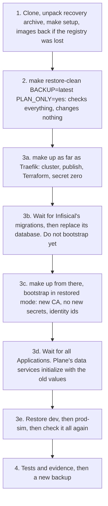

# Disaster recovery

What fails, what survives, how to recover, and how to restore the whole platform into a clean environment. [Hosted production](#hosted-production) comes first, and the rest of the page is the kind cluster's, where dev and prod-sim run.

**Hosted production, 2026-11-07.** Backups have run by hand and restored in an isolated namespace on the VPS, and a copy pulled to the Mac restored. Nothing has been restored into hosted production itself, no rebuild of the VPS has run, and the steps that would bring its data back onto a new VPS are not written. The restart check is PENDING tonight.

**Kind cluster, 2026-11-05.** The pod restart drill has run in both environments on the final images, and backups have run. Infisical has been restored in place, and dev and prod-sim have each been restored in place into their real database and bucket, with result PASS and `make test-e2e` passing after. `make down` and `make up` resumed with the data intact.

**The destroying run has finished, and its restore read PASS.** `make drill-clean-restore CONFIRM=yes CLEAN_INSTALL_FIRST=yes` deleted the cluster, ran a clean install from a fresh clone with new secrets, tested it and deleted it, then restored Infisical, dev and prod-sim from backup into a new cluster. All four restore files read PASS on every step, with `not_run` empty ([restore-clean-20261105T081017Z.json](evidence/runs/restore-clean-20261105T081017Z.json), [restore-infisical-20261105T081608Z.json](evidence/runs/restore-infisical-20261105T081608Z.json), [restore-dev-20261105T082337Z.json](evidence/runs/restore-dev-20261105T082337Z.json), [restore-prod-sim-20261105T082657Z.json](evidence/runs/restore-prod-sim-20261105T082657Z.json)), and `make test` then passed on the restored platform ([MAKE-TEST-20261105T083455Z.txt](evidence/runs/MAKE-TEST-20261105T083455Z.txt)). The drill's own last line reads `RESULT FAIL   1 failure(s)`, and that one is a defect in the test, as [Path C](#path-c-nothing-to-restore) says ([log](evidence/runs/drill-clean-restore-20261105T074859Z.log)). It kept the local registry and the pull-through caches, and `.tools` was copied rather than downloaded, so it is not a new machine.

**A second destroying run, with a cold install, also restored with PASS.** `make drill-clean-restore CONFIRM=yes CLEAN_INSTALL_FIRST=yes COLD_INSTALL=yes`, at `e602dad`, removed the registry and caches as well, ran [a cold install](#path-c-nothing-to-restore) from a fresh clone, then restored into a new cluster, on code with the recovery fixes merged. All four restore files read PASS on every step, with `not_run` empty ([restore-clean-20261105T124518Z.json](evidence/runs/restore-clean-20261105T124518Z.json), [restore-infisical-20261105T124950Z.json](evidence/runs/restore-infisical-20261105T124950Z.json), [restore-dev-20261105T125720Z.json](evidence/runs/restore-dev-20261105T125720Z.json), [restore-prod-sim-20261105T130009Z.json](evidence/runs/restore-prod-sim-20261105T130009Z.json)), the cluster CA was new, the old ids stood, all 38 rendered Secret keys held the old values, a second bootstrap changed nothing, and the e2e and Infisical tests passed ([log](evidence/runs/drill-clean-restore-20261105T105347Z.log)). Its last line reads `RESULT FAIL   1 failure(s)` too, for the same test defect. That restore was not cold: it found the caches the cold install had just filled, and a registry put back from the drill's own snapshot. [Off the normal path](#off-the-normal-path) lists four fixes that came after the first run.

**A third destroying run read `RESULT PASS`.** `make drill-clean-restore CONFIRM=yes LOSE_CLUSTER=yes`, from 13:06:33Z to 13:35:01Z at `06b8be7`, took fresh backups, deleted with kind alone, as a disaster would, and left the local Terraform state behind. The restore moved that state aside, to `.local/terraform/local.stale-20261105T130830Z`, did not apply over it, and finished 1,474 s after the delete, with nothing else in the gap. All four restore files read PASS on every step, with `not_run` empty ([restore-clean-20261105T130828Z.json](evidence/runs/restore-clean-20261105T130828Z.json), [restore-infisical-20261105T132002Z.json](evidence/runs/restore-infisical-20261105T132002Z.json), [restore-dev-20261105T132634Z.json](evidence/runs/restore-dev-20261105T132634Z.json), [restore-prod-sim-20261105T132932Z.json](evidence/runs/restore-prod-sim-20261105T132932Z.json)), and the last line reads `RESULT PASS`, `make` exit 0 ([output](evidence/runs/BKP-6-20261105T130633Z-lose-cluster-make.txt), [log](evidence/runs/drill-clean-restore-20261105T130633Z.log)). It has no stage 4b, so it does not exercise `1374c1e`, and the last small restore fixes, on a branch merged afterward at `90ef495`, have run on stubs only. `make test` then passed whole on the cluster it left, from 14:00:19Z to 14:11:52Z at `f30a7f5` ([output](evidence/runs/MAKE-TEST-20261105T140019Z.txt)).

A result links to its file under `docs/evidence/runs/`. The kind cluster is local, production-inspired and single-node, and from [Principles](#principles) on nothing on this page is a claim about hosted production.

## Hosted production

One node, on one disk, run by one person. Recovery there means restarting, restoring, or building a new node, and a restore means losing what was written since the backup it uses. Backups and their checks are in [Data operations](data-operations.md#hosted-backups).

### What lives where

| What | On the VPS | On the Mac | Anywhere else |
|---|---|---|---|
| Plane's and Infisical's data | Volumes under `/var/lib/rancher/k3s/storage/` | | |
| Backups | restic repositories under `/srv/wayline/backups/`, each night | `.local/hosted/plane-prod/offsite-restic/`, as of the last pull | Nowhere: no S3 destination is set |
| Secret zero, the restic password, the deploy key, the alert credentials | As Secrets in the cluster | `.local/hosted/plane-prod/` | The recovery bundle, once the owner copies it off the Mac |
| Terraform state of the three roots, `prod`, `prod-host` and Infisical's | | `.local/hosted/plane-prod/terraform/` | The recovery bundle, as above |
| The recovery identity | | `~/.wayline/recovery-identity.txt`, until the owner moves it | The owner's password manager |
| The SSH key to the node, and the key that signs promotion evidence | | `~/.ssh/` | Nowhere the bundle reaches: it holds neither |
| What runs | Argo CD's copy | The repository | GitHub: `main`, and `deploy/plane-prod` |
| Wayline's images | containerd's store | | GHCR, by digest, where nothing deletes a version |

The VPS holds no credential for anywhere off it, so a compromised VPS cannot reach or delete the Mac's copy, and the Mac must be on for anything to leave the VPS.

### What each failure loses

| Failure | What is lost | Do | Run |
|---|---|---|---|
| A pod | Nothing: a StatefulSet's pod reattaches its volume. Every workload has one replica, so there is an outage while it restarts | Nothing | PENDING, `make remote-restart-check TARGET=plane-prod CONFIRM=plane-prod`. Its first run, at 07:52Z on 2026-11-07, restarted the four data services and the seven app Deployments one at a time, and each came back. It then timed out after 180 s waiting for the public API to answer 200, so it compared nothing: FAIL (not yet published: `hosted-restart-check-20261107T075212Z.log`, `restart-check-20261107T075237Z.txt`) |
| A reboot of the node | Nothing on disk. The site is down until K3s and its pods are back | Nothing: the firewall's own unit loads before K3s. `NodeRebootRequired` asks for a planned one, because nothing reboots unasked | NOT RUN |
| A claim deleted | Nothing at first: the class and the backup volumes are Retain | Bind a new claim to the old volume by hand | NOT RUN |
| A bad migration, or rows removed by mistake | Everything written since the dump that is restored | Roll back on `main`, then restore the dump taken before that image's migrations: [`scripts/hosted/README.md`](../scripts/hosted/README.md), section After a rollback | NOT RUN on a real cluster |
| Infisical's database | Its values, until restored. Plane keeps running on the Kubernetes Secrets it has, and the operator stops syncing | No script restores Infisical in place on hosted production. The restore test shows its nightly restores into an empty Postgres, and the steps after that are not written | NOT RUN |
| The VPS, or its disk | Everything on it, the restic repositories among them | [Rebuild from nothing](#rebuilding-the-vps-from-nothing), from the Mac's copy | NOT RUN |
| The Mac | Nothing that runs. The only copy off the VPS, the bundle and identity unless copied off, and the SSH and signing keys unless copied, which stops SSH to the node and every new promotion | A new Mac: the repository, `make setup`, and `.local/hosted/plane-prod/` from the bundle with the identity | NOT RUN |
| The Mac and the VPS together | All of Plane's and Infisical's data, unless a copy of the pull exists elsewhere | A new, empty production from Git and GHCR | NOT RUN |
| `ENCRYPTION_KEY` on the Mac, in the cluster and in every bundle | Infisical's database, for good. Plane runs on what its Secrets hold until they change | A new Infisical, and Plane's data back with a `SECRET_KEY` mismatch accepted, as [Path B](#path-b-encryption_key-is-lost) on kind | NOT RUN |
| The restic password everywhere | Every repository, on the node and on the Mac | Nothing reads them again | |
| The recovery identity | Every bundle made for it | A new identity with `scripts/hosted/bundle.sh init`, and a new bundle while the Mac still holds the files | |

### RPO and RTO

None is promised, and few numbers exist yet.

| | Hosted production |
|---|---|
| RPO on the VPS | Up to a day, from the nightly, and the dump taken before each migration. The first night is due at 01:47Z on 2026-11-08, and until then the newest backup is the one made by hand on 2026-11-07, in the run that began at 07:07:50Z and sealed Plane's snapshot at 07:12Z |
| RPO off the VPS | The age of the last `make remote-pull-backups`. It ran at 07:13Z on 2026-11-07 (not yet published: `hosted-pull-20261107T071339Z.log`), and nothing schedules it |
| RTO | Not measured. The restore test into an isolated namespace took under 5 minutes from its start to its evidence, on very little data (not yet published: `restore-test-plane-prod-20261107071414.json`). A rebuild has never run |

### Rebuilding the VPS from nothing

Nothing here has rebuilt the VPS. The scripts that built this one would build another, in this order:

1. **A VPS,** by hand at Contabo. Terraform only reads the instance, because as a resource its provider can reinstall the disk or cancel the contract. Write its address, instance id and node name into [`target.yaml`](../infrastructure/hosted/plane-prod/target.yaml), with `kube_system_uid: pending`, which admits only provisioning, and record its host key with `ssh-keyscan` into `.local/hosted/known_hosts`.
2. **Local state.** On a new Mac, the repository and `make setup`. Unpack the newest bundle with the identity into `.local/hosted/plane-prod/`, mode 0700, because its paths are relative to that folder. That brings back secret zero, the restic password, the deploy key, the alert and GHCR credentials, Grafana's login and the Terraform states, so nothing below makes a new one.
3. **DNS.** With a new address, `TARGET=plane-prod scripts/hosted/host-terraform.sh plan`, then `apply` with `EXPECT` naming exactly its changes. Each record refuses an address Contabo does not report for the instance. The records must answer before Argo CD first sees a Certificate, or its order fails and waits an hour or more.
4. **The node.** `TARGET=plane-prod CONFIRM=plane-prod scripts/hosted/provision-node.sh access`, then `os`, then `k3s`. `os` leaves the firewall at `closed`.
5. **The cluster.** `make remote-kubeconfig TARGET=plane-prod` prints the new `kube-system` UID. Every script and the Terraform root refuse the cluster until `target.yaml` names it.
6. **Bootstrap.** `make remote-bootstrap TARGET=plane-prod CONFIRM=plane-prod`, after `scripts/hosted/owner-inputs.sh` for anything missing. Argo CD then deploys whatever `deploy/plane-prod` names, Plane included, because that branch already holds the promotion.
7. **In.** Infisical's two-factor through the tunnel, then `TWO_FACTOR=on edge.sh open`, which refuses until Plane and Infisical each have an admin, and `make remote-test TARGET=plane-prod CONFIRM=plane-prod`.

**What that does not bring back is the data.** On a new node Infisical's database is empty, so bootstrap's Infisical step makes a new instance: it moves the old admin files and Terraform state aside, then makes a new admin, identity and values, a new `SECRET_KEY` among them. Plane then starts empty, with new passwords, and its backups no longer pair with its key. Keeping the data needs Infisical's database, then Plane's database and objects, back from the Mac's restic copy before that step and before Plane first syncs, and bootstrap in restored mode. On kind, `make restore-clean` does exactly that ([Full restoration](#full-restoration-into-a-clean-environment)). On hosted production nothing does yet: no script puts the Mac's copy back on a node, restores it into the live namespaces, or runs `scripts/infisical-bootstrap.sh` with `INFISICAL_RESTORED=yes` there. Until one exists, a lost VPS means a new, empty production, with the backups kept to restore by hand. `make remote-restore-test TARGET=plane-prod RESTORE_ON=kind` would prove the Mac's copy restores into a database, and it has not run.

### Before anything fails, on hosted production

These are the owner's, and they are manual.

- Copy the newest bundle off the Mac, and the identity into a password manager, apart from each other.
- Copy `~/.ssh/wayline_contabo_ed25519` and `~/.ssh/wayline_evidence_ed25519` off the Mac too, because no bundle holds them.
- `make remote-bundle TARGET=plane-prod` after every bootstrap, token mint or Terraform apply. The applies at 18:12Z and 18:13Z on 2026-11-07 left the bundle the Mac holds stale, and it has not run since.
- `make remote-pull-backups TARGET=plane-prod`, then `make remote-backup-dest TARGET=plane-prod VERB=verify`, at least every 35 days, or off-VPS status goes back to incomplete. An S3 copy is optional: `scripts/hosted/owner-inputs.sh offsite`, then `VERB=push`.

## Principles

- **One node, one replica, one Docker VM, one laptop.** There is no failover. Recovery means restarting or restoring.
- **`dev` and `prod-sim` share all of that.** Namespace separation is not equivalent to independent production clusters: a node or VM failure takes both.
- **Git describes what runs, not what is stored.** Argo CD can rebuild workloads from Git. Data comes back only from a backup.
- **Plane data and its `SECRET_KEY` are a matched set.** `SECRET_KEY` lives in Infisical, so Infisical restores first.
- **Two things leave the cluster and no script copies them off the machine:** `.local/backups/` and `.local/secret-zero/`. Each Infisical backup also holds the Terraform state of `infisical/terraform`. Until someone copies them, a lost laptop loses everything except Git.
- **Images built here are in no backup.** Git deploys `localhost:5001/wayline` digests, which live only in a Docker volume. See [registry lost](#scenario-registry-lost).

## What survives what

| | Pod deleted | `make down` | Node container lost | `make destroy` | Docker VM disk lost | Machine lost |
|---|---|---|---|---|---|---|
| Plane and Infisical PVs | Yes | Yes | No, node `/var` | No | No | No |
| Etcd, including Secrets | Yes | Yes | No | No | No | No |
| Argo CD state | Yes | Yes | No | No | No | No |
| Registry and caches, named volumes | Yes | Yes | Yes | Yes, unless `PURGE=yes` | No | No |
| `.local/git` bare repo | Yes | Yes | Yes | Yes | Yes | No |
| `.local/backups` | Yes | Yes | Yes | Yes | Yes | **No, unless copied** |
| `.local/secret-zero` | Yes | Yes | Yes | Yes | Yes | **No, unless copied** |
| `.local/terraform/infisical` | Yes | Yes | Yes | Yes | Yes | **No, unless copied**. Each Infisical backup holds a copy |
| Working Git repo | Yes | Yes | Yes | Yes | Yes | No |
| GitHub `origin` | Yes | Yes | Yes | Yes | Yes | Yes, as of the last push |

This table is read from what each path and volume is. The pod column has run, and so have `make down` ([PERS-3-20261105T083304Z.txt](evidence/runs/PERS-3-20261105T083304Z.txt)) and `make destroy`: the drill of 2026-11-05 read the cluster gone, the local Terraform state removed, the Infisical Terraform state kept and secret zero unchanged ([log](evidence/runs/drill-clean-restore-20261105T074859Z.log), stage 4). The other columns: Not tested in Pass 1.

## Before anything fails

Recovery depends on these, and they are manual.

```bash
make backup ENV=all
```

Then copy the recovery set off this machine, encrypted. `gpg` here is an example, not a prerequisite of this repository.

```bash
tar -C .local -cf - secret-zero backups \
  | gpg --symmetric --cipher-algo AES256 -o "plane-platform-recovery-$(date -u +%Y%m%dT%H%M%SZ).tar.gpg"
```

| Item | Why | If missing |
|---|---|---|
| `secret-zero/ENCRYPTION_KEY` | Decrypts Infisical's database | Path B. All Infisical contents are gone |
| `secret-zero/AUTH_SECRET` | Without it nothing the dump signed can be verified | A clean restore refuses before it touches anything |
| `secret-zero/infisical-admin.json`, `infisical-admin-password` | How a restore logs in | With the password, a restore mints a new token. With neither, a person writes a new password hash into the restored database. See [`infisical/README.md`](../infisical/README.md#how-a-restore-logs-in) |
| `secret-zero/infisical-machine.json` | Project and identity ids | A restore rebuilds it from the backup's Terraform state |
| `backups/infisical`, `backups/dev`, `backups/prod-sim` | The data, and `recovery/terraform.tfstate` and `recovery/set.json` in each Infisical backup, the test accounts and sentinel in each Plane backup | Nothing to restore |

A backup records the sha256 of each secret zero file and never holds the file, and a restore finds them by that checksum. Keeping `ENCRYPTION_KEY` in the same archive as a dump is a tradeoff, acceptable for a local platform whose backups are themselves unencrypted, when the archive is encrypted. To separate them, put `ENCRYPTION_KEY` in a password manager.

Push `main` to `origin` as well, and check it: `git fetch origin && git status && git log -1 origin/main`.

## RPO and RTO: to measure, not promised

No RPO or RTO is promised. Few numbers exist yet, and nothing automates the inputs.

**RPO is the age of the newest copy.** Backups are on demand: no CronJob, and no alert on backup age. With no discipline, RPO is unbounded. Off-machine RPO is the age of the last manual copy.

**RTO is what the timed drills below show.** A Plane restore's evidence JSON records steps and a start time, not durations, so use `time`. An Infisical restore records its `server-downtime`.

| Scenario | RPO by design | RTO | Evidence |
|---|---|---|---|
| Pod lost | Zero, the volume survives | Dev, final images, read every 3 s: Silo and Postgres about 9 s, RabbitMQ about 12 s, Valkey under 3 s. A signed-in request answered 500 for about 7 s during the Postgres round. Prod-sim's drill was not timed | PASS: [PERS-1-20261105T070358Z-timeline.txt](evidence/runs/PERS-1-20261105T070358Z-timeline.txt), [drill-pod-restart-dev-20261105T070414Z.log](evidence/runs/drill-pod-restart-dev-20261105T070414Z.log), [drill-pod-restart-prod-sim-20261105T072331Z.log](evidence/runs/drill-pod-restart-prod-sim-20261105T072331Z.log) |
| `make down` then `make up` | Zero | On the restored cluster, with no reading of Plane during it: `make down` 15 s, `make up` 82 s | PASS: [PERS-3-20261105T083304Z.txt](evidence/runs/PERS-3-20261105T083304Z.txt) |
| Cluster deleted, host state kept | Age of last backup | 1,201 s, from the start stamp to the evidence file's last write ([MANIFEST.tsv](evidence/runs/MANIFEST.tsv)), with the registry and caches kept, and 102 objects in dev and 71 in prod-sim. Within it: Infisical answering after 255 s, its restore 43 s with the server not answering for 34 s, all 14 Applications after 394 s, dev 200 s, prod-sim 199 s. The drill's own 2,402 s counts from the delete and holds its clean install. The second run: 1,067 s by the same measure, with caches the cold install had filled, and 113 objects in dev and 82 in prod-sim. Within it: Infisical's restore 44 s with the server not answering for 35 s, all 14 Applications after 384 s, dev 169 s, prod-sim 174 s. Its drill's 7,663 s counts from the delete and holds the cold install | PASS: [restore-clean-20261105T081017Z.json](evidence/runs/restore-clean-20261105T081017Z.json), [log](evidence/runs/drill-clean-restore-20261105T074859Z.log), [restore-clean-20261105T124518Z.json](evidence/runs/restore-clean-20261105T124518Z.json), [log](evidence/runs/drill-clean-restore-20261105T105347Z.log) |
| Node container lost with `docker rm` | Age of last backup | Not tested in Pass 1 | NOT RUN |
| Infisical Postgres lost | Age of last Infisical backup | In place with the volume kept, seven runs: six PASS in 44 s to 69 s, and one BLOCKED in 71 s, which removed the token and the password on purpose. In the last five the server did not answer for 39 s to 52 s, and the 52 s is the BLOCKED run. The operators' resync was not timed. With the volume deleted: Not tested in Pass 1 | NOT RUN with the volume deleted. In place, six PASS: [dr-inplace-restore-1.txt](evidence/runs/dr-inplace-restore-1.txt), [dr-inplace-restore-2.txt](evidence/runs/dr-inplace-restore-2.txt), [dr-inplace-restore-3.txt](evidence/runs/dr-inplace-restore-3.txt), [dr-inplace-token-lost-1.txt](evidence/runs/dr-inplace-token-lost-1.txt), [dr-inplace-token-back-1.txt](evidence/runs/dr-inplace-token-back-1.txt), [dr-inplace-no-token-no-password-3.txt](evidence/runs/dr-inplace-no-token-no-password-3.txt), and after them [dr-after-restores-1.txt](evidence/runs/dr-after-restores-1.txt). In place, one BLOCKED: [dr-inplace-no-token-no-password-2.txt](evidence/runs/dr-inplace-no-token-no-password-2.txt) |
| Plane Postgres lost | Age of last backup | Over the live database with the volume kept: dev 178 s, prod-sim 183 s, checks and proofs included. After deleting the PVC: Not tested in Pass 1 | NOT RUN with the volume deleted. In place, PASS: [restore-dev-20261105T074337Z.json](evidence/runs/restore-dev-20261105T074337Z.json), [restore-prod-sim-20261105T073438Z.json](evidence/runs/restore-prod-sim-20261105T073438Z.json) |
| Docker VM disk lost | Age of last backup | Not tested in Pass 1 | NOT RUN |
| Whole machine lost | Age of last off-machine copy | Not tested in Pass 1. The clean install of 2026-11-05 is not this: it kept the registry and caches and copied `.tools`, so by its design it built nothing and pulled nothing from the internet. The cold install came closer and is not this either: it built from source and pulled through empty caches, on the same Mac, with `.tools` copied, and the restore after it used this disk's backups, secret zero and registry snapshot. Its `make up` of 5,238 s holds a [defect](known-limitations.md#what-real-runs-found), so it is no RTO, and a full cold install with no defect has not been timed | NOT RUN |

Record each result in `docs/evidence/` with date and command, labelled **PASS**, **FAIL**, **BLOCKED** or **NOT RUN**. A first boot on an empty Docker also pulls every image again, which can hit Docker Hub limits. Read with both environments up: 10.51 GiB of images on the node ([dr-disk-1.txt](evidence/runs/dr-disk-1.txt)). Adding the local services' volumes and the node image gives an estimate of 17.75 GiB for a first install. The cold install took host free disk from 31 to 13 GiB, about 18 GiB, with a second image build in it ([summary](evidence/runs/clean-install-20261105T105546Z/summary.txt), [readings](evidence/runs/clean-install-20261105T105546Z/disk-after-install.txt)). On an empty Docker, or with no defect: Not measured in Pass 1.

## Failure scenarios

### Scenario: pod lost

**What happens.** Kubernetes reschedules it. StatefulSet pods reattach the same PVC. Deleting a pod changes no spec, so Argo CD sees no drift. There is a brief outage, since every workload has one replica.

**Do.** Nothing. To exercise it:

```bash
make drill-pod-restart ENV=dev
```

The drill deletes each StatefulSet's pod in turn, checks each reattached the same claim, re-reads the sentinel written by `tests/e2e/smoke.py`, and creates a new work item to prove the async path after a broker restart.

Both environments passed on the final images on 2026-11-05 ([drill-pod-restart-dev-20261105T070414Z.log](evidence/runs/drill-pod-restart-dev-20261105T070414Z.log), [drill-pod-restart-prod-sim-20261105T072331Z.log](evidence/runs/drill-pod-restart-prod-sim-20261105T072331Z.log)). On 2026-11-04, on upstream images, prod-sim also passed, after a failed run that stays as evidence ([drill-pod-restart-prod-sim-20261104T235402Z.log](evidence/runs/drill-pod-restart-prod-sim-20261104T235402Z.log), [drill-pod-restart-prod-sim-20261104T233500Z.log](evidence/runs/drill-pod-restart-prod-sim-20261104T233500Z.log)). This shows data surviving a pod, not a volume.

### Scenario: node lost

The node is one Docker container, `plane-platform-control-plane`.

| Sub-case | State | Do |
|---|---|---|
| Stopped by `make down`, Docker restart or host reboot | Data intact | `make up` |
| Container deleted, or `kind delete cluster` by hand | PVs and etcd gone, since they live in the node's `/var` volume. Host state intact | `make restore-clean BACKUP=latest`. See [Full restoration](#full-restoration-into-a-clean-environment). With no cluster, it moves the stale `.local/terraform/local` aside by itself |

A stopped node resumed with its data, kubeconfig and API server on 2026-11-05. `make down` took 15 s and `make up` 82 s, Terraform found no changes, bootstrap wrote nothing, and the sentinel row and attachment read back in both environments ([PERS-3-20261105T083304Z.txt](evidence/runs/PERS-3-20261105T083304Z.txt)). Docker read the node as `Exited (137)`, which is how a SIGKILL reads, so nothing here shows that Postgres stopped cleanly. `make up` started the Compose services again, and `plane-git` answered a pod's `git://` read in the `make test` that followed ([MAKE-TEST-20261105T083455Z.txt](evidence/runs/MAKE-TEST-20261105T083455Z.txt)). A resume when the node's Docker IP changes: Not tested in Pass 1. Compose services restarting with Docker itself: Not tested in Pass 1.

### Scenario: Infisical lost

On kind. On hosted production no script restores Infisical in place yet, and bootstrap on an empty Infisical makes new secrets: see [What each failure loses](#what-each-failure-loses).

| What is lost | Effect on Plane | Do |
|---|---|---|
| Server pod | None immediately. Kubernetes Secrets stay, so restarts should still work. Sync stops | Nothing |
| Redis pod or volume | Queued jobs, schedules and caches. The API does not answer while Redis is down: about 12 s in the restart test ([infisical-restart-1.txt](evidence/runs/infisical-restart-1.txt)) | Nothing |
| Postgres pod | Server fails until it returns: reads answered 500 for about 6 s in the same test. Volume intact | Nothing |
| Postgres volume, with a dump | Server fails or comes up empty. Plane keeps running on existing Secrets. Operators fail to log in | Procedure below |
| Postgres volume, no dump | Values are gone. Existing Kubernetes Secrets are the last copy | Path B |
| `ENCRYPTION_KEY` lost, cluster alive | None | `scripts/secret-zero.sh` recovers it from Secret `infisical-secrets`. It restored all four local files byte for byte on the live cluster ([infisical-secret-zero-1.txt](evidence/runs/infisical-secret-zero-1.txt)) |
| `ENCRYPTION_KEY` lost everywhere | Values cannot be decrypted, even with a dump | Path B |

**Volume lost on a live cluster, with a dump and `ENCRYPTION_KEY`:**

```bash
# 1. Do not run the plain scripts/infisical-bootstrap.sh. On an empty database it starts a new instance.
# 2. Recreate the volume, if the PVC was deleted, by deleting the pod so the StatefulSet makes a new PVC.
kubectl --context kind-plane-platform -n infisical delete pod infisical-postgres-0

# 3. Wait for the server to finish migrations on the empty database.
until curl -fsS -m 5 http://infisical.localhost/api/status >/dev/null; do sleep 10; done

# 4. Restore. With no token or password known to this backup, add ALLOW_NO_ADMIN_TOKEN=yes.
make restore ENV=infisical BACKUP=latest CONFIRM=yes

# 5. Refresh the cluster CA and the identity Secrets. Restored mode writes no secret value.
INFISICAL_RESTORED=yes scripts/infisical-bootstrap.sh
```

Plane's password check matters here. If `PG_PASSWORD` was rotated after this dump was taken, Infisical would hold the old value, the operator would write it to the Secret, and Plane would fail on its next restart. So the restore refuses that dump unless `ALLOW_STALE_PLANE_SECRETS=yes`, and `rotate.sh` refuses to run in that state. `make rotate` takes an Infisical backup when it finishes, so the newest dump holds the new value. Of the three rotations that have finished, two took it ([SEC-2-20261105T072331Z.txt](evidence/runs/SEC-2-20261105T072331Z.txt), [SEC-3-BKP-3-20261105T073240Z.txt](evidence/runs/SEC-3-BKP-3-20261105T073240Z.txt)), and the resumed one in prod-sim took none, by `SKIP_BACKUP=yes` ([SEC-4-20261105T073843Z.txt](evidence/runs/SEC-4-20261105T073843Z.txt)), so the newest dump held the previous password until `20261105T074912Z`. The rollback of a killed rotation at 08:46Z took none either, by the same switch ([SEC-4b-20261105T084615Z.txt](evidence/runs/SEC-4b-20261105T084615Z.txt)). `SKIP_BACKUP=yes` leaves that to you.

The restore itself has run in place seven times with the volume kept: six read PASS, and one read BLOCKED, because that run removed the token and the password on purpose ([dr-inplace-no-token-no-password-2.txt](evidence/runs/dr-inplace-no-token-no-password-2.txt)). In the six that compared Plane before and after, every Plane pod uid and restart count, workload generation and Secret resourceVersion stayed the same, apart from probe pods of another test and one worker another test replaced, and `make test-infisical` exited 0 afterwards ([dr-inplace-restore-3.txt](evidence/runs/dr-inplace-restore-3.txt), [dr-after-restores-1.txt](evidence/runs/dr-after-restores-1.txt)). The Job as it stood on 2026-11-04, before the swap became two renames, restored into a brand-new server on an empty database, in a throwaway namespace ([dr-fresh-instance-rehearsal-2.txt](evidence/runs/dr-fresh-instance-rehearsal-2.txt)). The current swap has since run on a brand-new server in a new cluster, inside the clean restore ([restore-infisical-20261105T081608Z.json](evidence/runs/restore-infisical-20261105T081608Z.json)). Deleting the real volume on a live cluster and following the commands above, with the operators resuming: Not tested in Pass 1. A Plane pod restarted on purpose during an outage: Not tested in Pass 1.

### Scenario: Git repository lost

Three copies exist, and each has a role.

| Copy | Role | If lost |
|---|---|---|
| `.local/git/plane-platform.git`, served by `plane-git` | What Argo CD reads | Rebuilt: `make gitops-publish` creates it if absent and pushes the working repo. Running workloads are unaffected in the meantime. Argo CD cannot compare or sync, and it reports errors |
| Working repo `/Users/bek/dev/pr/plane-platform` | Source of truth | `git clone` from `origin`. Commits never pushed are gone |
| GitHub `origin` | CI, off-machine copy | `git push` from the working repo |

`gitops-publish` pushes without force. A non-fast-forward means history was rewritten, and it refuses. Reverts are the way back. If `main` was rewritten on purpose, delete the bare repo to republish from scratch. The one rewrite so far did that, and is [recorded](evidence/history-rewrite.md).

Repo rights do not imply data. A Git restore brings no secret zero and no backups.

Deleting `.local/git` and running `make gitops-publish`, with Argo CD syncing again and no workload restarted: Not tested in Pass 1. `plane-git` serving a bare repo recreated while its container runs: Not tested in Pass 1.

### Scenario: registry lost

Registry contents live in Docker named volumes: `registry-data` and three mirror volumes.

| Lost | Effect | Do |
|---|---|---|
| Pull-through caches | Images already on the node keep working. New pulls fetch from upstream through the mirror again | Nothing. `scripts/cluster-up.sh` restarts them. Watch Docker Hub limits |
| `localhost:5001/wayline/*` | Running pods keep running from containerd's store. New pulls of those digests fail | Below |

Both overlays reference `localhost:5001/wayline` digests for web, admin, space and backend. No backup holds them, because saving them would cost about 430 MiB a set compressed ([sizes.txt](evidence/branding/sizes.txt)), and this disk has little to spare. The volume survives `make destroy` and a lost cluster. It does not survive `make destroy PURGE=yes`, a new machine or a lost `Docker.raw`. `make restore-clean` and its plan list each digest the registry cannot serve, and refuse before they touch anything. `make up` lists them, tries a rebuild, and stops before it publishes, which is what it did on the cold install ([make up](evidence/runs/clean-install-20261105T105546Z/make-up-stops-on-new-digests.txt)).

```bash
# make up UP_STOP_AFTER=cluster starts the registry and publishes nothing. Then, either:

# Rebuild. This produces new digests, so promote them. It commits them to main.
make images
make promote ENV=dev
make promote ENV=prod-sim CONFIRM=yes SKIP_BACKUP=yes OVERRIDE_DEV_CHECK="restoring into an empty cluster"

# Or copy, which keeps a digest, if GHCR has that digest. Needs docker login ghcr.io with read:packages.
# The script lower-cases <owner>, because a mixed-case reference is refused.
scripts/ci/copy-to-local-registry.sh ghcr.io/<owner>/wayline dev
scripts/ci/copy-to-local-registry.sh ghcr.io/<owner>/wayline prod-sim

# Then, either way, if a clean restore brought you here:
make restore-clean BACKUP=<id>
```

A rebuild does not reproduce the digest: the cold install's two builds gave web `136c8365` and then `63f30455`, where Git names `3d7575a1`. Prod-sim accepts only a digest recorded for dev, so a rebuild must pass through dev again.

**Rebuild on `b4f6cc9` or later.** The cold install ran under umask 077, and the images it built from `e602dad` crashed at start, web, admin, space and api, with Permission denied in the logs of web, admin and api, because their non-root users could not read their own files. Every build step had passed, and `make up` waited with no explanation. `b4f6cc9` runs `chmod -R a+rX` on each build context, and the same umask then gave images that came up healthy, in the same cluster, after [the stuck operation was ended](runbooks/argo-sync-stuck.md#end-an-operation) ([rebuild](evidence/runs/INST-1-cold-rebuild-20261105T122036Z.txt), [Clean rebuild](runbooks/clean-rebuild.md#the-umask-defect)).

**As things stand, GHCR holds what dev runs, and not what prod-sim runs.** On 2026-11-05 `main` named only digests built on this Mac, and the GHCR packages held other digests, built by `images.yml` at `9c8e098` and at `76e98ee` ([ci-4-20261105T055033Z-ghcr-visibility.txt](evidence/ci/ci-4-20261105T055033Z-ghcr-visibility.txt), [ci-5-20261105T150014Z-pr-1.txt](evidence/ci/ci-5-20261105T150014Z-pr-1.txt)). Since 2026-11-07 dev's overlay names set `6d3610b95f01`, the linux/amd64 images `images.yml` published to GHCR, which pull request 1 brought when it was merged as `6204af2`, and which hosted production runs too (`helm/plane/overlays/dev/kustomization.yaml`). Prod-sim's overlay still names the Mac's build of `84b63d9`, which was never pushed, so for prod-sim the way back is the rebuild. GitHub's quota for private packages is documented and has not been measured. Nothing in `images.yml` deletes a version on GHCR now: its prune job was removed, because it could have deleted a digest production runs. A digest that exists nowhere means the pinned version is lost.

The copy command keeps the digest: with `--prefer-index=false`, a throwaway registry answered with the source's digest, and without it a new index's ([ci-5-20261105T060108Z-copy-keeps-digest.txt](evidence/ci/ci-5-20261105T060108Z-copy-keeps-digest.txt)). In Pass 1 the script never finished a copy. With the owner as `BereketAbera` it failed on `invalid reference format`, before the script lower-cased the owner. In lower case it stopped at the first image with a 401, for want of a token with `read:packages` ([ci-5-20261105T060504Z-copy-rehearsal.txt](evidence/ci/ci-5-20261105T060504Z-copy-rehearsal.txt)). On 2026-11-07 it copied GHCR's four linux/amd64 images into `localhost:5001` under their own digests, exit 0, and dev then ran them ([copy](evidence/runs/DEV-VALIDATE-copy-publish-20261107T050522Z.txt), LOC-2 and LOC-3 in [validation.md](validation.md#local-since-pass-1)). Pods do pull the digests built here through `localhost:5001`, on the final images, and `make test-e2e` checks they run the digests in the overlay ([plane-dev-final-e2e-20261105T070735Z.txt](evidence/runs/plane-dev-final-e2e-20261105T070735Z.txt)).

A finished copy from GHCR, and pods pulling what it copied: Not tested in Pass 1, and done for dev on 2026-11-07, as above. A full pull with empty caches ran once, on the cold install, and reached all 14 Applications Synced and Healthy after a rebuild and both promotions ([make up](evidence/runs/clean-install-20261105T105546Z/make-up.txt), [Applications](evidence/runs/clean-install-20261105T105546Z/apps-after-up.txt)). Against the Docker Hub quota: Not measured in Pass 1. Its files show no limit being met, but they do not read pull errors, and no file says what held `metrics-server` Progressing and Degraded for its first 968 s.

### Scenario: Docker VM disk lost

`Docker.raw` lost or reset. PVs, etcd, images, registry and caches go. Host paths under `.local/` survive, including `.local/git`, because they are bind mounts.

Resetting Docker Desktop also destroys every unrelated container and image on this host, including a cached MinIO image that can no longer be pulled anonymously. Check before doing it by choice.

**Do.** [Full restoration](#full-restoration-into-a-clean-environment), Path A, from step 2. The registry is gone too, so the plan refuses until the [images are back](#scenario-registry-lost). With no cluster at the start, `up.sh` moves `.local/terraform/local` to `local.stale-<time>` by itself, since that state describes a cluster that is gone. `.local/terraform/infisical` stays in place. This has run only on stubs.

The drill of 2026-11-05 removed only `.local/terraform/local` and applied on a new cluster, and its restore read PASS ([restore-clean-20261105T081017Z.json](evidence/runs/restore-clean-20261105T081017Z.json)). Starting from an empty Docker: Not tested in Pass 1. The cold drill removed the project's volumes, and `PURGE` leaves Docker's image store alone, with the node image and the owner's other images in it.

Disk full is a more likely version of this. kind disables eviction and image GC, so it shows up as write errors, not evictions. `guard_disk` is the check, since the VM reports hundreds of free GiB on a sparse disk.

### Scenario: whole machine lost

Everything local is gone. What exists: GitHub `origin`, as of the last push, and any off-machine archive.

| Have | Result |
|---|---|
| Clone, recovery archive with all items | Path A, after the [images are back](#scenario-registry-lost), because the archive holds none |
| Clone, backups, no `ENCRYPTION_KEY` | Path B: Plane's rows come back, encrypted settings do not |
| Clone only | A new, empty platform from Git, after a rebuild of the images. All Plane data is gone |

Prerequisites on the new machine: Docker Desktop with the memory and disk below, and `make setup`.

| Requirement | Value | Status |
|---|---|---|
| Docker Desktop memory | 14 GiB, which shows as 13.63 GiB inside the VM. 16 GiB to keep unrelated containers running | With both environments up, the VM used 9.81 to 9.87 GiB during the drill, and read 9.7 to 9.85 GiB before and after the Infisical restores ([PERS-1-20261105T070358Z-timeline.txt](evidence/runs/PERS-1-20261105T070358Z-timeline.txt), [dr-inplace-restore-3.txt](evidence/runs/dr-inplace-restore-3.txt), [dr-inplace-token-lost-1.txt](evidence/runs/dr-inplace-token-lost-1.txt)). On the restored cluster, which was young, it read 8.65 GiB idle and peaked at 9.05 GiB under load ([windows](evidence/runs/LOAD-3-20261105T092547Z-prometheus-windows.json)). See [resource-utilization.md](resource-utilization.md). A clean restore's first boots have not been measured |
| Free host disk | 25 GiB for `make up` to create a cluster | The cold install used about 18 GiB, from 31 to 13 GiB free, with a second image build in it, so an install with no defect has not been read, and this figure from 25 GiB would end near 7 GiB ([summary](evidence/runs/clean-install-20261105T105546Z/summary.txt), [readings](evidence/runs/clean-install-20261105T105546Z/disk-after-install.txt)). 17.75 GiB is an estimate from a running cluster's sizes ([dr-disk-1.txt](evidence/runs/dr-disk-1.txt)). Before a delete, a plan counts what is free plus 93% of the kind volume. That came from a 273 MB volume, and it held on 12.8 GiB on 2026-11-05: free disk went from 17.5 GiB to 31.6 GiB, 14.1 GiB back by the first reading ([log](evidence/runs/drill-clean-restore-20261105T074859Z.log), lines 59 and 74). That is free disk, not `Docker.raw`, and the first reading is not always the end: after the clean install's delete it read 19 GiB, and a plan moments later 26.8 GiB (lines 98 and 108). The cold drill's delete, with the local services' volumes too, read 31.7 GiB free, where the check, counting the kind volume alone, expected 27.0 ([log](evidence/runs/drill-clean-restore-20261105T105347Z.log), line 81). The last drill's delete, with kind alone, read 28.3 GiB free, 11.2 GiB back, where the check counted on about 26.6 ([log](evidence/runs/drill-clean-restore-20261105T130633Z.log), line 73). `Docker.raw` around a delete: 38,276,744 KiB and 38,301,404 KiB, at the top and bottom of [that drill's output](evidence/runs/BKP-6-20261105T130633Z-lose-cluster-make.txt), and they bracket the whole drill, delete and restore |

## Full restoration into a clean environment

`make restore-clean` brings the whole platform back. All of it is in `scripts/restore.sh`.



### Why this order, and why not `make up`

`scripts/infisical-bootstrap.sh` treats an empty Infisical as a new instance. It moves the admin file and Terraform state aside, then creates new identities and seeds a **new `SECRET_KEY`**. Plane's data tier then initialises with new passwords.

So `make destroy`, `make up`, `make restore` does not bring back a matched set. `make restore ENV=dev` refuses on the `SECRET_KEY` fingerprint. Restoring Infisical afterwards leaves the local admin file, machine file, Terraform state and identity Secrets pointing at the new instance, and Plane's volumes initialised with passwords Infisical no longer holds.

`make restore-clean` avoids that by restoring Infisical **before** the first bootstrap, and running bootstrap in restored mode after it. Plane stops at wave -2 until then, so Plane's data tier never initialises with the wrong values. While `.local/restore-clean.state` exists, a plain `make up` refuses to bootstrap a fresh instance. `make destroy` clears that file, and so does finishing the restore.

### Path A: `ENCRYPTION_KEY` and Infisical backup exist

**Step 1. Prepare the host.** Skip for a node or VM loss.

```bash
git clone https://github.com/BereketAbera/plane-platform.git
cd plane-platform
make setup
mkdir -p .local && chmod 700 .local
gpg --decrypt plane-platform-recovery-<stamp>.tar.gpg | tar -C .local -xf -
chmod 700 .local/secret-zero .local/backups
```

`origin` is private today, so that clone needs a GitHub login ([BR-3-20261105T054812Z.txt](evidence/runs/BR-3-20261105T054812Z.txt)).

Check before continuing:

```bash
ls .local/secret-zero/ENCRYPTION_KEY .local/secret-zero/AUTH_SECRET
ls .local/backups/infisical .local/backups/dev .local/backups/prod-sim
```

Backups unpacked from an archive keeping modes the Job's UID 70 can read through VirtioFS: Not tested in Pass 1.

**Step 2. Plan.** This checks everything and changes nothing, and it works on a live cluster.

```bash
make restore-clean BACKUP=latest PLAN_ONLY=yes
```

It checks every checksum, the keys the set names, that each Plane backup was taken with the `SECRET_KEY` this Infisical backup holds, that it records no row marked uploaded with no object, and that Git does not deploy an older Infisical than the dump came from. Then it checks what `make up` would stop on, by the same code: uncommitted changes under `gitops`, `helm`, `monitoring` and `infisical`, digests the registry cannot serve, and free disk. It refuses a cluster that holds data, or one it cannot read. The plan prints what each backup holds, and warns if a Plane backup has 0 users. [`infisical/README.md`](../infisical/README.md#refusals-and-their-overrides) lists each refusal and the way past it.

On the live cluster the plan read the real volumes, registry and manifests, and changed nothing. It refused for disk, at about 24.9 GiB after a delete against 25, and with a reason given it passed ([dr-plan-4.txt](evidence/runs/dr-plan-4.txt)). A real run refused a cluster holding data, a backup with no recovery set, and an unknown id ([dr-plan-refusals-1.txt](evidence/runs/dr-plan-refusals-1.txt)).

**Step 3. Run it.** Keep other work off `gitops`, `helm`, `monitoring` and `infisical` until it ends, because `make up` runs twice inside it. It can resume: run the same command again after any failure, including a hard stop.

```bash
make restore-clean BACKUP=latest
```

| Stage | What happens | What has shown it |
|---|---|---|
| a. `make up` as far as Traefik | Cluster, publish, Terraform, secret zero. With no cluster at the start, `.local/terraform/local` moves aside | In the restore of 2026-11-05: the cluster step 30 s, Terraform 36 s, secret zero 1 s, Traefik 24 s ([log](evidence/runs/drill-clean-restore-20261105T074859Z.log)), and in the second, 28 s, 32 s, 1 s and 24 s ([log](evidence/runs/drill-clean-restore-20261105T105347Z.log)). One whole `make up` from a fresh clone, on the clean install, with the registry and caches kept: exit 0 in 955 s ([summary.txt](evidence/runs/clean-install-20261105T075041Z/summary.txt)). Before it, `UP_STOP_AFTER` had stopped `make up` at three of its stages ([terraform](evidence/runs/bootstrap-up-terraform-1.txt), [secret-zero](evidence/runs/bootstrap-up-secret-zero-1.txt), [traefik](evidence/runs/bootstrap-up-traefik-1.txt)) |
| b. Replace Infisical's database | Waits for the fresh server's migrations, pauses auto-sync on `infisical` only, stops the server, restores into a second database, checks row counts, renames it into place, flushes Redis, starts the server, makes sure something here can log in | On a brand-new server in the new cluster, on 2026-11-05: PASS in 43 s, 785 tables equal to the backup ([restore-infisical-20261105T081608Z.json](evidence/runs/restore-infisical-20261105T081608Z.json), [log](evidence/runs/drill-clean-restore-20261105T074859Z.log)). Before it, the Job as it stood on 2026-11-04, before the swap became two renames, on a brand-new server in a throwaway namespace ([dr-fresh-instance-rehearsal-2.txt](evidence/runs/dr-fresh-instance-rehearsal-2.txt)). The current Job in place, five times, four PASS and one BLOCKED ([dr-inplace-restore-3.txt](evidence/runs/dr-inplace-restore-3.txt), [dr-inplace-token-lost-1.txt](evidence/runs/dr-inplace-token-lost-1.txt), [dr-inplace-token-back-1.txt](evidence/runs/dr-inplace-token-back-1.txt), [dr-inplace-no-token-no-password-2.txt](evidence/runs/dr-inplace-no-token-no-password-2.txt), [dr-inplace-no-token-no-password-3.txt](evidence/runs/dr-inplace-no-token-no-password-3.txt)) |
| c. `make up` from there, restored mode | Same credentials. Terraform updates the CA in Kubernetes Auth and nothing else, the seed writes nothing, and the identity Secrets are published | On the new cluster: Terraform changed 2 resources and created and deleted none, and the seed wrote nothing. A second run found nothing to change ([log](evidence/runs/drill-clean-restore-20261105T074859Z.log), stages 5 and 7). Before it, against the rehearsal instance and the live one |
| d. Wait for all Applications | Plane comes up empty, using the original passwords on new volumes | On the new cluster: all 14 Applications Synced and Healthy, 394 s into the wait ([log](evidence/runs/drill-clean-restore-20261105T074859Z.log)) |
| e. Restore each Plane environment | As `make restore`, dev first, then prod-sim. Then it checks everything again from outside | `make restore` in place on the real database and bucket in both environments ([restore-dev-20261105T074337Z.json](evidence/runs/restore-dev-20261105T074337Z.json), [restore-prod-sim-20261105T073438Z.json](evidence/runs/restore-prod-sim-20261105T073438Z.json)), and the exact Job into a scratch database and bucket ([dr-plane-restore-rehearsal-1.txt](evidence/runs/dr-plane-restore-rehearsal-1.txt)). Into the new cluster, over empty targets: [restore-dev-20261105T082337Z.json](evidence/runs/restore-dev-20261105T082337Z.json), [restore-prod-sim-20261105T082657Z.json](evidence/runs/restore-prod-sim-20261105T082657Z.json) |

What is known about each stage:

- **Waves.** On the first boot, Traefik read Healthy at 20:46:21Z and `infisical` at 21:11:00Z, both before Plane was unblocked: the `plane-dev` sync failed and retried from 21:11:38Z until the retry after bootstrap at 21:28:54Z ([bootstrap-timeline-1.txt](evidence/runs/bootstrap-timeline-1.txt), [infisical-unready-sync-1.txt](evidence/runs/infisical-unready-sync-1.txt)).
- **Plane's data waits.** Plane's data pods are not created while `InfisicalAuth` is unready, so they cannot initialize with a wrong value. On that boot they were created at 21:29:03Z, 9 s after the retry ([plane-dev-firstboot-1.txt](evidence/runs/plane-dev-firstboot-1.txt)).
- **The pause.** Root is left alone, because its sync is waiting for Plane, and terminating it would stop Argo CD retrying that revision. Root does not undo a paused child ([dr-child-pause-1.txt](evidence/runs/dr-child-pause-1.txt)). So the Terminating patch an earlier version of this page needed is gone.
- **The token.** The pre-restore admin token authenticates against the restored database, read through the API on the rehearsal instance ([dr-fresh-instance-rehearsal-2.txt](evidence/runs/dr-fresh-instance-rehearsal-2.txt)). A token that has ended, or a lost file, is replaced by a password login after the swap. That login ran on the live instance ([dr-mint-1.txt](evidence/runs/dr-mint-1.txt), [dr-inplace-token-lost-1.txt](evidence/runs/dr-inplace-token-lost-1.txt)). On the new cluster the file the backup named was in place, and the server accepted it (`admin-token` in that run's evidence). An ended token has run only on stubs.
- **Terraform.** With the backup's state against that instance it planned no changes. With a stored CA that differs it planned 2 updates and 8 no-ops, applied them, and both identities logged in ([dr-fresh-instance-rehearsal-1.txt](evidence/runs/dr-fresh-instance-rehearsal-1.txt), [-2](evidence/runs/dr-fresh-instance-rehearsal-2.txt)). The real new cluster read the same: 2 changed, none added or destroyed, and both readers logged in.

The drill answered the rest. Infisical restored in this state. The operators logged in with the new CA and rendered all six Secrets in each namespace with their original values: all 38 rendered keys read the same as before the delete. Both Plane environments reached Healthy on first boot, and VM memory during those boots was not sampled, so their margin is not known. An environment that had only run its migrator read `target is empty`, so `CONFIRM` was not needed ([log](evidence/runs/drill-clean-restore-20261105T074859Z.log), [restore-dev-20261105T082337Z.json](evidence/runs/restore-dev-20261105T082337Z.json), [restore-prod-sim-20261105T082657Z.json](evidence/runs/restore-prod-sim-20261105T082657Z.json)).

**How it ends.** `scripts/restore.sh` exits 0 when everything is proven, 1 when something failed, 2 when nothing failed but a proof could not run or a person has to act, which is not a pass, and 4 when everything is proven and it overwrote what `ALLOW_RESUME_OVERWRITE` named, which is not a pass either. Through `make`, any of these but 0 is make's own exit 2, and make prints which. So read the evidence: `jq '.result, .not_run' .local/evidence-raw/restore-clean-*.json`. With 2 the restore stays marked as under way, and the same command goes on from there. `ALLOW_NO_SENTINEL=yes` accepts a sentinel proof that could not run, and the step still reads NOT RUN.

**Step 4. Verify and record.**

```bash
make status
make gates
make test-netpol
make test-infisical
make test-e2e ENV=dev
make test-e2e ENV=prod-sim
make backup ENV=all
```

Copy `.local/evidence-raw/restore-*.json` and `.local/evidence-raw/restore-smoke-*.json` into `docs/evidence/` with `make publish-evidence`. A proof reported NOT RUN stays NOT RUN.

Each Plane backup holds that environment's test accounts and sentinel in `recovery/`, and a restore puts them back, so `.local/test-accounts.env` need not be in the archive. With those files absent, `make test-e2e` on a restored environment has run only on stubs, and the drill of 2026-11-05 started with them present: Not tested in Pass 1.

**The drill.** `make drill-clean-restore CONFIRM=yes` takes a fresh backup, deletes the cluster, does all of the above, and compares truncated hashes and ids across the delete. `CLEAN_INSTALL_FIRST=yes` runs `tests/drills/clean-install.sh` between the delete and the restore, and `COLD_INSTALL=yes` with it also removes the local services and their volumes first. `LOSE_CLUSTER=yes` deletes with kind alone, as a disaster would. It ran whole for the first time from 13:06Z to 13:35Z, and read `RESULT PASS` ([output](evidence/runs/BKP-6-20261105T130633Z-lose-cluster-make.txt), [log](evidence/runs/drill-clean-restore-20261105T130633Z.log)). Before the run of 2026-11-05 it had gone only as far as the delete ([dr-drill-planonly-1.txt](evidence/runs/dr-drill-planonly-1.txt), [dr-drill-planonly-2.txt](evidence/runs/dr-drill-planonly-2.txt)). `make drill-clean-restore-harness` runs the logic against stubs. At `f30a7f5`, whole, in six `ONLY=` groups in one clean clone: 1340 passed and 0 failed ([total](evidence/runs/final-harness-f30a7f5/total.txt)). Of 126 lines taken out one at a time, 125 were noticed and 1 survived, a gap in one scenario that `f05930d` closes, with the whole set not run again ([mutants](evidence/runs/final-harness-f30a7f5/mutants.txt), [BKP-9](validation.md#7-backup-and-restoration)). Earlier, 112 of 112 at `52c4744` ([mutants-3-14d2a17.txt](evidence/runs/dr4-evidence/mutants-3-14d2a17.txt), under its old id), and at `0bd3e2d`: 905 checks PASS, 73 of 73 lines, and 61 sampled stops recovered ([dr-harness-stubbed-4.txt](evidence/runs/dr-harness-stubbed-4.txt), [dr-mutants-1.txt](evidence/runs/dr-mutants-1.txt), [dr-stop-sweep-1.txt](evidence/runs/dr-stop-sweep-1.txt)). That shows the logic, not the platform.

**What the drill read across the delete, on 2026-11-05.** Stage 6 found the same data and secrets on a new cluster: the cluster CA is new, the organization, project and identity ids, secret zero, the admin password and the admin token file are the old ones, nothing was archived, and all 38 rendered Secret keys hold the old values. `restore-clean`'s result reads PASS ([restore-clean-20261105T081017Z.json](evidence/runs/restore-clean-20261105T081017Z.json)). In each environment row counts and content hashes equal the backup across 110 tables, every uploaded asset has its object, 65 in dev and 46 in prod-sim, and the sentinel work item and attachment read back. Stage 7 found that a second bootstrap, in restored mode and plain, changes nothing. Stage 8 passed Infisical's isolation and rendered Secrets, and a full smoke test in each environment signing in with the restored accounts ([log](evidence/runs/drill-clean-restore-20261105T074859Z.log)). After `make down` and `make up`, `make test` exited 0 ([MAKE-TEST-20261105T083455Z.txt](evidence/runs/MAKE-TEST-20261105T083455Z.txt)), and a real browser found a work item typed by hand before the delete, on a new sign-in ([live-final](evidence/branding/live-final/README.md)).

That run had a backup moments old, so no real loss was repaired. It kept the registry and caches and copied `.tools`.

**The second run read the same, at stages 6, 7 and 8.** Over more data: 58 users, 1,372 work items and 113 objects in dev, and 38 users, 198 work items and 82 objects in prod-sim. The cluster CA was new, the ids, secret zero, the admin password and the admin token file were the old ones, nothing was archived, and all 38 rendered Secret keys held the old values. In each environment row counts and content hashes equal the backup, every uploaded asset has its object, and the sentinel work item and attachment read back. A second bootstrap, in restored mode and plain, changed nothing, and Infisical's isolation and rendered Secrets and a full smoke in each environment passed ([log](evidence/runs/drill-clean-restore-20261105T105347Z.log), [restore-clean-20261105T124518Z.json](evidence/runs/restore-clean-20261105T124518Z.json), [restore-infisical-20261105T124950Z.json](evidence/runs/restore-infisical-20261105T124950Z.json), [restore-dev-20261105T125720Z.json](evidence/runs/restore-dev-20261105T125720Z.json), [restore-prod-sim-20261105T130009Z.json](evidence/runs/restore-prod-sim-20261105T130009Z.json)). No `make test` or browser reading followed it, because the next drill started at 13:06Z. Its backups were about a minute older than its delete, and it found caches the cold install had just filled and a registry from the drill's snapshot, so this too repaired no real loss.

### Path B: `ENCRYPTION_KEY` is lost

The Infisical dump is unreadable. Every value in it is gone, including `SECRET_KEY`. Plane's rows and objects can still come back.

This path assumes a new cluster. On a live cluster, first take `make backup ENV=dev` and `make backup ENV=prod-sim` if Plane still runs, then `make destroy CONFIRM=yes SKIP_BACKUP=yes`, because the old data volumes hold old passwords.

1. Follow step 1. Skip restoring `secret-zero`, or remove what remains. `REGENERATE=yes CONFIRM=yes scripts/secret-zero.sh` archives an old set on a cluster that still has one.
2. `make up`. It generates new secret zero files, and bootstrap finds a fresh instance: a new admin, new identities, and new values, including a new `SECRET_KEY`. It moves the old local state aside and deletes nothing.
3. Restore each environment, accepting the loss:

```bash
scripts/restore.sh dev latest ALLOW_SECRET_KEY_MISMATCH=yes
scripts/restore.sh prod-sim latest ALLOW_SECRET_KEY_MISMATCH=yes
```

**What this costs.** Encrypted instance configuration rows, such as SMTP and OAuth settings, decrypt silently to `""`. Reconfigure them in the instance admin UI. The script reports the mismatch, the proofs fail, and it exits non-zero even though the data is back. That exit code is correct, so do not read it as a failed restore of rows. Check the row-count gates in the evidence file. API tokens are not bound to the key, and should survive. Users may need to log in again. No part of this path has run.

`proof-no-empty-decrypt` will go on failing until the affected rows are cleared, and no command for that is written down here. Resetting undecryptable `InstanceConfiguration` rows, including `WAYLINE_RESTORE_SENTINEL`: Not tested in Pass 1. Path B as a whole, with rows and objects read back under the new `SECRET_KEY`: Not tested in Pass 1.

### Path C: nothing to restore

`make up` gives a new empty platform from Git. Infisical generates new values. Plane starts with no data. One whole `make up` from a fresh clone, with new secrets, exited 0 in 955 s on 2026-11-05 with all 14 Applications Synced and Healthy. `make test-e2e` then passed with no SKIP, 46 PASS in dev and 45 in prod-sim, a second `make up` took 16 s and left the same pod uids, and Terraform found no differences ([summary.txt](evidence/runs/clean-install-20261105T075041Z/summary.txt), [apps-after-up.txt](evidence/runs/clean-install-20261105T075041Z/apps-after-up.txt)). It kept the registry and caches and copied `.tools`, so it is not a new machine. Its summary's `Steps that failed: 1` is `destroy-refused`, which is a defect in the test: it inherited `CONFIRM=yes`, so `make destroy` obeyed. `af8b26e` cleared the variable, and the cold install's step failed the same way, because make also passes `CONFIRM=yes` down in `MAKEFLAGS`. `1374c1e` clears those too, and that step has not run in a drill since, though its line was [checked against a stub](evidence/runs/destroy-refused-line-check.txt). So neither run is a result for the refusal. Run clean at `af8b26e`, `make destroy` refused and changed nothing ([TEAR-1-20261105T083304Z.txt](evidence/runs/TEAR-1-20261105T083304Z.txt)).

With the registry and caches gone, the cold install at `e602dad` took the steps a new machine must. `make setup` passed. The first `make up` created the cluster and local services, built the images from source and stopped by design, because the digests in Git do not exist there, in 1,008 s. Then `make promote ENV=dev` and `ENV=prod-sim` with `OVERRIDE_DEV_CHECK`, then `make up`, which pulled everything through empty caches and exited 0 in 5,238 s. That is not the time of a good install. A [defect](#scenario-registry-lost) cost at most about 46 minutes of it, from 11:51:28Z to 12:37:10Z, less what a healthy `plane-dev` first boot takes, and a full cold install with no defect has not been timed end to end. The first smoke passed in both with no SKIP, 46 PASS in dev and 45 in prod-sim, `make test-infisical` passed, a second `make up` took 16 s with the same pod uids, Terraform found no differences, and a dev backup from another install was refused on `SECRET_KEY` ([summary](evidence/runs/clean-install-20261105T105546Z/summary.txt), [timeline](evidence/runs/clean-install-20261105T105546Z/app-timeline.txt), [Clean rebuild](runbooks/clean-rebuild.md#rebuild)).

## Off the normal path

A clean restore had four ways to lose data away from the path the drill walks. They were fixed after the first drill's restore, which ran at `af8b26e`, and merged at `e602dad`. The second drill's restore ran on code that holds them and read PASS. It walked the normal path, so it exercised none of them, and each has run only in `make drill-clean-restore-harness`, with the rest stubbed.

| Case | What could be lost | What is true now | Commit |
|---|---|---|---|
| The client's output is dead, as after a terminal that closed or a `tee` that took the same Ctrl-C | The exit trap's first print ended it, so a restore Job went on and replaced the database, after the run had said it stopped, and auto-sync stayed paused | No error stops the trap. It removes the Job first, and what it has to say goes to `restore-<env>-<time>.json.log` beside the evidence | `233b21f` |
| `make destroy` with a clean restore's marker kept | `backup.sh` refused, which failed `make destroy`, and its advice was `SKIP_BACKUP=yes`, which deletes with no backup of what the cluster holds | `scripts/destroy.sh` passes `ALLOW_BACKUP_DURING_RESTORE=yes`, and retention keeps the newest backup with users. `SKIP_BACKUP=yes` still deletes with no backup, and the refusal now says what it loses | `fba8b15` |
| `ALLOW_RESUME_OVERWRITE=yes` on a resume | It was one switch for the whole run, and a refusal names only the first environment, so following one overwrote others with no refusal and no backup | It takes names, as `ALLOW_RESUME_OVERWRITE=dev`, and `yes` is refused. A run that used it exits 4 and reads `OVERWROTE`, and no such run removes the marker with a PASS | `a775951` |
| A resume after a failed migrator or proof | Counts cannot tell this backup from this backup plus new work items, so a resume overwrote what the platform had written since, with exit 0 | The data Job's end writes `data-back <env>` to the marker. A resume keeps what is there and goes on from the migrator, unless `ALLOW_RESUME_OVERWRITE` names it. The marker also names the Job, so a stop before that line is answered by asking the Job, for a day | `1965a1b`, `0ed9efe` |

[`infisical/README.md`](../infisical/README.md#clean-restore) has how a resume reads the marker, and what its refusals leave standing.

## Known gaps

Recorded plainly, because each changes what a real recovery needs.

| Gap | Where | Effect | Mitigation today |
|---|---|---|---|
| The full restore has run three times | [The first log](evidence/runs/drill-clean-restore-20261105T074859Z.log) and [the second](evidence/runs/drill-clean-restore-20261105T105347Z.log) each end `RESULT FAIL   1 failure(s)`. Their only FAIL lines are line 99 and line 121, stage 4b, the clean install's `destroy-refused` step, the defect in the test described under [Path C](#path-c-nothing-to-restore). The restores' own results read PASS ([first](evidence/runs/restore-clean-20261105T081017Z.json), [second](evidence/runs/restore-clean-20261105T124518Z.json)). Neither stands for the other. [The third](evidence/runs/drill-clean-restore-20261105T130633Z.log), `LOSE_CLUSTER=yes`, has no stage 4b, and ends `RESULT PASS` | Three runs show backups moments old, on one laptop, with the registry in place or put back from a snapshot, and caches kept or just filled. They show no new machine, no empty Docker and no restore on empty caches | [The third run's output](evidence/runs/BKP-6-20261105T130633Z-lose-cluster-make.txt). `make test` then passed whole on what it left, from 14:00:19Z to 14:11:52Z at `f30a7f5` ([output](evidence/runs/MAKE-TEST-20261105T140019Z.txt)), with `make ci`, the restore suite and the image scan beside it |
| Paths that have run only on stubs | `infisical/README.md`, Not yet proven | The repair after a hard stop, the stop for a sign-in and its resume, an admin token that has really ended, a registry that cannot serve a digest as a restore's plan meets it (the same stop in `make up` has run for real, on the cold install), a client ending during a Job, every refusal of a resume, and each case under [Off the normal path](#off-the-normal-path) | The harness, which shows the logic |
| The sign-in steps by hand | `ia_print_sign_in_steps` | Their labels come from this image's frontend build, and nobody has clicked through them. The API calls behind a password login ran on the live instance | [dr-mint-1.txt](evidence/runs/dr-mint-1.txt) |
| Images built here are in no backup | `plane-platform-local_registry-data` | A new machine, a lost `Docker.raw` or `PURGE=yes` loses them, and GHCR holds other digests | [Registry lost](#scenario-registry-lost) |
| Terraform state lost with no Infisical backup | `.local/terraform/infisical`, `recovery/terraform.tfstate` | Bootstrap fails, because Terraform would create what the restored database already holds | Copy it from the newest Infisical backup. Otherwise a fresh instance. Importing each resource in `infisical/terraform/main.tf`: Not tested in Pass 1 |
| A dump older than the last rotation | `SKIP_BACKUP=yes` on `make rotate`, or a backup that failed there | Restoring it in place gives Infisical a stale `PG_PASSWORD`, so `make restore` refuses it unless `ALLOW_STALE_PLANE_SECRETS=yes` | `make backup ENV=infisical` |
| No off-machine copy | No script | Machine loss is total without a manual archive | [Before anything fails](#before-anything-fails) |
| No scheduled backup, no backup-age alert | No CronJob on kind, `PlaneBackupFailed` covers only failed Jobs. Hosted production has both | RPO unbounded on kind | Run `make backup` deliberately |

Infisical's Redis is flushed on restore now, because the server caches secrets, permissions and KMS material there and keeps its queues there, so stale jobs no longer outlive a database restore (`redis` step in [restore-infisical-20261105T001834Z.json](evidence/runs/restore-infisical-20261105T001834Z.json)).

## Related documents

- [data-operations.md](data-operations.md): backup contents, restore steps and proofs, on kind and on hosted production.
- [`scripts/hosted/README.md`](../scripts/hosted/README.md): the scripts that reach hosted production, getting back into its consoles, and the way back after a rollback.
- [security.md](security.md#the-recovery-bundle): what the recovery bundle holds, and what it does not.
- [infisical.md](infisical.md): secret zero and Infisical recovery detail.
- [`infisical/README.md`](../infisical/README.md): every refusal of a clean restore, how a restore logs in, and what each measurement rests on.
- [security.md](security.md): what `.local/` exposes.
- [runbooks/backup-restore.md](runbooks/backup-restore.md) and [runbooks/clean-rebuild.md](runbooks/clean-rebuild.md): operational procedures.
- [validation.md](validation.md): test status.
- [known-limitations.md](known-limitations.md): limits of the platform.
- [platform-contract.md](platform-contract.md): names and ownership.
