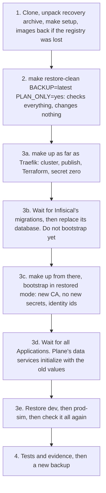

# Disaster recovery

What fails, what survives, how to recover, and how to restore the whole platform into a clean environment.

**Status, 2026-11-05.** The pod restart drill has run in both environments on the final images, and backups have run. Infisical has been restored in place, and dev and prod-sim have each been restored in place into their real database and bucket, with result PASS and `make test-e2e` passing after.

**The destroying run has finished, and its restore has no result recorded here until its evidence is published.** `make drill-clean-restore CONFIRM=yes CLEAN_INSTALL_FIRST=yes` deleted the cluster, ran a clean install from a fresh clone with new secrets, tested it and deleted it, then restored Infisical, dev and prod-sim from backup into a new cluster. It kept the local registry and the pull-through caches, and `.tools` was copied rather than downloaded. So until that evidence is published, the [clean restore](#full-restoration-into-a-clean-environment) is read from the scripts, backed by rehearsals on throwaway copies. The clean install's results are under [Path C](#path-c-nothing-to-restore), and [Known gaps](#known-gaps) says what the drill's log reads. Neither is published yet, so each names its raw file under `.local/evidence-raw/`. The two markers left here wait on that evidence.

A result links to its file under `docs/evidence/runs/`. This platform is local, production-inspired and single-node, and nothing here is a claim about any other environment.

## Principles

- **One node, one replica, one Docker VM, one laptop.** There is no failover. Recovery means restarting or restoring.
- **`dev` and `prod-sim` share all of that.** Namespace separation is not equivalent to independent production clusters: a node or VM failure takes both.
- **Git describes what runs, not what is stored.** Argo CD can rebuild workloads from Git. Data comes back only from a backup.
- **Plane data and its `SECRET_KEY` are a matched set.** `SECRET_KEY` lives in Infisical, so Infisical restores first.
- **Two things leave the cluster and no script copies them off the machine:** `.local/backups/` and `.local/secret-zero/`. Each Infisical backup also holds the Terraform state of `infisical/terraform`. Until someone copies them, a lost laptop loses everything except Git.
- **Images built here are in no backup.** Git deploys `localhost:5001/wayline` digests, which live only in a Docker volume. See [registry lost](#scenario-registry-lost).

## What survives what

| | Pod deleted | `make down` | Node container lost | `make destroy` | Docker VM disk lost | Machine lost |
|---|---|---|---|---|---|---|
| Plane and Infisical PVs | Yes | Yes | No, node `/var` | No | No | No |
| Etcd, including Secrets | Yes | Yes | No | No | No | No |
| Argo CD state | Yes | Yes | No | No | No | No |
| Registry and caches, named volumes | Yes | Yes | Yes | Yes, unless `PURGE=yes` | No | No |
| `.local/git` bare repo | Yes | Yes | Yes | Yes | Yes | No |
| `.local/backups` | Yes | Yes | Yes | Yes | Yes | **No, unless copied** |
| `.local/secret-zero` | Yes | Yes | Yes | Yes | Yes | **No, unless copied** |
| `.local/terraform/infisical` | Yes | Yes | Yes | Yes | Yes | **No, unless copied**. Each Infisical backup holds a copy |
| Working Git repo | Yes | Yes | Yes | Yes | Yes | No |
| GitHub `origin` | Yes | Yes | Yes | Yes | Yes | Yes, as of the last push |

This table is read from what each path and volume is. The pod column has run. The `make destroy` column was exercised by the drill of 2026-11-05, and has no result recorded here until its evidence is published. The other columns: Not tested in Pass 1.

## Before anything fails

Recovery depends on these, and they are manual.

```bash
make backup ENV=all
```

Then copy the recovery set off this machine, encrypted. `gpg` here is an example, not a prerequisite of this repository.

```bash
tar -C .local -cf - secret-zero backups \
  | gpg --symmetric --cipher-algo AES256 -o "plane-platform-recovery-$(date -u +%Y%m%dT%H%M%SZ).tar.gpg"
```

| Item | Why | If missing |
|---|---|---|
| `secret-zero/ENCRYPTION_KEY` | Decrypts Infisical's database | Path B. All Infisical contents are gone |
| `secret-zero/AUTH_SECRET` | Without it nothing the dump signed can be verified | A clean restore refuses before it touches anything |
| `secret-zero/infisical-admin.json`, `infisical-admin-password` | How a restore logs in | With the password, a restore mints a new token. With neither, a person writes a new password hash into the restored database. See [`infisical/README.md`](../infisical/README.md#how-a-restore-logs-in) |
| `secret-zero/infisical-machine.json` | Project and identity ids | A restore rebuilds it from the backup's Terraform state |
| `backups/infisical`, `backups/dev`, `backups/prod-sim` | The data, and `recovery/terraform.tfstate` and `recovery/set.json` in each Infisical backup, the test accounts and sentinel in each Plane backup | Nothing to restore |

A backup records the sha256 of each secret zero file and never holds the file, and a restore finds them by that checksum. Keeping `ENCRYPTION_KEY` in the same archive as a dump is a tradeoff, acceptable for a local platform whose backups are themselves unencrypted, when the archive is encrypted. To separate them, put `ENCRYPTION_KEY` in a password manager.

Push `main` to `origin` as well, and check it: `git fetch origin && git status && git log -1 origin/main`.

## RPO and RTO: to measure, not promised

No RPO or RTO is promised. Few numbers exist yet, and nothing automates the inputs.

**RPO is the age of the newest copy.** Backups are on demand: no CronJob, and no alert on backup age. With no discipline, RPO is unbounded. Off-machine RPO is the age of the last manual copy.

**RTO is what the timed drills below show.** A Plane restore's evidence JSON records steps and a start time, not durations, so use `time`. An Infisical restore records its `server-downtime`.

| Scenario | RPO by design | RTO | Evidence |
|---|---|---|---|
| Pod lost | Zero, the volume survives | Dev, final images, read every 3 s: Silo and Postgres about 9 s, RabbitMQ about 12 s, Valkey under 3 s. A signed-in request answered 500 for about 7 s during the Postgres round. Prod-sim's drill was not timed | PASS: [PERS-1-20261105T070358Z-timeline.txt](evidence/runs/PERS-1-20261105T070358Z-timeline.txt), [drill-pod-restart-dev-20261105T070414Z.log](evidence/runs/drill-pod-restart-dev-20261105T070414Z.log), [drill-pod-restart-prod-sim-20261105T072331Z.log](evidence/runs/drill-pod-restart-prod-sim-20261105T072331Z.log) |
| `make down` then `make up` | Zero | Not tested in Pass 1 | NOT RUN |
| Cluster deleted, host state kept | Age of last backup | [[MEASURE: time of the clean restore into the new cluster, from the drill's log, without its clean install]] | NOT RUN. The drill's evidence is not published yet |
| Node container lost with `docker rm` | Age of last backup | Not tested in Pass 1 | NOT RUN |
| Infisical Postgres lost | Age of last Infisical backup | In place with the volume kept, seven runs: six PASS in 44 s to 69 s, and one BLOCKED in 71 s, which removed the token and the password on purpose. In the last five the server did not answer for 39 s to 52 s, and the 52 s is the BLOCKED run. The operators' resync was not timed. With the volume deleted: Not tested in Pass 1 | NOT RUN with the volume deleted. In place, six PASS: [dr-inplace-restore-1.txt](evidence/runs/dr-inplace-restore-1.txt), [dr-inplace-restore-2.txt](evidence/runs/dr-inplace-restore-2.txt), [dr-inplace-restore-3.txt](evidence/runs/dr-inplace-restore-3.txt), [dr-inplace-token-lost-1.txt](evidence/runs/dr-inplace-token-lost-1.txt), [dr-inplace-token-back-1.txt](evidence/runs/dr-inplace-token-back-1.txt), [dr-inplace-no-token-no-password-3.txt](evidence/runs/dr-inplace-no-token-no-password-3.txt), and after them [dr-after-restores-1.txt](evidence/runs/dr-after-restores-1.txt). In place, one BLOCKED: [dr-inplace-no-token-no-password-2.txt](evidence/runs/dr-inplace-no-token-no-password-2.txt) |
| Plane Postgres lost | Age of last backup | Over the live database with the volume kept: dev 178 s, prod-sim 183 s, checks and proofs included. After deleting the PVC: Not tested in Pass 1 | NOT RUN with the volume deleted. In place, PASS: [restore-dev-20261105T074337Z.json](evidence/runs/restore-dev-20261105T074337Z.json), [restore-prod-sim-20261105T073438Z.json](evidence/runs/restore-prod-sim-20261105T073438Z.json) |
| Docker VM disk lost | Age of last backup | Not tested in Pass 1 | NOT RUN |
| Whole machine lost | Age of last off-machine copy | Not tested in Pass 1. The clean install of 2026-11-05 is not this: it kept the registry and caches and copied `.tools`, so by its design it built nothing and pulled nothing from the internet | NOT RUN |

Record each result in `docs/evidence/` with date and command, labelled **PASS**, **FAIL**, **BLOCKED** or **NOT RUN**. A first boot on an empty Docker also pulls every image again, which can hit Docker Hub limits. Read with both environments up: 10.51 GiB of images on the node ([dr-disk-1.txt](evidence/runs/dr-disk-1.txt)). Adding the local services' volumes and the node image gives an estimate of 17.75 GiB for a first install, which has not been measured on an empty machine.

## Failure scenarios

### Scenario: pod lost

**What happens.** Kubernetes reschedules it. StatefulSet pods reattach the same PVC. Deleting a pod changes no spec, so Argo CD sees no drift. There is a brief outage, since every workload has one replica.

**Do.** Nothing. To exercise it:

```bash
make drill-pod-restart ENV=dev
```

The drill deletes each StatefulSet's pod in turn, checks each reattached the same claim, re-reads the sentinel written by `tests/e2e/smoke.py`, and creates a new work item to prove the async path after a broker restart.

Both environments passed on the final images on 2026-11-05 ([drill-pod-restart-dev-20261105T070414Z.log](evidence/runs/drill-pod-restart-dev-20261105T070414Z.log), [drill-pod-restart-prod-sim-20261105T072331Z.log](evidence/runs/drill-pod-restart-prod-sim-20261105T072331Z.log)). On 2026-11-04, on upstream images, prod-sim also passed, after a failed run that stays as evidence ([drill-pod-restart-prod-sim-20261104T235402Z.log](evidence/runs/drill-pod-restart-prod-sim-20261104T235402Z.log), [drill-pod-restart-prod-sim-20261104T233500Z.log](evidence/runs/drill-pod-restart-prod-sim-20261104T233500Z.log)). This shows data surviving a pod, not a volume.

### Scenario: node lost

The node is one Docker container, `plane-platform-control-plane`.

| Sub-case | State | Do |
|---|---|---|
| Stopped by `make down`, Docker restart or host reboot | Data intact | `make up` |
| Container deleted, or `kind delete cluster` by hand | PVs and etcd gone, since they live in the node's `/var` volume. Host state intact | `make restore-clean BACKUP=latest`. See [Full restoration](#full-restoration-into-a-clean-environment). With no cluster, it moves the stale `.local/terraform/local` aside by itself |

A stopped node resuming with its data, kubeconfig and API server, including when its Docker IP changes: Not tested in Pass 1. Compose services restarting with Docker, and `plane-git` answering after a resume: Not tested in Pass 1.

### Scenario: Infisical lost

| What is lost | Effect on Plane | Do |
|---|---|---|
| Server pod | None immediately. Kubernetes Secrets stay, so restarts should still work. Sync stops | Nothing |
| Redis pod or volume | Queued jobs, schedules and caches. The API does not answer while Redis is down: about 12 s in the restart test ([infisical-restart-1.txt](evidence/runs/infisical-restart-1.txt)) | Nothing |
| Postgres pod | Server fails until it returns: reads answered 500 for about 6 s in the same test. Volume intact | Nothing |
| Postgres volume, with a dump | Server fails or comes up empty. Plane keeps running on existing Secrets. Operators fail to log in | Procedure below |
| Postgres volume, no dump | Values are gone. Existing Kubernetes Secrets are the last copy | Path B |
| `ENCRYPTION_KEY` lost, cluster alive | None | `scripts/secret-zero.sh` recovers it from Secret `infisical-secrets`. It restored all four local files byte for byte on the live cluster ([infisical-secret-zero-1.txt](evidence/runs/infisical-secret-zero-1.txt)) |
| `ENCRYPTION_KEY` lost everywhere | Values cannot be decrypted, even with a dump | Path B |

**Volume lost on a live cluster, with a dump and `ENCRYPTION_KEY`:**

```bash
# 1. Do not run the plain scripts/infisical-bootstrap.sh. On an empty database it starts a new instance.
# 2. Recreate the volume, if the PVC was deleted, by deleting the pod so the StatefulSet makes a new PVC.
kubectl --context kind-plane-platform -n infisical delete pod infisical-postgres-0

# 3. Wait for the server to finish migrations on the empty database.
until curl -fsS -m 5 http://infisical.localhost/api/status >/dev/null; do sleep 10; done

# 4. Restore. With no token or password known to this backup, add ALLOW_NO_ADMIN_TOKEN=yes.
make restore ENV=infisical BACKUP=latest CONFIRM=yes

# 5. Refresh the cluster CA and the identity Secrets. Restored mode writes no secret value.
INFISICAL_RESTORED=yes scripts/infisical-bootstrap.sh
```

Plane's password check matters here. If `PG_PASSWORD` was rotated after this dump was taken, Infisical would hold the old value, the operator would write it to the Secret, and Plane would fail on its next restart. So the restore refuses that dump unless `ALLOW_STALE_PLANE_SECRETS=yes`, and `rotate.sh` refuses to run in that state. `make rotate` takes an Infisical backup when it finishes, so the newest dump holds the new value. Of the three rotations that have finished, two took it ([SEC-2-20261105T072331Z.txt](evidence/runs/SEC-2-20261105T072331Z.txt), [SEC-3-BKP-3-20261105T073240Z.txt](evidence/runs/SEC-3-BKP-3-20261105T073240Z.txt)), and the resumed one in prod-sim took none, by `SKIP_BACKUP=yes` ([SEC-4-20261105T073843Z.txt](evidence/runs/SEC-4-20261105T073843Z.txt)), so the newest dump held the previous password until `20261105T074912Z`. `SKIP_BACKUP=yes` leaves that to you.

The restore itself has run in place seven times with the volume kept: six read PASS, and one read BLOCKED, because that run removed the token and the password on purpose ([dr-inplace-no-token-no-password-2.txt](evidence/runs/dr-inplace-no-token-no-password-2.txt)). In the six that compared Plane before and after, every Plane pod uid and restart count, workload generation and Secret resourceVersion stayed the same, apart from probe pods of another test and one worker another test replaced, and `make test-infisical` exited 0 afterwards ([dr-inplace-restore-3.txt](evidence/runs/dr-inplace-restore-3.txt), [dr-after-restores-1.txt](evidence/runs/dr-after-restores-1.txt)). The Job as it stood on 2026-11-04, before the swap became two renames, restored into a brand-new server on an empty database, in a throwaway namespace ([dr-fresh-instance-rehearsal-2.txt](evidence/runs/dr-fresh-instance-rehearsal-2.txt)). No rehearsal has run the current swap on a brand-new server. Deleting the real volume and following the commands above, with the operators resuming: Not tested in Pass 1. A Plane pod restarted on purpose during an outage: Not tested in Pass 1.

### Scenario: Git repository lost

Three copies exist, and each has a role.

| Copy | Role | If lost |
|---|---|---|
| `.local/git/plane-platform.git`, served by `plane-git` | What Argo CD reads | Rebuilt: `make gitops-publish` creates it if absent and pushes the working repo. Running workloads are unaffected in the meantime. Argo CD cannot compare or sync, and it reports errors |
| Working repo `/Users/bek/dev/pr/plane-platform` | Source of truth | `git clone` from `origin`. Commits never pushed are gone |
| GitHub `origin` | CI, off-machine copy | `git push` from the working repo |

`gitops-publish` pushes without force. A non-fast-forward means history was rewritten, and it refuses. Reverts are the way back. If `main` was rewritten on purpose, delete the bare repo to republish from scratch.

Repo rights do not imply data. A Git restore brings no secret zero and no backups.

Deleting `.local/git` and running `make gitops-publish`, with Argo CD syncing again and no workload restarted: Not tested in Pass 1. `plane-git` serving a bare repo recreated while its container runs: Not tested in Pass 1.

### Scenario: registry lost

Registry contents live in Docker named volumes: `registry-data` and three mirror volumes.

| Lost | Effect | Do |
|---|---|---|
| Pull-through caches | Images already on the node keep working. New pulls fetch from upstream through the mirror again | Nothing. `scripts/cluster-up.sh` restarts them. Watch Docker Hub limits |
| `localhost:5001/wayline/*` | Running pods keep running from containerd's store. New pulls of those digests fail | Below |

Both overlays reference `localhost:5001/wayline` digests for web, admin, space and backend. No backup holds them, because saving them would cost about 430 MiB a set compressed ([sizes.txt](evidence/branding/sizes.txt)), and this disk has little to spare. The volume survives `make destroy` and a lost cluster. It does not survive `make destroy PURGE=yes`, a new machine or a lost `Docker.raw`. `make restore-clean` and its plan list each digest the registry cannot serve, and refuse before they touch anything. `make up` lists them, tries a rebuild, and stops before it publishes.

```bash
# make up UP_STOP_AFTER=cluster starts the registry and publishes nothing. Then, either:

# Rebuild. This produces new digests, so promote them. It commits them to main.
make images
make promote ENV=dev
make promote ENV=prod-sim CONFIRM=yes SKIP_BACKUP=yes OVERRIDE_DEV_CHECK="restoring into an empty cluster"

# Or copy, which keeps a digest, if GHCR has that digest. Needs docker login ghcr.io with read:packages.
# The script lower-cases <owner>, because a mixed-case reference is refused.
scripts/ci/copy-to-local-registry.sh ghcr.io/<owner>/wayline dev
scripts/ci/copy-to-local-registry.sh ghcr.io/<owner>/wayline prod-sim

# Then, either way, if a clean restore brought you here:
make restore-clean BACKUP=<id>
```

A rebuild does not reproduce the digest. Prod-sim accepts only a digest recorded for dev, so a rebuild must pass through dev again.

**As things stand, GHCR does not hold what `main` deploys.** `main` names digests built on this Mac. The four private GHCR packages hold the digests built by `images.yml` at `9c8e098`, which are different, and pull request 1, open and unmerged, is the only thing that names those ([ci-4-20261105T055033Z-ghcr-visibility.txt](evidence/ci/ci-4-20261105T055033Z-ghcr-visibility.txt), `helm/plane/overlays/dev/kustomization.yaml`). So today the way back is the rebuild. GitHub's quota for private packages is documented and has not been measured, and the prune in `images.yml` has deleted nothing so far. A digest that exists nowhere means the pinned version is lost.

The copy command keeps the digest: with `--prefer-index=false`, a throwaway registry answered with the source's digest, and without it a new index's ([ci-5-20261105T060108Z-copy-keeps-digest.txt](evidence/ci/ci-5-20261105T060108Z-copy-keeps-digest.txt)). The script has never finished a copy. With the owner as `BereketAbera` it failed on `invalid reference format`, before the script lower-cased the owner. In lower case it stopped at the first image with a 401, for want of a token with `read:packages` ([ci-5-20261105T060504Z-copy-rehearsal.txt](evidence/ci/ci-5-20261105T060504Z-copy-rehearsal.txt)). Pods do pull the digests built here through `localhost:5001`, on the final images, and `make test-e2e` checks they run the digests in the overlay ([plane-dev-final-e2e-20261105T070735Z.txt](evidence/runs/plane-dev-final-e2e-20261105T070735Z.txt)).

A finished copy from GHCR, and pods pulling what it copied: Not tested in Pass 1. A full pull with empty caches against the Docker Hub quota: Not tested in Pass 1, and the drill of 2026-11-05 kept the caches, so it does not answer this.

### Scenario: Docker VM disk lost

`Docker.raw` lost or reset. PVs, etcd, images, registry and caches go. Host paths under `.local/` survive, including `.local/git`, because they are bind mounts.

Resetting Docker Desktop also destroys every unrelated container and image on this host, including a cached MinIO image that can no longer be pulled anonymously. Check before doing it by choice.

**Do.** [Full restoration](#full-restoration-into-a-clean-environment), Path A, from step 2. The registry is gone too, so the plan refuses until the [images are back](#scenario-registry-lost). With no cluster at the start, `up.sh` moves `.local/terraform/local` to `local.stale-<time>` by itself, since that state describes a cluster that is gone. `.local/terraform/infisical` stays in place. This has run only on stubs.

The drill of 2026-11-05 removed only `.local/terraform/local` and applied on a new cluster, and has no result recorded here until its evidence is published. Starting from an empty Docker: Not tested in Pass 1.

Disk full is a more likely version of this. kind disables eviction and image GC, so it shows up as write errors, not evictions. `guard_disk` is the check, since the VM reports hundreds of free GiB on a sparse disk.

### Scenario: whole machine lost

Everything local is gone. What exists: GitHub `origin`, as of the last push, and any off-machine archive.

| Have | Result |
|---|---|
| Clone, recovery archive with all items | Path A, after the [images are back](#scenario-registry-lost), because the archive holds none |
| Clone, backups, no `ENCRYPTION_KEY` | Path B: Plane's rows come back, encrypted settings do not |
| Clone only | A new, empty platform from Git, after a rebuild of the images. All Plane data is gone |

Prerequisites on the new machine: Docker Desktop with the memory and disk below, and `make setup`.

| Requirement | Value | Status |
|---|---|---|
| Docker Desktop memory | 14 GiB, which shows as 13.63 GiB inside the VM. 16 GiB to keep unrelated containers running | With both environments up, the VM used 9.81 to 9.87 GiB during the drill, and read 9.7 to 9.85 GiB before and after the Infisical restores ([PERS-1-20261105T070358Z-timeline.txt](evidence/runs/PERS-1-20261105T070358Z-timeline.txt), [dr-inplace-restore-3.txt](evidence/runs/dr-inplace-restore-3.txt), [dr-inplace-token-lost-1.txt](evidence/runs/dr-inplace-token-lost-1.txt)). See [resource-utilization.md](resource-utilization.md). A clean restore's first boots have not been measured |
| Free host disk | 25 GiB for `make up` to create a cluster | A first install has not been measured on an empty machine: 17.75 GiB is an estimate from a running cluster's sizes ([dr-disk-1.txt](evidence/runs/dr-disk-1.txt)). Before a delete, a plan counts what is free plus 93% of the kind volume. That came from a 273 MB volume, and it held on 12.8 GiB on 2026-11-05: free disk went from 17.7 GiB to 31.6 GiB, 14.1 GiB back by the first reading (`.local/evidence-raw/drill-clean-restore-20261105T074859Z.log`, lines 7 and 74, not published yet). That is free disk, not `Docker.raw`, and the first reading is not always the end: after the clean install's delete it read 19 GiB, and a plan moments later 26.8 GiB (lines 98 and 108) |

## Full restoration into a clean environment

`make restore-clean` brings the whole platform back. All of it is in `scripts/restore.sh`.



### Why this order, and why not `make up`

`scripts/infisical-bootstrap.sh` treats an empty Infisical as a new instance. It moves the admin file and Terraform state aside, then creates new identities and seeds a **new `SECRET_KEY`**. Plane's data tier then initialises with new passwords.

So `make destroy`, `make up`, `make restore` does not bring back a matched set. `make restore ENV=dev` refuses on the `SECRET_KEY` fingerprint. Restoring Infisical afterwards leaves the local admin file, machine file, Terraform state and identity Secrets pointing at the new instance, and Plane's volumes initialised with passwords Infisical no longer holds.

`make restore-clean` avoids that by restoring Infisical **before** the first bootstrap, and running bootstrap in restored mode after it. Plane stops at wave -2 until then, so Plane's data tier never initialises with the wrong values. While `.local/restore-clean.state` exists, a plain `make up` refuses to bootstrap a fresh instance. `make destroy` clears that file, and so does finishing the restore.

### Path A: `ENCRYPTION_KEY` and Infisical backup exist

**Step 1. Prepare the host.** Skip for a node or VM loss.

```bash
git clone https://github.com/BereketAbera/plane-platform.git
cd plane-platform
make setup
mkdir -p .local && chmod 700 .local
gpg --decrypt plane-platform-recovery-<stamp>.tar.gpg | tar -C .local -xf -
chmod 700 .local/secret-zero .local/backups
```

`origin` is private today, so that clone needs a GitHub login ([BR-3-20261105T054812Z.txt](evidence/runs/BR-3-20261105T054812Z.txt)).

Check before continuing:

```bash
ls .local/secret-zero/ENCRYPTION_KEY .local/secret-zero/AUTH_SECRET
ls .local/backups/infisical .local/backups/dev .local/backups/prod-sim
```

Backups unpacked from an archive keeping modes the Job's UID 70 can read through VirtioFS: Not tested in Pass 1.

**Step 2. Plan.** This checks everything and changes nothing, and it works on a live cluster.

```bash
make restore-clean BACKUP=latest PLAN_ONLY=yes
```

It checks every checksum, the keys the set names, that each Plane backup was taken with the `SECRET_KEY` this Infisical backup holds, that it records no row marked uploaded with no object, and that Git does not deploy an older Infisical than the dump came from. Then it checks what `make up` would stop on, by the same code: uncommitted changes under `gitops`, `helm`, `monitoring` and `infisical`, digests the registry cannot serve, and free disk. It refuses a cluster that holds data, or one it cannot read. The plan prints what each backup holds, and warns if a Plane backup has 0 users. [`infisical/README.md`](../infisical/README.md#refusals-and-their-overrides) lists each refusal and the way past it.

On the live cluster the plan read the real volumes, registry and manifests, and changed nothing. It refused for disk, at about 24.9 GiB after a delete against 25, and with a reason given it passed ([dr-plan-4.txt](evidence/runs/dr-plan-4.txt)). A real run refused a cluster holding data, a backup with no recovery set, and an unknown id ([dr-plan-refusals-1.txt](evidence/runs/dr-plan-refusals-1.txt)).

**Step 3. Run it.** Keep other work off `gitops`, `helm`, `monitoring` and `infisical` until it ends, because `make up` runs twice inside it. It can resume: run the same command again after any failure, including a hard stop.

```bash
make restore-clean BACKUP=latest
```

| Stage | What happens | What has shown it |
|---|---|---|
| a. `make up` as far as Traefik | Cluster, publish, Terraform, secret zero. With no cluster at the start, `.local/terraform/local` moves aside | One whole `make up` from nothing, on the clean install: exit 0 in 955 s (`.local/evidence-raw/clean-install-20261105T075041Z/summary.txt`, not published yet). Before it, `UP_STOP_AFTER` had stopped `make up` at three of its stages ([terraform](evidence/runs/bootstrap-up-terraform-1.txt), [secret-zero](evidence/runs/bootstrap-up-secret-zero-1.txt), [traefik](evidence/runs/bootstrap-up-traefik-1.txt)) |
| b. Replace Infisical's database | Waits for the fresh server's migrations, pauses auto-sync on `infisical` only, stops the server, restores into a second database, checks row counts, renames it into place, flushes Redis, starts the server, makes sure something here can log in | The Job as it stood on 2026-11-04, before the swap became two renames, on a brand-new server in a throwaway namespace ([dr-fresh-instance-rehearsal-2.txt](evidence/runs/dr-fresh-instance-rehearsal-2.txt)). The current Job in place, five times, four PASS and one BLOCKED ([dr-inplace-restore-3.txt](evidence/runs/dr-inplace-restore-3.txt), [dr-inplace-token-lost-1.txt](evidence/runs/dr-inplace-token-lost-1.txt), [dr-inplace-token-back-1.txt](evidence/runs/dr-inplace-token-back-1.txt), [dr-inplace-no-token-no-password-2.txt](evidence/runs/dr-inplace-no-token-no-password-2.txt), [dr-inplace-no-token-no-password-3.txt](evidence/runs/dr-inplace-no-token-no-password-3.txt)). No rehearsal has run the current swap on a brand-new server |
| c. `make up` from there, restored mode | Same credentials. Terraform updates the CA in Kubernetes Auth and nothing else, the seed writes nothing, and the identity Secrets are published | Against the rehearsal instance and the live one |
| d. Wait for all Applications | Plane comes up empty, using the original passwords on new volumes | Not on a restored instance |
| e. Restore each Plane environment | As `make restore`, dev first, then prod-sim. Then it checks everything again from outside | `make restore` in place on the real database and bucket in both environments ([restore-dev-20261105T074337Z.json](evidence/runs/restore-dev-20261105T074337Z.json), [restore-prod-sim-20261105T073438Z.json](evidence/runs/restore-prod-sim-20261105T073438Z.json)), and the exact Job into a scratch database and bucket ([dr-plane-restore-rehearsal-1.txt](evidence/runs/dr-plane-restore-rehearsal-1.txt)). Not into a new cluster |

What is known about each stage:

- **Waves.** On the first boot, Traefik read Healthy at 20:46:21Z and `infisical` at 21:11:00Z, both before Plane was unblocked: the `plane-dev` sync failed and retried from 21:11:38Z until the retry after bootstrap at 21:28:54Z ([bootstrap-timeline-1.txt](evidence/runs/bootstrap-timeline-1.txt), [infisical-unready-sync-1.txt](evidence/runs/infisical-unready-sync-1.txt)).
- **Plane's data waits.** Plane's data pods are not created while `InfisicalAuth` is unready, so they cannot initialize with a wrong value. On that boot they were created at 21:29:03Z, 9 s after the retry ([plane-dev-firstboot-1.txt](evidence/runs/plane-dev-firstboot-1.txt)).
- **The pause.** Root is left alone, because its sync is waiting for Plane, and terminating it would stop Argo CD retrying that revision. Root does not undo a paused child ([dr-child-pause-1.txt](evidence/runs/dr-child-pause-1.txt)). So the Terminating patch an earlier version of this page needed is gone.
- **The token.** The pre-restore admin token authenticates against the restored database, read through the API on the rehearsal instance ([dr-fresh-instance-rehearsal-2.txt](evidence/runs/dr-fresh-instance-rehearsal-2.txt)). A token that has ended, or a lost file, is replaced by a password login after the swap. That login ran on the live instance ([dr-mint-1.txt](evidence/runs/dr-mint-1.txt), [dr-inplace-token-lost-1.txt](evidence/runs/dr-inplace-token-lost-1.txt)). An ended token has run only on stubs.
- **Terraform.** With the backup's state against that instance it planned no changes. With a stored CA that differs it planned 2 updates and 8 no-ops, applied them, and both identities logged in ([dr-fresh-instance-rehearsal-1.txt](evidence/runs/dr-fresh-instance-rehearsal-1.txt), [-2](evidence/runs/dr-fresh-instance-rehearsal-2.txt)). No real new cluster has been involved.

Only the drill can show the rest, and no result is recorded here until its evidence is published: whether Infisical restores in this state, whether the operators log in with the new CA and materialise all six Secrets with their original values, whether both Plane environments reach Healthy on first boot within the VM's memory, and whether an environment that has only run its migrator holds no users and no objects, so that `CONFIRM` is not needed.

**How it ends.** `scripts/restore.sh` exits 0 when everything is proven, 1 when something failed, and 2 when nothing failed but a proof could not run or a person has to act, which is not a pass. Through `make`, any of these but 0 is make's own exit 2, and make prints which. So read the evidence: `jq '.result, .not_run' .local/evidence-raw/restore-clean-*.json`. With 2 the restore stays marked as under way, and the same command goes on from there. `ALLOW_NO_SENTINEL=yes` accepts a sentinel proof that could not run, and the step still reads NOT RUN.

**Step 4. Verify and record.**

```bash
make status
make gates
make test-netpol
make test-infisical
make test-e2e ENV=dev
make test-e2e ENV=prod-sim
make backup ENV=all
```

Copy `.local/evidence-raw/restore-*.json` and `.local/evidence-raw/restore-smoke-*.json` into `docs/evidence/` with `make publish-evidence`. A proof reported NOT RUN stays NOT RUN.

Each Plane backup holds that environment's test accounts and sentinel in `recovery/`, and a restore puts them back, so `.local/test-accounts.env` need not be in the archive. With those files absent, `make test-e2e` on a restored environment has run only on stubs, and the drill of 2026-11-05 started with them present: Not tested in Pass 1.

**The drill.** `make drill-clean-restore CONFIRM=yes` takes a fresh backup, deletes the cluster, does all of the above, and compares truncated hashes and ids across the delete. `CLEAN_INSTALL_FIRST=yes` runs `tests/drills/clean-install.sh` between the delete and the restore. `LOSE_CLUSTER=yes` deletes with kind alone, as a disaster would, and has not run. Before the run of 2026-11-05 it had gone only as far as the delete ([dr-drill-planonly-1.txt](evidence/runs/dr-drill-planonly-1.txt), [dr-drill-planonly-2.txt](evidence/runs/dr-drill-planonly-2.txt)). `make drill-clean-restore-harness` runs the logic against stubs: 905 checks PASS, 73 of 73 lines taken out one at a time are noticed, and 61 sampled stops recovered ([dr-harness-stubbed-4.txt](evidence/runs/dr-harness-stubbed-4.txt), [dr-mutants-1.txt](evidence/runs/dr-mutants-1.txt), [dr-stop-sweep-1.txt](evidence/runs/dr-stop-sweep-1.txt)). That shows the logic, not the platform.

[[VERIFY: data across the rebuild: the drill's stage 6 finds the same data and secrets on the new cluster, and restore-clean's result reads PASS, with evidence in docs/evidence/runs/]]

### Path B: `ENCRYPTION_KEY` is lost

The Infisical dump is unreadable. Every value in it is gone, including `SECRET_KEY`. Plane's rows and objects can still come back.

This path assumes a new cluster. On a live cluster, first take `make backup ENV=dev` and `make backup ENV=prod-sim` if Plane still runs, then `make destroy CONFIRM=yes SKIP_BACKUP=yes`, because the old data volumes hold old passwords.

1. Follow step 1. Skip restoring `secret-zero`, or remove what remains. `REGENERATE=yes CONFIRM=yes scripts/secret-zero.sh` archives an old set on a cluster that still has one.
2. `make up`. It generates new secret zero files, and bootstrap finds a fresh instance: a new admin, new identities, and new values, including a new `SECRET_KEY`. It moves the old local state aside and deletes nothing.
3. Restore each environment, accepting the loss:

```bash
scripts/restore.sh dev latest ALLOW_SECRET_KEY_MISMATCH=yes
scripts/restore.sh prod-sim latest ALLOW_SECRET_KEY_MISMATCH=yes
```

**What this costs.** Encrypted instance configuration rows, such as SMTP and OAuth settings, decrypt silently to `""`. Reconfigure them in the instance admin UI. The script reports the mismatch, the proofs fail, and it exits non-zero even though the data is back. That exit code is correct, so do not read it as a failed restore of rows. Check the row-count gates in the evidence file. API tokens are not bound to the key, and should survive. Users may need to log in again. No part of this path has run.

`proof-no-empty-decrypt` will go on failing until the affected rows are cleared, and no command for that is written down here. Resetting undecryptable `InstanceConfiguration` rows, including `WAYLINE_RESTORE_SENTINEL`: Not tested in Pass 1. Path B as a whole, with rows and objects read back under the new `SECRET_KEY`: Not tested in Pass 1.

### Path C: nothing to restore

`make up` gives a new empty platform from Git. Infisical generates new values. Plane starts with no data. One whole `make up` from nothing, on a fresh clone with new secrets, exited 0 in 955 s on 2026-11-05 with all 14 Applications Synced and Healthy. `make test-e2e` then passed with no SKIP, 46 PASS in dev and 45 in prod-sim, a second `make up` took 16 s and left the same pod uids, and Terraform found no differences (`.local/evidence-raw/clean-install-20261105T075041Z/`, not published yet). It kept the registry and caches and copied `.tools`, so it is not a new machine. Its summary's `Steps that failed: 1` is `destroy-refused`, which is a defect in the test: it inherited `CONFIRM=yes`, so `make destroy` obeyed, and `00126ea` fixed the test. So that step is no result for the refusal, and TEAR-1 in [validation.md](validation.md) is where a clean run is recorded.

## Known gaps

Recorded plainly, because each changes what a real recovery needs.

| Gap | Where | Effect | Mitigation today |
|---|---|---|---|
| The destroying run has no published result yet | `make drill-clean-restore CONFIRM=yes CLEAN_INSTALL_FIRST=yes`, finished, raw log `.local/evidence-raw/drill-clean-restore-20261105T074859Z.log`, not published yet | Nothing recorded here shows the sequence on a real new cluster with a new CA, or Plane's data services initializing with the old values. This page is unproven until that evidence is published | The log's last line reads `RESULT FAIL   1 failure(s)`. Its only FAIL line is line 99, stage 4b, the clean install's `destroy-refused` step, the defect in the test described under [Path C](#path-c-nothing-to-restore). The restore's own result is apart from that: raw `restore-clean-20261105T081017Z.json` reads PASS, not published yet. Neither stands for the other |
| Paths that have run only on stubs | `infisical/README.md`, Not yet proven | The repair after a hard stop, the stop for a sign-in and its resume, an admin token that has really ended, a registry that cannot serve a digest, a client ending during a Job, every refusal of a resume | The harness, which shows the logic |
| The sign-in steps by hand | `ia_print_sign_in_steps` | Their labels come from this image's frontend build, and nobody has clicked through them. The API calls behind a password login ran on the live instance | [dr-mint-1.txt](evidence/runs/dr-mint-1.txt) |
| Images built here are in no backup | `plane-platform-local_registry-data` | A new machine, a lost `Docker.raw` or `PURGE=yes` loses them, and GHCR holds other digests | [Registry lost](#scenario-registry-lost) |
| Terraform state lost with no Infisical backup | `.local/terraform/infisical`, `recovery/terraform.tfstate` | Bootstrap fails, because Terraform would create what the restored database already holds | Copy it from the newest Infisical backup. Otherwise a fresh instance. Importing each resource in `infisical/terraform/main.tf`: Not tested in Pass 1 |
| A dump older than the last rotation | `SKIP_BACKUP=yes` on `make rotate`, or a backup that failed there | Restoring it in place gives Infisical a stale `PG_PASSWORD`, so `make restore` refuses it unless `ALLOW_STALE_PLANE_SECRETS=yes` | `make backup ENV=infisical` |
| No off-machine copy | No script | Machine loss is total without a manual archive | [Before anything fails](#before-anything-fails) |
| No scheduled backup, no backup-age alert | No CronJob, `PlaneBackupFailed` covers only failed Jobs | RPO unbounded | Run `make backup` deliberately |

Infisical's Redis is flushed on restore now, because the server caches secrets, permissions and KMS material there and keeps its queues there, so stale jobs no longer outlive a database restore (`redis` step in [restore-infisical-20261105T001834Z.json](evidence/runs/restore-infisical-20261105T001834Z.json)).

## Related documents

- [data-operations.md](data-operations.md): backup contents, restore steps and proofs.
- [infisical.md](infisical.md): secret zero and Infisical recovery detail.
- [`infisical/README.md`](../infisical/README.md): every refusal of a clean restore, how a restore logs in, and what each measurement rests on.
- [security.md](security.md): what `.local/` exposes.
- [runbooks/backup-restore.md](runbooks/backup-restore.md) and [runbooks/clean-rebuild.md](runbooks/clean-rebuild.md): operational procedures.
- [validation.md](validation.md): test status.
- [known-limitations.md](known-limitations.md): limits of the platform.
- [platform-contract.md](platform-contract.md): names and ownership.
