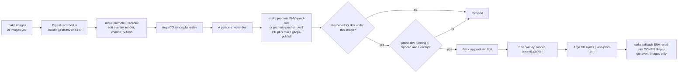
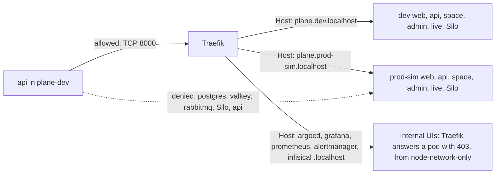

# Environments

The platform runs two deployments of customized Plane Community Edition v1.4.3: `dev` and `prod-sim`. They sit in two namespaces of one cluster on one laptop.

**Namespace separation is not equivalent to independent production clusters.** `prod-sim` is a rehearsal of production practices. It is not production, and it is not isolated the way production would be. This page says exactly what is separate, what is shared, and how that fails.

On 2026-11-05 Plane ran in both, on the same final images, built from `84b63d9` ([digests](evidence/branding/digests.tsv)). On those images `make test-e2e` ended PASS in both: `dev` 45 PASS and 1 SKIP ([smoke-dev-20261105T070735Z-94252.json](evidence/runs/smoke-dev-20261105T070735Z-94252.json)), and `prod-sim` 44 PASS and 1 SKIP ([smoke-prod-sim-20261105T053533Z-8468.json](evidence/runs/smoke-prod-sim-20261105T053533Z-8468.json)). The skipped step needs a clean database. Both read the same again after an in-place restore ([smoke-dev-20261105T074635Z-6532.json](evidence/runs/smoke-dev-20261105T074635Z-6532.json), [smoke-prod-sim-20261105T073741Z-73161.json](evidence/runs/smoke-prod-sim-20261105T073741Z-73161.json)). Then both were deleted and restored from backup into a new cluster, every restore step PASS ([restore-clean-20261105T081017Z.json](evidence/runs/restore-clean-20261105T081017Z.json)). There `make test` read the same counts again, and passed in full ([dev](evidence/runs/smoke-dev-20261105T083455Z-37296.json), [prod-sim](evidence/runs/smoke-prod-sim-20261105T083455Z-37296.json), [MAKE-TEST-20261105T083455Z.txt](evidence/runs/MAKE-TEST-20261105T083455Z.txt)). Older runs predate that build: `dev` passed 38 steps on the build from `1563cbf` ([smoke](evidence/runs/smoke-dev-20261105T001213Z.json)), and `prod-sim` passed 37 steps on upstream images ([smoke](evidence/runs/smoke-prod-sim-20261104T235926Z.json)). On the build deployed before this one, `ec45e21`, the first `prod-sim` run after its promotion ended FAIL on `branding-backend`, which read upstream's changelog URL, and the next run, 46s later, ended PASS ([smoke-prod-sim-20261105T022210Z-2247.json](evidence/runs/smoke-prod-sim-20261105T022210Z-2247.json), [smoke-prod-sim-20261105T022256Z-12154.json](evidence/runs/smoke-prod-sim-20261105T022256Z-12154.json)). The likely cause is `/api/instances/`, which is cached in Valkey for two hours. That was inferred and not measured, and the step now reads a key nothing else fills. None of the failure scenarios below has been forced, except scenario 1, by `make down` on purpose, and scenario 11 for the length of one restore, and scenario 9's trigger happened once, unforced, at `2aefba1`. Statements here describe configuration unless a link to evidence says otherwise. Two later runs of `make drill-clean-restore` restored both again into new clusters, every restore step PASS, with the same e2e counts: one with the registry and caches removed as well, and `LOSE_CLUSTER=yes`, whose log reads `RESULT PASS` ([second](evidence/runs/restore-clean-20261105T124518Z.json), [third](evidence/runs/restore-clean-20261105T130828Z.json), [log](evidence/runs/drill-clean-restore-20261105T130633Z.log)).

## At a glance

| | `dev` | `prod-sim` |
|---|---|---|
| URL | `http://plane.dev.localhost` | `http://plane.prod-sim.localhost` |
| Namespace | `plane-dev` | `plane-prod-sim` |
| Argo CD Application | `plane-dev`, root wave -1 | `plane-prod-sim`, root wave 0 |
| Overlay | `helm/plane/overlays/dev` | `helm/plane/overlays/prod-sim` |
| Rendered manifests | `gitops/environments/dev/manifests.yaml` | `gitops/environments/prod-sim/manifests.yaml` |
| How it changes | Automated sync with self-heal, from Git | Same. The control point is the Git change, not a sync button |

Object names match in both, because the Helm release is `plane` in each. That lets one patch set fit both.

## What is separate

| Layer | `dev` | `prod-sim` | How strong the separation is |
|---|---|---|---|
| Namespace | `plane-dev` | `plane-prod-sim` | A naming and RBAC scope. Not a security boundary on its own |
| Database | `plane-pgdb` StatefulSet and PVC | Same names, own instance | Separate process and volume. NetworkPolicy denies cross-namespace access |
| Cache and queue | Own Valkey, own RabbitMQ | Own Valkey, own RabbitMQ | Separate. Valkey has no password, so NetworkPolicy is its only access control |
| Object storage | Own Silo, bucket `uploads` | Own Silo, bucket `uploads` | Separate instance and volume. The bucket name is the same in both on purpose, because `export_task.py` hardcodes it |
| Credentials | Generated and stored in project `plane-dev` | Generated and stored in project `plane-prod-sim` | Different values, generated at seed time |
| Secrets operator | Release `infisical-operator-dev`, `fullnameOverride: iso-dev`, scoped to `plane-dev` | Release `infisical-operator-prod-sim`, `iso-prod-sim`, scoped to `plane-prod-sim` | Separate pods and namespaced RBAC. **The CRDs are shared and owned by the dev release** |
| Machine identity | `plane-dev-reader`, built-in `viewer`, org role `no-access` | `plane-prod-sim-reader`, same roles | Each may log in only from its own namespace and ServiceAccount |
| Infisical project | `plane-dev` | `plane-prod-sim` | This is the free-tier isolation boundary. Same server, same database, same encryption key |
| Argo CD project | `plane-dev`: deploys to `plane-dev` only | `plane-prod-sim`: deploys to `plane-prod-sim` only | Stops a Plane Application from writing elsewhere, cluster-scoped objects, or NetworkPolicies |
| ResourceQuota | `plane-budget`: 2732Mi requests, 7984Mi limits, 24 pods, memory and object counts only | Same | Bounds memory declared by pods. No CPU quota |
| Backup storage | PV `backups-dev`, host path `/backups/dev`, PVC `backups` | PV `backups-prod-sim`, `/backups/prod-sim` | A pod mounts only its own folder. `restore.sh` refuses another environment's backup |

### What real attempts showed

**Namespace separation is not equivalent to independent production clusters. These results are about two namespaces on one node, and they do not change that.** They show that the rules hold against real attempts from inside the cluster, in the configuration that was running then.

On 2026-11-04, on upstream images in both, real pods with `hostNetwork=false` tried to reach the other environment, with real clients and their own credentials. The same checks now live in `tests/separation/`, run by `scripts/test.sh separation`, and they passed again on 2026-11-05 with `dev` on the branded images from `1563cbf`, 364 and 97 checks with 0 failed ([network](evidence/runs/harness-separation-network-1.txt), [state](evidence/runs/harness-separation-state-1.txt)). `b27813d` grew the network harness to 384 checks ([stub](evidence/runs/harness-separation-stub-2.txt)). On the final images, on the platform restored into a new cluster, `make test` read 384 network and 97 state checks passed, 0 failed and 0 blocked ([network](evidence/runs/separation-network-20261105T083455Z-37296.txt), [state](evidence/runs/separation-state-20261105T083455Z-37296.txt), [MAKE-TEST-20261105T083455Z.txt](evidence/runs/MAKE-TEST-20261105T083455Z.txt)). The table below holds the first runs.

| Claim | What happened | Evidence |
|---|---|---|
| No path between the data tiers | 10 real pods dialled 6 data ports by Service name and by pod IP, 120 rows each way. Every row timed out at 5.0 to 6.0s, in each run | [run 1](evidence/runs/plane-prod-sim-separation-network-1.txt), [run 2](evidence/runs/plane-prod-sim-separation-network-2.txt) |
| Those timeouts are real | In the same runs, pods inside each environment connected to the 4 ports the app uses, so the targets were up | Same |
| Real clients, with their own credentials | psycopg, redis-py, amqp and boto3 all timed out at about 5s against the other environment, and connected to their own before and after. `pg_isready` exited 2, and `valkey-cli` hung until killed at 5s | Same |
| Every deny row in the matrix between them | `plane-dev` 135 PASS, `plane-prod-sim` 134 PASS, 0 FAIL, 0 INCONCLUSIVE. A deny passes only on a timeout. Those runs had 135 and 134 rows. The matrix has grown since. All 418 rows passed as one run on 2026-11-05 at 04:19 UTC, before the final images, and again on the final images on the restored platform | [dev](evidence/runs/netpol-20261104T232752Z.tsv), [prod-sim](evidence/runs/netpol-20261104T233304Z.tsv), [netpol-20261105T041921Z.tsv](evidence/runs/netpol-20261105T041921Z.tsv), [netpol-20261105T083542Z.tsv](evidence/runs/netpol-20261105T083542Z.tsv) |
| Own database and object store | Different Postgres system identifiers, Valkey run ids and bucket creation times, and 10 distinct volumes | [state 2](evidence/runs/plane-prod-sim-separation-state-2.txt) |
| Nothing connected across | Every Postgres, Valkey and AMQP client is a pod in the same namespace, and conntrack shows 0 flows joining the environments | Same |
| Own credentials | 13 keys differ, and 7 are the same by design, such as the bucket name and the database user. The other environment's password or key gets `password authentication failed`, `ACCESS_REFUSED` or `InvalidAccessKeyId`, and each environment's own is accepted | Same |
| Own Infisical project | Each reader gets 403 on the other project, in both directions. A login with one environment's ServiceAccount token as the other's identity gets 401, `K8s namespace not allowed`, which is the login an `InfisicalAuth` naming the wrong identity would make. A scratch `InfisicalAuth` in `plane-dev` that reached for prod-sim's account and identity read `IsReady: False`, because the operator could not fetch the other namespace's Secret. One holding the prod-sim id in a Secret of its own namespace has not been applied. Operators have no rights in the other namespace | [isolation](evidence/runs/infisical-isolation-3.txt), [RBAC](evidence/runs/infisical-rbac-1.txt) |
| Data stays put, both directions | A marker created in one environment is found there and not in the other: by SQL, by a `pg_dump` scan of every table (7 lines against 0), by the API (403 and 404) and by S3 HEAD (200 and 404) | [state 2](evidence/runs/plane-prod-sim-separation-state-2.txt) |
| No overlap anywhere | 0 shared slugs, ids, API tokens, session keys or object keys | Same |
| Sessions do not cross | The other host answers an API key with 403, the same as a made-up key, and a session cookie with 401. The admin password is refused, a presigned link gets 403, and CORS refuses the other origin. On 2026-11-05, on the final images, a real Chromium profile signed in on dev read 401 on the prod-sim host. After the restore, signed in on both, each tab's `GET /api/users/me/` answered 200 at 08:38:18 UTC, so signing in on prod-sim did not end dev's session | Same, [host and identity](evidence/runs/plane-prod-sim-host-and-identity-1.txt), [AUTH-4-20261105T062750Z.txt](evidence/runs/AUTH-4-20261105T062750Z.txt), [live-final](evidence/branding/live-final/README.md) |

[The first state run](evidence/runs/plane-prod-sim-separation-state-1.txt) shows 2 FAIL lines, from a wrong expectation of 401 for a foreign API key. Plane answers 403 to any unknown key, so the second run added a made-up key as a control, and 97 checks passed.

**What these do not show.**

- They do not separate anything shared: the node, kernel, API server, etcd, Traefik, CoreDNS, Argo CD, the Infisical server, Prometheus and Loki. [The next section](#what-is-shared) lists them.
- Each `api` pod still reaches the other host's public HTTP surface through Traefik. It gets 401 on `/api/users/me/` and 403 listing the bucket. See [the known gap](#the-known-gap-api-to-traefik-to-anywhere).
- Valkey has no password in either environment, so NetworkPolicy is its only control. No run had kindnet failing open, which would remove it for both.
- Every attempt came from a pod as configured. Nothing tried a container escape, or root on the node, which kindnet's rules do not evaluate.
- Accounts outside the two namespaces can read both environments' Secrets: Traefik's and the Prometheus operator's chart roles list them in every namespace, and Argo CD's controller can do anything ([cluster-readings-2.txt](evidence/runs/cluster-readings-2.txt)).
- The table's first runs came on a boot where prod-sim's Infisical CRs were applied by hand before root's wave 0 ([infisical-prod-sim-crs-1.txt](evidence/runs/infisical-prod-sim-crs-1.txt)). The `make test` run came on a platform with no such step, restored by `make restore-clean`.
- The browser readings above are Chromium only. Safari and Firefox were not tested in Pass 1.

### Intended differences

The two overlays are almost identical. Apart from names and hostnames, these are the only differences.

| Setting | `dev` | `prod-sim` | Why |
|---|---|---|---|
| `env.enable_drf_spectacular` | `true`, serves `/api/schema/` | `false` | Scripted testing in dev. No debug surface in prod-sim |
| CPU request on api, worker, postgres, rabbitmq | Component default | `100m` | Scheduler weight, so the tiers prod-sim depends on win when dev competes. Memory is unchanged |
| k6 load-test NetworkPolicy | Present | Absent | Load tests run only in dev |
| Image digests | Current build. On 2026-11-05, the final images built from `84b63d9`, since `1fc9fbe`, and again since `9891630` after the drills | Whatever was last promoted. On 2026-11-05, the same images, since `9c8e098` | The point of having two environments |

## What is shared

| Shared thing | What that means |
|---|---|
| **Cluster** | One Kubernetes version, one set of cluster-scoped objects and CRDs. `make destroy` removes both environments together |
| **Node** | One container, `plane-platform-control-plane`, with one memory, CPU, and disk budget. Control plane and workloads run on it together |
| **API server and etcd** | One control plane. Both environments' Secrets sit in one etcd, base64 and not encrypted at rest |
| **Traefik** | One pod with a 192Mi limit serves both environments and every admin UI. Routes from all namespaces merge into one router |
| **Argo CD** | One controller, one repo-server, one Redis, one admin. If it stops, both lose reconciliation and self-heal. Running pods carry on |
| **Infisical server** | One server, one Postgres, one Redis, one `ENCRYPTION_KEY`. Projects are logical separation inside it |
| **Monitoring** | One Prometheus, Alertmanager, Grafana, Loki, and Alloy. Retention and volume are shared |
| **Kernel** | One Linux kernel in the Docker VM, shared with every other container on the host. `monitoring-agents` runs with `hostNetwork` and `hostPID` under PSA `privileged` |
| CoreDNS and kindnet | One resolver and one policy engine. kindnet fails open, for both at once |
| Infisical CRDs | Cluster-scoped, installed by `infisical-operator-dev` alone |
| Registry, caches, Git remote | One `plane-registry`, one `plane-git`, one `main` branch, one bare repo |
| Terraform state | One root for both namespaces |
| Human access | One kubeconfig with cluster-admin, one Argo CD admin, one Infisical admin token. No per-environment operator role exists |
| Host | One Mac and one disk |

## The promotion model



```bash
make images                                   # build and push to localhost:5001, write .build/digests.tsv
make promote ENV=dev                          # takes digests from .build/digests.tsv
make promote ENV=dev IMAGE=web DIGEST=sha256:<digest>
make promote ENV=prod-sim CONFIRM=yes         # copies every differing image from the dev overlay
make rollback ENV=prod-sim CONFIRM=yes        # reverts the last promotion of prod-sim, then publishes
```

**What promotion is.** A commit that moves image digests in one overlay. Argo CD then syncs automatically. There is no sync button in the path, and the migrator runs as a Sync hook at wave 2 like any other sync.

**What is enforced, and by what.**

| Rule | Enforced by | Limit |
|---|---|---|
| Prod-sim takes only a digest recorded for dev, under the same image | `scripts/promote.sh`, `scripts/ci/check-promoted-digests.sh` | "Recorded" means committed to dev's overlay, and a digest dev has since reverted still counts. A commit adding a digest to both environments at once also passes. `scripts/gitops-publish.sh` repeats the check only as a warning, because rollback uses that path |
| `plane-dev` is Synced and Healthy with that digest in a ready container | `scripts/lib/dev-check.sh`, from `scripts/promote.sh`, and from `scripts/gitops-publish.sh` for the GitHub path | **It shows dev is running the digest, not that anyone tested it.** `OVERRIDE_DEV_CHECK="<reason>"` goes past it, logged in `.local/evidence-raw/promotion-overrides.log`. With no cluster in reach it is skipped. `scripts/promote.sh` then says so in the commit, and `scripts/gitops-publish.sh`, which makes no commit, only warns. `make rollback ENV=prod-sim` publishes with `SKIP_DEV_CHECK`, because an emergency must not depend on dev |
| A backup precedes a prod-sim image change | `scripts/promote.sh`, and `scripts/gitops-publish.sh` for the GitHub path | `SKIP_BACKUP=yes` overrides. It is a safeguard against accidents, not a control |
| A person confirms prod-sim | Terminal prompt or `CONFIRM=yes` | One person can do everything, by design |
| Pull request review | Process only | GitHub Free on a private repo has no required reviewers or protected branches. Anyone with write access can merge their own pull request or push to `main` |
| The local registry holds the digest | `scripts/promote.sh` | Skipped with `SKIP_REGISTRY_CHECK=yes`. `scripts/gitops-publish.sh` has no such check, so from reading the code a merged digest bump published with no copy step would name digests the local registry does not hold |
| A rollback of dev does not carry a prod-sim change | `scripts/rollback.sh` | A publish is all of `main`. If `main` holds a change that moves a prod-sim image and Argo CD has not read it, the rollback stops and names it. `OVERRIDE_DEV_CHECK="<reason>"` goes on, and is logged |

`make promote ENV=prod-sim` ran for real on 2026-11-05 at `0af8956`, with `plane-dev` running the same digests. Its backup Job ran from 02:20:27 to 02:20:37 UTC, the commit followed at 02:20:40, and the pods then ran those digests unchanged ([cluster-readings-2.txt](evidence/runs/cluster-readings-2.txt)). It ran again at `9c8e098` with the final images: dump `20261105T053351Z` first, then the commit at 05:34:06, and Argo CD's sync ran from 05:34:07 to 05:35:07 ([OPS-7-20261105T061555Z.txt](evidence/runs/OPS-7-20261105T061555Z.txt), [FINAL-state-20261105T062807Z.txt](evidence/runs/FINAL-state-20261105T062807Z.txt)).

On GitHub at `9c8e098`, `promote-prod-sim.yml` refused an invented digest and a digest recorded under another image ([run 41976950402](evidence/ci/ci-6-20261105T055435Z-run-41976950402.log), [run 41977025314](evidence/ci/ci-6-20261105T055520Z-run-41977025314.log)). Given a digest dev had recorded, it opened pull request 2, which was closed unmerged as a test ([run 41977114312](evidence/ci/ci-6b-20261105T055612Z-run-41977114312.log), [closed](evidence/ci/ci-6b-20261105T055943Z-pr-2-closed.txt)).

`make rollback ENV=dev` ran for real at `91ef477`. `plane-dev` read Synced and Healthy 65s after the publish, `prod-sim`'s render and pods did not move, and `make promote ENV=dev` put the final images back at `29316f2` ([DEP-2-20261105T064032Z-rollback.txt](evidence/runs/DEP-2-20261105T064032Z-rollback.txt), [DEP-2-20261105T064032Z-timeline.txt](evidence/runs/DEP-2-20261105T064032Z-timeline.txt)). A rollback of `prod-sim`, and a merged pull request reaching the cluster, have run only against a stubbed `kubectl` ([make ci](evidence/ci/ci-2-20261105T061644Z-make-ci.log)). So `make rollback ENV=prod-sim` on the real cluster, with auto-sync on: not tested in Pass 1.

The failing migrator drill in dev left prod-sim alone: all 83 readings of its page answered 200, and its pod list did not change ([DEP-3-20261105T064517Z-timeline.txt](evidence/runs/DEP-3-20261105T064517Z-timeline.txt)). That is one failure in dev, watched for 14 minutes, not a guarantee.

**What promotion does not cover.**

- **Only digests are promoted. Configuration is not.** `helm/plane/components/hardening`, the vendored chart, and most of `helm/values/` feed both environments. A change to the hardening component plus `make render` changes both rendered manifests in one commit, and both Applications sync on their own. `make gitops-publish` warns about changed prod-sim lines that are not images, and publishes them. So a bad patch reaches prod-sim with no dev stage. Commit `2aefba1` did exactly that on 2026-11-04, and rolled prod-sim's pods with dev's. Sync waves do not help, because waves only order the root's first creation of each Application.
- **A publish is all of `main`.** A dev change waits behind a prod-sim digest that is refused, and leaves with it. A rollback of prod-sim publishes with no `plane-dev` check and no dump, so if a promotion that never reached Argo CD has anything else that moves prod-sim waiting under it, the rollback stops and names those (`4664cbd`, by stubs only).
- **Platform changes have no stage at all.** Traefik, Argo CD, Infisical, monitoring, CoreDNS, and NetworkPolicies exist once. A change goes live for both environments.
- **Rollback restores images, not data.** Migrations are forward-only, and old code starts against a newer schema with no warning. The dump taken before promotion is the way back, through `make restore`, as a deliberate second step. `make restore` ended PASS in place in both on 2026-11-05, on a backup taken just before ([BKP-2-20261105T074322Z.txt](evidence/runs/BKP-2-20261105T074322Z.txt), [SEC-3-BKP-3-20261105T073240Z.txt](evidence/runs/SEC-3-BKP-3-20261105T073240Z.txt)). In prod-sim, with no `CONFIRM`, it refused, in that second file. No run has restored across a schema change after a rollback.
- **Secrets are not promoted.** Each environment has its own values. Adding a key means seeding both projects by hand or by script.

## Why this is not the same as independent clusters

An independent production cluster has its own control plane, nodes, kernel, ingress, delivery, secret store, and monitoring, and usually its own account, network, and credentials. Here every one of those is shared. A namespace limits names and RBAC, a quota limits declared memory, and a NetworkPolicy limits packets, if the CNI is running. None of them isolates the kernel, the disk, the control plane, or the operator's mistakes.

So:

- A clean result in `prod-sim` shows how the application behaves in this configuration. It does not show production-grade isolation, availability, or capacity.
- An outage in shared infrastructure is an outage in both environments.
- A change to shared infrastructure cannot be tested in `dev` first.

### Failure scenarios

None of these failures has been forced on the real platform, except scenario 11, for the length of the restore noted under the table, and scenario 1, once, by `make down` on purpose: both environments stopped together and resumed together, with their sentinels intact ([PERS-3-20261105T083304Z.txt](evidence/runs/PERS-3-20261105T083304Z.txt)). Scenario 9's trigger happened once, unforced, as its row says. Each describes what the configuration implies, and a row says so where a static check or a measurement bears on it. The drills that do exist are listed in [validation.md](validation.md).

| # | Trigger | What happens to `prod-sim` | With a separate cluster |
|---|---|---|---|
| 1 | The Docker VM restarts, or the kind node container stops | Down, with `dev` | Unaffected |
| 2 | A `dev` load test or migration uses a lot of memory | The node's OOM killer does not respect namespaces, so prod-sim pods can die. Each ResourceQuota allows 7984Mi of limits: two together are 15,968Mi, above the 13.63 GiB the VM reports. On a quiet cluster `make test-load ENV=dev` went up to 20 virtual users with no think time, with the VM at a peak of 9.05 GiB, no pod restarted and no OOM event, and prod-sim at 1,095 MiB against 1,082 idle ([results.json](evidence/runs/load-20261105T091213Z/results.json), [windows](evidence/runs/LOAD-3-20261105T092547Z-prometheus-windows.json)). That load did not test this failure | Unaffected |
| 3 | `dev` uses a lot of CPU | Each Plane workload has its own CPU limit, but the ResourceQuota has no CPU line, so nothing caps a namespace's total against the node. Prod-sim's `100m` requests give it weight, not a guarantee, and API server latency rises for both. With no think time `plane-dev` averaged 995 m and prod-sim 55 m, with at most 2.49 of the VM's 12 CPUs busy, so nothing competed for the node, and that load did not test this failure ([windows](evidence/runs/LOAD-3-20261105T092547Z-prometheus-windows.json)) | Unaffected |
| 4 | Dev data, images, or logs fill the disk | kind sets no eviction and no image GC, and the VM reports hundreds of free GiB while the Mac runs out. Writes fail for both, with no alert. `guard_disk` only checks at script entry | Unaffected |
| 5 | The API server or etcd is overloaded or corrupted | Both lose scheduling, reconciliation, and log collection, since Alloy reads through the API. Corrupted etcd means both environments' objects and Secrets | Unaffected |
| 6 | Traefik crashes, is OOM-killed at 192Mi during a dev load test, or a route breaks its config | Both Plane hosts and all admin UIs go down together. Under `make test-load ENV=dev` on a quiet cluster, with no think time, its namespace peaked at 56 MiB ([windows](evidence/runs/LOAD-3-20261105T092547Z-prometheus-windows.json)), so that load came nowhere near the limit | Unaffected |
| 7 | A `dev` IngressRoute names `Host(plane.prod-sim.localhost)` | Traefik reads routes from all namespaces and the `plane-dev` project allows IngressRoutes in its namespace, so a longer rule could win and capture prod-sim traffic into a dev Service. `policy/plane.rego` refuses such a route in CI ([negative control](evidence/ci/ci-3-20261104T223937Z-negative-controls-local.log)), but no check can block a merge on this GitHub plan, and `make gitops-publish` does not run policy | Impossible: separate ingress and DNS |
| 8 | Argo CD's controller or repo-server stops | No sync and no self-heal for either environment. Running pods carry on | Depends on the design; a separate Argo CD is common |
| 9 | A commit changes `helm/plane/components/hardening` | Both environments change in one commit, and `make gitops-publish` warns and goes on. See the promotion section. This happened once, at `2aefba1` on 2026-11-04: prod-sim's api, web, admin, space and live were replaced at 22:51:16 UTC, each Ready within 36s ([plane-prod-sim-firstboot-1.txt](evidence/runs/plane-prod-sim-firstboot-1.txt)) | Reaches prod only when promoted |
| 10 | A commit edits a file in `gitops/applications/` to set `project: platform` on a Plane Application | The Plane project's limits no longer apply. The AppProjects are not managed from Git, but the Application's choice of project is. `policy/gitops.rego` refuses this in CI ([negative control](evidence/ci/ci-3-20261104T223937Z-negative-controls-local.log)), with the same limit as scenario 7 | A separate cluster's credentials would still bound it |
| 11 | Infisical's server stops | No refresh and no rotation for either. Existing Kubernetes Secrets stay in place, so running pods continue | Unaffected |
| 12 | `ENCRYPTION_KEY` and the cluster Secret are both lost, or Infisical's Postgres is lost without a dump | Both environments' secret values are gone. `SECRET_KEY` is bound to each Plane database's encrypted rows, so restores must match | Unaffected |
| 13 | `infisical-operator-dev` is deleted with cascade, or a dev-labelled CRD upgrade goes wrong | Deleting the CRDs deletes every Infisical CR in both namespaces. The Secrets use `creationPolicy: Owner`, so they would be garbage-collected, and prod-sim pods fail at next start. The Application has no finalizer, so plain deletion does not cascade. A cascade requested by hand is not stopped, and neither is auto-prune after a values edit that sets `installCRDs: false` | Unaffected |
| 14 | kindnet crashes or errors | It fails open with only a log line, so every NetworkPolicy stops applying for both. `dev` could then reach prod-sim's Valkey, which has no password. Alert `KindnetSkippedNetworkPolicies` now watches that line, proven with a synthetic line and not a real failure ([h18-synthetic-2.txt](evidence/runs/h18-synthetic-2.txt)). `make test-netpol` remains the real check | Unaffected |
| 15 | CoreDNS fails, or `terraform destroy` empties its `Corefile` | Name resolution breaks for both at the next restart | Unaffected |
| 16 | A container escape from any pod | One kernel. Root on the node reaches every volume, every Secret on disk, and every container | Bounded to that cluster |
| 17 | Kubernetes or kind upgrade | Both move at once, with no way to try it in dev first. kind config changes mean delete and recreate | Upgrade one cluster, then the other |
| 18 | Noisy dev metrics or logs | Prometheus's `retentionSize: 1GiB` and Loki's volume are shared, so prod-sim's history shortens | Separate retention, or tenant limits |
| 19 | An operator runs a command against the wrong namespace | One kubeconfig reaches both. No separate context or role guards prod-sim, beyond the script prompts | A different context and credentials |
| 20 | `dev`'s api is compromised | See the next section | Network path does not exist |

Scenario 7, applying a test IngressRoute in `plane-dev` on a disposable cluster: not tested in Pass 1.

During an in-place Infisical restore on 2026-11-05, Infisical was at zero for part of a 44s restore, and no Plane pod uid, restart count, workload generation or Secret resourceVersion changed ([dr-inplace-restore-2.txt](evidence/runs/dr-inplace-restore-2.txt)). That shows pods keeping on running for that long. Restarting one with Infisical stopped: not tested in Pass 1.

Scenario 13, deleting the CRDs, and scenario 14, deleting kindnet's pod and reading enforcement while it restarts: not tested in Pass 1. Each describes what the configuration implies.

## The known gap: api to Traefik to anywhere

Direct pod-to-pod paths between the environments are denied. But **the `api` pod in one environment can reach the other environment over HTTP through Traefik**, and the code does not prevent it. Measured from the real api pods in both directions: the other host answers 200 at `/api/instances/`, 401 at `/api/users/me/`, and 403 listing the bucket ([state 2](evidence/runs/plane-prod-sim-separation-state-2.txt)), and `tests/routes/internal-routes.sh` prints it as a `GAP` row on every run ([routes-after-3.txt](evidence/runs/routes-after-3.txt), and on the restored platform [routes-20261105T083455Z-37296.txt](evidence/runs/routes-20261105T083455Z-37296.txt)).

The path:

1. The api must reach its own public host for `copy_object` and OAuth avatars. So `plane-dev.yaml` allows its egress to Traefik on port 8000, and `traefik.yaml` admits api pods from both Plane namespaces.
2. Traefik routes on the Host header, which a NetworkPolicy cannot see.
3. CoreDNS rewrites `plane.dev.localhost` and `plane.prod-sim.localhost` to Traefik for every pod in the cluster, and the Host header can be set regardless.



**What the attacker gets.** The other environment's public HTTP surface, the same as a browser on the laptop has. No direct database, cache, or queue access. A compromised dev api would still need valid credentials to do anything that requires login in prod-sim.

**The reach used to be wider, and the wider part is closed.** Until 2026-11-04 the same path gave an api pod read access to all metrics for both environments, and Alertmanager's API, which can silence alerts: each internal UI answered it with 200 ([routes-before-1.txt](evidence/runs/routes-before-1.txt)). Now each of the five internal hosts carries Middleware `node-network-only`, an allow list of `172.16.0.0/12`, and Traefik answers an api pod with 403, through the Service and the NodePort. Spoofed forwarding headers on Prometheus and Alertmanager, and a respelled Prometheus host, got 403 too. From the host each still answers 200 ([routes-after-3.txt](evidence/runs/routes-after-3.txt)). A Middleware that is missing fails closed, with a 404 ([h17-fail-closed-1.txt](evidence/runs/h17-fail-closed-1.txt)).

**That list has a limit.** It reads a source address and trusts the node network. On Docker Desktop, a scratch pod with free egress read Prometheus through `host.docker.internal:80`, because that leaves through the Mac and returns as the host ([h17-doors-free-egress-2.txt](evidence/runs/h17-doors-free-egress-2.txt)). Plane api pods time out on that door, but only NetworkPolicy holds it, so a kindnet that fails open would open it.

**Only `api` has this path among Plane pods.** Worker, beat, migrator, web, admin, space, live, and the exporters have no egress rule to Traefik, and dev's worker timed out trying ([state 2](evidence/runs/plane-prod-sim-separation-state-2.txt)). Blackbox and k6 reach Traefik, but they are platform test tools, not application pods.

**Why it stays in Pass 1.** The api needs the path, and a NetworkPolicy cannot express "only your own hostname". `tests/network-policy-matrix.yaml` leaves it out deliberately, because a row would have to assert allow on something undesirable.

| Possible fix | Effect | Cost |
|---|---|---|
| Separate clusters (Pass 2) | Path no longer exists between environments | The plan already |
| A dedicated route for self-calls in each namespace, or S3 endpoint config that does not use the public host | Closes the path | `settings/storage.py` builds the client from `request.get_host()`, so this means patching Plane behaviour |
| Per-environment Traefik instance | Closes cross-environment reach on one cluster | One more pod and a second NodePort pair |
| Auth Middleware on Prometheus and Alertmanager | Adds a login behind the allow list. It does not touch the path between environments | Basic-auth value to manage. The code already notes this as required before Pass 2 exposure |

## Moving to independent environments

Pass 2 moves to Hetzner Cloud with independent dev and prod environments and Cloudflare in front, so most of the shared rows above stop being shared. None of that is provisioned or configured in Pass 1. See [future-hetzner.md](future-hetzner.md) and [PASS2_HANDOFF.md](../PASS2_HANDOFF.md).

Related: [architecture.md](architecture.md), [security.md](security.md), [known-limitations.md](known-limitations.md), [platform-contract.md](platform-contract.md).
