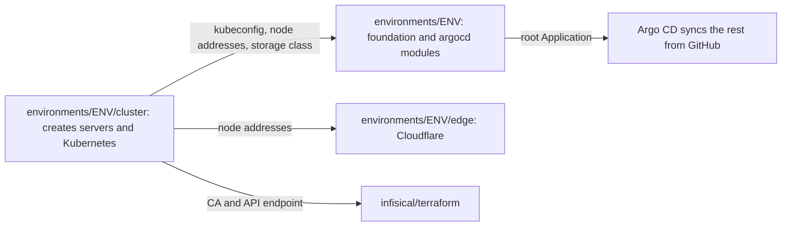

# Future Hetzner environments: Terraform contracts

`infrastructure/terraform/environments/dev` and `environments/prod` are placeholders. They hold a `README.md` and an `INTERFACE.md`, and no Terraform. **Nothing in them has ever run, and no Hetzner or Cloudflare resource exists.** The platform today is a customized Plane Community Edition deployment on one local kind node, local and production-inspired. This document states what the Pass 2 implementation must provide so the rest of the platform can use it. Every name is a proposal until Pass 2 builds it.

The migration as a whole is in [`PASS2_HANDOFF.md`](../PASS2_HANDOFF.md). This file covers only root modules, state, and how to tell an implementation meets the contract. Local Terraform is described in [terraform.md](terraform.md).

Written 2026-11-04, and checked against the code again on 2026-11-05. Pass 1's results on kind are in [validation.md](validation.md). None of them says anything about this document's contracts, which remain unbuilt and untested. A sentence starting "Unverified:" is a provider detail from memory, or a behaviour nothing has tested, and Pass 1 cannot answer it. Check it at the start of Pass 2.

## What Terraform does today

So the contract is not misread: in Pass 1, Terraform provisions no infrastructure. The kind CLI creates the cluster, and Docker Compose creates the registry, caches, and Git remote. Terraform creates namespaces, quotas, a CoreDNS rewrite, the Argo CD release, AppProjects, and the root Application inside a cluster that already exists. A separate root configures Infisical. Those two roots have applied on kind, and a later run of each reports no changes ([local](evidence/runs/argo-controller-limit-1.txt), [Infisical](evidence/runs/infisical-idempotency-3.txt)). A clean install from a fresh clone, which applies both again, was still running when this was written, and its result is not recorded here. Statements that Terraform provisions servers become true only after Pass 2 implements and runs what is below.

## Layout

`INTERFACE.md` calls for two roots, because the Kubernetes and Helm providers read a kubeconfig during plan, and the provider docs warn against creating a cluster and its Kubernetes resources in one module. A third root for the edge keeps DNS and Tunnel changes out of cluster plans.

```text
infrastructure/terraform/environments/
  local/                 existing, unchanged in purpose
  dev/
    cluster/             servers, network, firewall, Kubernetes, object storage
    edge/                Cloudflare records, Tunnel or origin settings, Access
    (root files)         the platform root: same two modules as local/
  prod/
    cluster/
    edge/
    (root files)
infisical/terraform/     one state per Infisical instance
```

`dev/` and `prod/` differ only in values and in the backend `key`. Keeping code in modules makes that checkable. The nested layout extends what `INTERFACE.md` says rather than contradicting it, since `environments/dev` stays the platform root.



Roots pass values through `terraform_remote_state` or by outputs fed to variables in a wrapper. Pick one and use it for both environments.

## Contract A: `environments/<env>/cluster`

### Inputs

| Variable | Type | Sensitive | Default | Purpose |
|---|---|---|---|---|
| `hcloud_token` | string | yes | none | From `TF_VAR_hcloud_token` at runtime, never a file in Git |
| `environment` | string | no | none | `dev` or `prod`. Validated |
| `location` | string | no | none | Hetzner location |
| `server_type` | string | no | none | From the [sizing method](../PASS2_HANDOFF.md#7-sizing-method). No default, so a guess is visible |
| `control_plane_count`, `worker_count` | number | no | none | From the sizing method and the owner's availability target, not a preference for more nodes. No default, so a guess is visible |
| `ssh_public_key` | string | no | none | Admin access |
| `admin_cidrs` | list(string) | no | none | SSH and Kubernetes API. No default, so it cannot silently be open. `0.0.0.0/0` fails validation |
| `kubernetes_version` | string | no | none | Exact version, as contract section 1 does for kind |
| `image` | string | no | none | Pinned OS image |

`INTERFACE.md` lists all variables in one flat table, including `hcloud_token` and `cloudflare_api_token`. This split assigns each to the one root that needs it, so the platform root never holds a Hetzner token.

This root passes its inputs to [`modules/hetzner-cluster`](../PASS2_HANDOFF.md#moduleshetzner-cluster), whose inputs are finer. `server_type` sets both `control_plane_server_type` and `worker_server_type`, and `ssh_public_key` is the one entry of `ssh_public_keys`. A root that needs a different worker type or a second key adds an input for it. Both shapes are proposals.

### Outputs

| Output | Sensitive | Consumed by |
|---|---|---|
| `kubeconfig` | yes | Written to a file by a wrapper, then used as `kubeconfig_path` by the platform root |
| `kube_context` | no | Platform root |
| `api_server_endpoint`, `cluster_ca_certificate` | no | `infisical/terraform` variables `kubernetes_host` and `kubernetes_ca_certificate` |
| `node_ipv4` | no | Edge root, firewall checks. A list, because a singular output would assume one node |
| `node_cidr` | no | NetworkPolicy values, replacing `172.16.0.0/12` |
| `storage_class_name` | no | Plane overlays and Infisical manifests, replacing `standard` |
| `backup_bucket`, `s3_endpoint` | no | Backup Job configuration |

**State warning.** A cluster bootstrap token, and a kubeconfig output, end up in state. Treat this state as a credential: encrypted backend, restricted access, and separate S3 keys per environment. Prefer a design where the kubeconfig is fetched after creation rather than stored. Unverified: whether the chosen distribution and provider allow bootstrap without a long-lived token in state. Check it at the start of Pass 2.

## Contract B: `environments/<env>` (platform root)

This root calls `modules/foundation` and `modules/argocd`, as `environments/local` does.

### Inputs

| Variable | Type | Sensitive | Same as `local`? | Purpose |
|---|---|---|---|---|
| `kubeconfig_path` | string | no | Yes | Kubernetes and Helm providers |
| `kube_context` | string | no | Yes | Same |
| `git_repo_url` | string | no | Yes | GitHub HTTPS URL, replacing `git://plane-git/plane-platform.git`. The repository is private today, and making it public is an open owner decision ([D10](../PASS2_HANDOFF.md#12-open-decisions)) |
| `git_target_revision` | string | no | Yes | `main` unless the owner decides otherwise |
| `environment` | string | no | New | Selects the one Plane namespace |
| `base_domain` | string | no | New | Public parent domain, replacing `*.localhost` |

### Outputs

| Output | Same as `local`? | Purpose |
|---|---|---|
| `argocd_url` | Yes | Operators. `module.argocd.url` reads it from the values file |
| `namespaces` | Yes | Operators |

### Changes the reused modules need

These are changes to existing code. They should land on kind first (Phase 1 in the handoff), so they are tested before any server exists.

| Where | Today | Needed |
|---|---|---|
| `modules/foundation/main.tf` | `local.namespaces` hard-codes `plane-dev` and `plane-prod-sim` | Input choosing Plane namespaces for this cluster. Non-Plane namespaces stay |
| `modules/foundation/variables.tf` | Only `coredns_rewrites` | Add the input above. Leave rewrites empty unless the self-dial decision needs them. `corefile.tftpl` is the kubeadm Corefile for Kubernetes 1.36 and overwrites another distribution's config |
| `modules/argocd/variables.tf` | Description says one value changes the source to GitHub | Correct it. 13 child Applications hard-code the URL |
| `gitops/bootstrap/chart/templates/root-application.yaml` | `path: gitops/applications` | Value for a per-cluster path |
| `gitops/bootstrap/chart/templates/appprojects.yaml` | Declares both Plane projects | One project per cluster |
| `helm/values/argocd.yaml` | `argocd.localhost`, `server.insecure` | A values file per cluster, passed as `values_file` |
| `gitops/bootstrap/argocd-route/ingressroute.yaml` | Host and `web` hard-coded | Overlay per cluster |
| `gitops/bootstrap/argocd-route/ingressroute.yaml`, `infisical/manifests/ingressroute.yaml`, `monitoring/manifests/shared/ingress-routes.yaml`, `policy/plane.rego` | Middleware `node-network-only` admits `172.16.0.0/12`, Docker's address pool, and policy requires it on all 5 internal UIs | The real auth layer. On another network the list makes each UI answer 403, and behind a proxy or Tunnel it can no longer tell one client from another |

Known trap from Pass 1: the provider's delete of `kubernetes_config_map_v1_data` removes the `Corefile` key. Do not rely on `terraform destroy` and then keep using a cluster.

## Contract C: `environments/<env>/edge`

| Variable | Type | Sensitive | Purpose |
|---|---|---|---|
| `cloudflare_api_token` | string | yes | From `TF_VAR_cloudflare_api_token` at runtime |
| `zone_id` | string | no | The one zone |
| `environment`, `base_domain` | string | no | Build hostnames |
| `origin_mode` | string | no | `tunnel` or `load_balancer` |
| `node_ipv4` | list(string) | no | `load_balancer` mode |
| `access_allowed_emails` | list(string) | no | Who may reach internal UIs |

| Output | Purpose |
|---|---|
| `public_hostnames` | Map of service to hostname, used to generate overlay values and Probes |

A public DNS record must not exist for an internal UI unless Access or an equivalent covers it. Keep that in one list in code, and test it (acceptance test 7). Cloudflare resource names and behaviour change between provider majors. Unverified: which Cloudflare provider resources cover records, tunnels, and Access in the pinned version. Check it at the start of Pass 2.

## Remote state

`INTERFACE.md` carries a commented `s3` backend template aimed at Hetzner Object Storage. It records that Terraform 1.17 accepted the arguments during `terraform init` against a dead local endpoint. It has never reached a real bucket. Unverified: whether the template works against a real Hetzner Object Storage bucket. Check it at the start of Pass 2.

| Rule | Reason |
|---|---|
| One bucket and one key pair per environment | A dev credential must not be able to read prod state |
| Separate `key` per root | `plane-platform/<env>/cluster`, `/edge`, `/platform`, `/infisical` |
| The state bucket is created outside these roots | It must exist before `init`. Record how, since it is the one manual step |
| Versioning on | Recover from a bad write. Unverified: whether Hetzner Object Storage supports object versioning. Check it at the start of Pass 2 |
| Locking tested before relied on | `INTERFACE.md` says `use_lockfile` conditional writes are unknown there. Unverified: whether `use_lockfile` rejects a second concurrent lock at Hetzner Object Storage. Check it at the start of Pass 2 |
| No credentials in backend blocks | `AWS_ACCESS_KEY_ID` and `AWS_SECRET_ACCESS_KEY` at runtime |

If locking does not work, the choices are another backend, or a documented single-operator rule. Say which was chosen.

## Invariants

Invariants 1 and 2 carry from [contract section 4](platform-contract.md#4-ownership-exactly-one-owner-per-resource). The rest are proposed for Pass 2. All of them must hold in any implementation:

1. **Exactly one owner per resource.** Terraform creates namespaces. Argo CD never does. CI's ownership check extends to new resources.
2. **Secret values never enter state.** Use scripts, as `infisical/terraform` does: that root never handles a secret value. Use `*_wo` attributes where a root must take a value. A token Terraform cannot avoid storing is listed in that root's README.
3. **No defaults that open access.** `admin_cidrs`, `server_type` and the node counts have no default.
4. **Exact versions.** Providers pinned, `.terraform.lock.hcl` committed, for every platform that runs Terraform.
5. **Dev and prod differ in values only.** A diff of `environments/dev` and `environments/prod` shows backend keys and nothing structural. Pass 1's `INTERFACE.md` and `README.md` already differ only in name and key.
6. **No secrets in `terraform.tfvars` in Git.** Provide `terraform.tfvars.example`, as `environments/local` does.
7. **Destruction is guarded in prod.** `prevent_destroy` on stateful resources once data exists.

## What may differ between dev and prod

| May differ | Must not differ |
|---|---|
| `server_type`, node counts, volume sizes | Module code and versions |
| Retention, backup frequency | Plane chart version and hardening component |
| `enable_drf_spectacular` | Contract section 8 secret shape |
| Image digests, temporarily, during promotion | NetworkPolicy model |
| Alert receiver | The rule that prod accepts only a digest recorded for dev |

A larger prod is fine. A dev too small to run the same workloads would stop dev testing what prod runs, which is why the sizing method derives both.

## Acceptance tests

An implementation meets this contract when each passes, with evidence in `docs/evidence/`. None has run, and Pass 1 has nothing to run them on, because none of these roots exists. Pass 1's own drills on kind do not count toward any row. Set up each check at the start of Pass 2.

| # | Test | Status |
|---|---|---|
| 1 | `terraform fmt -check` and `validate` on every root, in CI, without credentials | NOT RUN. Unverified: CI validates all new roots with no credentials |
| 2 | Fresh apply of cluster, platform, and edge from an empty project | NOT RUN. Unverified: a full apply from empty succeeds and records its duration |
| 3 | A second `plan` on each root reports no changes | NOT RUN. Unverified: plans are clean immediately after apply |
| 4 | Dev credentials are refused on prod state and prod resources | NOT RUN. Unverified: dev Terraform credentials are refused against prod |
| 5 | `git grep` finds no secret value, and state holds only what the root README lists | NOT RUN. Unverified: state contents reviewed for secrets |
| 6 | `admin_cidrs = ["0.0.0.0/0"]` fails validation, and a port scan from outside matches the firewall | NOT RUN. Unverified: an external scan shows only intended ports |
| 7 | Internal UI hostnames are unreachable without auth from a browser with no session | NOT RUN. Unverified: internal UIs refuse an anonymous browser |
| 8 | `environments/local` still works after module changes | NOT RUN. Unverified: `make up` on kind after module changes matches the Pass 1 result |
| 9 | Destroy then re-create, then restore from off-host backup | NOT RUN. Unverified: recreate and restore passes `tests/e2e/smoke.py` |

## Hetzner and Cloudflare facts to confirm before writing code

Each is from memory, and Pass 1 cannot answer it. Check each at the start of Pass 2.

- Unverified: whether a Hetzner API token's scope is per project.
- Unverified: which arm64 and x86 server types exist, and their availability per location.
- Unverified: whether Hetzner Cloud firewall rules apply to the chosen attachment and to private network traffic as expected.
- Unverified: which Hetzner CCM and CSI driver versions are compatible with Kubernetes v1.36.
- Unverified: whether `terraform-provider-hcloud` can manage everything in contract A except S3 buckets.
- Unverified: Hetzner Object Storage's endpoints and S3 compatibility.
- Unverified: Cloudflare's proxied WebSocket behaviour and body limit on the chosen plan.
- Unverified: which Cloudflare token permissions records, tunnels, and Access need.
