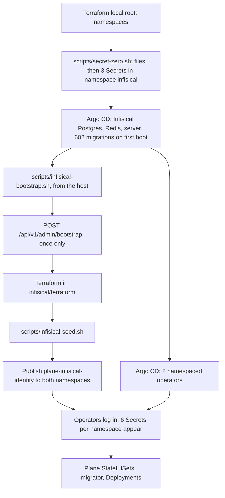

# Infisical

How secret values reach the two Plane environments of Wayline, a customized Plane Community Edition v1.4.3 deployment, and what happens when the secret store is lost.

**Status: run on the real cluster on 2026-11-04 and 2026-11-05, except `scripts/rotate.sh` and the destroying end of a clean restore.** A result links to its file under `docs/evidence/runs/`. A file name in code with no link is a raw run in `.local/evidence-raw/`, not yet published. Each `VERIFY` or `MEASURE` marker left here waits on a run that has not happened. Prose with no file and no marker describes configuration in the repository, not observed behaviour. All of this is one local kind node, and it says nothing about Infisical on another host. [`infisical/README.md`](../infisical/README.md) holds the full list of measurements.

| Component | Version | Where it is pinned |
|---|---|---|
| Infisical server | v0.167.6, by digest | `helm/values/infisical.yaml` |
| Chart `infisical-standalone` | 1.12.0 | `gitops/applications/infisical.yaml` |
| Operator `secrets-operator` | v0.11.16, chart 0.11.16, by digest | `helm/values/infisical-operator-dev.yaml`, `helm/values/infisical-operator-prod-sim.yaml` |
| Terraform provider `infisical/infisical` | 0.20.10 | `infisical/terraform/versions.tf` |
| Infisical's Postgres | `postgres:16.15-alpine`, by digest | `infisical/manifests/postgres.yaml` |
| Infisical's Redis | `redis:7.2.17-alpine`, by digest | `infisical/manifests/redis.yaml` |

Postgres and Redis here are dedicated to Infisical and never shared with Plane, so the secret store does not depend on what it protects. This Postgres runs with `max_locks_per_transaction=128`, because a backup's scratch restore held 3437 locks against a table of 3328 at the default (`dr-locks-1.txt`).

## What this design does and does not solve

It gives one source for every Plane secret value, keeps those values out of Git and out of Terraform state, and gives each environment its own read-only credential.

It does not remove secret zero. It moves the problem to the laptop: `ENCRYPTION_KEY` and friends sit in files under `.local/secret-zero/`. Materialised values are still Kubernetes Secrets, which are base64 in kind's etcd and not encrypted at rest. See [security.md](security.md) for what that leaves open.

## Ownership

| Thing | Owner | Never |
|---|---|---|
| Infisical server, its Postgres and Redis, both operators | Argo CD, `platform` project | `helm install` by hand |
| Projects, environment, identities, memberships, Kubernetes Auth | Terraform in `infisical/terraform`, separate root, state in `.local/terraform/infisical/` | Secret values. They never enter a variable, a plan or state |
| First admin and organization | `scripts/infisical-bootstrap.sh`, one API call | The chart's bootstrap Job, which would put the admin token in a cluster Secret. `autoBootstrap.enabled` is false |
| Plane secret values | `scripts/infisical-seed.sh`, first time only, then Infisical | Any copy on disk |
| Secrets `infisical-db`, `infisical-redis`, `infisical-secrets` | `scripts/secret-zero.sh` | Git, Argo CD |
| Secret `plane-infisical-identity` in each Plane namespace | `scripts/infisical-bootstrap.sh` | Rendered manifests, which hold zero `kind: Secret` |
| The six contract Secrets in each Plane namespace | The operator, through `InfisicalStaticSecret` | Hand edits, which the operator reverts on its next reconcile |

## Bootstrap from secret zero

The order matters because each step needs what the previous one created.



| # | Step | Run by | Waits until |
|---|---|---|---|
| 1 | Namespaces | Terraform, `infrastructure/terraform/environments/local` | |
| 2 | `scripts/secret-zero.sh` | Script. Needs step 1 | Files exist and the 3 Secrets are applied. Postgres and Redis wait in `CreateContainerConfigError` until then |
| 3 | `infisical` Application, wave -4. Inside it: ServiceAccount -2, Postgres and Redis -1, server 0, IngressRoute 1 | Argo CD | First boot finishes its migrations |
| 4 | `infisical-operator-dev` and `infisical-operator-prod-sim`, wave -3 | Argo CD | `infisical-operator-dev` alone installs the CRDs, so the prod-sim manager restarts until they exist |
| 5 | `scripts/infisical-bootstrap.sh` | Script, from the host. Needs `http://infisical.localhost` | Terraform applied, values seeded, identity Secrets published |
| 6 | `plane-dev` wave -1, `plane-prod-sim` wave 0 | Argo CD | `InfisicalAuth` stays unready until step 5 publishes the identity Secret |

Step 5 is outside Argo CD because it needs the admin token, and that token never enters the cluster. It seeds before it publishes identity ids, so an operator never logs in to an empty project.

First boot ran 602 migrations in about 11 s under the 1Gi limit and 640 MiB heap on arm64, with a peak of 807 MiB by cgroup `memory.peak` and 0 OOM events ([infisical-firstboot-1.txt](evidence/runs/infisical-firstboot-1.txt)). The container started at 21:10:39Z and the `infisical` Application read Healthy at 21:11:00Z, 21 s later ([bootstrap-timeline-1.txt](evidence/runs/bootstrap-timeline-1.txt)). `/api/status` itself was not timed apart from that.

`make up` runs these steps in this order. It has not yet run whole on a fresh cluster. So far bootstrap ran with the operators already up, and the prod-sim ServiceAccounts and CRs were applied by hand 19 minutes before `plane-prod-sim` existed, after which Argo CD adopted them with the same UIDs ([infisical-prod-sim-crs-1.txt](evidence/runs/infisical-prod-sim-crs-1.txt)).

[[VERIFY: the sequence above completes on a fresh cluster with scripts/up.sh, which does not exist at commit f733b87]]

### Idempotence, and the trap in it

Steps 2 and 5 are written to be rerun. With an initialized instance and intact local files, the bootstrap script finds the admin file, Terraform changes nothing except a new cluster CA, and the seed writes nothing. Three reruns on the live instance, the last with both Plane environments up, gave "No changes" and left secret ids, versions, Secret contents, pods and Plane generations identical ([infisical-idempotency-1.txt](evidence/runs/infisical-idempotency-1.txt), [infisical-idempotency-2.txt](evidence/runs/infisical-idempotency-2.txt)).

The other branch is destructive to local state. If `GET /api/v1/admin/config` reports `initialized: false`, the script assumes a fresh instance. It moves `infisical-admin.json`, `infisical-machine.json` and `infisical-admin-password` to `.local/secret-zero/archive-<stamp>/`, moves the Terraform state aside, creates a new admin, new projects and new identities, and seeds new values including a new `SECRET_KEY`.

So never run the plain bootstrap against an empty Infisical that you intend to restore. `make restore-clean` does the order, and while `.local/restore-clean.state` exists the script refuses that branch. `INFISICAL_RESTORED=yes scripts/infisical-bootstrap.sh` is restored mode: same credentials, new cluster CA through Terraform, identity Secrets published, no value written. It refuses a fresh instance, a token the server rejects, Terraform wanting to create or delete anything, or a missing secret. On the live instance it gave "No changes" and wrote nothing ([dr-restored-bootstrap-1.txt](evidence/runs/dr-restored-bootstrap-1.txt), `dr-restored-bootstrap-2.txt`). [disaster-recovery.md](disaster-recovery.md#full-restoration-into-a-clean-environment) gives the order.

## What lives in `.local/secret-zero`

The directory is mode 0700, files are 0600, and `.local/` is gitignored. No script copies this directory off the machine. That is a manual duty, and the whole recovery story depends on it. No backup copies these files either. Each Infisical backup records their sha256 in `recovery/set.json`, and a restore finds them by that, here or in any `archive-*` inside here. So this directory and `.local/backups/` both have to be kept, and kept apart.

| File | Written by | Used for | If lost |
|---|---|---|---|
| `ENCRYPTION_KEY` | `secret-zero.sh`, `openssl rand -hex 16` | Encrypts Infisical's KMS root key, and so every secret in the database | Recoverable from Secret `infisical-secrets` while the cluster lives. **Unrecoverable once that is gone too** |
| `AUTH_SECRET` | `secret-zero.sh` | Signs JWTs | Sessions and tokens die, identities log in again |
| `DB_PASSWORD` | `secret-zero.sh` | Infisical's Postgres | Recoverable from Secret `infisical-db` |
| `REDIS_PASSWORD` | `secret-zero.sh` | Infisical's Redis | Recoverable from Secret `infisical-redis` |
| `infisical-admin.json` | Bootstrap, or a script that replaced an ended token | Admin token, org id. The token carries a JWT expiry capped at 90 days | A password login makes another. See [Recovery](#recovery) |
| `infisical-admin-password` | Bootstrap, before the call, because the route works once | First admin's UI password | The token still works until it ends. After that a person needs a copy |
| `infisical-admin-token.new` | A person, after a sign-in, one line | There only until a script has checked it against the server and moved it into place | |
| `infisical-admin-replaced.log` | Each replacement of `infisical-admin.json` | When, why, how, and the sha256 before and after. No token | Nothing depends on it. It is the record |
| `infisical-machine.json` | Bootstrap, from Terraform outputs | Project ids, identity ids. Not secret, but 0600 like the rest | Rerun bootstrap. A restore rebuilds it from the backup's Terraform state |
| `rotation-<env>/` | `rotate.sh` | Old and new password in plaintext, only while a rotation is stopped partway | That rotation cannot be resumed automatically |
| `archive-<stamp>/` | `secret-zero.sh REGENERATE`, bootstrap on a fresh instance | Files moved aside, never deleted | |
| `archive-token-<time>/`, `archive-pre-restore-<time>/` | A token replacement, a restore | The admin file or machine file taken over from, so a restore can still find it by checksum | |

`secret-zero.sh` reuses existing files. It restores a missing one from the cluster when it can. It refuses to replace a differing `ENCRYPTION_KEY` in the cluster without `CONFIRM=yes`. It replaces the whole set only with `REGENERATE=yes CONFIRM=yes`, which is meant for an empty database, because Postgres keeps its old password until its volume is recreated.

The six Plane Secrets contain no secret zero. The seed generates values in memory, sends them, and keeps no copy. Infisical's database plus `ENCRYPTION_KEY` is the whole recovery set for them.

Terraform state in `.local/terraform/infisical/` is not in this directory, yet recovery also needs it. `make destroy` keeps it, and each Infisical backup copies it to `recovery/terraform.tfstate`, because state and database are a pair. See [Recovery](#recovery).

## Projects and the secret layout

Two projects, `plane-dev` and `plane-prod-sim`, each with one environment, slug `prod`, and flat keys at path `/`. The slug is the same in both so one `InfisicalStaticSecret` shape fits both. Default environments are off.

Why one project per environment: custom roles and folder RBAC are paid features. One project with two environments could not stop a reader of one environment from reading the other. Two projects can.

| Infisical key | Generated as | Feeds |
|---|---|---|
| `PG_USER`, `PG_DB` | Literal `plane`. Identifiers, so no quoting in SQL | `plane-pgdb`, `plane-app-env` |
| `PG_PASSWORD` | `openssl rand -hex 24` | `plane-pgdb`, `plane-app-env` |
| `RABBITMQ_USER` | Literal `plane` | `plane-rabbitmq`, `plane-app-env` |
| `RABBITMQ_PASSWORD` | `openssl rand -hex 24` | `plane-rabbitmq`, `plane-app-env` |
| `SILO_ACCESS_KEY` | `openssl rand -hex 10` | `plane-doc-store` |
| `SILO_SECRET_KEY` | `openssl rand -hex 20` | `plane-doc-store` |
| `SECRET_KEY` | `openssl rand -hex 32` | `plane-app-keys` |
| `LIVE_SERVER_SECRET_KEY` | `openssl rand -hex 32` | `plane-app-keys` |

Passwords are hex because the chart and the templates do not URL-encode into connection strings. The seed uses one batch write and 3 requests per environment. The research named a limit of 40 secret requests per minute per client IP, but v0.167.6 registers the limiter only on Infisical Cloud (`app.ts`), and 240 reads in 4 s from one address all answered 200 ([infisical-rate-limit-1.txt](evidence/runs/infisical-rate-limit-1.txt)).

## Machine identities and Kubernetes Auth

Each project has one identity, `plane-dev-reader` and `plane-prod-sim-reader`. Org role `no-access`. Project role built-in `viewer`.

Each identity authenticates through Kubernetes Auth:

| Setting | Value | Why |
|---|---|---|
| `token_reviewer_mode` | `api` | Infisical calls the API server's TokenReview |
| `kubernetes_host` | `https://kubernetes.default.svc.cluster.local` | As Infisical sees it from inside the cluster |
| `kubernetes_ca_certificate` | From ConfigMap `kube-root-ca.crt` | Supplying it turns TLS verification on. A new cluster has a new CA |
| `token_reviewer_jwt` | Unset | The client's token reviews itself, so no long-lived reviewer JWT exists anywhere |
| `allowed_namespaces` | The environment's own namespace | Binds the identity to one namespace |
| `allowed_service_account_names` | `plane-infisical-auth` | Binds it to one ServiceAccount |
| `allowed_audience` | Unset | A token minted for another audience could not authenticate to the API server, and that token does the review |
| `access_token_ttl`, `access_token_max_ttl` | 3600 s | The operator logs in again at 70% of this. Non-wildcard trusted IPs are paid, so short TTLs do that job |

The login flow: the operator mints a short-lived token for `plane-infisical-auth`, Infisical sends it to TokenReview, checks namespace and name, and returns an access token.

Three costs come with this choice:

- `plane-infisical-auth` needs `system:auth-delegator`, a ClusterRoleBinding in `infisical/manifests/token-reviewer.yaml`, which grants only `tokenreviews` and `subjectaccessreviews` create. No pod runs as this account. It sets `automountServiceAccountToken: false`.
- The server pod needs egress to the API server. kindnet sees that as the node IP on 6443, so the policy allows `172.16.0.0/12` on 6443.
- `ALLOW_INTERNAL_IP_CONNECTIONS=true` is set, because token review goes through a safe-request path that rejects private IPs, and `kubernetes.default.svc` is a private IP on kind. This relaxes SSRF protection for the whole instance. It is acceptable on a single-user local instance and needs a new decision for Pass 2.

Login works on kind under default-deny. The operator logs in and caches for 42 m, 70% of the TTL. A wrong CA is refused with "SSL certificate verification failed", so verification is on, and the API server's certificate covers `kubernetes.default.svc.cluster.local` ([infisical-k8s-auth-tls-1.txt](evidence/runs/infisical-k8s-auth-tls-1.txt), [infisical-isolation-2.txt](evidence/runs/infisical-isolation-2.txt)). The dev operator logged in again 42m17s after its first login, with 0 errors in the 24 reconciles around it ([infisical-token-renewal-1.txt](evidence/runs/infisical-token-renewal-1.txt)).

An identity id is not a credential, since login also needs a token for the ServiceAccount. It still sits in a Secret, because the CRD accepts only a Secret reference, and it changes on every re-bootstrap, so it cannot be rendered into Git.

## Static secret CRDs

Each Plane overlay, `helm/plane/overlays/<env>/infisical.yaml`, holds three kinds of resource:

| Kind | Sync wave | Role |
|---|---|---|
| `InfisicalConnection` | -3 | Address `http://infisical.infisical.svc.cluster.local:8080/api`. Always set, because empty falls back to the chart's `hostAPI`, whose default is Infisical Cloud |
| `InfisicalAuth` | -2 | Method `kubernetes`, identity from Secret `plane-infisical-identity`, ServiceAccount `plane-infisical-auth` |
| `InfisicalStaticSecret`, 6 of them | -1 | Source: project, slug `prod`, path `/`. Target: one Secret, `creationPolicy: Owner`, `refreshInterval: 60s` |

Details that exist because of a specific failure:

- **Templates use `secretFrom`, not `.KEY.Value`.** With `secretFrom` a missing key fails the reconcile and the CR goes Degraded. `.KEY.Value` renders a literal `<no value>` and reports success (operator issue 121), and a database would accept that as a password. `rotate.sh` also refuses to run if any Plane Secret contains that literal.
- **`targets[].metadata` is explicit.** It stops the operator copying the CR's labels and annotations, including Argo CD's tracking id, onto the Secret.
- **A target with a template gets only its template's keys.** No Secret carries a key it does not need.
- **Argo CD health is custom Lua** in `helm/values/argocd.yaml`. `InfisicalStaticSecret` is Healthy only when `status.observedGeneration` matches and `status.error` is not true. `InfisicalAuth` and `InfisicalConnection` read the `secrets.infisical.com/IsReady` condition. Wave 1 and later wait on this.

All 6 `InfisicalStaticSecret` reconcile in both namespaces, and each rendered Secret holds exactly the keys of contract section 8, with no empty or `<no value>` value and nothing shared across environments. The check fails on a tampered Secret, and the operator repaired that one in 9 s ([infisical-rendered-secrets-1.txt](evidence/runs/infisical-rendered-secrets-1.txt), [infisical-tamper-1.txt](evidence/runs/infisical-tamper-1.txt)). `make test-infisical` runs it again.

The Lua checks, run through `argocd admin` in the real server pod, read Healthy on the real CRs and Degraded on a failing one ([argocd-lua-infisical-live-1.txt](evidence/runs/argocd-lua-infisical-live-1.txt)).

Argo CD fails the sync and retries it. While `InfisicalAuth` is unready, a Plane sync fails at wave -2 and retries, every 5 minutes once backed off. After bootstrap publishes the identity Secret the CR turns Ready within a second, but the sync moves on only at its next retry, which took 3m10s on the first run ([infisical-unready-sync-1.txt](evidence/runs/infisical-unready-sync-1.txt)).

Instant updates are paid, so the operator polls. `refreshInterval` is the propagation delay, up to 60 s. Each operator polls 6 CRs per minute from its own pod IP.

### Two operators, not one

There is one operator release per Plane namespace, each with `scopedRBAC: true` and `scopedNamespaces` set to its namespace. In cluster mode a single operator could mint a token for any ServiceAccount and read every Secret, and nothing would stop an `InfisicalAuth` in `plane-dev` from referencing the prod-sim identity.

Scoped mode still renders three cluster-scoped objects per release. The chart truncates its fullname to 15 characters, so both release names would collide. `fullnameOverride` sets `iso-dev` and `iso-prod-sim`. Both deploy under the `platform` project, the only one allowed cluster-scoped objects.

## Auto-reload

The annotation `secrets.infisical.com/auto-reload: "true"` sits on the workload's own metadata, not the pod template, on `plane-api-wl`, `plane-worker-wl`, `plane-beat-worker-wl` and `plane-live-wl`.

From the operator source at v0.11.16: when a target Secret really changes, the operator merge-patches `secrets.infisical.com/managed-secret.<hash>` with the new etag into the workload and pod template annotations, which causes a normal rolling update. It covers Deployment, DaemonSet and StatefulSet, not Jobs. An operator restart causes no rollout. The patch is attempted only in the reconcile that changed the Secret.

| Workload | Annotated | Why |
|---|---|---|
| api, worker, beat, live | Yes | Read connection strings from env at start |
| Postgres, RabbitMQ | No, on purpose | `POSTGRES_PASSWORD` and `RABBITMQ_DEFAULT_*` act only on an empty data directory, so a restart achieves nothing and causes an outage |
| Migrator Job | Not supported | A Job is not restarted. It reads the current Secret on its next run |
| `postgres-exporter` | Yes, in `monitoring/manifests/environments/base/exporters.yaml` | Reads `plane-pgdb` at start, so without a restart it would keep the old password after a rotation, and `PlanePostgresDown` could fire on a healthy Postgres. The running pod template carries the operator's mark (`SEC-2-20261105T062211Z-state-before.txt`). No rotation has shown it restart |

At the first sync the operator patched `postgres-exporter` once when `plane-pgdb` appeared and not again, and `monitoring-extras` stayed Synced. That says nothing yet about a rotation.

[[VERIFY: the operator's template annotation does not cause a sync loop with Argo CD self-heal]]

`rotate.sh` tests that loop by comparing workload generations for 20 s after the rollout. If the operator did not mark every pod template within 120 s, the script restarts the workloads itself and records it.

## Rotation

```bash
make rotate ENV=dev
make rotate ENV=prod-sim CONFIRM=yes
scripts/rotate.sh ENV=dev RESUME=yes
scripts/rotate.sh ENV=dev ROLLBACK=yes
```

**`make rotate` has not run, in either environment.** The attempt in dev was refused by the session's permission system before anything ran, and no password changed (`SEC-2-20261105T062211Z-refused.txt`). Prod-sim stopped at the backup that comes first (`SEC-3-20261105T062127Z.txt`). So this section is read from `scripts/rotate.sh`, and the dev rotation needs the owner to run or approve it.

**Why it is a script.** Secret rotation is a paid feature (`secretRotation: false` for unlicensed self-hosted, `license-fns.ts` at v0.167.6). So this is scripted rotation of one value, `PG_PASSWORD`. It is not native rotation, scheduled rotation, or per-pod credentials. Dynamic secrets are paid too. `PG_PASSWORD` was chosen because the role can be changed in place and the old value can be shown to fail.

**Order of operations:**

1. Preflight. Infisical, both Secrets and Postgres agree. Plane answers. Every consumer of `plane-app-env` carries auto-reload. A random password is rejected, so the rejection proof means something.
2. Write old and new values to the journal `.local/secret-zero/rotation-<env>/`, then write the new one to Infisical as a new version.
3. Nudge the CRs by annotation and wait for the operator to update `plane-pgdb` and `plane-app-env`. The operator starts restarting Plane at this point.
4. `ALTER ROLE` over the Unix socket, with the statement on stdin and logging suppressed for the session.
5. Wait for the rollouts, then record the proofs.
6. Take an Infisical backup, because an older dump holds the old `PG_PASSWORD`. `SKIP_BACKUP=yes` skips it. If it fails, the rotation stands and the script exits 3.

Step 3 precedes step 4 because the operator owns the restart. New pods crash-loop until the role has the new password, which is the error window.

**Proofs written to `.local/evidence-raw/rotate-<env>-<stamp>.log`, which holds no values:**

| Proof | How | Trap avoided |
|---|---|---|
| Old rejected, new accepted | Login over the pod IP | The image's `pg_hba.conf` trusts the socket and 127.0.0.1, so a login there accepts any password |
| The test can fail | Random password rejected first | |
| Plane uses a new connection | `/api/public/anchor/__probe__/settings/` returns 404 "does not exist" | `/api/instances/` is cached in Valkey for two hours. In each Postgres round of the pod restart drill, under a minute, the probe route answered 500 for one 15 s sample while `/api/instances/` stayed 200 ([monitoring-history-reads-1.txt](evidence/runs/monitoring-history-reads-1.txt)). A longer outage has not been tried |
| Plane rolled | Pod template names the Secret's new version, `rollout status` finishes | |
| Postgres untouched | Pod start time compared before and after | |
| `SECRET_KEY` unchanged | Value compared before and after | |
| Error window | A probe every second | |
| No fight with Argo CD | Generations stable after the rollout | |

[[VERIFY: make rotate ENV=dev completes against real Postgres and every proof above records PASS]]

A random password is refused over the pod IP and over the Service, while the current one is accepted, so passwords are checked on those routes (`SEC-2-20261105T062211Z-old-value.txt`). Trust on the socket and on 127.0.0.1 has not been shown apart from that.

[[VERIFY: the socket and 127.0.0.1 are trusted while the pod IP requires scram-sha-256 in postgres:15.19-alpine]]

[[MEASURE: error window in seconds during make rotate ENV=dev, from the probe log]]

[[MEASURE: error window in seconds during make rotate ENV=prod-sim, from the probe log]]

**What this does not cover:**

- The role is a shared superuser. One credential for all Plane components.
- In-flight Jobs keep their old environment.
- Audit logs are not stored on this tier (`auditLogsRetentionDays: 0`). Secret version history is the only trail.
- Changing `PG_PASSWORD` by hand in the UI does not change the role. The next Plane restart then fails. Only `ROLLBACK=yes` keeps both sides together.
- A dump of Infisical taken before a rotation holds the old password. Restoring it in place makes Infisical and the Postgres role disagree, so `make restore ENV=infisical` refuses it unless `ALLOW_STALE_PLANE_SECRETS=yes`. A clean restore does not care: Plane's Postgres initializes with whatever Infisical says, and a dump carries no role password.

If it stops partway, the script prints what Infisical, the Secret and Postgres each hold. `RESUME=yes` finishes and `ROLLBACK=yes` undoes. Both run the same steps against real state, so running either twice is meant to be safe. [[VERIFY: RESUME and ROLLBACK recover a rotation interrupted between the Infisical write and ALTER ROLE]]

## What is never rotated, and why

| Value | Decision | Why |
|---|---|---|
| Plane `SECRET_KEY` | **Never** | It derives the Fernet key for encrypted instance configuration rows. `decrypt_data` fails silently to `""` on a wrong key, so SMTP and OAuth settings vanish with no error. Auto-reload on `plane-api-wl` is safe only because this key does not change |
| `LIVE_SERVER_SECRET_KEY` | Not rotated | Nothing consumes it at v1.4.3: `requireSecretKey` is defined and never used on a route (`apps/live/src/lib/auth-middleware.ts` in Plane v1.4.3). Rotating it would prove nothing |
| `ENCRYPTION_KEY` | Not rotated in Pass 1 | No procedure exists. After a key rotation, older dumps would need the older key (Infisical docs, v0.164 and later). Each dump's manifest records a truncated hash of the key in use, so a mismatch is detectable |
| `AUTH_SECRET` | Not rotated in Pass 1 | No procedure exists. Changing it kills every session and token, including the admin token |
| Infisical `DB_PASSWORD`, `REDIS_PASSWORD` | Not rotated in Pass 1 | `REGENERATE=yes` is only for an empty database |
| `RABBITMQ_PASSWORD`, `SILO_*` | Not rotated in Pass 1 | Separate procedures that nothing implements. The env values act only on an empty data directory |

## Free-tier limits and what they forced

Read from `license-fns.ts` and its enforcement sites at v0.167.6. An unlicensed self-hosted instance differs from the Cloud pricing page.

| Limit | What it forced |
|---|---|
| Custom roles and folder RBAC are paid. Additional privileges return 400 on projects created today | One project per environment, built-in `viewer`, org role `no-access`. A reader sees every secret in its environment and nothing in the other |
| Secret rotation is paid | `scripts/rotate.sh`, with an error window |
| Dynamic secrets are paid | One shared Postgres role |
| Audit logs are not stored | Who read what cannot be shown |
| Instant updates are paid | The operator polls every 60 s |
| None for rate limits. The research named 40 secret requests, 60 reads and 200 writes per minute, but v0.167.6 registers the limiter only on Infisical Cloud, and 240 reads in 4 s all answered 200 ([infisical-rate-limit-1.txt](evidence/runs/infisical-rate-limit-1.txt)) | The seed still uses one batch, and scripts still honour `Retry-After` on 429, in case a later version applies a limit. That path has never run |
| Non-wildcard trusted IPs are paid | 1 hour token TTL |
| Gateway reviewer is paid | The client JWT reviews itself |

## Recovery

| Situation | Result | Do this |
|---|---|---|
| Server pod lost | Stateless, rescheduled | Nothing |
| Redis lost | Queued jobs, schedules and caches. While it is down the API does not answer, for about 12 s in the restart test ([infisical-restart-1.txt](evidence/runs/infisical-restart-1.txt)) | Nothing |
| Operator pod lost | Existing Secrets stay. Sync pauses until it returns | Nothing |
| Infisical down, Plane running | Plane keeps running on its existing Kubernetes Secrets, and Plane pods should still start, for the same reason. Rotation and new Secrets stop. Across in-place restores with the server down for 39 s to 52 s, no Plane pod, generation or Secret moved (`dr-inplace-restore-3.txt`). No Plane pod was restarted on purpose during an outage | Restore service. [[VERIFY: Plane survives an Infisical outage and restarts with existing Secrets]] |
| `ENCRYPTION_KEY` file lost, cluster alive | Recoverable | `scripts/secret-zero.sh` restores it from the cluster |
| `ENCRYPTION_KEY` lost everywhere | **Secrets are gone**, even with the database dump | New instance, new values. `SECRET_KEY` is gone too, so see [disaster-recovery.md](disaster-recovery.md#path-b-encryption_key-is-lost) |
| Postgres lost, key kept, dump exists | Recoverable | `make restore ENV=infisical BACKUP=<id> CONFIRM=yes` on the same or a newer image with the same key, then `INFISICAL_RESTORED=yes scripts/infisical-bootstrap.sh`. See [disaster-recovery.md](disaster-recovery.md#scenario-infisical-lost) |
| Postgres lost, no dump | All secret values gone | As `ENCRYPTION_KEY` lost |
| Cluster and everything in it gone | New CA must reach Kubernetes Auth, and the data must come back | `make restore-clean BACKUP=latest`. See [disaster-recovery.md](disaster-recovery.md#full-restoration-into-a-clean-environment) |
| Cluster recreated with `make up`, data not wanted back | New instance, new secrets | Bootstrap detects `initialized=false` and moves the old files aside, never deleting them |
| `infisical-admin.json` lost, instance initialized | Bootstrap's own route works once, so it cannot make another | `scripts/infisical-bootstrap.sh` signs in with `infisical-admin-password`, mints a token for the instance admin identity and records it. Run through the API on the live instance (`dr-mint-1.txt`). With no password it stops with the steps for a person, whose labels were read from this image's frontend build and not yet clicked through |
| Admin token expired | 90 day cap. Scripts warn in the last 7 days. A backup or `make up` then replaces it the same way, and anything else refuses and says so. `RENEW_ADMIN_TOKEN=yes scripts/infisical-bootstrap.sh` does it ahead of time | As above. A token that has really ended has run only on stubs |
| Admin token and password both gone | Nothing here can log in, and the instance and its secrets are fine | Write a new bcrypt hash into the restored database, as [`infisical/README.md`](../infisical/README.md#admin-token-and-password-both-gone) shows. Run in place on 2026-11-05 (`dr-inplace-no-token-no-password-1.txt`, `-2.txt`, `-3.txt`), not on a clean restore |
| Terraform state lost, instance alive | Terraform would try to create what exists, and bootstrap runs Terraform unconditionally, so it fails before publishing identity ids | Copy `recovery/terraform.tfstate` from the newest Infisical backup. With no backup, import each resource, or start from a fresh instance. A destroyed project keeps its slug for 14 days. [[VERIFY: terraform import works for infisical_project, infisical_project_environment, infisical_identity, infisical_project_identity and infisical_identity_kubernetes_auth at provider 0.20.10]] |
| Rotation stopped partway | Plane may be failing | `RESUME=yes` or `ROLLBACK=yes` |

Infisical's migrations run forward only. An older image refuses to start on a newer schema, so a Helm rollback alone does not restore it. A restore must use the same or a newer image.

Back up `ENCRYPTION_KEY` separately from the dump. A dump with its key in one archive defeats the point, and `scripts/backup.sh` deliberately writes only a truncated hash to the manifest.

A restored Plane database needs the `SECRET_KEY` it was written with. `SECRET_KEY` lives in Infisical. So Infisical and Plane restore as a matched set, Infisical first. `scripts/restore.sh` compares the fingerprint and refuses a mismatch unless `ALLOW_SECRET_KEY_MISMATCH=yes`.

An in-place Infisical restore has run five times, 51 s to 71 s in all, with the server not answering for 39 s to 52 s by a probe once a second. Afterwards `make test-infisical` exited 0 with 118 PASS lines, and all 14 Applications were Synced and Healthy (`dr-inplace-restore-3.txt`, `dr-after-restores-1.txt`). Earlier runs took 48 s and 44 s ([dr-inplace-restore-1.txt](evidence/runs/dr-inplace-restore-1.txt), [dr-inplace-restore-2.txt](evidence/runs/dr-inplace-restore-2.txt)). The restore into a new cluster has not run.

## Least-privilege evidence

`make test-infisical` runs `infisical/tests/isolation.sh` and `infisical/tests/rendered-secrets.sh`: real logins and reads with the same ServiceAccount tokens the operators use, from the host and from inside each namespace. Every 403 is checked against a positive control with the same token, so a wrong project id or a dead token cannot pass as isolation. It prints status codes and the server's messages, and no token or value.

| # | Claim | Test | Expected | Result |
|---|---|---|---|---|
| L1 | Dev reader lists its own project | `make test-infisical` | 200 | PASS, 200 |
| L2 | Dev reader cannot read prod-sim, and the other way round | Same: list, single read and slug lookup | 403 or 404 | PASS, 403 in both directions |
| L3 | Dev reader cannot write its own project | Same | 403. A success is a FAIL | PASS, 403. Asked of the dev reader only |
| L4 | Org role `no-access` reaches nothing at org level | Same: list the organization's identities | 403 | PASS, 403. Asked of the dev reader only |
| L5 | Wrong namespace cannot log in | Same: each namespace's account with the other's identity | 401 or 403 | PASS, 401 "K8s namespace not allowed" in both directions |
| L6 | Wrong ServiceAccount cannot log in | Same: `plane-dev/default` and `plane-dev/iso-dev-controller-manager` with the dev identity | 401 or 403 | PASS, 401. A forged token also gets 401 |
| L7 | Dev operator cannot read prod-sim Secrets, and the other way round | `kubectl auth can-i` below | `no` | PASS, `no` |
| L8 | Dev operator cannot mint tokens in prod-sim, and the other way round | `kubectl auth can-i` below | `no` | PASS, `no` |
| L9 | Workloads hold no API token | `policy/workloads.rego` denies a rendered workload without `automountServiceAccountToken: false`, except the two operators | No exception | PASS on rendered manifests, in `make ci`. Running pods have not been read |
| L10 | Rendered manifests hold no Secret | `make ci`, conftest rule in `policy/gitops.rego` | Passes | PASS |

L1 to L6: [infisical-isolation-2.txt](evidence/runs/infisical-isolation-2.txt), [infisical-isolation-3.txt](evidence/runs/infisical-isolation-3.txt), [infisical-isolation-20261104T232524Z.txt](evidence/runs/infisical-isolation-20261104T232524Z.txt), and on the restored database `dr-after-restores-1.txt`. L7 and L8: [infisical-rbac-1.txt](evidence/runs/infisical-rbac-1.txt). L9 and L10: [ci-2-20261105T061644Z-make-ci.log](evidence/ci/ci-2-20261105T061644Z-make-ci.log), exit 0. These show the boundary the free tier allows, per project. A reader still sees every secret in its own environment.

```bash
SA=system:serviceaccount:plane-dev:iso-dev-controller-manager
kubectl --context kind-plane-platform auth can-i get secrets -n plane-prod-sim --as="$SA"                         # L7
kubectl --context kind-plane-platform auth can-i create serviceaccounts --subresource=token -n plane-prod-sim --as="$SA"  # L8
```

## Related documents

- [security.md](security.md): threat model and what is not protected.
- [data-operations.md](data-operations.md): backup contents and restore.
- [disaster-recovery.md](disaster-recovery.md): failure scenarios and full restoration.
- [platform-contract.md](platform-contract.md): the binding names.
- [`infisical/README.md`](../infisical/README.md): the layer's own notes, including the names other layers rely on.
