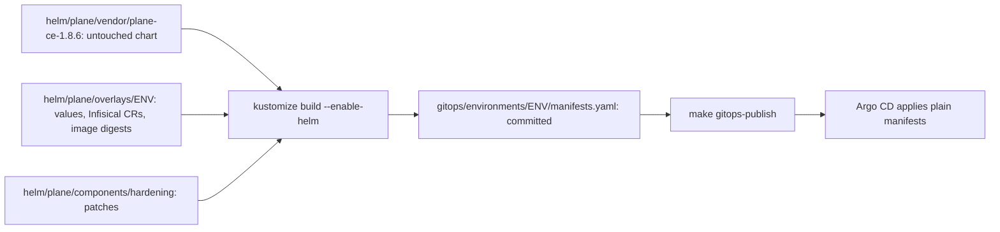

# Kubernetes and Helm

How Plane gets from an upstream chart to manifests on the cluster, what the platform changes on the way, and how to
change it safely. Wayline is a customized Plane Community Edition v1.4.3 deployment, not an original product. The chart
is upstream's `plane-ce` 1.8.6, unmodified.

**Status of this page.** It describes configuration in the code, and says so where a real run has settled something. On
2026-11-05 Plane runs in both namespaces, on the final branded images from `84b63d9`. What nothing has
measured yet carries a `VERIFY` or `MEASURE` marker. A path under `.local/evidence-raw/` is raw output from a real run that is not published
yet, and `make publish-evidence` copies it to `evidence/runs/` under the same name. This is local and production-inspired, and not a claim of
production readiness.

**Namespace separation is not equivalent to independent production clusters.** `plane-dev` and `plane-prod-sim` share one
node, one API server, one etcd, one CoreDNS, one Traefik, one Infisical server and one Docker VM disk. Failure of any of
those takes down both. Quotas cover memory and object counts only. See [environments.md](environments.md).

## Render flow

Helm is a packaging format here, not an owner. Nothing is `helm install`ed by hand, and Argo CD runs neither Helm nor
Kustomize for Plane.



| Stage | Path | Who edits it |
|---|---|---|
| Vendored chart | `helm/plane/vendor/plane-ce-1.8.6/plane-ce/` | Nobody. It is the release tarball untarred. `VENDOR.md` records the tarball sha256 and a tree hash |
| Overlay | `helm/plane/overlays/{dev,prod-sim}/` | You, except `images:` lines, which only `make promote` writes |
| Hardening component | `helm/plane/components/hardening/` | You. Shared by both environments |
| Rendered output | `gitops/environments/{dev,prod-sim}/manifests.yaml` | Only `make render`. The file header says so |

**Why render and commit.**

- Argo CD issue #30215 is an open regression that makes `--enable-helm` unreliable at sync time, and it appears only at manifest regeneration. Rendering removes Helm from the repo server for Plane.
- A pull request then shows exactly what will be applied, not a change to an input.
- CI can check the exact objects: schema, policy, zero Secrets, digest pinning.

**Why a Component.** Kustomize runs generators before components, so these patches apply to the chart's output, and one
patch set fits both environments because the Helm release is `plane` in each and object names match.

**Why a vendored chart.** An upgrade is a directory swap. A patch that no longer applies shows up in the render, not at sync.

Verify the vendored chart against `VENDOR.md`:

```bash
cd helm/plane/vendor/plane-ce-1.8.6
find plane-ce -type f -print0 | LC_ALL=C sort -z | xargs -0 shasum -a 256 | shasum -a 256
```

## What the hardening component does

Everything is in `helm/plane/components/hardening/kustomization.yaml`, with one file per workload under `patches/`.

| Change | Target | Why |
|---|---|---|
| Delete the `plane-minio-bucket-1` Job | Job | The API's `create_bucket` makes the bucket. This Job adds an anonymous-download policy upstream's compose does not have, always exits 0, and pulls two more images |
| Remove the `timestamp` pod annotation | Deployments, Job | `now` changes on every render. It would roll all Deployments and hit the Job's immutable template. See [determinism](#how-the-determinism-check-works) |
| Remove `tty` and `stdin` | Deployments, StatefulSets | A TTY makes app tools emit colour and CRLF into logs Loki ingests |
| Add security contexts | All workloads | See below |
| Add sync-wave annotations | ConfigMaps, Services, StatefulSets, Deployments, routes | See [argocd.md](argocd.md#inside-a-plane-application) |
| Set `progressDeadlineSeconds: 600` | Deployments | Image pulls count against it, and the kubelet pulls one image at a time, so a Deployment also waits for every pull queued ahead of it. On a cold mirror wave 3's four images took 175s, 216s, 52s and 5s in turn ([plane-dev-firstboot-1.txt](evidence/runs/plane-dev-firstboot-1.txt)), and 360 failed web, admin and space on that first boot, an event read live and not in a saved file. This value stays above the longest startup budget of 300 seconds. A longer deadline delays the Degraded report on a bad rollout: on the failed-deploy drill's first real run, `plane-dev` read Degraded 629s after the publish (`.local/evidence-raw/drill-failed-deploy-20261105T062343Z.log`). The drill waits this long plus 120s |
| Add `preStop: {sleep: {seconds: 5}}` | web, admin, space, live, api | A pod gets SIGTERM as its endpoint starts to go, and Traefik can still send it requests for a moment, so with no pause a rollout dropped requests: 10 failed of 2,757 samples ([before](evidence/runs/plane-dev-rollout-availability-1.txt)), and 0 of 5,902 across two rollouts with it ([after](evidence/runs/plane-dev-rollout-availability-2.txt)). Sleep needs no shell. Worker and beat have no Service, so they do not need it |
| Set `MINIO_PROMETHEUS_AUTH_TYPE=public` | Silo | The ServiceMonitor scrapes without credentials, and the default `jwt` answers 403. The ingress routes only `/uploads` to Silo, and a NetworkPolicy limits who reaches port 9000 |
| Make the migrator a `Sync` hook at wave 2 | Job `plane-api-migrate-1` | Postgres is applied in the Sync phase and `wait_for_db` does not wait, so `PreSync` deadlocks a fresh install |
| Set `activeDeadlineSeconds: 900` | Migrator | A bad image never fails the Job on its own |
| Replace `maxRequestBodyBytes` with an integer | Middleware `plane-body-limit` | Helm renders `2.097152e+07`, and the CRD field is an integer. It stays above `FILE_SIZE_LIMIT` to allow for multipart overhead |
| Add `plane-trailing-slash` | IngressRoute `plane-ingress`, routes `/spaces` and `/god-mode` | Upstream's Caddy issues this redirect. Without it, nginx redirects to the pod's port 3000 |
| Add `plane-rabbitmq-conf` | RabbitMQ | `vm_memory_high_watermark.absolute = 256Mi` |
| Replace the ServiceAccount | `plane`, `plane-infisical-auth` | The chart can only create one account, with automount hard-coded to true |

Kustomize does not fail when a patch target matches nothing, so `scripts/render.sh` asserts the results it can see. A
`remove` of a path the chart stops rendering does fail, and two `test` operations fail if the chart reorders its routes.

### Security context

Every Plane workload gets `runAsNonRoot: true`, `seccompProfile: RuntimeDefault`, `allowPrivilegeEscalation: false`,
`capabilities.drop: [ALL]`, `automountServiceAccountToken: false` and `imagePullPolicy: IfNotPresent`.

| Workload | UID:GID | | Workload | UID:GID |
|---|---|---|---|---|
| web, admin | 101:101 | | postgres | 70:70 |
| space, live | 1000:1000 | | valkey | 999:1000 |
| api, worker, beat, migrator | 1000:1000 | | rabbitmq | 100:101 |
| silo | 1000:1000 | | | |

Upstream images are not built for all of this, so workarounds exist. nginx gets `emptyDir` mounts for its cache, run and
temp paths. Python workloads get `HOME=/tmp`.

`readOnlyRootFilesystem` is not set on Plane workloads, and has not been tried. The namespaces enforce PSA `baseline` and warn on
`restricted`. Contract section 2 keeps prod-sim on `baseline` until a per-workload non-root test passes.

That test passed on 2026-11-04, on upstream images. Each container with a shell reported the UID above with `id`, and Silo, which has
no shell, was read from its pod spec. A server-side dry run of `enforce=restricted` gave no warnings in either namespace
([dev](evidence/runs/plane-dev-psa-1.txt), [prod-sim](evidence/runs/plane-prod-sim-host-and-identity-1.txt)). The finished migrator was read from
its pod spec too, in dev that day and in prod-sim on 2026-11-05 ([cluster-readings-1.txt](evidence/runs/cluster-readings-1.txt)). The label
has not moved, and nobody has repeated the dry run on the branded images. They were each started under the chart's UID, memory, CPU and
security settings before promotion ([smoke.txt](evidence/branding/smoke.txt)).

## Probes

| Workload | Startup | Readiness | Liveness |
|---|---|---|---|
| web | None | `GET / :3000`, 10s | `GET / :3000`, 30s |
| admin | None | `GET /god-mode/ :3000`, 10s | Same path, 30s |
| space | `GET /spaces/ :3000`, 5s x 36 | Same path, 10s | Same path, 30s |
| live | `GET /live/health :3000`, 5s x 36 | Same path, 10s | Same path, 30s |
| api | `GET / :8000`, 5s x 60 | `GET / :8000`, 10s | `GET / :8000`, 30s |
| worker | `pgrep -f "celery -A plane worker"`, 5s x 60 | Same, 15s | `celery inspect ping`, 120s, timeout 60s, 3 failures |
| beat | `pgrep -f "celery -A plane beat"`, 5s x 60 | Same, 15s | Same, 30s |
| postgres | `pg_isready -h 127.0.0.1`, 5s x 60 | Same, 10s | Same, 30s |
| valkey | None | `valkey-cli ping`, 10s | Same, 30s |
| rabbitmq | TCP 5672, 10s x 30 | TCP 5672, 10s | `rabbitmq-diagnostics -q ping`, 60s, timeout 30s, 3 failures |
| silo | `GET /minio/health/live :9000`, 5s x 36 | `GET /minio/health/ready :9000`, 10s | `GET /minio/health/live :9000`, 30s |

The reasons are the useful part:

- **api liveness hits `/`**, which touches no dependency, so a database outage does not restart the pod. The entrypoint runs seven `manage.py` steps before binding, which is why it has a startup gate.
- **postgres uses TCP to `127.0.0.1`.** During `initdb` the server listens only on the Unix socket, so this stays unready until the real server is up. The migrator depends on that.
- **worker liveness is infrequent** because it loads all of Django. It needs the broker, so three failures take about six minutes of RabbitMQ outage before a restart.
- **beat's probe proves only that the process exists.** Beat has no ping. The alert on `last_run_at` is the real check. See [monitoring.md](monitoring.md).
- **worker and beat probes use `exec` with no shell**, because under `sh -c` `pgrep -f` would match the shell's own command line.

The budgets held. Seconds to Ready with the image already on the node, in dev on 2026-11-04, on upstream images: web and admin 1, worker 10,
space 10, live 20, beat 25, api 31 ([plane-dev-startup-1.txt](evidence/runs/plane-dev-startup-1.txt)). On the first boot of each environment, under
the CPU limits, api took 31s in dev and 36s in prod-sim, against a budget of 300s ([plane-prod-sim-firstboot-1.txt](evidence/runs/plane-prod-sim-firstboot-1.txt)).

## Resources

Memory comes from contract section 10, and changes only with a measurement. CPU is set in the patches.

| Workload | Memory request | Memory limit | CPU request dev | CPU request prod-sim | CPU limit |
|---|---:|---:|---:|---:|---:|
| web | 16Mi | 64Mi | 10m | 10m | 100m |
| admin | 16Mi | 64Mi | 10m | 10m | 100m |
| space | 96Mi | 256Mi | 20m | 20m | 250m |
| live | 128Mi | 384Mi | 20m | 20m | 250m |
| api | 256Mi | 768Mi | 50m | 100m | 750m |
| worker | 256Mi | 768Mi | 50m | 100m | 500m |
| beat | 128Mi | 256Mi | 10m | 10m | 200m |
| postgres | 128Mi | 512Mi | 50m | 100m | 500m |
| valkey | 16Mi | 96Mi | 10m | 10m | 100m |
| rabbitmq | 128Mi | 512Mi | 50m | 100m | 500m |
| silo | 256Mi | 512Mi | 20m | 20m | 500m |
| migrator (Job) | 128Mi | 512Mi | 50m | 50m | 750m |

Prod-sim's higher CPU requests set scheduler weight on the shared node, so the tiers prod-sim depends on win when dev
competes. Limits are the same.

Two settings keep memory on budget. `GUNICORN_WORKERS=1`, and `CELERY_WORKER_CONCURRENCY=2`: the entrypoint passes no
`-c`, and Celery otherwise forks per CPU the node reports.

On 2026-11-05 the memory limits of the 56 running pods summed to 15,812 MiB, 113% of the 13.63 GiB the Docker VM reports. etcd, the API
server and the other control plane containers have no limit, and come on top ([cluster-readings-1.txt](evidence/runs/cluster-readings-1.txt)). This
is deliberate overcommit. Bring the two environments up serially, because simultaneous first boots are the worst case.

Real use has stayed inside that so far, with 0 OOM kills in any Plane container. Read after both smokes ran at once on 2026-11-04, no Plane
container was above 66% of its memory limit, and the worker was highest at 426 of 768 MiB. The VM peaked at 10.49 GiB of 13.63 across all the tests
([plane-prod-sim-memory-1.txt](evidence/runs/plane-prod-sim-memory-1.txt)). The closest any reading came was `live` at 309 of 384 MiB, 80% of its
limit, in dev earlier that day ([plane-dev-memory-1.txt](evidence/runs/plane-dev-memory-1.txt)). Those are cgroup peaks, which include page cache.
The load test has not run. [[MEASURE: actual RSS per Plane workload at idle and under load]]

In dev, the pods from the first boot read 0 OOM kills and 0 restarts ([plane-dev-memory-1.txt](evidence/runs/plane-dev-memory-1.txt)). In prod-sim,
six of the eleven workloads were read on their first-boot pods with 0 OOM kills and 0 restarts: worker, beat, Postgres, Valkey, RabbitMQ and Silo
([snapshot](evidence/runs/plane-prod-sim-snapshot-after-concurrent-1.txt)). The other five, api, web, admin, space and live, were replaced at 22:51
before a read ([first boot](evidence/runs/plane-prod-sim-firstboot-1.txt)). [[VERIFY: no OOMKilled pods during first boot of both environments]]

RabbitMQ applies the absolute watermark through `conf.d`: smoke step `broker-memory` reads `{absolute,"256Mi"}` with no alarms, in both environments
([dev](evidence/runs/smoke-dev-20261105T001213Z.json), [prod-sim](evidence/runs/smoke-prod-sim-20261104T235926Z.json)).

## Quotas and LimitRange

Terraform owns both ([terraform.md](terraform.md)). The calculation is in `infrastructure/terraform/modules/foundation/main.tf`.

**`ResourceQuota/plane-budget`, per Plane namespace:**

| Resource | Hard limit | How derived |
|---|---:|---|
| `requests.memory` | 2732Mi | 2 x 896 for Deployments, plus 528 for StatefulSets, plus 412 for extras |
| `limits.memory` | 7984Mi | 2 x 2560 for Deployments, plus 1632 for StatefulSets, plus 1232 for extras |
| `pods` | 24 | 2 x 7 Deployments, plus 4 StatefulSets, plus 6 extras |
| `persistentvolumeclaims` | 6 | 4 StatefulSets, plus the backup PVC, plus one spare for restore drills |

Extras are the Infisical operator, postgres-exporter, redis-exporter, the migrator, a backup Job (128Mi and 256Mi, an estimate:
the Job has run, and nobody has read its peak) and one ad-hoc pod.

**Why Deployments count twice.** A rolling update surges one extra pod each. A quota that fits only the steady state makes a
rollout fail with `exceeded quota` while the old pods keep serving, and that looks like a stuck deploy rather than a
budget problem.

**Why no CPU.** The contract budgets none, and a CPU quota would reject any pod that omits a CPU request.

**`LimitRange/plane-defaults`, per Plane namespace, type Container:** default limit 256Mi, default request 64Mi, max 1Gi.
A quota on `limits.memory` rejects a pod with no limit. These defaults make such a pod admissible and visibly small. The
largest budgeted container is 768Mi, so going above 1Gi needs a contract change first.

All seven Plane Deployments surging at once reached 21 of 24 pods, 2412Mi of 2732Mi requests and 6960Mi of 7984Mi limits, with no
`FailedCreate` ([plane-dev-rollout-quota-1.txt](evidence/runs/plane-dev-rollout-quota-1.txt)). The quota does not cover every Deployment
surging, exporters included, with the migrator, a backup and an ad-hoc pod: that is 26 pods, 2760Mi and 8064Mi
([quota-budget-1.txt](evidence/runs/quota-budget-1.txt), from renders, not a run). A real rollout during a backup has not been run.
[[VERIFY: a rollout during a backup in one namespace is not rejected by the pods quota]]

## Storage

| Fact | Detail |
|---|---|
| Class | kind's default `standard`: `rancher.io/local-path`, `reclaimPolicy: Delete`, `WaitForFirstConsumer` |
| Location | `/var/local-path-provisioner` on the node, which is the Docker VM volume, not VirtioFS |
| Why named explicitly | Values set `storageClass: standard` so a volume never lands on a class the contract did not choose |
| Durability | One disk in one VM. There is no replication or snapshot. Backups are the only copy elsewhere |

**PVCs from the chart's `volumeClaimTemplates`:**

| StatefulSet | Claim template | Requested |
|---|---|---:|
| `plane-pgdb-wl` | `pvc-plane-pgdb-vol` | 1Gi |
| `plane-minio-wl` | `pvc-plane-minio-vol` | 1Gi |
| `plane-rabbitmq-wl` | `pvc-plane-rabbitmq-vol` | 100Mi |
| `plane-redis-wl` | `pvc-plane-redis-vol` | 100Mi |

### Behaviour on kind

- **Requested size is not enforced.** local-path ignores it. A claim can grow until the host runs out. Measured on Loki's claim of 2Gi on 2026-11-04: its `wal` directory alone reached 2.2G with no error ([monitoring-loki-replay-1.txt](evidence/runs/monitoring-loki-replay-1.txt)). No Plane claim has been pushed past its size.
- **The VM cannot see the real disk limit.** Its filesystem reports hundreds of free GiB while the host has far less. kind also sets `evictionHard` to `0%`, so a full disk means write errors, not pod eviction. `guard_disk` is the actual protection.
- **Volumes survive `make down`,** because the node container is only stopped. [[VERIFY: data survives make down and make up]]
- **Volumes do not survive `make destroy`.** Deleting the node deletes its volume.
- **Deleting a pod keeps its PVC.** `tests/drills/pod-restart-persistence.sh` checks this with a data sentinel. On 2026-11-04 it ended PASS in dev, on upstream images ([dev](evidence/runs/drill-pod-restart-dev-20261104T224424Z.log)). In prod-sim its [first run](evidence/runs/drill-pod-restart-prod-sim-20261104T233500Z.log) ended FAIL on the job probe after the RabbitMQ and Valkey restarts, with the sentinel row and attachment intact in every round. The smoke's worker control had left that worker unable to resume after a broker restart, which `0bba707` fixed in the test. The [second run](evidence/runs/drill-pod-restart-prod-sim-20261104T235402Z.log), on a clean worker, ended PASS. On 2026-11-05 it ended PASS again in dev on the final images, while the API answered 500 to 7 signed-in requests in a row, for about 6s, as Postgres restarted (`.local/evidence-raw/drill-pod-restart-dev-20261105T070414Z.log`, `.local/evidence-raw/PERS-1-20261105T070358Z-timeline.txt`). It has not run in prod-sim on the final images.
- **Deleting a StatefulSet or Application keeps its PVCs.** No retention policy is set, and Argo CD does not track `volumeClaimTemplates` claims.
- **Deleting a namespace or a PVC deletes the data,** because the reclaim policy is `Delete`.
- **`storageClass` and claim sizes are immutable** in an existing StatefulSet. A change fails at sync. See [how to change a value](#how-to-change-a-value-safely).

### Backup storage

`gitops/platform/backup-storage` holds a static `hostPath` PV per environment on `/backups/<env>`, reclaim `Retain`, plus
a PVC named `backups` in each namespace. `/backups` on the node is `.local/backups` on the host, so backups outlive the
cluster. Pods mount a PVC rather than `hostPath`, so they stay PSA-compatible. See [data-operations.md](data-operations.md).
UID 70 writes `/backups/<env>` through the VirtioFS mount: `make backup` completed in dev and prod-sim on 2026-11-04
([dev](evidence/runs/dr-backup-dev-1.txt), [prod-sim](evidence/runs/dr-backup-prod-sim-1.txt)). rclone logs that the mount has no xattrs, and goes on.

## Ingress and hostnames

Traefik is a NodePort (30080, 30443). kind maps those to `127.0.0.1:80` and `127.0.0.1:443` only. There is no TLS locally. The chart's
`IngressRoute` is used through `ingress.ingressClass: traefik`, and no `kind: Ingress` is rendered.

`plane-ingress` has these routes on `plane.dev.localhost` or `plane.prod-sim.localhost`, entry point `web`:

| Path prefix | Backend | Extra middleware |
|---|---|---|
| `/spaces` | `plane-space:3000` | `plane-trailing-slash` |
| `/god-mode` | `plane-admin:3000` | `plane-trailing-slash` |
| `/api`, `/auth`, `/static/` | `plane-api:8000` | |
| `/live` | `plane-live:3000` | |
| `/uploads` | `plane-minio:9000` | |
| `/` | `plane-web:3000` | |

All routes carry `plane-body-limit`, with `buffering.maxRequestBodyBytes: 20971520`.

**Silo and the bucket.** `/uploads` serves the object store. Silo is a MinIO-compatible fork that upstream Plane itself
pins, used because official MinIO images no longer pull anonymously. The bucket is named `uploads` in both environments
because `export_task.py` hardcodes that path. Each environment has its own Silo, so that is where isolation comes from.

**Hosts inside pods.** `*.localhost` means loopback to a browser, but the Plane API dials its own public host for
`copy_object` and OAuth avatars. The CoreDNS rewrite from Terraform sends both hostnames to
`traefik.traefik.svc.cluster.local`.

All of this ran through Traefik in both environments, on the final images from `84b63d9`
(`.local/evidence-raw/smoke-dev-20261105T070735Z-94252.json`, `.local/evidence-raw/smoke-prod-sim-20261105T053533Z-8468.json`). Steps `frontends` and
`routes` cover the prefixes, `asset-duplicate` covers `copy_object` through the CoreDNS rewrite with a valid signature, `realtime-*` covers
the `/live` WebSocket through the buffering middleware, and `attachment-upload` and `object-in-silo` cover presigned uploads with the bucket Job
deleted. The smoke drives HTTP and WebSocket with its own client. A real browser session is recorded in
[live-dev](evidence/branding/live-dev/README.md), for dev only, on the build from `1563cbf`.

## How to change a value safely

First find the right place.

| You want to change | Edit | Then |
|---|---|---|
| A chart value | `helm/plane/overlays/<env>/values.yaml`, both files if it applies to both | Procedure below |
| A workload's probe, UID, env or resources | `helm/plane/components/hardening/patches/<workload>.yaml` | Procedure below |
| An environment-only difference | `patches:` in `helm/plane/overlays/<env>/kustomization.yaml` | Procedure below |
| An image | Never by hand: `make promote` | [argocd.md](argocd.md#promotion) |
| A secret value | Infisical, never values. See [infisical.md](infisical.md) | Operator reconciles |
| A memory number | Measurement first, then the contract, the patch, **and** `modules/foundation/main.tf` | Procedure below, plus `terraform apply` |
| A hostname | `appHost`, the CoreDNS rewrite, NetworkPolicies, monitoring probes, tests. Several owners | Plan it as a change across layers |
| A file under `vendor/` | Don't | Change the component |

**Procedure:**

```bash
$EDITOR helm/plane/overlays/dev/values.yaml
make render
git diff gitops/environments/       # read this: it is what Argo CD will apply
make ci                             # needs network; or at least scripts/ci/validate-manifests.sh
git add -A helm gitops
git commit -m "..."
make gitops-publish
make status
```

Read the rendered diff, not the input diff. A one-line value can change several objects.

**Values that break things.** Each of these came from reading upstream code, and most are enforced in `policy/` or
`scripts/render.sh`.

| Setting | Rule | What goes wrong otherwise |
|---|---|---|
| `docstore_bucket`, `AWS_S3_BUCKET_NAME` | `uploads` | Export links break |
| `FILE_SIZE_LIMIT` | Bytes | `5MB` crashes Django at import |
| Passwords | Hex | The chart does not URL-encode them into connection strings |
| `SECRET_KEY` | Never rotate | It derives the key for encrypted config rows, and `decrypt_data` fails silently to `""` |
| RabbitMQ image | 3.13 or 4.2, never 4.3 | Celery attaches 0 consumers on 4.3 (upstream chart PR #304) |
| `external_secrets.*`, `requireExplicitSecrets` | Keep | Rendered manifests must hold zero `kind: Secret` |
| `artifacts.plane.so` | Never | It fronts Docker Hub and shares its limit. Policy bans it |
| `postgres.storageClass`, claim sizes | Immutable once created | Sync fails on the StatefulSet |

**Fields Kubernetes will not update.** StatefulSet `volumeClaimTemplates` and selectors are immutable, so a change needs a
planned migration with a backup. The migrator Job's template is also immutable, but `BeforeHookCreation` deletes and
recreates it on each sync, so that one is handled.

**Secrets rollouts.** api, worker, beat and live carry `secrets.infisical.com/auto-reload: "true"`, so the operator restarts them
when a referenced Secret changes. postgres-exporter carries it too, from `monitoring/manifests`. No rotation has run. [[VERIFY: operator auto-reload does not fight Argo CD self-heal]]

## How the determinism check works

`make render` must produce identical bytes for identical inputs, or CI would fail for no reason and every render would
restart pods.

**What would break it.** The chart puts a `timestamp` annotation from Helm's `now` on pod templates. The component
removes it. `scripts/render.sh` then fails if a `timestamp:` line survives.

**What holds the rest still.**

- Helm and Kustomize come from `tools.lock`, and `render.sh` passes `--helm-command .tools/bin/helm` explicitly.
- The chart is vendored, with no network fetch.
- Image digests are fixed in the overlay.

**The check.** `scripts/render.sh --check` renders each environment into a temporary directory and runs the same assertions as a
normal render. It compares against the committed file with `diff -u`, prints any difference, writes nothing, and exits
non-zero if a file is stale.

```bash
scripts/render.sh --check
```

| Assertion in `render.sh` | Fails on |
|---|---|
| Zero `kind: Secret` | A chart change that falls back to rendering a Secret |
| Every `image:` has `@sha256:` | An unpinned image |
| No `timestamp:` | The non-determinism above returning |

**Where it runs.**

- `scripts/ci/validate-manifests.sh`, through `make ci` and on every pull request.
- `scripts/promote.sh`, before it edits anything, so unrelated drift cannot fold into a promotion commit.

`scripts/rollback.sh` renders instead of checking: a later change beside an image line makes the revert conflict in the rendered file, and
that file is generated, so rendering replaces it and the rollback goes on.

CI also runs kubeconform in strict mode and conftest against the rendered files. Nothing makes a failing check block a merge
on this GitHub plan. See [security.md](security.md).

`scripts/render.sh --check` exits 0 on a clean checkout on `ubuntu-24.04`, so a render from this Mac matched one from Linux byte for byte: run
41909741166 at `5fdf41d` on 2026-11-04 ([log](evidence/ci/ci-1-20261104T204614Z-run-41909741166.log)), and again at `9c8e098` and `0dde813` on
2026-11-05 ([run 41975431001](evidence/ci/ci-1-20261105T053955Z-run-41975431001.log), [run 41978707479](evidence/ci/ci-1-20261105T061058Z-run-41978707479.log)).
Commits after `0dde813` have run it only on this Mac.

## Upgrades

### Chart

The chart and the app version move together: chart 1.8.6 is appVersion 1.4.3.

1. Download the tarball named in the chart's `index.yaml` and check its sha256 against the index.
2. Untar it into a new `helm/plane/vendor/plane-ce-<version>/plane-ce/`, with a matching `VENDOR.md`.
3. Change `helmGlobals.chartHome` in both overlays.
4. `make render`, and read every failure. A failing `remove` or `test` patch is the alarm working.
5. Read the whole `git diff gitops/environments/`. A patch whose target stopped matching fails silently, so look for lost security contexts, probes or annotations.
6. Update digests through `make promote`, dev first. Update the contract.
7. `make ci`, commit, publish, and run `make test-e2e ENV=dev` before promoting.

No upgrade has been performed on this platform. [[VERIFY: a chart upgrade works by this procedure]]

### Plane version and data services

Migrations run forward only. Rolling back an image does not roll back a schema, and old code starts against a newer
schema with no warning. So the prod-sim path takes a dump first. See [argocd.md](argocd.md#rollback).

Postgres stays on its major version here, since a major upgrade needs dump and restore, not an image change. Patch bumps go
through `make promote` like any image, IMAGE being `postgres`, `valkey`, `rabbitmq` or `silo`. The backup Job reads the Postgres
image from the live server, so it follows.

### Platform charts

Traefik, monitoring and Infisical use Argo CD Helm sources with exact versions in `gitops/applications/*.yaml` and values in
`helm/values/`. Change the version, run `make ci`, commit, publish. Argo CD upgrades go through Terraform.

## Teardown

| Goal | Do this | Consequence |
|---|---|---|
| Stop everything | `make down` | No data loss |
| Delete everything | `make destroy CONFIRM=yes` | See [install.md](install.md#teardown) |
| Remove Plane from Argo CD management only | Delete `gitops/applications/plane-<env>.yaml`, commit, publish | Workloads are orphaned, not deleted, because the Application has no finalizer. PVCs stay |
| Reset one environment's data | No make target exists | Restore a backup with `make restore ENV=<env> BACKUP=<id> CONFIRM=yes`, or `make destroy` |

**Do not `kubectl delete namespace plane-dev`.** It deletes the PVCs and, by reclaim policy, the data, along with quotas and labels that Terraform
owns and Argo CD will not recreate.

The empty-render safeguard: `allowEmpty` stays false on the Plane Applications, so an empty render cannot prune everything.
`PruneLast=true` applies removals only after the new state is healthy.
