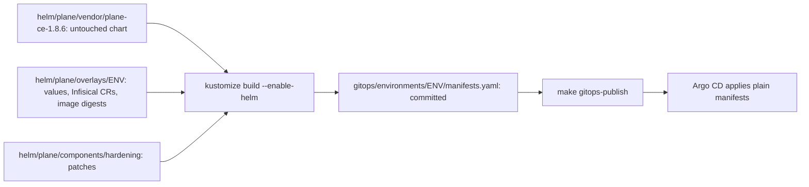

# Kubernetes and Helm

How Plane gets from an upstream chart to manifests on the cluster, what the platform changes on the way, and how to
change it safely. Wayline is a customized Plane Community Edition v1.4.3 deployment, not an original product. The chart
is upstream's `plane-ce` 1.8.6, unmodified, and all three environments render from it.

Every section from [Render flow](#render-flow) to [Teardown](#teardown) is about the kind cluster, and holds for hosted production
wherever [Hosted production](#hosted-production) does not say otherwise. That section covers its overlay, its charts and values, K3s's own
components, and what differs from kind.

**Status of this page.** It describes configuration in the code, and says so where a real run has settled something. On
2026-11-05 Plane ran in both namespaces on the final branded images from `84b63d9`, and the runs below on those images say so. A full restore from backup into
a new cluster then read PASS on every restore step, and `make test` passed on the restored platform ([restore-clean-20261105T081017Z.json](evidence/runs/restore-clean-20261105T081017Z.json), [MAKE-TEST-20261105T083455Z.txt](evidence/runs/MAKE-TEST-20261105T083455Z.txt)). Two later drills, one with the
registry and caches removed as well and one on a cluster lost to kind alone, restored with every restore step PASS, and the last log reads `RESULT PASS` ([log](evidence/runs/drill-clean-restore-20261105T130633Z.log)). This is a local and
production-inspired platform.

**Namespace separation is not equivalent to independent production clusters.** `plane-dev` and `plane-prod-sim` share one
node, one API server, one etcd, one CoreDNS, one Traefik, one Infisical server and one Docker VM disk. Failure of any of
those takes down both. Quotas cover memory and object counts only. See [environments.md](environments.md). Hosted production
shares none of those with them, and has the same kind of single points inside itself: one node, one API server and one disk.

## Render flow

Helm is a packaging format here, not an owner. Nothing is `helm install`ed by hand, and Argo CD runs neither Helm nor
Kustomize for Plane.



| Stage | Path | Who edits it |
|---|---|---|
| Vendored chart | `helm/plane/vendor/plane-ce-1.8.6/plane-ce/` | Nobody. It is the release tarball untarred. `VENDOR.md` records the tarball sha256 and a tree hash |
| Overlay | `helm/plane/overlays/{dev,prod-sim,prod}/` | You, except `images:` lines. In dev and prod-sim only `make promote` edits them, and `make rollback` takes an edit back with `git revert`. In `prod` only `scripts/ci/promote-prod.sh` does, from a signed set |
| Hardening component | `helm/plane/components/hardening/` | You. Shared by all three environments |
| Rendered output | `gitops/environments/{dev,prod-sim,prod}/manifests.yaml` | Only `make render`, which runs `scripts/render.sh` and then `scripts/render.sh --env prod`. The file header says so |

**Why render and commit.**

- Argo CD issue #30215 is an open regression that makes `--enable-helm` unreliable at sync time, and it appears only at manifest regeneration. Rendering removes Helm from the repo server for Plane.
- A pull request then shows exactly what will be applied, not a change to an input.
- CI can check the exact objects: schema, policy, zero Secrets, digest pinning.

**Why a Component.** Kustomize runs generators before components, so these patches apply to the chart's output, and one
patch set fits all three environments because the Helm release is `plane` in each and object names match.

**Why a vendored chart.** An upgrade is a directory swap. A patch that no longer applies shows up in the render, not at sync.

Verify the vendored chart against `VENDOR.md`:

```bash
cd helm/plane/vendor/plane-ce-1.8.6
find plane-ce -type f -print0 | LC_ALL=C sort -z | xargs -0 shasum -a 256 | shasum -a 256
```

## What the hardening component does

Everything is in `helm/plane/components/hardening/kustomization.yaml`, with one file per workload under `patches/`.

| Change | Target | Why |
|---|---|---|
| Delete the `plane-minio-bucket-1` Job | Job | The API's `create_bucket` makes the bucket. This Job adds an anonymous-download policy upstream's compose does not have, always exits 0, and pulls two more images |
| Remove the `timestamp` pod annotation | Deployments, Job | `now` changes on every render. It would roll all Deployments and hit the Job's immutable template. See [determinism](#how-the-determinism-check-works) |
| Remove `tty` and `stdin` | Deployments, StatefulSets | A TTY makes app tools emit colour and CRLF into logs Loki ingests |
| Add security contexts | All workloads | See below |
| Add sync-wave annotations | ConfigMaps, Services, StatefulSets, Deployments, routes | See [argocd.md](argocd.md#inside-a-plane-application) |
| Set `progressDeadlineSeconds: 600` | Deployments | Image pulls count against it, and the kubelet pulls one image at a time, so a Deployment also waits for every pull queued ahead of it. On a cold mirror wave 3's four images took 175s, 216s, 52s and 5s in turn ([plane-dev-firstboot-1.txt](evidence/runs/plane-dev-firstboot-1.txt)), and 360 failed web, admin and space on that first boot, an event read live and not in a saved file. This value stays above the longest startup budget of 300 seconds. A longer deadline delays the Degraded report on a bad rollout: on the failed-deploy drill's first real run, `plane-dev` read Degraded 629s after the publish ([drill-failed-deploy-20261105T062343Z.log](evidence/runs/drill-failed-deploy-20261105T062343Z.log)). The drill waits this long plus 120s |
| Add `preStop: {sleep: {seconds: 5}}` | web, admin, space, live, api | A pod gets SIGTERM as its endpoint starts to go, and Traefik can still send it requests for a moment, so with no pause a rollout dropped requests: 10 failed of 2,757 samples ([before](evidence/runs/plane-dev-rollout-availability-1.txt)), and 0 of 5,902 across two rollouts with it ([after](evidence/runs/plane-dev-rollout-availability-2.txt)). Sleep needs no shell. Worker and beat have no Service, so they do not need it |
| Set `MINIO_PROMETHEUS_AUTH_TYPE=public` | Silo | The ServiceMonitor scrapes without credentials, and the default `jwt` answers 403. The ingress routes only `/uploads` to Silo, and a NetworkPolicy limits who reaches port 9000 |
| Make the migrator a `Sync` hook at wave 2 | Job `plane-api-migrate-1` | Postgres is applied in the Sync phase and `wait_for_db` does not wait, so `PreSync` deadlocks a fresh install |
| Set `activeDeadlineSeconds: 900` | Migrator | A bad image never fails the Job on its own |
| Replace `maxRequestBodyBytes` with an integer | Middleware `plane-body-limit` | Helm renders `2.097152e+07`, and the CRD field is an integer. It stays above `FILE_SIZE_LIMIT` to allow for multipart overhead |
| Add `plane-trailing-slash` | IngressRoute `plane-ingress`, routes `/spaces` and `/god-mode` | Upstream's Caddy issues this redirect. Without it, nginx redirects to the pod's port 3000 |
| Add `plane-rabbitmq-conf` | RabbitMQ | `vm_memory_high_watermark.absolute = 256Mi` |
| Replace the ServiceAccount | `plane`, `plane-infisical-auth` | The chart can only create one account, with automount hard-coded to true |

Kustomize does not fail when a patch target matches nothing, so `scripts/render.sh` asserts the results it can see. A
`remove` of a path the chart stops rendering does fail, and two `test` operations fail if the chart reorders its routes.

### Security context

Every Plane workload gets `runAsNonRoot: true`, `seccompProfile: RuntimeDefault`, `allowPrivilegeEscalation: false`,
`capabilities.drop: [ALL]`, `automountServiceAccountToken: false` and `imagePullPolicy: IfNotPresent`.

| Workload | UID:GID | | Workload | UID:GID |
|---|---|---|---|---|
| web, admin | 101:101 | | postgres | 70:70 |
| space, live | 1000:1000 | | valkey | 999:1000 |
| api, worker, beat, migrator | 1000:1000 | | rabbitmq | 100:101 |
| silo | 1000:1000 | | | |

Upstream images are not built for all of this, so workarounds exist. nginx gets `emptyDir` mounts for its cache, run and
temp paths. Python workloads get `HOME=/tmp`.

`readOnlyRootFilesystem` is not set on Plane workloads, and has not been tried. The namespaces enforce PSA `baseline` and warn on
`restricted`. Contract section 2 keeps prod-sim on `baseline` until a per-workload non-root test passes.

That test passed on 2026-11-04, on upstream images. Each container with a shell reported the UID above with `id`, and Silo, which has
no shell, was read from its pod spec. A server-side dry run of `enforce=restricted` gave no warnings in either namespace
([dev](evidence/runs/plane-dev-psa-1.txt), [prod-sim](evidence/runs/plane-prod-sim-host-and-identity-1.txt)). The finished migrator was read from
its pod spec too, in dev that day and in prod-sim on 2026-11-05 ([cluster-readings-1.txt](evidence/runs/cluster-readings-1.txt)). The label
has not moved, and nobody has repeated the dry run on the branded images. They were each started under the chart's UID, memory, CPU and
security settings before promotion ([smoke.txt](evidence/branding/smoke.txt)).

## Probes

| Workload | Startup | Readiness | Liveness |
|---|---|---|---|
| web | None | `GET / :3000`, 10s | `GET / :3000`, 30s |
| admin | None | `GET /god-mode/ :3000`, 10s | Same path, 30s |
| space | `GET /spaces/ :3000`, 5s x 36 | Same path, 10s | Same path, 30s |
| live | `GET /live/health :3000`, 5s x 36 | Same path, 10s | Same path, 30s |
| api | `GET / :8000`, 5s x 60 | `GET / :8000`, 10s | `GET / :8000`, 30s |
| worker | `pgrep -f "celery -A plane worker"`, 5s x 60 | Same, 15s | `celery inspect ping`, 120s, timeout 60s, 3 failures |
| beat | `pgrep -f "celery -A plane beat"`, 5s x 60 | Same, 15s | Same, 30s |
| postgres | `pg_isready -h 127.0.0.1`, 5s x 60 | Same, 10s | Same, 30s |
| valkey | None | `valkey-cli ping`, 10s | Same, 30s |
| rabbitmq | TCP 5672, 10s x 30 | TCP 5672, 10s | `rabbitmq-diagnostics -q ping`, 60s, timeout 30s, 3 failures |
| silo | `GET /minio/health/live :9000`, 5s x 36 | `GET /minio/health/ready :9000`, 10s | `GET /minio/health/live :9000`, 30s |

The reasons are the useful part:

- **api liveness hits `/`**, which touches no dependency, so a database outage does not restart the pod. The entrypoint runs seven `manage.py` steps before binding, which is why it has a startup gate.
- **postgres uses TCP to `127.0.0.1`.** During `initdb` the server listens only on the Unix socket, so this stays unready until the real server is up. The migrator depends on that.
- **worker liveness is infrequent** because it loads all of Django. It needs the broker, so three failures take about six minutes of RabbitMQ outage before a restart.
- **beat's probe proves only that the process exists.** Beat has no ping and exposes no metrics, so no alert reads whether it dispatches anything. The only proof that it does is one reading by hand of `total_run_count` in Postgres, in dev on 2026-11-04 (JOB-3 in [validation.md](validation.md)). `tests/e2e/smoke.py --job-probe` shows a worker running a task, not beat sending one. See [monitoring.md](monitoring.md).
- **The `pgrep` probes on worker and beat use `exec` with no shell**, because under `sh -c` `pgrep -f` would match the shell's own command line. The worker's liveness probe does use `sh -c`, to read the hostname, and `pgrep` is not involved there.

The budgets held. Seconds to Ready with the image already on the node, in dev on 2026-11-04, on upstream images: web and admin 1, worker 10,
space 10, live 20, beat 25, api 31 ([plane-dev-startup-1.txt](evidence/runs/plane-dev-startup-1.txt)). On the first boot of each environment, under
the CPU limits, api took 31s in dev and 36s in prod-sim, against a budget of 300s ([plane-prod-sim-firstboot-1.txt](evidence/runs/plane-prod-sim-firstboot-1.txt)).

## Resources

Memory comes from contract section 10, and changes only with a measurement. CPU is set in the patches.

| Workload | Memory request | Memory limit | CPU request dev | CPU request prod-sim | CPU limit |
|---|---:|---:|---:|---:|---:|
| web | 16Mi | 64Mi | 10m | 10m | 100m |
| admin | 16Mi | 64Mi | 10m | 10m | 100m |
| space | 96Mi | 256Mi | 20m | 20m | 250m |
| live | 128Mi | 384Mi | 20m | 20m | 250m |
| api | 256Mi | 768Mi | 50m | 100m | 750m |
| worker | 256Mi | 768Mi | 50m | 100m | 500m |
| beat | 128Mi | 256Mi | 10m | 10m | 200m |
| postgres | 128Mi | 512Mi | 50m | 100m | 500m |
| valkey | 16Mi | 96Mi | 10m | 10m | 100m |
| rabbitmq | 128Mi | 512Mi | 50m | 100m | 500m |
| silo | 256Mi | 512Mi | 20m | 20m | 500m |
| migrator (Job) | 128Mi | 512Mi | 50m | 50m | 750m |

Prod-sim's higher CPU requests set scheduler weight on the shared node, so the tiers prod-sim depends on win when dev
competes. Limits are the same.

Under load it is a CPU limit that binds. With no think time in dev, on a quiet cluster, Postgres ran at 497, 493 and 500 m against its 500 m limit, throttled in 98% to 100% of CFS periods, and requests flattened by 5 virtual users at about 8.9 a second. The api averaged 389 to 412 m and topped out at 460 m against its 750 m, and it was throttled in 10% to 17% of periods, so its bursts reached the limit and its average did not. What a higher Postgres limit would give has not been tried. See [resource-utilization.md](resource-utilization.md#load-results-dev).

Two settings keep memory on budget. `GUNICORN_WORKERS=1`, and `CELERY_WORKER_CONCURRENCY=2`: the entrypoint passes no
`-c`, and Celery otherwise forks per CPU the node reports.

On 2026-11-05 the memory limits of the 56 running pods summed to 15,812 MiB, 113% of the 13.63 GiB the Docker VM reports. etcd, the API
server and the other control plane containers have no limit, and come on top ([cluster-readings-1.txt](evidence/runs/cluster-readings-1.txt)). This
is deliberate overcommit. Bring the two environments up serially, because simultaneous first boots are the worst case.

Real use has stayed inside that so far, with 0 OOM kills in any Plane container. Read after both smokes ran at once on 2026-11-04, no Plane
container was above 66% of its memory limit, and the worker was highest at 426 of 768 MiB. The closest any reading came was `live` at 309 of 384 MiB, 80% of its
limit, in dev earlier that day ([plane-dev-memory-1.txt](evidence/runs/plane-dev-memory-1.txt)). Those are cgroup peaks, which include page cache.
From 23:17 UTC that night to 00:04 UTC the VM peaked at 10.49 GiB of 13.63, just after a concurrent change replaced the Argo CD pods, and VM use includes about 1 GiB of the
owner's unrelated containers ([plane-prod-sim-memory-1.txt](evidence/runs/plane-prod-sim-memory-1.txt)). Later readings went higher: 10.93 GiB at 01:50 UTC on 2026-11-05, in
60-second readings ([LOAD-3-20261105T074543Z-timeline.json](evidence/runs/LOAD-3-20261105T074543Z-timeline.json)).

`make test-load ENV=dev` ran on a quiet cluster on 2026-11-05 at 09:02 UTC, on the final images restored into a new cluster, with think time and then with none
([results.json](evidence/runs/load-20261105T090247Z/results.json), [results.json](evidence/runs/load-20261105T091213Z/results.json)). With think time it passed its thresholds at 5, 10 and 20 virtual users, with 2,800 requests and 0 failed. Top working set by workload with no think time, in MiB: worker 287, api 207, live 155, beat 148, RabbitMQ 138, Postgres 122, space 92, Silo 82, Valkey 10, web and admin 3. The highest share of a limit was beat, at 58%. No container restarted, and no OOM event rose ([window checks](evidence/runs/LOAD-3-20261105T092547Z-window-checks.txt)). Idle averages in `plane-dev`, 08:47:35 to 08:56:59 UTC: worker 280, api 168, live 152, beat 148, RabbitMQ 134, space 90, Silo 82, Postgres 39, Valkey 10, web and admin 3 ([derived](evidence/runs/LOAD-3-20261105T092547Z-derived.txt)). The VM read 8.65 GiB idle and peaked at 9.05 GiB. These are working set from Prometheus, and RSS itself was not read. That cluster was young, and this says nothing about a server. See [resource-utilization.md](resource-utilization.md#the-load-window), which also keeps the earlier run on a busy machine.

In dev, the pods from the first boot read 0 OOM kills and 0 restarts ([plane-dev-memory-1.txt](evidence/runs/plane-dev-memory-1.txt)). In prod-sim,
six of the eleven workloads were read on their first-boot pods with 0 OOM kills and 0 restarts: worker, beat, Postgres, Valkey, RabbitMQ and Silo
([snapshot](evidence/runs/plane-prod-sim-snapshot-after-concurrent-1.txt)). The other five, api, web, admin, space and live, were replaced at 22:51
before a read ([first boot](evidence/runs/plane-prod-sim-firstboot-1.txt)), so their first boot has no reading. The clean install of 2026-11-05 recorded no OOM or restart counts either. Its `make status` found no pod unready, with the node at 8.265 GiB ([make-status.txt](evidence/runs/clean-install-20261105T075041Z/make-status.txt)).

RabbitMQ applies the absolute watermark through `conf.d`: smoke step `broker-memory` reads `{absolute,"256Mi"}` with no alarms, in both environments
([dev](evidence/runs/smoke-dev-20261105T001213Z.json), [prod-sim](evidence/runs/smoke-prod-sim-20261104T235926Z.json)).

## Quotas and LimitRange

Terraform owns both ([terraform.md](terraform.md)). The calculation is in `infrastructure/terraform/modules/foundation/main.tf`.

**`ResourceQuota/plane-budget`, per Plane namespace:**

| Resource | Hard limit | How derived |
|---|---:|---|
| `requests.memory` | 2732Mi | 2 x 896 for Deployments, plus 528 for StatefulSets, plus 412 for extras |
| `limits.memory` | 7984Mi | 2 x 2560 for Deployments, plus 1632 for StatefulSets, plus 1232 for extras |
| `pods` | 24 | 2 x 7 Deployments, plus 4 StatefulSets, plus 6 extras |
| `persistentvolumeclaims` | 6 | 4 StatefulSets, plus the backup PVC, plus one spare for restore drills |

Extras are the Infisical operator, postgres-exporter, redis-exporter, the migrator, a backup Job (128Mi and 256Mi, an estimate:
the Job has run, and nobody has read its peak) and one ad-hoc pod.

**Why Deployments count twice.** A rolling update surges one extra pod each. A quota that fits only the steady state makes a
rollout fail with `exceeded quota` while the old pods keep serving, and that looks like a stuck deploy rather than a
budget problem.

**Why no CPU.** The contract budgets none, and a CPU quota would reject any pod that omits a CPU request.

**`LimitRange/plane-defaults`, per Plane namespace, type Container:** default limit 256Mi, default request 64Mi, max 1Gi.
A quota on `limits.memory` rejects a pod with no limit. These defaults make such a pod admissible and visibly small. The
largest budgeted container is 768Mi, so going above 1Gi needs a contract change first.

All seven Plane Deployments surging at once reached 21 of 24 pods, 2412Mi of 2732Mi requests and 6960Mi of 7984Mi limits, with no
`FailedCreate` ([plane-dev-rollout-quota-1.txt](evidence/runs/plane-dev-rollout-quota-1.txt)). The quota does not cover every Deployment
surging, exporters included, with the migrator, a backup and an ad-hoc pod: that is 26 pods, 2760Mi and 8064Mi
([quota-budget-1.txt](evidence/runs/quota-budget-1.txt), from renders, not a run). Whether a real rollout during a backup is rejected: not tested in Pass 1.

## Storage

| Fact | Detail |
|---|---|
| Class | kind's default `standard`: `rancher.io/local-path`, `reclaimPolicy: Delete`, `WaitForFirstConsumer` |
| Location | `/var/local-path-provisioner` on the node, which is the Docker VM volume, not VirtioFS |
| Why named explicitly | Values set `storageClass: standard` so a volume never lands on a class the contract did not choose |
| Durability | One disk in one VM. There is no replication or snapshot. Backups are the only copy elsewhere |

**PVCs from the chart's `volumeClaimTemplates`:**

| StatefulSet | Claim template | Requested |
|---|---|---:|
| `plane-pgdb-wl` | `pvc-plane-pgdb-vol` | 1Gi |
| `plane-minio-wl` | `pvc-plane-minio-vol` | 1Gi |
| `plane-rabbitmq-wl` | `pvc-plane-rabbitmq-vol` | 100Mi |
| `plane-redis-wl` | `pvc-plane-redis-vol` | 100Mi |

### Behaviour on kind

- **Requested size is not enforced.** local-path ignores it. A claim can grow until the host runs out. Measured on Loki's claim of 2Gi on 2026-11-04: its `wal` directory alone reached 2.2G with no error ([monitoring-loki-replay-1.txt](evidence/runs/monitoring-loki-replay-1.txt)). No Plane claim has been pushed past its size.
- **The VM cannot see the real disk limit.** Its filesystem reports hundreds of free GiB while the host has far less. kind also sets `evictionHard` to `0%`, so a full disk means write errors, not pod eviction. `guard_disk` is the actual protection.
- **Volumes survive `make down`,** because the node container is only stopped. On 2026-11-05 `make down` took 15 s and `make up` 82 s, and the sentinel row and attachment read back in both environments ([PERS-3-20261105T083304Z.txt](evidence/runs/PERS-3-20261105T083304Z.txt)).
- **Volumes do not survive `make destroy`.** Deleting the node deletes its volume. In the drill of 2026-11-05 the data came back only from backups ([log](evidence/runs/drill-clean-restore-20261105T074859Z.log)).
- **Deleting a pod keeps its PVC.** `tests/drills/pod-restart-persistence.sh` checks this with a data sentinel. On 2026-11-04 it ended PASS in dev, on upstream images ([dev](evidence/runs/drill-pod-restart-dev-20261104T224424Z.log)). In prod-sim its [first run](evidence/runs/drill-pod-restart-prod-sim-20261104T233500Z.log) ended FAIL on the job probe after the RabbitMQ and Valkey restarts, with the sentinel row and attachment intact in every round. The smoke's worker control had left that worker unable to resume after a broker restart, which `0bba707` fixed in the test. The [second run](evidence/runs/drill-pod-restart-prod-sim-20261104T235402Z.log), on a clean worker, ended PASS. On 2026-11-05 it ended PASS again in dev on the final images, while the API answered 500 to 7 signed-in requests in a row, for about 6s, as Postgres restarted ([drill-pod-restart-dev-20261105T070414Z.log](evidence/runs/drill-pod-restart-dev-20261105T070414Z.log), [PERS-1-20261105T070358Z-timeline.txt](evidence/runs/PERS-1-20261105T070358Z-timeline.txt)), and in prod-sim on the final images ([drill-pod-restart-prod-sim-20261105T072331Z.log](evidence/runs/drill-pod-restart-prod-sim-20261105T072331Z.log)).
- **Deleting a StatefulSet or Application keeps its PVCs.** No retention policy is set, and Argo CD does not track `volumeClaimTemplates` claims.
- **Deleting a namespace or a PVC deletes the data,** because the reclaim policy is `Delete`.
- **`storageClass` and claim sizes are immutable** in an existing StatefulSet. A change fails at sync. See [how to change a value](#how-to-change-a-value-safely).

### Backup storage

`gitops/platform/backup-storage` holds a static `hostPath` PV per environment on `/backups/<env>`, reclaim `Retain`, plus
a PVC named `backups` in each namespace. `/backups` on the node is `.local/backups` on the host, so backups outlive the
cluster. Pods mount a PVC rather than `hostPath`, so they stay PSA-compatible. See [data-operations.md](data-operations.md).
UID 70 writes `/backups/<env>` through the VirtioFS mount: `make backup` completed in dev and prod-sim on 2026-11-04
([dev](evidence/runs/dr-backup-dev-1.txt), [prod-sim](evidence/runs/dr-backup-prod-sim-1.txt)). rclone logs that the mount has no xattrs, and goes on.
On 2026-11-05, on the final images, a backup taken just before was restored in place in each environment with result PASS, and `make test-e2e` passed after it
([dev](evidence/runs/BKP-2-20261105T074322Z.txt), [prod-sim](evidence/runs/SEC-3-BKP-3-20261105T073240Z.txt)). That restores over the same volumes. The same day a restore into a new cluster, on new volumes, also read PASS in both ([dev](evidence/runs/restore-dev-20261105T082337Z.json), [prod-sim](evidence/runs/restore-prod-sim-20261105T082657Z.json)).

## Ingress and hostnames

Traefik is a NodePort (30080, 30443). kind maps those to `127.0.0.1:80` and `127.0.0.1:443` only. There is no TLS locally. The chart's
`IngressRoute` is used through `ingress.ingressClass: traefik`, and no `kind: Ingress` is rendered.

`plane-ingress` has these routes on `plane.dev.localhost` or `plane.prod-sim.localhost`, entry point `web`:

| Path prefix | Backend | Extra middleware |
|---|---|---|
| `/spaces` | `plane-space:3000` | `plane-trailing-slash` |
| `/god-mode` | `plane-admin:3000` | `plane-trailing-slash` |
| `/api`, `/auth`, `/static/` | `plane-api:8000` | |
| `/live` | `plane-live:3000` | |
| `/uploads` | `plane-minio:9000` | |
| `/` | `plane-web:3000` | |

All routes carry `plane-body-limit`, with `buffering.maxRequestBodyBytes: 20971520`.

**Silo and the bucket.** `/uploads` serves the object store. Silo is a MinIO-compatible fork that upstream Plane itself
pins, used because official MinIO images no longer pull anonymously. The bucket is named `uploads` in both environments
because `export_task.py` hardcodes that path. Each environment has its own Silo, so that is where isolation comes from.

**Hosts inside pods.** `*.localhost` means loopback to a browser, but the Plane API dials its own public host for
`copy_object` and OAuth avatars. The CoreDNS rewrite from Terraform sends both hostnames to
`traefik.traefik.svc.cluster.local`.

All of this ran through Traefik in both environments, on the final images from `84b63d9`
([smoke-dev-20261105T070735Z-94252.json](evidence/runs/smoke-dev-20261105T070735Z-94252.json), [smoke-prod-sim-20261105T053533Z-8468.json](evidence/runs/smoke-prod-sim-20261105T053533Z-8468.json)), and again after the restore ([dev](evidence/runs/smoke-dev-20261105T083455Z-37296.json), [prod-sim](evidence/runs/smoke-prod-sim-20261105T083455Z-37296.json)). Steps `frontends` and
`routes` cover the prefixes, `asset-duplicate` covers `copy_object` through the CoreDNS rewrite with a valid signature, `realtime-*` covers
the `/live` WebSocket through the buffering middleware, and `attachment-upload` and `object-in-silo` cover presigned uploads with the bucket Job
deleted. The smoke drives HTTP and WebSocket with its own client. A full real browser session is recorded in
[live-dev](evidence/branding/live-dev/README.md), for dev only, on the build from `1563cbf`. On the final images after the restore, a real browser signed in through both hosts and opened a published board on dev ([live-final](evidence/branding/live-final/README.md)). On the final images, in dev and in Chromium only, two real tabs synced one page through
`/live` for about 5 minutes, and text typed during a restart of `live` reached the other tab after the tabs reconnected, and survived a reload ([RT-2b-RT-3](evidence/runs/RT-2b-RT-3-20261105T073208Z.txt)).

## How to change a value safely

First find the right place.

| You want to change | Edit | Then |
|---|---|---|
| A chart value | `helm/plane/overlays/<env>/values.yaml`, both files if it applies to both | Procedure below |
| A workload's probe, UID, env or resources | `helm/plane/components/hardening/patches/<workload>.yaml` | Procedure below |
| An environment-only difference | `patches:` in `helm/plane/overlays/<env>/kustomization.yaml` | Procedure below |
| An image | Never by hand: `make promote` | [argocd.md](argocd.md#promotion) |
| A secret value | Infisical, never values. See [infisical.md](infisical.md) | Operator reconciles |
| A memory number | Measurement first, then the contract, the patch, **and** `modules/foundation/main.tf` | Procedure below, plus `terraform apply` |
| A hostname | `appHost`, the CoreDNS rewrite, NetworkPolicies, monitoring probes, tests. Several owners | Plan it as a change across layers |
| A file under `vendor/` | Don't | Change the component |

**Procedure:**

```bash
$EDITOR helm/plane/overlays/dev/values.yaml
make render
git diff gitops/environments/       # read this: it is what Argo CD will apply
make ci                             # needs network; or at least scripts/ci/validate-manifests.sh
git add -A helm gitops
git commit -m "..."
make gitops-publish
make status
```

Read the rendered diff, not the input diff. A one-line value can change several objects.

**Values that break things.** Each of these came from reading upstream code, and most are enforced in `policy/` or
`scripts/render.sh`.

| Setting | Rule | What goes wrong otherwise |
|---|---|---|
| `docstore_bucket`, `AWS_S3_BUCKET_NAME` | `uploads` | Export links break |
| `FILE_SIZE_LIMIT` | Bytes | `5MB` crashes Django at import |
| Passwords | Hex | The chart does not URL-encode them into connection strings |
| `SECRET_KEY` | Never rotate | It derives the key for encrypted config rows, and `decrypt_data` fails silently to `""` |
| RabbitMQ image | 3.13 or 4.2, never 4.3 | Celery attaches 0 consumers on 4.3 (upstream chart PR #304) |
| `external_secrets.*`, `requireExplicitSecrets` | Keep | Rendered manifests must hold zero `kind: Secret` |
| `artifacts.plane.so` | Never | It fronts Docker Hub and shares its limit. Policy bans it |
| `postgres.storageClass`, claim sizes | Immutable once created | Sync fails on the StatefulSet |

**Fields Kubernetes will not update.** StatefulSet `volumeClaimTemplates` and selectors are immutable, so a change needs a
planned migration with a backup. The migrator Job's template is also immutable, but `BeforeHookCreation` deletes and
recreates it on each sync, so that one is handled.

**Secrets rollouts.** api, worker, beat and live carry `secrets.infisical.com/auto-reload: "true"`, so the operator restarts them
when a referenced Secret changes. postgres-exporter carries it too, from `monitoring/manifests`. `make rotate ENV=dev` on 2026-11-05 rolled api, worker, beat and postgres-exporter, and left live and Postgres alone. `plane-dev` stayed Synced with no new sync operation, so auto-reload and self-heal did not fight in that run ([rotate-dev-20261105T072345Z.log](evidence/runs/rotate-dev-20261105T072345Z.log), [SEC-6-20261105T072331Z-application-watch.txt](evidence/runs/SEC-6-20261105T072331Z-application-watch.txt)). `make rotate ENV=prod-sim` rolled api, worker, beat and postgres-exporter, and left live and Postgres alone. Its log names only the three it waits for ([SEC-3-BKP-3](evidence/runs/SEC-3-BKP-3-20261105T073240Z.txt)), and a watch of prod-sim's pods shows the exporter's new pod at 07:32:51 UTC ([SEC-2-20261105T072331Z-watch.txt](evidence/runs/SEC-2-20261105T072331Z-watch.txt)).

## How the determinism check works

`make render` must produce identical bytes for identical inputs, or CI would fail for no reason and every render would
restart pods.

**What would break it.** The chart puts a `timestamp` annotation from Helm's `now` on pod templates. The component
removes it. `scripts/render.sh` then fails if a `timestamp:` line survives.

**What holds the rest still.**

- Helm and Kustomize come from `tools.lock`, and `render.sh` passes `--helm-command .tools/bin/helm` explicitly.
- The chart is vendored, with no network fetch.
- Image digests are fixed in the overlay.

**The check.** `scripts/render.sh --check` renders each environment into a temporary directory and runs the same assertions as a
normal render. It compares against the committed file with `diff -u`, prints any difference, writes nothing, and exits
non-zero if a file is stale.

```bash
scripts/render.sh --check
```

| Assertion in `render.sh` | Fails on |
|---|---|
| Zero `kind: Secret` | A chart change that falls back to rendering a Secret |
| Every `image:` has `@sha256:` | An unpinned image |
| No `timestamp:` | The non-determinism above returning |

**Where it runs.**

- `scripts/ci/validate-manifests.sh`, through `make ci` and on every push to `main`. `ci.yml` also names `pull_request`, and has run there on pull requests opened from a user account since 2026-11-08. One opened with `GITHUB_TOKEN` starts no job: GitHub holds it at `action_required` ([runs](evidence/ci/ci-1-20261105T060416Z-pull-request-runs.txt)) until a person approves or re-runs that run.
- `scripts/promote.sh`, before it edits anything, so unrelated drift cannot fold into a promotion commit.

`scripts/rollback.sh` renders instead of checking: a later change beside an image line makes the revert conflict in the rendered file, and
that file is generated, so rendering replaces it and the rollback goes on.

CI also runs kubeconform in strict mode and conftest against the rendered files. Since 2026-11-08 a failing `Lint`, `Manifests` or
`Security` check blocks a merge to `main`. Anyone with write access can still change the check in the same pull request.
See [security.md](security.md).

`scripts/render.sh --check` exits 0 on a clean checkout on `ubuntu-24.04`, so a render from this Mac matched one from Linux byte for byte: run
41909741166 at `5fdf41d` on 2026-11-04 ([log](evidence/ci/ci-1-20261104T204614Z-run-41909741166.log)), and again at `9c8e098` and `0dde813` on
2026-11-05 ([run 41975431001](evidence/ci/ci-1-20261105T053955Z-run-41975431001.log), [run 41978707479](evidence/ci/ci-1-20261105T061058Z-run-41978707479.log)), and at `7cde05a` and `6edde64` ([run 42046683167](evidence/ci/ci-1-20261105T143644Z-run-42046683167.log), [run 42048656380](evidence/ci/ci-1-20261105T144855Z-run-42048656380.log)).
It passed again at `d6b76c1` ([run 42088240603](evidence/ci/ci-1-20261105T185116Z-run-42088240603.log)), and no run of it is recorded after that commit.

## Upgrades

### Chart

The chart and the app version move together: chart 1.8.6 is appVersion 1.4.3.

1. Download the tarball named in the chart's `index.yaml` and check its sha256 against the index.
2. Untar it into a new `helm/plane/vendor/plane-ce-<version>/plane-ce/`, with a matching `VENDOR.md`.
3. Change `helmGlobals.chartHome` in both overlays.
4. `make render`, and read every failure. A failing `remove` or `test` patch is the alarm working.
5. Read the whole `git diff gitops/environments/`. A patch whose target stopped matching fails silently, so look for lost security contexts, probes or annotations.
6. Update digests through `make promote`, dev first. Update the contract.
7. `make ci`, commit, publish, and run `make test-e2e ENV=dev` before promoting.

No upgrade has been performed on this platform. This procedure is untried: not tested in Pass 1.

### Plane version and data services

Migrations run forward only. Rolling back an image does not roll back a schema, and old code starts against a newer
schema with no warning. So the prod-sim path takes a dump first. See [argocd.md](argocd.md#rollback).

Postgres stays on its major version here, since a major upgrade needs dump and restore, not an image change. Patch bumps go
through `make promote` like any image, IMAGE being `postgres`, `valkey`, `rabbitmq` or `silo`. The backup Job reads the Postgres
image from the live server, so it follows.

### Platform charts

Traefik, monitoring and Infisical use Argo CD Helm sources with exact versions in `gitops/applications/*.yaml` and values in
`helm/values/`. Change the version, run `make ci`, commit, publish. Argo CD upgrades go through Terraform.

## Teardown

| Goal | Do this | Consequence |
|---|---|---|
| Stop everything | `make down` | Keeps the volumes, by design. `make up` resumed with the sentinels intact on 2026-11-05 ([PERS-3-20261105T083304Z.txt](evidence/runs/PERS-3-20261105T083304Z.txt)) |
| Delete everything | `make destroy CONFIRM=yes` | See [install.md](install.md#teardown) |
| Remove Plane from Argo CD management only | Delete `gitops/applications/plane-<env>.yaml`, commit, publish | Workloads are orphaned, not deleted, because the Application has no finalizer. PVCs stay |
| Reset one environment's data | No make target exists | Restore a backup with `make restore ENV=<env> BACKUP=<id> CONFIRM=yes`, or `make destroy` |

**Do not `kubectl delete namespace plane-dev`.** It deletes the PVCs and, by reclaim policy, the data, along with quotas and labels that Terraform
owns and Argo CD will not recreate.

The empty-render safeguard: `allowEmpty` stays false on the Plane Applications, so an empty render cannot prune everything.
`PruneLast=true` applies removals only after the new state is healthy.

## Hosted production

Hosted production renders Plane from the same chart and the same hardening component, and installs its platform from the same charts
at the same versions, plus cert-manager. What differs is its overlay, its values, and the cluster under them: K3s on one VPS, not kind.

### The prod overlay

`helm/plane/overlays/prod` renders, through `scripts/render.sh --env prod`, into `gitops/environments/prod/manifests.yaml`, which hosted
Argo CD's Application `plane-prod` syncs from `deploy/plane-prod`. It copies prod-sim's shape on purpose, so a change for this cluster
cannot re-render dev or prod-sim. `components/hardening` is shared, so everything above about it holds here: the security contexts, the
probes, the `preStop` sleep, the migrator as a Sync hook at wave 2, `progressDeadlineSeconds: 600`, and no Secret in the render.

| Setting | Here | Why |
|---|---|---|
| Namespace | `plane-prod` | The one Plane namespace on this cluster |
| `ingress.appHost`, entry points | `wayline.bereket.dev`, `websecure` only | Port 80 only redirects, so a route on `web` would never be used |
| `ssl.tls_secret_name` | `wayline-tls` | The Secret cert-manager writes for Certificate `wayline-tls` |
| `CORS_ALLOWED_ORIGINS` | `https://wayline.bereket.dev`, by patch | The chart always adds an `http://` origin, and Django takes Secure off the session and CSRF cookies when any origin holds `http:`. A value cannot remove it |
| `ENABLE_SIGNUP` | `0`, by patch | Upstream's default is open sign-up, and it is seeded once, at first boot, so it must be right before then |
| `minio.env.minio_endpoint_ssl` | `true` | Presigned upload URLs must be `https` |
| Volumes | `local-path-retain`: Postgres 30Gi, Valkey 2Gi, RabbitMQ 4Gi, Silo 64Gi | Reclaim `Retain`. The sizes are not enforced, as on kind, but the quota's `requests.storage` counts them |
| Images | `ghcr.io/bereketabera/wayline/{web,admin,space,backend}` by digest, and the same upstream index digests as the local overlays | Production runs what dev ran, and only a signed set changes them: [argocd.md](argocd.md#exact-digest-image-sets) |
| ServiceAccount `plane` | `imagePullSecrets: [ghcr-pull]`, by patch | The packages are private, and `dockerRegistry.existingSecret` does nothing when the chart does not make the account |
| `InfisicalStaticSecret` `ghcr-pull` | A seventh one, at wave -1 | The pull token, seeded from the owner's file and synced from Infisical like the other six |
| Job `plane-prod-predeploy-dump` | A Sync hook at wave 1, before the migrator | It waits for Postgres, tolerates an empty database, and dumps to the backup volume, so every migration has a fresh dump behind it. `scripts/hosted/README.md`, section After a rollback, says how to restore one |
| `GUNICORN_WORKERS`, `CELERY_WORKER_CONCURRENCY` | 3 and 4, where the local overlays hold 1 and 2 | Starting values from the hosted sizing, with the resources below |
| CPU | Requests and limits of this overlay's own, and none of prod-sim's CPU patches | Nothing here competes with dev for the node |

`policy/hosted.rego` holds the render to what a public site needs, in CI: no `localhost:` image and Wayline's only from GHCR, an `https`
`WEB_URL` and no `http` origin, routes on `websecure` alone with `tls` naming only `wayline-tls`, no route to a console, no NodePort or
LoadBalancer Service, no `hostPort` but Traefik's, and no `kind: Ingress` in Git. `validate-manifests.sh` runs
`scripts/render.sh --env prod --check` beside the local check.

**Resources.** Starting values from the hosted sizing, to be measured again on the node. They replace the hardening component's.

| Workload | Memory request | Memory limit | CPU request | CPU limit |
|---|---:|---:|---:|---:|
| web | 32Mi | 128Mi | 20m | 500m |
| admin | 32Mi | 128Mi | 20m | 500m |
| space | 128Mi | 384Mi | 50m | 500m |
| live | 256Mi | 768Mi | 100m | 1000m |
| api | 768Mi | 2048Mi | 500m | 3000m |
| worker | 512Mi | 1536Mi | 250m | 2000m |
| beat | 128Mi | 256Mi | 20m | 200m |
| postgres | 2048Mi | 4096Mi | 1000m | 4000m |
| valkey | 64Mi | 512Mi | 50m | 500m |
| rabbitmq | 256Mi | 1024Mi | 100m | 1000m |
| silo | 384Mi | 1536Mi | 100m | 1000m |
| migrator (Job) | 128Mi | 512Mi | 50m | 750m |
| predeploy dump (Job) | 64Mi | 512Mi | 50m | 1000m |

What they use on the node is in [resource-utilization.md](resource-utilization.md).

**To change a value here.** Edit `helm/plane/overlays/prod/`, or `gitops/clusters/plane-prod/values/<chart>.yaml` for a platform chart,
then `make render`, read `git diff gitops/environments/prod/`, run `make ci`, commit on a branch, open a pull request and merge it with a merge commit. CI's release job moves
`deploy/plane-prod`, and Argo CD syncs it. A change that is not an image needs no new evidence, because a set is images alone, so read
the rendered diff as the review it is.

### Platform charts and values

The hosted Applications install these charts, with values under `gitops/clusters/plane-prod/values/`. Each file is a plain copy adapted
from `helm/values/`, never a patch over it, so a change for this cluster cannot reach the kind cluster, and a chart bump reaches here
only by an edit here. Every image is pinned by digest.

| Chart | Version | Values | What changes from the local copy, and why |
|---|---|---|---|
| `traefik` | 42.3.0 | `traefik.yaml` | hostPorts 80 and 443, and a ClusterIP Service, because the hostPort is the only way in. The host firewall runs before portmap's DNAT, which does not masquerade, so Traefik sees each client's own address. `maxSurge: 0`, because a second pod could not bind the same hostPorts, at the cost of a brief outage on each Traefik rollout. A redirect on entry point `web` to `websecure`, with `allowACMEByPass` for the challenge path. TLS 1.2 at least, with `sniStrict`, and no certificate resolver, because cert-manager is the only certificate owner. The Ingress provider is on, for class `traefik` in the six namespaces that hold a route, only for cert-manager's HTTP-01 solver. JSON access logs with query strings dropped, because a presigned URL carries its signature there |
| `cert-manager` | v1.21.3, OCI, from `quay.io/jetstack/charts` | `cert-manager.yaml` | Hosted only. CRDs on and kept, leader election in its own namespace, each image by digest, the solver's among them, and its ServiceMonitor in `monitoring-extras`, because the chart's own would arrive before the CRD |
| `metrics-server` | 3.14.0 | `metrics-server.yaml` | `--kubelet-insecure-tls`, because K3s signs the kubelet's serving certificate with its own CA, which the pod does not hold. The port is reached only by pods the policies allow, and the host firewall drops it |
| `kube-prometheus-stack` | 92.18.0 | `kube-prometheus-stack.yaml` | No scrapes of etcd, the controller manager, the scheduler or kube-proxy, because K3s runs the control plane in one process and exposes none of them, so they would fire `*Down` for good. The API server's scrape is off too, for its series count. Prometheus keeps 15 days, up to 12GiB, on 16Gi, and Alertmanager 120h on 1Gi, both on `local-path-retain`. Grafana takes its admin from Secret `grafana-admin`, keeps no volume, and answers at `https://grafana.bereket.dev` |
| `loki` | 20.4.1 | `loki.yaml` | 168h of retention on 10Gi of `local-path-retain`. Only retention bounds that volume |
| `alloy` | 1.15.0 | `alloy.yaml` | Pods' logs from every namespace but K3s's own and the restore tests, read through the Kubernetes API, with a Telegram bot token in a line replaced before Loki keeps it. No kindnet counter, because K3s has no kindnet |
| `infisical-standalone` | 1.12.0 | `infisical.yaml` | Its bundled Postgres and Redis off, with its own from `platform/infisical`, and the settings its public route needs, `SITE_URL` among them. See [infisical.md](infisical.md) |
| `secrets-operator` | 0.11.16 | `infisical-operator-prod.yaml` and `infisical-operator-frameflow.yaml` | Two releases, one per namespace that reads Infisical: `iso-prod` in `plane-prod`, which installs the CRDs, and `iso-frameflow` in `frameflow`, which does not |
| `argo-cd` | 10.11.7 | `argocd.yaml` | Installed by Terraform, not by Argo CD. See [argocd.md](argocd.md#hosted-production) |

### K3s's own components

K3s v1.36.6+k3s1 is one binary on the node. It runs the API server, controller manager, scheduler and kubelet in one process, with
containerd 2.3.7, flannel for the pod network, kube-router as the NetworkPolicy controller, and SQLite as its datastore, K3s's default
for one server. It also deploys components of its own, and `infrastructure/hosted/plane-prod/k3s-config.yaml` turns three of them off:

| Component | Here | Why |
|---|---|---|
| CoreDNS | K3s's own, `rancher/mirrored-coredns-coredns:1.14.7` | Kept. Terraform's `coredns-custom` adds the three rewrites beside it: [terraform.md](terraform.md#hosted-production) |
| local-path-provisioner | K3s's own, `rancher/local-path-provisioner:v0.0.37`, with its class `local-path` and reclaim `Delete` | Kept as the provisioner. The platform's claims use `local-path-retain` instead, which Terraform makes on the same provisioner with reclaim `Retain` |
| Traefik | Off | Argo CD installs it, at the pinned chart and values |
| ServiceLB | Off | Its klipper pods hide the client's address, which Plane's throttle needs, and Traefik's hostPorts are the way in |
| metrics-server | Off | Argo CD installs it |

K3s pulls its own images by tag, so only the node can say which digest it holds. `policy/hosted-system-images.txt` lists what each tag
named when it was added, for the hosted image scan ([security.md](security.md)).

Written by `provision-node.sh k3s` before K3s first starts, from `infrastructure/hosted/plane-prod/`:

| Setting | Value | Why |
|---|---|---|
| `cluster-cidr`, `service-cidr`, `cluster-dns` | `10.244.0.0/16`, `10.96.0.0/16`, `10.96.0.10` | The kind cluster's ranges, so the policies and docs need no second set of numbers. They cannot change after the first start |
| `flannel-backend` | `host-gw` | One node needs no overlay, so nothing listens on VXLAN's UDP port |
| `secrets-encryption` | `true` | Secrets are encrypted at rest. The node read Enabled after provisioning ([hosted-node](evidence/runs/hosted-node-20261106T225936Z.txt)) |
| `protect-kernel-defaults` | `true` | `provision-node.sh os` sets the sysctls first |
| `resolv-conf` | `1.1.1.1` and `8.8.8.8` | Contabo's resolvers were slow. The config's comment gives over 3 seconds a lookup, and no file in `docs/evidence` holds that reading |
| Audit log | Policy `audit.yaml`, at Metadata, kept 14 days in 5 files of 100 MB | |
| `registries.yaml` | `docker.io` through `mirror.gcr.io`, then Docker Hub | Docker Hub limits anonymous pulls by address. Every image is pinned by digest, so a mirror cannot change what runs |
| Kubelet drop-in | Reserves 1000m and 3Gi for K3s and 500m and 1Gi for the system. Evicts below 1Gi of memory or 10% of disk. Collects images above 75% of the disk, down to 65%, and any unused for 336h. 4096 PIDs a pod | K3s sets only disk eviction, which zeroes every other signal, so these are stated in full. Starting values, to measure again |

Upgrading K3s has not been tried. `provision-node.sh k3s` installs what `target.yaml`'s `k3s_version` names, and changes nothing when K3s
is at that version already.

### Storage, quotas and limits on the VPS

| Fact | Detail |
|---|---|
| Class | `local-path-retain`: `rancher.io/local-path`, reclaim `Retain`, `WaitForFirstConsumer`, made by Terraform. Plane's, Infisical's, monitoring's and Frameflow's claims use it |
| Location | `/var/lib/rancher/k3s/storage` on the node's one disk. There is no replication or snapshot, and the backups are the copy elsewhere |
| Requested size | Not enforced, as on kind. The quotas' `requests.storage` caps what claims may ask, and only the disk alerts bound what a volume holds |
| Deleting a claim or a namespace | Leaves the volume and its data on the disk, because of `Retain`, and nothing binds it again by itself |
| Backups | Static `hostPath` volumes on `/srv/wayline/backups/plane-prod`, `/srv/wayline/backups/infisical` and `/srv/wayline/backups/frameflow`, 40Gi, 10Gi and 24Gi, reclaim `Retain`, each bound to a claim `backups`, from Application `backup`. The nightly CronJobs seal into them with restic. See [data-operations.md](data-operations.md) |

The quotas come from `infrastructure/hosted/plane-prod/capacity.yaml`, which Terraform applies as `ResourceQuota/budget`:

| Namespace | `requests.cpu` | `requests.memory` | `limits.memory` | `pods` | Claims | `requests.storage` |
|---|---:|---:|---:|---:|---:|---:|
| `plane-prod` | 3300m | 7Gi | 14688Mi | 32 | 6 | 140Gi |
| `argocd` | 250m | 512Mi | 1984Mi | 8 | 0 | 0 |
| `traefik` | 100m | 192Mi | 512Mi | 3 | 0 | 0 |
| `cert-manager` | 50m | 192Mi | 448Mi | 6 | 0 | 0 |
| `monitoring` | 300m | 1792Mi | 4416Mi | 14 | 3 | 27Gi |
| `monitoring-agents` | 20m | 48Mi | 128Mi | 2 | 0 | 0 |
| `infisical` | 300m | 1664Mi | 2400Mi | 6 | 3 | 13Gi |
| `rillmark` | 50m | 160Mi | 256Mi | 5 | 0 | 0 |
| `awushi-cloudgarden` | 50m | 160Mi | 256Mi | 5 | 0 | 0 |
| `frameflow` | 1500m | 4608Mi | 13824Mi | 16 | 4 | 55Gi |

Unlike the kind cluster's, these cap `requests.cpu` too, because requests are what the scheduler holds back and they must fit one node, and
each `LimitRange/defaults` gives a container with no request 10m of CPU, so such a pod stays admissible. Each `limits.memory` is what every
pod there may reach at once, plus room for one rollout's surge: a quota with no room for the largest pod would stop that rollout for good.
Frameflow's emptyDirs take up to 32Gi more of the disk, which no quota counts, and `scripts/ci/check-capacity.sh` fails CI unless the
quotas' sum, with the system's share and that scratch, fits the node. In `infisical` the quota fits one of a server rollout, the nightly
backup or a certificate's solver at a time, so they wait for each other: `scripts/hosted/README.md`, section The first certificate.

### What differs from kind

| | kind | K3s on the VPS |
|---|---|---|
| Distribution | kind v0.33.0, Kubernetes v1.36.4, kubeadm's control plane in containers | K3s v1.36.6+k3s1 in one process, with SQLite, and Secrets encrypted at rest |
| Node | A container in Docker Desktop's VM on this Mac, arm64 | The VPS itself, x86-64, 12 vCPU and 47 GiB |
| Images | arm64 builds in prod-sim. Dev runs the amd64 builds under Rosetta | linux/amd64. For an upstream index, its amd64 child |
| Pod network | kindnet | flannel, `host-gw` |
| NetworkPolicy | kindnet: a denied connection times out | kube-router: a denied connection is refused at once, so the hosted matrix counts a deny only as a refusal from a port the node really connected to ([first run](evidence/runs/hosted-netpol-first-20261107T043810Z.txt)) |
| The way in | NodePorts 30080 and 30443, which kind maps to `127.0.0.1:80` and `:443` | Traefik's hostPorts 80 and 443 on the public address, behind the host firewall |
| TLS | None | cert-manager, with Let's Encrypt by HTTP-01, terminated by Traefik ([ADR 0018](adr/0018-hosted-tls-cert-manager.md)) |
| CoreDNS rewrite | kubeadm's Corefile, rewritten in place | `coredns-custom`, which K3s's Corefile imports |
| Storage class | `standard`, reclaim `Delete` | `local-path-retain`, reclaim `Retain` |
| Backup volumes | `hostPath` on `/backups`, which is `.local/backups` on this Mac | `hostPath` on `/srv/wayline/backups`, on the VPS |
| Quotas | Memory and object counts, worked out in the module | CPU requests too, from `capacity.yaml`, checked against the node in CI |
| Control plane metrics | Scraped | Not exposed by K3s, so not scraped |

**Do not `kubectl delete namespace plane-prod`.** It deletes every claim with it. The volumes stay, on `Retain`, but nothing would be
bound to them, and the quota and labels Terraform owns would be gone, which Argo CD does not make again.
