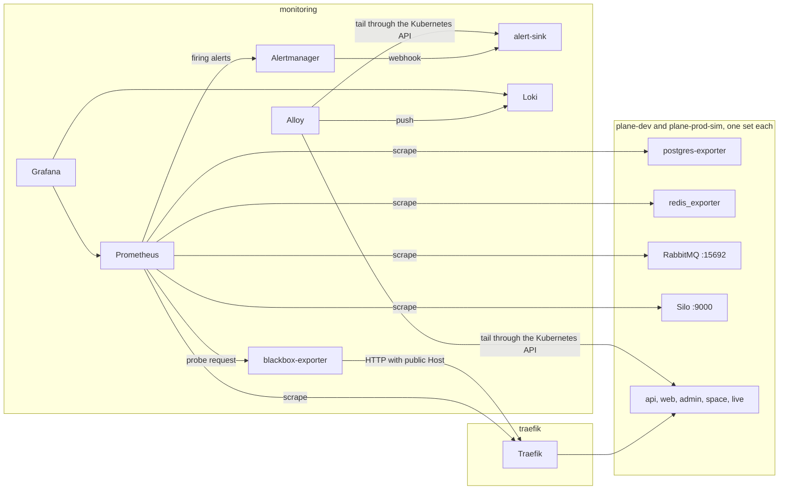
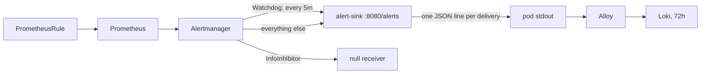

# Monitoring

Wayline is a customized Plane Community Edition v1.4.3 deployment. This page covers how that
deployment and the platform around it are observed: what is scraped, why Plane needs blackbox probes,
which alerts exist, what each can and cannot see, where they go, and how the path is tested.

**Status.** The stack ran on the one local kind cluster on 2026-11-04 and 2026-11-05. Targets, rules, dashboards, log search and
several alerts were proved by queries, not by pod status, and each result links its file under
[`docs/evidence/runs/`](evidence/README.md). `make test-alert` has not run. Each remaining `VERIFY` and `MEASURE` marker is a
claim that still needs a real run. This stack is sized for a laptop and has no redundancy: one Prometheus, one Alertmanager, one
Loki, no paging. It is local and production-inspired, and it makes no claim of production readiness.

## Stack

All versions are pinned in `helm/values/` and `monitoring/manifests/`.

| Component | Version | Namespace | Argo CD Application, wave | Retention or cap |
|---|---|---|---|---|
| Prometheus | v3.15.1 distroless, chart `kube-prometheus-stack` 92.18.0 | `monitoring` | `kube-prometheus-stack`, -7 | 3 days or 1 GiB, whichever comes first |
| Alertmanager | v0.34.2 | `monitoring` | same | 24 hours |
| Grafana | 13.3.0 distroless | `monitoring` | same | No volume. Dashboards come from Git |
| kube-state-metrics | v2.20.0 | `monitoring` | same | Collectors reduced, no Secrets |
| node-exporter | v1.12.1 distroless | `monitoring-agents` | same | PSA `privileged`, because of `hostNetwork` and `hostPID` |
| Loki | 3.7.9, chart 20.4.1, monolithic, filesystem | `monitoring` | `loki`, -6 | 72 hours |
| Alloy | v1.21.3 distroless, chart 1.15.0 | `monitoring` | `alloy`, -6 | Tail positions on an `emptyDir` |
| blackbox-exporter | v0.29.1 | `monitoring` | `monitoring-extras`, -5 | |
| alert sink | Python 3.13 stdlib, `monitoring/manifests/shared/sink.py` | `monitoring` | same | Pod stdout, then Loki |
| postgres-exporter | v0.20.1 | each Plane namespace | same | |
| redis_exporter | v1.96.0 | each Plane namespace | same | |

`retentionSize` is the real cap on Prometheus, because kind's local-path provisioner ignores PVC
capacity. The same is true of Loki: its `2Gi` is a label, and only retention bounds the volume.



## Why Plane has no `/metrics`, and what replaces it

No Plane service exports Prometheus metrics. A repo-wide search of Plane v1.4.3 for `prometheus`,
`django_prometheus` and `prom-client` finds nothing (research note `plane-app.md`, read from source).
Patching them in would widen the fork, so the signal is built from outside:

| Question | Signal |
|---|---|
| Can a client reach the API, web, admin, space and live? | Blackbox probes through Traefik |
| Is the API able to use Postgres? | Blackbox probe on a route that needs the database |
| Is a worker attached? | RabbitMQ consumer count on queue `celery` |
| Is work piling up? | RabbitMQ ready messages on queue `celery` |
| Is a data service up? | postgres-exporter, redis_exporter, RabbitMQ plugin, Silo endpoint |
| Is a pod restarting or near its limit? | kube-state-metrics and cAdvisor |
| What rate and error ratio does the edge see? | Traefik metrics |

Workers and beat expose nothing. A consumer on `celery` proves a connection, not a working task loop. The
only task-level proof is `tests/e2e/smoke.py --job-probe`, which creates a work item and waits for its
background activity. A real case of a live worker with nothing to read is in
[Plane app debugging](runbooks/plane-app-debugging.md#the-cancel_consumer-trap).

## Blackbox probes

Each Plane namespace has four `Probe` objects (`monitoring/manifests/environments/base/probes.yaml`),
scraped every 15 seconds. The target is Traefik's in-cluster Service. The public host is passed as
`?hostname=`, so a probe exercises the same routes as a browser and does not depend on DNS for
`*.localhost`. The Prometheus Operator sets the `namespace` label from where the `Probe` lives, which is
what splits alerts by environment. All 12 `probe_success` series read 1 on 2026-11-04 at 22:19Z
([monitoring-probes-1.txt](evidence/runs/monitoring-probes-1.txt)).

| `probe` label | Path | Module | Passes when | Proves | Does not prove |
|---|---|---|---|---|---|
| `api-instance` | `/api/instances/` | `http_plane_instance` | 200, and the JSON has `config` and `instance` | Traefik and the API process and Valkey answer | **Postgres** |
| `api-db` | `/api/public/anchor/__probe__/settings/` | `http_plane_db` | **404**, and the body has `does not exist` | The API ran a database query | Any write path |
| `live` | `/live/health` | `http_live` | 200, and JSON `status` is `OK` | The live process answers | WebSocket auth |
| `frontend` | `/`, `/god-mode/`, `/spaces/` | `http_html` | 200, and the body has a doctype | The static or SSR page is served | That the page works in a browser |

### Traps these probes are built around

**`/api/instances/` is cached for two hours.** `InstanceEndpoint` carries
`@cache_response(60*60*2, user=False)`, so this route stays 200 from Valkey through a full Postgres outage
(research note `data-observability.md`, read from source). It looks like the obvious health check and is
not one. On 2026-11-04, on upstream images, each Postgres round of the pod restart drill took Postgres away for under a minute. `api-db`
answered 500 with `probe_success` 0 for one sample each, in plane-dev at 22:44:45Z and in plane-prod-sim at 23:35:30Z and 23:54:25Z, while
`api-instance` stayed 200 and 1 ([monitoring-history-reads-1.txt](evidence/runs/monitoring-history-reads-1.txt)). A longer outage, or one
that outlasts the cache entry, has not been tried.

**The healthy `api-db` answer is a 404.** The route runs `DeployBoard.objects.get` for an anchor that does
not exist. A 404 with that message needs a database round trip, and a failed connection gives 500.
Do not "fix" `valid_status_codes` to 200. It read 404 with `probe_success` 1 in both environments
([monitoring-probes-1.txt](evidence/runs/monitoring-probes-1.txt)).

**Status alone is not enough.** With no API endpoints, Traefik can fall through to the catch-all web route,
which answers 200 with HTML. Every module therefore asserts on the body. That fall-through has not been seen. With the only API pod deleted
on 2026-11-04 at about 22:41:45Z and 22:42:45Z in plane-dev, both API routes answered 503 and both probes failed on the status code
([monitoring-history-reads-1.txt](evidence/runs/monitoring-history-reads-1.txt)). Scaling to zero, which is what `make test-alert` does, has
not run.
[[VERIFY: with plane-api-wl at zero, /api/instances/ fails the CEL check rather than passing on the web route]]

**Probes spend the anonymous rate limit.** The two API probes make 8 requests a minute per environment
from one IP, against Plane's anonymous limit of 30 a minute. Do not raise the frequency much: a 429 fails the
probe and looks like an outage. None has been seen at the configured 15s interval: of the 4,740 samples of those two probes that Prometheus
held from 2026-11-04T21:04Z to 2026-11-05T02:01Z, none read 429
([monitoring-history-reads-1.txt](evidence/runs/monitoring-history-reads-1.txt)). That window held smoke runs and drills, and no load test.

**A wiped database shows up late on `api-instance`.** With no `Instance` row the route returns
`{"is_activated":false,"is_setup_done":false}`, which fails the check, but only once the cache is gone.
API start clears the cache. [[VERIFY: after an empty-database restart the api-instance probe fails]]

**Do not set a `Host` header in `blackbox.yml`.** The exporter refuses a module that has one when `?hostname=`
is also passed.

## What is scraped

Prometheus selects every ServiceMonitor, Probe and PrometheusRule in every namespace, because the
`*SelectorNilUsesHelmValues` values are false. Default scrape interval is 30 seconds. On 2026-11-04 at 22:19Z, 40 of 40 active
targets were up ([monitoring-targets-1.txt](evidence/runs/monitoring-targets-1.txt)).

| Target | Source object | Interval | Notes |
|---|---|---|---|
| Plane probes, 4 per environment | `Probe` | 15s | Above |
| postgres-exporter | ServiceMonitor, per environment | 30s | Connects as `POSTGRES_USER`, a superuser, from the `plane-pgdb` Secret. A `pg_monitor` role has no owner today |
| redis_exporter | ServiceMonitor, per environment | 30s | Valkey has no password here, so it holds no credentials |
| RabbitMQ `/metrics` | ServiceMonitor `plane-rabbitmq` | 30s | Aggregated, no `queue` label. Reached through the added `plane-rabbitmq-metrics` Service, because the chart's Service omits 15692 |
| RabbitMQ `/metrics/detailed` | same | 30s | Families `queue_coarse_metrics` and `queue_consumer_count`, vhost `/`. It returns nothing unless families are named |
| Silo `/minio/v2/metrics/cluster` and `/bucket` | ServiceMonitor `plane-minio` | 60s | `helm/plane/components/hardening/patches/silo.yaml` sets `MINIO_PROMETHEUS_AUTH_TYPE=public`, and both scrapes read `up` 1 in both environments ([monitoring-silo-metrics-1.txt](evidence/runs/monitoring-silo-metrics-1.txt)) |
| Traefik | ServiceMonitor `traefik` | 30s | `honorLabels: true`, so Traefik's own `service` label survives |
| Argo CD application controller | ServiceMonitor `argocd-application-controller` | 30s | `helm/values/argocd.yaml` enables the metrics Service. `argocd_app_info` is what the sync alerts read ([h16-metrics-inventory-1.txt](evidence/runs/h16-metrics-inventory-1.txt)) |
| kubelet and cAdvisor | chart `kps-kubelet` | kubelet 30s, cAdvisor 10s | `prober_*` series are off |
| kube-state-metrics, node-exporter, CoreDNS, Prometheus, Alertmanager, Grafana, operator | chart | 30s | |
| Loki, Alloy | their charts' ServiceMonitors | Chart values | Alloy's also carries the two kindnet counters, with kindnet's namespace and pod as labels |

**Not scraped, on purpose:**

| Component | Why |
|---|---|
| etcd, controller-manager, scheduler, kube-proxy | kind binds them to loopback, so a pod cannot reach them. Their rules are off too, or they would fire `*Down` forever |
| API server | It is reachable, but off to save series. `KubeAPIDown` is disabled with it, because its rule file is not guarded by `kubeApiServer.enabled` and carries `absent(up{job="apiserver"})` |
| Infisical operators | The ServiceMonitor stays off: it needs a binding to the metrics-reader role (`infisical/README.md`) |
| Infisical server | No target is configured. Its failure shows as a degraded Application or a stale Secret |

`pg_up` keeps a failing database visible as 0 on a Ready exporter, because the exporter's probes use its landing
page and not `/metrics`. On 2026-11-04 `pg_up` read 0 while the exporter's `up` read 1 and its container read Ready, on both first boots
before Postgres was ready (plane-dev 21:29:30Z to 21:32:45Z, plane-prod-sim 21:30:00Z to 21:47:15Z), and for one 30s scrape in each Postgres
round of the pod restart drill ([monitoring-history-reads-1.txt](evidence/runs/monitoring-history-reads-1.txt)).

`postgres-exporter` carries `argocd.argoproj.io/ignore-healthcheck: "true"`. It syncs at wave -5, and its Secret
appears at wave -1 or later, so without the annotation it would hold the root's waves forever. On the first boot it sat in
`CreateContainerConfigError` from 21:05 to 21:29 while `monitoring-extras` stayed Healthy
([monitoring-ignore-healthcheck-1.txt](evidence/runs/monitoring-ignore-healthcheck-1.txt)).

## Dashboards

Grafana is at `http://grafana.localhost`, user `admin`. The chart generates the password, so it is never in Git.

```bash
KUBECONFIG=.local/kubeconfig .tools/bin/kubectl -n monitoring get secret kps-grafana \
  -o jsonpath='{.data.admin-password}' | base64 -d; echo
```

Dashboards live in `monitoring/manifests/shared/dashboards/`. The Grafana sidecar loads them from labelled
ConfigMaps, and `allowUiUpdates` is false, so a change in the UI is not kept. Edit the JSON, commit, and publish.

| Dashboard | UID | Folder | Answers |
|---|---|---|---|
| Platform overview | `wayline-platform-overview` | Platform | Are both environments up? Firing alerts, VM memory, edge request rate and 5xx ratio, CPU, memory and restarts by namespace |
| Plane data services | `wayline-data-services` | Plane | Postgres, Valkey, RabbitMQ and Silo status, Celery consumers and depth, database and bucket size, last backup age |
| Deployments and rollbacks | `wayline-deployments` | Plane | Application state, sync history, syncs still open, which digest ran when, unavailable replicas |
| Logs | `wayline-logs` | Plane | Search by namespace and container, API 5xx lines, alert deliveries to the sink |

All four load, and no query errors. On 2026-11-04 at 22:19Z through Grafana's API, with namespace `plane-dev`, 41 targets returned
data and 3 were empty. With `plane-prod-sim`, 25 returned data and 2 were empty. The empties were true at the time: no backup had run
(`Last backup`), and no 5xx had happened (`5xx ratio by environment`, `API requests with a 5xx`)
([monitoring-dashboards-wayline-1.txt](evidence/runs/monitoring-dashboards-wayline-1.txt)). They also rendered in the real Grafana UI
(`monitoring-ui-*.jpg` in [`evidence/runs/`](evidence/runs/)). The "Syncs still open" panel came later, in `e64f023`, and no evidence file
records it loading, through the API or in a browser. Its expression, run directly on Prometheus, does return the open operations, such as the
throwaway's 22:56Z to 23:28Z ([monitoring-history-reads-1.txt](evidence/runs/monitoring-history-reads-1.txt)).

The chart's default Kubernetes dashboards are also present. All 26 dashboards loaded through the API on 2026-11-04 at 22:19Z with 0 errors:
431 targets returned data and 44 were empty ([monitoring-dashboards-all-1.txt](evidence/runs/monitoring-dashboards-all-1.txt)). Three chart
dashboards were empty throughout. "Persistent Volumes", 0 of 6, because `kubelet_volume_stats_*` has no series here. "Grafana Overview", 0 of
7, and "Prometheus / Overview", 0 of 15, because the test set `instance` to the first value of its query, which was a pod IP that had gone:
at that moment `grafana_build_info` and `prometheus_build_info` had a series on another IP and none on those
([monitoring-history-reads-1.txt](evidence/runs/monitoring-history-reads-1.txt)). Neither has been run with the right IP.

Panels that group Traefik by `service` read labels of the form `<namespace>-<route>-<first 20 hex of sha256(match)>@kubernetescrd`,
which the `plane-(dev|prod-sim)-.*` regex in `platform-overview.json` matches, checked on the live labels
([monitoring-traefik-labels-1.txt](evidence/runs/monitoring-traefik-labels-1.txt)).

## Alert rules

Project rules are in `monitoring/manifests/shared/rules-plane.yaml` and `rules-platform.yaml`: 24 rules under 23 names,
because `ArgoSyncFailed` has two forms. `tests/rules/rules.test.yaml` holds promtool unit tests for 13 of those names. The "Seen" column
says what the evidence records on the cluster. Where it gives no other file, it comes from a read of `ALERTS` over all that Prometheus held on
2026-11-05, from 2026-11-04T20:30Z to 2026-11-05T02:01Z ([monitoring-history-reads-1.txt](evidence/runs/monitoring-history-reads-1.txt)).

### Plane

Runbook: [Plane debugging](runbooks/plane-app-debugging.md), and [Backup and restore](runbooks/backup-restore.md) for
`PlaneBackupFailed`.

| Alert | Fires on | `for` | Severity | Cannot see | Seen |
|---|---|---|---|---|---|
| `PlaneApiDown` | `probe_success{probe="api-instance"} == 0` | 1m | critical | Postgres, because the route is cached | Fired on the first boot, with Plane absent. See below. `make test-alert` is its test, NOT RUN |
| `PlaneApiDatabaseProbeFailing` | `probe_success{probe="api-db"} == 0` | 1m | critical | Any write path | Fired on the first boot, with Plane absent. See below. Pending for one sample in each Postgres round of the pod restart drill |
| `PlaneFrontendDown` | `probe` is `frontend` or `live`, and it fails | 2m | warning | A page that loads and does not work, an old page a browser kept in its cache ([live-dev](evidence/branding/live-dev/README.md)), WebSocket auth | Fired on the first boot, with Plane absent. See below |
| `PlanePodCrashLooping` | A Plane container waiting in `CrashLoopBackOff` | 1m | critical | `ImagePullBackOff`, or a single restart | None in evidence |
| `PlanePostgresDown` | `pg_up == 0` | 1m | critical | A slow or full database that still answers. A stopped exporter leaves no series | Fired on the first boot, before Postgres was ready. See below. Pending in each Postgres round of the pod restart drill |
| `PlaneValkeyDown` | `redis_up == 0` | 1m | critical | The same for Valkey | Fired on the first boot, before Valkey was ready. See below |
| `PlaneRabbitmqDown` | `up` of the RabbitMQ `/metrics` scrape is 0 | 2m | critical | A broker that answers and has blocked publishers | Pending for seconds around broker restarts, and no firing |
| `PlaneMinioDown` | `up` of the Silo cluster scrape is 0 | 2m | critical | Failing uploads on a Silo that still answers metrics | None in evidence |
| `PlaneWorkerNoConsumer` | `rabbitmq_detailed_queue_consumers{queue="celery"} == 0` | 2m | critical | A worker attached and not finishing tasks. A broker with no `celery` queue | Fired for real in prod-sim on 2026-11-04: pending 23:36:20, in Alertmanager 23:38:20, cleared after the repair ([plane-prod-sim-worker-no-consumer-alert-1.txt](evidence/runs/plane-prod-sim-worker-no-consumer-alert-1.txt)) |
| `PlaneCeleryQueueMissing` | RabbitMQ is up and has no `celery` queue | 10m | critical | A queue with no consumer, which is the rule above | Pending only, and no firing: on both first boots, with the broker up before any worker, for 5m45s in plane-dev and 1m15s in plane-prod-sim, and for seconds after a broker restart ([same file](evidence/runs/plane-prod-sim-worker-no-consumer-alert-1.txt)) |
| `PlaneCeleryBacklog` | More than 500 ready messages on `celery` | 5m | warning | A backlog under 500 | None in evidence |
| `PlaneBackupFailed` | `kube_job_status_failed` on a `plane-backup-*` Job, in a Plane namespace or `infisical` | none | warning | A backup that never ran. The "Last backup" stat shows that | Fired for real in `infisical` on 2026-11-04, from 22:57:30Z, on two backups that failed ([dr-backup-1.txt](evidence/runs/dr-backup-1.txt), [dr-backup-2.txt](evidence/runs/dr-backup-2.txt)). It cleared by 22:59Z, when the next backup succeeded and deleted those Jobs ([dr-backup-3.txt](evidence/runs/dr-backup-3.txt)) |

**A first boot fires these.** `monitoring-extras` syncs at wave -5 and Plane at -1 and 0, so the probes and rules are in place before Plane
answers. The read of `ALERTS` shows them firing on 2026-11-04, in UTC ([monitoring-history-reads-1.txt](evidence/runs/monitoring-history-reads-1.txt)):

| Alert | plane-dev | plane-prod-sim |
|---|---|---|
| `PlaneApiDown`, `PlaneApiDatabaseProbeFailing` | 21:06:00 to 21:46:45 | 21:06:00 to 21:49:30 |
| `PlaneFrontendDown`, first to last of its four probes | 21:06:45 to 21:47:00 | 21:06:45 to 21:49:30 |
| `PlaneValkeyDown` | 21:06:30 to 21:32:45 | 21:06:30 to 21:47:45 |
| `PlanePostgresDown` | 21:31:00 to 21:33:15 | 21:31:30 to 21:47:45 |

The API and frontend alerts cleared when each environment came up. The two data alerts cleared earlier, when the data pods came up. `PlanePostgresDown`
started later because `pg_up` has no series until the exporter runs, and the exporter sat in `CreateContainerConfigError` until 21:29. This shows
the rules can fire on a missing environment, not that each fires on the fault it names. None of these five has fired on a Plane that was up. A first boot
also fires Argo CD rules: see `ArgoAppDegraded` and `ArgoSyncFailed` below.

`PlaneCeleryQueueMissing` exists because of how RabbitMQ 4.3 fails with Celery. The broker is up, and the worker
never attaches and never creates a queue, so `PlaneWorkerNoConsumer` has no series to read. Contract section 9
keeps RabbitMQ on 3.13 or 4.2 for this reason.

`PlaneBackupFailed` clears when a later `scripts/backup.sh` run succeeds, because that script deletes earlier
failed backup Jobs. Otherwise the Job and its alert remain until the 7-day `ttlSecondsAfterFinished`.

### Platform

Runbooks: [Memory pressure](runbooks/memory-pressure.md) for workloads and the VM,
[Troubleshooting](runbooks/troubleshooting.md#networkpolicy-seems-not-to-be-enforced) for kindnet, and
[Argo sync stuck](runbooks/argo-sync-stuck.md) for Argo CD, which also has
[what fires for which failure](runbooks/argo-sync-stuck.md#what-fires-for-which-failure).

| Alert | Fires on | `for` | Severity | Cannot see | Seen |
|---|---|---|---|---|---|
| `PodRestarting` | More than one restart in 15m (`increase` above 1.5), in a Plane, monitoring, `argocd`, `traefik` or `infisical` namespace | none | warning | One restart, on purpose. `kube-system` | Quiet on one Alloy restart, firing on the second ([kindnet-hold-1.txt](evidence/runs/kindnet-hold-1.txt)) |
| `ContainerMemorySaturation` | Working set above 90% of the limit | 5m | warning | A `memory.peak` at the limit that is page cache. `kube-system` | Pending only, and no firing: Loki between 21:46Z and 21:58Z on 2026-11-04, and Prometheus for seconds on 2026-11-05 |
| `VmMemoryLow` | `MemAvailable` below 10% of the node's total | 5m | warning | The Mac's memory | None in evidence. The VM's top was 10.49 GiB of 13.63 ([plane-prod-sim-memory-1.txt](evidence/runs/plane-prod-sim-memory-1.txt)) |
| `KindnetSkippedNetworkPolicies` | The count of kindnet's `skipping network policies` line, held for 3d | none | critical | Any other way enforcement can fail. A line Alloy forgot more than 3d ago. It also sticks after kindnet's container restarts healthy in the same pod | A synthetic line from a scratch pod, firing to resolved, and through two in-place Alloy restarts ([h18-synthetic-2.txt](evidence/runs/h18-synthetic-2.txt), [kindnet-hold-1.txt](evidence/runs/kindnet-hold-1.txt)). No real kindnet failure |
| `KindnetLogsNotRead` | No kindnet line counted, by `absent()` | 10m | warning | A tail that reads and counts wrongly | Pending after an Alloy restart, and no firing recorded ([kindnet-hold-1.txt](evidence/runs/kindnet-hold-1.txt)) |
| `ArgoAppOutOfSync` | `sync_status="OutOfSync"` | 15m | warning | Sync status Unknown, which is the next rule | Fired on a throwaway ([h16-fire-1.txt](evidence/runs/h16-fire-1.txt)) |
| `ArgoAppSyncUnknown` | `sync_status="Unknown"`: a commit that cannot render, or a Git that cannot be read. On an Application that was rendering, the controller ignores the failure for 180s and looks every 120s, so this fires about 21m after the commit (`rules-platform.yaml`) | 15m of reading Unknown | warning | Nothing else fires for this. The cluster silently stays on the old commit | A throwaway with a path that never existed: to the sink at 15m, resolved 2 minutes after its delete ([argo-sync-unknown-1.txt](evidence/runs/argo-sync-unknown-1.txt)). That proves the path, not the timing from a real commit, which has not fired: one read Unknown 5m57s after it and reached pending before it was taken out (`argo-sync-unknown-2.txt`, in `.local/evidence-raw/`, not yet published) |
| `ArgoAppDegraded` | `health_status` is `Degraded` or `Missing` | 5m | critical | A retry loop whose health stays Healthy. Anything that stays Progressing | Fired on a throwaway ([h16-throwaway-1.txt](evidence/runs/h16-throwaway-1.txt)). Also on `plane-dev` and `root` on the first boot, up to 21:26Z, while they waited for the identity Secret |
| `ArgoSyncFailed`, open operation | `argocd_app_info{operation="sync"}` held on any child except root | 15m | critical | It cannot tell a retry loop from a wave waiting on something that never gets healthy. A single-wave chart Application closes its operation on apply, so this never sees it | Fired on a throwaway at 15m, through 2 Prometheus and 1 controller restarts, resolved after its delete ([h16-fire-1.txt](evidence/runs/h16-fire-1.txt)). This form went live after the first boot, at 23:06:02Z. In the failed-deploy drill: NOT RUN |
| `ArgoSyncFailed`, completed | `argocd_app_sync_total{phase=~"Error\|Failed"}` increases, or first appears, in 15m | none | critical | A retry loop, which never completes | Fired with `phase="Failed"` on operations ended by the Terminating patch, on 2026-11-04: scratch Applications `term-a` and `term-b` from 21:05:15Z, and `root` from 21:15:45Z to 21:19:00Z ([argocd-terminate-1.txt](evidence/runs/argocd-terminate-1.txt), [argocd-root-terminate-1.txt](evidence/runs/argocd-root-terminate-1.txt)) |
| `ArgoAppStuckProgressing` | `health_status="Progressing"` on any child except root | 30m | warning | The first 30m. Root itself | Fired on a throwaway at 30m on 2026-11-05, from 01:08:15Z to 01:18:30Z, reading `tests/rules/fixtures/stuck-progressing`. The run's own file, `argo-stuck-progressing-1.txt`, is in `.local/evidence-raw/` and not yet published |
| `ArgoRootSyncStuck` | `argocd_app_info{operation="sync",name="root"}` held | 60m | warning | A Prometheus that cannot start, since nothing then evaluates rules | Pending for under 4 minutes on 2026-11-04 from 23:22:45Z, and no firing |

`ArgoAppOutOfSync` has a 15-minute `for` so that scripts holding self-heal off, such as `scripts/test-alert.sh`
and `scripts/restore.sh`, do not trigger it during a normal run.

**`ArgoSyncFailed` used to stay silent during a retry loop.** Every Application sets `retry.limit: -1`, so a failing sync never
completes. Measured over 30 minutes of a retry loop on a real controller: phase `Running`, `retryCount` up to 8, no series in
`argocd_app_sync_total`, `status.conditions` empty, and only `argocd_app_info{operation="sync"}` held
([h16-throwaway-1.txt](evidence/runs/h16-throwaway-1.txt), [h16-metrics-inventory-1.txt](evidence/runs/h16-metrics-inventory-1.txt),
[h16-fire-1.txt](evidence/runs/h16-fire-1.txt), which has the 8 and the 30 minutes).
So the rule now also reads the open operation. Its 15m has margin against a first boot's wave 3 at 448s
([plane-prod-sim-firstboot-1.txt](evidence/runs/plane-prod-sim-firstboot-1.txt)). It has none against `plane-dev`'s wait for
`scripts/infisical-bootstrap.sh`: that operation stayed open 34 minutes on the first boot ([h16-op-durations-1.txt](evidence/runs/h16-op-durations-1.txt)),
so `rules-platform.yaml` expects this rule to fire on `plane-dev` on a first boot. This form was not live on the one first boot that ran, so that is expected
and not measured. No measured promotion has pulled new layers.
The comment in `rules-platform.yaml` expects `ArgoSyncFailed` and `ArgoAppDegraded` to go pending in the failed-deploy drill, with neither
firing unless the revert takes more than 5m. That drill has not run, so this is expected and not measured.

### Chart defaults that stay on

`kube-prometheus-stack` adds its default rules: 146 alerting rules were loaded on 2026-11-04, 18 of them project rules then, with 0 not
ok, so 128 are the chart's ([monitoring-rules-1.txt](evidence/runs/monitoring-rules-1.txt)). Those worth knowing:

| Alert | Comment |
|---|---|
| `Watchdog` | Always firing, by design. See routing below |
| `NodeFilesystem*`, `KubePersistentVolumeFillingUp` | **Do not trust these for disk.** They watch the VM disk only, which reports hundreds of free GiB on a sparse disk while the Mac runs out first. `/backups` is excluded from node-exporter, because Docker Desktop's mount of the Mac reported 4397 GiB available with 17 GiB free, and the percentage rules went critical on a healthy cluster. Local-path volumes emit no `kubelet_volume_stats_*`. See [Disk pressure](runbooks/disk-pressure.md) |
| `KubeNodePressure`, `KubeNodeEviction` | kind sets eviction thresholds to 0%, so these are not expected to warn about disk |
| `CPUThrottlingHigh` | Fired on node-exporter from 21:19 to 21:38 on 2026-11-04, on a 100m quota. Sidecars, config reloaders, node-exporter and postgres-exporter now have no CPU limit. It still goes pending on pods that just started, which is not a fault ([cpu-throttling-1.txt](evidence/runs/cpu-throttling-1.txt)) |
| `PrometheusMissingRuleEvaluations` | Goes pending on a healthy Prometheus, because the Docker VM steps its wall clock. Left on, because it has not fired and a really slow group would miss far more often ([missing-rule-evaluations-1.txt](evidence/runs/missing-rule-evaluations-1.txt), `monitoring/README.md`) |
| `KubeMemoryOvercommit`, `KubeCPUOvercommit`, `KubeQuota*`, `NodeMemoryHighUtilization` | Memory limits are overcommitted on purpose. These were quiet in the reading below |

Off in Git, because they could only ever fire: `NodeClockNotSynchronising`, since the VM runs no NTP client, and `KubeAPIDown`, since the
API server is not scraped.

On an idle platform on 2026-11-04 at 22:19Z, only `Watchdog` was firing, and nothing was pending
([monitoring-rules-1.txt](evidence/runs/monitoring-rules-1.txt)).

There is deliberately no project disk rule. `guard_disk` in `scripts/lib/common.sh` runs on the host and is the real
check, and `make status` prints host free space.

## Routing to the sink

Alertmanager has one real receiver. There is no email, chat or paging integration in Pass 1, so **an alert reaching
the sink notifies no human.** Someone has to look at Grafana or the sink's log.



| Setting | Value | Why |
|---|---|---|
| `group_by` | `alertname`, `namespace` | The two environments are grouped apart |
| `group_wait` | 10s | Lets `scripts/test-alert.sh` meet its 180s deadline. Default is 30s |
| `group_interval` | 30s | Same reason. Default is 5m |
| `repeat_interval` | 1h, and 5m for `Watchdog` | |
| `send_resolved` | true | The test requires a resolved delivery |
| `max_alerts` | 20 | Keeps a sink line bounded |

`Watchdog` gives a continuous proof: a new sink line about every 5 minutes means rule evaluation, Alertmanager and the
webhook all still work. Measured: a line every 5 to 6 minutes ([monitoring-alertmanager-1.txt](evidence/runs/monitoring-alertmanager-1.txt)).
If those lines stop, the alert path is broken even when no other alert is firing. Nothing alerts on their absence, because the
sink is the only receiver.

Read deliveries in two ways:

```bash
KUBECONFIG=.local/kubeconfig .tools/bin/kubectl -n monitoring logs deploy/alert-sink --tail=20
```

In Grafana, use the "Alert deliveries to the sink" panel on the Logs dashboard. Prometheus and Alertmanager have no
login of their own. They are at `http://prometheus.localhost` and `http://alertmanager.localhost`, on loopback only, and a
`node-network-only` Middleware on all five internal UIs admits only `172.16.0.0/12`. The host gets 200, and a pod gets 403 from Traefik, spoofed
headers included ([routes-after-2.txt](evidence/runs/routes-after-2.txt)). This is a door check and not a login: a pod free to leave
through `host.docker.internal` came back as the host and read Prometheus, and only NetworkPolicy keeps Plane pods from that door
([h17-doors-free-egress-2.txt](evidence/runs/h17-doors-free-egress-2.txt)). Pass 2 must put them behind auth before exposing them.

## Loki and Alloy

Alloy runs as one Deployment and reads logs through the Kubernetes API with `loki.source.kubernetes`, not as a
DaemonSet tailing `/var/log/pods`. It therefore needs no root, no `hostPath` and no privileged namespace. It pays
for that with more kubelet and API server traffic, and that cost is small. Measured on 2026-11-04 over 180-second windows, with Alloy on
53 log streams: API server 58 to 106m CPU and 996 to 1,030 MiB RSS, kubelet 79 to 101m and 160 to 162 MiB. A second Alloy added 6 to
40 MiB to the API server and about 20 MiB to the kubelet, with CPU inside the noise from other work
([monitoring-alloy-apiserver-cost-1.txt](evidence/runs/monitoring-alloy-apiserver-cost-1.txt)). So the documented fallback, a DaemonSet in
`monitoring-agents`, is not needed at this size.

| Setting | Value | Consequence |
|---|---|---|
| Namespaces kept | `plane-dev`, `plane-prod-sim`, `infisical`, `argocd`, `traefik`, `monitoring` | `monitoring-agents` and CoreDNS are not shipped. Read them with `kubectl logs`. `traefik` had no lines in a 5-minute window, since Traefik writes no access log here ([monitoring-logql-1.txt](evidence/runs/monitoring-logql-1.txt)) |
| kindnet | `kube-system`, container `kindnet-cni` only | Counted for `KindnetSkippedNetworkPolicies` and `KindnetLogsNotRead`, then dropped, except the `skipping network policies` line. Read the rest with `kubectl logs` |
| Labels | `namespace`, `pod`, `container` | Query with these only |
| Finished pods | Pods in `Succeeded` or `Failed` are dropped | A short Job, such as the migrator or a backup, may have partial logs in Loki. Read it with `kubectl logs` while the Job exists |
| Probe noise | Lines containing `Blackbox-Exporter` are dropped | The string matches `prober/http.go:292` at v0.29.1. Plane's web and API logs do carry it, and the stage drops them: for `plane-web`, 24 lines in the pod and 16 in Loki, the same 16 without that string ([monitoring-alloy-restart-1.txt](evidence/runs/monitoring-alloy-restart-1.txt)) |
| Positions | `emptyDir`, 256 MiB | Over a pod replacement no line was lost or duplicated in the containers checked, and Loki refused 2,577 re-read lines as too far behind, stored the first time ([monitoring-alloy-restart-1.txt](evidence/runs/monitoring-alloy-restart-1.txt)). An in-place container restart keeps positions and loses counters |
| Loki limits | Ingestion 4 MB/s, burst 8 MB, querier concurrency 2 | Heavy log search on a laptop will be slow |
| Loki memory | 640 MiB limit | Below the chart's example of 2 to 4 GiB. Raise this first on an OOM kill. See below |

Loki at idle read 329 MiB in `kubectl top` on 2026-11-05 at 00:03Z ([plane-prod-sim-snapshot-final-1.txt](evidence/runs/plane-prod-sim-snapshot-final-1.txt)). Under a stress
test on 2026-11-04, 3.5 MB/s of pushes for 270 seconds with 8 query threads for the last 120, anon memory peaked at 553 MiB. There were no OOM kills and no failed
push or query, and the median query rose to about 19 seconds ([monitoring-loki-limit-2.txt](evidence/runs/monitoring-loki-limit-2.txt)). After `kill -9` with a 2.2 GB WAL, all
3,932,060 pushed lines were readable ([monitoring-loki-replay-1.txt](evidence/runs/monitoring-loki-replay-1.txt)). Those lines are synthetic. Queries over 72 hours of real logs have
not been tried.

The `grafana/loki` chart on `grafana.github.io` has been the Enterprise chart since 2026-03-16, so this repo uses
the same 20.4.1 from `grafana-community`. Do not swap the source because the other index looks current.

Filesystem storage is not supported for production by Loki itself. It fits a local Pass 1 only.

The "API requests with a 5xx" panel parses `container="plane-api"` lines as JSON. The parser works: `status_code >= 400` returned 8 lines
and `>= 500` returned none ([monitoring-logql-1.txt](evidence/runs/monitoring-logql-1.txt)). No real 5xx has happened, so that panel has
never shown one.

## Deployment and rollback visibility

A deployment here is a Git change, so the record has three parts.

| Question | Where to look |
|---|---|
| What was promoted, and when? | `git log --grep='^promote' --format='%h %cI %s'`. Commits also carry `Promote-Env` and `Promote-Image` trailers |
| What was rolled back? | `git log --grep='^Revert "promote' --format='%h %cI %s'` |
| Is that commit published to Argo CD? | `git --git-dir=.local/git/plane-platform.git log -1 --format='%h %s' main` |
| What did Argo CD do? | "Application state", "Sync history in range" and "Syncs still open" panels |
| Which digest was running at a given time? | "Which digest ran when" panel, from `kube_pod_container_info` `image_id` |
| Did the rollout hurt anything? | "Unavailable replicas" panel, plus "Probe history" on Platform overview |

Limits to keep in mind:

- History is bound by Prometheus retention, at most 3 days or 1 GiB. Git is the durable record.
- No dashboard has deploy annotations. Line up times by hand with the timeline panels.
- "Sync history" counts completed operations only, so a sync in a retry loop does not appear there. "Syncs still open" shows it.
- A backup taken before a prod-sim promotion appears in `.local/backups/prod-sim/` and in the "Last backup" stat.
  That stat reads Job completion time, so it goes empty once the Job's 7-day TTL expires.

## How alerts are tested

`make test-alert ENV=dev` (or `ENV=prod-sim`) runs `scripts/test-alert.sh`. It is written to prove one complete path for one alert,
`PlaneApiDown`, including the other environment staying quiet. **It has not run.**

| Stage | What the script does | Deadline after injection |
|---|---|---|
| Preflight | Prometheus, Alertmanager and sink are reachable, the rule is loaded, the alert is not already active, and both environments' API probes are healthy | |
| Pause | Pauses auto-sync on the root, then the target app, because self-heal would undo the scale in about 5 seconds | |
| Inject | Scales `plane-api-wl` to 0 | 0 |
| Pending | Alert visible in Prometheus | 60s |
| Firing | Alert `firing` in Prometheus | 150s |
| Alertmanager | Alert active in Alertmanager | 165s |
| Sink | A `firing` webhook for this namespace in the sink's log | 180s |
| Isolation | `PlaneApiDown` not active in the other namespace, no firing webhook for it, and no new `PlaneApiDown`, `PlaneApiDatabaseProbeFailing` or `PlaneFrontendDown` there. Other alerts there are unrelated and do not count ([test-alert-isolation-stub-1.txt](evidence/runs/test-alert-isolation-stub-1.txt), a stub) | |
| Recover | Scales back to the original replica count | |
| Resolved | A `resolved` webhook reaches the sink | 300s after recovery |
| Isolation again | Same check | |

A trap puts the replicas and auto-sync back on any exit, including Ctrl-C. It cannot run after `kill -9` or a power
loss. If that happens, see [Argo sync stuck](runbooks/argo-sync-stuck.md#auto-sync-was-left-paused).

Evidence goes to `.local/evidence-raw/alert-test-<env>-<stamp>.json`, with `PASS` or `FAIL`, the stage that failed, and
seconds per stage. `make publish-evidence` copies it to `docs/evidence/runs/` for it to count.

From configuration, the worst case to the sink is the 5s `preStop` sleep, a 15s probe, 15s evaluation, 1m `for` and 10s `group_wait`. Those
add up to 105 seconds. The script's header says about 125, and the comment in `rules-plane.yaml` about 2 minutes. All of these are calculated
estimates, not measurements. What has been measured is the part after
the rule: a temporary `vector(1)` rule with `for: 1m` took 70 seconds from pending to the sink, and the resolved line arrived 330 seconds
after the rule was deleted ([monitoring-alert-path-1.txt](evidence/runs/monitoring-alert-path-1.txt)).
[[MEASURE: seconds from injection to firing webhook at the sink, per environment]]

[[VERIFY: make test-alert ENV=dev delivers firing and resolved webhooks and prod-sim stays quiet]]

[[VERIFY: make test-alert ENV=prod-sim delivers firing and resolved webhooks and dev stays quiet]]

The preflight requires both environments' API probes to be healthy, so this test cannot run with prod-sim down.

### What this does not test

| Not tested by `make test-alert` | How it could be checked |
|---|---|
| Any other project rule firing | Not automated. The "Seen" columns above say which have fired, and how |
| The `PlanePostgresDown` and `PlaneApiDatabaseProbeFailing` pair | By hand, with self-heal paused, following the pattern in `scripts/test-alert.sh` |
| `PlaneWorkerNoConsumer` | Same, scaling `plane-worker-wl` to 0. It has already fired once for a real reason |
| `PlaneCeleryQueueMissing` | It needs a broker up with no `celery` queue for 10m: a fresh broker whose worker never starts, or a broker the contract forbids, on a throwaway dev run. A restart of a broker whose worker did not reattach keeps the queue, and read `PlaneWorkerNoConsumer` instead ([plane-prod-sim-worker-broker-restart-1.txt](evidence/runs/plane-prod-sim-worker-broker-restart-1.txt)). It has only gone pending so far |
| A real notification to a person | Not possible in Pass 1: the sink is the end of the path |

Whether a rule reads anything was checked on 2026-11-05 at 02:01Z, with both environments Synced and Healthy, by asking for the selector under each
rule with its threshold left off ([monitoring-history-reads-1.txt](evidence/runs/monitoring-history-reads-1.txt)). 16 of the 24 returned series. The other 8 name a
state nothing was in at that moment. The 7 Argo CD rules among them have each gone pending or firing in `ALERTS`, so those selectors do return series when the state
exists. `PlanePodCrashLooping` is the exception: its metric held other waiting reasons in Plane namespaces, and `CrashLoopBackOff` only outside them, so its selector has
returned nothing in what Prometheus holds. This shows what each rule reads, not that it fires on its fault.

A bad rule has two gates before it runs. The Prometheus Operator's admission webhook is off, so `scripts/ci/validate-manifests.sh` runs
`promtool check rules` over the rule files and `promtool test rules` over `tests/rules/rules.test.yaml`. Each published run covers the rules as they stood. At
2026-11-04T22:19Z both passed on 18 rules, 12 and 6 ([monitoring-rules-1.txt](evidence/runs/monitoring-rules-1.txt)). At 23:04Z both passed on 20, 12 and 8, and the
rules from before that change failed the new tests, exit 1 ([h16-promtool-1.txt](evidence/runs/h16-promtool-1.txt)). The current 24 passed at 2026-11-05T01:11Z, and the rules
from before that work failed, exit 1, in `rules-unit-1.txt`, which is in `.local/evidence-raw/` and not yet published. `scripts/ci/negative-controls.sh` plants a broken expression and a rule that
fires late, and requires each to go red. GitHub has not run promtool yet, as [evidence/ci/README.md](evidence/ci/README.md) says. A
broken expression that gets past these shows up only at evaluation, through `PrometheusRuleFailures`.

## Costs

Research estimated 620 to 1,040 MiB of idle RSS for Prometheus, Alertmanager, operator, kube-state-metrics, node-exporter, Grafana, blackbox
and sink, and 250 to 500 MiB for Loki and Alloy, before any monitoring pod had run. Measured on 2026-11-05 at 00:03Z in `kubectl top`, with both
environments running and no test in progress: `monitoring` 1,555 MiB and `monitoring-agents` 19 MiB, a little above the top of that range
([plane-prod-sim-snapshot-final-1.txt](evidence/runs/plane-prod-sim-snapshot-final-1.txt)). Per-container peaks are in
[monitoring-memory-1.txt](evidence/runs/monitoring-memory-1.txt), and the platform's figures in
[resource utilization](resource-utilization.md). A peak at a limit is often page cache: `monitoring/README.md` says how to read one.

[[MEASURE: Prometheus and Loki volume growth per day on an idle platform]]

## Related

- [Runbooks](runbooks/README.md)
- [`monitoring/README.md`](../monitoring/README.md), for the decisions behind this stack and the limits of the kindnet alert
- [Security](security.md), for why `monitoring-agents` is `privileged` and why postgres-exporter's superuser is accepted
- [Known limitations](known-limitations.md)
- [Platform contract](platform-contract.md)
