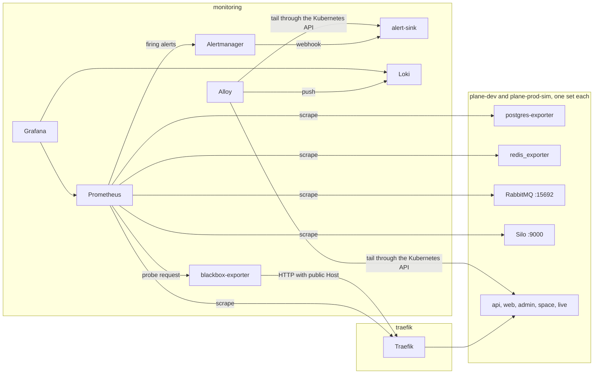
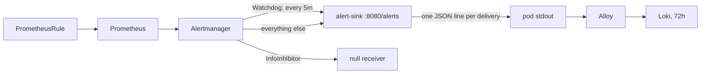

# Monitoring

Wayline is a customized Plane Community Edition v1.4.3 deployment. This page covers how that
deployment and the platform around it are observed: what is scraped, why Plane needs blackbox probes,
which alerts exist, where they go, and how the path is tested.

**Status.** This page describes configuration. It reports no test result, because
[`docs/evidence/`](evidence/) holds no monitoring evidence yet. Each `[[VERIFY: ...]]` and
`[[MEASURE: ...]]` marker is a claim that needs a real run before it can stand. This stack is sized for a
laptop and has no redundancy: one Prometheus, one Alertmanager, one Loki, no paging. It makes no claim
of production readiness.

## Stack

All versions are pinned in `helm/values/` and `monitoring/manifests/`.

| Component | Version | Namespace | Argo CD Application, wave | Retention or cap |
|---|---|---|---|---|
| Prometheus | v3.15.1 distroless, chart `kube-prometheus-stack` 92.18.0 | `monitoring` | `kube-prometheus-stack`, -7 | 3 days or 1 GiB, whichever comes first |
| Alertmanager | v0.34.2 | `monitoring` | same | 24 hours |
| Grafana | 13.3.0 distroless | `monitoring` | same | No volume. Dashboards come from Git |
| kube-state-metrics | v2.20.0 | `monitoring` | same | Collectors reduced, no Secrets |
| node-exporter | v1.12.1 distroless | `monitoring-agents` | same | PSA `privileged`, because of `hostNetwork` and `hostPID` |
| Loki | 3.7.9, chart 20.4.1, monolithic, filesystem | `monitoring` | `loki`, -6 | 72 hours |
| Alloy | v1.21.3 distroless, chart 1.15.0 | `monitoring` | `alloy`, -6 | Tail positions on an `emptyDir` |
| blackbox-exporter | v0.29.1 | `monitoring` | `monitoring-extras`, -5 | |
| alert sink | Python 3.13 stdlib, `monitoring/manifests/shared/sink.py` | `monitoring` | same | Pod stdout, then Loki |
| postgres-exporter | v0.20.1 | each Plane namespace | same | |
| redis_exporter | v1.96.0 | each Plane namespace | same | |

`retentionSize` is the real cap on Prometheus, because kind's local-path provisioner ignores PVC
capacity. The same is true of Loki: its `2Gi` is a label, and only retention bounds the volume.



## Why Plane has no `/metrics`, and what replaces it

No Plane service exports Prometheus metrics. A repo-wide search of Plane v1.4.3 for `prometheus`,
`django_prometheus` and `prom-client` finds nothing (research note `plane-app.md`, read from source).
Patching them in would widen the fork, so the signal is built from outside:

| Question | Signal |
|---|---|
| Can a client reach the API, web, admin, space and live? | Blackbox probes through Traefik |
| Is the API able to use Postgres? | Blackbox probe on a route that needs the database |
| Is a worker attached? | RabbitMQ consumer count on queue `celery` |
| Is work piling up? | RabbitMQ ready messages on queue `celery` |
| Is a data service up? | postgres-exporter, redis_exporter, RabbitMQ plugin, Silo endpoint |
| Is a pod restarting or near its limit? | kube-state-metrics and cAdvisor |
| What rate and error ratio does the edge see? | Traefik metrics |

Workers and beat expose nothing. A consumer on `celery` proves a connection, not a working task loop. The
only task-level proof is `tests/e2e/smoke.py --job-probe`, which creates a work item and waits for its
background activity.

## Blackbox probes

Each Plane namespace has four `Probe` objects (`monitoring/manifests/environments/base/probes.yaml`),
scraped every 15 seconds. The target is Traefik's in-cluster Service. The public host is passed as
`?hostname=`, so a probe exercises the same routes as a browser and does not depend on DNS for
`*.localhost`. The Prometheus Operator sets the `namespace` label from where the `Probe` lives, which is
what splits alerts by environment.

| `probe` label | Path | Module | Passes when | Proves | Does not prove |
|---|---|---|---|---|---|
| `api-instance` | `/api/instances/` | `http_plane_instance` | 200, and the JSON has `config` and `instance` | Traefik and the API process and Valkey answer | **Postgres** |
| `api-db` | `/api/public/anchor/__probe__/settings/` | `http_plane_db` | **404**, and the body has `does not exist` | The API ran a database query | Any write path |
| `live` | `/live/health` | `http_live` | 200, and JSON `status` is `OK` | The live process answers | WebSocket auth |
| `frontend` | `/`, `/god-mode/`, `/spaces/` | `http_html` | 200, and the body has a doctype | The static or SSR page is served | That the page works in a browser |

### Traps these probes are built around

**`/api/instances/` is cached for two hours.** `InstanceEndpoint` carries
`@cache_response(60*60*2, user=False)`, so this route stays 200 from Valkey through a full Postgres outage
(research note `data-observability.md`, read from source). It looks like the obvious health check and is
not one. [[VERIFY: api-instance stays 1 while api-db goes to 0 with Postgres stopped]]

**The healthy `api-db` answer is a 404.** The route runs `DeployBoard.objects.get` for an anchor that does
not exist. A 404 with that message needs a database round trip, and a failed connection gives 500.
Do not "fix" `valid_status_codes` to 200. [[VERIFY: api-db returns 404 with "does not exist" on a healthy environment]]

**Status alone is not enough.** With no API endpoints, Traefik can fall through to the catch-all web route,
which answers 200 with HTML. Every module therefore asserts on the body.
[[VERIFY: with plane-api-wl at zero, /api/instances/ fails the CEL check rather than passing on the web route]]

**Probes spend the anonymous rate limit.** The two API probes make 8 requests a minute per environment
from one IP, against Plane's anonymous limit of 30 a minute. Do not raise the frequency much: a 429 fails the
probe and looks like an outage. [[VERIFY: probes never receive a 429 at the configured 15s interval]]

**A wiped database shows up late on `api-instance`.** With no `Instance` row the route returns
`{"is_activated":false,"is_setup_done":false}`, which fails the check, but only once the cache is gone.
API start clears the cache. [[VERIFY: after an empty-database restart the api-instance probe fails]]

**Do not set a `Host` header in `blackbox.yml`.** The exporter refuses a module that has one when `?hostname=`
is also passed.

## What is scraped

Prometheus selects every ServiceMonitor, Probe and PrometheusRule in every namespace, because the
`*SelectorNilUsesHelmValues` values are false. Default scrape interval is 30 seconds.

| Target | Source object | Interval | Notes |
|---|---|---|---|
| Plane probes, 4 per environment | `Probe` | 15s | Above |
| postgres-exporter | ServiceMonitor, per environment | 30s | Connects as `POSTGRES_USER`, a superuser, from the `plane-pgdb` Secret. A `pg_monitor` role has no owner today |
| redis_exporter | ServiceMonitor, per environment | 30s | Valkey has no password here, so it holds no credentials |
| RabbitMQ `/metrics` | ServiceMonitor `plane-rabbitmq` | 30s | Aggregated, no `queue` label. Reached through the added `plane-rabbitmq-metrics` Service, because the chart's Service omits 15692 |
| RabbitMQ `/metrics/detailed` | same | 30s | Families `queue_coarse_metrics` and `queue_consumer_count`, vhost `/`. It returns nothing unless families are named |
| Silo `/minio/v2/metrics/cluster` and `/bucket` | ServiceMonitor `plane-minio` | 60s | Needs `MINIO_PROMETHEUS_AUTH_TYPE=public`. [[VERIFY: the Silo container sets MINIO_PROMETHEUS_AUTH_TYPE=public; at commit f733b87 it did not, so these scrapes would answer 403]] |
| Traefik | ServiceMonitor `traefik` | 30s | `honorLabels: true`, so Traefik's own `service` label survives |
| Argo CD application controller | ServiceMonitor `argocd-application-controller` | 30s | [[VERIFY: helm/values/argocd.yaml enables the controller metrics Service; at commit f733b87 it did not, so the Argo rules and panels had no data]] |
| kubelet and cAdvisor | chart `kps-kubelet` | kubelet 30s, cAdvisor 10s | `prober_*` series are off |
| kube-state-metrics, node-exporter, CoreDNS, Prometheus, Alertmanager, Grafana, operator | chart | 30s | |
| Loki, Alloy | their charts' ServiceMonitors | Chart values | |

**Not scraped, on purpose:**

| Component | Why |
|---|---|
| etcd, controller-manager, scheduler, kube-proxy | kind binds them to loopback, so a pod cannot reach them. Their rules are off too, or they would fire `*Down` forever |
| API server | It is reachable, but off to save series. `KubeAPIDown` is disabled with it, because its rule file is not guarded by `kubeApiServer.enabled` and carries `absent(up{job="apiserver"})` |
| Infisical operators | The ServiceMonitor stays off: it needs a binding to the metrics-reader role (`infisical/README.md`) |
| Infisical server | No target is configured. Its failure shows as a degraded Application or a stale Secret |

`pg_up` keeps a failing database visible as 0 on a Ready exporter, because the exporter's probes use its landing
page and not `/metrics`. [[VERIFY: pg_up goes to 0 while postgres-exporter stays Ready and scrapeable]]

`postgres-exporter` carries `argocd.argoproj.io/ignore-healthcheck: "true"`. It syncs at wave -5, and its Secret
appears at wave -1 or later, so without the annotation it would hold the root's waves forever.

## Dashboards

Grafana is at `http://grafana.localhost`, user `admin`. The chart generates the password, so it is never in Git.

```bash
KUBECONFIG=.local/kubeconfig .tools/bin/kubectl -n monitoring get secret kps-grafana \
  -o jsonpath='{.data.admin-password}' | base64 -d; echo
```

Dashboards live in `monitoring/manifests/shared/dashboards/`. The Grafana sidecar loads them from labelled
ConfigMaps, and `allowUiUpdates` is false, so a change in the UI is not kept. Edit the JSON, commit, and publish.

| Dashboard | UID | Folder | Answers |
|---|---|---|---|
| Platform overview | `wayline-platform-overview` | Platform | Are both environments up? Firing alerts, VM memory, edge request rate and 5xx ratio, CPU, memory and restarts by namespace |
| Plane data services | `wayline-data-services` | Plane | Postgres, Valkey, RabbitMQ and Silo status, Celery consumers and depth, database and bucket size, last backup age |
| Deployments and rollbacks | `wayline-deployments` | Plane | Application state, sync history, which digest ran when, unavailable replicas |
| Logs | `wayline-logs` | Plane | Search by namespace and container, API 5xx lines, alert deliveries to the sink |

The chart's default Kubernetes dashboards are also present. [[VERIFY: all four Wayline dashboards load and every panel returns data on a running platform]]

Panels that group Traefik by `service` assume values shaped like `plane-dev-*`. [[VERIFY: traefik_service_requests_total service label values match the plane-(dev|prod-sim)-.* regex in platform-overview.json]]

## Alert rules

Project rules are in `monitoring/manifests/shared/rules-plane.yaml` and `rules-platform.yaml`.

### Plane

| Alert | Fires on | `for` | Severity | Runbook |
|---|---|---|---|---|
| `PlaneApiDown` | `probe_success{probe="api-instance"} == 0` | 1m | critical | [Plane debugging](runbooks/plane-app-debugging.md) |
| `PlaneApiDatabaseProbeFailing` | `probe_success{probe="api-db"} == 0` | 1m | critical | [Plane debugging](runbooks/plane-app-debugging.md) |
| `PlaneFrontendDown` | `probe` is `frontend` or `live`, and it fails | 2m | warning | [Plane debugging](runbooks/plane-app-debugging.md) |
| `PlanePodCrashLooping` | A Plane container waiting in `CrashLoopBackOff` | 1m | critical | [Plane debugging](runbooks/plane-app-debugging.md) |
| `PlanePostgresDown` | `pg_up == 0` | 1m | critical | [Plane debugging](runbooks/plane-app-debugging.md) |
| `PlaneValkeyDown` | `redis_up == 0` | 1m | critical | [Plane debugging](runbooks/plane-app-debugging.md) |
| `PlaneRabbitmqDown` | `up` of the RabbitMQ `/metrics` scrape is 0 | 2m | critical | [Plane debugging](runbooks/plane-app-debugging.md) |
| `PlaneMinioDown` | `up` of the Silo cluster scrape is 0 | 2m | critical | [Plane debugging](runbooks/plane-app-debugging.md) |
| `PlaneWorkerNoConsumer` | `rabbitmq_detailed_queue_consumers{queue="celery"} == 0` | 2m | critical | [Plane debugging](runbooks/plane-app-debugging.md) |
| `PlaneCeleryQueueMissing` | RabbitMQ is up and has no `celery` queue | 10m | critical | [Plane debugging](runbooks/plane-app-debugging.md) |
| `PlaneCeleryBacklog` | More than 500 ready messages on `celery` | 5m | warning | [Plane debugging](runbooks/plane-app-debugging.md) |
| `PlaneBackupFailed` | `kube_job_status_failed` on a `plane-backup-*` Job | none | warning | [Backup and restore](runbooks/backup-restore.md) |

`PlaneCeleryQueueMissing` exists because of how RabbitMQ 4.3 fails with Celery. The broker is up, and the worker
never attaches and never creates a queue, so `PlaneWorkerNoConsumer` has no series to read. Contract section 9
keeps RabbitMQ on 3.13 or 4.2 for this reason.

`PlaneBackupFailed` clears when a later `scripts/backup.sh` run succeeds, because that script deletes earlier
failed backup Jobs. Otherwise the Job and its alert remain until the 7-day `ttlSecondsAfterFinished`.

### Platform

| Alert | Fires on | `for` | Severity | Runbook |
|---|---|---|---|---|
| `PodRestarting` | More than 1 restart in 15m, in any platform namespace | none | warning | [Memory pressure](runbooks/memory-pressure.md) |
| `ContainerMemorySaturation` | Working set above 90% of the limit | 5m | warning | [Memory pressure](runbooks/memory-pressure.md) |
| `VmMemoryLow` | `MemAvailable` below 10% of the node's total | 5m | warning | [Memory pressure](runbooks/memory-pressure.md) |
| `ArgoAppOutOfSync` | `sync_status="OutOfSync"` | 15m | warning | [Argo sync stuck](runbooks/argo-sync-stuck.md) |
| `ArgoAppDegraded` | `health_status` is `Degraded` or `Missing` | 5m | critical | [Argo sync stuck](runbooks/argo-sync-stuck.md) |
| `ArgoSyncFailed` | `argocd_app_sync_total{phase=~"Error\|Failed"}` increases | none | critical | [Argo sync stuck](runbooks/argo-sync-stuck.md) |

`ArgoAppOutOfSync` has a 15-minute `for` so that scripts holding self-heal off, such as `scripts/test-alert.sh`
and `scripts/restore.sh`, do not trigger it during a normal run.

**`ArgoSyncFailed` is expected to stay silent during a retry loop.** Every Application sets `retry.limit: -1`. Read
at Argo CD v3.5.7, `controller/appcontroller.go` puts a failed attempt back to phase `Running` when retries remain,
and `IncSync` in `controller/metrics/metrics.go` returns early unless the phase is completed. So a failing sync
does not increment the counter this rule reads. Until this is changed, treat `ArgoAppDegraded` and
`ArgoAppOutOfSync` as the working signals. See [Argo sync stuck](runbooks/argo-sync-stuck.md).
[[VERIFY: a sync failing under retry.limit -1 leaves argocd_app_sync_total{phase=~"Error|Failed"} unchanged and ArgoSyncFailed silent]]

### Chart defaults that stay on

`kube-prometheus-stack` adds its default rules. A `helm template` of chart 92.18.0 with these values has 129 alert rules. Those worth knowing:

| Alert | Comment |
|---|---|
| `Watchdog` | Always firing, by design. See routing below |
| `NodeFilesystem*`, `KubePersistentVolumeFillingUp` | **Do not trust these for disk.** The VM reports hundreds of free GiB on a sparse disk while the Mac runs out first, and local-path volumes emit no `kubelet_volume_stats_*`. See [Disk pressure](runbooks/disk-pressure.md) |
| `KubeNodePressure`, `KubeNodeEviction` | kind sets eviction thresholds to 0%, so these are not expected to warn about disk |
| `KubeMemoryOvercommit`, `KubeCPUOvercommit`, `KubeQuota*`, `NodeMemoryHighUtilization`, `CPUThrottlingHigh` | May fire on a healthy laptop cluster. Memory limits are overcommitted on purpose. [[VERIFY: list which default alerts fire on an idle, healthy platform, and decide whether to silence each one in Git]] |

There is deliberately no project disk rule. `guard_disk` in `scripts/lib/common.sh` runs on the host and is the real
check, and `make status` prints host free space.

## Routing to the sink

Alertmanager has one real receiver. There is no email, chat or paging integration in Pass 1, so **an alert reaching
the sink notifies no human.** Someone has to look at Grafana or the sink's log.



| Setting | Value | Why |
|---|---|---|
| `group_by` | `alertname`, `namespace` | The two environments are grouped apart |
| `group_wait` | 10s | Lets `scripts/test-alert.sh` meet its 180s deadline. Default is 30s |
| `group_interval` | 30s | Same reason. Default is 5m |
| `repeat_interval` | 1h, and 5m for `Watchdog` | |
| `send_resolved` | true | The test requires a resolved delivery |
| `max_alerts` | 20 | Keeps a sink line bounded |

`Watchdog` gives a continuous proof: a new sink line every 5 minutes means rule evaluation, Alertmanager and the
webhook all still work. If those lines stop, the alert path is broken even when no other alert is firing. Nothing alerts
on their absence, because the sink is the only receiver. [[VERIFY: the sink logs a Watchdog delivery about every 5 minutes]]

Read deliveries in two ways:

```bash
KUBECONFIG=.local/kubeconfig .tools/bin/kubectl -n monitoring logs deploy/alert-sink --tail=20
```

In Grafana, use the "Alert deliveries to the sink" panel on the Logs dashboard. Prometheus and Alertmanager have no
login of their own. They are reachable at `http://prometheus.localhost` and `http://alertmanager.localhost` on
loopback only, so Pass 2 must put them behind auth before exposing them.

## Loki and Alloy

Alloy runs as one Deployment and reads logs through the Kubernetes API with `loki.source.kubernetes`, not as a
DaemonSet tailing `/var/log/pods`. It therefore needs no root, no `hostPath` and no privileged namespace. It pays
for that with more kubelet and API server traffic. If that load shows up, the documented fallback is a DaemonSet in
`monitoring-agents`. [[MEASURE: API server and kubelet CPU and memory with Alloy tailing all kept containers]]

| Setting | Value | Consequence |
|---|---|---|
| Namespaces kept | `plane-dev`, `plane-prod-sim`, `infisical`, `argocd`, `traefik`, `monitoring` | `kube-system` and `monitoring-agents` are not shipped. Read kindnet and CoreDNS with `kubectl logs` |
| Labels | `namespace`, `pod`, `container` | Query with these only |
| Finished pods | Pods in `Succeeded` or `Failed` are dropped | A short Job, such as the migrator or a backup, may have partial logs in Loki. Read it with `kubectl logs` while the Job exists |
| Probe noise | Lines containing `Blackbox-Exporter` are dropped | The string matches `prober/http.go:292` at v0.29.1. [[VERIFY: Plane or Traefik logs carry the user agent, so this stage actually drops probe lines]] |
| Positions | `emptyDir`, 256 MiB | Lines can be lost or re-read when Alloy restarts |
| Loki limits | Ingestion 4 MB/s, burst 8 MB, querier concurrency 2 | Heavy log search on a laptop will be slow |
| Loki memory | 640 MiB limit | Below the chart's example of 2 to 4 GiB. Raise this first on an OOM kill. [[MEASURE: Loki working set at idle and during a log query]] |

The `grafana/loki` chart on `grafana.github.io` has been the Enterprise chart since 2026-03-16, so this repo uses
`oci://ghcr.io/grafana-community/helm-charts`. Do not swap the source because the other index looks current.

Filesystem storage is not supported for production by Loki itself. It fits a local Pass 1 only.

The "API requests with a 5xx" panel parses `container="plane-api"` lines as JSON. [[VERIFY: plane-api logs JSON with a status_code field, so the 5xx panel returns data]]

## Deployment and rollback visibility

A deployment here is a Git change, so the record has three parts.

| Question | Where to look |
|---|---|
| What was promoted, and when? | `git log --grep='^promote' --format='%h %cI %s'`. Commits also carry `Promote-Env` and `Promote-Image` trailers |
| What was rolled back? | `git log --grep='^Revert "promote' --format='%h %cI %s'` |
| Is that commit published to Argo CD? | `git --git-dir=.local/git/plane-platform.git log -1 --format='%h %s' main` |
| What did Argo CD do? | "Application state" and "Sync history in range" panels |
| Which digest was running at a given time? | "Which digest ran when" panel, from `kube_pod_container_info` `image_id` |
| Did the rollout hurt anything? | "Unavailable replicas" panel, plus "Probe history" on Platform overview |

Limits to keep in mind:

- History is bound by Prometheus retention, at most 3 days or 1 GiB. Git is the durable record.
- No dashboard has deploy annotations. Line up times by hand with the timeline panels.
- "Sync history" counts completed operations only, so a sync in a retry loop does not appear. See the note on
  `ArgoSyncFailed`.
- The panels depend on the Argo CD metrics Service noted in the scrape table.
- A backup taken before a prod-sim promotion appears in `.local/backups/prod-sim/` and in the "Last backup" stat.
  That stat reads Job completion time, so it goes empty once the Job's 7-day TTL expires.

## How alerts are tested

`make test-alert ENV=dev` (or `ENV=prod-sim`) runs `scripts/test-alert.sh`. It proves one complete path for one alert,
`PlaneApiDown`, including the other environment staying quiet.

| Stage | What the script does | Deadline after injection |
|---|---|---|
| Preflight | Prometheus, Alertmanager and sink are reachable, the rule is loaded, the alert is not already active, and both environments' API probes are healthy | |
| Pause | Pauses auto-sync on the root, then the target app, because self-heal would undo the scale in about 5 seconds | |
| Inject | Scales `plane-api-wl` to 0 | 0 |
| Pending | Alert visible in Prometheus | 60s |
| Firing | Alert `firing` in Prometheus | 150s |
| Alertmanager | Alert active in Alertmanager | 165s |
| Sink | A `firing` webhook for this namespace in the sink's log | 180s |
| Isolation | No `PlaneApiDown` and no new alert for the other namespace | |
| Recover | Scales back to the original replica count | |
| Resolved | A `resolved` webhook reaches the sink | 300s after recovery |
| Isolation again | Same check | |

A trap puts the replicas and auto-sync back on any exit, including Ctrl-C. It cannot run after `kill -9` or a power
loss. If that happens, see [Argo sync stuck](runbooks/argo-sync-stuck.md).

Evidence goes to `.local/evidence-raw/alert-test-<env>-<stamp>.json`, with `PASS` or `FAIL`, the stage that failed, and
seconds per stage. Copy it to `docs/evidence/` for it to count.

From configuration, the worst case to the sink is 15s probe plus 15s evaluation plus 1m `for` plus 10s `group_wait`,
about 100 seconds. That is a calculated estimate, not a measurement. [[MEASURE: seconds from injection to firing webhook at the sink, per environment]]

[[VERIFY: make test-alert ENV=dev delivers firing and resolved webhooks and prod-sim stays quiet]]

[[VERIFY: make test-alert ENV=prod-sim delivers firing and resolved webhooks and dev stays quiet]]

The preflight requires both environments' API probes to be healthy, so this test cannot run with prod-sim down.

### What this does not test

| Not tested by `make test-alert` | How it could be checked |
|---|---|
| Any other project rule firing | Not automated. Rule syntax and queries are not exercised against live data by this script |
| The `PlanePostgresDown` and `PlaneApiDatabaseProbeFailing` pair | By hand, with self-heal paused, following the pattern in `scripts/test-alert.sh` |
| `PlaneWorkerNoConsumer` | Same, scaling `plane-worker-wl` to 0 |
| `PlaneCeleryQueueMissing` | Only reachable with a broker the contract forbids, so only on a throwaway dev run |
| A real notification to a person | Not possible in Pass 1: the sink is the end of the path |

[[VERIFY: each project rule's expression returns a series on a running platform, so no rule is silently empty]]

A bad rule has few gates before it runs. The Prometheus Operator's admission webhook is off, and the comment beside that
setting in `helm/values/kube-prometheus-stack.yaml` says CI runs `promtool` instead. No script in the repository calls `promtool`
at commit fb0302f, so `PrometheusRule` objects get schema validation at most, and a broken expression shows up only at evaluation, through
`PrometheusRuleFailures`. [[VERIFY: CI runs promtool over the rule files, or the values comment is corrected]]

## Costs

Budgets from research are estimates, not measurements. Critique section 4 estimates 620 to 1,040 MiB of idle RSS for
Prometheus, Alertmanager, operator, kube-state-metrics, node-exporter, Grafana, blackbox and sink, and 250 to 500 MiB for
Loki and Alloy. Those were derived from research-report figures with Grafana raised to 350 MiB, and no monitoring pod had
run when they were made. The measured figures belong in [resource utilization](resource-utilization.md).

[[MEASURE: idle working set of the monitoring and monitoring-agents namespaces]]

[[MEASURE: Prometheus and Loki volume growth per day on an idle platform]]

## Related

- [Runbooks](runbooks/README.md)
- [Security](security.md), for why `monitoring-agents` is `privileged` and why postgres-exporter's superuser is accepted
- [Known limitations](known-limitations.md)
- [Platform contract](platform-contract.md)
