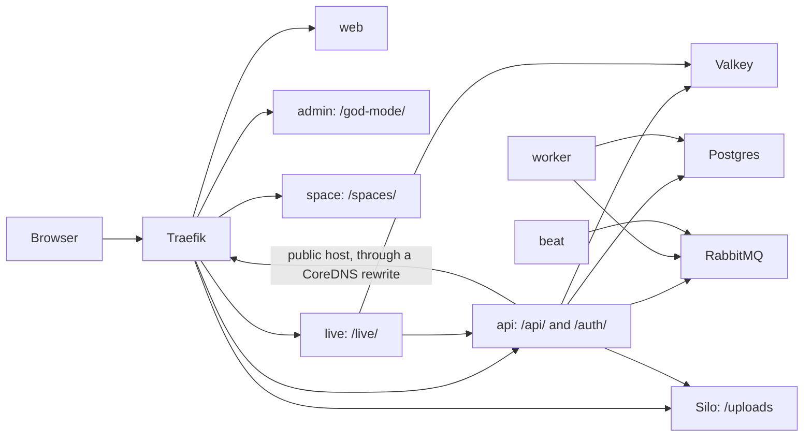

# Plane application debugging

The platform is up, and Plane itself misbehaves. Wayline is a customized Plane Community Edition v1.4.3 deployment, so most of these behaviours come from upstream code. The facts below were read from upstream source (research notes `plane-app.md`, `plane-helm.md` and critique section 1), and a link says where one was checked on the running environments. Marked ones still need a run.

Preamble for raw commands:

```bash
export PATH="$PWD/.tools/bin:$PATH" KUBECONFIG="$PWD/.local/kubeconfig"
NS=plane-dev HOST=plane.dev.localhost
```

## Topology



## First moves

```bash
kubectl -n "$NS" get pods
make logs ENV=dev SVC=api
curl -s -o /dev/null -w 'instances %{http_code}\n' "http://$HOST/api/instances/"
curl -s -w '\nanchor %{http_code}\n' "http://$HOST/api/public/anchor/__probe__/settings/"
curl -s "http://$HOST/live/health"; echo
```

Read these two API answers together. **`/api/instances/` is cached in Valkey for two hours** and says nothing about Postgres. On 2026-11-04, on upstream images, each Postgres round of the pod restart drill took Postgres away for under a minute: the anchor route answered 500 for one 15s probe sample while `/api/instances/` stayed 200 ([monitoring-history-reads-1.txt](../evidence/runs/monitoring-history-reads-1.txt)). On the final images on 2026-11-05 in dev, that round gave seven 500s on a signed-in `GET /api/users/me/`, read once a second, while the four pages stayed 200 (`.local/evidence-raw/PERS-1-20261105T070358Z-timeline.txt`, not yet published). A longer outage has not been tried.

| `/api/instances/` | `/api/public/anchor/__probe__/settings/` | Likely |
|---|---|---|
| 200 JSON | 404 "does not exist" | API and database are fine. This 404 is the healthy answer |
| 200 JSON | 500 | **Postgres is unreachable or empty**, and the first answer is from cache |
| 200 HTML | any | API has no endpoints, and Traefik fell through to the web route. Not seen so far, see the 503 row |
| 500 | 500 | Valkey or the API itself. Expected for Valkey down, as `CACHES` does not ignore exceptions. Not seen so far: in the drills' Valkey rounds the pod is back within seconds, and the `api-instance` probe read no failure, so the outage may have fallen between its 15s samples. [[VERIFY: with Valkey down /api/instances/ answers 500]] |
| 429 | any | Anonymous rate limit, 30 a minute per IP |
| 502, 503, 504 | same | No ready API pods. Look at the pods. With the only API pod deleted on 2026-11-04, both answered 503 ([monitoring-history-reads-1.txt](../evidence/runs/monitoring-history-reads-1.txt)) |

## Symptoms and causes

### API pod will not start or never becomes Ready

| Log or state | Cause | Fix |
|---|---|---|
| `CreateContainerConfigError` | A Secret is missing. Chart references are `optional: false`, so the pod waits | `kubectl -n "$NS" get infisicalstaticsecrets`. See [Argo sync stuck](argo-sync-stuck.md) |
| Hangs in `wait_for_migrations` | A migration is unapplied. It blocks API, worker and beat forever | Check the migrator below |
| Crash at import mentioning `FILE_SIZE_LIMIT` | Value is not bytes. `5MB` crashes Django | Value must be `5242880`, in Infisical's template |
| `SECRET_KEY` error from `configure_instance` | Key is missing. It is mandatory for the API | Check `plane-app-keys` |
| Hangs at boot on `.delay()`, or a connection error to RabbitMQ | `register_instance` calls `push_instance_metrics.delay()` unconditionally, so **the API needs RabbitMQ at boot** | Fix RabbitMQ first |
| Permission errors on `plane/logs` or `static-assets` | Non-root needs writable paths. Every workload ran as its intended non-root UID on 2026-11-04 ([plane-dev-psa-1.txt](../evidence/runs/plane-dev-psa-1.txt), [plane-prod-sim-host-and-identity-1.txt](../evidence/runs/plane-prod-sim-host-and-identity-1.txt)). Read-only root has not been tried | Check the hardening patch |
| Slow start under CPU limits | Boot runs migration checks, registration and collectstatic before gunicorn binds. Container start to Ready: 31s in dev ([plane-dev-startup-1.txt](../evidence/runs/plane-dev-startup-1.txt)), and 36s on prod-sim's first boot ([plane-prod-sim-firstboot-1.txt](../evidence/runs/plane-prod-sim-firstboot-1.txt)). The budget is 300s | Wait |

Migrator:

```bash
kubectl -n "$NS" get job plane-api-migrate-1
kubectl -n "$NS" logs job/plane-api-migrate-1 --tail=30
kubectl -n "$NS" exec deploy/plane-api-wl -c plane-api -- python manage.py showmigrations --plan | grep '\[ \]' | head
```

`wait_for_db` connects to nothing (`connections["default"]` never opens a socket), so an early failure is covered by `backoffLimit: 3`, not by the wait.

### Background work does not happen

Activity feeds are empty, notifications do not go out, exports never finish. The POST itself still returns 201, because the API only queues.

**Celery and RabbitMQ must be paired.** Contract section 9 allows RabbitMQ 3.13 or 4.2 only. On 4.3, Celery attaches **zero consumers** (upstream chart PR #304, with pidbox queue errors and a fix only in a private repo). The broker looks healthy and the worker looks alive. `CELERY_CONTROL_QUEUE_EXCLUSIVE` is absent from CE v1.4.3, so there is no setting to fall back on. This repo pins `3.13.7-management-alpine`, an end-of-life series accepted as a risk. Celery on 4.2.9 has not been tried.

```bash
kubectl -n "$NS" exec plane-rabbitmq-wl-0 -c plane-rabbitmq -- rabbitmqctl -q list_queues name messages consumers
kubectl -n "$NS" exec plane-rabbitmq-wl-0 -c plane-rabbitmq -- rabbitmqctl -q list_consumers
make logs ENV=dev SVC=worker
kubectl -n "$NS" get pods -l 'app.kubernetes.io/component in (worker,beat)'
```

| Queue state | Alert | Meaning |
|---|---|---|
| `celery` has 0 consumers | `PlaneWorkerNoConsumer` | Worker down or not connected |
| No `celery` queue at all | `PlaneCeleryQueueMissing`, after 10m | Worker never attached. This is the 4.3 failure, or the worker never started |
| Messages climbing | `PlaneCeleryBacklog` | Worker is slow or stuck. Concurrency is 2 |
| Consumers present, nothing processed | None | A consumer shows a connection, not a working loop. Read worker logs |
| 0 consumers, the worker Ready, `inspect ping` answers pong | `PlaneWorkerNoConsumer` | See [the `cancel_consumer` trap](#the-cancel_consumer-trap) |

Beat is single-replica by design, using `DatabaseScheduler`. Do not scale it.

End-to-end check of the async path:

```bash
python3 tests/e2e/smoke.py --env dev --mode verify --job-probe
```

Exit codes: 0 all passed, 1 a failure, 2 no failure but something was BLOCKED. Do not read 2 as a pass.

If publishers hang while the queue is fine, check for a memory alarm. See [Memory pressure](memory-pressure.md).

### The `cancel_consumer` trap

A worker that has been through Celery's `cancel_consumer` runs normally until its next broker reconnect. It then consumes nothing, while `inspect ping` still answers pong. In Celery 5.5.3, `cancel_consumer` empties the queue selection, and `add_consumer` attaches a consumer without putting the queue back in it ([harness-celery-selection-source-1.txt](../evidence/runs/harness-celery-selection-source-1.txt)). So nothing shows it until the moment it matters.

Measured in prod-sim on 2026-11-04 ([plane-prod-sim-worker-broker-restart-1.txt](../evidence/runs/plane-prod-sim-worker-broker-restart-1.txt)):

| Worker | Broker restarted | Result |
|---|---|---|
| Never cancelled | Yes | Consumer back in 34s, and a new job ran |
| After cancel, then add | Yes | In the controlled run: 0 consumers and 0 messages after a 90s wait, `active_queues` empty. The state found earlier, after the first drill failed, was the same with 210 messages parked |
| Pod replaced | Not needed | Consumer back, 210 parked messages drained, and all 4 probe items got their activity |

`PlaneWorkerNoConsumer` fired for it ([plane-prod-sim-worker-no-consumer-alert-1.txt](../evidence/runs/plane-prod-sim-worker-no-consumer-alert-1.txt)). It also failed the first pod restart drill in prod-sim ([drill-pod-restart-prod-sim-20261104T233500Z.log](../evidence/runs/drill-pod-restart-prod-sim-20261104T233500Z.log)).

The source was this repo's own `tests/e2e/smoke.py --worker-negative-control`. It now replaces the worker after its control, and smoke's step `worker-clean` fails on a worker that has logged the line. The control followed by a broker restart then ran a job ([harness-worker-control-prod-sim-1.txt](../evidence/runs/harness-worker-control-prod-sim-1.txt), and read the note at its top).

```bash
kubectl -n "$NS" logs deploy/plane-worker-wl -c plane-worker | grep 'Canceling queue'
kubectl -n "$NS" exec deploy/plane-worker-wl -c plane-worker -- celery -A plane inspect active_queues -t 15
kubectl -n "$NS" delete pod -l app.kubernetes.io/component=worker
```

Replacing the pod is the repair to use. `add_consumer` a second time did not bring it back through a broker restart on a scratch worker. SIGHUP, Celery's own restart, did, in that same scratch container, but that has not been tried on a Plane pod (`.local/evidence-raw/harness-worker-scratch-1.txt`, not yet published). Replacing the pod is no drift for Argo CD, though the Application reads `Progressing` until the new pod is ready.

### Configuration silently empty

Instance settings, such as SMTP or OAuth keys, read back empty with no error.

`decrypt_data` fails **silently** to `""` when `SECRET_KEY` does not match. `settings/common.py` also silently randomises a missing `SECRET_KEY` for worker, beat and migrator. Only the API fails loudly.

```bash
kubectl -n "$NS" exec deploy/plane-api-wl -c plane-api -- python manage.py shell -c "
from plane.license.models import InstanceConfiguration as C
from plane.license.utils.encryption import decrypt_data as d
rows = C.objects.filter(is_encrypted=True).exclude(value__isnull=True).exclude(value='')
print('rows', rows.count(), 'undecryptable', [c.key for c in rows if not d(c.value)])"
```

This prints key names only. If rows are undecryptable, the database and key do not match. The fix is a matched restore, see [Backup and restore](backup-restore.md). Rotating or reseeding the key cannot recover them.

### Uploads, images or exports fail

| Symptom | Cause |
|---|---|
| Export download link has a doubled path | Bucket is not named `uploads`. `export_task.py` does `.replace('/uploads', '')`. The name is fixed in both environments, and isolation comes from each having its own Silo |
| Duplicating an asset gives 500, and OAuth avatars fail | `copy_object` and avatars dial the **public host** from inside the API pod. CoreDNS rewrites `plane.*.localhost` to Traefik, and NetworkPolicy must allow API to Traefik. A connection error there is not caught as `ClientError` |
| Upload rejected | Two limits apply. Traefik's `plane-body-limit` allows 20 MiB, and Plane's `FILE_SIZE_LIMIT` is 5 MiB, in bytes. 4.5 MiB passes, and 5 MiB plus one byte gets 400 from the storage policy (smoke steps `large-upload`, `oversize-refused`) |
| Attachment returns 403 or 404 | Presigned URL host or signature. Check `AWS_S3_ENDPOINT_URL` and Traefik's `/uploads` route |
| Silo metrics answer 403 | `MINIO_PROMETHEUS_AUTH_TYPE` is not public. This is about scraping, not uploads |

```bash
kubectl -n "$NS" exec deploy/plane-api-wl -c plane-api -- python -c "import socket; print(socket.gethostbyname('$HOST'))"
kubectl -n kube-system get configmap coredns -o jsonpath='{.data.Corefile}' | grep -n rewrite
```

These work, with no bucket-creation Job. In both environments, smoke's steps `attachment-upload`, `attachment-download`, `object-in-silo`, `uploads-private`, `asset-duplicate`, `avatar` and `export` pass ([smoke-dev-20261105T001213Z.json](../evidence/runs/smoke-dev-20261105T001213Z.json), [smoke-prod-sim-20261104T235926Z.json](../evidence/runs/smoke-prod-sim-20261104T235926Z.json)). `copy_object` goes through the CoreDNS rewrite: the copied bytes match, and Traefik's PUT counter moved by one per run ([plane-dev-copy-object-path-1.txt](../evidence/runs/plane-dev-copy-object-path-1.txt)). An attachment through a browser's file dialog has not been tried.

The object store is Silo, a MinIO-compatible fork. Official MinIO images no longer pull anonymously. Silo images are distroless, so there is no shell in the pod. Inspect it with `rclone` Jobs, as `scripts/backup.sh` does, not with `kubectl exec`.

### Live collaboration fails

```bash
make logs ENV=dev SVC=live
curl -s "http://$HOST/live/health"; echo
```

An HTTP 101 alone does not prove anything: the Hocuspocus handshake is unauthenticated, and auth happens in the first frame, by calling `GET /api/users/me/` with the cookie. So a socket can open while auth fails. `tests/e2e/smoke.py` sends the auth frame for this reason. Live also needs `REDIS_URL`, and may crash on a bad one.

`LIVE_SERVER_SECRET_KEY` is not consumed by anything in v1.4.3, so it is not the cause.

The WebSocket works through Traefik's buffering middleware. Smoke held two connections idle for 330s, with pings answered, and then an update got through ([plane-dev-smoke-soak-1.txt](../evidence/runs/plane-dev-smoke-soak-1.txt)). In a real browser on the branded images on 2026-11-05, tab 2 showed what was typed in tab 1 within 2 seconds, and a reload brought it back from the server ([live-dev](../evidence/branding/live-dev/README.md)).

A `live` restart keeps stored edits. An edit still inside the 10-second debounce was not on the server afterwards, and the client took about 21 seconds to reconnect ([plane-dev-live-restart-1.txt](../evidence/runs/plane-dev-live-restart-1.txt)). Whether an open tab sends that edit again has not been tested.

### Login or rate limit trouble

Auth counters live in Valkey, and retry-heavy tests can trip them. `API_KEY_RATE_LIMIT` defaults to 60 a minute per key, and `api_tokens.allowed_rate_limit` is not read. Requests with an API key are also logged through Celery into `api_activity_logs`, so API-token load writes to the database. `tests/load/` uses session auth for this reason.

Cookies are host-only, with no `Domain` attribute, and a dev session gets 401 on the prod-sim host, over plain HTTP ([plane-dev-cookies-1.txt](../evidence/runs/plane-dev-cookies-1.txt)). In Chromium on 2026-11-05, a profile signed in on dev read 200 from dev's `GET /api/users/me/` and 401 from prod-sim's, in two tabs at once (`.local/evidence-raw/AUTH-4-20261105T062750Z.txt`, not yet published). That is one session, and no sign-in on prod-sim happened, because the session's permission system refused reading that test account. So both hosts signed in at once has not been tried. [[VERIFY: logging in to both hosts at once in one browser keeps sessions apart]]

### What a browser shows

An old page after a promotion was the browser's cache on the first branded images. On 2026-11-05 the upstream sign-in page kept showing after they landed, with no error, because nginx in the web and admin images sent `ETag` and `Last-Modified` with no `Cache-Control` ([live-dev](../evidence/branding/live-dev/README.md)). The final images send `cache-control: no-cache` on HTML, from `apps/wayline/runtime/nginx-web.conf` and `nginx-admin.conf`. In Chromium with no hard reload, a browser holding the old `/sign-in/` got the new file after a promotion in dev and in prod-sim, and got the older file after a rollback in dev (`.local/evidence-raw/auth-6-browser-promotion-dev-1.txt`, `.local/evidence-raw/AUTH-6-rollback-20261105T064032Z.txt`, not yet published). That was one route, read by `etag`, after a navigation. A tab left open across a rollout, and other browsers, have not been tried. If an old page shows anyway, reload past the cache to tell.

React errors #418 and #423 in the console are hydration mismatches. They appear on upstream's images as well, and the app works past them. Their cause has not been found ([plane-dev-browser-1.txt](../evidence/runs/plane-dev-browser-1.txt)).

### Data services

```bash
kubectl -n "$NS" exec plane-pgdb-wl-0 -c plane-pgdb -- sh -c 'psql -U "$POSTGRES_USER" -d "$POSTGRES_DB" -Atc "select count(*) from pg_stat_activity"'
kubectl -n "$NS" exec plane-redis-wl-0 -c plane-redis -- valkey-cli ping
kubectl -n "$NS" exec plane-rabbitmq-wl-0 -c plane-rabbitmq -- rabbitmq-diagnostics status
```

Treat Valkey as a cache. A cold cache after it restarts is normal. The pod restart drill deletes each StatefulSet's pod in turn, Valkey's included, and checks the sentinel row, the attachment and a new background job after each: PASS in dev and prod-sim on upstream images ([drill-pod-restart-dev-20261104T224424Z.log](../evidence/runs/drill-pod-restart-dev-20261104T224424Z.log), [drill-pod-restart-prod-sim-20261104T235402Z.log](../evidence/runs/drill-pod-restart-prod-sim-20261104T235402Z.log)), and PASS again in dev on the final images on 2026-11-05 (`.local/evidence-raw/drill-pod-restart-dev-20261105T070414Z.log`, not yet published). It has not run in prod-sim on the final images.

Valkey logging `Possible SECURITY ATTACK` means something sent HTTP to its port. Here that was the NetworkPolicy matrix's probes, and one direct HTTP request reproduced it ([plane-prod-sim-valkey-security-line-1.txt](../evidence/runs/plane-prod-sim-valkey-security-line-1.txt)).

## Confirm

```bash
make test-e2e ENV=dev
```

Check the Platform overview dashboard: all four probes green for the environment. Then check that relevant alerts have resolved in `http://alertmanager.localhost`.

On the final images on 2026-11-05, `make test-e2e ENV=dev` read 45 PASS and 1 SKIP, and `make test-e2e ENV=prod-sim` read 44 PASS and 1 SKIP (`.local/evidence-raw/smoke-dev-20261105T053137Z-52811.json`, `.local/evidence-raw/smoke-prod-sim-20261105T053533Z-8468.json`, not yet published). The skip is `branding-fresh-install`, which needs a clean database. They drive the API and the WebSocket, not a browser.

## What not to do

| Do not | Why |
|---|---|
| Treat `/api/instances/` 200 as "healthy" | It is cached for two hours |
| Treat the anchor probe's 404 as an error | It is the healthy answer |
| Rotate `SECRET_KEY` to fix decryption | It makes things worse, silently |
| Rename the bucket per environment | It breaks export links |
| Upgrade RabbitMQ to 4.3 | Celery attaches zero consumers |
| Run Celery's `cancel_consumer` on a worker you mean to keep | It stops consuming at the next broker reconnect. Replace the pod afterwards |
| Use `artifacts.plane.so` images | Upstream images come from `docker.io` by digest, and the branded web, admin, space and backend from `localhost:5001/wayline/` |
| Scale beat above 1 | Scheduled tasks would run twice |
| `FLUSHALL` Valkey as a first move | Cache and rate-limit counters all go at once, and live state with them. It belongs after a restore |
| Purge `celery` to clear a backlog on a live system | It drops real activity and notification work |
| Report Wayline-specific behaviour as a Plane bug upstream without reproducing on stock v1.4.3 | This is a customized deployment |
