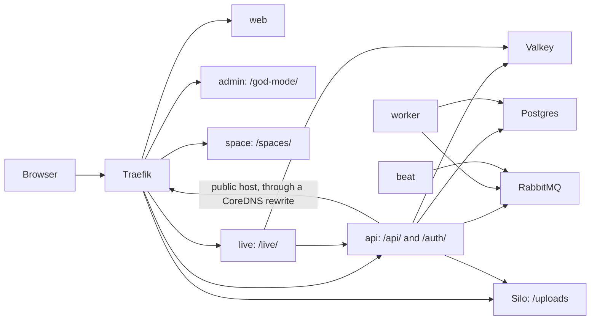

# Plane application debugging

The platform is up, and Plane itself misbehaves. Wayline is a customized Plane Community Edition v1.4.3 deployment, so most of these behaviours come from upstream code. The facts below were read from upstream source (research notes `plane-app.md`, `plane-helm.md` and critique section 1). Marked ones still need a running system.

Preamble for raw commands:

```bash
export PATH="$PWD/.tools/bin:$PATH" KUBECONFIG="$PWD/.local/kubeconfig"
NS=plane-dev HOST=plane.dev.localhost
```

## Topology



## First moves

```bash
kubectl -n "$NS" get pods
make logs ENV=dev SVC=api
curl -s -o /dev/null -w 'instances %{http_code}\n' "http://$HOST/api/instances/"
curl -s -w '\nanchor %{http_code}\n' "http://$HOST/api/public/anchor/__probe__/settings/"
curl -s "http://$HOST/live/health"; echo
```

Read these two API answers together. **`/api/instances/` is cached in Valkey for two hours** and says nothing about Postgres.

| `/api/instances/` | `/api/public/anchor/__probe__/settings/` | Likely |
|---|---|---|
| 200 JSON | 404 "does not exist" | API and database are fine. This 404 is the healthy answer |
| 200 JSON | 500 | **Postgres is unreachable or empty**, and the first answer is from cache |
| 200 HTML | any | API has no endpoints, and Traefik fell through to the web route |
| 500 | 500 | Valkey or the API itself. Expected for Valkey down, as `CACHES` does not ignore exceptions. [[VERIFY: with Valkey down /api/instances/ answers 500]] |
| 429 | any | Anonymous rate limit, 30 a minute per IP |
| 502, 503, 504 | same | No ready API pods. Look at the pods |

## Symptoms and causes

### API pod will not start or never becomes Ready

| Log or state | Cause | Fix |
|---|---|---|
| `CreateContainerConfigError` | A Secret is missing. Chart references are `optional: false`, so the pod waits | `kubectl -n "$NS" get infisicalstaticsecrets`. See [Argo sync stuck](argo-sync-stuck.md) |
| Hangs in `wait_for_migrations` | A migration is unapplied. It blocks API, worker and beat forever | Check the migrator below |
| Crash at import mentioning `FILE_SIZE_LIMIT` | Value is not bytes. `5MB` crashes Django | Value must be `5242880`, in Infisical's template |
| `SECRET_KEY` error from `configure_instance` | Key is missing. It is mandatory for the API | Check `plane-app-keys` |
| Hangs at boot on `.delay()`, or a connection error to RabbitMQ | `register_instance` calls `push_instance_metrics.delay()` unconditionally, so **the API needs RabbitMQ at boot** | Fix RabbitMQ first |
| Permission errors on `plane/logs` or `static-assets` | Non-root and read-only root need writable paths | Check the hardening patch. [[VERIFY: all Plane workloads run non-root under the hardening patches]] |
| Slow start under CPU limits | Boot runs migration checks, registration and collectstatic before gunicorn binds | Wait. [[MEASURE: API pod start to Ready, per environment]] |

Migrator:

```bash
kubectl -n "$NS" get job plane-api-migrate-1
kubectl -n "$NS" logs job/plane-api-migrate-1 --tail=30
kubectl -n "$NS" exec deploy/plane-api-wl -c plane-api -- python manage.py showmigrations --plan | grep '\[ \]' | head
```

`wait_for_db` connects to nothing (`connections["default"]` never opens a socket), so an early failure is covered by `backoffLimit: 3`, not by the wait.

### Background work does not happen

Activity feeds are empty, notifications do not go out, exports never finish. The POST itself still returns 201, because the API only queues.

**Celery and RabbitMQ must be paired.** Contract section 9 allows RabbitMQ 3.13 or 4.2 only. On 4.3, Celery attaches **zero consumers** (upstream chart PR #304, with pidbox queue errors and a fix only in a private repo). The broker looks healthy and the worker looks alive. `CELERY_CONTROL_QUEUE_EXCLUSIVE` is absent from CE v1.4.3, so there is no setting to fall back on. This repo pins `3.13.7-management-alpine`, an end-of-life series accepted as a risk. Celery on 4.2.9 has not been tried.

```bash
kubectl -n "$NS" exec plane-rabbitmq-wl-0 -c plane-rabbitmq -- rabbitmqctl -q list_queues name messages consumers
kubectl -n "$NS" exec plane-rabbitmq-wl-0 -c plane-rabbitmq -- rabbitmqctl -q list_consumers
make logs ENV=dev SVC=worker
kubectl -n "$NS" get pods -l 'app.kubernetes.io/component in (worker,beat)'
```

| Queue state | Alert | Meaning |
|---|---|---|
| `celery` has 0 consumers | `PlaneWorkerNoConsumer` | Worker down or not connected |
| No `celery` queue at all | `PlaneCeleryQueueMissing`, after 10m | Worker never attached. This is the 4.3 failure, or the worker never started |
| Messages climbing | `PlaneCeleryBacklog` | Worker is slow or stuck. Concurrency is 2 |
| Consumers present, nothing processed | None | A consumer shows a connection, not a working loop. Read worker logs |

Beat is single-replica by design, using `DatabaseScheduler`. Do not scale it.

End-to-end check of the async path:

```bash
python3 tests/e2e/smoke.py --env dev --mode verify --job-probe
```

Exit codes: 0 all passed, 1 a failure, 2 no failure but something was BLOCKED. Do not read 2 as a pass.

If publishers hang while the queue is fine, check for a memory alarm. See [Memory pressure](memory-pressure.md).

### Configuration silently empty

Instance settings, such as SMTP or OAuth keys, read back empty with no error.

`decrypt_data` fails **silently** to `""` when `SECRET_KEY` does not match. `settings/common.py` also silently randomises a missing `SECRET_KEY` for worker, beat and migrator. Only the API fails loudly.

```bash
kubectl -n "$NS" exec deploy/plane-api-wl -c plane-api -- python manage.py shell -c "
from plane.license.models import InstanceConfiguration as C
from plane.license.utils.encryption import decrypt_data as d
rows = C.objects.filter(is_encrypted=True).exclude(value__isnull=True).exclude(value='')
print('rows', rows.count(), 'undecryptable', [c.key for c in rows if not d(c.value)])"
```

This prints key names only. If rows are undecryptable, the database and key do not match. The fix is a matched restore, see [Backup and restore](backup-restore.md). Rotating or reseeding the key cannot recover them.

### Uploads, images or exports fail

| Symptom | Cause |
|---|---|
| Export download link has a doubled path | Bucket is not named `uploads`. `export_task.py` does `.replace('/uploads', '')`. The name is fixed in both environments, and isolation comes from each having its own Silo |
| Duplicating an asset gives 500, and OAuth avatars fail | `copy_object` and avatars dial the **public host** from inside the API pod. CoreDNS rewrites `plane.*.localhost` to Traefik, and NetworkPolicy must allow API to Traefik. A connection error there is not caught as `ClientError` |
| Upload rejected | Two limits apply. Traefik's `plane-body-limit` allows 20 MiB, and Plane's `FILE_SIZE_LIMIT` is 5 MiB, in bytes |
| Attachment returns 403 or 404 | Presigned URL host or signature. Check `AWS_S3_ENDPOINT_URL` and Traefik's `/uploads` route |
| Silo metrics answer 403 | `MINIO_PROMETHEUS_AUTH_TYPE` is not public. This is about scraping, not uploads |

```bash
kubectl -n "$NS" exec deploy/plane-api-wl -c plane-api -- python -c "import socket; print(socket.gethostbyname('$HOST'))"
kubectl -n kube-system get configmap coredns -o jsonpath='{.data.Corefile}' | grep -n rewrite
```

[[VERIFY: copy_object from the API pod succeeds through the CoreDNS rewrite with a valid signature]]

[[VERIFY: presigned upload, attachment download and export link all work with no bucket-creation Job]]

The object store is Silo, a MinIO-compatible fork. Official MinIO images no longer pull anonymously. Silo images are distroless, so there is no shell in the pod. Inspect it with `rclone` Jobs, as `scripts/backup.sh` does, not with `kubectl exec`.

### Live collaboration fails

```bash
make logs ENV=dev SVC=live
curl -s "http://$HOST/live/health"; echo
```

An HTTP 101 alone does not prove anything: the Hocuspocus handshake is unauthenticated, and auth happens in the first frame, by calling `GET /api/users/me/` with the cookie. So a socket can open while auth fails. `tests/e2e/smoke.py` sends the auth frame for this reason. Live also needs `REDIS_URL`, and may crash on a bad one.

`LIVE_SERVER_SECRET_KEY` is not consumed by anything in v1.4.3, so it is not the cause.

[[VERIFY: /live WebSocket through Traefik's buffering middleware stays open and authenticates, in a two-tab test]]

### Login or rate limit trouble

Auth counters live in Valkey, and retry-heavy tests can trip them. `API_KEY_RATE_LIMIT` defaults to 60 a minute per key, and `api_tokens.allowed_rate_limit` is not read. Requests with an API key are also logged through Celery into `api_activity_logs`, so API-token load writes to the database. `tests/load/` uses session auth for this reason.

Cookie separation between `plane.dev.localhost` and `plane.prod-sim.localhost` has not been confirmed. [[VERIFY: logging in to both hosts at once in one browser keeps sessions apart]]

### Data services

```bash
kubectl -n "$NS" exec plane-pgdb-wl-0 -c plane-pgdb -- sh -c 'psql -U "$POSTGRES_USER" -d "$POSTGRES_DB" -Atc "select count(*) from pg_stat_activity"'
kubectl -n "$NS" exec plane-redis-wl-0 -c plane-redis -- valkey-cli ping
kubectl -n "$NS" exec plane-rabbitmq-wl-0 -c plane-rabbitmq -- rabbitmq-diagnostics status
```

Treat Valkey as a cache. A cold cache after it restarts is normal. [[VERIFY: Plane recovers with no data loss after plane-redis-wl-0 is deleted]]

## Confirm

```bash
make test-e2e ENV=dev
```

Check the Platform overview dashboard: all four probes green for the environment. Then check that relevant alerts have resolved in `http://alertmanager.localhost`.

[[VERIFY: make test-e2e ENV=dev passes]]

[[VERIFY: make test-e2e ENV=prod-sim passes]]

## What not to do

| Do not | Why |
|---|---|
| Treat `/api/instances/` 200 as "healthy" | It is cached for two hours |
| Treat the anchor probe's 404 as an error | It is the healthy answer |
| Rotate `SECRET_KEY` to fix decryption | It makes things worse, silently |
| Rename the bucket per environment | It breaks export links |
| Upgrade RabbitMQ to 4.3 | Celery attaches zero consumers |
| Use `artifacts.plane.so` images | Images come from `docker.io` by digest |
| Scale beat above 1 | Scheduled tasks would run twice |
| `FLUSHALL` Valkey as a first move | Cache and rate-limit counters all go at once, and live state with them. It belongs after a restore |
| Purge `celery` to clear a backlog on a live system | It drops real activity and notification work |
| Report Wayline-specific behaviour as a Plane bug upstream without reproducing on stock v1.4.3 | This is a customized deployment |
