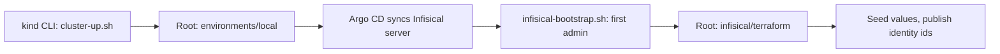

# Terraform

Terraform owns a small, specific part of this platform: the cluster's foundation and the Infisical configuration. It
does not create the cluster. The application it helps deploy, Wayline, is a customized Plane Community Edition v1.4.3
deployment, not an original product.

**Status of this page.** It describes configuration read from the code. Both roots have applied on the real cluster since
2026-11-04, and the text links those runs. `terraform destroy` was not tested in Pass 1. An apply on a clean host is part of the clean install
that `make drill-clean-restore CONFIRM=yes CLEAN_INSTALL_FIRST=yes` was running when this was written, and its result is not recorded here.
Evidence is in [`docs/evidence/`](evidence/README.md).

## What Terraform owns

This restates contract section 4 ([platform-contract.md](platform-contract.md)). `scripts/ci/ownership.sh` checks it
statically and fails if a resource has two owners.

| Owner | Owns |
|---|---|
| **Terraform**, `infrastructure/terraform/environments/local` | Seven namespaces and their labels; a ResourceQuota and a LimitRange in each Plane namespace; the CoreDNS Corefile rewrite; the Argo CD Helm release; a second Helm release holding the AppProjects and the root Application |
| **Terraform**, `infisical/terraform` | Infisical projects, environments, machine identities, project memberships, Kubernetes Auth config |

## What Terraform does not own

Read this table before assuming anything below was provisioned by Terraform.

| Thing | Actual owner | How it is created |
|---|---|---|
| **The kind cluster, its node, CNI, port mappings, mounts** | kind CLI | `scripts/cluster-up.sh` runs `kind create cluster` |
| **Registry, pull-through caches, `git://` remote** | Docker Compose | `scripts/cluster-up.sh` runs `docker compose up` on `infrastructure/local-services/compose.yaml` |
| Traefik, metrics-server, NetworkPolicies, monitoring, Infisical server, operators, both Plane environments | Argo CD | Synced from Git. See [argocd.md](argocd.md) |
| PersistentVolumes for Plane data | kind's local-path provisioner | Created when a pod using the claim is scheduled |
| Static backup PVs and PVCs | Argo CD | `gitops/platform/backup-storage` |
| Secret values | Infisical, seeded by `scripts/infisical-seed.sh` | Never in Terraform state. See [infisical.md](infisical.md) |
| Secret zero | `scripts/secret-zero.sh` | Files in `.local/secret-zero/`, applied by `kubectl` |
| First Infisical admin and root organization | `scripts/infisical-bootstrap.sh` | One API call. Terraform cannot create the root org, so the script passes `org_id` in |
| `argocd-initial-admin-secret` | Argo CD | Generated at first start |
| Image builds and digests | `scripts/ci/build-images.sh`, `scripts/promote.sh` | Written into overlays, not Terraform |
| Anything on Hetzner or Cloudflare | Nobody yet | Nothing on either is provisioned or configured in Pass 1 |

**Why kind is not a Terraform resource.** The Kubernetes and Helm providers read the kubeconfig during plan. The
[provider docs](https://registry.terraform.io/providers/hashicorp/kubernetes/latest/docs) warn against creating a cluster
and its Kubernetes resources in one module. So the cluster exists before Terraform runs.

**Why Argo CD does not manage itself.** A bad sync cannot take down the controller that would apply the fix, and
`terraform apply` does not depend on Git being up. The cost is that Argo CD upgrades are not GitOps.

## The two roots



| | `infrastructure/terraform/environments/local` | `infisical/terraform` |
|---|---|---|
| Target | Kubernetes API of the kind cluster | Infisical API at `http://infisical.localhost` |
| Run by | `make up`, or by hand | `scripts/infisical-bootstrap.sh`, or by hand with the environment shown below |
| Modules | `modules/foundation`, `modules/argocd` | None |
| State | `.local/terraform/local/terraform.tfstate` | `.local/terraform/infisical/terraform.tfstate` |
| Inputs | All have defaults. See `terraform.tfvars.example` | `org_id` and `kubernetes_ca_certificate` are required. The script passes both |
| Outputs | `argocd_url`, `namespaces` | `project_ids`, `project_slugs`, `environment_slug`, `identity_ids`. None is secret |

They are separate because their lifecycles differ. The second needs a running Infisical, which the first one's Argo CD
deploys. Their state files also die at different times. `make destroy` removes `.local/terraform/local` with the cluster and keeps
`.local/terraform/infisical`, because that describes the Infisical database, which a backup can bring back. On a truly fresh
instance, bootstrap moves it aside.

### Module contents

**`modules/foundation`** creates:

- Namespaces with PSA labels (`enforce` per contract section 2, `warn` and `audit` set to `restricted`), plus `plane-platform/managed-by: terraform` and, on Plane namespaces, `plane-platform/environment`.
- `ResourceQuota/plane-budget` and `LimitRange/plane-defaults` in each Plane namespace. Numbers and reasoning are in [kubernetes-helm.md](kubernetes-helm.md#quotas-and-limitrange).
- The CoreDNS `Corefile`, from `corefile.tftpl`, through `kubernetes_config_map_v1_data` with `force = true`. kubeadm is recorded as the field manager, so server-side apply conflicts without force. The rewrite sends `plane.dev.localhost` and `plane.prod-sim.localhost` to `traefik.traefik.svc.cluster.local`, because the Plane API dials its own public host for `copy_object` and OAuth avatars.

**`modules/argocd`** creates:

- `helm_release.argocd`: chart `argo-cd` 10.11.7, image `v3.5.7`, values from `helm/values/argocd.yaml`, a 600 second timeout, and `wait_for_jobs`.
- `helm_release.bootstrap`: local chart `gitops/bootstrap/chart` with the AppProjects and the root Application.

**Why a second Helm release.** `kubernetes_manifest` needs the CRD at plan time, which fails on an empty cluster. The
chart's `extraObjects` fails too: the chart ships CRDs as ordinary templates, and Helm maps every object in a release to
an API before it creates any. A second release installs after the first, so the CRDs exist.

**Why a content hash is a value.** The Helm provider only notices template edits in a local chart when `Chart.yaml`'s
version changes. The module hashes every file in the chart and passes the result as `chartHash`, so any edit appears in the plan.

## Providers and version constraints

| Where | Terraform | Provider | Constraint |
|---|---|---|---|
| `environments/local` | `~> 1.17.0` | `hashicorp/kubernetes` | `3.4.0` exact |
| `environments/local` | | `hashicorp/helm` | `3.3.0` exact |
| `modules/foundation` | `~> 1.17` | `hashicorp/kubernetes` | `~> 3.4` |
| `modules/argocd` | `~> 1.17` | `hashicorp/helm` | `~> 3.3` |
| `infisical/terraform` | `>= 1.11.0, < 2.0.0` | `infisical/infisical` | `0.20.10` exact |

`tools.lock` pins the Terraform binary at 1.17.1. Roots pin exact providers and modules state a compatible range, so a
root decides and a module does not.

Both roots commit `.terraform.lock.hcl`. After a provider bump, regenerate hashes for the platforms in use:

```bash
terraform -chdir=infrastructure/terraform/environments/local \
  providers lock -platform=darwin_arm64 -platform=linux_amd64
```

The `local` lock file has hashes for those two platforms, while `scripts/install-tools.sh` also supports `linux_arm64`.
Nothing in Pass 1 runs Terraform on `linux_arm64`: this Mac is `darwin_arm64`, and the Lint job in `ci.yml` runs on `ubuntu-24.04`, which is
`linux_amd64`. So `terraform init` on `linux_arm64` with this lock file is unverified. If a Pass 2 machine uses that platform, check it at the start of Pass 2.

## State

Both state files live under `.local/terraform/`, which is gitignored, through a `local` backend with a relative path.

**Why local.**

- There is one operator and one laptop, and the cluster it describes lives on that laptop.
- Root `local`'s state and the cluster share a lifecycle. `scripts/destroy.sh` removes `.local/terraform/local` when it deletes the cluster, since state describing a gone cluster would only mislead the next plan. A cluster lost any other way leaves that state behind, and since `1fb4707` `make up` moves it aside when no cluster exists. `destroy.sh` keeps `.local/terraform/infisical`, because a clean restore needs it (`make restore-clean`).
- Pass 1 provisions nothing remote, so a remote backend would add a credential and a dependency for no gain.

**What local state costs.** No locking across machines, no version history, and no way to share it. Root `local` has no backup but the
previous version Terraform keeps beside it. Root `infisical` also has a copy in each Infisical backup, at `recovery/terraform.tfstate`
(`infisical/lib/recovery.sh`), on the same disk until someone copies it off. This does not carry into a shared environment. The Pass 2 interfaces describe an `s3` backend template instead.

**What is in state.**

| Root | Contains | Secret? |
|---|---|---|
| `local` | Namespaces, quotas, the Corefile, Helm release metadata and values | No secret values by design: `helm/values/argocd.yaml` holds none |
| `infisical` | Project and identity ids, the cluster CA (public) | No secret values by design: authentication is `INFISICAL_TOKEN` in the environment |

That is by design, from reading the code. A search of both state files for secret values after a real apply was not tested in Pass 1.

The `infisical` provider token never appears in a variable, a plan or state. `scripts/infisical-bootstrap.sh` sets it
only in the environment of a subshell around one `terraform` process.

**If state is lost.**

| Root | What happens | Do this |
|---|---|---|
| `local`, cluster alive | Apply fails because the namespaces exist | Delete the cluster and start again after a backup: `make destroy CONFIRM=yes`, or import each resource |
| `infisical`, instance alive | Terraform would try to create what exists | Copy `recovery/terraform.tfstate` from the newest Infisical backup. A scratch plan with a backup's state, against an instance restored from that backup, read no changes ([dr-fresh-instance-rehearsal-2.txt](evidence/runs/dr-fresh-instance-rehearsal-2.txt)). With no backup, import each resource, which is not tested in Pass 1, or start from a fresh instance. A destroyed project keeps its slug for 14 days, so `destroy` then `apply` on a live instance probably conflicts. After a restore, `INFISICAL_RESTORED=yes scripts/infisical-bootstrap.sh` refuses rather than repairs if Terraform wants to create or delete anything |
| `infisical`, fresh instance | State points at nothing | Bootstrap detects `initialized=false` and moves the old state aside |

## What reaches the cluster, how

Git holds everything, and only part of it reaches the cluster through Argo CD. This trips people up.

| You changed | It takes effect through |
|---|---|
| `helm/values/argocd.yaml` | `terraform apply`, root `local` |
| `gitops/bootstrap/chart/**` (AppProjects, root Application) | `terraform apply`, root `local` |
| `infrastructure/terraform/**` | `terraform apply`, root `local` |
| `infisical/terraform/**` | `scripts/infisical-bootstrap.sh`, or `terraform apply` with the environment below |
| `gitops/applications/**`, `gitops/platform/**`, `gitops/environments/**`, `gitops/bootstrap/argocd-route/**`, `helm/values/*` except `argocd.yaml`, `monitoring/manifests/**`, `infisical/manifests/**` | Commit, then `make gitops-publish` |

AppProjects stay out of the Git-synced path on purpose: an Application in Git must not be able to widen its own permissions.

## Plan and apply

The cluster must be running.

### Root `local`

```bash
export PATH="$PWD/.tools/bin:$PATH"
TF=infrastructure/terraform/environments/local

mkdir -p .local/terraform/local
terraform fmt -check -recursive infrastructure/terraform
terraform -chdir=$TF init
terraform -chdir=$TF validate
terraform -chdir=$TF plan -out=../../../../.local/terraform/local/plan.tfplan
terraform -chdir=$TF apply ../../../../.local/terraform/local/plan.tfplan
```

The provider reads `.local/kubeconfig` from the repository itself, so `KUBECONFIG` is not needed here. Read the plan. After
an apply a second plan shows no changes: seen on the first re-runs on 2026-11-04 ([bootstrap-up-secret-zero-1.txt](evidence/runs/bootstrap-up-secret-zero-1.txt)),
after the Prometheus health change ([h43-terraform-plan-2.txt](evidence/runs/h43-terraform-plan-2.txt)), and after the controller limit change on
2026-11-05 ([argo-controller-limit-1.txt](evidence/runs/argo-controller-limit-1.txt)).

### Root `infisical`

Normally `scripts/infisical-bootstrap.sh` does this. It is idempotent: rerun it on every `make up`, and it picks up a
new cluster CA if the cluster was recreated. To plan by hand, mirror its environment in a subshell, so the token dies
with the subshell:

```bash
(
  export PATH="$PWD/.tools/bin:$PATH" KUBECONFIG="$PWD/.local/kubeconfig"
  export TF_DATA_DIR="$PWD/.local/terraform/infisical/.terraform" TF_INPUT=0
  export INFISICAL_AUTH_METHOD=token
  INFISICAL_TOKEN="$(jq -r .token .local/secret-zero/infisical-admin.json)"
  export INFISICAL_TOKEN
  TF_VAR_org_id="$(jq -er .organization.id .local/secret-zero/infisical-admin.json)"
  TF_VAR_kubernetes_ca_certificate="$(kubectl --context kind-plane-platform -n infisical \
    get configmap kube-root-ca.crt -o jsonpath='{.data.ca\.crt}')"
  export TF_VAR_org_id TF_VAR_kubernetes_ca_certificate
  terraform -chdir=infisical/terraform init -input=false -lockfile=readonly
  terraform -chdir=infisical/terraform plan
)
```

Never write the token to a file, a variable with a default, or `terraform.tfvars`.

This root applies against the real API. On 2026-11-04 bootstrap and Terraform exited 0 in 12s with 10 resources added
([infisical-bootstrap-1.txt](evidence/runs/infisical-bootstrap-1.txt)), and reruns said "No changes"
([infisical-idempotency-1.txt](evidence/runs/infisical-idempotency-1.txt), [infisical-idempotency-3.txt](evidence/runs/infisical-idempotency-3.txt)).

## fmt, validate, tflint

`scripts/ci/lint.sh` runs all three, through `make ci` and in GitHub Actions.

| Check | Scope | Notes |
|---|---|---|
| `terraform fmt -check -recursive -diff` | `infrastructure/terraform`, `infisical/terraform` | No state needed |
| `terraform init -backend=false` then `validate` | Every directory with `.tf` files, except `modules/` | CI holds no state and never talks to a cluster. Provider schemas are enough |
| `tflint --chdir=<dir>` | Every directory with `.tf` files, including `modules/` | v0.65.0 with its bundled Terraform ruleset. The repository has no `.tflint.hcl` |

`environments/dev` and `environments/prod` contain no `.tf` files, so none of these checks them. There is nothing to check.

The Lint job ran them on `ubuntu-24.04` at `9c8e098`, `0dde813` and `6edde64` ([run 41975431001](evidence/ci/ci-1-20261105T053955Z-run-41975431001.log), [run 41978707479](evidence/ci/ci-1-20261105T061058Z-run-41978707479.log), [run 42048656380](evidence/ci/ci-1-20261105T144855Z-run-42048656380.log)).
Validation proves syntax and provider schema. It does not prove that an apply works.

```bash
make ci
```

## dev and prod are documented interfaces

`infrastructure/terraform/environments/dev` and `environments/prod` hold a `README.md` and an `INTERFACE.md`. **They
are not operational code.** They contain no Terraform, no resources and no `versions.tf`, and nothing in them has ever run.

| Status | Detail |
|---|---|
| What they are | A proposal for Pass 2: the variables a Hetzner implementation must take, the outputs it must produce, what changes when the modules are reused, and a commented remote state template |
| What they are not | Provisioning code. No Hetzner or Cloudflare resource exists anywhere in this repository |
| Remote state template | Commented out in `INTERFACE.md`. It has never reached a real bucket. Support for `use_lockfile` on Hetzner Object Storage is unverified. `INTERFACE.md` says `terraform init` accepted these arguments against a dead endpoint, and `docs/evidence` holds no record of that, so it is unverified too. Check both at the start of Pass 2 |
| Environment model today | Dev and prod-sim are two namespaces on one kind node, both created by the single root `environments/local`. **Namespace separation is not equivalent to independent production clusters** |

Pass 2 is described in [future-hetzner.md](future-hetzner.md) and [PASS2_HANDOFF.md](../PASS2_HANDOFF.md).

Reusing `modules/argocd` takes more than one value. The module's `git_repo_url` description says Pass 2 changes "this
one value", but it only reaches the bootstrap chart. All 13 manifests in `gitops/applications/` hard-code
`git://plane-git/plane-platform.git`, and those need changing too.

## Destroy caveats

**Use `make destroy`, not `terraform destroy`.** `make destroy` deletes the cluster and root `local`'s state together. See
[install.md](install.md#teardown). `terraform destroy` on root `local` leaves a damaged cluster behind.

```bash
terraform -chdir=infrastructure/terraform/environments/local destroy   # read below first
```

| Effect | Why |
|---|---|
| **Every PVC and all Plane data is deleted** | Namespaces are Terraform resources, and deleting one deletes its PVCs. The `standard` class has `reclaimPolicy: Delete`. Run `make backup ENV=all` first |
| **CoreDNS breaks** | The provider's delete of `kubernetes_config_map_v1_data` applies an empty map, which removes the `Corefile` key. CoreDNS cannot mount its config at the next restart. Delete the cluster afterwards rather than reusing it |
| Argo CD's CRDs stay | `crds.keep` |
| Root does not cascade | The root Application has no finalizer, so removing it does not delete its children |
| **Namespace `argocd` may hang in `Terminating`** | Six child Applications carry `resources-finalizer.argocd.argoproj.io`: traefik, metrics-server, kube-prometheus-stack, loki, alloy, monitoring-extras. The controller is removed before the namespace, so nothing would clear those finalizers. Not tested in Pass 1 |

This table comes from reading the code and the provider's behaviour. `terraform destroy` was not tested in Pass 1, so none of its rows has been seen happen.

Destroying root `infisical` on a live instance deletes projects and identities. Plane's operators can then no longer log
in, and a destroyed project's slug stays reserved for 14 days. Do not use it to reset. Start from a fresh instance.
