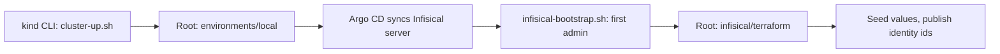

# Terraform

Terraform owns a small, specific part of this platform: each cluster's foundation, the Infisical configuration, and hosted
production's DNS records. It creates neither cluster, and never the VPS. The application it helps deploy, Wayline, is a
customized Plane Community Edition v1.4.3 deployment, not an original product.

| Root | Environment | What it owns |
|---|---|---|
| `infrastructure/terraform/environments/local` | The kind cluster: dev and prod-sim | Its foundation and its Argo CD |
| `infisical/terraform` | Each Infisical, with a state of its own per cluster | Projects, identities, Kubernetes Auth |
| `infrastructure/terraform/environments/prod` | Hosted production, `plane-prod` | Its foundation and its Argo CD |
| `infrastructure/terraform/environments/prod-host` | Hosted production, outside the cluster | Six DNS records on Vercel. It only reads the VPS |

The local sections are first. [Hosted production](#hosted-production) covers the two hosted roots and the hosted state.

**Status of this page.** It describes configuration read from the code. The local roots have applied on the real cluster since
2026-11-04, and root `prod` on the VPS since 2026-11-07. The text links those runs. `terraform destroy` was not tested in Pass 1. An apply on a fresh clone ran in the clean install on 2026-11-05, and on the cold install,
and each later plan read no changes ([clean](evidence/runs/clean-install-20261105T075041Z/terraform-plan-local.txt), [cold](evidence/runs/clean-install-20261105T105546Z/terraform-plan-local.txt)). Neither is a new machine.
Evidence is in [`docs/evidence/`](evidence/README.md).

## What Terraform owns

This restates contract section 4 ([platform-contract.md](platform-contract.md)). `scripts/ci/ownership.sh` checks it
statically and fails if a resource has two owners.

| Owner | Owns |
|---|---|
| **Terraform**, `infrastructure/terraform/environments/local` | Seven namespaces and their labels; a ResourceQuota and a LimitRange in each Plane namespace; the CoreDNS Corefile rewrite; the Argo CD Helm release; a second Helm release holding the AppProjects and the root Application |
| **Terraform**, `infisical/terraform` | Infisical projects, environments, machine identities, project memberships, Kubernetes Auth config. On hosted production the same code makes project `plane-prod` and its one identity, bound to namespace `plane-prod`, in a state of its own |
| **Terraform**, `infrastructure/terraform/environments/prod` | Hosted production's ten namespaces and their labels; a ResourceQuota `budget` in each, and a LimitRange `defaults` in each, both from `infrastructure/hosted/plane-prod/capacity.yaml`; StorageClass `local-path-retain`; K3s's `coredns-custom` ConfigMap; the Argo CD Helm release; a second Helm release holding AppProjects `platform`, `plane-prod`, `frameflow`, `rillmark` and `awushi-cloudgarden` and the root Application |
| **Terraform**, `infrastructure/terraform/environments/prod-host` | The A records `wayline`, `grafana`, `infisical`, `frameflow`, `rillmark` and `devops` in `bereket.dev`, on Vercel. It reads the VPS from Contabo, and owns nothing there |

## What Terraform does not own

Read this table before assuming anything below was provisioned by Terraform.

| Thing | Actual owner | How it is created |
|---|---|---|
| **The kind cluster, its node, CNI, port mappings, mounts** | kind CLI | `scripts/cluster-up.sh` runs `kind create cluster` |
| **Registry, pull-through caches, `git://` remote** | Docker Compose | `scripts/cluster-up.sh` runs `docker compose up` on `infrastructure/local-services/compose.yaml` |
| Traefik, metrics-server, NetworkPolicies, monitoring, Infisical server, operators, the Plane environments, and on hosted production cert-manager and the certificates | Argo CD | Synced from Git. See [argocd.md](argocd.md) |
| PersistentVolumes for Plane data | kind's local-path provisioner, and K3s's on hosted production | Created when a pod using the claim is scheduled |
| Static backup PVs and PVCs | Argo CD | `gitops/platform/backup-storage`, and `gitops/clusters/plane-prod/platform/backup` on hosted production |
| Secret values | Infisical, seeded by `scripts/infisical-seed.sh` | Never in Terraform state. See [infisical.md](infisical.md) |
| Secret zero | `scripts/secret-zero.sh` | Files in `.local/secret-zero/`, applied by `kubectl` |
| First Infisical admin and root organization | `scripts/infisical-bootstrap.sh` | One API call. Terraform cannot create the root org, so the script passes `org_id` in |
| `argocd-initial-admin-secret` | Argo CD | Generated at first start |
| Image builds and digests | `scripts/ci/build-images.sh`, `scripts/promote.sh`, and for hosted production `scripts/ci/promote-prod.sh` | Written into overlays, not Terraform |
| **The VPS: its disk, its OS, its contract** | The owner, at Contabo | Ordered by hand. Root `prod-host` holds it as a data source only, because the provider's resource can reinstall the disk or cancel the contract, and `prevent_destroy` stops neither |
| The node's users, SSH, packages, sysctls, firewall and K3s | `scripts/hosted/provision-node.sh` and `scripts/hosted/edge.sh` | Over SSH, from the files in `infrastructure/hosted/plane-prod/`. See [install.md](install.md#hosted-production) |
| Every other record in `bereket.dev` | The owner, on Vercel | Vercel's provider acts on the record ids it holds and never lists the zone, so nothing else there can change |
| Hosted Secrets: the deploy key, secret zero, the restic password, Grafana's login, alert delivery | `scripts/hosted/bootstrap.sh` and the scripts it calls | Files in `.local/hosted/plane-prod/`, applied by `kubectl`, never in Terraform state |
| What hosted Argo CD syncs | CI's `release-plane-prod` job | Branch `deploy/plane-prod`. See [argocd.md](argocd.md#hosted-production) |
| Anything on Hetzner or Cloudflare | Nobody | Pass 1 planned both, and nothing was made on either. Hosted production went to Contabo, with DNS on Vercel |

**Why kind is not a Terraform resource.** The Kubernetes and Helm providers read the kubeconfig during plan. The
[provider docs](https://registry.terraform.io/providers/hashicorp/kubernetes/latest/docs) warn against creating a cluster
and its Kubernetes resources in one module. So the cluster exists before Terraform runs. K3s on the VPS is the same case, and
`provision-node.sh` installs it before either hosted root runs.

**Why Argo CD does not manage itself.** A bad sync cannot take down the controller that would apply the fix, and
`terraform apply` does not depend on Git being up. The cost is that Argo CD upgrades are not GitOps.

## The local roots



| | `infrastructure/terraform/environments/local` | `infisical/terraform` |
|---|---|---|
| Target | Kubernetes API of the kind cluster | Infisical API at `http://infisical.localhost` |
| Run by | `make up`, or by hand | `scripts/infisical-bootstrap.sh`, or by hand with the environment shown below |
| Modules | `modules/foundation`, `modules/argocd` | None |
| State | `.local/terraform/local/terraform.tfstate` | `.local/terraform/infisical/terraform.tfstate` |
| Inputs | All have defaults. See `terraform.tfvars.example` | `org_id` and `kubernetes_ca_certificate` are required. The script passes both |
| Outputs | `argocd_url`, `namespaces` | `project_ids`, `project_slugs`, `environment_slug`, `identity_ids`. None is secret |

They are separate because their lifecycles differ. The second needs a running Infisical, which the first one's Argo CD
deploys. Their state files also die at different times. `make destroy` removes `.local/terraform/local` with the cluster and keeps
`.local/terraform/infisical`, because that describes the Infisical database, which a backup can bring back. On a truly fresh
instance, bootstrap moves it aside.

### Module contents

**`modules/foundation`** creates:

- Namespaces with PSA labels (`enforce` per contract section 2, `warn` and `audit` set to `restricted`), plus `plane-platform/managed-by: terraform` and, on Plane namespaces, `plane-platform/environment`.
- `ResourceQuota/plane-budget` and `LimitRange/plane-defaults` in each Plane namespace. Numbers and reasoning are in [kubernetes-helm.md](kubernetes-helm.md#quotas-and-limitrange).
- The CoreDNS `Corefile`, from `corefile.tftpl`, through `kubernetes_config_map_v1_data` with `force = true`. kubeadm is recorded as the field manager, so server-side apply conflicts without force. The rewrite sends `plane.dev.localhost` and `plane.prod-sim.localhost` to `traefik.traefik.svc.cluster.local`, because the Plane API dials its own public host for `copy_object` and OAuth avatars.

Root `environments/prod` calls the same module with inputs of its own, and the defaults keep the local cluster as it was. Its quotas
and limit ranges come from `capacity.yaml`, so they are named `budget` and `defaults`. It adds StorageClass `local-path-retain`. In
place of the kubeadm Corefile it writes ConfigMap `kube-system/coredns-custom`, whose `*.override` keys K3s's own Corefile imports:
K3s redeploys its `coredns` ConfigMap, so a template written over it would not stay, and K3s neither makes nor manages this one, so a
plain resource owns it. Its rewrites send `wayline.bereket.dev`, `grafana.bereket.dev`, `infisical.bereket.dev` and each app's host,
`frameflow.bereket.dev`, `rillmark.bereket.dev` and `devops.bereket.dev`, to `traefik.traefik.svc.cluster.local`, for Plane's self-dial,
blackbox and cert-manager's self-check, which inside a pod must reach Traefik's Service and not leave through the host firewall.

**`modules/argocd`** creates:

- `helm_release.argocd`: chart `argo-cd` 10.11.7, image `v3.5.7`, values from `helm/values/argocd.yaml`, a 600 second timeout, and `wait_for_jobs`.
- `helm_release.bootstrap`: local chart `gitops/bootstrap/chart` with the AppProjects and the root Application.

**Why a second Helm release.** `kubernetes_manifest` needs the CRD at plan time, which fails on an empty cluster. The
chart's `extraObjects` fails too: the chart ships CRDs as ordinary templates, and Helm maps every object in a release to
an API before it creates any. A second release installs after the first, so the CRDs exist.

**Why a content hash is a value.** The Helm provider only notices template edits in a local chart when `Chart.yaml`'s
version changes. The module hashes every file in the chart and passes the result as `chartHash`, so any edit appears in the plan.

## Providers and version constraints

| Where | Terraform | Provider | Constraint |
|---|---|---|---|
| `environments/local` | `~> 1.17.0` | `hashicorp/kubernetes` | `3.4.0` exact |
| `environments/local` | | `hashicorp/helm` | `3.3.0` exact |
| `modules/foundation` | `~> 1.17` | `hashicorp/kubernetes` | `~> 3.4` |
| `modules/argocd` | `~> 1.17` | `hashicorp/helm` | `~> 3.3` |
| `infisical/terraform` | `>= 1.11.0, < 2.0.0` | `infisical/infisical` | `0.20.10` exact |
| `environments/prod` | `~> 1.17.0` | `hashicorp/kubernetes`, `hashicorp/helm` | `3.4.0` and `3.3.0` exact, as `local` |
| `environments/prod-host` | `~> 1.17.0` | `contabo/contabo` | `0.1.44` exact |
| `environments/prod-host` | | `vercel/vercel` | `5.26.1` exact |

`tools.lock` pins the Terraform binary at 1.17.1. Roots pin exact providers and modules state a compatible range, so a
root decides and a module does not.

Every root commits `.terraform.lock.hcl`. After a provider bump, regenerate hashes for the platforms in use:

```bash
terraform -chdir=infrastructure/terraform/environments/local \
  providers lock -platform=darwin_arm64 -platform=linux_amd64
```

Each lock file has hashes for two platforms, while `scripts/install-tools.sh` also supports `linux_arm64`.
Nothing runs Terraform on `linux_arm64`: this Mac is `darwin_arm64`, and it runs the hosted roots too, and the Lint job in `ci.yml` runs on
`ubuntu-24.04`, which is `linux_amd64`. So `terraform init` on `linux_arm64` with these lock files is unverified.

## State

The local roots' state files live under `.local/terraform/`, which is gitignored, through a `local` backend with a relative path.
Hosted production's are under `.local/hosted/plane-prod/terraform/`, and [Hosted state](#hosted-state) says why.

**Why local.**

- There is one operator and one laptop, and the cluster it describes lives on that laptop.
- Root `local`'s state and the cluster share a lifecycle. `scripts/destroy.sh` removes `.local/terraform/local` when it deletes the cluster, since state describing a gone cluster would only mislead the next plan. A cluster lost any other way leaves that state behind, and since `1fb4707` `make up` moves it aside when no cluster exists. `destroy.sh` keeps `.local/terraform/infisical`, because a clean restore needs it (`make restore-clean`).
- The kind cluster is on this Mac, so a remote backend would add a credential and a dependency for no gain.

**What local state costs.** No locking across machines, no version history, and no way to share it. Root `local` has no backup but the
previous version Terraform keeps beside it. Root `infisical` also has a copy in each Infisical backup, at `recovery/terraform.tfstate`
(`infisical/lib/recovery.sh`), on the same disk until someone copies it off.

**What is in state.**

| Root | Contains | Secret? |
|---|---|---|
| `local` | Namespaces, quotas, the Corefile, Helm release metadata and values | No secret values by design: `helm/values/argocd.yaml` holds none |
| `infisical` | Project and identity ids, the cluster CA (public) | No secret values by design: authentication is `INFISICAL_TOKEN` in the environment |

That is by design, from reading the code. A search of both state files for secret values after a real apply was not tested in Pass 1.

The `infisical` provider token never appears in a variable, a plan or state. `scripts/infisical-bootstrap.sh` sets it
only in the environment of a subshell around one `terraform` process.

**If state is lost.**

| Root | What happens | Do this |
|---|---|---|
| `local`, cluster alive | Apply fails because the namespaces exist | Delete the cluster and start again after a backup: `make destroy CONFIRM=yes`, or import each resource |
| `infisical`, instance alive | Terraform would try to create what exists | Copy `recovery/terraform.tfstate` from the newest Infisical backup. A scratch plan with a backup's state, against an instance restored from that backup, read no changes ([dr-fresh-instance-rehearsal-2.txt](evidence/runs/dr-fresh-instance-rehearsal-2.txt)). With no backup, import each resource, which is not tested in Pass 1, or start from a fresh instance. A destroyed project keeps its slug for 14 days, so `destroy` then `apply` on a live instance probably conflicts. After a restore, `INFISICAL_RESTORED=yes scripts/infisical-bootstrap.sh` refuses rather than repairs if Terraform wants to create or delete anything |
| `infisical`, fresh instance | State points at nothing | Bootstrap detects `initialized=false` and moves the old state aside |

## What reaches the cluster, how

Git holds everything, and only part of it reaches the cluster through Argo CD. This trips people up.

| You changed | It takes effect through |
|---|---|
| `helm/values/argocd.yaml` | `terraform apply`, root `local` |
| `gitops/bootstrap/chart/**` (AppProjects, root Application) | `terraform apply`, root `local` |
| `infrastructure/terraform/**` | `terraform apply`, root `local` |
| `infisical/terraform/**` | `scripts/infisical-bootstrap.sh`, or `terraform apply` with the environment below |
| `gitops/applications/**`, `gitops/platform/**`, `gitops/environments/{dev,prod-sim}/**`, `gitops/bootstrap/argocd-route/**`, `helm/values/*` except `argocd.yaml`, `monitoring/manifests/**`, `infisical/manifests/**` | Commit, then `make gitops-publish` |
| Hosted: `gitops/clusters/plane-prod/values/argocd.yaml`, `gitops/clusters/plane-prod/bootstrap-chart/**`, `infrastructure/terraform/environments/prod/**`, `infrastructure/hosted/plane-prod/capacity.yaml` | Root `prod`: `make remote-bootstrap TARGET=plane-prod CONFIRM=plane-prod`, or a plan you read and then apply. See [Plan and apply on hosted production](#plan-and-apply-on-hosted-production) |
| Hosted: `infrastructure/terraform/environments/prod-host/**` | Root `prod-host`: `scripts/hosted/host-terraform.sh plan`, then `apply` with `EXPECT` |
| Hosted: the hosts and address in `infrastructure/hosted/plane-prod/target.yaml` | Both hosted roots: the records in `prod-host`, the CoreDNS rewrite in `prod`. Scripts and policy read the same file |
| Hosted: every other file under `gitops/clusters/plane-prod/**`, and `gitops/environments/prod/**` | A merge to `main`. CI's `release-plane-prod` job then moves `deploy/plane-prod`, which hosted Argo CD syncs. `make gitops-publish` never reaches it. See [argocd.md](argocd.md#hosted-production) |

AppProjects stay out of the Git-synced path on purpose, on both clusters: an Application in Git must not be able to widen its own permissions.

## Plan and apply

The cluster must be running.

### Root `local`

```bash
export PATH="$PWD/.tools/bin:$PATH"
TF=infrastructure/terraform/environments/local

mkdir -p .local/terraform/local
terraform fmt -check -recursive infrastructure/terraform
terraform -chdir=$TF init
terraform -chdir=$TF validate
terraform -chdir=$TF plan -out=../../../../.local/terraform/local/plan.tfplan
terraform -chdir=$TF apply ../../../../.local/terraform/local/plan.tfplan
```

The provider reads `.local/kubeconfig` from the repository itself, so `KUBECONFIG` is not needed here. Read the plan. After
an apply a second plan shows no changes: seen on the first re-runs on 2026-11-04 ([bootstrap-up-secret-zero-1.txt](evidence/runs/bootstrap-up-secret-zero-1.txt)),
after the Prometheus health change ([h43-terraform-plan-2.txt](evidence/runs/h43-terraform-plan-2.txt)), and after the controller limit change on
2026-11-05 ([argo-controller-limit-1.txt](evidence/runs/argo-controller-limit-1.txt)).

### Root `infisical`

Normally `scripts/infisical-bootstrap.sh` does this. It is idempotent: rerun it on every `make up`, and it picks up a
new cluster CA if the cluster was recreated. To plan by hand, mirror its environment in a subshell, so the token dies
with the subshell:

```bash
(
  export PATH="$PWD/.tools/bin:$PATH" KUBECONFIG="$PWD/.local/kubeconfig"
  export TF_DATA_DIR="$PWD/.local/terraform/infisical/.terraform" TF_INPUT=0
  export INFISICAL_AUTH_METHOD=token
  INFISICAL_TOKEN="$(jq -r .token .local/secret-zero/infisical-admin.json)"
  export INFISICAL_TOKEN
  TF_VAR_org_id="$(jq -er .organization.id .local/secret-zero/infisical-admin.json)"
  TF_VAR_kubernetes_ca_certificate="$(kubectl --context kind-plane-platform -n infisical \
    get configmap kube-root-ca.crt -o jsonpath='{.data.ca\.crt}')"
  export TF_VAR_org_id TF_VAR_kubernetes_ca_certificate
  terraform -chdir=infisical/terraform init -input=false -lockfile=readonly
  terraform -chdir=infisical/terraform plan
)
```

Never write the token to a file, a variable with a default, or `terraform.tfvars`.

This root applies against the real API. On 2026-11-04 bootstrap and Terraform exited 0 in 12s with 10 resources added
([infisical-bootstrap-1.txt](evidence/runs/infisical-bootstrap-1.txt)), and reruns said "No changes"
([infisical-idempotency-1.txt](evidence/runs/infisical-idempotency-1.txt), [infisical-idempotency-3.txt](evidence/runs/infisical-idempotency-3.txt)).

## Hosted production

Two roots, because their credentials and their risks differ. Root `prod` talks to K3s's API through the SSH tunnel, and needs no
credential but the kubeconfig. Root `prod-host` talks to Contabo's API and Vercel's, and holds what a mistake would make public, the
DNS records. Neither can be aimed elsewhere: they take no variables, and both read
[`target.yaml`](../infrastructure/hosted/plane-prod/target.yaml).

| | `environments/prod` | `environments/prod-host` |
|---|---|---|
| Target | K3s's API on `https://127.0.0.1:16443`, through the tunnel, with `.local/hosted/plane-prod/kubeconfig` and context `plane-prod` | Contabo's API, read only, and Vercel's |
| Run by | `make remote-bootstrap`, steps 2 and 3, or a plan you read and then apply | `scripts/hosted/host-terraform.sh` |
| Modules | `modules/foundation`, `modules/argocd` | None |
| Credentials | The kubeconfig alone | Contabo's from `~/.cntb.yaml` and Vercel's from its CLI's login, through the environment of one process. Never in a file in Git, a variable or state |
| Guard | `terraform_data.right_cluster`: a plan stops unless the live `kube-system` UID is the one `target.yaml` records | A precondition on each record: Contabo's address for the instance must be `target.yaml`'s `host` |
| State | `.local/hosted/plane-prod/terraform/terraform.tfstate` | `.local/hosted/plane-prod/terraform/host/terraform.tfstate` |
| Outputs | `argocd_url`, `namespaces` | The instance's name, status, size and address, and the six records. None is secret |

Hosted Infisical's root is `infisical/terraform` again, with `TF_VAR_environments` naming project `plane-prod` and namespace
`plane-prod`, and its state at `.local/hosted/plane-prod/terraform/infisical/terraform.tfstate`. The bootstrap's step 6 runs it through a
port-forward, through `scripts/infisical-bootstrap.sh` as locally.

### environments/prod: the cluster

[Its README](../infrastructure/terraform/environments/prod/README.md) lists what it makes. The namespaces and their PSA levels:

| Namespace | `enforce` | Why |
|---|---|---|
| `argocd`, `monitoring`, `infisical`, `cert-manager`, `plane-prod` | `baseline` | As locally. `plane-prod` stays at baseline until a dry run of restricted passes on the branded images |
| `traefik` | `privileged` | Traefik's hostPorts cannot pass baseline, and they are the only way in |
| `monitoring-agents` | `privileged` | node-exporter's hostNetwork and hostPID |
| `rillmark`, `awushi-cloudgarden` | `restricted` | The static sites. nginx runs as user 101 with every capability dropped, and cert-manager's solver pod passes too |
| `frameflow` | `restricted` | Frameflow, its Hatchet, Postgres and Silo, its operator and its Jobs: each runs as a user that is not root, with every capability dropped and no privilege escalation, as cert-manager's solver does |

Every namespace also warns and audits at `restricted`. The quotas' numbers and reasons are in `capacity.yaml`, and
`scripts/ci/check-capacity.sh` fails CI unless their sum, with the system's share and the scratch space that no quota counts, still fits
the node.
[kubernetes-helm.md](kubernetes-helm.md#hosted-production) has the table.

`modules/argocd` installs the same chart as locally, `argo-cd` 10.11.7 with v3.5.7, with values from
`gitops/clusters/plane-prod/values/argocd.yaml` and the bootstrap chart from `gitops/clusters/plane-prod/bootstrap-chart`, whose root
Application reads branch `deploy/plane-prod` of `ssh://git@ssh.github.com:443/BereketAbera/plane-platform.git`. The Git credential is not
a value: the bootstrap writes Secret `argocd/argocd-repo-plane-platform` from the deploy key, before the apply that starts Argo CD.

### environments/prod-host: the VPS and its records

[Its README](../infrastructure/terraform/environments/prod-host/README.md) says what it holds and why.

| Address | What | How it came to be held |
|---|---|---|
| `data.contabo_instance.vps` | Instance 203733427, read only | A data source, never a resource |
| `vercel_dns_record.wayline` | `wayline.bereket.dev A 5.253.234.127`, TTL 60 | Made before Terraform held it, on 2026-11-06 ([hosted-access-dns](evidence/runs/hosted-access-dns-20261106T212722Z.txt)), then imported by the id `target.yaml` records |
| `vercel_dns_record.grafana` | `grafana.bereket.dev A 5.253.234.127`, TTL 60 | Made by this root, for Grafana's public route |
| `vercel_dns_record.infisical` | `infisical.bereket.dev A 5.253.234.127`, TTL 60 | Made by this root on 2026-11-07, before Argo CD first saw Infisical's Certificate |
| `vercel_dns_record.frameflow` | `frameflow.bereket.dev A 5.253.234.127`, TTL 60 | Made by this root, before Argo CD first sees Frameflow's Certificate |
| `vercel_dns_record.rillmark` | `rillmark.bereket.dev A 5.253.234.127`, TTL 60 | Made by this root, before Argo CD first sees Rillmark's Certificate |
| `vercel_dns_record.cloudgarden` | `devops.bereket.dev A 5.253.234.127`, TTL 60 | Made by this root, before Argo CD first sees Awushi Cloudgarden's Certificate |

Each record has `prevent_destroy`. Vercel's provider acts on one record id and never lists the zone, so nothing else in `bereket.dev`
can change. It cannot see a record it does not hold either: run `vercel dns ls bereket.dev` before a plan adds a record, because one
made by hand with the same name would become a second A beside it. There is no AAAA record, so Traefik answers on IPv4 alone.

### Hosted state

The three hosted states are under `.local/hosted/plane-prod/terraform/`, inside a folder of mode 0700, each through a `local` backend
whose path is relative to its root's directory.

| State | Holds | Secret? |
|---|---|---|
| `terraform.tfstate`, root `prod` | Namespaces, quotas, limit ranges, the storage class, `coredns-custom`, Helm release metadata and values | No secret values by design: the values hold none, and the Git credential is a Secret the bootstrap writes |
| `host/terraform.tfstate`, root `prod-host` | The records' ids and values, and what Contabo says of the instance | No credential, because credentials come from the environment |
| `infisical/terraform.tfstate`, `infisical/terraform` | Project and identity ids, the cluster's CA | No secret values, as locally |

**Why only one checkout holds it.** `.local/` is gitignored and the backend paths are relative, so a state belongs to the checkout that
made it, the one that ran the bootstrap. Another clone or worktree has none. From there root `prod` would try to create namespaces that
exist, and fail. Root `prod-host` would do harm: Terraform would import wayline's record again, and make a second A record for each of the
others. So `host-terraform.sh` stops at both verbs when its state is missing or empty, before it reads any credential.
`HOST_TERRAFORM_FIRST_STATE=yes` lets it go on, and is only for a zone that holds none of these records yet. Each script
also finds `.local` and `.tools` beside itself, so run the hosted steps from that checkout, at the commit you mean to apply.

**Why local, and what it costs.** There is one operator, and a remote backend would add a credential and a service to keep, for one
person. The cost is the same as locally: no locking across machines, no history beyond the `.backup` beside each file, and no copy off
this Mac but the recovery bundle. `scripts/hosted/bundle.sh` puts every state in that folder into the age-encrypted bundle. Run
`make remote-bundle TARGET=plane-prod` after every apply, because a newer state makes the older bundle stale, and copy the bundle off this
Mac.

**If state is lost.**

| Root | What happens | Do this |
|---|---|---|
| `prod`, cluster alive | Apply fails, because the namespaces exist | Bring the state back from the recovery bundle. Importing each resource has not been tried |
| `prod-host` | `host-terraform.sh` refuses both verbs | Bring the state back from the recovery bundle. Do not set `HOST_TERRAFORM_FIRST_STATE=yes` for a zone that holds these records |
| `infisical/terraform`, hosted | Terraform would try to create what exists | Bring the state back from the recovery bundle |

### Plan and apply on hosted production

**Root `prod-host`, through `host-terraform.sh`.** It reads Contabo's login from `~/.cntb.yaml`, and the Vercel CLI's token after
`vercel whoami` has renewed it, into the environment of that one process, so neither reaches a command line, a file here or its output.

```bash
TARGET=plane-prod scripts/hosted/host-terraform.sh plan
TARGET=plane-prod CONFIRM=plane-prod EXPECT='create vercel_dns_record.infisical' scripts/hosted/host-terraform.sh apply
```

`plan` runs `init` with the committed lock file, plans into a file beside the state, prints Terraform's plan, and ends with one line,
`This plan: <changes>`: each change as its action and its address, sorted and joined by commas, with `import` in front of one that
imports, and data sources left out. Then it prints the `apply` command for exactly that. `apply` needs `CONFIRM=plane-prod` and `EXPECT`.
It makes its own plan again, applies it only if its changes are exactly `EXPECT`, and otherwise prints both and applies nothing. `EXPECT`
names actions and addresses, not values, so a value that changed between your `plan` and your `apply` still goes through: read the plan
itself, not only its last line. The example is the change that added Infisical's record. `host-terraform.sh --selftest` checks how a
plan's changes are read, with no Terraform, and the Lint job runs it.

**Root `prod`, through the bootstrap.** Step 2 applies `-target=module.foundation` and step 3 the whole root, each with
`-auto-approve`, so any difference goes through unread. That fits a first run, and a rerun that should change nothing. For a change on
a running cluster, plan into a file, read it, and apply that file, with `-target` when it should touch one resource:

```bash
make remote-tunnel TARGET=plane-prod
TF=infrastructure/terraform/environments/prod
PLAN="$PWD/.local/hosted/plane-prod/terraform/change.tfplan"
.tools/bin/terraform -chdir=$TF init -input=false -lockfile=readonly
.tools/bin/terraform -chdir=$TF plan -input=false -out="$PLAN" \
  -target='module.foundation.kubernetes_config_map_v1.k3s_coredns_custom[0]'
.tools/bin/terraform -chdir=$TF apply -input=false "$PLAN"
rm -f "$PLAN"
make remote-bundle TARGET=plane-prod
```

That is the plan that added Infisical's CoreDNS rewrite on 2026-11-07. It carries `terraform_data.right_cluster` as well, because the
rewrite depends on it. CoreDNS's `reload` plugin picks a change up with no restart.

**What ran.** The first bootstrap applied root `prod` in two parts, 26 resources and then the two Helm releases. The second found
nothing to change, and applied `infisical/terraform` for the first time, 5 resources
([first](evidence/runs/hosted-bootstrap-20261107T042651Z.txt), [second](evidence/runs/hosted-bootstrap-20261107T050333Z.txt)). The applies
since, for Grafana's and Infisical's records and rewrites, are not in `docs/evidence`.

## fmt, validate, tflint

`scripts/ci/lint.sh` runs all three, through `make ci` and in GitHub Actions.

| Check | Scope | Notes |
|---|---|---|
| `terraform fmt -check -recursive -diff` | `infrastructure/terraform`, `infisical/terraform` | No state needed |
| `terraform init -backend=false` then `validate` | Every directory with `.tf` files, except `modules/` | CI holds no state and never talks to a cluster. Provider schemas are enough |
| `tflint --chdir=<dir>` | Every directory with `.tf` files, including `modules/` | v0.65.0 with its bundled Terraform ruleset. The repository has no `.tflint.hcl` |

That covers both hosted roots, whose `validate` needs no state and no credential, though it downloads the Contabo and Vercel
providers. `environments/dev` holds no `.tf` files, so none of these checks it. Lint also runs `scripts/hosted/host-terraform.sh --selftest`.

The Lint job ran them on `ubuntu-24.04` at `9c8e098`, `0dde813` and `6edde64` ([run 41975431001](evidence/ci/ci-1-20261105T053955Z-run-41975431001.log), [run 41978707479](evidence/ci/ci-1-20261105T061058Z-run-41978707479.log), [run 42048656380](evidence/ci/ci-1-20261105T144855Z-run-42048656380.log)), before the hosted roots existed.
Its runs since are on GitHub, and not in `docs/evidence`.
Validation proves syntax and provider schema. It does not prove that an apply works.

```bash
make ci
```

## environments/dev is an interface that was not built

`infrastructure/terraform/environments/dev` holds a `README.md` and an `INTERFACE.md`, and no Terraform. **It is not operational
code**, and nothing in it has ever run. Pass 1 wrote it, with an `environments/prod` of the same kind, as a proposal for Pass 2 on
Hetzner, with Cloudflare and a remote `s3` state. That plan was not followed. Hosted production went to one Contabo VPS, with DNS on
Vercel and local state, and `environments/prod` now holds its real cluster root. No Hetzner or Cloudflare resource exists anywhere in
this repository. [future-hetzner.md](future-hetzner.md) and [PASS2_HANDOFF.md](../PASS2_HANDOFF.md) describe the plan that was not
followed.

| Status | Detail |
|---|---|
| Remote state template | Commented out in `INTERFACE.md`. It has never reached a real bucket, and the hosted roots do not use one |
| Environment model today | Dev and prod-sim are two namespaces on one kind node, both created by the single root `environments/local`. **Namespace separation is not equivalent to independent production clusters.** Hosted production is a cluster of its own, with roots of its own |

Hosted production reuses `modules/foundation` and `modules/argocd` without changing the local cluster: the modules' inputs default to
what `environments/local` had, and the hosted Applications are separate files in `gitops/clusters/plane-prod/applications/` that name
the GitHub repository, so the 13 in `gitops/applications/` still name `git://plane-git/plane-platform.git`.

## Destroy caveats

**Use `make destroy`, not `terraform destroy`.** `make destroy` deletes the cluster and root `local`'s state together. See
[install.md](install.md#teardown). `terraform destroy` on root `local` leaves a damaged cluster behind.

```bash
terraform -chdir=infrastructure/terraform/environments/local destroy   # read below first
```

| Effect | Why |
|---|---|
| **Every PVC and all Plane data is deleted** | Namespaces are Terraform resources, and deleting one deletes its PVCs. The `standard` class has `reclaimPolicy: Delete`. Run `make backup ENV=all` first |
| **CoreDNS breaks** | The provider's delete of `kubernetes_config_map_v1_data` applies an empty map, which removes the `Corefile` key. CoreDNS cannot mount its config at the next restart. Delete the cluster afterwards rather than reusing it |
| Argo CD's CRDs stay | `crds.keep` |
| Root does not cascade | The root Application has no finalizer, so removing it does not delete its children |
| **Namespace `argocd` may hang in `Terminating`** | Six child Applications carry `resources-finalizer.argocd.argoproj.io`: traefik, metrics-server, kube-prometheus-stack, loki, alloy, monitoring-extras. The controller is removed before the namespace, so nothing would clear those finalizers. Not tested in Pass 1 |

This table comes from reading the code and the provider's behaviour. `terraform destroy` was not tested in Pass 1, so none of its rows has been seen happen.

Destroying root `infisical` on a live instance deletes projects and identities. Plane's operators can then no longer log
in, and a destroyed project's slug stays reserved for 14 days. Do not use it to reset. Start from a fresh instance.

**On hosted production, destroy nothing.** No make target deletes it, and none should.

| Root | What `terraform destroy` would do |
|---|---|
| `prod` | Delete the namespaces, and with them every claim. The volumes stay, on reclaim `Retain`, but nothing would be bound to them. The root Application has no finalizer, so the children would not cascade, and the six with a finalizer would hold namespace `argocd`, as locally |
| `prod-host` | Stop at `prevent_destroy` on each record. The VPS is a data source, so no destroy can reach it, which is why it is one |
| `infisical/terraform`, hosted | Delete project `plane-prod` and its identity, as locally, so the operator in `plane-prod` could no longer log in |

None of this has been run. It is read from the code, and from [`environments/prod`'s README](../infrastructure/terraform/environments/prod/README.md).
